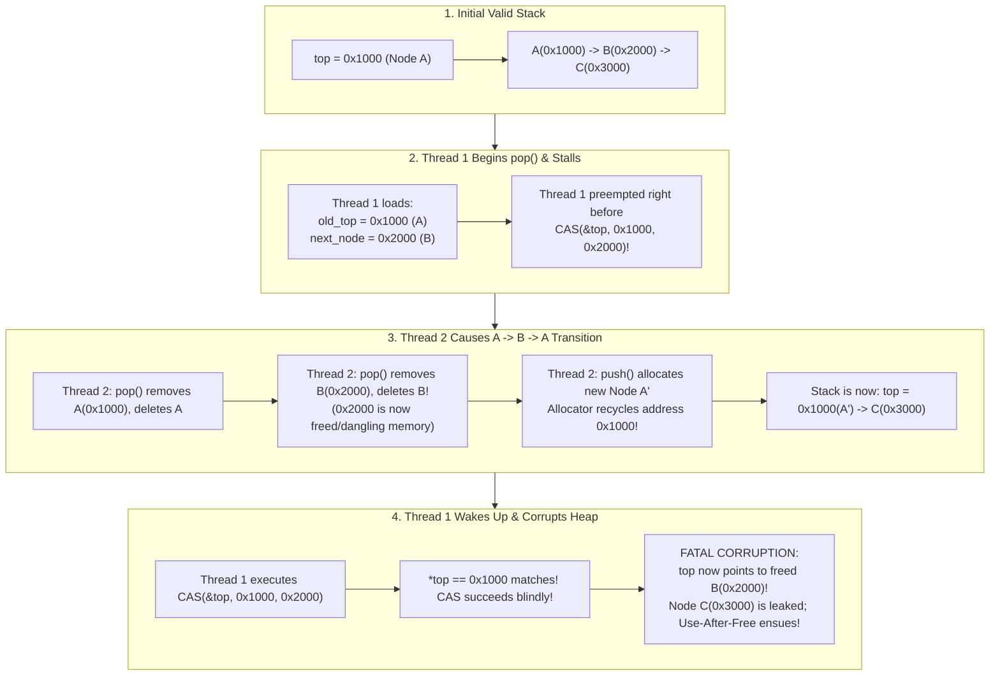
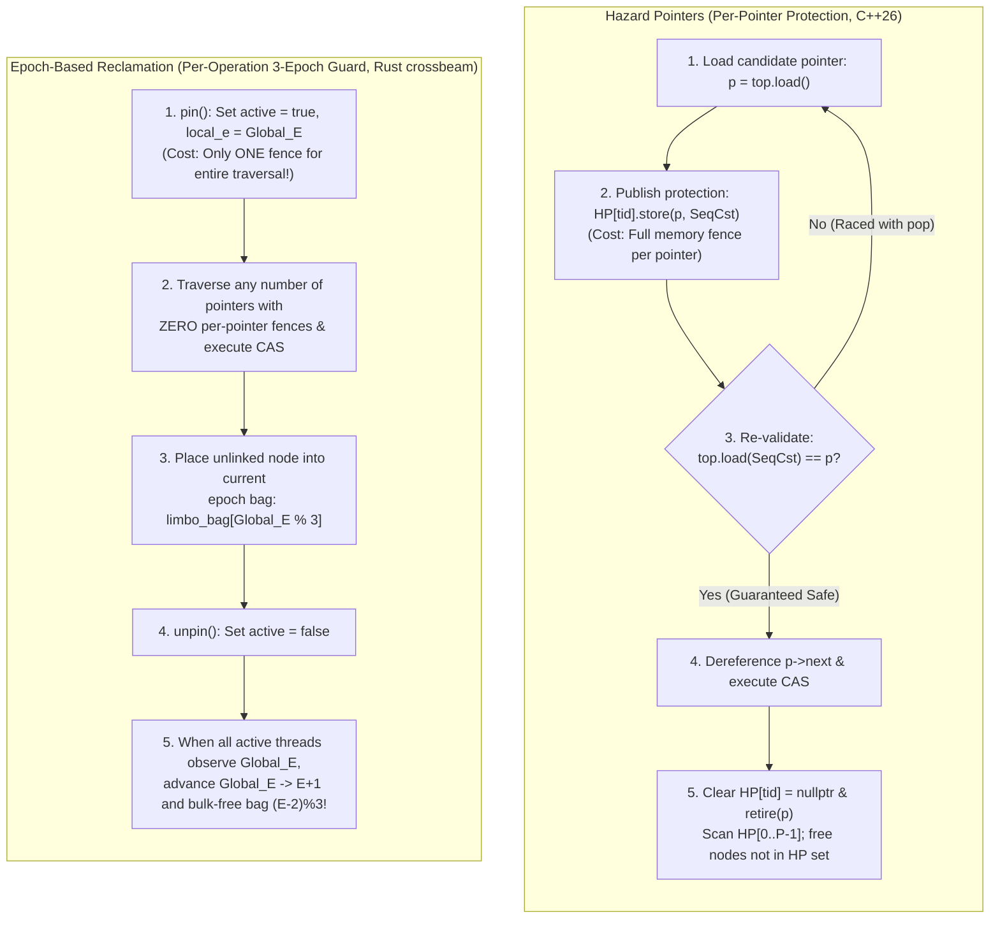

Modern server processors are massively parallel shared-memory machines: a single dual-socket server routinely houses 128 to 256 physical cores—and up to 512 hardware threads via Simultaneous Multithreading (SMT)—all contending for the same cache-coherent non-uniform memory architecture (ccNUMA) address space. When engineering systems at the extreme boundaries of throughput and latency—such as operating system kernel schedulers, high-frequency trading (HFT) limit order books, real-time audio digital signal processing (DSP) callbacks, or lock-free work-stealing runtimes—the very first synchronization primitive taught in undergraduate computer science, the <strong>Mutual Exclusion Lock (`mutex`)</strong>, transforms from a safety mechanism into a catastrophic architectural bottleneck.

Consider what happens when 128 hardware threads concurrently push and pop tasks from a shared queue protected by a `pthread_mutex_t` or `std::mutex`. Updating the queue's head pointer requires barely three machine instructions—perhaps 15 nanoseconds of execution. Yet if the single thread currently holding that mutex is preempted by the operating system scheduler because its time slice expired, or stalls on a minor page fault or last-level cache miss, those 15 nanoseconds instantly balloon into several milliseconds. During that entire window, <strong>all 127 remaining CPU cores grind to a halt</strong>, either burning cycles in futile spin loops or queuing up inside the kernel via `SYS_futex` system calls, waiting for a sleeping thread that isn't even scheduled on a CPU.

To sever this fatal coupling—where the delay or failure of a single thread holds the forward progress of the entire system hostage—computer scientists developed the theory and practice of <strong>Non-Blocking Synchronization</strong>: <strong>Lock-Free</strong> and <strong>Wait-Free</strong> algorithms.

However, the moment we discard mutual exclusion locks and attempt to manipulate dynamic linked data structures directly using hardware atomic instructions like `Compare-And-Swap` (`CAS`), we walk straight into one of the subtlest, most notorious traps in computer science: the <strong>ABA Problem</strong>, intertwined with the <strong>Safe Memory Reclamation (SMR)</strong> problem in non-garbage-collected systems languages like C, C++, and Rust.

In this comprehensive treatise, we examine the structural failure modes of mutual exclusion, formalize correctness via <strong>Linearizability</strong> and the three non-blocking progress guarantees, prove <strong>Maurice Herlihy's 1991 Consensus Hierarchy Theorem</strong> from first principles, trace the exact pointer-by-pointer heap corruption of the <strong>ABA Problem</strong> in R. Kent Treiber's lock-free stack, and dissect the four great architectural solutions: <strong>Double-Width Tagged Pointers (`DWCAS`)</strong>, <strong>Hazard Pointers (C++26)</strong>, <strong>Epoch-Based Reclamation (EBR / Rust `crossbeam`)</strong>, and <strong>Read-Copy-Update (RCU)</strong>.

---

## Chapter 1: Why Mutual Exclusion (`mutex`) Fails in Ultra-Low-Latency Systems

In textbook concurrent programming, shared state invariants are preserved by enclosing critical sections within a mutex acquire/release pair. While modern OS mutex implementations such as Linux's `futex` (Fast Userspace Mutex) optimize the uncontended fast path down to a single user-space atomic instruction, the fundamental paradigm of mutual exclusion remains <strong>blocking</strong>: to preserve safety, all concurrent actors except one must be serialized and delayed.

In general-purpose application software, occasional microsecond stalls are imperceptible. In systems programming, kernel engineering, and hard real-time environments, blocking synchronization introduces four fatal pathologies.

### 1.1 Preemption inside Critical Sections and Lock Convoying

Suppose Thread $T_1$ acquires a mutex protecting a shared memory allocator bin or work queue. Inside the critical section, $T_1$ needs only to swap two pointers. However, right after acquiring the lock, one of two hardware events occurs:

1. <strong>Preemption by Hardware Timer or Interrupt</strong>: The local APIC timer fires, or a network interface card (NIC) raises a hardware interrupt. The OS kernel preempts $T_1$ and schedules another process on that core for a 4-millisecond scheduling quantum.
2. <strong>Page Fault or Cache Hierarchy Stall</strong>: $T_1$ dereferences a pointer whose virtual memory page is not currently present in the Translation Lookaside Buffer (TLB) or requires a page table walk/minor fault handled by the kernel.

While $T_1$ is descheduled, Threads $T_2, T_3, \dots, T_{128}$ arrive at the critical section. Because $T_1$ holds the lock, every single one of those 127 threads is forced to block. Worse still, even after $T_1$ eventually wakes up and releases the mutex, a massive queue of sleeping threads has accumulated in the kernel wait queue. Waking them up one by one—incurring context switches, TLB flushes, and cache line bouncing (`Modified` $\leftrightarrow$ `Invalid` across NUMA interconnects) as each thread acquires and releases the lock in sequence—creates a standing wave of serialization known as a <strong>Lock Convoy</strong>. A single microsecond perturbation cascades into tens of milliseconds of degraded throughput across the entire machine.

### 1.2 Unbounded Priority Inversion: The 1997 Mars Pathfinder Lesson

In real-time systems with prioritized threads, blocking locks break scheduling guarantees via <strong>Priority Inversion</strong>. The most famous real-world manifestation occurred in July 1997 aboard NASA's <strong>Mars Pathfinder</strong> spacecraft. Shortly after landing on Mars, the spacecraft began experiencing repeated, catastrophic system resets triggered by its hardware watchdog timer.

Engineers at JPL traced the failure to three threads running on the VxWorks real-time operating system sharing an information bus protected by a mutex:

1. A <strong>low-priority meteorological task ($T_{\text{low}}$)</strong> acquired the bus mutex to publish atmospheric data.
2. A <strong>high-priority bus management task ($T_{\text{high}}$)</strong>—which ran on a strict real-time deadline—woke up, preempted $T_{\text{low}}$, and attempted to acquire the same bus mutex. Because $T_{\text{low}}$ held the lock, $T_{\text{high}}$ was forced to block and wait for $T_{\text{low}}$ to finish.
3. Before $T_{\text{low}}$ could finish its critical section, several <strong>medium-priority communications tasks ($T_{\text{med}}$)</strong> became runnable. These medium-priority tasks did not need the bus mutex at all! Because $T_{\text{med}}$ had higher priority than $T_{\text{low}}$, the scheduler let $T_{\text{med}}$ preempt $T_{\text{low}}$ and run for an extended period.
4. Consequently, the medium-priority task $T_{\text{med}}$ indirectly starved the highest-priority task $T_{\text{high}}$, causing $T_{\text{high}}$ to miss its hard deadline and tripping the system watchdog reset.

While Priority Inheritance Protocols (PIP)—where $T_{\text{low}}$ temporarily inherits $T_{\text{high}}$'s priority—mitigate single-lock inversion, they add significant kernel complexity and cannot prevent worst-case blocking latencies across deep lock dependency chains.

### 1.3 Deadlock, Lack of Composability, and Contexts Where Blocking Is Strictly Illegal

Furthermore, lock-based abstractions violate software modularity because <strong>locks do not compose</strong>. If `HashTable A` and `HashTable B` are each internally thread-safe via private mutexes, implementing an atomic `transfer(key, A, B)` operation requires acquiring both locks simultaneously. If one thread calls `transfer(k1, A, B)` while another calls `transfer(k2, B, A)`, a classic AB-BA <strong>Deadlock</strong> freezes both threads permanently unless a global lock-ordering hierarchy is enforced across the entire codebase.

Most decisively, there are critical execution contexts in systems programming where acquiring a blocking mutex is <strong>strictly forbidden by architecture</strong>:

- <strong>POSIX Asynchronous Signal Handlers (`SIGINT`, `SIGSEGV`, `SIGPROF`)</strong>: A signal can interrupt a thread at *any* machine instruction. If a thread is interrupted while holding an internal lock inside `malloc()` or `printf()`, and the signal handler attempts to acquire that same lock, the thread enters an unrecoverable <strong>Self-Deadlock</strong>—sleeping forever waiting for itself to release a lock. Thus, POSIX mandates that signal handlers may only invoke *Async-Signal-Safe* functions (or use lock-free atomics).
- <strong>OS Kernel Top-Half Interrupt Service Routines (ISRs)</strong>: Hardware interrupt handlers execute asynchronously without a backing process context; calling a sleeping mutex inside an ISR panics the kernel (`BUG: scheduling while atomic`).
- <strong>Real-Time Audio DSP Callbacks (`CoreAudio`, `ASIO`, `JACK`)</strong>: At a $48\,\text{kHz}$ sample rate with a 64-sample buffer, the audio rendering callback (`processBlock`) has a hard deadline of $1.33\,\text{ms}$. Invoking `pthread_mutex_lock` inside the audio thread risks triggering a `futex` kernel sleep if the UI thread holds the lock, causing immediate audio buffer underruns (audible clicks and pops).

To survive in these environments, we must eliminate blocking altogether.

---

## Chapter 2: Linearizability and the Three Non-Blocking Progress Guarantees

When multiple threads read and mutate a shared data structure simultaneously without locks, their execution intervals overlap in time. Before designing lock-free algorithms, we must rigorously define two orthogonal properties: <strong>Safety</strong> ("What does it mean for a concurrent data structure to behave correctly?") and <strong>Liveness</strong> ("What guarantees do we have that operations eventually finish?").

### 2.1 The Gold Standard of Correctness: Linearizability (Herlihy & Wing, 1990)

In a sequential program, a stack's behavior is defined by a simple state machine: `pop()` returns the most recently pushed item (LIFO). In a concurrent execution, however, each method call $op_i$ is not a point in time, but an interval $[t_{\text{inv}}(op_i), t_{\text{resp}}(op_i)]$ spanning from the moment the thread invokes the method to the moment the method returns a response.

In their seminal 1990 paper, Maurice Herlihy and Jeannette Wing formulated <strong>Linearizability</strong>, the universal correctness criterion for concurrent objects:

> <strong>Definition (Linearizability)</strong>:
> A concurrent history $H$ of overlapping operation intervals is <strong>linearizable</strong> if every operation $op_i$ can be assigned a single instantaneous point in time—called its <strong>Linearization Point</strong> $t_{\text{lin}}(op_i) \in [t_{\text{inv}}(op_i), t_{\text{resp}}(op_i)]$—such that when all operations are ordered strictly by their linearization points $t_{\text{lin}}$, the resulting sequence forms a valid sequential execution of the object's specification.

In practical terms, even though a lock-free `push()` or `pop()` executes dozens of instructions and potentially multiple retry iterations, there must exist <strong>one specific atomic machine instruction</strong> (typically the successful `Compare-And-Swap` or atomic load) within the method's execution window where the operation takes effect atomically and instantaneously for all observers.

Crucially, unlike database *Serializability*, Linearizability is a <strong>local (composable) property</strong>: if concurrent object $X$ is linearizable and concurrent object $Y$ is linearizable, then the combined system $(X, Y)$ is automatically linearizable without any additional global coordination!

### 2.2 The Three Non-Blocking Progress Guarantees

While Linearizability defines correctness, non-blocking algorithms are classified into a strict three-tier hierarchy based on the strength of their forward-progress guarantee when threads contend or fail:

#### 1. Obstruction-Free (Solo Progress — Herlihy, Luchangco, Moir 2003)
> <strong>Definition</strong>: A concurrent operation is <strong>obstruction-free</strong> if, from any point after a thread invokes the operation, that thread is guaranteed to complete its operation in a finite number of its own steps <strong>provided it eventually executes in isolation</strong> (i.e., without interference from other concurrent threads).

Obstruction-freedom is the weakest non-blocking guarantee. Because no locks are used, a preempted thread can never block other threads. However, if two threads execute concurrently, they may continually invalidate each other's tentative updates in an infinite <strong>livelock</strong>. Practical obstruction-free designs rely on an external *Contention Manager* (using exponential backoff or random delays) to quiet competing threads when contention is detected.

#### 2. Lock-Free (System-Wide Progress)
> <strong>Definition</strong>: A concurrent object is <strong>lock-free</strong> if, whenever one or more threads invoke operations on the object, <strong>at least one thread among them is guaranteed to complete its operation in a finite number of steps</strong>, regardless of the execution speeds, arbitrary scheduling delays, or permanent crash-stop failures of any other threads.

Lock-freedom is the workhorse of practical non-blocking systems programming. Notice the subtle brilliance of its guarantee: an individual thread $T_1$ executing a `CAS` retry loop might theoretically experience retry failures if Threads $T_2, T_3, \dots$ keep modifying the data structure ahead of it. However, <strong>the only reason $T_1$'s `CAS` can fail is because another thread's `CAS` succeeded and completed a useful operation!</strong>
Thus, while an individual thread can theoretically suffer starvation under adversarial scheduling, <strong>the system as a whole is mathematically guaranteed to make continuous forward progress</strong>. Deadlock, priority inversion, and lock convoying are completely impossible.

#### 3. Wait-Free (Per-Thread Bounded Progress — Herlihy 1991)
> <strong>Definition</strong>: A concurrent object is <strong>wait-free</strong> if <strong>every single thread</strong> invoking an operation is guaranteed to complete its operation in a finite, bounded number of its own steps, regardless of the actions, speeds, or failures of all other threads.

Wait-freedom is the strongest possible progress guarantee: it combines system-wide non-blocking progress with <strong>strict starvation-freedom</strong> for every individual thread. Every operation has a deterministic worst-case instruction bound (e.g., $O(1)$ or $O(P)$ where $P$ is the number of threads), making wait-free algorithms suitable for hard real-time avionics, medical devices, and audio DSP.

How is it possible for Thread $T_1$ to complete an update in bounded steps even while 127 faster threads are relentlessly modifying the same pointer? The universal design pattern behind wait-free algorithms is the <strong>Helping Mechanism</strong>:
Before attempting its operation, slow thread $T_1$ publishes an *Operation Descriptor* into a globally visible announcement array `announce[1]`. Fast threads, as part of their own execution protocol, check `announce[j]` in round-robin order and <strong>collaboratively execute and complete $T_1$'s pending operation on $T_1$'s behalf</strong> before finishing their own work! Thus, if $T_1$'s direct `CAS` fails repeatedly due to contention from fast threads, those very fast threads are guaranteed to have already completed $T_1$'s operation for it within $O(P)$ steps.

| Progress Guarantee | Blocking? | System-Wide Progress Guaranteed? | Per-Thread Starvation Freedom? | Safe in Signal Handlers / ISRs / Audio RT? | Worst-Case Step Complexity | Canonical Examples |
| :--- | :--- | :--- | :--- | :--- | :--- | :--- |
| <strong>Blocking (`mutex` / `spinlock`)</strong> | Yes | No (halted if lock holder stalls) | No (Deadlock & Priority Inversion possible) | <strong>Unsafe / Forbidden</strong> | $\infty$ (Unbounded OS sleep) | `std::mutex`, `pthread_mutex_t` |
| <strong>Obstruction-Free</strong> | Non-Blocking | Only when running solo (Livelock possible) | No (Requires contention manager backoff) | Safe (with bounded retry) | $\infty$ under contention | Software Transactional Memory (DSTM) |
| <strong>Lock-Free</strong> | Non-Blocking | <strong>Yes (At least one thread finishes)</strong> | No (Individual retries under contention) | <strong>Safe</strong> | Expected $O(1)$, unbounded worst-case per thread | Treiber Stack, Michael-Scott Queue, Harris Linked List |
| <strong>Wait-Free</strong> | Non-Blocking | <strong>Yes (Every active thread finishes)</strong> | <strong>Yes (Zero starvation)</strong> | <strong>Strictly Safe (Hard Real-Time)</strong> | <strong>Bounded $O(1)$ or $O(P)$</strong> | Kogan-Petrank Queue, SPSC Ring Buffer, RCU Readers |

---

## Chapter 3: Hardware Atomic Instructions and Maurice Herlihy's Consensus Hierarchy (1991)

Suppose we want to build a lock-free stack or queue shared by $N$ threads. What hardware atomic instructions must our CPU architecture provide?
A natural question arises: *"If the CPU provides sequentially consistent atomic `load` and `store` registers (`std::atomic<T>`), can't a sufficiently clever programmer build a lock-free queue or stack using only atomic reads and writes, similar to Peterson's or Lamport's Bakery algorithm?"*

In 1991, Maurice Herlihy published his landmark paper *"Wait-Free Synchronization"* (which won both the Gödel Prize and the Dijkstra Prize), proving a breathtaking result: <strong>No. It is mathematically impossible.</strong> Not only are atomic read/write registers insufficient, even hardware read-modify-write instructions like `Test-and-Set` (`TAS`), `Swap` (`XCHG`), and `Fetch-and-Add` (`LOCK XADD`) are provably incapable of building general lock-free data structures for $N \ge 3$ threads!

### 3.1 The Consensus Problem and Consensus Numbers $C(\mathcal{O})$

To measure the exact synchronization power of any hardware primitive or data structure $\mathcal{O}$, Herlihy reduced concurrent synchronization to the fundamental <strong>Consensus Problem</strong>:
Suppose $N$ threads $T_1, T_2, \dots, T_N$ each start with a private input proposal $v_i \in V$, communicate via shared objects, and each thread eventually outputs a decision value $d_i$ and halts. A wait-free consensus protocol must satisfy three properties:

1. <strong>Agreement</strong>: All threads that decide must output the exact same value ($\forall i, j: d_i = d_j = v^*$).
2. <strong>Validity</strong>: The common decision value $v^*$ must have been proposed by at least one participating thread ($v^* \in \{v_1, \dots, v_N\}$).
3. <strong>Wait-Free Termination</strong>: Every non-faulty thread must decide in a finite number of its own steps, regardless of whether other threads stall or crash.

> <strong>Definition (Consensus Number $C(\mathcal{O})$)</strong>:
> The <strong>Consensus Number</strong> $C(\mathcal{O})$ of a concurrent object type $\mathcal{O}$ is the maximum number of threads $N$ for which wait-free consensus can be solved using any number of instances of $\mathcal{O}$ combined with any number of atomic read/write registers (or $\infty$ if it can solve consensus for any $N$).

Herlihy proved the fundamental hierarchy theorem of concurrent computing:

> <strong>Theorem (Herlihy's Wait-Free Hierarchy & Universality, 1991)</strong>:
> 1. <strong>Impossibility Downward</strong>: If type $\mathcal{X}$ has consensus number $C(\mathcal{X}) = m$ and type $\mathcal{Y}$ has consensus number $C(\mathcal{Y}) = n > m$, then <strong>it is impossible to construct a wait-free (or lock-free) implementation of $\mathcal{Y}$ for $n$ threads using any combination of $\mathcal{X}$ and atomic read/write registers</strong>.
> 2. <strong>Universality at $C = \infty$</strong>: A primitive $\mathcal{U}$ is <strong>Universal</strong> for $N$ threads—capable of implementing *any* sequential object wait-free or lock-free for $N$ threads—if and only if $C(\mathcal{U}) \ge N$.

| Consensus Number $C(\mathcal{O})$ | Hardware Instructions & Concurrent Objects | Mathematical Capability & Impossibility Boundary |
| :--- | :--- | :--- |
| <strong>$C = 1$</strong> | Atomic Read/Write Registers (`MOV` + `MFENCE`), Atomic Snapshots | <strong>Cannot solve consensus even for $N = 2$ threads!</strong> Can implement Single-Producer Single-Consumer (SPSC) wait-free ring buffers, but cannot implement multi-producer stacks, queues, or locks without blocking. |
| <strong>$C = 2$</strong> | `Test-and-Set` (`TAS`), `Fetch-and-Add` (`LOCK XADD`), `Swap` (`XCHG`), FIFO Queues, LIFO Stacks | <strong>Solves consensus for at most $N = 2$ threads.</strong> Provably <strong>impossible</strong> to construct a general lock-free queue, stack, or consensus object for $N \ge 3$ threads using only `FAA`, `Swap`, and `TAS`! |
| <strong>$C = 2m - 2$</strong> | $m$-Register Atomic Assignment ($m \ge 2$) | Solves consensus for up to $2m - 2$ threads. |
| <strong>$C = \infty$ (Universal)</strong> | <strong>`Compare-And-Swap` (`CAS` / `CMPXCHG`)</strong>, <strong>`Load-Linked / Store-Conditional` (`LL/SC`)</strong>, Memory-to-Memory `Swap` | <strong>Universal across all $N \to \infty$ threads.</strong> Solves $N$-thread consensus in $O(1)$ steps and can implement *any* concurrent data structure lock-free or wait-free. |

### 3.2 Proof: Why Atomic Read/Write Registers Have Consensus Number $C = 1$

Why can't two threads $A$ (proposing $0$) and $B$ (proposing $1$) reach wait-free agreement using only atomic reads and writes? The proof, adapted from Fischer-Lynch-Paterson (FLP 1985) and Loui & Abu-Amara (1987), uses a brilliant <strong>Bivalence / Indistinguishability Argument</strong>.

Suppose for the sake of contradiction that a 2-thread wait-free consensus protocol exists using only atomic read/write registers.

1. Define a system <strong>Configuration $S$</strong> as the complete state of all shared registers plus the local states and program counters of Threads $A$ and $B$.
   - $S$ is <strong>0-valent</strong> if every possible future execution schedule starting from $S$ forces the threads to decide $0$.
   - $S$ is <strong>1-valent</strong> if every possible future execution schedule starting from $S$ forces the threads to decide $1$.
   - $S$ is <strong>bivalent</strong> if both a $0$-decision and a $1$-decision are still reachable depending on how the scheduler interleaves $A$ and $B$.
2. <strong>The initial configuration $S_{\text{init}}$ is bivalent</strong>: If Thread $A$ runs completely solo from $S_{\text{init}}$ without $B$ taking a single step, Validity forces $A$ to decide $0$ (its own proposal). Conversely, if $B$ runs solo from $S_{\text{init}}$, Validity forces $B$ to decide $1$. Since both outcomes are reachable from $S_{\text{init}}$, $S_{\text{init}}$ is bivalent.
3. Because the protocol terminates in finite steps, if an adversary scheduler keeps the system in bivalent states as long as possible, it must eventually reach a <strong>Critical Bivalent Configuration $S_{\text{crit}}$</strong> where every single next step resolves the bivalence: specifically, letting Thread $A$ take its next step $e_A$ leads to a <strong>0-valent</strong> state $S_0 = e_A(S_{\text{crit}})$, whereas letting Thread $B$ take its next step $e_B$ leads to a <strong>1-valent</strong> state $S_1 = e_B(S_{\text{crit}})$.
4. Now examine the two pending atomic steps $e_A$ and $e_B$ out of $S_{\text{crit}}$. Since only atomic read/write registers exist, there are only three exhaustive cases:
   - <strong>Case 1: $e_A$ and $e_B$ access two different registers $R_1 \neq R_2$, or both are Read operations.</strong>
     Then $e_A$ and $e_B$ commute! Executing $e_A$ followed by $e_B$ yields the exact same global configuration as executing $e_B$ followed by $e_A$: $e_B(e_A(S_{\text{crit}})) = e_A(e_B(S_{\text{crit}}))$. Yet $e_B(S_0)$ must be 0-valent (since $S_0$ is 0-valent), while $e_A(S_1)$ must be 1-valent (since $S_1$ is 1-valent). A single state cannot be both 0-valent and 1-valent—<strong>Contradiction!</strong>
   - <strong>Case 2: One step is a Read of register $R$ (say $e_A$) and the other is a Write to the same register $R$ ($e_B$).</strong>
     Consider the state $S' = e_B(e_A(S_{\text{crit}}))$ reached by letting $A$ read $R$ (entering 0-valent $S_0$) and immediately letting $B$ write to $R$. Since $S'$ descends from 0-valent $S_0$, $S'$ is <strong>0-valent</strong>.
     However, $e_A$ was merely a Read—it changed only $A$'s private internal register and modified nothing in shared memory! Therefore, <strong>from Thread $B$'s perspective, the 0-valent state $S' = e_B(e_A(S_{\text{crit}}))$ and the 1-valent state $S_1 = e_B(S_{\text{crit}})$ are 100% indistinguishable</strong> (every shared register in RAM and every local variable in $B$ is identical). If we now pause $A$ and let $B$ run solo to completion from $S'$, $B$ must output the exact same decision ($1$) as it does from $S_1$, contradicting that $S'$ is 0-valent!
   - <strong>Case 3: Both $e_A$ and $e_B$ are Writes to the exact same register $R$.</strong>
     Consider the 0-valent state $S'' = e_B(e_A(S_{\text{crit}}))$ where $A$ writes to $R$ first, and $B$ immediately writes to $R$ second. Because $B$'s write to $R$ <strong>completely overwrites and obliterates $A$'s write to $R$</strong>, every shared register in $S''$ is identical to the 1-valent state $S_1 = e_B(S_{\text{crit}})$ where $A$ never wrote at all! Letting $B$ run solo to completion from $S''$ forces $B$ to decide $1$, contradicting that $S''$ is 0-valent! $\blacksquare$

This proof reveals *why* simple reads and writes fail: an uncoordinated write blindly obliterates history.

### 3.3 Why `Fetch-and-Add` and `Swap` Hit a Wall at $C = 2$

Instructions like `Fetch-and-Add` (`FAA`), `Swap` (`XCHG`), and `Test-and-Set` (`TAS`) solve 2-thread consensus effortlessly: if Threads $A$ and $B$ both execute `FAA(&counter, 1)` on a register initialized to $0$, the winner receives old value $0$ and the loser receives old value $1$.

Why do they fail for $N = 3$ threads ($A, B, C$)?
Suppose at the critical bivalent state $S_{\text{crit}}$, Threads $A$ and $B$ are both about to execute `FAA(&R, 1)` (or `Swap(&R, val)`).
- In `FAA`: If $A$ executes first and $B$ executes second, the register's value becomes $r + 1 + 1 = r + 2$. If $B$ executes first and $A$ executes second, the register's value *also* becomes $r + 2$! If both $A$ and $B$ now stall (get preempted), the third thread $C$ running solo inspects register $R$, sees $r + 2$, and <strong>cannot distinguish whether $A$ went first (0-valent) or $B$ went first (1-valent)!</strong>
- In `Swap`: Only the *first* thread sees the initial sentinel value, while the *second* thread overwrites the register with its own token. If $C$ arrives third and swaps, $C$ sees only who went *second*, not who went *first*!

### 3.4 Universal Primitives ($C = \infty$): `Compare-And-Swap` (`CAS`) and `LL/SC`

Both `Compare-And-Swap` (`CAS`) and `Load-Linked / Store-Conditional` (`LL/SC`) shatter the $C = 2$ barrier and achieve $C = \infty$ because they are <strong>non-oblivious conditional primitives</strong>: only the very first thread modifies the state, while all subsequent threads fail cleanly *without overwriting the winner's state*.

```cpp
// Solving N-thread Wait-Free Consensus in O(1) steps using CAS (C = infinity)
std::atomic<int> decision{-1}; // -1 represents UNDECIDED

int decide(int my_proposal) {
    int expected = -1;
    // Exactly ONE thread among N will succeed in changing -1 to its proposal.
    // All other N-1 threads will fail CAS, leaving 'expected' updated to the winner's value!
    if (decision.compare_exchange_strong(expected, my_proposal, std::memory_order_seq_cst)) {
        return my_proposal; // I won!
    }
    return expected; // Another thread won; 'expected' now holds the winning decision!
}
```

| Architectural Aspect | `Compare-And-Swap` (`CAS` / x86 `LOCK CMPXCHG`) | `Load-Linked / Store-Conditional` (`LL/SC` / ARM `LDXR`/`STXR`, RISC-V `LR`/`SC`) |
| :--- | :--- | :--- |
| <strong>Instruction Structure</strong> | Single monolithic Read-Modify-Write instruction (`CMPXCHG`). | Split pair of instructions: `LL` establishes reservation, `SC` conditionally commits. |
| <strong>Success Condition</strong> | <strong>Value Equality</strong>: Succeeds iff `*addr == expected` at execution time. | <strong>Event Absence</strong>: Succeeds iff no coherent store or eviction invalidated the reservation granule since `LL`. |
| <strong>Hardware Mechanism</strong> | Locks cache line in `Modified`/`Exclusive` MESI state for the RMW cycle. | Monitors cache line via local core Link Register / Reservation Granule snooping on MESI invalidations. |
| <strong>Susceptibility to Value ABA</strong> | <strong>Vulnerable</strong>: If `*addr` changes $A \to B \to A$, `CAS` blindly succeeds. | <strong>Immune at the hardware word</strong>: Writing $B$ and $A$ sends cache invalidations, breaking the `LL` reservation! |
| <strong>Spurious Failures</strong> | None (`compare_exchange_strong` never fails if `*addr == expected`). | Yes (context switches, cache line evictions, or false sharing on the same cache line abort `SC`). |

---

## Chapter 4: Treiber's Lock-Free Stack (1986), Michael-Scott Queue (1996), and the Anatomy of the ABA Problem

Equipped with `CAS`, let us examine the foundational lock-free data structure: <strong>R. Kent Treiber's 1986 Lock-Free Stack</strong> (originally written in IBM System/370 assembly).

### 4.1 Implementing Treiber's Stack in C++ (and Its Hidden Fatal Flaw)

```cpp
#include <atomic>

template <typename T>
class NaiveTreiberStack {
public:
    struct Node {
        T value;
        Node* next;
        explicit Node(const T& v) : value(v), next(nullptr) {}
    };

private:
    std::atomic<Node*> top{nullptr};

public:
    // Lock-Free Push: Linearization point is the successful compare_exchange_weak
    void push(const T& val) {
        Node* new_node = new Node(val);
        Node* old_top = top.load(std::memory_order_relaxed);
        do {
            new_node->next = old_top;
        } while (!top.compare_exchange_weak(
            old_top, new_node,
            std::memory_order_release,
            std::memory_order_relaxed));
    }

    // Lock-Free Pop: WARNING — Vulnerable to the ABA Problem & Use-After-Free!
    bool pop(T& out) {
        Node* old_top = top.load(std::memory_order_acquire);
        while (old_top != nullptr) {
            Node* next_node = old_top->next; // <-- Danger Point 1: Dereferencing old_top
            if (top.compare_exchange_weak(   // <-- Danger Point 2: Value-based CAS on old_top
                    old_top, next_node,
                    std::memory_order_acquire,
                    std::memory_order_relaxed)) {
                out = old_top->value;
                delete old_top;              // <-- Reclaiming old_top back to the heap allocator!
                return true;
            }
        }
        return false;
    }
};
```

*(Note on Lock-Free FIFO Queues: In 1996, Maged Michael and Michael Scott extended this technique to FIFO queues with the <strong>Michael-Scott Lock-Free Queue</strong>. Because a queue mutates both `head` and `tail`, `enqueue` uses a dummy sentinel node and two separate `CAS` steps: first linking `tail->next` from `nullptr` to the new node, and second advancing `tail` itself. If a thread is preempted between those two `CAS` steps, any arriving thread detects that `tail->next != nullptr` and cooperatively helps advance `tail` before proceeding.)*

Now look closely at `NaiveTreiberStack::pop()` above. When Thread 1 executes `top.compare_exchange_weak(old_top, next_node)`, Thread 1 is implicitly making a critical assumption:
> *"If `top` still equals `old_top`, then the stack has not changed since I read `old_top`, so `old_top->next` is still `next_node`."*

In a language without immediate memory reuse, that assumption holds. In C, C++, or Rust—where `delete` or `free()` returns memory to a thread-caching slab allocator (`jemalloc`, `tcmalloc`, `mimalloc`, or `ptmalloc`) that immediately recycles hot L1-cached addresses in LIFO order—that assumption fails catastrophically.

### 4.2 Step-by-Step Trace of the ABA Heap Corruption

Let us trace the exact execution timeline with concrete hexadecimal memory addresses. Suppose the stack initially holds three nodes:
$$
\text{top} \longrightarrow A(\texttt{0x1000}) \longrightarrow B(\texttt{0x2000}) \longrightarrow C(\texttt{0x3000}) \longrightarrow \texttt{nullptr}
$$

- <strong>Step 1 (Thread 1 starts `pop` and gets preempted)</strong>:
  Thread 1 reads `old_top = 0x1000` (Node $A$) and dereferences `old_top->next` to read `next_node = 0x2000` (Node $B$). Right before Thread 1 can execute the machine instruction `LOCK CMPXCHG` for `CAS(&top, 0x1000, 0x2000)`, <strong>the OS scheduler preempts Thread 1</strong>.

- <strong>Step 2 (Thread 2 pops $A$ and pops $B$, freeing both)</strong>:
  While Thread 1 sleeps, Thread 2 runs on another core:
  1. Thread 2 calls `pop()`: removes Node $A(\texttt{0x1000})$ and calls `delete A`. Stack is now $\text{top} \to B(\texttt{0x2000}) \to C(\texttt{0x3000})$.
  2. Thread 2 calls `pop()` a second time: removes Node $B(\texttt{0x2000})$ and calls <strong>`delete B`</strong>. Stack is now $\text{top} \to C(\texttt{0x3000})$.
  Crucially, memory address `0x2000` (formerly Node $B$) is now <strong>unallocated free memory</strong> (or worse, reallocated to hold an unrelated object like a `std::string` or network socket buffer!).

- <strong>Step 3 (Thread 2 pushes a new node that reuses address `0x1000`)</strong>:
  Thread 2 now calls `push(new_val)`, invoking `new Node(new_val)`. Because the memory allocator recycles recently freed chunks from its LIFO cache to maximize L1 cache locality, it allocates the brand-new node $A'$ at the <strong>exact same memory address `0x1000`</strong>!
  Thread 2 sets $A'(\texttt{0x1000})\text{->next} = C(\texttt{0x3000})$ and pushes $A'$ onto the stack.
  The valid stack is now:
  $$
  \text{top} \longrightarrow A'(\texttt{0x1000}) \longrightarrow C(\texttt{0x3000}) \longrightarrow \texttt{nullptr}
  $$

- <strong>Step 4 (Thread 1 wakes up and executes its stale `CAS`)</strong>:
  Thread 1 resumes execution with its stale CPU registers: `old_top = 0x1000`, `next_node = 0x2000`.
  Thread 1 executes `CAS(&top, 0x1000, 0x2000)`.
  The hardware compares current `top` (`0x1000`, pointing to $A'$) against `old_top` (`0x1000`, formerly $A$). Because the 64-bit addresses are bitwise identical (`0x1000 == 0x1000`), <strong>`CAS` succeeds blindly!</strong>

- <strong>Step 5 (Total Heap Corruption)</strong>:
  `top` is overwritten with `0x2000`—the dangling pointer to the freed Node $B$! Node $C(\texttt{0x3000})$ is leaked forever, and the very next thread that accesses the stack dereferences freed memory at `0x2000`, triggering silent memory corruption or an immediate segmentation fault (`SIGSEGV`).



### 4.3 The Twin Problem: Use-After-Free Before `CAS` (`old_top->next`)

Even before reaching the `CAS` instruction, look at Danger Point 1 in `pop()`:
```cpp
Node* old_top = top.load(std::memory_order_acquire);
// What if Thread 1 is preempted right here, and Thread 2 pops & frees old_top?
Node* next_node = old_top->next; // <-- Immediate Use-After-Free (SIGSEGV)!
```
If Thread 2 pops `old_top` and the allocator unmaps its physical page (`munmap`) before Thread 1 executes `old_top->next`, Thread 1 crashes on the load instruction itself! Furthermore, this explains why hardware `LL/SC` alone cannot save `pop()` in C/C++/Rust: you cannot dereference `old_top->next` safely without first guaranteeing that the memory pointed to by `old_top` cannot be reclaimed while you are reading it.

Thus, every lock-free data structure in an unmanaged language must solve <strong>Safe Memory Reclamation (SMR)</strong> alongside ABA prevention.

---

## Chapter 5: The Four Architectural Solutions to ABA and Safe Memory Reclamation (SMR)

### 5.1 Solution 1: Tagged Pointers & Double-Width CAS (`DWCAS` / `CMPXCHG16B`)

The most direct way to eliminate state-identity ABA is to pair every pointer with a monotonically increasing <strong>Generation Counter (`tag`)</strong>: `(Node* ptr, uint64_t tag)`. Every time a `CAS` modifies the pointer, it increments `tag` by $1$:

$$
(\texttt{0x1000}, \text{tag}=10) \xrightarrow{\text{pop } A} (\texttt{0x2000}, \text{tag}=11) \xrightarrow{\text{pop } B} (\texttt{0x3000}, \text{tag}=12) \xrightarrow{\text{push } A'} (\texttt{0x1000}, \text{tag}=13)
$$

When Thread 1 wakes up and attempts `DWCAS(&top, (0x1000, 10), (0x2000, 11))`, the hardware sees that `top.tag` is now `13 != 10` and rejects the `CAS` immediately!

On x86-64, this is supported natively via the 128-bit <strong>`LOCK CMPXCHG16B`</strong> instruction (and `CASP` on ARM64), which atomically compares and swaps a 16-byte aligned struct containing a 64-bit pointer and a 64-bit counter:

```cpp
// 128-bit Tagged Pointer utilizing x86-64 LOCK CMPXCHG16B
struct alignas(16) TaggedPointer {
    Node* ptr;
    uint64_t tag; // 64-bit counter: takes 58.5 years to wrap around at 10 billion ops/sec!
    bool operator==(const TaggedPointer& o) const noexcept {
        return ptr == o.ptr && tag == o.tag;
    }
};
```

*(Alternatively, on 64-bit architectures using 48-bit canonical virtual addresses, a 16-bit tag can be packed into the upper unused 16 bits of a single `uint64_t` pointer, though a 16-bit tag wraps around after $2^{16} = 65,536$ operations.)*

<strong>Crucial Caveat of Tagged Pointers</strong>: Because Thread 1 still executes `old_top.ptr->next` *before* the `DWCAS`, nodes cannot be returned to `free()` or `munmap()`. Instead, `DWCAS` must be paired with a <strong>Type-Stable Freelist Pool</strong> (where freed `Node` objects remain mapped as valid `Node` structs in a lock-free object pool, ensuring `old_top.ptr->next` never triggers a page fault).

---

### 5.2 Solution 2: Hazard Pointers (Maged Michael 2004, Standardized in C++26 `<hazard_pointer>`)

To allow true memory reclamation (`delete` / `free`) while preventing both Use-After-Free on `old_top->next` and the ABA problem simultaneously, Maged Michael invented <strong>Hazard Pointers (2004)</strong>, now standardized in <strong>C++26 (`std::hazard_pointer`)</strong>.

The protocol establishes a formal contract between <strong>Readers</strong> (threads dereferencing shared pointers) and <strong>Reclaimers</strong> (threads deleting unlinked nodes):

1. <strong>Global Hazard Array</strong>: Each thread $i \in \{0, \dots, P-1\}$ owns dedicated single-writer, multi-reader atomic slots `HP[i]` in a global array.
2. <strong>Reader Protection & Double-Check Validation</strong>:
   - Step A: Thread $i$ loads `p = top.load(memory_order_relaxed)`.
   - Step B: Thread $i$ writes `HP[i].store(p, memory_order_seq_cst)`, announcing to all threads: *"Do not free address `p`; I am about to dereference it!"*
   - Step C (<strong>The Critical Validation Step</strong>): Thread $i$ immediately re-reads `top.load(memory_order_seq_cst)` and checks `if (top != p) retry;`.
   Why is Step C mandatory? Because another thread might have popped and retired `p` during the tiny window *between* Step A and Step B! However, if `top == p` still holds *after* `HP[i] = p` is sequentially consistent and globally visible, then no future thread that pops `p` can possibly overlook `HP[i] == p`!
3. <strong>Deferred Batch Reclamation (`retire`)</strong>:
   When a thread pops a node `u`, it does not call `delete u`. Instead, it pushes `u` into a thread-local `retired_list`. Once `retired_list.size()` reaches a threshold $R = \Omega(P)$, the thread scans all `HP[0..P-1]`, collects all currently protected addresses into a hash set $S_{\text{hazard}}$, and calls `delete` on every retired node $u \notin S_{\text{hazard}}$.

Notice how Hazard Pointers kill two birds with one stone:
- `old_top->next` can never cause a Use-After-Free because `old_top` is protected in `HP[i]` before dereferencing.
- <strong>ABA is completely impossible</strong> without needing 128-bit `DWCAS`! As long as Thread 1 holds `HP[1] == A(0x1000)`, Node $A$ can never be freed by `retire()`, so the memory allocator can *never* recycle address `0x1000` for a new node $A'$ while Thread 1 is watching it!

---

### 5.3 Solution 3: Epoch-Based Reclamation (EBR — Keir Fraser 2004, Rust `crossbeam-epoch`)

While Hazard Pointers provide strict $O(P^2)$ memory bounds, Step B requires executing a full `memory_order_seq_cst` fence (`MFENCE`) *every single time a thread traverses a pointer*. In a lock-free linked list or B-tree traversal touching 50 nodes, executing 50 `MFENCE` instructions destroys read scalability.

<strong>Epoch-Based Reclamation (EBR)</strong>, introduced by Keir Fraser (2004) and popularized by Rust's <strong>`crossbeam-epoch`</strong> crate, amortizes synchronization across time using <strong>Three Rotating Epochs ($0, 1, 2 \pmod 3$)</strong>:

1. The system maintains a global atomic counter $\text{GlobalEpoch} \in \mathbb{Z}_{\ge 0}$ and three epoch-indexed garbage bags `limbo_bag[0]`, `limbo_bag[1]`, `limbo_bag[2]`.
2. <strong>Entering a Critical Region (`pin()`)</strong>: Before touching shared pointers, a thread sets its thread-local `active = true` and copies `local_epoch = GlobalEpoch.load()` with a <strong>single memory fence for the entire operation</strong>. Inside the pinned scope, the thread can dereference hundreds of pointers at full hardware speed with zero additional fences!
3. <strong>Retiring Nodes</strong>: Any node unlinked during global epoch $E$ is appended to `limbo_bag[E % 3]`.
4. <strong>Advancing the Epoch & Bulk Reclamation</strong>: Periodically, a thread checks if every currently `active` thread has `local_epoch == GlobalEpoch`. If so, it increments $\text{GlobalEpoch}$ from $E$ to $E+1$.
   Once the global epoch reaches $E+2$, every active thread in the system is guaranteed to have started its operation in epoch $E+1$ or $E+2$. Therefore, <strong>no active thread can possibly hold a pointer to a node that was unlinked two epochs ago in epoch $E$!</strong> The entire `limbo_bag[E % 3]` is bulk-freed safely.



---

### 5.4 Solution 4: Read-Copy-Update (RCU — Paul McKenney, Linux Kernel & `liburcu`)

For read-mostly workloads (such as OS kernel routing tables, VFS directory caches `dcache`, and module lists where reads outnumber writes by $10,000:1$), <strong>Read-Copy-Update (RCU)</strong> achieves the ultimate theoretical limit: <strong>zero-overhead wait-free reads</strong>.

1. <strong>Wait-Free Readers (`rcu_read_lock()` / `rcu_dereference()`)</strong>: In a non-preemptible Linux kernel, `rcu_read_lock()` and `rcu_read_unlock()` compile to <strong>literally zero machine instructions</strong>—they simply forbid the thread from voluntarily context-switching while reading RCU-protected pointers! Even in user-space RCU (`liburcu`), reading requires zero atomic RMW instructions and zero `SeqCst` hardware fences on the fast path.
2. <strong>Copy-on-Write Updaters (`rcu_assign_pointer()`)</strong>: To modify a node, a writer allocates a copy, mutates the copy, and atomically publishes the new pointer. Concurrent readers seamlessly see either the intact old version or the complete new version.
3. <strong>Grace Period Reclamation (`synchronize_rcu()` / `call_rcu()`)</strong>: Because RCU readers are forbidden from sleeping inside an RCU read section, the moment <strong>every CPU core in the system has executed at least one context switch (a Quiescent State)</strong>, the kernel knows with mathematical certainty that every reader that could possibly have seen the old node has exited its read section! This interval is called a <strong>Grace Period</strong>; once it elapses, the old node is safely freed.

| SMR / ABA Mitigation Technique | Reader Fast-Path Overhead | Bounded Memory Under Stalled Thread? | Prevents ABA Without 128-bit `DWCAS`? | Primary Production Ecosystem |
| :--- | :--- | :--- | :--- | :--- |
| <strong>Tagged Pointers (`DWCAS` + Pool)</strong> | <strong>Minimal</strong> (Atomic load only) | Fixed pool (Cannot `munmap` back to OS) | Requires 128-bit `CMPXCHG16B` or bit-packing | Linux Kernel `SLUB` allocator, embedded freelists |
| <strong>Hazard Pointers (Michael 2004)</strong> | <strong>High</strong> (`SeqCst` fence per pointer) | <strong>Yes — Strictly bounded $O(P^2)$</strong> | <strong>Yes</strong> (Protected nodes cannot be recycled) | <strong>C++26 `<hazard_pointer>`</strong>, Meta `Folly` |
| <strong>Epoch-Based Reclamation (EBR)</strong> | <strong>Low</strong> (1 fence per `pin()` scope) | No (Stalled pinned thread delays epoch advance) | <strong>Yes</strong> (Nodes stay in limbo for 2 epochs) | <strong>Rust `crossbeam-epoch`</strong>, Bw-Tree, MassTree |
| <strong>Read-Copy-Update (RCU)</strong> | <strong>Zero</strong> (0 instructions in kernel; Wait-Free) | Bounded by Grace Period / Quiescent States | <strong>Yes</strong> (CoW + Grace Period isolation) | <strong>Linux Kernel (VFS, Networking)</strong>, `liburcu` |

---

## Conclusion: The Architectural Synthesis of Non-Blocking Concurrency

Let us synthesize the mathematical and systems engineering principles we have established:

1. <strong>The Breakdown of Mutual Exclusion</strong>: Blocking primitives (`mutex`) couple the forward progress of an entire multi-core machine to the scheduling state of a single lock holder, inviting lock convoying, unbounded priority inversion, deadlocks, and crashes inside signal handlers, interrupt routines, and real-time DSP callbacks.
2. <strong>Linearizability & Non-Blocking Progress</strong>: Linearizability guarantees that every concurrent operation takes effect atomically at a single linearization point $t_{\text{lin}} \in [t_{\text{inv}}, t_{\text{resp}}]$, while Lock-Freedom guarantees system-wide throughput and Wait-Freedom guarantees deterministic per-thread latency bounds via collaborative helping.
3. <strong>Herlihy's Consensus Hierarchy</strong>: By proving that atomic read/write registers have Consensus Number $C = 1$ and `Fetch-and-Add`/`Swap` have $C = 2$, Maurice Herlihy demonstrated mathematically why universal primitives with $C = \infty$—namely <strong>`Compare-And-Swap` (`CAS`)</strong> and <strong>`Load-Linked / Store-Conditional` (`LL/SC`)</strong>—are indispensable for general $N$-thread non-blocking data structures.
4. <strong>Conquering the ABA Problem & Safe Memory Reclamation</strong>: Because `CAS` checks value equality rather than modification history, allocator recycling causes the $A \to B \to A$ transition to corrupt the heap. Modern systems programming pairs lock-free pointer updates with <strong>128-bit Tagged Pointers (`DWCAS`)</strong>, <strong>Hazard Pointers</strong>, <strong>Epoch-Based Reclamation (EBR)</strong>, or <strong>Read-Copy-Update (RCU)</strong> to achieve both blistering parallel scalability and mathematical memory safety.
