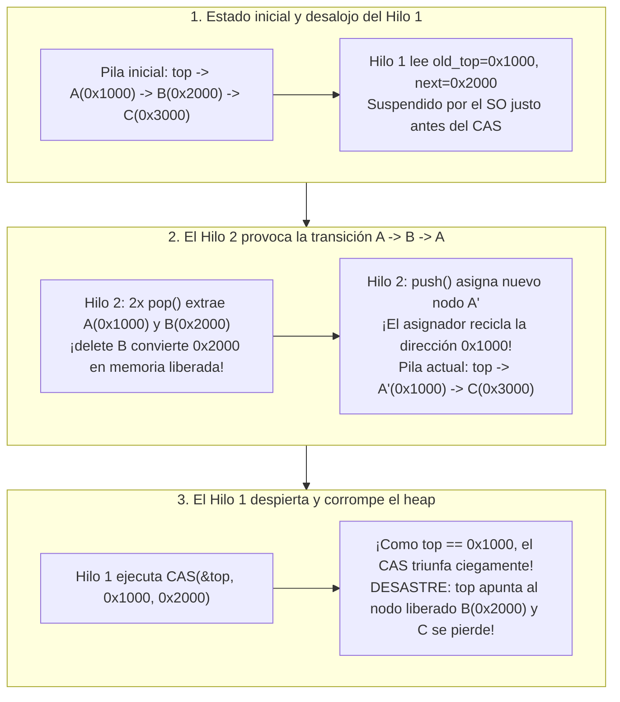

Los procesadores de servidores modernos son máquinas de memoria compartida masivamente paralelas: un servidor de doble zócalo alberga habitualmente entre 128 y 256 núcleos físicos —y hasta 512 hilos de hardware mediante multihilo simultáneo (SMT)— que compiten por el mismo espacio de direcciones con coherencia de caché (ccNUMA). Al diseñar planificadores de núcleos de sistemas operativos, motores de emparejamiento de órdenes de negociación de alta frecuencia (HFT), callbacks de procesamiento digital de señales (DSP) de audio en tiempo real o motores de bases de datos, la primitiva de sincronización más básica —el <strong>bloqueo de exclusión mutua (`mutex`)</strong>— pasa de ser un mecanismo de seguridad a convertirse en un cuello de botella catastrófico.

¿Qué ocurre cuando 128 hilos insertan y extraen tareas simultáneamente de una cola protegida por `std::mutex`? Actualizar un puntero requiere apenas 15 nanosegundos. Pero si el único hilo $T_1$ que posee el bloqueo es desalojado (Preempted) por el planificador del sistema operativo al agotarse su rodaja de tiempo, o sufre un fallo de página (Page Fault), esos 15 nanosegundos se convierten en varios milisegundos. Durante todo ese intervalo, <strong>los 127 núcleos restantes de la CPU se detienen por completo</strong> esperando a un hilo dormido.

Para romper este acoplamiento fatal surgió la ciencia de la <strong>sincronización no bloqueante (Non-Blocking Synchronization)</strong>: los algoritmos <strong>Lock-Free</strong> (libres de bloqueo) y <strong>Wait-Free</strong> (libres de espera). Sin embargo, en cuanto abandonamos los bloqueos y manipulamos punteros directamente con instrucciones atómicas de hardware como `Compare-And-Swap` (`CAS`), nos topamos con uno de los errores más sutiles y destructivos de la informática: el <strong>problema ABA</strong>, junto con la <strong>recuperación segura de memoria (Safe Memory Reclamation, SMR)</strong> en lenguajes sin recolector de basura (C, C++, Rust).

---

## Capítulo 1: Por qué fracasa la exclusión mutua (`mutex`) en sistemas de latencia ultrabaja

Incluso implementaciones altamente optimizadas como `futex` (Fast Userspace Mutex) en Linux sufren cuatro patologías estructurales debido a su naturaleza bloqueante:

1. <strong>Desalojo (Preemption) y efecto convoy (Lock Convoying)</strong>: Si el hilo que posee el mutex es suspendido dentro de la sección crítica, todos los demás hilos se apilan en la cola de espera del kernel. Al liberarse el bloqueo, el despertar secuencial de los hilos, los cambios de contexto y el rebote de líneas de caché (Cache Line Bouncing) entre nodos NUMA provocan una congestión en cadena.
2. <strong>Inversión de prioridad no acotada — La lección de Mars Pathfinder (1997)</strong>: En julio de 1997, la sonda *Mars Pathfinder* de la NASA sufrió reinicios continuos en Marte. En el SO de tiempo real VxWorks, una tarea meteorológica de baja prioridad $T_{\text{low}}$ adquirió el mutex del bus; la tarea crítica de gestión del bus de alta prioridad $T_{\text{high}}$ se bloqueó esperando ese mutex; mientras tanto, tareas de comunicación de prioridad media $T_{\text{med}}$ (que no necesitaban el mutex) desalojaron a $T_{\text{low}}$, provocando la inanición indirecta de $T_{\text{high}}$ hasta que el temporizador *watchdog* reinició la nave.
3. <strong>Interbloqueo (Deadlock) y falta de composabilidad</strong>: Dos tablas hash $A$ y $B$ protegidas por mutex internos no pueden componerse en una operación atómica `transfer(A, B)` sin imponer un orden global de adquisición de bloqueos para evitar interbloqueos AB-BA.
4. <strong>Prohibición absoluta en manejadores de señales, interrupciones (ISR) y audio en tiempo real</strong>: Invocar `mutex_lock` dentro de un manejador de señales POSIX (`SIGINT`, `SIGSEGV`) causa un <strong>auto-deadlock</strong> instantáneo si el hilo interrumpido ya poseía el bloqueo. En un callback de audio DSP en tiempo real ($48\,\text{kHz}$, búfer de 64 muestras $\implies$ límite estricto de $1{,}33\,\text{ms}$), cualquier espera en el kernel produce vaciado de búfer (chasquidos audibles).

---

## Capítulo 2: Linealizabilidad y las tres garantías de progreso no bloqueante

### 2.1 El estándar de corrección: Linealizabilidad (Herlihy & Wing, 1990)
En una ejecución concurrente, cada operación $op_i$ abarca un intervalo de tiempo $[t_{\text{inv}}(op_i), t_{\text{resp}}(op_i)]$. Un objeto concurrente es <strong>linealizable (Linearizable)</strong> si a cada operación $op_i$ se le puede asignar un instante atómico —su <strong>punto de linealización</strong> $t_{\text{lin}}(op_i) \in [t_{\text{inv}}(op_i), t_{\text{resp}}(op_i)]$— tal que el orden de todas las operaciones según $t_{\text{lin}}$ constituya una ejecución secuencial válida. La linealizabilidad es una propiedad <strong>local y componible</strong>.

### 2.2 Los tres niveles de progreso no bloqueante (Liveness)
1. <strong>Obstruction-Free (Libre de obstrucción)</strong>: Un hilo completa su operación en un número finito de pasos <strong>siempre que finalmente llegue a ejecutarse en aislamiento</strong> (sin interferencia concurrente). Puede sufrir *livelock* bajo contención, por lo que requiere gestores de contención con retroceso exponencial (*backoff*).
2. <strong>Lock-Free (Libre de bloqueo)</strong>: Sin importar la velocidad, el desalojo o el fallo definitivo (*crash-stop*) de otros hilos, <strong>se garantiza que al menos un hilo entre todos los hilos activos completará su operación en un número finito de pasos</strong>. Si el `CAS` de un hilo falla, significa con certeza matemática que el `CAS` de *otro* hilo tuvo éxito e hizo avanzar el estado global del sistema.
3. <strong>Wait-Free (Libre de espera)</strong>: <strong>Cada hilo individual</strong> tiene garantizado completar su operación en un número finito y acotado de pasos ($O(1)$ u $O(P)$), eliminando por completo la inanición (*Zero Starvation*). Se logra mediante el mecanismo de <strong>ayuda cooperativa (Helping)</strong>: cada hilo publica su descriptor de operación en un arreglo global `announce[i]`, y los hilos rápidos ayudan a completar las operaciones pendientes de los hilos lentos antes de finalizar la suya.

| Garantía de progreso | ¿Bloqueante? | ¿Progreso global garantizado? | ¿Inmunidad a la inanición individual? | ¿Seguro en Señales / ISR / Audio RT? | Complejidad en el peor caso | Ejemplos representativos |
| :--- | :--- | :--- | :--- | :--- | :--- | :--- |
| <strong>Blocking (`mutex`)</strong> | Sí | No (se detiene si el poseedor duerme) | No (Deadlock e Inversión de prioridad) | <strong>Prohibido / Inseguro</strong> | $\infty$ (Sueño del SO no acotado) | `std::mutex`, `pthread_mutex_t` |
| <strong>Obstruction-Free</strong> | No bloqueante | Solo en ejecución aislada (Livelock) | No (Requiere backoff) | Seguro | $\infty$ bajo contención | Memoria Transaccional por Software (STM) |
| <strong>Lock-Free</strong> | No bloqueante | <strong>Sí (Al menos 1 hilo termina)</strong> | No (Reintentos bajo alta contención) | <strong>Totalmente seguro</strong> | Esperado $O(1)$ | Pila de Treiber, Cola de Michael-Scott |
| <strong>Wait-Free</strong> | No bloqueante | <strong>Sí (Todos los hilos terminan)</strong> | <strong>Sí (Cero inanición)</strong> | <strong>Tiempo real estricto</strong> | <strong>Acotado $O(1)$ u $O(P)$</strong> | Cola de Kogan-Petrank, Búfer SPSC, Lectores RCU |

---

## Capítulo 3: Instrucciones atómicas y la jerarquía de consenso de Maurice Herlihy (1991)

En su célebre artículo *"Wait-Free Synchronization"* (1991, premios Gödel y Dijkstra), Maurice Herlihy clasificó el poder computacional de toda primitiva de sincronización $\mathcal{O}$ mediante su <strong>número de consenso (Consensus Number) $C(\mathcal{O})$</strong>: el número máximo de hilos $N$ para los cuales se puede resolver el problema de consenso Wait-Free (Acuerdo, Validez y Terminación Wait-Free) combinando instancias de $\mathcal{O}$ y registros atómicos de lectura/escritura.

- <strong>$C = 1$: Registros atómicos de lectura/escritura (`MOV` + barrera de memoria)</strong>: <strong>¡No pueden resolver el consenso ni siquiera para $N = 2$ hilos!</strong>
  *Demostración por bivalencia*: Partiendo de un estado inicial bivalente (donde las decisiones 0 y 1 aún son alcanzables), el protocolo debe llegar a un <strong>estado bivalente crítico $S_{\text{crit}}$</strong> donde el paso $e_A$ del hilo $A$ lleva a un estado 0-valente $S_0$ y el paso $e_B$ del hilo $B$ lleva a un estado 1-valente $S_1$. En el caso crítico en que ambos escriben en el mismo registro $R$, si $A$ escribe primero y $B$ escribe inmediatamente después, ¡la escritura de $B$ <strong>sobrescribe y borra sin dejar rastro</strong> la escritura de $A$! Para el hilo $B$, el estado 0-valente $e_B(e_A(S_{\text{crit}}))$ resulta <strong>totalmente indistinguible</strong> del estado 1-valente $e_B(S_{\text{crit}})$, generando una contradicción al dejar que $B$ termine en solitario.
- <strong>$C = 2$: `Test-and-Set` (`TAS`), `Swap` (`XCHG`), `Fetch-and-Add` (`LOCK XADD`), pilas y colas FIFO</strong>: Resuelven el consenso para 2 hilos, pero <strong>¡fracasan matemáticamente para $N \ge 3$ hilos!</strong> En `Fetch-and-Add`, si $A$ y $B$ suman 1 al mismo registro, por la conmutatividad de la suma el resultado es $r+2$ sin importar quién fue primero; un tercer hilo $C$ no puede distinguir quién ganó. Por tanto, <strong>es matemáticamente imposible construir una cola o pila Lock-Free general para $\ge 3$ hilos usando solo `Fetch-and-Add` o `Swap`</strong>.
- <strong>$C = \infty$ (Primitivas universales): `Compare-And-Swap` (`CAS`) y `Load-Linked / Store-Conditional` (`LL/SC`)</strong>: Con `CAS(&decision, UNDECIDED, my_val)`, solo el primer hilo modifica el registro mientras que los $N-1$ restantes fallan <strong>sin sobrescribir jamás el valor ganador</strong>. Así, `CAS` y `LL/SC` son universales para cualquier número $N$ de hilos.

---

## Capítulo 4: La pila de Treiber (1986) y la anatomía del problema ABA

Analicemos la implementación ingenua de `pop()` en la pila sin bloqueos de R. Kent Treiber (1986):

```cpp
// Operación pop() ingenua de la pila de Treiber — ¡vulnerable al problema ABA y Use-After-Free!
bool pop(T& result) {
    Node* old_top = top.load(std::memory_order_acquire);
    while (old_top != nullptr) {
        Node* next_node = old_top->next; // Punto de peligro 1: desreferenciar old_top
        if (top.compare_exchange_weak(   // Punto de peligro 2: CAS basado solo en igualdad de dirección
                old_top, next_node,
                std::memory_order_acquire, std::memory_order_relaxed)) {
            result = old_top->data;
            delete old_top;              // Devolver nodo al asignador de memoria (¡origen del desastre!)
            return true;
        }
    }
    return false;
}
```

### 4.1 Cronología en 5 pasos de la corrupción del heap por el problema ABA
Estado inicial de la pila: $\text{top} \longrightarrow A(\texttt{0x1000}) \longrightarrow B(\texttt{0x2000}) \longrightarrow C(\texttt{0x3000})$.

1. <strong>[Paso 1] El Hilo 1 inicia `pop()` y es desalojado justo antes del `CAS`</strong>: El Hilo 1 lee `old_top = 0x1000` ($A$) y `next_node = 0x2000` ($B$), pero el planificador del SO lo suspende justo antes de ejecutar `CAS(&top, 0x1000, 0x2000)`.
2. <strong>[Paso 2] El Hilo 2 extrae $A$ y $B$ y libera ambos</strong>: El Hilo 2 ejecuta `pop()` dos veces: extrae $A(\texttt{0x1000})$ (`delete A`) y luego extrae $B(\texttt{0x2000})$ invocando <strong>`delete B`</strong>. La dirección `0x2000` es ahora memoria liberada (*dangling pointer*), y la pila queda como $\text{top} \to C(\texttt{0x3000})$.
3. <strong>[Paso 3] El Hilo 2 hace `push()` y el asignador recicla la dirección `0x1000`</strong>: El Hilo 2 crea un nuevo nodo $A'$. Los asignadores modernos (`jemalloc`, `tcmalloc`, `ptmalloc`) reutilizan inmediatamente bloques recién liberados en orden LIFO para aprovechar la caché L1, otorgando a $A'$ <strong>exactamente la misma dirección `0x1000`</strong>. Al apilarlo, la pila es $\text{top} \longrightarrow A'(\texttt{0x1000}) \longrightarrow C(\texttt{0x3000})$.
4. <strong>[Paso 4] El Hilo 1 despierta y ejecuta su antiguo `CAS(&top, 0x1000, 0x2000)`</strong>: El hardware comprueba que `top` (`0x1000`) coincide bit a bit con `old_top` (`0x1000`) tras la transición $A \to B \to A$, ¡y <strong>el `CAS` tiene éxito ciegamente</strong>!
5. <strong>[Paso 5] Corrupción total del heap</strong>: `top` apunta ahora a `0x2000` (¡el nodo $B$ ya liberado!), el nodo $C(\texttt{0x3000})$ queda huérfano (fuga de memoria) y el siguiente acceso provoca Use-After-Free o `SIGSEGV`.



---

## Capítulo 5: Las cuatro arquitecturas para erradicar ABA y lograr una recuperación segura de memoria (SMR)

### 5.1 Solución 1: Punteros etiquetados (Tagged Pointers) y CAS de doble ancho (`DWCAS` / `CMPXCHG16B`)
Empareja el puntero de 64 bits `ptr` con un contador de generación monótono de 64 bits `tag` en una estructura de 128 bits `(ptr, tag)` que se incrementa en cada actualización: $(\texttt{0x1000}, 42) \to (\texttt{0x2000}, 43) \to (\texttt{0x1000}, 44)$. Mediante la instrucción x86-64 `LOCK CMPXCHG16B`, el `DWCAS` detecta `tag 42 != 44` y rechaza la operación. Requiere un pool de memoria de tipo estable (*Type-Stable Freelist*) para que leer `old_top->next` nunca produzca `SIGSEGV`.

### 5.2 Solución 2: Hazard Pointers (Maged Michael 2004, C++26 `<hazard_pointer>`)
Cada hilo lector $i$ anuncia el puntero `p = top.load()` en una ranura atómica global `HP[i].store(p, memory_order_seq_cst)` y <strong>revalida inmediatamente</strong> `if (top.load(memory_order_seq_cst) != p) retry;`. Mientras `HP[i] == p` esté publicado, ningún hilo puede liberar ni reutilizar la dirección `p`. Los nodos extraídos pasan a una lista local de retiro (`retired_list`) y solo se eliminan con `delete` tras escanear todos los `HP[]` y verificar que nadie los protege. Garantiza un uso de memoria acotado en $O(P^2)$, a cambio de una barrera `SeqCst` (`MFENCE`) por cada puntero recorrido.

### 5.3 Solución 3: Recuperación basada en épocas (EBR — Keir Fraser 2004, Rust `crossbeam-epoch`)

```mermaid
flowchart TD
    subgraph HP["Hazard Pointers (Protección por puntero, C++26)"]
        H1["1. Leer p = top.load()"] --> H2["2. Publicar HP[tid] = p (Barrera SeqCst)"]
        H2 --> H3{"3. Revalidación: ¿top == p?"}
        H3 -- "No (Conflicto)" --> H1
        H3 -- "Sí (Protección activa)" --> H4["4. Leer p->next de forma segura y ejecutar CAS"]
        H4 --> H5["5. Limpiar HP[tid], retirar p y escanear HP[] antes de delete"]
    end

    subgraph EBR["Epoch-Based Reclamation (Protección por operación en 3 épocas)"]
        E1["1. pin(): active=true, local_e = Global_E<br/>(¡Solo 1 barrera de memoria para todo el recorrido!)"] --> E2["2. Recorrer punteros sin barreras adicionales y ejecutar CAS"]
        E2 --> E3["3. Añadir nodo desconectado a bag[Global_E % 3]"]
        E3 --> E4["4. unpin(): active=false"]
        E4 --> E5["5. Cuando todos los hilos activos ven Global_E: avanzar época<br/>y liberar en bloque la bolsa de hace 2 épocas bag[(E-2)%3]"]
    end
```

Para evitar barreras de memoria en cada puntero, EBR utiliza un contador global de época $E$ y 3 bolsas de basura `bag[0..2]`. Al iniciar una operación (`pin()`), el hilo marca `active = true` y registra `local_e = E` (<strong>¡una sola barrera para toda la operación!</strong>). Los nodos desconectados se guardan en `bag[E % 3]`. Cuando todos los hilos activos alcanzan la época $E$, la época global avanza; al llegar a $E+2$, ningún hilo activo puede conservar referencias de la época $E$, liberando en bloque toda la bolsa `bag[E % 3]`.



### 5.4 Solución 4: Read-Copy-Update (RCU — Kernel de Linux y `liburcu`)
Para cargas de trabajo mayoritariamente de lectura (tablas de enrutamiento, caché VFS `dcache`), RCU logra <strong>lecturas Wait-Free con sobrecarga cero</strong> (`rcu_read_lock()` se compila en cero instrucciones de máquina en kernels no desalojables, prohibiendo únicamente cambios de contexto). El escritor crea una copia (*Copy-on-Write*), actualiza atómicamente el puntero y espera mediante `synchronize_rcu()` un <strong>período de gracia (Grace Period)</strong> —hasta que cada núcleo de CPU haya pasado por al menos un cambio de contexto (*Quiescent State*)— antes de liberar el nodo antiguo.

| Técnica SMR / Anti-ABA | Sobrecarga de lectura | ¿Memoria acotada si un hilo se detiene? | Flexibilidad de estructuras | Uso en producción |
| :--- | :--- | :--- | :--- | :--- |
| <strong>Tagged Pointers (`DWCAS` + Pool)</strong> | <strong>Mínima</strong> (Carga atómica) | Pool fijo (No devuelve páginas al SO) | Limitado a estructuras de puntero único | Kernel Linux `SLUB`, pools embebidos |
| <strong>Hazard Pointers</strong> | <strong>Alta</strong> (Barrera `SeqCst` por puntero) | <strong>Sí — Acotada en $O(P^2)$ (100% Lock-Free)</strong> | <strong>Muy alta</strong> (Listas, árboles, grafos) | <strong>C++26 `<hazard_pointer>`</strong>, Meta `Folly` |
| <strong>Epoch-Based Reclamation (EBR)</strong> | <strong>Baja</strong> (1 barrera por `pin()`) | No (Hilo detenido en `pin` retrasa el GC) | <strong>Muy alta</strong> (Ideal para recorridos largos) | <strong>Rust `crossbeam-epoch`</strong>, Bw-Tree |
| <strong>Read-Copy-Update (RCU)</strong> | <strong>Cero (0 instrucciones, Wait-Free)</strong> | Acotada por el Grace Period | Especializado en lectura intensiva (Read-Mostly) | <strong>Kernel de Linux (VFS, Red)</strong>, `liburcu` |
