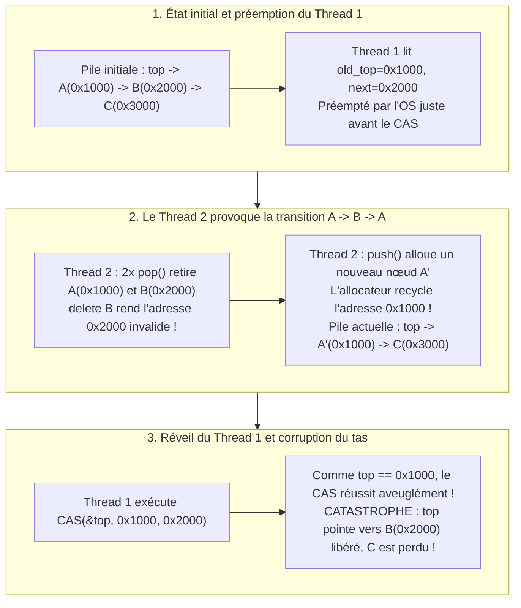

Les processeurs de serveurs modernes sont des machines à mémoire partagée massivement parallèles : un serveur bi-socket réunit couramment 128 à 256 cœurs physiques — et jusqu'à 512 threads matériels via le multithreading simultané (SMT) — accédant tous au même espace d'adressage cohérent (ccNUMA). Lors de la conception d'ordonnanceurs de noyaux d'OS, de moteurs d'appariement d'ordres pour le trading haute fréquence (HFT), de callbacks audio temps réel (DSP) ou de moteurs de bases de données, la primitive de synchronisation fondamentale enseignée partout — le <strong>verrou d'exclusion mutuelle (`mutex`)</strong> — cesse d'être une protection pour devenir un goulot d'étranglement catastrophique.

Que se passe-t-il lorsque 128 threads manipulent simultanément une file protégée par un `std::mutex` ? La mise à jour d'un pointeur ne prend que 15 nanosecondes. Mais si le seul thread $T_1$ détenant le verrou est préempté par l'ordonnanceur du système d'exploitation à la fin de son quantum de temps, ou subit un défaut de page (Page Fault), ces 15 nanosecondes se transforment en plusieurs millisecondes. Pendant tout ce temps, <strong>les 127 autres cœurs CPU sont totalement paralysés</strong>, attendant le réveil d'un thread endormi.

Pour briser ce couplage fatal où le retard d'un seul thread prend en otage tout le système, les informaticiens ont développé la <strong>synchronisation non bloquante (Non-Blocking Synchronization)</strong> : les algorithmes <strong>Lock-Free</strong> (sans verrou) et <strong>Wait-Free</strong> (sans attente). Cependant, dès que l'on abandonne les mutex au profit d'instructions atomiques matérielles comme `Compare-And-Swap` (`CAS`), surgit l'un des bogues les plus subtils et destructeurs de l'informatique : le <strong>problème ABA</strong>, couplé au défi de la <strong>récupération sûre de la mémoire (Safe Memory Reclamation, SMR)</strong> dans les langages sans ramasse-miettes (C, C++, Rust).

---

## Chapitre 1 : Pourquoi l'exclusion mutuelle (`mutex`) échoue dans les systèmes à ultra-basse latence

Même une implémentation moderne comme le `futex` (Fast Userspace Mutex) de Linux souffre de quatre pathologies structurelles inhérentes au blocage :

1. <strong>Préemption et effet de convoi (Lock Convoying)</strong> : Si un thread détenant un verrou est suspendu par une interruption matérielle ou un défaut de page, tous les autres threads s'accumulent dans la file d'attente du noyau. À la libération du verrou, le réveil séquentiel des threads, les changements de contexte et le rebond des lignes de cache (Cache Line Bouncing) entre nœuds NUMA créent un embouteillage durable appelé *convoi de verrous*.
2. <strong>Inversion de priorité non bornée — La leçon de Mars Pathfinder (1997)</strong> : En juillet 1997, la sonde de la NASA *Mars Pathfinder* a subi des réinitialisations répétées sur Mars. Sur l'OS temps réel VxWorks, une tâche météorologique de basse priorité $T_{\text{low}}$ détenait le mutex du bus ; la tâche critique de gestion du bus de haute priorité $T_{\text{high}}$ s'est bloquée en attendant ce mutex ; mais des tâches de communication de priorité moyenne $T_{\text{med}}$ (qui n'avaient pas besoin du mutex) ont préempté $T_{\text{low}}$, affamant indirectement $T_{\text{high}}$ jusqu'au déclenchement du chien de garde (Watchdog Reset).
3. <strong>Interblocage (Deadlock) et absence de composabilité</strong> : Deux tables de hachage $A$ et $B$ protégées chacune par un verrou interne ne peuvent pas être combinées simplement en une opération atomique `transfer(A, B)` sans risquer un interblocage croisé AB-BA.
4. <strong>Interdiction stricte dans les gestionnaires de signaux, les interruptions (ISR) et l'audio temps réel</strong> : Appeler `mutex_lock` dans un gestionnaire de signal POSIX (`SIGINT`, `SIGSEGV`) provoque un <strong>auto-deadlock</strong> immédiat si le thread interrompu détenait déjà ce verrou. Dans un callback audio DSP temps réel ($48\,\text{kHz}$, tampon de 64 échantillons $\implies$ échéance stricte de $1{,}33\,\text{ms}$), tout appel système bloquant entraîne une famine du tampon (craquements sonores).

---

## Chapitre 2 : Linéarisabilité et les trois garanties de progression non bloquantes

### 2.1 Le critère de correction : la Linéarisabilité (Herlihy & Wing, 1990)
Dans une exécution concurrente, chaque appel de méthode $op_i$ s'étend sur un intervalle $[t_{\text{inv}}(op_i), t_{\text{resp}}(op_i)]$. Un objet concurrent est <strong>linéarisable (Linearizable)</strong> s'il existe pour chaque opération $op_i$ un instant précis — son <strong>point de linéarisation</strong> $t_{\text{lin}}(op_i) \in [t_{\text{inv}}(op_i), t_{\text{resp}}(op_i)]$ — tel que l'ordre de ces points corresponde à une exécution séquentielle valide. Contrairement à la sérialisabilité des bases de données, la linéarisabilité est <strong>composable</strong> (locale).

### 2.2 Les trois niveaux de progression (Liveness)
1. <strong>Obstruction-Free (Sans obstruction)</strong> : Un thread termine son opération en un nombre fini d'étapes <strong>à condition d'être finalement exécuté en isolation</strong> (sans interférence concurrente). Sensible au *livelock*, il nécessite un gestionnaire de contention avec recul exponentiel (*exponential backoff*).
2. <strong>Lock-Free (Sans verrou)</strong> : Quelles que soient la vitesse, la préemption ou la panne par arrêt (*crash-stop*) des autres threads, <strong>au moins un thread parmi les threads actifs est garanti de terminer son opération en un nombre fini d'étapes</strong>. Si le `CAS` d'un thread échoue, c'est nécessairement parce que le `CAS` d'un autre thread a réussi et a fait progresser l'état global du système !
3. <strong>Wait-Free (Sans attente)</strong> : <strong>Chaque thread individuel</strong> est garanti de terminer son opération en un nombre fini et borné d'étapes ($O(1)$ ou $O(P)$), éliminant toute famine (*Zero Starvation*). Cela repose sur le mécanisme d'<strong>entraide (Helping)</strong> : chaque thread publie son descripteur d'opération dans un tableau global `announce[i]`, et les threads rapides aident à achever les opérations en attente des threads plus lents avant de terminer la leur.

| Garantie de progression | Bloquant ? | Progression globale du système | Absence de famine par thread | Sécurité Signaux / ISR / Temps Réel | Complexité pire cas | Exemples classiques |
| :--- | :--- | :--- | :--- | :--- | :--- | :--- |
| <strong>Blocking (`mutex`)</strong> | Oui | Non (arrêt si le détenteur dort) | Non (Deadlock & Inversion de priorité) | <strong>Interdit / Dangereux</strong> | $\infty$ (Sommeil OS non borné) | `std::mutex`, `pthread_mutex_t` |
| <strong>Obstruction-Free</strong> | Non-bloquant | En exécution solo (risque de Livelock) | Non (Backoff requis) | Sûr | $\infty$ sous contention | Mémoire Transactionnelle Logicielle (STM) |
| <strong>Lock-Free</strong> | Non-bloquant | <strong>Oui (Au moins 1 thread finit)</strong> | Non (Retries sous forte contention) | <strong>Totalement sûr</strong> | Espérance $O(1)$ | Pile de Treiber, File de Michael-Scott |
| <strong>Wait-Free</strong> | Non-bloquant | <strong>Oui (Tous les threads finissent)</strong> | <strong>Oui (Famine zéro)</strong> | <strong>Temps réel dur</strong> | <strong>Bornée $O(1)$ ou $O(P)$</strong> | File de Kogan-Petrank, Ring Buffer SPSC, RCU |

---

## Chapitre 3 : Instructions atomiques et la hiérarchie du consensus de Maurice Herlihy (1991)

Dans son article fondateur *"Wait-Free Synchronization"* (1991, prix Gödel et prix Dijkstra), Maurice Herlihy a démontré que la puissance de toute primitive de synchronisation $\mathcal{O}$ est entièrement caractérisée par son <strong>nombre de consensus (Consensus Number) $C(\mathcal{O})$</strong> : le nombre maximal de threads $N$ pouvant résoudre le problème du consensus sans attente (Accord, Validité, Terminaison Wait-Free) à l'aide d'objets de type $\mathcal{O}$ et de registres atomiques de lecture/écriture.

- <strong>$C = 1$ : Registres atomiques de lecture/écriture (`MOV` + barrière mémoire)</strong> : <strong>Impossible de résoudre le consensus même pour $N = 2$ threads !</strong>
  *Preuve par bivalence* : En partant d'une configuration initiale bivalente (où les décisions 0 et 1 sont toutes deux encore accessibles), le système atteint nécessairement un <strong>état bivalent critique $S_{\text{crit}}$</strong> où le pas $e_A$ du thread $A$ mène à un état 0-valent $S_0$ et le pas $e_B$ du thread $B$ mène à un état 1-valent $S_1$. Dans le cas décisif où $e_A$ et $e_B$ écrivent dans le même registre $R$, l'exécution de $e_A$ suivie immédiatement de $e_B$ fait que l'écriture de $B$ <strong>écrase et efface totalement</strong> celle de $A$ ! Pour le thread $B$, l'état 0-valent $e_B(e_A(S_{\text{crit}}))$ est donc <strong>parfaitement indiscernable</strong> de l'état 1-valent $e_B(S_{\text{crit}})$, ce qui aboutit à une contradiction lorsque $B$ termine seul son exécution.
- <strong>$C = 2$ : `Test-and-Set` (`TAS`), `Swap` (`XCHG`), `Fetch-and-Add` (`LOCK XADD`), piles et files FIFO</strong> : Résolvent le consensus pour 2 threads, mais <strong>échouent mathématiquement dès $N = 3$ threads !</strong> Avec `Fetch-and-Add`, si $A$ et $B$ ajoutent chacun 1 à un registre, la commutativité de l'addition produit la même somme $r+2$ quel que soit l'ordre d'arrivée ; un troisième thread $C$ ne peut plus savoir qui de $A$ ou $B$ est passé en premier. Corollaire fondamental : <strong>il est impossible de construire une file ou une pile Lock-Free générale pour $\ge 3$ threads uniquement avec `Fetch-and-Add` ou `Swap` !</strong>
- <strong>$C = \infty$ (Primitives universelles) : `Compare-And-Swap` (`CAS`) et `Load-Linked / Store-Conditional` (`LL/SC`)</strong> : Avec `CAS(&decision, UNDECIDED, my_val)`, seul le premier thread modifie la mémoire tandis que les $N-1$ suivants échouent <strong>sans jamais écraser la valeur gagnante</strong>. `CAS` et `LL/SC` sont donc universels pour tout nombre $N$ de threads.

---

## Chapitre 4 : La pile de Treiber (1986) et l'anatomie du problème ABA

Examinons l'opération `pop()` naïve de la pile sans verrou de R. Kent Treiber (1986) :

```cpp
// Opération pop() naïve de la pile de Treiber — vulnérable au problème ABA et au Use-After-Free !
bool pop(T& result) {
    Node* old_top = top.load(std::memory_order_acquire);
    while (old_top != nullptr) {
        Node* next_node = old_top->next; // Point critique 1 : déréférencement de old_top
        if (top.compare_exchange_weak(   // Point critique 2 : CAS basé uniquement sur l'égalité d'adresse
                old_top, next_node,
                std::memory_order_acquire, std::memory_order_relaxed)) {
            result = old_top->data;
            delete old_top;              // Libération mémoire (déclencheur de la catastrophe !)
            return true;
        }
    }
    return false;
}
```

### 4.1 Chronologie en 5 étapes de la corruption du tas par le problème ABA
État initial de la pile : $\text{top} \longrightarrow A(\texttt{0x1000}) \longrightarrow B(\texttt{0x2000}) \longrightarrow C(\texttt{0x3000})$.

1. <strong>[Étape 1] Le Thread 1 démarre `pop()` et est préempté juste avant le `CAS`</strong> : Le Thread 1 lit `old_top = 0x1000` ($A$) et `next_node = 0x2000` ($B$), puis est suspendu par l'ordonnanceur juste avant d'exécuter `CAS(&top, 0x1000, 0x2000)`.
2. <strong>[Étape 2] Le Thread 2 dépile $A$ et $B$ et libère leur mémoire</strong> : Le Thread 2 appelle deux fois `pop()`, retire $A(\texttt{0x1000})$ (`delete A`), puis retire $B(\texttt{0x2000})$ et appelle <strong>`delete B`</strong>. L'adresse `0x2000` devient un pointeur pendouillant (*dangling pointer*) ; la pile ne contient plus que $\text{top} \to C(\texttt{0x3000})$.
3. <strong>[Étape 3] Le Thread 2 empile un nouveau nœud qui recycle l'adresse `0x1000`</strong> : Le Thread 2 alloue un nouveau nœud $A'$. Les allocateurs modernes (`jemalloc`, `tcmalloc`, `ptmalloc`) réutilisent immédiatement les blocs récemment libérés en ordre LIFO pour optimiser le cache L1, attribuant à $A'$ <strong>exactement la même adresse `0x1000`</strong> ! Après le `push`, la pile est $\text{top} \longrightarrow A'(\texttt{0x1000}) \longrightarrow C(\texttt{0x3000})$.
4. <strong>[Étape 4] Le Thread 1 se réveille et exécute son `CAS(&top, 0x1000, 0x2000)`</strong> : Le processeur compare `top` (`0x1000`) à `old_top` (`0x1000`). Comme l'adresse est revenue à `0x1000` ($A \to B \to A$), <strong>le `CAS` réussit aveuglément !</strong>
5. <strong>[Étape 5] Corruption totale du tas</strong> : `top` pointe désormais vers `0x2000` (le nœud $B$ déjà détruit !), le nœud $C(\texttt{0x3000})$ est perdu en fuite mémoire, et tout accès ultérieur provoque un Use-After-Free ou un `SIGSEGV`.



---

## Chapitre 5 : Les quatre architectures de résolution d'ABA et de récupération mémoire (SMR)

### 5.1 Solution 1 : Pointeurs étiquetés (Tagged Pointers) et CAS double largeur (`DWCAS` / `CMPXCHG16B`)
On associe au pointeur 64 bits `ptr` un compteur de génération monotone 64 bits `tag` dans une structure de 128 bits `(ptr, tag)` incrémentée à chaque modification : $(\texttt{0x1000}, 42) \to (\texttt{0x2000}, 43) \to (\texttt{0x1000}, 44)$. Grâce à l'instruction x86-64 `LOCK CMPXCHG16B`, le `DWCAS` détecte que `tag 42 != 44` et échoue proprement. Doit être combiné à un pool mémoire à typage stable (*Type-Stable Freelist*) pour éviter un `SIGSEGV` lors de la lecture de `old_top->next`.

### 5.2 Solution 2 : Hazard Pointers (Maged Michael 2004, C++26 `<hazard_pointer>`)
Chaque thread lecteur $i$ publie l'adresse `p = top.load()` qu'il s'apprête à déréférencer dans un registre global `HP[i].store(p, memory_order_seq_cst)`, puis <strong>revalide immédiatement</strong> `if (top.load(memory_order_seq_cst) != p) retry;`. Tant que `HP[i] == p` est affiché, aucun thread ne peut libérer ni recycler `p`. Les nœuds dépilés sont placés dans une liste de retraite locale (`retired_list`) et ne sont détruits par `delete` qu'après vérification qu'aucun `HP[]` ne pointe sur eux. Garantit une mémoire bornée en $O(P^2)$, au prix d'une barrière `SeqCst` (`MFENCE`) par pointeur traversé.

### 5.3 Solution 3 : Récupération basée sur les époques (EBR — Keir Fraser 2004, Rust `crossbeam-epoch`)

```mermaid
flowchart TD
    subgraph HP["Hazard Pointers (Protection par pointeur, C++26)"]
        H1["1. Lire p = top.load()"] --> H2["2. Publier HP[tid] = p (Barrière SeqCst)"]
        H2 --> H3{"3. Revalidation : top == p ?"}
        H3 -- "Non (Conflit)" --> H1
        H3 -- "Oui (Protection garantie)" --> H4["4. Lire p->next en sécurité & exécuter CAS"]
        H4 --> H5["5. Effacer HP[tid], mettre p en retraite & scanner HP[]"]
    end

    subgraph EBR["Epoch-Based Reclamation (Protection globale sur 3 époques)"]
        E1["1. pin() : active=true, local_e = Global_E<br/>(Une seule barrière mémoire pour toute l'opération !)"] --> E2["2. Parcourir les pointeurs sans barrière supplémentaire & CAS"]
        E2 --> E3["3. Placer le nœud retiré dans bag[Global_E % 3]"]
        E3 --> E4["4. unpin() : active=false"]
        E4 --> E5["5. Quand tous les threads actifs atteignent Global_E :<br/>avancer l'époque et libérer bag[(E-2)%3] en bloc !"]
    end
```

Pour supprimer la barrière mémoire sur chaque pointeur, l'EBR utilise un compteur d'époque global $E$ et 3 sacs de collecte `bag[0..2]`. Au début d'une opération (`pin()`), le thread se déclare actif sur l'époque courante $E$ (<strong>une seule barrière pour toute l'opération !</strong>). Les nœuds retirés vont dans `bag[E % 3]`. Lorsque tous les threads actifs ont rejoint l'époque $E$, l'époque globale avance ; à l'époque $E+2$, plus aucun thread actif ne peut détenir de pointeur datant de l'époque $E$, permettant de libérer `bag[E % 3]` en bloc.



### 5.4 Solution 4 : Read-Copy-Update (RCU — Noyau Linux & `liburcu`)
Pour les structures majoritairement lues (tables de routage, cache VFS `dcache`), RCU offre des <strong>lectures Wait-Free à coût nul</strong> (`rcu_read_lock()` génère zéro instruction machine sur un noyau non préemptible et interdit simplement le changement de contexte). Le thread écrivain copie le nœud (*Copy-on-Write*), remplace atomiquement le pointeur, puis attend via `synchronize_rcu()` une <strong>période de grâce (Grace Period)</strong> — le temps que chaque cœur CPU traverse au moins un changement de contexte (*Quiescent State*) — avant de libérer l'ancien nœud.

| Technique SMR / Anti-ABA | Surcoût en lecture | Mémoire bornée si un thread bloque ? | Généralité des structures | Écosystèmes de production |
| :--- | :--- | :--- | :--- | :--- |
| <strong>Tagged Pointers (`DWCAS` + Pool)</strong> | <strong>Minimal</strong> (Load atomique) | Pool fixe (Pas de retour à l'OS) | Limité aux structures à pointeur unique | Noyau Linux `SLUB`, pools embarqués |
| <strong>Hazard Pointers</strong> | <strong>Élevé</strong> (Barrière `SeqCst` / pointeur) | <strong>Oui — Bornée en $O(P^2)$ (100% Lock-Free)</strong> | <strong>Très élevée</strong> (Listes, arbres, graphes) | <strong>C++26 `<hazard_pointer>`</strong>, Meta `Folly` |
| <strong>Epoch-Based Reclamation (EBR)</strong> | <strong>Faible</strong> (1 barrière par `pin()`) | Non (Un thread bloqué dans `pin` retarde le GC) | <strong>Très élevée</strong> (Idéal pour parcours profonds) | <strong>Rust `crossbeam-epoch`</strong>, Bw-Tree |
| <strong>Read-Copy-Update (RCU)</strong> | <strong>Zéro (0 instruction, Wait-Free)</strong> | Dépend de la Grace Period | Spécialisé lecture intensive (Read-Mostly) | <strong>Noyau Linux (VFS, Réseau)</strong>, `liburcu` |
