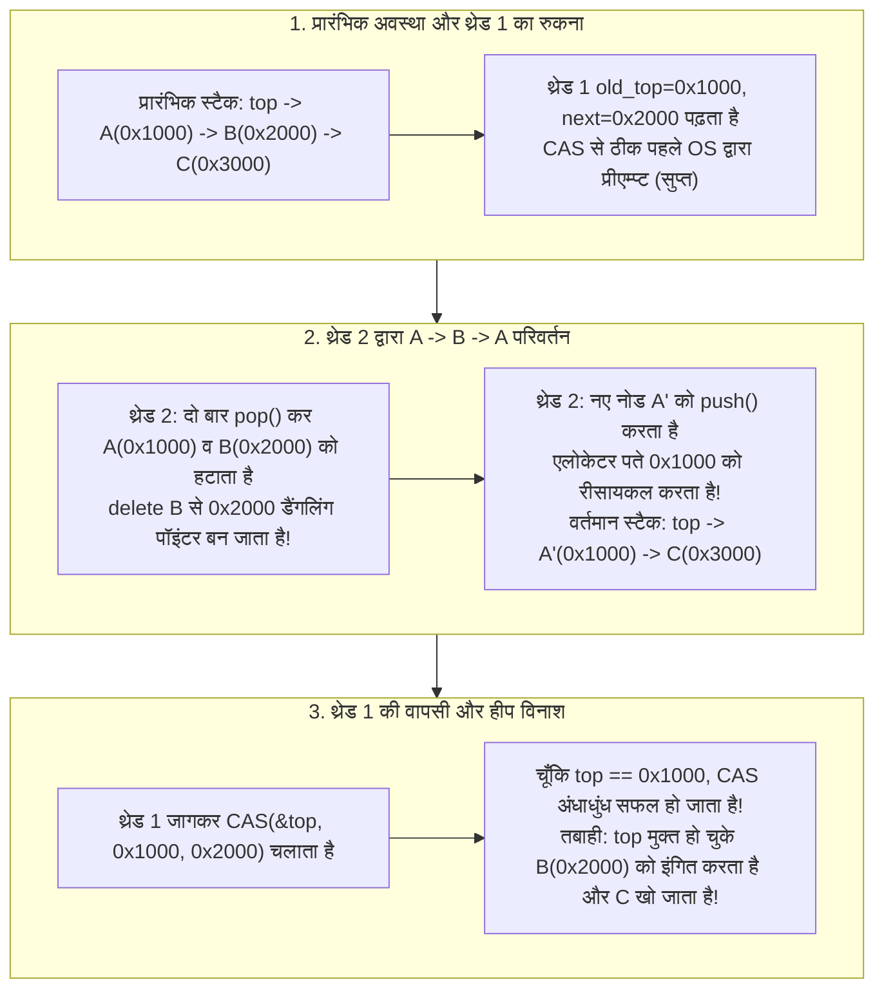

आधुनिक सर्वर प्रोसेसर विशाल समानांतर शेयर्ड-मेमोरी मशीनें हैं: एक ड्यूल-सॉकेट सर्वर में आमतौर पर 128 से 256 भौतिक कोर (और SMT के माध्यम से 512 तक हार्डवेयर थ्रेड्स) होते हैं, जो एक ही कैश-कोहेरेंट मेमोरी स्पेस (ccNUMA) के लिए प्रतिस्पर्धा करते हैं। जब हम ऑपरेटिंग सिस्टम कर्नेल शेड्यूलर, हाई-फ्रीक्वेंसी ट्रेडिंग (HFT) ऑर्डर मैचिंग इंजन, रियल-टाइम ऑडियो डिजिटल सिग्नल प्रोसेसिंग (DSP) कॉलबैक, या उच्च-समवर्ती डेटाबेस इंजन डिज़ाइन करते हैं, तो कंप्यूटर विज्ञान में सिखाया जाने वाला सबसे बुनियादी सिंक्रोनाइज़ेशन प्रिमिटिव—<strong>म्यूचुअल एक्सक्लूज़न लॉक (`mutex`)</strong>—सुरक्षा कवच के बजाय पूरे सिस्टम को ठप करने वाली सबसे बड़ी बाधा बन जाता है।

कल्पना कीजिए कि 128 थ्रेड्स एक साथ `std::mutex` द्वारा सुरक्षित किसी साझा क्यू (Queue) में डेटा डाल और निकाल रहे हैं। पॉइंटर को बदलने में केवल 15 नैनोसेकंड लगते हैं। लेकिन यदि लॉक पकड़े हुए एकमात्र थ्रेड $T_1$ को OS शेड्यूलर द्वारा टाइम-स्लाइस समाप्त होने पर प्रीएम्प्ट (Preempt) कर दिया जाए, या पेज फ़ॉल्ट (Page Fault) हो जाए, तो वे 15 नैनोसेकंड कई मिलीसेकंड में बदल जाते हैं। उस पूरे समय के दौरान, <strong>बाकी सभी 127 CPU कोर पूरी तरह से रुक जाते हैं</strong> और एक सोए हुए थ्रेड के जागने का इंतज़ार करते रहते हैं।

इस घातक निर्भरता को तोड़ने के लिए <strong>नॉन-ब्लॉकिंग सिंक्रोनाइज़ेशन (Non-Blocking Synchronization)</strong>—अर्थात <strong>लॉक-फ्री (Lock-Free)</strong> और <strong>वेट-फ्री (Wait-Free)</strong> एल्गोरिदम के विज्ञान का जन्म हुआ। लेकिन जैसे ही हम लॉक छोड़कर `Compare-And-Swap` (`CAS`) जैसे हार्डवेयर एटॉमिक निर्देशों से सीधे पॉइंटर्स बदलने की कोशिश करते हैं, हमारा सामना कंप्यूटर विज्ञान के सबसे खतरनाक और सूक्ष्म बग से होता है: <strong>ABA समस्या (ABA Problem)</strong> और बिना गार्बेज कलेक्टर वाली भाषाओं (C, C++, Rust) में <strong>सुरक्षित मेमोरी रिक्लेमेशन (Safe Memory Reclamation, SMR)</strong> की समस्या।

---

## अध्याय 1: अल्ट्रा-लो-लेटेंसी सिस्टम में म्यूटेक्स (`mutex`) क्यों विफल हो जाते हैं?

लिनक्स के `futex` (Fast Userspace Mutex) जैसे अत्यधिक अनुकूलित म्यूटेक्स भी अपनी ब्लॉकिंग प्रकृति के कारण चार संरचनात्मक दोषों से ग्रस्त हैं:

1. <strong>प्रीएम्प्शन और लॉक काफिला प्रभाव (Lock Convoying)</strong>: यदि क्रिटिकल सेक्शन के भीतर लॉक रखने वाला थ्रेड निलंबित हो जाता है, तो पीछे आने वाले सभी थ्रेड्स कर्नेल वेट क्यू में जमा हो जाते हैं। लॉक छूटने के बाद भी थ्रेड्स को एक-एक करके जगाने, कॉन्टेक्स्ट स्विच करने और NUMA नोड्स के बीच कैश लाइन बाउंसिंग (Cache Line Bouncing) से एक लंबा ट्रैफिक जाम लग जाता है।
2. <strong>असीमित प्राथमिकता व्युत्क्रमण (Priority Inversion) — मार्स पाथफाइंडर (1997) का सबक</strong>: जुलाई 1997 में नासा के *Mars Pathfinder* यान को मंगल ग्रह पर बार-बार रहस्यमय सिस्टम रीसेट का सामना करना पड़ा। VxWorks रियल-टाइम OS पर कम प्राथमिकता वाले मौसम कार्य $T_{\text{low}}$ ने बस म्यूटेक्स पकड़ा हुआ था; उच्च प्राथमिकता वाला बस प्रबंधन कार्य $T_{\text{high}}$ उसी म्यूटेक्स के लिए ब्लॉक हो गया; इसी बीच मध्यम प्राथमिकता वाले संचार कार्यों $T_{\text{med}}$ (जिन्हें उस म्यूटेक्स की कोई ज़रूरत नहीं थी!) ने $T_{\text{low}}$ से CPU छीन लिया, जिससे $T_{\text{high}}$ अप्रत्यक्ष रूप से स्टार्वेशन का शिकार हो गया और वॉचडॉग टाइमर ने पूरे यान को रीबूट कर दिया।
3. <strong>डेडलॉक (Deadlock) और संयोजनीयता की कमी (Lack of Composability)</strong>: आंतरिक लॉक द्वारा सुरक्षित दो अलग-अलग हैश टेबल $A$ और $B$ के बीच बिना वैश्विक लॉक क्रम के एक एटॉमिक `transfer(A, B)` ऑपरेशन बनाना AB-BA डेडलॉक को जन्म देता है।
4. <strong>सिग्नल हैंडलर, इंटरप्ट (ISR) और रियल-टाइम ऑडियो कॉलबैक में पूर्ण प्रतिबंध</strong>: POSIX सिग्नल हैंडलर (`SIGINT`, `SIGSEGV`) के भीतर `mutex_lock` को कॉल करने से तत्काल <strong>सेल्फ-डेडलॉक (Self-Deadlock)</strong> हो जाता है यदि बाधित थ्रेड के पास पहले से ही वह लॉक था। वहीं रियल-टाइम ऑडियो DSP कॉलबैक ($48\,\text{kHz}$, 64-सैंपल बफर $\implies 1.33\,\text{ms}$ की सख्त समय-सीमा) में किसी भी कर्नेल स्लीप से तुरंत बफर अंडररन (ऑडियो ग्लिच) हो जाता है।

---

## अध्याय 2: लीनियराइज़ेबिलिटी (Linearizability) और तीन नॉन-ब्लॉकिंग प्रगति गारंटियाँ

### 2.1 शुद्धता का मानदंड: लीनियराइज़ेबिलिटी (Herlihy & Wing, 1990)
समवर्ती निष्पादन में प्रत्येक मेथड कॉल $op_i$ का एक समय अंतराल $[t_{\text{inv}}(op_i), t_{\text{resp}}(op_i)]$ होता है। कोई समवर्ती ऑब्जेक्ट <strong>लीनियराइज़ेबल (Linearizable)</strong> कहलाता है यदि प्रत्येक ऑपरेशन $op_i$ के अंतराल के भीतर एक ऐसा तात्कालिक क्षण—<strong>लीनियराइज़ेशन बिंदु (Linearization Point)</strong> $t_{\text{lin}}(op_i) \in [t_{\text{inv}}(op_i), t_{\text{resp}}(op_i)]$—निर्धारित किया जा सके कि $t_{\text{lin}}$ के क्रम में रखने पर सभी ऑपरेशन्स क्रमिक विनिर्देश (Sequential Specification) से पूरी तरह मेल खाएँ। लीनियराइज़ेबिलिटी एक <strong>स्थानीय और संयोजनीय (Composable)</strong> गुण है।

### 2.2 नॉन-ब्लॉकिंग प्रगति (Liveness) के तीन स्तर
1. <strong>ऑब्स्ट्रक्शन-फ्री (Obstruction-Free / बाधा-मुक्त)</strong>: एक थ्रेड सीमित चरणों में अपना ऑपरेशन पूरा कर लेता है <strong>बशर्ते उसे अंततः अकेले (अन्य थ्रेड्स के हस्तक्षेप के बिना) चलने का अवसर मिले</strong>। प्रतिस्पर्धा होने पर इसमें लाइवलॉक (Livelock) का खतरा रहता है, इसलिए एक्सपोनेन्शियल बैकऑफ (Backoff) आवश्यक होता है।
2. <strong>लॉक-फ्री (Lock-Free / लॉक-मुक्त)</strong>: चाहे अन्य थ्रेड्स किसी भी गति से चलें, प्रीएम्प्ट हों या क्रैश हो जाएँ, <strong>सभी सक्रिय थ्रेड्स में से 'कम से कम एक थ्रेड' सीमित चरणों में अपना ऑपरेशन अवश्य पूरा करेगा</strong>। यदि किसी थ्रेड का `CAS` विफल होता है, तो इसका गणितीय अर्थ है कि किसी *दूसरे* थ्रेड का `CAS` सफल हुआ है और सिस्टम की वैश्विक स्थिति आगे बढ़ी है!
3. <strong>वेट-फ्री (Wait-Free / प्रतीक्षा-मुक्त)</strong>: <strong>प्रत्येक थ्रेड</strong> सीमित और बंधे हुए चरणों ($O(1)$ या $O(P)$) के भीतर अपना ऑपरेशन पूरा करने की गारंटी रखता है, जिससे स्टार्वेशन (Starvation) पूरी तरह समाप्त हो जाता है। यह <strong>हेल्पिंग तंत्र (Helping Mechanism)</strong> द्वारा प्राप्त किया जाता है: धीमा थ्रेड ग्लोबल एरे `announce[i]` में अपना ऑपरेशन डिस्क्रिप्टर प्रकाशित करता है, और तेज़ थ्रेड्स अपना काम खत्म करने से पहले धीमे थ्रेड्स के लंबित ऑपरेशन को पूरा करने में मदद करते हैं।

| प्रगति गारंटी वर्ग | ब्लॉकिंग? | पूरे सिस्टम की प्रगति सुनिश्चित? | व्यक्तिगत थ्रेड स्टार्वेशन से सुरक्षा? | सिग्नल / ISR / हार्ड RT में सुरक्षित? | सबसे खराब समय जटिलता | प्रमुख उदाहरण |
| :--- | :--- | :--- | :--- | :--- | :--- | :--- |
| <strong>Blocking (`mutex`)</strong> | हाँ | नहीं (लॉक धारक रुकने पर सब ठप) | नहीं (डेडलॉक और प्राथमिकता व्युत्क्रमण) | <strong>वर्जित / असुरक्षित</strong> | $\infty$ (असीमित OS स्लीप) | `std::mutex`, `pthread_mutex_t` |
| <strong>Obstruction-Free</strong> | नॉन-ब्लॉकिंग | केवल अकेले चलने पर (लाइवलॉक जोखिम) | नहीं (बैकऑफ आवश्यक) | सुरक्षित | प्रतिस्पर्धा में $\infty$ | सॉफ्टवेयर ट्रांजैक्शनल मेमोरी (STM) |
| <strong>Lock-Free</strong> | नॉन-ब्लॉकिंग | <strong>हाँ (कम से कम 1 थ्रेड पूरा होगा)</strong> | नहीं (उच्च प्रतिस्पर्धा में रीट्राई) | <strong>पूरी तरह सुरक्षित</strong> | अपेक्षित $O(1)$ | ट्रेबर स्टैक, माइकल-स्कॉट क्यू |
| <strong>Wait-Free</strong> | नॉन-ब्लॉकिंग | <strong>हाँ (सभी सक्रिय थ्रेड्स पूरे होंगे)</strong> | <strong>हाँ (शून्य स्टार्वेशन)</strong> | <strong>हार्ड रियल-टाइम सुरक्षित</strong> | <strong>सख्ती से बंधा $O(1)$ या $O(P)$</strong> | कोगन-पेट्रैंक क्यू, SPSC रिंग बफर, RCU रीडर्स |

---

## अध्याय 3: हार्डवेयर एटॉमिक निर्देश और मौरिस हर्लिही का 'सर्वसम्मति पदानुक्रम' (1991)

1991 के अपने ऐतिहासिक शोधपत्र *"Wait-Free Synchronization"* (गोडेल और डाइक्स्ट्रा पुरस्कार विजेता) में, मौरिस हर्लिही ने प्रत्येक सिंक्रोनाइज़ेशन प्रिमिटिव $\mathcal{O}$ की क्षमता को उसकी <strong>सर्वसम्मति संख्या (Consensus Number) $C(\mathcal{O})$</strong> द्वारा वर्गीकृत किया: अधिकतम थ्रेड्स की संख्या $N$ जिनके लिए $\mathcal{O}$ और एटॉमिक रीड/राइट रजिस्टरों की मदद से वेट-फ्री सर्वसम्मति समस्या (Agreement, Validity, Wait-Free Termination) हल की जा सकती है।

- <strong>$C = 1$: एटॉमिक रीड/राइट रजिस्टर (`MOV` + मेमोरी बैरियर)</strong>: <strong>यह केवल $N = 2$ थ्रेड्स के लिए भी सर्वसम्मति हल नहीं कर सकता!</strong>
  *द्वि-संयोजकता (Bivalence) प्रमाण*: प्रारंभिक अवस्था द्वि-संयोजक (Bivalent) होती है जहाँ निर्णय 0 और 1 दोनों संभव हैं। प्रोटोकॉल को अंततः एक <strong>क्रिटिकल बाइवैलेंट अवस्था $S_{\text{crit}}$</strong> पर पहुँचना ही होगा जहाँ थ्रेड $A$ का अगला कदम $e_A$ सिस्टम को 0-वैलेंट अवस्था $S_0$ में ले जाता है और थ्रेड $B$ का अगला कदम $e_B$ उसे 1-वैलेंट अवस्था $S_1$ में ले जाता है। सबसे महत्वपूर्ण स्थिति में जब दोनों एक ही रजिस्टर $R$ पर लिखते हैं (Write), तो $A$ के लिखने के तुरंत बाद $B$ द्वारा लिखने पर $B$ का मान <strong>$A$ के लिखे मान को पूरी तरह मिटाकर ओवरराइट कर देता है</strong>! थ्रेड $B$ की दृष्टि से 0-वैलेंट अवस्था $e_B(e_A(S_{\text{crit}}))$ और 1-वैलेंट अवस्था $e_B(S_{\text{crit}})$ मेमोरी में <strong>पूरी तरह अभेद्य (Indistinguishable)</strong> हो जाती हैं, जिससे विरोधाभास उत्पन्न होता है।
- <strong>$C = 2$: `Test-and-Set` (`TAS`), `Swap` (`XCHG`), `Fetch-and-Add` (`LOCK XADD`), स्टैक और FIFO क्यू</strong>: ये 2 थ्रेड्स की सर्वसम्मति हल कर सकते हैं, लेकिन <strong>$N \ge 3$ थ्रेड्स के लिए गणितीय रूप से विफल हो जाते हैं!</strong> उदाहरण के लिए `Fetch-and-Add` में यदि थ्रेड $A$ और $B$ दोनों रजिस्टर में 1 जोड़ते हैं, तो योग के क्रमविनिमेय नियम के कारण परिणाम हमेशा $r+2$ ही होगा चाहे पहले कोई भी आया हो; तीसरा थ्रेड $C$ यह कभी नहीं जान सकता कि पहला कौन था। इसलिए, <strong>केवल `Fetch-and-Add` या `Swap` से 3 या अधिक थ्रेड्स के लिए सामान्य लॉक-फ्री क्यू या स्टैक बनाना असंभव है!</strong>
- <strong>$C = \infty$ (सार्वभौमिक प्रिमिटिव): `Compare-And-Swap` (`CAS`) और `Load-Linked / Store-Conditional` (`LL/SC`)</strong>: `CAS(&decision, UNDECIDED, my_val)` में केवल सबसे पहला थ्रेड मान बदल पाता है जबकि बाकी सभी $N-1$ थ्रेड्स विफल हो जाते हैं और <strong>विजेता के मान को कभी ओवरराइट नहीं करते</strong>। इसलिए `CAS` और `LL/SC` किसी भी संख्या $N \to \infty$ के थ्रेड्स के लिए सार्वभौमिक (Universal) हैं।

---

## अध्याय 4: ट्रेबर स्टैक (1986) और कुख्यात 'ABA समस्या' की चीर-फाड़

आइए आर. केंट ट्रेबर (1986) के लॉक-फ्री स्टैक के साधारण `pop()` कोड को देखें:

```cpp
// ट्रेबर स्टैक का साधारण pop() — ABA समस्या और Use-After-Free के प्रति संवेदनशील!
bool pop(T& result) {
    Node* old_top = top.load(std::memory_order_acquire);
    while (old_top != nullptr) {
        Node* next_node = old_top->next; // खतरा बिंदु 1: मुक्त हो चुके पॉइंटर को डीरेफरेंस करना
        if (top.compare_exchange_weak(   // खतरा बिंदु 2: केवल मेमोरी पते की समानता जाँचने वाला CAS
                old_top, next_node,
                std::memory_order_acquire, std::memory_order_relaxed)) {
            result = old_top->data;
            delete old_top;              // मेमोरी एलोकेटर को नोड लौटाना (तबाही की शुरुआत!)
            return true;
        }
    }
    return false;
}
```

### 4.1 ABA समस्या द्वारा हीप मेमोरी के नष्ट होने के 5 चरण
मान लीजिए स्टैक की प्रारंभिक स्थिति है: $\text{top} \longrightarrow A(\texttt{0x1000}) \longrightarrow B(\texttt{0x2000}) \longrightarrow C(\texttt{0x3000})$.

1. <strong>[चरण 1] थ्रेड 1 `pop()` शुरू करता है और `CAS` से ठीक पहले प्रीएम्प्ट हो जाता है</strong>: थ्रेड 1 `old_top = 0x1000` ($A$) और `next_node = 0x2000` ($B$) को पढ़ता है, लेकिन `CAS(&top, 0x1000, 0x2000)` चलाने से ठीक पहले OS शेड्यूलर उसे रोक देता है।
2. <strong>[चरण 2] थ्रेड 2 लगातार $A$ और $B$ को `pop()` करके डिलीट कर देता है</strong>: थ्रेड 2 दो बार `pop()` कॉल करता है: पहले $A(\texttt{0x1000})$ को निकालकर `delete A` करता है, फिर $B(\texttt{0x2000})$ को निकालकर <strong>`delete B`</strong> करता है। अब पता `0x2000` मुक्त मेमोरी (Dangling Pointer) बन चुका है और स्टैक में केवल $\text{top} \to C(\texttt{0x3000})$ बचा है।
3. <strong>[चरण 3] थ्रेड 2 नया नोड `push()` करता है और एलोकेटर पता `0x1000` का पुनः उपयोग करता है</strong>: थ्रेड 2 नया नोड $A'$ बनाता है। आधुनिक एलोकेटर (`jemalloc`, `tcmalloc`, `ptmalloc`) L1 कैश लोकैलिटी के लिए तुरंत मुक्त हुए पते `0x1000` को LIFO फ्री-लिस्ट से दोबारा आवंटित कर देते हैं! पुश करने के बाद स्टैक $\text{top} \longrightarrow A'(\texttt{0x1000}) \longrightarrow C(\texttt{0x3000})$ हो जाता है।
4. <strong>[चरण 4] थ्रेड 1 जागता है और अपना पुराना `CAS(&top, 0x1000, 0x2000)` चलाता है</strong>: हार्डवेयर देखता है कि वर्तमान `top` (`0x1000`) थ्रेड 1 के `old_top` (`0x1000`) के बराबर है ($A \to B \to A$), इसलिए <strong>`CAS` अंधाधुंध रूप से सफल हो जाता है!</strong>
5. <strong>[चरण 5] हीप मेमोरी का पूर्ण विनाश</strong>: स्टैक का `top` अब `0x2000` (पहले ही डिलीट हो चुके नोड $B$!) की ओर इशारा करने लगता है, नोड $C(\texttt{0x3000})$ हमेशा के लिए लीक हो जाता है, और अगला एक्सेस तुरंत Use-After-Free या `SIGSEGV` क्रैश पैदा करता है।



---

## अध्याय 5: ABA समस्या और सुरक्षित मेमोरी रिक्लेमेशन (SMR) के चार प्रमुख आर्किटेक्चर

### 5.1 समाधान 1: टैग किए गए पॉइंटर्स (Tagged Pointers) और डबल-विड्थ CAS (`DWCAS` / `CMPXCHG16B`)
64-बिट पॉइंटर `ptr` के साथ 64-बिट जनरेशन काउंटर `tag` को जोड़कर 128-बिट संरचना `(ptr, tag)` बनाई जाती है और हर बदलाव पर `tag` को $+1$ बढ़ाया जाता है: $(\texttt{0x1000}, 42) \to (\texttt{0x2000}, 43) \to (\texttt{0x1000}, 44)$। x86-64 के `LOCK CMPXCHG16B` निर्देश द्वारा `DWCAS` तुरंत पकड़ लेता है कि `tag 42 != 44` और विफल हो जाता है। इसे टाइप-स्टेबल मेमोरी पूल (*Type-Stable Freelist*) के साथ प्रयोग किया जाना चाहिए ताकि `old_top->next` पढ़ते समय `SIGSEGV` न हो।

### 5.2 समाधान 2: हैज़र्ड पॉइंटर्स (Hazard Pointers — Maged Michael 2004, C++26 `<hazard_pointer>`)
प्रत्येक रीडर थ्रेड $i$ पॉइंटर `p = top.load()` को डीरेफरेंस करने से पहले ग्लोबल स्लॉट `HP[i].store(p, memory_order_seq_cst)` में प्रकाशित करता है और <strong>तुरंत दोबारा जाँचता है</strong> `if (top.load(memory_order_seq_cst) != p) retry;`। जब तक `HP[i] == p` सेट है, कोई भी थ्रेड `p` को मुक्त या रीसायकल नहीं कर सकता। हटाए गए नोड्स को थ्रेड-लोकल `retired_list` में रखा जाता है और सभी `HP[]` को स्कैन करने के बाद ही सुरक्षित रूप से `delete` किया जाता है। यह मेमोरी को $O(P^2)$ तक सीमित रखता है, लेकिन हर पॉइंटर पर एक भारी `SeqCst` मेमोरी बैरियर (`MFENCE`) लगता है।

### 5.3 समाधान 3: एपोक-आधारित रिक्लेमेशन (EBR — Keir Fraser 2004, Rust `crossbeam-epoch`)

```mermaid
flowchart TD
    subgraph HP["हैज़र्ड पॉइंटर्स (Hazard Pointers — प्रति-पॉइंटर सुरक्षा, C++26)"]
        H1["1. p = top.load() पढ़ें"] --> H2["2. HP[tid] = p प्रकाशित करें (SeqCst बैरियर)"]
        H2 --> H3{"3. पुनः सत्यापन: क्या top == p?"}
        H3 -- "नहीं (बदलाव हुआ)" --> H1
        H3 -- "हाँ (सुरक्षित)" --> H4["4. सुरक्षित रूप से p->next पढ़ें और CAS चलाएँ"]
        H4 --> H5["5. HP[tid] साफ़ करें, p को रिटायर करें व HP[] स्कैन कर delete करें"]
    end

    subgraph EBR["एपोक-आधारित रिक्लेमेशन (EBR — 3 एपोक में पूरे ऑपरेशन की सुरक्षा)"]
        E1["1. pin(): active=true, local_e = Global_E<br/>(पूरी ट्रैवर्सल के लिए केवल 1 मेमोरी बैरियर!)"] --> E2["2. बिना अतिरिक्त बैरियर के अनेक पॉइंटर्स पढ़ें और CAS चलाएँ"]
        E2 --> E3["3. हटाए गए नोड को वर्तमान बैग bag[Global_E % 3] में डालें"]
        E3 --> E4["4. unpin(): active=false"]
        E4 --> E5["5. जब सभी सक्रिय थ्रेड्स Global_E पर पहुँचें: एपोक बढ़ाएँ<br/>और 2 पीढ़ी पुराने बैग bag[(E-2)%3] को एक साथ मुक्त करें!"]
    end
```

प्रत्येक पॉइंटर पर मेमोरी बैरियर के खर्च को खत्म करने के लिए EBR एक ग्लोबल एपोक काउंटर $E$ और 3 कचरा बैग `bag[0..2]` का उपयोग करता है। ऑपरेशन शुरू करते समय (`pin()`) थ्रेड `active = true` और `local_e = E` सेट करता है (<strong>पूरे ऑपरेशन में केवल एक बार मेमोरी बैरियर!</strong>)। हटाए गए नोड्स `bag[E % 3]` में जाते हैं। जब सभी सक्रिय थ्रेड्स एपोक $E$ पर पहुँच जाते हैं, तो ग्लोबल एपोक आगे बढ़ता है; $E+2$ पर पहुँचते ही 2 पीढ़ी पुराने बैग `bag[E % 3]` को एक साथ सुरक्षित रूप से `delete` कर दिया जाता है।



### 5.4 समाधान 4: रीड-कॉपी-अपडेट (RCU — Linux कर्नेल और `liburcu`)
जहाँ पढ़ने के ऑपरेशन 99.9% से अधिक हों (राउटिंग टेबल, VFS `dcache`), वहाँ RCU <strong>शून्य ओवरहेड के साथ वेट-फ्री रीड (Wait-Free Read)</strong> प्रदान करता है (गैर-प्रीएम्प्टिव कर्नेल में `rcu_read_lock()` शून्य मशीन निर्देशों में कंपाइल होता है और केवल कॉन्टेक्स्ट स्विच रोकता है)। राइटर नोड की कॉपी बनाकर (*Copy-on-Write*) पॉइंटर को एटॉमिक रूप से बदलता है और `synchronize_rcu()` के माध्यम से <strong>ग्रेस पीरियड (Grace Period)</strong>—जब तक कि प्रत्येक CPU कोर कम से कम एक कॉन्टेक्स्ट स्विच (*Quiescent State*) से न गुज़र जाए—का इंतज़ार करने के बाद पुराने नोड को मुक्त करता है।

| SMR / ABA निवारण तकनीक | रीड पाथ ओवरहेड | थ्रेड रुकने पर मेमोरी सीमा गारंटी? | डेटा संरचना लचीलापन | प्रमुख प्रोडक्शन उपयोग |
| :--- | :--- | :--- | :--- | :--- |
| <strong>Tagged Pointers (`DWCAS` + पूल)</strong> | <strong>न्यूनतम</strong> (एटॉमिक लोड) | स्थिर पूल (OS को मेमोरी वापसी नहीं) | एकल पॉइंटर संरचनाओं तक सीमित | Linux कर्नेल `SLUB`, एम्बेडेड पूल |
| <strong>Hazard Pointers</strong> | <strong>उच्च</strong> (प्रति पॉइंटर `SeqCst` बैरियर) | <strong>हाँ — सख्ती से बंधा $O(P^2)$ (100% Lock-Free)</strong> | <strong>अत्यधिक उच्च</strong> (लिस्ट, ट्री, ग्राफ) | <strong>C++26 `<hazard_pointer>`</strong>, Meta `Folly` |
| <strong>Epoch-Based Reclamation (EBR)</strong> | <strong>कम</strong> (प्रति `pin()` केवल 1 बैरियर) | नहीं (`pin` में रुका थ्रेड GC रोकता है) | <strong>अत्यधिक उच्च</strong> (गहरी ट्रैवर्सल के लिए आदर्श) | <strong>Rust `crossbeam-epoch`</strong>, Bw-Tree |
| <strong>Read-Copy-Update (RCU)</strong> | <strong>शून्य (0 निर्देश, Wait-Free)</strong> | Grace Period द्वारा नियंत्रित | रीड-मोस्टली (Read-Mostly) के लिए विशेष | <strong>Linux कर्नेल (VFS, नेटवर्क)</strong>, `liburcu` |
