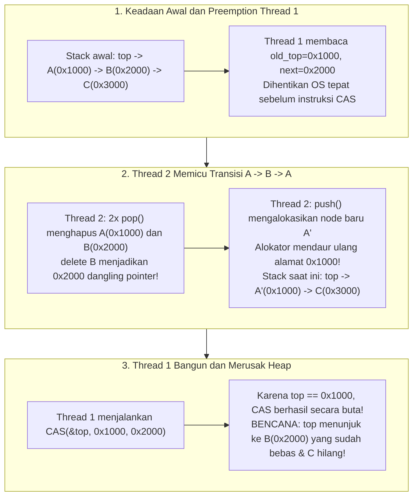

Prosesor server modern adalah mesin memori bersama (*shared-memory*) yang sangat paralel: satu server soket ganda dewasa ini lazim memiliki 128 hingga 256 core fisik—dan hingga 512 thread perangkat keras melalui *Simultaneous Multithreading* (SMT)—yang semuanya mengakses ruang alamat *cache-coherent* (ccNUMA) yang sama. Saat merancang penjadwal kernel sistem operasi, mesin pencocokan pesanan perdagangan frekuensi tinggi (HFT), *callback* pemrosesan sinyal digital (DSP) audio *real-time*, atau mesin basis data konkurensi tinggi, primitif sinkronisasi paling dasar—<strong>Mutual Exclusion Lock (`mutex`)</strong>—berubah dari mekanisme pengaman menjadi leher botol (*bottleneck*) yang melumpuhkan sistem.

Bayangkan apa yang terjadi ketika 128 thread secara bersamaan memasukkan dan mengambil tugas dari antrean yang dilindungi oleh `std::mutex`. Memperbarui pointer kepala antrean hanya membutuhkan waktu sekitar 15 nanodetik. Namun, jika satu-satunya thread $T_1$ yang sedang memegang lock tersebut terkena *preemption* oleh penjadwal OS karena kuota waktunya habis, atau mengalami *Page Fault*, waktu 15 nanodetik itu langsung membengkak menjadi beberapa milidetik. Selama rentang waktu tersebut, <strong>ke-127 core CPU lainnya berhenti total</strong>, menunggu satu thread yang sedang tidur.

Untuk memutus ketergantungan fatal ini, lahirlah sains <strong>Sinkronisasi Non-Blocking (Non-Blocking Synchronization)</strong>: algoritma <strong>Lock-Free</strong> dan <strong>Wait-Free</strong>. Akan tetapi, begitu kita membuang lock dan memanipulasi pointer secara langsung menggunakan instruksi atomik perangkat keras seperti `Compare-And-Swap` (`CAS`), kita langsung berhadapan dengan salah satu bug paling licik dalam ilmu komputer: <strong>Masalah ABA (ABA Problem)</strong>, beserta masalah <strong>Reklamasi Memori Aman (Safe Memory Reclamation, SMR)</strong> pada bahasa pemrograman tanpa *Garbage Collector* (C, C++, Rust).

---

## Bab 1: Mengapa Mutual Exclusion (`mutex`) Gagal dalam Sistem Berlatensi Sangat Rendah

Bahkan implementasi mutex modern yang sangat teroptimasi seperti `futex` (*Fast Userspace Mutex*) di Linux tetap menderita empat patologi struktural akibat sifat pemblokirannya:

1. <strong>Preemption dan Efek Konvoi (Lock Convoying)</strong>: Jika thread pemegang lock dihentikan sementara di dalam *critical section*, semua thread lain yang datang belakangan akan menumpuk di antrean tidur kernel. Bahkan setelah lock dilepaskan, proses membangunkan thread satu per satu, pergantian konteks (*Context Switch*), dan *Cache Line Bouncing* antar-node NUMA menciptakan kemacetan beruntun yang panjang.
2. <strong>Inversi Prioritas Tak Terbatas (Priority Inversion) — Pelajaran dari Mars Pathfinder (1997)</strong>: Pada Juli 1997, wahana antariksa NASA *Mars Pathfinder* mengalami *reset* sistem berulang kali di permukaan Mars. Pada OS *real-time* VxWorks, tugas meteorologi berprioritas rendah $T_{\text{low}}$ memegang mutex bus; tugas manajemen bus berprioritas tinggi $T_{\text{high}}$ terblokir menunggu mutex tersebut; sementara itu, tugas komunikasi berprioritas menengah $T_{\text{med}}$ (yang sama sekali tidak membutuhkan mutex itu!) mengambil alih CPU dari $T_{\text{low}}$, membuat $T_{\text{high}}$ kelaparan secara tidak langsung hingga *watchdog timer* me-reboot wahana.
3. <strong>Deadlock dan Ketidakmampuan Komposisi (Lack of Composability)</strong>: Dua tabel hash $A$ dan $B$ yang masing-masing aman terhadap thread melalui mutex internal tidak dapat digabungkan menjadi operasi atomik `transfer(A, B)` tanpa aturan urutan penguncian global untuk menghindari *deadlock* silang AB-BA.
4. <strong>Larangan Mutlak di dalam Signal Handler, Interrupt (ISR), dan Callback Audio Real-Time</strong>: Memanggil `mutex_lock` di dalam *signal handler* POSIX (`SIGINT`, `SIGSEGV`) memicu <strong>Self-Deadlock</strong> seketika jika thread yang diinterupsi sedang memegang lock tersebut. Dalam *callback* audio DSP *real-time* ($48\,\text{kHz}$, buffer 64 sampel $\implies$ batas waktu keras $1{,}33\,\text{ms}$), tidur di kernel akibat `futex` langsung menyebabkan *buffer underrun* (suara gemeretak/glitch).

---

## Bab 2: Linearizabilitas dan Tiga Jaminan Kemajuan Non-Blocking

### 2.1 Standar Kebenaran: Linearizabilitas (Herlihy & Wing, 1990)
Dalam eksekusi konkuren, setiap pemanggilan metode $op_i$ membentang pada interval waktu $[t_{\text{inv}}(op_i), t_{\text{resp}}(op_i)]$. Sebuah objek konkuren disebut <strong>linearizable</strong> jika setiap operasi $op_i$ dapat diberi satu titik waktu instan—<strong>Titik Linearisasi (Linearization Point)</strong> $t_{\text{lin}}(op_i) \in [t_{\text{inv}}(op_i), t_{\text{resp}}(op_i)]$—sehingga pengurutan seluruh operasi berdasarkan $t_{\text{lin}}$ membentuk eksekusi sekuensial yang sah. Linearizabilitas bersifat <strong>lokal dan dapat dikomposisikan (Composable)</strong>.

### 2.2 Tiga Tingkatan Jaminan Kemajuan (Liveness)
1. <strong>Obstruction-Free (Bebas Hambatan)</strong>: Sebuah thread dijamin menyelesaikan operasinya dalam jumlah langkah berhingga <strong>asalkan pada akhirnya ia dieksekusi seorang diri dalam isolasi</strong> (tanpa gangguan thread lain). Rentan terhadap *livelock* saat terjadi kontensi sehingga memerlukan pengelola kontensi dengan *exponential backoff*.
2. <strong>Lock-Free (Bebas Kunci)</strong>: Tanpa memedulikan kecepatan, *preemption*, atau kegagalan permanen (*crash-stop*) dari thread lain, <strong>setidaknya satu thread di antara seluruh thread yang aktif dijamin menyelesaikan operasinya dalam jumlah langkah berhingga</strong>. Jika `CAS` suatu thread gagal, itu berarti secara matematis `CAS` milik thread *lain* telah berhasil dan memajukan keadaan sistem secara global!
3. <strong>Wait-Free (Bebas Tunggu)</strong>: <strong>Setiap thread individu</strong> dijamin menyelesaikan operasinya dalam jumlah langkah berhingga yang terbatas ($O(1)$ atau $O(P)$), menghilangkan kelaparan sepenuhnya (*Zero Starvation*). Hal ini dicapai melalui <strong>Mekanisme Bantuan (Helping)</strong>: thread lambat mengumumkan deskriptor operasinya di array global `announce[i]`, dan thread cepat membantu menyelesaikan operasi thread lambat yang tertunda sebelum menyelesaikan operasinya sendiri.

| Jaminan Kemajuan | Blocking? | Kemajuan Global Sistem? | Bebas Kelaparan per Thread? | Aman di Signal / ISR / Audio RT? | Kompleksitas Kasus Terburuk | Contoh Klasik |
| :--- | :--- | :--- | :--- | :--- | :--- | :--- |
| <strong>Blocking (`mutex`)</strong> | Ya | Tidak (berhenti jika pemegang lock tidur) | Tidak (Deadlock & Inversi Prioritas) | <strong>Dilarang / Berbahaya</strong> | $\infty$ (Tidur OS tak terbatas) | `std::mutex`, `pthread_mutex_t` |
| <strong>Obstruction-Free</strong> | Non-blocking | Hanya saat eksekusi solo (Risiko Livelock) | Tidak (Butuh backoff) | Aman | $\infty$ saat kontensi | Software Transactional Memory (STM) |
| <strong>Lock-Free</strong> | Non-blocking | <strong>Ya (Minimal 1 thread selesai)</strong> | Tidak (Retry saat kontensi tinggi) | <strong>Sangat Aman</strong> | Ekspektasi $O(1)$ | Treiber Stack, Antrean Michael-Scott |
| <strong>Wait-Free</strong> | Non-blocking | <strong>Ya (Semua thread selesai)</strong> | <strong>Ya (Nol kelaparan)</strong> | <strong>Hard Real-Time Aman</strong> | <strong>Terbatas ketat $O(1)$ atau $O(P)$</strong> | Antrean Kogan-Petrank, Buffer SPSC, Pembaca RCU |

---

## Bab 3: Instruksi Atomik Perangkat Keras dan Hierarki Konsensus Maurice Herlihy (1991)

Dalam makalah terkenalnya *"Wait-Free Synchronization"* (1991, peraih Gödel Prize dan Dijkstra Prize), Maurice Herlihy mengklasifikasikan kekuatan komputasi setiap primitif sinkronisasi $\mathcal{O}$ melalui <strong>Bilangan Konsensus (Consensus Number) $C(\mathcal{O})$</strong>: jumlah maksimum thread $N$ yang dapat menyelesaikan masalah konsensus Wait-Free (Kesepakatan, Validitas, dan Terminasi Wait-Free) menggunakan objek tipe $\mathcal{O}$ dan register baca/tulis atomik.

- <strong>$C = 1$: Register Baca/Tulis Atomik (`MOV` + memory barrier)</strong>: <strong>Bahkan tidak mampu menyelesaikan konsensus untuk $N = 2$ thread!</strong>
  *Bukti melalui Bivalensi*: Berangkat dari keadaan awal yang bivalen (keputusan 0 maupun 1 masih mungkin dicapai), protokol pasti akan mencapai <strong>keadaan bivalen kritis $S_{\text{crit}}$</strong> di mana langkah $e_A$ dari thread $A$ menghasilkan keadaan 0-valen $S_0$ dan langkah $e_B$ dari thread $B$ menghasilkan keadaan 1-valen $S_1$. Pada kasus krusial ketika keduanya menulis ke register $R$ yang sama, jika $A$ menulis lebih dulu lalu langsung diikuti oleh $B$, penulisan oleh $B$ <strong>menimpa dan menghapus tanpa jejak</strong> nilai yang ditulis $A$! Bagi thread $B$, keadaan 0-valen $e_B(e_A(S_{\text{crit}}))$ menjadi <strong>sama sekali tidak dapat dibedakan (Indistinguishable)</strong> dari keadaan 1-valen $e_B(S_{\text{crit}})$, yang memicu kontradiksi saat $B$ dijalankan sendirian hingga selesai.
- <strong>$C = 2$: `Test-and-Set` (`TAS`), `Swap` (`XCHG`), `Fetch-and-Add` (`LOCK XADD`), Stack & Antrean FIFO</strong>: Mampu menyelesaikan konsensus untuk 2 thread, tetapi <strong>gagal secara matematis untuk $N \ge 3$ thread!</strong> Pada `Fetch-and-Add`, jika $A$ dan $B$ masing-masing menambahkan 1 ke register yang sama, sifat komutatif penjumlahan menghasilkan nilai $r+2$ yang identik terlepas dari siapa yang lebih dulu; thread ketiga $C$ tidak dapat mengetahui siapa pemenangnya. Kesimpulan penting: <strong>mustahil membangun antrean atau stack Lock-Free umum untuk $\ge 3$ thread hanya dengan `Fetch-and-Add` atau `Swap`!</strong>
- <strong>$C = \infty$ (Primitif Universal): `Compare-And-Swap` (`CAS`) dan `Load-Linked / Store-Conditional` (`LL/SC`)</strong>: Dengan `CAS(&decision, UNDECIDED, my_val)`, hanya thread pertama yang berhasil mengubah nilai, sedangkan $N-1$ thread lainnya gagal <strong>tanpa pernah menimpa nilai pemenang</strong>. Karena itu, `CAS` dan `LL/SC` bersifat universal untuk jumlah thread $N \to \infty$ berapa pun.

---

## Bab 4: Treiber Stack (1986) dan Anatomi Masalah ABA

Mari kita periksa implementasi `pop()` naif pada stack Lock-Free karya R. Kent Treiber (1986):

```cpp
// Operasi pop() naif pada Treiber Stack — rentan terhadap Masalah ABA dan Use-After-Free!
bool pop(T& result) {
    Node* old_top = top.load(std::memory_order_acquire);
    while (old_top != nullptr) {
        Node* next_node = old_top->next; // Titik bahaya 1: dereferensi old_top
        if (top.compare_exchange_weak(   // Titik bahaya 2: CAS hanya memeriksa kesamaan alamat
                old_top, next_node,
                std::memory_order_acquire, std::memory_order_relaxed)) {
            result = old_top->data;
            delete old_top;              // Mengembalikan node ke alokator memori (pemicu bencana!)
            return true;
        }
    }
    return false;
}
```

### 4.1 Kronologi 5 Langkah Kerusakan Heap Akibat Masalah ABA
Keadaan awal stack: $\text{top} \longrightarrow A(\texttt{0x1000}) \longrightarrow B(\texttt{0x2000}) \longrightarrow C(\texttt{0x3000})$.

1. <strong>[Langkah 1] Thread 1 memulai `pop()` dan terkena preemption tepat sebelum `CAS`</strong>: Thread 1 membaca `old_top = 0x1000` ($A$) dan `next_node = 0x2000` ($B$), tetapi dihentikan sementara oleh penjadwal OS tepat sebelum menjalankan instruksi `CAS(&top, 0x1000, 0x2000)`.
2. <strong>[Langkah 2] Thread 2 mengambil $A$ dan $B$ lalu membebaskan keduanya</strong>: Thread 2 memanggil `pop()` dua kali: mengeluarkan $A(\texttt{0x1000})$ (`delete A`), lalu mengeluarkan $B(\texttt{0x2000})$ dan memanggil <strong>`delete B`</strong>. Alamat `0x2000` kini menjadi memori bebas (*dangling pointer*), dan stack menyisakan $\text{top} \to C(\texttt{0x3000})$.
3. <strong>[Langkah 3] Thread 2 melakukan `push()` dan alokator mendaur ulang alamat `0x1000`</strong>: Thread 2 mengalokasikan node baru $A'$. Alokator memori modern (`jemalloc`, `tcmalloc`, `ptmalloc`) segera menggunakan kembali blok yang baru saja dibebaskan dalam urutan LIFO demi lokalitas cache L1, sehingga memberikan <strong>alamat yang persis sama `0x1000`</strong> kepada $A'$! Setelah di-push, stack menjadi $\text{top} \longrightarrow A'(\texttt{0x1000}) \longrightarrow C(\texttt{0x3000})$.
4. <strong>[Langkah 4] Thread 1 bangun dan mengeksekusi `CAS(&top, 0x1000, 0x2000)` miliknya yang sudah usang</strong>: Perangkat keras memeriksa bahwa `top` (`0x1000`) cocok secara bit-demi-bit dengan `old_top` (`0x1000`) setelah transisi $A \to B \to A$, sehingga <strong>`CAS` berhasil secara membabi buta!</strong>
5. <strong>[Langkah 5] Kerusakan Total pada Heap</strong>: `top` kini menunjuk ke `0x2000` (node $B$ yang sudah dihapus!), node $C(\texttt{0x3000})$ bocor selamanya, dan akses berikutnya memicu Use-After-Free atau `SIGSEGV`.



---

## Bab 5: Empat Arsitektur Solusi Masalah ABA dan Reklamasi Memori Aman (SMR)

### 5.1 Solusi 1: Tagged Pointers & Double-Width CAS (`DWCAS` / `CMPXCHG16B`)
Memasangkan pointer 64-bit `ptr` dengan penghitung generasi monotonik 64-bit `tag` ke dalam struktur 128-bit `(ptr, tag)` yang selalu ditambah $+1$ setiap kali dimodifikasi: $(\texttt{0x1000}, 42) \to (\texttt{0x2000}, 43) \to (\texttt{0x1000}, 44)$. Menggunakan instruksi x86-64 `LOCK CMPXCHG16B`, `DWCAS` mendeteksi `tag 42 != 44` dan menggagalkan operasi dengan aman. Harus dipadukan dengan pool memori bertipe stabil (*Type-Stable Freelist*) agar pembacaan `old_top->next` tidak memicu `SIGSEGV`.

### 5.2 Solusi 2: Hazard Pointers (Maged Michael 2004, C++26 `<hazard_pointer>`)
Setiap thread pembaca $i$ mengumumkan pointer `p = top.load()` pada slot atomik global `HP[i].store(p, memory_order_seq_cst)` lalu <strong>segera memvalidasi ulang</strong> `if (top.load(memory_order_seq_cst) != p) retry;`. Selama `HP[i] == p` tercatat, tidak ada thread yang boleh membebaskan atau mendaur ulang alamat `p`. Node yang dikeluarkan dimasukkan ke daftar pensiun lokal (`retired_list`) dan hanya dihapus dengan `delete` setelah memindai seluruh `HP[]`. Menjamin batas memori $O(P^2)$, dengan konsekuensi biaya *memory fence* `SeqCst` (`MFENCE`) setiap kali menelusuri satu pointer.

### 5.3 Solusi 3: Reklamasi Berbasis Epoch (EBR — Keir Fraser 2004, Rust `crossbeam-epoch`)

```mermaid
flowchart TD
    subgraph HP["Hazard Pointers (Perlindungan per Pointer, C++26)"]
        H1["1. Baca p = top.load()"] --> H2["2. Publikasikan HP[tid] = p (Barrier SeqCst)"]
        H2 --> H3{"3. Validasi ulang: top == p?"}
        H3 -- "Tidak (Konflik)" --> H1
        H3 -- "Ya (Terlindungi)" --> H4["4. Baca p->next dengan aman & jalankan CAS"]
        H4 --> H5["5. Kosongkan HP[tid], pensiunkan p & pindai HP[] sebelum delete"]
    end

    subgraph EBR["Epoch-Based Reclamation (Perlindungan per Operasi dalam 3 Epoch)"]
        E1["1. pin(): active=true, local_e = Global_E<br/>(Hanya 1 memory barrier untuk seluruh penelusuran!)"] --> E2["2. Telusuri banyak pointer tanpa barrier tambahan & CAS"]
        E2 --> E3["3. Masukkan node terlepas ke bag[Global_E % 3]"]
        E3 --> E4["4. unpin(): active=false"]
        E4 --> E5["5. Saat semua thread aktif mencapai Global_E: majukan epoch<br/>dan bebaskan massal kantong 2 epoch lalu bag[(E-2)%3]"]
    end
```

Untuk menghilangkan *memory barrier* pada setiap pointer, EBR menggunakan penghitung epoch global $E$ dan 3 kantong sampah `bag[0..2]`. Saat memulai operasi (`pin()`), thread menandai `active = true` dan mencatat `local_e = E` (<strong>hanya satu *memory barrier* untuk seluruh operasi!</strong>). Node yang dilepas dimasukkan ke `bag[E % 3]`. Ketika seluruh thread aktif telah mencapai epoch $E$, epoch global maju; saat mencapai $E+2$, dipastikan tidak ada lagi thread aktif yang memegang referensi dari epoch $E$, sehingga seluruh isi `bag[E % 3]` dapat dibebaskan secara massal.



### 5.4 Solusi 4: Read-Copy-Update (RCU — Kernel Linux & `liburcu`)
Untuk beban kerja yang didominasi pembacaan (tabel perutean, cache VFS `dcache`), RCU mencapai <strong>pembacaan Wait-Free dengan overhead nol</strong> (`rcu_read_lock()` dikompilasi menjadi nol instruksi mesin pada kernel non-preemptible, hanya melarang pergantian konteks). Penulis membuat salinan (*Copy-on-Write*), mengganti pointer secara atomik, lalu menunggu melalui `synchronize_rcu()` selama <strong>Grace Period</strong>—hingga setiap core CPU melewati setidaknya satu pergantian konteks (*Quiescent State*)—sebelum membebaskan node lama.

| Teknik SMR / Anti-ABA | Overhead Jalur Baca | Memori Terbatas Saat Thread Macet? | Fleksibilitas Struktur Data | Implementasi Produksi Utama |
| :--- | :--- | :--- | :--- | :--- |
| <strong>Tagged Pointers (`DWCAS` + Pool)</strong> | <strong>Sangat Rendah</strong> (Load atomik) | Pool tetap (Tidak dikembalikan ke OS) | Terbatas pada struktur pointer tunggal | Kernel Linux `SLUB`, pool embedded |
| <strong>Hazard Pointers</strong> | <strong>Tinggi</strong> (Barrier `SeqCst` per pointer) | <strong>Ya — Terbatas $O(P^2)$ (100% Lock-Free)</strong> | <strong>Sangat tinggi</strong> (List, pohon, graf) | <strong>C++26 `<hazard_pointer>`</strong>, Meta `Folly` |
| <strong>Epoch-Based Reclamation (EBR)</strong> | <strong>Rendah</strong> (1 barrier per `pin()`) | Tidak (Thread macet di `pin` menunda GC) | <strong>Sangat tinggi</strong> (Ideal untuk penelusuran dalam) | <strong>Rust `crossbeam-epoch`</strong>, Bw-Tree |
| <strong>Read-Copy-Update (RCU)</strong> | <strong>Nol (0 instruksi, Wait-Free)</strong> | Dibatasi oleh Grace Period | Khusus beban kerja Read-Mostly | <strong>Kernel Linux (VFS, Jaringan)</strong>, `liburcu` |
