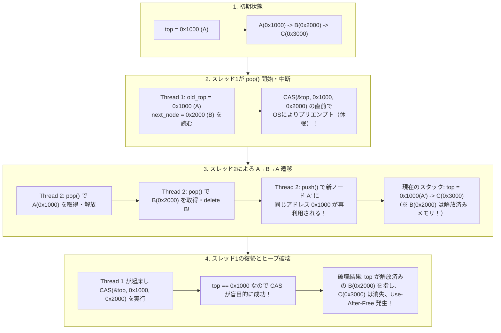
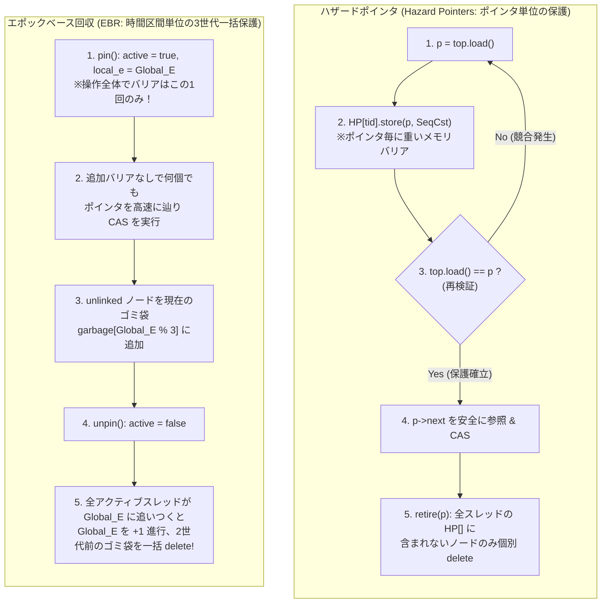

現代のサーバプロセッサは、1ソケットあたり64コアから128コア、SMT（同時マルチスレッディング）を含めれば256以上の論理スレッドが単一の共有メモリ空間（NUMAノード群）に同時アクセスする巨大な並列計算機である。このようなメニーコア環境において、OSカーネルのスケジューラ、高頻度取引（HFT）の注文マッチングエンジン、リアルタイム・オーディオDSPのコールバック、あるいはデータベースのトランザクションマネージャを設計するとき、プログラマが最初に教わる同期プリミティブ——すなわち<strong>ミューテックス（Mutual Exclusion Lock: 相互排他ロック）</strong>——は、しばしばシステム全体を破綻させる最大のボトルネックへと変貌する。

もし128個のスレッドが同じキューやスタックに対してデータを出し入れするとき、誰か1つのスレッドがロックを握ったままOSのタイムスライス切れでプリエンプト（強制中断）されたら何が起きるだろうか？ たった20ナノ秒で終わるはずだったポインタの書き換え処理が、コンテキストスイッチによって数ミリ秒間凍結され、その間に残りの127個のCPUコアすべてが「眠っているスレッド」のロック解放を待って次々と停止していく。

この「1つのスレッドの遅延がシステム全体の進行を止める」という相互排他の根本的な呪縛を断ち切るために生まれたのが、<strong>ノンブロッキング同期（Non-blocking Synchronization）</strong>——すなわち<strong>ロックフリー（Lock-Free）</strong>および<strong>ウェイトフリー（Wait-Free）</strong>アルゴリズムの科学である。

しかし、ロックを捨ててハードウェアの原子命令（`Compare-And-Swap` や `Load-Linked / Store-Conditional`）だけでデータ構造を書き換えようとした瞬間、私たちはコンピュータ科学において最も狡猾で悪名高いバグの一つに直面する。それが<strong>「ABA問題（ABA Problem）」</strong>と、ガベージコレクタを持たない言語（C / C++ / Rust）における<strong>「安全なメモリ回収問題（Safe Memory Reclamation: SMR）」</strong>である。

本稿では、ミューテックスが低遅延システムで破綻する構造的理由から出発し、モーリス・ハーリヒ（Maurice Herlihy）が証明した「合意数階層（Consensus Hierarchy）」の数理、トレイバー・スタック（Treiber Stack）を破壊するABA問題の正確なタイムライン、そしてそれを克服するハザードポインタ（Hazard Pointers）、エポックベース回収（EBR）、RCU（Read-Copy-Update）のアルゴリズムまでを体系的に解き明かす。

---

## 第1章：なぜミューテックス（相互排他ロック）は超低遅延システムで破綻するのか

マルチスレッドプログラミングの入門書では、共有データを守る黄金律として `std::mutex` や `pthread_mutex_t` によるクリティカルセクションの保護が説かれる。Linuxにおける現代的なミューテックス実装である `futex`（Fast Userspace Mutex）は、競合がない限りユーザ空間のアトミック演算だけでロック取得を完了し、競合が発生したときのみ `SYS_futex` システムコールを発行してカーネルの待機キューでスレッドをスリープさせるという極めて洗練された設計を持っている。

それにもかかわらず、OSカーネル内部、リアルタイムシステム、あるいはミリ秒未満のテールレイテンシ（99.99パーセンタイル遅延）を争うシステムにおいて、ミューテックスは致命的な脆弱性を抱えている。その理由は単なる「ロック取得命令のオーバーヘッド」ではなく、<strong>「ロックを保持しているスレッドの運命に、システム全体の進行（Progress）が人質に取られる」</strong>という構造そのものにある。

### 1.1 プリエンプションとロック・コンボイ（Lock Convoying）

共有キューの先頭ポインタを更新するクリティカルセクションを考えよう。機械語にコンパイルすれば、これはわずか数命令（数ナノ秒〜十数ナノ秒）で完結する処理である。

しかし、スレッド $T_1$ がミューテックスを獲得した直後、ハードウェアタイマ割り込みが発生し、OSのスケジューラが $T_1$ のタイムスライス終了を宣告して別のプロセスへコンテキストスイッチしたとしよう。あるいは、$T_1$ がクリティカルセクション内でアクセスしたメモリページがたまたまTLBミスやページフォルト（Page Fault）を引き起こし、カーネルのページフォルトハンドラが走るために数マイクロ秒から数ミリ秒の間 $T_1$ がブロックされたとする。

この瞬間、破局が始まる。
他のコアで稼働しているスレッド $T_2, T_3, \dots, T_N$ が同じキューにアクセスしようとすると、ミューテックスがロックされているため先に進めない。スピンロック（Spinlock）であれば他のコアはCPUサイクルを100%浪費しながら空転し続け、スリープ型ミューテックスであれば次々と `futex` システムコールを呼んでカーネルの休眠キューへと積み重なっていく。

数ミリ秒後にようやく $T_1$ がスケジュールされ直してロックを解放したあとも、休眠していた大量のスレッドをカーネルが順次ウェイクアップし、コンテキストスイッチを繰り返しながら1つずつロックを引き渡していくため、玉突き事故のような渋滞が長く尾を引く。これを<strong>ロック・コンボイ（Lock Convoying：ロックの護送船団現象）</strong>と呼ぶ。

### 1.2 優先度逆転（Priority Inversion）——火星探査機マーズ・パスファインダーの教訓

リアルタイムシステムにおいてさらに深刻なのが<strong>優先度逆転（Priority Inversion）</strong>である。1997年7月、火星に着陸したNASAの探査機「マーズ・パスファインダー（Mars Pathfinder）」が、着陸後に原因不明のシステムリセットを繰り返すという危機に見舞われた。原因はVxWorksリアルタイムOS上で動いていた3つのスレッドと1つのミューテックスにあった。

1. <strong>低優先度スレッド $T_{\text{low}}$</strong>（気象データ収集タスク）が、情報バスを守るミューテックスを獲得して書き込みを開始する。
2. <strong>高優先度スレッド $T_{\text{high}}$</strong>（バス管理タスク：厳格なデッドラインを持つ最重要タスク）が起動し、$T_{\text{low}}$ をプリエンプトして走り始めるが、同じミューテックスを取得しようとしてブロックされ、$T_{\text{low}}$ の完了を待つためにスリープする。
3. そこへ、ミューテックスとは全く無関係な<strong>中優先度スレッド $T_{\text{med}}$</strong>（通信タスク）が起動する。$T_{\text{med}}$ はミューテックスを必要としないためブロックされず、しかもロックを握っている $T_{\text{low}}$ より優先度が高いため、$T_{\text{low}}$ からCPUを奪い取って長時間実行し続ける。
4. 結果として、最高優先度であるはずの $T_{\text{high}}$ が、無関係な中優先度タスク $T_{\text{med}}$ によって間接的に妨害され続け、ウォッチドッグタイマがタイムアウトして探査機全体が強制再起動されたのである。

優先度継承プロトコル（Priority Inheritance Protocol）によってこの問題は緩和できるものの、ネストした複数のロックや複雑な依存グラフが存在する場合、リアルタイム性の保証は著しく困難になる。

### 1.3 デッドロックと非同期シグナル・オーディオコールバックの制約

さらに、複数のミューテックス $M_1, M_2$ を組み合わせた瞬間に<strong>デッドロック（Deadlock：死の抱擁）</strong>のリスクが生じる。ソフトウェア工学において重要な帰結として、<strong>「ロックベースのオブジェクトは合成可能（Composable）ではない」</strong>という事実がある。スレッド安全なハッシュテーブル $A$ とスレッド安全なハッシュテーブル $B$ がそれぞれ内部ロックを持っていても、「$A$ から要素を取り出して $B$ へアトミックに移動する」という操作を安全かつデッドロックなしに合成することは自明ではない。

加えて、以下のコンテキストではミューテックスを使用すること自体が<strong>原理的に禁止</strong>されている。

- <strong>POSIX非同期シグナルハンドラ（`SIGINT`, `SIGSEGV`, プロファイラのタイマシグナル等）</strong>：もし通常スレッドが `malloc` 内部のアリーナロックやログ出力のミューテックスを保持している最中にシグナルが配送され、シグナルハンドラ内で同じミューテックスを取得しようとすれば、<strong>自分自身が解放するはずのロックを自分自身が永遠に待つ（自己デッドロック）</strong>ことになる。
- <strong>OSカーネルのハードウェア割り込みハンドラ（Top-Half ISR）</strong>：割り込みコンテキストには対応するプロセスのスレッド構造体が存在しない（あるいは無関係なプロセスを中断して走っている）ため、ミューテックス待ちでスリープ（`schedule()`）することが許されない。
- <strong>リアルタイム・オーディオDSPコールバック（CoreAudio / ASIO / JACKの `processBlock`）</strong>：サンプリング周波数 $48\,\text{kHz}$、バッファサイズ64サンプルの環境では、コールバックは $64 / 48000 \approx 1.33\,\text{ms}$ 以内に必ず計算を終えなければならない。ここでUIスレッドと共有するミューテックスに触れてシステムコール待ちが発生すれば、即座にバッファアンダーラン（音声のプツプツというグリッチノイズ）が発生する。

これらの極限環境で共有データを安全に読み書きするには、<strong>「どのスレッドがいつ停止・中断しようとも、他のスレッドは一切待つことなく処理を完遂できる」</strong>というノンブロッキングなアルゴリズムが不可欠となる。

---

## 第2章：線形化可能性（Linearizability）と3つのノンブロッキング進行保証

ロックを使わずに複数スレッドが同時にデータ構造を操作するとき、「そもそもデータ構造が正しく動いている（Correctness）」とは何を意味するのか？ そして「ロックなしで前に進む（Progress）」にはどのような理論的段階があるのか？ これを厳密に定義したのが、モーリス・ハーリヒ（Maurice Herlihy）とジャネット・ウィング（Jeannette Wing）が1990年に提唱した<strong>線形化可能性（Linearizability）</strong>と、3段階の進行保証である。

### 2.1 正当性の基準：線形化可能性（Linearizability）

シングルスレッドのプログラムでは、スタックに対する `push(x)` と `pop()` の仕様は自明である。しかしマルチスレッド環境では、各操作は「呼び出し（Invocation）」から「応答（Response）」までの時間区間 $[t_{\text{inv}}, t_{\text{resp}}]$ を持つ。スレッド $T_1$ の `push(A)` の実行区間と、スレッド $T_2$ の `push(B)` や $T_3$ の `pop()` の実行区間は時間軸上で激しく重なり合う（オーバーラップする）。

ハーリヒとウィングは、並行オブジェクトが<strong>線形化可能（Linearizable）</strong>であるとは、以下の条件を満たすことであると定義した：

> <strong>線形化可能性の定義</strong>：
> すべての並行操作 $op_i$ について、その呼び出し時刻 $t_{\text{inv}}(op_i)$ と応答時刻 $t_{\text{resp}}(op_i)$ の間のどこか一点に<strong>「線形化点（Linearization Point）」</strong>と呼ばれる瞬間 $t_{\text{lin}}(op_i) \in [t_{\text{inv}}(op_i), t_{\text{resp}}(op_i)]$ を割り当てることができ、すべての操作をこの $t_{\text{lin}}(op_i)$ の順序で一列に並べたとき、その列が逐次仕様（Sequential Specification：シングルスレッドで順番に実行したときの正しい振る舞い）と完全に一致すること。

直感的に言えば、各メソッドの内部で何十行もの準備処理やリトライループが走っていようとも、外部の観測者からは<strong>「呼び出しから完了までの間のたった1つの機械語命令（通常は成功した `CAS` 命令やアトミックロード命令）が実行されたその瞬間に、操作全体が不可分（アトミック）に発火した」</strong>かのように見えるという性質である。

データベースの「直列化可能性（Serializability）」との決定的な違いは、線形化可能性が<strong>実時間順序（Real-time Order）を保存する</strong>点と、<strong>局所的性質（Local / Composable Property）である</strong>点にある。すなわち、個々のデータ構造 $X$ と $Y$ がそれぞれ線形化可能であれば、特別な全体調整を行わなくても、$X$ と $Y$ を組み合わせたシステム全体も自動的に線形化可能となる。

### 2.2 進行保証の3階層：Obstruction-Free, Lock-Free, Wait-Free

「正当性（Safety：壊れた状態を返さないこと）」を線形化可能性が担保するのに対し、「活性（Liveness：処理が止まらずに完了すること）」を分類するのが以下の3つのノンブロッキング進行保証である。

#### 1. 妨害フリー（Obstruction-Free / Solo-Progress）
> <strong>定義</strong>：あるスレッドが、他のすべてのスレッドが停止（または競合しない状態に）したあと<strong>単独で実行（Solo Execution）</strong>され続ければ、有限ステップ数以内に必ず自身の操作を完了できる性質。

最も弱いノンブロッキング保証である。ロックは使わないため、あるスレッドが途中でプリエンプトされても他のスレッドをブロックすることはない。しかし、2つ以上のスレッドが同時に同じ場所を書き換えようとして互いの作業を打ち消し合う<strong>ライブロック（Livelock）</strong>が発生する可能性がある。そのため実用上は、競合を検知した際に指数バックオフ（Exponential Backoff）などで譲り合う「競合マネージャ（Contention Manager）」と組み合わせて使われる。

#### 2. ロックフリー（Lock-Free / System-Wide Progress）
> <strong>定義</strong>：他のスレッドがどのような速度で動こうと、どこでプリエンプトされようと、あるいは永久にクラッシュ停止しようとも、<strong>現在操作を実行中のスレッド群のうち「少なくとも1つのスレッド」が、有限ステップ数以内に必ず操作を完了する</strong>性質。

実世界の並行プログラミングで最も広く使われている中核的なクラスである。
なぜ「少なくとも1つ」なのか？ ロックフリー・アルゴリズムの典型的な構造は、「現在の状態を読み取り、ローカルで新しいノードを準備し、`CAS`（Compare-And-Swap）命令でポインタの差し替えを試みる。もし失敗したらループの先頭に戻ってやり直す」という形をとる。

ここで重要な論理的帰結がある。<strong>「自分の `CAS` が失敗したという事実は、自分が状態を読み取ってから `CAS` を実行するまでの間に、他の誰か別のスレッドの `CAS` が成功してデータ構造の状態が前に進んだことを100%意味する」</strong>のである。
したがって、個別のスレッド $T_1$ だけを見れば、運悪く他のスレッドに何度も割り込まれてループをリトライさせられる（飢餓状態：Starvation の理論的可能性はある）かもしれないが、<strong>システム全体として見れば、誰かがリトライするたびに必ず別の誰かが操作を完了しているため、全体のスループットは決して停止しない</strong>。デッドロックも優先度逆転もロック・コンボイも原理的に起こり得ない。

#### 3. ウェイトフリー（Wait-Free / Per-Thread Starvation-Free Progress）
> <strong>定義</strong>：他のスレッドがどれほど激しく競合しようと、またどこで停止しようとも、<strong>操作を実行する「すべてのスレッド」が、それぞれ有界な有限ステップ数（Bounded Finite Steps）以内に必ず自身の操作を完了する</strong>性質。

ノンブロッキング同期の最高峰である。ロックフリーが許容していた「運の悪いスレッドがリトライし続ける（Starvation）」という可能性すら完全に排除し、すべてのスレッドのレイテンシに厳密な上限（たとえば $O(1)$ または $O(\text{スレッド数 } P)$ ステップ）を与える。

「他のスレッドがひっきりなしにポインタを書き換えているのに、どうやって自分の操作を有限ステップで必ず成功させるのか？」と不思議に思うかもしれない。ウェイトフリー・アルゴリズムの基本原理は<strong>「ヘルピング（Helping：助け合い機構）」</strong>にある。
スレッド $T_i$ は操作を始める前に、全スレッドから見える共有の「告知配列（Announcement Array）」の自分のスロット `state[i]` に「私はこれからこの操作をしたい」という記述子（Operation Descriptor）を書き込む。そして各スレッドは、自分の操作を行う前に（あるいはラウンドロビンで）他のスレッドの `state[j]` を確認し、まだ完了していない操作があれば<strong>他のスレッドに代わってその操作を完了させてあげる（Helpする）</strong>のである。たとえ $T_i$ の直接の `CAS` が他の高速なスレッド群に邪魔されて失敗し続けたとしても、最大でも $P$ 回の競合のうちに、邪魔をした高速なスレッド自身が $T_i$ の操作を代行して完了させてくれるため、$T_i$ は有限ステップで必ず結果を得ることができる。

| 進行保証クラス | ブロッキング有無 | システム全体の進行保証 | 個別スレッドの飢餓（Starvation）耐性 | プリエンプション・割り込み耐性 | 最悪計算量（レイテンシ上限） | 主な用途・実装例 |
| :--- | :--- | :--- | :--- | :--- | :--- | :--- |
| <strong>Blocking（Mutex / Spinlock）</strong> | ブロッキング | なし（保持スレッド停止で全体停止） | なし（デッドロック・優先度逆転あり） | 極めて脆弱（ISR・Signal不可） | $\infty$（無制限：OSスケジューラ依存） | 一般的な業務アプリケーション、低競合パス |
| <strong>Obstruction-Free（妨害フリー）</strong> | ノンブロッキング | 単独実行時のみ保証（ライブロックの恐れ） | なし（バックオフ制御が必要） | 安全 | $\infty$（競合時は未定義） | ソフトウェアトランザクションメモリ（STM） |
| <strong>Lock-Free（ロックフリー）</strong> | ノンブロッキング | <strong>常に保証（最低1スレッドが完了）</strong> | なし（高競合時にリトライ増加） | <strong>完全に安全（Signal/ISR可）</strong> | 期待値 $O(1)$、最悪時はリトライ発生 | Treiberスタック、Michael-Scottキュー、Linuxカーネル内リスト |
| <strong>Wait-Free（ウェイトフリー）</strong> | ノンブロッキング | <strong>常に保証（全スレッドが完了）</strong> | <strong>完全に保証（Starvationゼロ）</strong> | <strong>完全に安全（ハードRT可）</strong> | <strong>厳密に有界（$O(1)$ または $O(P)$）</strong> | 航空宇宙制御、リアルタイム音声DSPリングバッファ（SPSC）、RCU読み取り |

---

## 第3章：ハードウェア原子命令とハーリヒの「合意数階層（Consensus Hierarchy）」定理

では、ロックフリーやウェイトフリーなデータ構造を作るには、CPUがどのような機械語命令（ハードウェア・プリミティブ）を備えていればよいのだろうか？
「アトミックな読み書き（`std::atomic<int>` の `load` と `store`）さえあれば、工夫次第でどんなロックフリーデータ構造でも作れるのではないか？」——実はこの直感は<strong>数学的に誤りである</strong>ことが証明されている。

1991年、ブラウン大学のモーリス・ハーリヒ（Maurice Herlihy）は、論文 *"Wait-Free Synchronization"* において並行計算理論の金字塔となる定理を発表した（この業績によりハーリヒは2003年にゲーデル賞、2004年にダイクストラ賞を受賞している）。彼はあらゆる同期プリミティブの計算能力を<strong>「合意数（Consensus Number）」</strong>という単一の指標によって完全に分類し、どの命令で何が作れて何が絶対に作れないかの境界線を決定づけたのである。

### 3.1 合意問題（Consensus Problem）と合意数 $C(\mathcal{O})$

$N$ 個のスレッド $T_1, T_2, \dots, T_N$ がそれぞれ初期値（提案値）$v_i \in V$ を持ってスタートし、共有オブジェクトを介して通信した末に、各スレッドが単一の決定値 $d_i$ を出力して終了する問題を<strong>合意問題（Consensus Problem）</strong>と呼ぶ。正しいウェイトフリー合意プロトコルは以下の3条件をすべて満たさなければならない。

1. <strong>合意性（Agreement）</strong>：すべてのスレッドが出力する決定値は完全に同一でなければならない（任意の $i, j$ について $d_i = d_j = v^*$）。
2. <strong>妥当性（Validity）</strong>：決定値 $v^*$ は、少なくともどれか1つのスレッドが実際に提案した初期値 $v_k$ でなければならない（外から勝手に定数を捏造してはならない）。
3. <strong>ウェイトフリー終了性（Wait-Free Termination）</strong>：すべてのスレッドは、他のスレッドの速度や停止に関わらず、有限ステップ数以内に必ず決定値 $d_i$ を出力して終了しなければならない。

ある同期プリミティブ（共有オブジェクトの型）$\mathcal{O}$ の<strong>合意数（Consensus Number）$C(\mathcal{O})$</strong> とは、<strong>「任意の個数のアトミック読み書きレジスタと、任意の個数の型 $\mathcal{O}$ のオブジェクトだけを使って、$N$ スレッドのウェイトフリー合意問題を解くことができる最大の整数 $N$（もし任意の $N$ で解けるなら $\infty$）」</strong>として定義される。

ハーリヒは、すべてのハードウェア原子命令とデータ構造がこの合意数 $C \in \{1, 2, \dots, \infty\}$ の階層（<strong>Herlihy's Consensus Hierarchy</strong>）に厳密に配置され、<strong>「合意数が $m$ のプリミティブを何万個組み合わせても、合意数が $n > m$ のオブジェクトを $n$ スレッド以上でロックフリー／ウェイトフリーに実装することは絶対に不可能である」</strong>ことを証明した。

| 合意数 $C(\mathcal{O})$ | 対応するハードウェア原子命令・データ構造 | 可能なこと・不可能なことの理論的境界 |
| :--- | :--- | :--- |
| <strong>$C = 1$</strong> | アトミック読み書きレジスタ（Atomic Read/Write、`MOV` + メモリバリア） | <strong>2スレッドの合意すら不可能</strong>。単一書き手・単一読み手（SPSC）のリングバッファ等は作れるが、2スレッド以上が競合する汎用スタックやキューは実装不可能。 |
| <strong>$C = 2$</strong> | `Test-and-Set` (`TAS`)、`Swap` (`XCHG`)、`Fetch-and-Add` (`LOCK XADD`)、FIFOキュー、スタック | <strong>2スレッド間の合意のみ可能</strong>。これらと読み書きレジスタだけを使って、<strong>3スレッド以上が共有する汎用ロックフリーデータ構造を作ることは数学的に不可能</strong>。 |
| <strong>$C = 2m - 2$</strong> | $m$ レジスタ同時代入（$m$-register Assignment, $m \ge 2$） | $2m-2$ スレッドまでの合意が可能。 |
| <strong>$C = \infty$（普遍プリミティブ）</strong> | <strong>`Compare-And-Swap` (`CAS` / `LOCK CMPXCHG`)</strong>、<strong>`Load-Linked / Store-Conditional` (`LL/SC`)</strong>、メモリ間 `Move` / `Swap` | <strong>任意のスレッド数 $N$ に対して合意問題を1ステップで解決可能</strong>。あらゆる逐次データ構造を任意の $N$ スレッド向けにロックフリー／ウェイトフリー化できる<strong>万能（Universal）プリミティブ</strong>。 |

### 3.2 なぜアトミック読み書きレジスタだけでは2スレッドの合意すら不可能なのか？（$C = 1$ の不可能性証明）

なぜ `std::atomic` の `load()` と `store()` だけでは、たった2つのスレッド $A$ と $B$ が「どちらが先に来たか」をウェイトフリーに合意することすらできないのだろうか？ その証明（FLP不可能性定理およびLoui & Abu-Amara 1987に基づく二価性証明）は驚くほど美しく、並行計算の本質を突いている。

背理法で証明しよう。スレッド $A$（初期値 $0$ を提案）とスレッド $B$（初期値 $1$ を提案）の2スレッド合意を有限ステップで必ず解くプロトコルが存在すると仮定する。

1. システムのある時点の状態（全レジスタの値と両スレッドのプログラムカウンタ）を「構成（Configuration）」と呼ぶ。
   - その状態から先、スケジューラが $A$ と $B$ をどのような順序で動かしても最終的に必ず全員が $0$ を決定する状態を<strong>「0価（0-valent）」</strong>と呼ぶ。
   - 同様に、どう動かしても必ず $1$ を決定する状態を<strong>「1価（1-valent）」</strong>と呼ぶ（0価と1価を合わせて<strong>一価：Univalent</strong>と呼ぶ）。
   - まだこれからの $A$ と $B$ の実行順序（スケジューリング）次第で、$0$ にも $1$ にもなり得る状態を<strong>「二価（Bivalent）」</strong>と呼ぶ。
2. <strong>初期状態は必ず二価（Bivalent）である</strong>：なぜなら、もし最初からスレッド $B$ が1ステップも動かず $A$ だけが単独で最後まで走ったなら、妥当性（Validity）により $A$ は自分が知る唯一の提案値 $0$ を決定するしかない。逆に $B$ だけが単独で最後まで走ったなら $1$ を決定するしかない。つまり初期状態の時点では、まだ $0$ になる未来も $1$ になる未来も両方残っている。
3. ウェイトフリー終了性により、有限ステップで必ず決定が下されるため、二価の状態から慎重にステップを進めていくと、<strong>「あと1ステップの選択で運命が確定する臨界状態（Critical Bivalent Configuration）$S_{\text{crit}}$」</strong>に必ず到達する。すなわち、$S_{\text{crit}}$ においてスレッド $A$ が次の1ステップ $e_A$ を実行した状態 $S_0 = e_A(S_{\text{crit}})$ は<strong>0価</strong>であり、スレッド $B$ が次の1ステップ $e_B$ を実行した状態 $S_1 = e_B(S_{\text{crit}})$ は<strong>1価</strong>となるような分岐点 $S_{\text{crit}}$ が存在する。
4. では、この運命を分ける1ステップ $e_A$ と $e_B$ は一体何の命令だろうか？ アトミック読み書きレジスタしか存在しないため、各ステップは「あるレジスタ $R$ の読み取り（Read）」か「あるレジスタ $R$ への書き込み（Write）」のどちらかしかない。3つのケースに分類してみよう。
   - <strong>ケース1：$e_A$ と $e_B$ が異なるレジスタ $R_1, R_2$ にアクセスする場合、または両方が Read の場合</strong>：
     このとき2つの操作は可換（Commutative）である。すなわち、$S_{\text{crit}}$ から「$e_A$ を実行した直後に $e_B$ を実行した状態 $e_B(e_A(S_{\text{crit}}))$」と、「$e_B$ を実行した直後に $e_A$ を実行した状態 $e_A(e_B(S_{\text{crit}}))$」は、すべてのレジスタの値も両スレッドの内部状態も<strong>1ビットの狂いもなく完全に同一の状態</strong>になる！ しかし前者は0価の状態 $S_0$ から遷移したため0価でなければならず、後者は1価の状態 $S_1$ から遷移したため1価でなければならない。同一の状態が0価かつ1価であることは矛盾である。
   - <strong>ケース2：$e_A$ がレジスタ $R$ の Read であり、$e_B$ が同じレジスタ $R$ の Write である場合</strong>：
     $S_0 = e_A(S_{\text{crit}})$（0価）の直後にスレッド $B$ に $e_B$（Write）を実行させた状態 $S' = e_B(e_A(S_{\text{crit}}))$ を考える。この状態 $S'$ は $S_0$ の子孫なので<strong>0価</strong>である。
     ところが、スレッド $A$ が行った $e_A$ は「読み取り（Read）」だったため、共有メモリ上のどのレジスタも一切書き換えておらず、$A$ のローカル変数だけが変わっている。したがって、<strong>スレッド $B$ の視点から見ると、状態 $S' = e_B(e_A(S_{\text{crit}}))$（0価）と、状態 $S_1 = e_B(S_{\text{crit}})$（1価）は、共有メモリ上のすべてのレジスタ値も $B$ 自身の内部状態も完全に同一で区別がつかない（Indistinguishable）！</strong>
     そこでこの状態からスレッド $A$ を休眠させ、スレッド $B$ だけを単独で最後まで走らせてみよう。$S_1$ から $B$ を単独で走らせれば1価なので $B$ は必ず $1$ を出力する。しかし $B$ にとって全く区別がつかない $S'$ から $B$ を単独で走らせても、$B$ は全く同じ計算を行って $1$ を出力してしまう！ これは $S'$ が0価であることに矛盾する。
   - <strong>ケース3：$e_A$ と $e_B$ の両方が同じレジスタ $R$ への Write である場合</strong>：
     ここがクライマックスである。$S_0 = e_A(S_{\text{crit}})$（0価）の直後に、スレッド $B$ に $e_B$（同じレジスタ $R$ への上書き Write）を実行させた状態 $S'' = e_B(e_A(S_{\text{crit}}))$（0価）を考える。
     スレッド $A$ がレジスタ $R$ に書いた値は、直後にスレッド $B$ が同じレジスタ $R$ に値を上書きしたことで<strong>跡形もなく消滅（Overwrite）した</strong>！
     したがって、スレッド $B$ にとって状態 $S'' = e_B(e_A(S_{\text{crit}}))$（0価）は、最初から $A$ が何もせず $B$ だけが書き込んだ状態 $S_1 = e_B(S_{\text{crit}})$（1価）と<strong>完全に同一</strong>である。ここから $B$ を単独で最後まで走らせれば、0価のはずの $S''$ で $B$ は $1$ を出力してしまい、矛盾が生じる！

ゆえに、アトミックな読み書きレジスタを何千個並べても、2つのスレッド間でさえウェイトフリーな合意を達成することは<strong>数学的に不可能（$C = 1$）</strong>なのである。「古い値を消さずに読み取りつつ、条件付きで書き換える」という不可分な Read-Modify-Write（RMW）ハードウェア命令が不可欠な理由はここにある。

### 3.3 なぜ `Fetch-and-Add` や `Swap` は $C = 2$ で限界を迎えるのか？

では、x86の `LOCK XADD`（`fetch_add`）や `XCHG`（`swap`）、`TAS`（`test_and_set`）はどうだろうか？
これらは1命令で「古い値を返しつつ新しい値を書き込む」ため、<strong>2スレッド間（$N = 2$）の合意は簡単に解ける</strong>。たとえば初期値 $0$ の変数 `turn` に対して2つのスレッドが `fetch_add(1)` を実行すれば、戻り値として $0$ を受け取ったスレッドが「自分が1番乗り（勝者）」と分かり、戻り値 $1$ を受け取ったスレッドは「自分は2番手（敗者）なので勝者の提案値を読む」と分かる。

しかし、<strong>3スレッド（$N = 3$）になった瞬間、`Fetch-and-Add` も `Swap` も破綻する（$C = 2$）</strong>。
なぜか？ スレッド $A, B, C$ の3つがあるとき、臨界状態 $S_{\text{crit}}$ で $A$ と $B$ が両方とも同じ変数に対して `fetch_add(1)` を実行する場面を考えよう。「$A$ が先に `fetch_add(1)` して次に $B$ が `fetch_add(1)` した状態」と、「$B$ が先に `fetch_add(1)` して次に $A$ が `fetch_add(1)` した状態」を比較すると、共有メモリの変数の値はどちらも $+2$ されて<strong>全く同じ値</strong>になっている！
この直後に $A$ と $B$ の両方がプリエンプトされて眠ってしまい、残された第3のスレッド $C$ が単独で走らなければならなくなったとき、$C$ が共有メモリをどう調べても「$A$ と $B$ のどちらが1番乗りだったのか」を知る手がかりがメモリ上から完全に失われているのである（`Swap` でも同様に、後から `Swap` した側が前の値を上書きしてしまうため、3人目のスレッド $C$ は1番乗りが誰か判別できない）。

### 3.4 普遍プリミティブ（$C = \infty$）：`CAS` と `LL/SC`

この $C = 2$ の壁を打ち破り、任意のスレッド数 $N \to \infty$ に対して合意数 $\infty$ を達成する普遍プリミティブ（Universal Primitive）が、<strong>`Compare-And-Swap`（`CAS`）</strong>と<strong>`Load-Linked / Store-Conditional`（`LL/SC`）</strong>である。

#### Compare-And-Swap (`CAS` — x86-64 `LOCK CMPXCHG`, ARMv8.1 LSE `CAS`)
`CAS` は3つの引数（メモリアドレス `addr`、期待する古い値 `expected`、書き込みたい新しい値 `desired`）を受け取り、ハードウェアのキャッシュコヒーレンシ機構（MESIプロトコルの排他状態 `Modified`/`Exclusive` ロック）のもとで以下の処理を不可分に実行する：

```cpp
// ハードウェアが1命令（不可分）として実行する CAS の意味論
bool CAS(T* addr, T expected, T desired) {
    if (*addr == expected) {
        *addr = desired;
        return true;   // 成功：メモリが期待通りの値だったので書き換えた
    } else {
        return false;  // 失敗：他の誰かがすでに書き換えていた（一切変更しない！）
    }
}
```

なぜ `CAS` の合意数は $\infty$ なのか？
初期値 `UNDECIDED`（未決定）が入った共有変数 `decision` に対し、100万個のスレッドが一斉に `CAS(&decision, UNDECIDED, my_proposal)` を実行したとする。
すると、<strong>1番乗りのスレッドの `CAS` だけが成功して `decision` に自分の提案値を書き込み、2番手以降の99万9999個のスレッドの `CAS` はすべて失敗してメモリを一切上書きしない（勝者の値を壊さない！）</strong>。そのため、何番目のスレッドがいつ目覚めて `decision` を読んでも、1番乗りの勝者が誰であったかを100%確実に知ることができるのである。

#### Load-Linked / Store-Conditional (`LL/SC` — ARM `LDXR`/`STXR`, RISC-V `LR`/`SC`, PowerPC)
一方、ARMやRISC-VなどのRISCアーキテクチャが伝統的に採用してきたのが、操作を2つの命令に分割する `LL/SC` である。

1. <strong>`LL`（Load-Linked / Load-Exclusive: `LDXR` / `LR`）</strong>：メモリアドレス `addr` から値を読み取ると同時に、プロセッサコア内部の専用ハードウェアレジスタ（<strong>予約レジスタ：Reservation Register / Link Register</strong>）にそのキャッシュラインの物理アドレスを記録し、「監視状態（ Exclusive Reservation）」を開始する。
2. <strong>`SC`（Store-Conditional / Store-Exclusive: `STXR` / `SC`）</strong>：`LL` で監視を開始したアドレス `addr` に対して新しい値の書き込みを試みる。もし `LL` を実行してから `SC` を実行するまでの間に、<strong>他のCPUコアがそのキャッシュラインに対して一度でも書き込みを行った（キャッシュコヒーレンシのInvalidateメッセージを受信した）場合、あるいはコンテキストスイッチが発生した場合、予約フラグがクリアされているため `SC` は書き込みを中止して失敗コードを返す</strong>。誰も触れていなければ書き込みを完了して成功を返す。

後述するように、「値が `expected` と等しいか」しか見ない `CAS` と、「キャッシュラインに誰かが触れたか（変更イベントそのもの）」をハードウェアで監視する `LL/SC` の違いは、ABA問題において決定的な差を生むことになる。

---

## 第4章：トレイバー・スタック（Treiber Stack）の実装と、悪名高き「ABA問題」の解剖

それでは実際に `CAS` を使って、ロックを一切使わない並列データ構造を構築してみよう。1986年にIBMのR. Kent Treiberが発表した<strong>トレイバー・スタック（Treiber's Lock-Free Stack）</strong>は、すべてのロックフリーデータ構造の原点にして最も美しいアルゴリズムである。

### 4.1 ナイーブなトレイバー・スタックの実装（C++）

スタックの実体は単方向連結リストであり、先頭ノードを指すアトミックポインタ `top` だけを持つ。

```cpp
#include <atomic>

template <typename T>
class NaiveLockFreeStack {
public:
    struct Node {
        T data;
        Node* next;
        Node(const T& val) : data(val), next(nullptr) {}
    };

private:
    std::atomic<Node*> top{nullptr};

public:
    // ロックフリーな Push 操作
    void push(const T& val) {
        Node* new_node = new Node(val);
        // 1. 現在の top を読み取る
        Node* old_top = top.load(std::memory_order_relaxed);
        do {
            // 2. 新ノードの next が現在の top を指すように繋ぐ
            new_node->next = old_top;
            // 3. top がまだ old_top のままなら、不可分に new_node へ差し替える！
            //    もし他スレッドに先を越されていたら、old_top が最新の top に自動更新され再ループする
        } while (!top.compare_exchange_weak(
            old_top, new_node,
            std::memory_order_release,
            std::memory_order_relaxed));
    }

    // ロックフリーな Pop 操作（実はここに致命的なバグが潜んでいる！）
    bool pop(T& result) {
        Node* old_top = top.load(std::memory_order_acquire);
        while (old_top != nullptr) {
            // 先頭ノードの次（2番目のノード）を読み取る
            Node* next_node = old_top->next;
            // top がまだ old_top のままなら、2番目のノード next_node へ繰り上げる
            if (top.compare_exchange_weak(
                    old_top, next_node,
                    std::memory_order_acquire,
                    std::memory_order_relaxed)) {
                result = old_top->data;
                delete old_top; // 取り出したノードを解放（※これが破局を招く！）
                return true;
            }
            // CAS失敗時は old_top に最新の top が格納されているのでそのままループ継続
        }
        return false; // スタックが空
    }
};
```

ちなみに、キュー（FIFO）をロックフリーにする場合は、先頭 `head` と末尾 `tail` の2箇所を扱う必要がある。1996年にMaged MichaelとMichael Scottが発表した<strong>Michael-Scott Lock-Free Queue</strong>では、リストの先頭に常に1つのダミーノード（Sentinel Node）を置き、`enqueue` 時は ① `tail->next` を `nullptr` から新ノードへ `CAS` で繋ぎ、② `tail` 自体を新ノードへ `CAS` で進めるという2段階プロトコルをとる。もし①だけ終えてスレッドがプリエンプトされても、後から来た別スレッドが「`tail->next` が `nullptr` ではない（遅れている）」ことを検知して代わりに②の `CAS` を進めてあげる（Helping機構）ことでロックフリー性を実現している。

さて、上の `NaiveLockFreeStack` のコードを一見すると、完璧に動くように見える。
`push` も `pop` もロックを一切使っておらず、`top.compare_exchange_weak` が成功した瞬間が線形化点（Linearization Point）となる。もし他スレッドが割り込んで `top` を書き換えていれば、`compare_exchange_weak` が失敗して最初からやり直すはずだ——<strong>そう、「ポインタのアドレス値が変わっていれば」の話である。</strong>

### 4.2 悪夢のシナリオ：「ABA問題（ABA Problem）」の完全トレース

`CAS(&top, A, B)` という命令がチェックしているのは、<strong>「私が以前 `top` を読んだときから今まで、誰一人として `top` を書き換えていないか？」ではない。</strong>
`CAS` がハードウェア的にチェックしているのは、ただ単に<strong>「今この瞬間の `top` のビット列が、`A` のビット列と等しいか？」</strong>だけである。

もし、スレッド1が `A` を読み取ってから `CAS` を実行するまでのわずかな隙間に、他のスレッドがスタックから `A` と `B` を取り出して解放し、その後<strong>たまたま同じメモリアドレス `A` に再利用された全く別のノードをスタックにプッシュして、`top` の値が再び `A` に戻っていた（$A \to B \to A$）</strong>としたら何が起きるか？

具体的なメモリアドレスを使って、ヒープが完全に破壊される6ステップの惨劇を追跡しよう。

#### 初期状態
スタックには3つのノード $A$（アドレス `0x1000`）、$B$（アドレス `0x2000`）、$C$（アドレス `0x3000`）が積まれている。
$$
\text{top} \longrightarrow A(\texttt{0x1000}) \longrightarrow B(\texttt{0x2000}) \longrightarrow C(\texttt{0x3000}) \longrightarrow \texttt{nullptr}
$$

1. <strong>【Step 1】スレッド1が `pop()` を開始し、`CAS` の直前でプリエンプトされる</strong>
   スレッド1が `pop()` に入り、以下を実行する：
   - `old_top = top.load()` $\implies$ `0x1000`（ノード $A$）をローカルレジスタに読み込む。
   - `next_node = old_top->next` $\implies$ `0x2000`（ノード $B$）をローカルレジスタに読み込む。
   - これから `CAS(&top, 0x1000, 0x2000)`（「もし `top` がまだ `0x1000` なら、`0x2000` に書き換えよ」）を実行しようとする<strong>まさにその直前の機械語命令で、OSのスケジューラ割り込みが入り、スレッド1が休眠する</strong>。

2. <strong>【Step 2】スレッド2が稼働し、$A$ と $B$ を2連続で `pop()` して解放する</strong>
   スレッド1が眠っている間に、別コアのスレッド2が `pop()` を2回呼び出す：
   - 1回目の `pop()`：ノード $A(\texttt{0x1000})$ を取り出し、`delete A` を呼ぶ。スタックは $\text{top} \to B(\texttt{0x2000}) \to C(\texttt{0x3000})$ となる。
   - 2回目の `pop()`：ノード $B(\texttt{0x2000})$ を取り出し、<strong>`delete B` を呼んでアドレス `0x2000` をメモリアロケータに返却する！</strong>（あるいは `0x2000` のメモリ領域が全く別のサブシステム——たとえば暗号鍵バッファやファイルディスクリプタ構造体——に再割り当てされて書き換えられる）。
   - この時点でスタックの状態は $\text{top} \longrightarrow C(\texttt{0x3000}) \longrightarrow \texttt{nullptr}$ である。

3. <strong>【Step 3】スレッド2が新しい要素を `push()` し、アロケータがアドレス `0x1000` を再利用する</strong>
   次にスレッド2が新しいデータをスタックへ `push()` するため、`new Node(val)` を呼び出す。
   ここで現代のメモリアロケータ（`glibc malloc`, `jemalloc`, `tcmalloc`, `mimalloc` 等）の挙動を思い出してほしい。アロケータはCPUキャッシュ（L1/L2）の局所性を最大化するため、直前に `delete` されたばかりのメモリチャンクをスレッドローカルなLIFOフリーリストの先頭から<strong>即座に再利用（Reuse）する</strong>！
   その結果、新しく作られたノード $A'$ に、先ほど解放されたばかりの<strong>全く同じメモリアドレス `0x1000`</strong> が割り当てられる。
   スレッド2は $A'(\texttt{0x1000})$ をスタックにプッシュする。$A'\text{->next}$ は $C(\texttt{0x3000})$ を指す。
   現在の正しいスタックの状態は以下の通りである：
   $$
   \text{top} \longrightarrow A'(\texttt{0x1000}) \longrightarrow C(\texttt{0x3000}) \longrightarrow \texttt{nullptr}
   $$

4. <strong>【Step 4】スレッド1が目覚め、保留していた `CAS(&top, 0x1000, 0x2000)` を実行する！</strong>
   OSスケジューラがスレッド1を再開させる。スレッド1のCPUレジスタには、眠る前に読んだ `old_top = 0x1000` と `next_node = 0x2000` が残っている。
   スレッド1は `CAS(&top, 0x1000, 0x2000)` を実行する。
   CPUは現在の `top` の値（`0x1000`：新しいノード $A'$）と、スレッド1の期待値 `old_top`（`0x1000`：昔のノード $A$）を比較する。
   <strong>アドレスのビット列が `0x1000 == 0x1000` で完全に一致するため、`CAS` は「誰も変更していない！」と誤認して大成功してしまう！！</strong>

5. <strong>【Step 5】大惨事：ダングリングポインタによるヒープの完全崩壊</strong>
   成功した `CAS` によって、スタックの先頭ポインタ `top` は <strong>`0x2000`（すでに `delete` されて解放済み、あるいは別データとして使われている旧ノード $B$ の亡霊アドレス！）</strong> に強制的に書き換えられる。
   さらに、本来スタックに残っているべきだったノード $C(\texttt{0x3000})$ はどこからも参照されなくなり完全に消失（メモリリーク）し、以降このスタックを `pop()` しようとしたすべてのスレッドは解放済みメモリ `0x2000` を参照して Use-After-Free 脆弱性やセグメンテーションフォルト（`SIGSEGV`）を引き起こす！



これが<strong>ABA問題（状態が $A$ から $B$ へ変わり、再び $A$ に戻ったとき、`CAS` が変化を検知できない問題）</strong>の全貌である。

### 4.3 第2の罠：`CAS` の前に起きる `old_top->next` の Use-After-Free

ここでさらに鋭い読者は、ABA問題の手前に<strong>もう1つの致命的なバグ</strong>が潜んでいることに気づくだろう。
もう一度 `pop()` の最初の2行を見てみよう：

```cpp
Node* old_top = top.load(std::memory_order_acquire);
// ★もしここでスレッド1がプリエンプトされたら？！
Node* next_node = old_top->next; // ★ここで何が起きるか？
```

スレッド1が `old_top = 0x1000` を読み取った<strong>直後</strong>（まだ `old_top->next` すら読む前）にプリエンプトされたとする。
その間にスレッド2が `0x1000` を `pop()` して `delete` し、メモリアロケータがそのメモリページをOSに返却（`munmap` / `VirtualFree`）してしまったらどうなるか？
スレッド1が目覚めて `old_top->next` を読み取ろうとメモリアドレス `0x1000` をデリファレンスした瞬間、`CAS` に辿り着く前に<strong>即座にページフォルト（`SIGSEGV`：セグメンテーション違反）でプロセスがクラッシュする</strong>！

また、仮にハードウェアが `CAS` ではなく `LL/SC`（`LDXR`/`STXR`）を使っていたとしても、この問題は解決しない。なぜなら、ARMやRISC-Vの `LL/SC` 命令は「`LL` と `SC` の間に別のメモリアクセス命令（`old_top->next` のロードなど）を挟むこと」をアーキテクチャ仕様上禁止（あるいはキャッシュライン競合による無条件失敗を招くため非推奨）しており、結局 `old_top->next` の読み取りは `top` の監視とは別に行わざるを得ないからである。

つまり、ガベージコレクタ（GC）を持たないC / C++ / Rustなどのシステムプログラミング言語でロックフリーデータ構造を実装するには、以下の<strong>2つの問題を同時に解決しなければならない</strong>：

1. <strong>状態識別としてのABA防止</strong>：ポインタのアドレスが同じ `0x1000` でも、「昔のノード $A$」と「再利用された新しいノード $A'$」を区別すること。
2. <strong>安全なメモリ回収（Safe Memory Reclamation: SMR）</strong>：他のスレッドがまだローカル変数 `old_top` で参照している（これから `old_top->next` を読もうとしている）ノードを、絶対に即座に `free` / `delete` しないこと。

---

## 第5章：ABA問題とメモリ回収（SMR）を克服する4大アーキテクチャ

人類はこの難問に対して、ハードウェア機能と精巧なソフトウェア・アルゴリズムを組み合わせた4つの主要な解決策を編み出してきた。それぞれの仕組みとトレードオフを詳しく見ていこう。

### 5.1 解決策①：タグ付きポインタ（Tagged Pointers）と2倍幅CAS（`DWCAS` / `CMPXCHG16B`）

最も古典的かつ直接的なABA対策は、ポインタ `ptr` に<strong>単調増加するバージョン番号（世代カウンタ：Generation Tag）`tag`</strong> をペアとしてくっつけ、ポインタを書き換えるたびに必ず `tag` を $+1$ インクリメントする方法である。

$$
(\texttt{0x1000}, \text{tag}=42) \xrightarrow{\text{pop } A} (\texttt{0x2000}, \text{tag}=43) \xrightarrow{\text{pop } B} (\texttt{0x3000}, \text{tag}=44) \xrightarrow{\text{push } A'} (\texttt{0x1000}, \text{tag}=45)
$$

このようにすれば、たとえメモリアドレスが `0x1000` に戻ったとしても、スレッド1が期待しているのは `(0x1000, tag=42)` であるのに対し、現在の `top` は `(0x1000, tag=45)` となっているため、<strong>世代番号の不一致によって `CAS` は確実に失敗し、ABA問題を100%防ぐことができる</strong>。

これをハードウェアで実装するには2つのアプローチがある。

#### A. 128ビット2倍幅CAS（Double-Width CAS: `DWCAS`）
x86-64プロセッサが備える `LOCK CMPXCHG16B` 命令（またはARMv8の `CASP` 命令）を使うと、64ビットのポインタと64ビットの世代カウンタを並べた<strong>合計128ビット（16バイト）の構造体を1命令で不可分に `CAS` する</strong>ことができる。

```cpp
// 16バイト境界にアラインされたタグ付きポインタ（x86-64 CMPXCHG16B 対応）
struct alignas(16) TaggedPtr {
    Node* ptr;
    uint64_t tag; // 64ビット世代カウンタ（毎秒100億回更新してもラップアラウンドまで約58.5年かかる！）
};
```

64ビットのカウンタ（$2^{64} \approx 1.84 \times 10^{19}$）であれば、仮に毎秒100億回（10GHz）のペースで絶え間なく `CAS` が成功し続けたとしても、カウンタが一周して同じ番号に戻る（Wrap-aroundする）までに<strong>約58.5年</strong>かかるため、実用上オーバーフローによるABA再発は絶対に起こらない。

#### B. 64ビットポインタの上位16ビットへのパッキング（Pointer Packing）
もしターゲット環境が128ビット原子命令をサポートしていない（あるいはC++の `std::atomic<TaggedPtr>` が内部ロックにフォールバックしてしまう）場合、x86-64やARM64の<strong>仮想アドレス空間の仕様</strong>を利用する技法が使われる。
現行の多くの64ビットCPU（4レベルページテーブル構成）では、実際に仮想アドレスとして使われているのは下位48ビット（$256\,\text{TB}$）だけであり、<strong>上位16ビットは未使用（符号拡張されたCanonical Address領域）</strong>となっている（あるいはキャッシュライン単位の64バイトアラインメントを強制すれば下位6ビットも常に `0` になる）。
そこで、1つの `uint64_t` の下位48ビットにアドレスを格納し、上位16ビットに世代タグ（$0 \sim 65535$）を埋め込むことで、通常の64ビット `CAS` 命令1つでタグ付きポインタを実現できる。

<strong>【タグ付きポインタの限界】</strong>
ただし注意すべき点がある。タグ付きポインタは「`CAS` 時点でのABA誤判定」は防げるが、第4.3節で指摘した<strong>「`old_top->next` を読む瞬間に `old_top` のメモリ自体がOSに返却されて `SIGSEGV` になる問題」</strong>は防げない！
したがって、タグ付きポインタを使う場合は、ノードを `delete` でOSや汎用ヒープに返すのではなく、<strong>同じ型 `Node` 専用のロックフリー・フリーリスト（Type-Stable Memory Pool / Object Pool）</strong>に返却し、`old_top->next` のメモリページが絶対にアンマップされないように保証する必要がある。

---

### 5.2 解決策②：ハザードポインタ（Hazard Pointers — Maged Michael 2004, C++26標準）

「フリーリストにメモリを溜め込むのではなく、使い終わったノードはちゃんと `delete` してヒープに返したい。しかも `old_top->next` を読むときの Use-After-Free もABA問題も同時に根絶したい！」
この要求に応えるため、2004年にIBMのMaged Michaelが発明し、<strong>C++26標準ライブラリ（`<hazard_pointer>`）</strong>にも正式採択された手法が<strong>ハザードポインタ（Hazard Pointers）</strong>である。

ハザードポインタの核心アイデアは極めて明快である：
> <strong>「各読み取りスレッドは、ポインタ `p` の中身（`p->next`）にアクセスする前に、全スレッドから見える掲示板（ハザードポインタ配列 `HP`）に『私は今、アドレス `p` を触っています！ 絶対に解放しないでください！』と宣言（Publish）する。そして宣言した直後に、もう一度 `top` がまだ `p` のままかを確認する」</strong>。

なぜ「宣言したあとにもう一度 `top` を確認する（Double-Check Validation）」必要があるのか？
なぜなら、スレッド1が `p = top.load()` を読んでから掲示板 `HP[tid] = p` に書き込むまでの数ナノ秒の隙間に、スレッド2がすでに `p` をポップして回収リストに入れてしまっているかもしれないからである！
しかし、掲示板 `HP[tid] = p` への書き込みを完了した<strong>後</strong>に、もう一度 `top.load() == p` であることを確認できたなら、「`p` がまだスタックの先頭に現役で存在している時点で、すでに私の保護宣言 `HP[tid] = p` が全世界に公開されていた」ことが確定する。それ以降に誰かが `p` をポップしても、回収担当者は必ず掲示板で `p` を見つけるため、スレッド1が保護を解除するまで `p` は絶対に解放されず、同じアドレスに別ノードが再割り当てされること（ABA問題）も原理的に起きない！

```cpp
// ハザードポインタを用いた完全に安全な Treiber Stack の pop() 概念実装
constexpr int MAX_THREADS = 128;
std::atomic<Node*> global_hazard_pointers[MAX_THREADS]; // 全スレッド共有の保護掲示板
thread_local std::vector<Node*> retired_list;           // 各スレッド固有の「回収待ち（仮死）リスト」

bool safe_pop(int my_tid, T& result) {
    Node* old_top = top.load(std::memory_order_relaxed);
    while (old_top != nullptr) {
        // 1. ハザードポインタ掲示板に「私は old_top を保護する」と宣言する（SeqCstバリア必須！）
        global_hazard_pointers[my_tid].store(old_top, std::memory_order_seq_cst);

        // 2. 【核心】宣言後に top が変わっていないか再検証（Validation）する！
        //    もし宣言の直前に他スレッドに pop & retire されていたら、ここで検知してやり直す
        Node* current_top = top.load(std::memory_order_seq_cst);
        if (current_top != old_top) {
            old_top = current_top;
            continue;
        }

        // 3. ここまで来れば old_top は100%保護されている！ 安心して next をデリファレンスできる
        Node* next_node = old_top->next;

        // 4. CAS で top を更新（old_top は保護中なので ABA 再利用も絶対に起きない！）
        if (top.compare_exchange_weak(old_top, next_node,
                                      std::memory_order_acquire,
                                      std::memory_order_relaxed)) {
            result = old_top->data;
            // 5. 操作完了につきハザードポインタの保護を解除
            global_hazard_pointers[my_tid].store(nullptr, std::memory_order_release);
            // 6. 即座に delete せず、回収待ちリストへ送る（Retire）
            retire_node(old_top);
            return true;
        }
    }
    global_hazard_pointers[my_tid].store(nullptr, std::memory_order_release);
    return false;
}

void retire_node(Node* node) {
    retired_list.push_back(node);
    // 回収待ちリストが閾値 R を超えたら、一括スキャンして安全なノードだけを delete する
    if (retired_list.size() >= 2 * MAX_THREADS) {
        // 全スレッドのハザードポインタをスキャンして保護中アドレスの集合を作る
        std::unordered_set<Node*> protected_ptrs;
        for (int i = 0; i < MAX_THREADS; ++i) {
            Node* hp = global_hazard_pointers[i].load(std::memory_order_seq_cst);
            if (hp != nullptr) protected_ptrs.insert(hp);
        }
        // 誰からも保護されていないノードだけを実際に delete し、保護中のものは次回へ残す
        std::erase_if(retired_list, [&](Node* candidate) {
            if (protected_ptrs.find(candidate) == protected_ptrs.end()) {
                delete candidate;
                return true;
            }
            return false;
        });
    }
}
```

ハザードポインタの最大の長所は、未解放のゴミノードの総数が常に $O(P^2)$（$P$ はスレッド数）以下に厳密に抑えられる点と、あるスレッドが途中で停止しても他のスレッドが他のノードを問題なく `delete` し続けられる（メモリ回収自体もロックフリーである）点にある。
一方、最大の欠点は、<strong>ポインタを1つ辿るたびに毎回 `memory_order_seq_cst`（x86の `MFENCE` や `LOCK` プレフィックス命令に相当する重いフルメモリバリア）を発行して掲示板に書き込まなければならない</strong>ことである。連結リストや木構造で何十個ものノードを順番に辿る場合、このバリア命令のコストが積み重なって読み取り性能が大きく低下する。

---

### 5.3 解決策③：エポックベース・メモリ回収（EBR: Epoch-Based Reclamation — Rust `crossbeam-epoch`）

ハザードポインタの「ポインタを辿るたびに重いメモリバリアが必要になる」というオーバーヘッドを劇的に解消したのが、2004年にケンブリッジ大学のKeir Fraserが博士論文で体系化し、Rustの並行処理ライブラリ <strong>`crossbeam-epoch`</strong> などで標準的に採用されている<strong>エポックベース回収（EBR: Epoch-Based Reclamation）</strong>である。

EBRは「個々のポインタ」を保護するのではなく、<strong>「時間（世代＝エポック：Epoch）」</strong>によって操作区間全体をまとめて保護する。

1. システム全体に1つの<strong>グローバル・エポックカウンタ $E \in \{0, 1, 2, \dots\}$</strong> と、3つの世代別ゴミ袋 `garbage[0]`, `garbage[1]`, `garbage[2]`（$\text{mod } 3$ の巡回バッファ）を用意する。
2. スレッドがロックフリー操作を開始するとき（Rustの `let guard = crossbeam_epoch::pin();`）、自分のスレッドローカル状態に「現在アクティブ（`active = true`）であり、私のローカルエポックは現在のグローバルエポック $E$ である」と記録する。<strong>メモリバリアが必要なのは、この操作開始時のたった1回だけである！</strong> その後、その操作内で何百個のポインタを辿ろうとも、追加のバリアは一切不要となる。
3. 操作中にノードをスタックから外したスレッドは、そのノードを現在のグローバルエポック $E$ に対応するゴミ袋 `garbage[E % 3]` に入れる。
4. あるスレッドが定期的に「現在アクティブなすべてのスレッドのローカルエポックが、最新のグローバルエポック $E$ に追いついたか？」を確認する。全員が $E$ に揃っていれば、グローバルエポックを $E \to E + 1$ へ1つ進める。
5. グローバルエポックが $E$ から $E+1$、さらに <strong>$E+2$ へと2世代進んだ瞬間</strong>、論理的に何が言えるだろうか？
   「現在アクティブなどのスレッドも、遅くともエポック $E+1$ 以降に操作を開始したスレッドばかりであり、<strong>2世代前のエポック $E$ の時点で存在していた古いポインタを握っているスレッドはシステム内に1つも存在しない！</strong>」
   ゆえに、2世代前のゴミ袋 `garbage[E % 3]` に入っているすべてのノードを、個別のポインタ比較を行うことなく一括で安全に `delete` できるのである。



EBRは読み取りパスが極めて高速であるため、実務のロックフリーデータ構造で最も人気が高い。ただし唯一の弱点として、<strong>「もし1つのスレッドが `pin()` したまま無限ループや長いスリープに入ってしまうと、グローバルエポックが先に進めなくなり、他のスレッドが捨てたゴミ袋が解放されずにRAMを圧迫し続ける（メモリ回収に関してはブロッキングになる）」</strong>というトレードオフがある。近年ではこの弱点を克服するため、ハザードポインタとEBRを融合させた <strong>HP-BR / IBR（Interval-Based Reclamation）</strong> や <strong>Hyaline / Crystalline</strong> といった次世代SMRアルゴリズムも研究・実用化されている。

---

### 5.4 解決策④：RCU（Read-Copy-Update — Paul McKenney / Linuxカーネル）

最後に、OSカーネル（とりわけLinuxカーネルのルーティングテーブル、仮想ファイルシステムVFSのディレクトリキャッシュ `dcache`、プロセスリスト等）のように<strong>「読み取りが99.9%以上を占め、更新はまれである」</strong>というワークロードにおいて究極の性能を発揮する<strong>RCU（Read-Copy-Update）</strong>を紹介しよう。

Paul McKenneyらによってLinuxカーネルに導入されたRCUは、驚異的な特性を持つ：<strong>読み取りスレッド（Reader）は、ロックも、アトミック命令（`CAS`）も、さらにはハードウェアのメモリバリア命令（`MFENCE`）すら一切実行しない！</strong>

1. <strong>読み取り側（Wait-Free Read）</strong>：
   `rcu_read_lock()` と `rcu_read_unlock()` で囲まれた区間（RCU Read-Side Critical Section）では、ただ単に「この区間内ではCPUのコンテキストスイッチ（自発的スリープ）を禁止する」というルールだけを守る。非プリエンプティブ設定のカーネル（`CONFIG_PREEMPT_NONE`）では、`rcu_read_lock()` はコンパイルすると<strong>文字通り機械語0命令（空っぽ）</strong>になり、通常のポインタ読み取りと1クロックの差もない最高速度（完全なWait-Free $O(1)$）でデータを読み取る。
2. <strong>書き込み側（Copy-on-Write Update）</strong>：
   データを書き換えたいスレッド（Updater）は、既存のノードを直接書き換えるのではなく、<strong>ノードを丸ごとコピーして新しいノードを作り、そちらを書き換えた上で、`rcu_assign_pointer()` によって親ポインタを旧ノードから新ノードへアトミックに差し替える</strong>。
   この瞬間、差し替えより前に来た古いReaderは旧ノードを安全に読み続け、差し替え後に来た新しいReaderは新ノードを読むため、ReaderとUpdaterは一切競合しない。
3. <strong>猶予期間（Grace Period）の待機と回収</strong>：
   では、切り離された旧ノードはいつ `kfree()` できるのか？
   RCUのルールにより、「すべてのReaderは、RCU読み取り区間の中では絶対にコンテキストスイッチしない」ことが保証されている。
   逆偶をとれば、<strong>「システム内のすべてのCPUコアが少なくとも1回ずつコンテキストスイッチ（またはアイドル状態・ユーザ空間復帰などの静止状態：Quiescent State）を通過したなら、差し替え前に旧ノードを読んでいたすべてのReaderは100%確実に読み取り区間を抜け終わっている！」</strong>
   Updaterは `synchronize_rcu()`（または非同期コールバック `call_rcu()`）を呼び出し、全CPUコアが1回ずつ静止状態を通過する期間（<strong>Grace Period：猶予期間</strong>）が過ぎるのを待ってから、旧ノードを安全に解放する。

| メモリ回収・ABA対策手法 | 読み取り側のオーバーヘッド | メモリ使用量の上限保証（停止スレッド耐性） | 実装の柔軟性・適用可能なデータ構造 | 代表的な採用例 |
| :--- | :--- | :--- | :--- | :--- |
| <strong>タグ付きポインタ + 型安定プール (`DWCAS`)</strong> | <strong>極小</strong>（ポインタ読み取りのみ） | プールサイズ固定（OSへメモリ返却不可） | 単一ポインタの `CAS` で済む構造（スタック等）に限定 | OSカーネルのSlabキャッシュ（`slub`）、組み込み用固定長キュー |
| <strong>ハザードポインタ (Hazard Pointers)</strong> | <strong>中〜大</strong>（ポインタ毎に `SeqCst` バリア） | <strong>厳密に有界 $O(P^2)$（完全Lock-Free回収）</strong> | <strong>極めて高い</strong>（任意のグラフ・木・リストに適用可能） | <strong>C++26 `<hazard_pointer>`</strong>、Meta `Folly` ライブラリ |
| <strong>エポックベース回収 (EBR)</strong> | <strong>小</strong>（操作開始時に1回だけバリア） | 非有界（1スレッドが休眠するとゴミが蓄積） | <strong>極めて高い</strong>（複雑にポインタを辿る構造に最適） | <strong>Rust `crossbeam-epoch`</strong>、MassTree、Bw-Tree |
| <strong>RCU (Read-Copy-Update)</strong> | <strong>ゼロ（機械語0命令〜数命令、Wait-Free）</strong> | Grace Period依存（更新側の遅延は大） | 読み取り圧倒的多数（Read-Mostly）の構造に特化 | <strong>Linuxカーネル全般（VFS, ネットワーク経路表）</strong>、Userspace `liburcu` |

---

## まとめ：ロックフリー科学が切り拓くメニーコア時代のシステム設計

本稿で辿ってきたロックフリー・プログラミングの科学を総括しよう。

1. <strong>ミューテックスの限界</strong>：ロック（相互排他）は「1つのスレッドのプリエンプションやページフォルトが、他の全コアを連鎖的に停止させる（ロック・コンボイ、優先度逆転、シグナル／リアルタイムコールバックでのデッドロック）」という構造的限界を持つ。
2. <strong>線形化可能性と進行保証</strong>：正しい並行データ構造は、すべての操作が呼び出しから応答の間のたった1つの瞬間（線形化点）で不可分に発火したように見える<strong>線形化可能性（Linearizability）</strong>を満たし、システム全体の進行を保証する<strong>ロックフリー（Lock-Free）</strong>または全スレッドの有限ステップ完了を保証する<strong>ウェイトフリー（Wait-Free）</strong>を目指す。
3. <strong>ハーリヒの合意数階層定理</strong>：アトミックな読み書きレジスタ（$C = 1$）や `Fetch-and-Add` / `Swap`（$C = 2$）には数学的な不可能性の壁が存在し、任意の $N$ スレッドで汎用的なロックフリーデータ構造を構築するには、合意数 $C = \infty$ を持つ普遍プリミティブ——<strong>`Compare-And-Swap` (`CAS`)</strong> または <strong>`Load-Linked / Store-Conditional` (`LL/SC`)</strong>——が不可欠である。
4. <strong>ABA問題と安全なメモリ回収（SMR）</strong>：`CAS` は「途中の変更履歴」ではなく「現在のビット列の一致」しか見ないため、メモリ再利用によって $A \to B \to A$ とアドレスが戻ると解放済みメモリを誤って繋ぎ直す<strong>ABA問題</strong>を引き起こす。これを克服するために、<strong>128ビットタグ付きポインタ（`DWCAS`）</strong>、<strong>ハザードポインタ（Hazard Pointers）</strong>、<strong>エポックベース回収（EBR）</strong>、そして<strong>RCU（Read-Copy-Update）</strong>という4大アーキテクチャが現代のOSカーネルや標準ライブラリを支えている。

私たちが普段何気なく使っているOSのタスクスケジューラ、ブラウザのJavaScriptエンジンのGCワーカー、Rustの非同期ランタイム `Tokio` のワークスティーリング・キュー、あるいはLinuxのネットワークスタックの深部では、今日も1秒間に何億回もの `CAS` 命令とエポック管理が、ロックを一切使わずに静かに、そして正確にデータを書き換え続けているのである。
