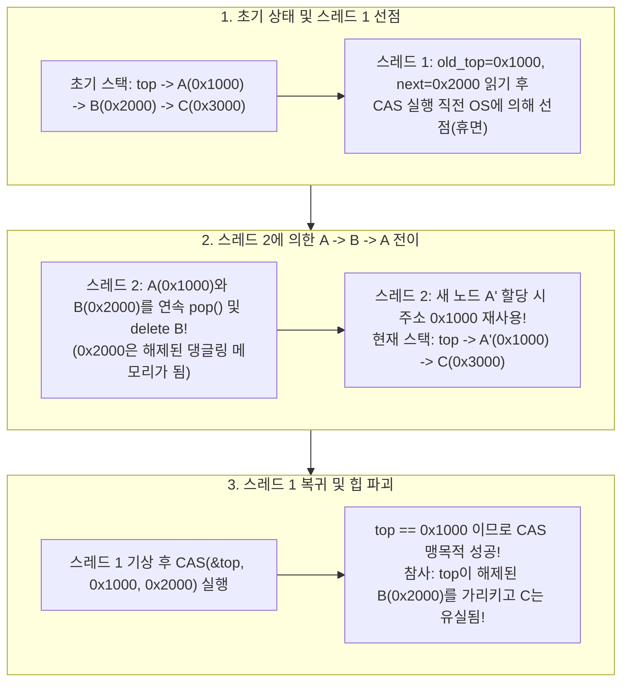
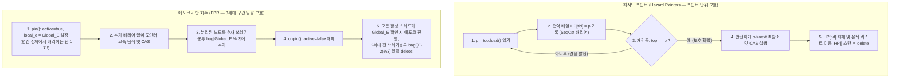

현대의 서버 프로세서는 소켓당 64~128개의 물리 코어, 동시 멀티스레딩(SMT)을 포함하면 최대 256~512개의 하드웨어 스레드가 단일 캐시 일관성 공유 메모리(ccNUMA) 공간에 동시에 접근하는 거대한 병렬 컴퓨터다. 이러한 매니코어 환경에서 OS 커널 스케줄러, 초단타 매매(HFT) 주문 매칭 엔진, 실시간 오디오 DSP 콜백, 혹은 고성능 데이터베이스 트랜잭션 엔진을 설계할 때, 전통적인 동기화 기본 요소인 <strong>뮤텍스(Mutual Exclusion Lock, `mutex`)</strong>는 안전장치가 아니라 시스템 전체의 진행을 멈추게 하는 치명적인 병목으로 돌변한다.

만약 128개의 스레드가 동일한 큐나 스택에 데이터를 넣고 뺄 때, 락을 쥐고 있던 단 하나의 스레드 $T_1$이 OS 타임슬라이스 만료로 선점(Preemption)되거나 페이지 폴트(Page Fault)를 일으키면 어떻게 될까? 불과 20나노초면 끝날 포인터 교체 작업이 수 밀리초 동안 동결되고, 그사이 나머지 <strong>127개의 CPU 코어 전체가 잠든 스레드의 락 해제를 기다리며 줄줄이 정지</strong>한다.

이처럼 "단일 스레드의 지연이 시스템 전체의 전진을 인질로 잡는" 상호 배제의 구조적 한계를 돌파하기 위해 탄생한 것이 바로 <strong>논블로킹 동기화(Non-blocking Synchronization)</strong>—즉 <strong>락프리(Lock-Free)</strong> 및 <strong>웨이트프리(Wait-Free)</strong> 알고리즘의 과학이다. 하지만 락을 버리고 하드웨어 원자적 명령(`Compare-And-Swap` 등)만으로 포인터를 조작하는 순간, 우리는 컴퓨터 과학에서 가장 교묘하고 악명 높은 버그인 <strong>ABA 문제(ABA Problem)</strong>와 가비지 컬렉터가 없는 언어(C / C++ / Rust)의 <strong>안전한 메모리 회수(Safe Memory Reclamation, SMR)</strong> 문제에 직면한다.

---

## 제1장: 왜 뮤텍스(`mutex`)는 초저지연 시스템에서 붕괴하는가?

리눅스의 `futex`(Fast Userspace Mutex)처럼 고도로 최적화된 뮤텍스라도 블로킹 동기화라는 본질 때문에 다음 4가지 치명적인 결함을 피할 수 없다.

1. <strong>선점(Preemption)과 락 호송대 현상(Lock Convoying)</strong>: 임계 구역 내부에서 락을 쥔 스레드가 타이머 인터럽트나 페이지 폴트로 스케줄링에서 밀려나면, 뒤따라온 수많은 스레드가 커널 대기 큐에 쌓인다. 이후 락이 풀려도 커널이 스레드를 하나씩 깨우며 문맥 교환(Context Switch)과 캐시 라인 바운싱(Cache Line Bouncing)을 반복하느라 극심한 정체가 길게 이어진다.
2. <strong>우선순위 역전(Priority Inversion) — 1997년 화성 탐사선 마스 패스파인더의 교훈</strong>: 화성에 착륙한 NASA의 마스 패스파인더가 원인 불명의 재부팅을 반복한 사건은 VxWorks 실시간 OS의 뮤텍스 때문이었다. 저우선순위 기상 태스크 $T_{\text{low}}$가 버스 뮤텍스를 잡은 상태에서 고우선순위 버스 관리 태스크 $T_{\text{high}}$가 같은 뮤텍스를 기다리며 블로킹되었고, 그 틈에 뮤텍스와 무관한 중우선순위 통신 태스크 $T_{\text{med}}$가 $T_{\text{low}}$의 CPU를 빼앗아 장시간 실행되면서 최고 우선순위인 $T_{\text{high}}$가 기아 상태에 빠져 워치독 타이머가 시스템을 강제 리셋시켰다.
3. <strong>데드락(Deadlock)과 합성 불가능성(Lack of Composability)</strong>: 각각 내부 락으로 보호되는 두 해시 테이블 $A, B$ 사이에서 원자적인 `transfer(A, B)`를 구현하려면 전역적인 락 획득 순서를 강제하지 않는 한 AB-BA 데드락이 발생한다.
4. <strong>비동기 시그널 핸들러, 인터럽트 서비스 루틴(ISR), 실시간 오디오 콜백에서의 절대적 사용 불가</strong>: POSIX 시그널 핸들러(`SIGINT`, `SIGSEGV`) 내부에서 `mutex_lock`을 호출하면 스레드가 자기 자신이 쥔 락을 영원히 기다리는 <strong>자기 데드락(Self-Deadlock)</strong>에 빠진다. 또한 $48\,\text{kHz}$·64샘플 버퍼(데드라인 $1.33\,\text{ms}$)의 실시간 오디오 DSP 콜백에서 뮤텍스 대기가 발생하면 즉각 오디오 버퍼 언더런(클릭 노이즈)이 발생한다.

---

## 제2장: 선형화 가능성(Linearizability)과 3단계 논블로킹 진행 보장

### 2.1 정확성의 기준: 선형화 가능성(Herlihy & Wing, 1990)
멀티스레드 환경에서 각 연산 $op_i$는 호출 시각과 응답 시각 사이의 시간 구간 $[t_{\text{inv}}(op_i), t_{\text{resp}}(op_i)]$을 갖는다. 모리스 헐리히와 지넷 윙은 모든 연산 구간 내부에 <strong>선형화 지점(Linearization Point)</strong> $t_{\text{lin}}(op_i) \in [t_{\text{inv}}(op_i), t_{\text{resp}}(op_i)]$という 단 하나의 순간을 지정하여, 모든 연산을 $t_{\text{lin}}$ 순서로 나열했을 때 순차 명세(Sequential Specification)와 완벽히 일치하면 그 객체가 <strong>선형화 가능(Linearizable)</strong>하다고 정의했다. 선형화 가능성은 지역적 성질(Composable)이므로 선형화 가능한 객체들을 결합한 시스템도 자동으로 선형화 가능하다.

### 2.2 활성(Liveness)의 3계층: Obstruction-Free, Lock-Free, Wait-Free
1. <strong>방해 프리(Obstruction-Free)</strong>: 다른 스레드와의 경합 없이 <strong>단독으로 실행(Solo Execution)</strong>되기만 하면 유한 단계 내에 연산을 완료한다. 경합 시 라이브락(Livelock) 위험이 있어 백오프(Backoff) 경합 관리자가 필요하다.
2. <strong>락프리(Lock-Free)</strong>: 다른 스레드가 어떤 속도로 움직이든, 선점되거나 영구 크래시하든 관계없이, <strong>현재 연산을 수행 중인 스레드들 중 '적어도 하나의 스레드'는 반드시 유한 단계 내에 연산을 완료한다</strong>. 내 `CAS`가 실패했다는 것은 곧 다른 누군가의 `CAS`가 성공하여 시스템 상태가 전진했음을 뜻하므로 시스템 전체 처리량은 절대 멈추지 않는다.
3. <strong>웨이트프리(Wait-Free)</strong>: 다른 스레드의 경합이나 정지와 무관하게 <strong>연산을 호출한 '모든 스레드'가 각각 유계된 유한 단계($O(1)$ 또는 $O(P)$) 내에 연산을 완료한다</strong>(기아 상태 완전 제로). 핵심 원리는 <strong>헬핑(Helping)</strong> 메커니즘으로, 느린 스레드가 전역 공지 배열 `announce[i]`에 작업 기술자를 등록하면 빠른 스레드들이 자신의 작업을 끝내기 전에 느린 스레드의 작업을 대신 완수해 준다.

| 진행 보장 등급 | 블로킹 여부 | 시스템 전체 전진 보장 | 개별 스레드 기아(Starvation) 면역 | 시그널 / ISR / 하드 실시간 안전성 | 최악 시간 복잡도 | 대표적인 알고리즘 및 구현체 |
| :--- | :--- | :--- | :--- | :--- | :--- | :--- |
| <strong>블로킹(Mutex / Spinlock)</strong> | 블로킹 | 없음(락 보유자 정지 시 전체 정지) | 없음(데드락·우선순위 역전 발생) | <strong>사용 금지</strong> | $\infty$ (OS 스케줄러 의존) | `std::mutex`, `pthread_mutex_t` |
| <strong>방해 프리(Obstruction-Free)</strong> | 논블로킹 | 단독 실행 시에만 보장(라이브락 위험) | 없음(지수 백오프 필요) | 안전 | 경합 시 $\infty$ | 소프트웨어 트랜잭셔널 메모리(STM) |
| <strong>락프리(Lock-Free)</strong> | 논블로킹 | <strong>항상 보장(최소 1개 스레드 완료)</strong> | 없음(고경합 시 재시도 증가) | <strong>완전 안전</strong> | 기댓값 $O(1)$ | Treiber 스택, Michael-Scott 큐 |
| <strong>웨이트프리(Wait-Free)</strong> | 논블로킹 | <strong>항상 보장(모든 스레드 완료)</strong> | <strong>완벽 보장(기아 제로)</strong> | <strong>하드 실시간 안전</strong> | <strong>엄격한 유계 $O(1)$ 또는 $O(P)$</strong> | Kogan-Petrank 큐, SPSC 링버퍼, RCU 읽기 |

---

## 제3장: 하드웨어 원자적 명령과 헐리히의 '합의 수 계층(Consensus Hierarchy)' 정리

1991년 모리스 헐리히(Maurice Herlihy)는 논문 *"Wait-Free Synchronization"*에서 모든 동기화 기본 요소 $\mathcal{O}$의 계산 능력을 <strong>합의 수(Consensus Number) $C(\mathcal{O})$</strong>—즉 임의 개수의 $\mathcal{O}$와 원자적 읽기/쓰기 레지스터를 조합하여 웨이트프리 합의 문제(Agreement, Validity, Wait-Free Termination)를 풀 수 있는 최대 스레드 수 $N$—으로 분류했다.

- <strong>$C = 1$: 원자적 읽기/쓰기 레지스터(Atomic Read/Write)</strong>: <strong>단 2개의 스레드($N=2$) 합의조차 불가능하다!</strong>
  <strong>이원성(Bivalence) 불가능성 증명 요약</strong>: 스레드 $A$(0 제안)와 $B$(1 제안)의 초기 상태는 결과가 0과 1 모두 가능한 '이원적(Bivalent)' 상태다. 유한 단계 내에 결정하려면 다음 한 단계로 운명이 갈리는 <strong>임계 이원 상태 $S_{\text{crit}}$</strong>에 도달해야 한다($A$가 $e_A$를 실행하면 0-결정 상태 $S_0$, $B$가 $e_B$를 실행하면 1-결정 상태 $S_1$). 그러나 읽기/쓰기만 존재하므로, 두 스레드가 같은 레지스터 $R$에 연속으로 쓰는 경우 나중에 실행된 $B$의 쓰기가 $A$의 쓰기를 <strong>흔적도 없이 덮어써 버린다(Overwrite)</strong>! 결과적으로 스레드 $B$ 입장에서는 0-결정 상태인 $e_B(e_A(S_{\text{crit}}))$와 1-결정 상태인 $e_B(S_{\text{crit}})$가 메모리상에서 <strong>완전히 구별 불가능(Indistinguishable)</strong>해져 모순이 발생한다.
- <strong>$C = 2$: `Test-and-Set`(`TAS`), `Swap`(`XCHG`), `Fetch-and-Add`(`LOCK XADD`), 큐, 스택</strong>: 2개 스레드 합의는 풀 수 있지만, <strong>$N \ge 3$ 스레드 합의는 수학적으로 불가능하다!</strong> 예를 들어 `Fetch-and-Add`에서 스레드 $A$와 $B$가 같은 변수에 1씩 더하면 덧셈의 교환법칙 때문에 누가 먼저 실행했든 결과값은 똑같이 $r+2$가 되어, 뒤늦게 깨어난 제3의 스레드 $C$는 누가 1등이었는지 알 수 없다. 따라서 <strong>`Fetch-and-Add`나 `Swap`만으로는 3스레드 이상의 범용 락프리 큐나 스택을 절대 구현할 수 없다.</strong>
- <strong>$C = \infty$ (보편적 기본 요소): `Compare-And-Swap`(`CAS`) 및 `Load-Linked / Store-Conditional`(`LL/SC`)</strong>: `CAS(&decision, UNDECIDED, my_val)`을 실행하면 오직 1등 스레드만 값을 기록하고 나머지 $N-1$개 스레드는 모두 실패하며 <strong>1등의 값을 덮어쓰지 않고 보존한다</strong>. 따라서 임의의 $N$ 스레드에 대해 모든 자료구조를 락프리/웨이트프리로 구현할 수 있는 만능(Universal) 명령이다.

---

## 제4장: 트라이버 스택(Treiber Stack)과 악명 높은 'ABA 문제'의 해부

1986년 R. Kent Treiber가 고안한 락프리 스택의 단순 `pop()` 구현을 살펴보자.

```cpp
// 치명적인 ABA 문제와 Use-After-Free 버그가 잠복한 단순 Treiber 스택 pop()
bool pop(T& result) {
    Node* old_top = top.load(std::memory_order_acquire);
    while (old_top != nullptr) {
        Node* next_node = old_top->next; // 위험 지점 1: 이미 해제된 포인터 역참조 위험
        if (top.compare_exchange_weak(   // 위험 지점 2: 오직 주소 비트열만 비교하는 CAS
                old_top, next_node,
                std::memory_order_acquire, std::memory_order_relaxed)) {
            result = old_top->data;
            delete old_top;              // 힙 할당자에 메모리 반환(재앙의 시작!)
            return true;
        }
    }
    return false;
}
```

### 4.1 ABA 문제로 힙 메모리가 파괴되는 5단계 시나리오
초기 스택 상태가 $\text{top} \longrightarrow A(\texttt{0x1000}) \longrightarrow B(\texttt{0x2000}) \longrightarrow C(\texttt{0x3000})$라고 하자.

1. <strong>[1단계] 스레드 1이 `pop()` 시작 후 `CAS` 직전에 선점됨</strong>: 스레드 1은 `old_top = 0x1000`($A$), `next_node = 0x2000`($B$)를 읽은 뒤 `CAS(&top, 0x1000, 0x2000)`을 실행하기 바로 직전에 OS 스케줄러에 의해 일시 정지된다.
2. <strong>[2단계] 스레드 2가 $A$와 $B$를 연속 `pop()`하고 해제함</strong>: 스레드 2가 $A(\texttt{0x1000})$를 꺼내 `delete A`하고, 이어서 $B(\texttt{0x2000})$를 꺼내 <strong>`delete B`</strong>를 호출한다. 이제 주소 `0x2000`은 해제된 댕글링 포인터(Dangling Pointer)가 되었고 스택은 $\text{top} \to C(\texttt{0x3000})$이다.
3. <strong>[3단계] 스레드 2가 새 노드를 `push()`하며 주소 `0x1000`이 재사용됨</strong>: 스레드 2가 새 노드 $A'$를 할당할 때, 현대 메모리 할당자(`jemalloc`, `tcmalloc`, `ptmalloc`)는 L1 캐시 지역성을 위해 방금 해제된 주소 `0x1000`을 LIFO 프리리스트에서 즉시 재사용한다! 스레드 2가 $A'(\texttt{0x1000})$를 푸시하면 스택은 $\text{top} \longrightarrow A'(\texttt{0x1000}) \longrightarrow C(\texttt{0x3000})$이 된다.
4. <strong>[4단계] 스레드 1이 깨어나 `CAS(&top, 0x1000, 0x2000)`을 실행함</strong>: 현재 `top`의 값(`0x1000`)이 스레드 1이 기억하던 `old_top`(`0x1000`)과 비트 단위로 일치하므로($A \to B \to A$), <strong>`CAS`가 감쪽같이 속아 성공해 버린다!</strong>
5. <strong>[5단계] 힙 메모리 완전 붕괴</strong>: 스택의 `top`은 이미 해제된 옛 노드 $B$의 주소 `0x2000`을 가리키게 되고, 노드 $C(\texttt{0x3000})$는 영구 누수되며, 이후 스택에 접근하는 모든 스레드는 Use-After-Free 및 세그멘테이션 폴트(`SIGSEGV`)를 일으킨다!



---

## 제5장: ABA 문제와 안전한 메모리 회수(SMR)를 해결하는 4대 아키텍처

### 5.1 해결책 ①: 태그 포인터(Tagged Pointers)와 2배 폭 CAS(`DWCAS` / `CMPXCHG16B`)
64비트 포인터 `ptr`과 단조 증가하는 64비트 세대 카운터 `tag`를 묶어 128비트 구조체 `(ptr, tag)`로 만든다. 포인터가 바뀔 때마다 `tag`를 $+1$ 증가시키면 $(\texttt{0x1000}, 42) \to (\texttt{0x2000}, 43) \to (\texttt{0x1000}, 44)$가 되어, x86-64의 128비트 원자적 명령 `LOCK CMPXCHG16B`가 세대 불일치(`42 != 44`)를 감지하고 ABA를 완벽히 차단한다. 단, `old_top->next` 역참조 시의 페이지 폴트를 막기 위해 타입 안정 객체 풀(Type-Stable Memory Pool)과 함께 사용해야 한다.

### 5.2 해결책 ②: 해저드 포인터(Hazard Pointers — Maged Michael 2004, C++26 `<hazard_pointer>`)
각 읽기 스레드 $i$는 전역 배열 `HP[i]`에 자신이 참조하려는 포인터 `p = top.load()`를 `SeqCst` 메모리 배리어로 공지(`HP[i] = p`)한 직후, <strong>`top == p`인지 재검증(Double-Check Validation)</strong>한다. 재검증을 통과하면 해당 노드는 `HP[i]`에 의해 보호되므로 다른 스레드가 팝하더라도 즉시 `delete`하지 못하고 스레드 로컬 `retired_list`에 보류시킨다. 이후 `HP[]` 전체를 스캔하여 아무도 가리키지 않는 노드만 안전하게 `delete`한다. 미회수 메모리가 $O(P^2)$으로 엄격히 제한되지만, 포인터를 하나 따라갈 때마다 무거운 `SeqCst` 배리어(`MFENCE`)가 필요한 것이 단점이다.

### 5.3 해결책 ③: 에포크 기반 메모리 회수(EBR: Epoch-Based Reclamation — Rust `crossbeam-epoch`)
포인터별 메모리 배리어 오버헤드를 없애기 위해 Keir Fraser(2004)가 고안한 방식으로, 전역 에포크 카운터 $E$와 3개의 쓰레기봉투 `bag[0..2]`를 사용한다. 스레드가 연산 시작 시 `pin()`을 호출해 `active = true`와 `local_e = E`를 기록하면(<strong>연산 전체에서 메모리 배리어는 단 1회뿐!</strong>), 내부에서는 추가 배리어 없이 초고속으로 포인터를 탐색한다. 연결이 끊긴 노드는 `bag[E % 3]`에 넣는다. 모든 활성 스레드가 에포크 $E$에 도달하면 전역 에포크를 $+1$ 증가시키며, 전역 에포크가 $E+2$에 도달하는 순간 2세대 전인 `bag[E % 3]`을 일괄 `delete`한다.



### 5.4 해결책 ④: RCU(Read-Copy-Update — Linux 커널 및 `liburcu`)
읽기가 압도적으로 많은 작업(라우팅 테이블, VFS `dcache`)에서 RCU는 <strong>오버헤드 제로의 웨이트프리 읽기(Wait-Free Read)</strong>를 달성한다. 비선점형 커널에서 `rcu_read_lock()`은 <strong>기계어 0명령</strong>으로 컴파일되며 단지 읽기 구간 내의 문맥 교환만 금지한다. 쓰기 스레드는 노드를 복사해 수정한 뒤 포인터를 원자적으로 교체(Copy-on-Write)하고, `synchronize_rcu()`를 통해 모든 CPU 코어가 최소 한 번씩 문맥 교환(정지 상태: Quiescent State)을 거치는 <strong>유예 기간(Grace Period)</strong>이 끝난 뒤 구 노드를 안전하게 해제한다.

| 메모리 회수 및 ABA 방지 기법 | 읽기 경로 오버헤드 | 스레드 정지 시 메모리 상한 보장 | 적용 가능한 자료구조 범위 | 대표적인 프로덕션 채택 사례 |
| :--- | :--- | :--- | :--- | :--- |
| <strong>태그 포인터 (`DWCAS` + 풀)</strong> | <strong>극소</strong> (단순 원자적 로드) | 고정 크기 풀 (OS 반환 불가) | 단일 포인터 CAS 구조(스택 등)에 한정 | Linux 커널 `SLUB`, 임베디드 큐 |
| <strong>해저드 포인터 (Hazard Pointers)</strong> | <strong>높음</strong> (포인터마다 `SeqCst` 배리어) | <strong>엄격한 유계 $O(P^2)$ (완전 락프리 회수)</strong> | <strong>매우 넓음</strong> (리스트, 트리, 스킵리스트) | <strong>C++26 `<hazard_pointer>`</strong>, Meta `Folly` |
| <strong>에포크 기반 회수 (EBR)</strong> | <strong>낮음</strong> (`pin()` 당 배리어 1회) | 비유계 (핀 내부 스레드 정지 시 회수 지연) | <strong>매우 넓음</strong> (다중 포인터 탐색에 최적) | <strong>Rust `crossbeam-epoch`</strong>, Bw-Tree |
| <strong>RCU (Read-Copy-Update)</strong> | <strong>제로 (기계어 0명령, Wait-Free)</strong> | Grace Period 의존 (쓰기 지연은 큼) | 읽기 위주(Read-Mostly) 자료구조 특화 | <strong>Linux 커널 전반(VFS, 네트워크)</strong>, `liburcu` |
