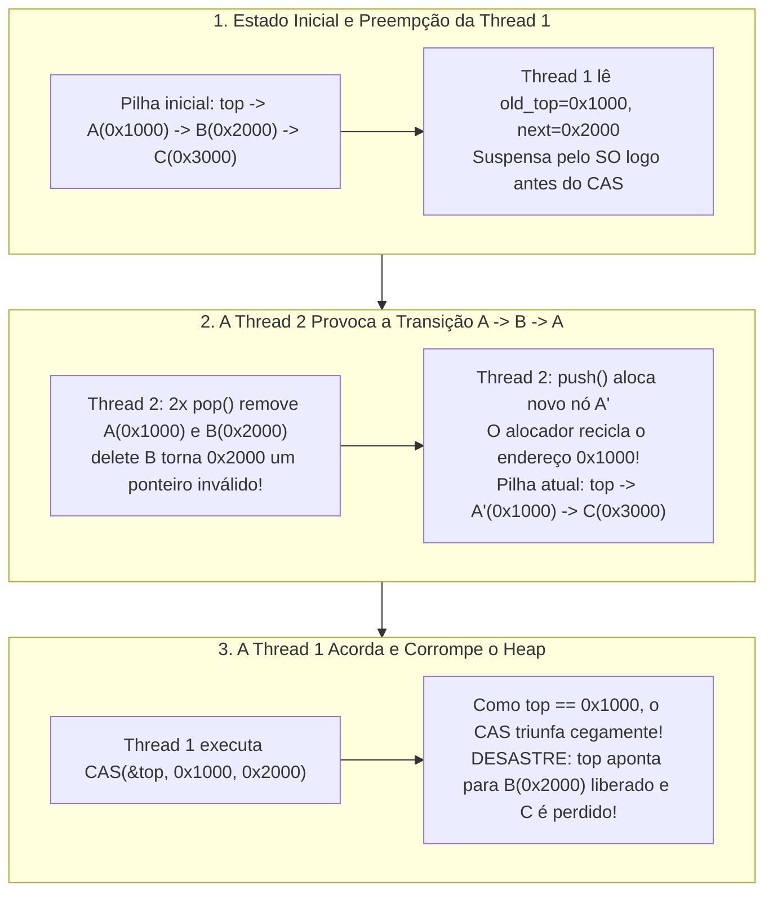

Os processadores de servidores modernos são máquinas de memória compartilhada massivamente paralelas: um único servidor de soquete duplo abriga rotineiramente de 128 a 256 núcleos físicos — e até 512 threads de hardware via *Simultaneous Multithreading* (SMT) — competindo pelo mesmo espaço de endereçamento coerente em cache (ccNUMA). Ao projetar escalonadores de kernel de sistemas operacionais, motores de casamento de ordens de negociação de alta frequência (HFT), callbacks de processamento digital de sinais (DSP) de áudio em tempo real ou mecanismos de bancos de dados, a primitiva de sincronização mais tradicional — o <strong>bloqueio de exclusão mútua (`mutex`)</strong> — deixa de ser uma proteção para se tornar um gargalo catastrófico.

O que acontece quando 128 threads inserem e removem tarefas simultaneamente de uma fila protegida por `std::mutex`? Atualizar o ponteiro da fila exige apenas 15 nanossegundos. Porém, se a única thread $T_1$ que detém o lock sofrer preempção pelo escalonador do sistema operacional ao fim de sua fatia de tempo, ou sofrer uma falta de página (*Page Fault*), esses 15 nanossegundos saltam para vários milissegundos. Durante todo esse intervalo, <strong>todos os outros 127 núcleos da CPU param completamente</strong> esperando por uma thread adormecida.

Para romper esse acoplamento fatal surgiu a ciência da <strong>sincronização não bloqueante (Non-Blocking Synchronization)</strong>: os algoritmos <strong>Lock-Free</strong> (livres de bloqueio) e <strong>Wait-Free</strong> (livres de espera). Contudo, assim que abandonamos os locks e manipulamos ponteiros diretamente com instruções atômicas de hardware como `Compare-And-Swap` (`CAS`), encontramos um dos bugs mais sutis e destrutivos da ciência da computação: o <strong>Problema ABA</strong>, aliado à <strong>recuperação segura de memória (Safe Memory Reclamation, SMR)</strong> em linguagens sem coletor de lixo (C, C++, Rust).

---

## Capítulo 1: Por Que a Exclusão Mútua (`mutex`) Falha em Sistemas de Latência Ultrabaixa

Mesmo implementações altamente otimizadas como o `futex` (*Fast Userspace Mutex*) do Linux sofrem de quatro patologias estruturais inerentes ao bloqueio:

1. <strong>Preempção e Efeito Comboio (Lock Convoying)</strong>: Se a thread detentora do lock for suspensa dentro da seção crítica, todas as outras threads acumulam-se na fila de espera do kernel. Mesmo após a liberação do lock, o despertar sequencial das threads, as trocas de contexto e o salto de linhas de cache (*Cache Line Bouncing*) entre nós NUMA geram um congestionamento em cadeia.
2. <strong>Inversão de Prioridade Ilimitada — A Lição da Mars Pathfinder (1997)</strong>: Em julho de 1997, a sonda *Mars Pathfinder* da NASA sofreu reinicializações misteriosas em Marte. No sistema operacional de tempo real VxWorks, uma tarefa meteorológica de baixa prioridade $T_{\text{low}}$ adquiriu o mutex do barramento; a tarefa crítica de gerenciamento de alta prioridade $T_{\text{high}}$ bloqueou aguardando esse mutex; nesse ínterim, tarefas de comunicação de média prioridade $T_{\text{med}}$ (que não precisavam do mutex) tomaram a CPU de $T_{\text{low}}$, causando inanição indireta de $T_{\text{high}}$ até que o temporizador *watchdog* reiniciasse a espaçonave.
3. <strong>Deadlock e Falta de Componibilidade</strong>: Duas tabelas hash $A$ e $B$ protegidas por mutexes internos não podem ser combinadas em uma operação atômica `transfer(A, B)` sem impor uma ordem global de bloqueio para evitar *deadlocks* AB-BA.
4. <strong>Proibição Estrita em Tratadores de Sinais, Interrupções (ISR) e Áudio em Tempo Real</strong>: Chamar `mutex_lock` dentro de um tratador de sinais POSIX (`SIGINT`, `SIGSEGV`) causa um <strong>auto-deadlock</strong> imediato se a thread interrompida já detinha o lock. Em um callback de áudio DSP em tempo real ($48\,\text{kHz}$, buffer de 64 amostras $\implies$ prazo rígido de $1{,}33\,\text{ms}$), qualquer bloqueio no kernel gera *buffer underrun* (estalos audíveis).

---

## Capítulo 2: Linearizabilidade e as Três Garantias de Progresso Não Bloqueante

### 2.1 O Padrão Ouro de Corretude: Linearizabilidade (Herlihy & Wing, 1990)
Em uma execução concorrente, cada chamada de método $op_i$ abrange um intervalo de tempo $[t_{\text{inv}}(op_i), t_{\text{resp}}(op_i)]$. Um objeto concorrente é <strong>linearizável (Linearizable)</strong> se a cada operação $op_i$ puder ser atribuído um único instante atômico — seu <strong>ponto de linearização</strong> $t_{\text{lin}}(op_i) \in [t_{\text{inv}}(op_i), t_{\text{resp}}(op_i)]$ — de modo que a ordenação de todas as operações por $t_{\text{lin}}$ forme uma execução sequencial válida. A linearizabilidade é uma propriedade <strong>local e componível</strong>.

### 2.2 Os Três Níveis de Progresso Não Bloqueante (Liveness)
1. <strong>Obstruction-Free (Livre de Obstrução)</strong>: Uma thread conclui sua operação em um número finito de passos <strong>desde que eventualmente execute em isolamento</strong> (sem interferência concorrente). Pode sofrer *livelock* sob contenção, exigindo gerenciadores de contenção com *backoff* exponencial.
2. <strong>Lock-Free (Livre de Bloqueio)</strong>: Independentemente da velocidade, preempção ou falha permanente (*crash-stop*) de outras threads, <strong>pelo menos uma thread entre todas as threads ativas tem garantia de concluir sua operação em um número finito de passos</strong>. Se o `CAS` de uma thread falha, isso significa matematicamente que o `CAS` de *outra* thread teve sucesso e fez o estado global do sistema avançar!
3. <strong>Wait-Free (Livre de Espera)</strong>: <strong>Cada thread individual</strong> tem garantia de concluir sua operação em um número finito e limitado de passos ($O(1)$ ou $O(P)$), eliminando totalmente a inanição (*Zero Starvation*). Isso é alcançado pelo mecanismo de <strong>ajuda cooperativa (Helping)</strong>: cada thread publica seu descritor de operação em um array global `announce[i]`, e threads rápidas ajudam a concluir as operações pendentes de threads lentas antes de finalizar a própria.

| Garantia de Progresso | Bloqueante? | Progresso Global Garantido? | Imunidade à Inanição Individual? | Seguro em Sinais / ISR / Áudio RT? | Complexidade no Pior Caso | Exemplos Clássicos |
| :--- | :--- | :--- | :--- | :--- | :--- | :--- |
| <strong>Blocking (`mutex`)</strong> | Sim | Não (para se o detentor dormir) | Não (Deadlock e Inversão de Prioridade) | <strong>Proibido / Inseguro</strong> | $\infty$ (Sono ilimitado no SO) | `std::mutex`, `pthread_mutex_t` |
| <strong>Obstruction-Free</strong> | Não bloqueante | Apenas em execução solo (Livelock) | Não (Requer backoff) | Seguro | $\infty$ sob contenção | Memória Transacional em Software (STM) |
| <strong>Lock-Free</strong> | Não bloqueante | <strong>Sim (Pelo menos 1 thread termina)</strong> | Não (Retentativas sob alta contenção) | <strong>Totalmente seguro</strong> | Esperado $O(1)$ | Pilha de Treiber, Fila de Michael-Scott |
| <strong>Wait-Free</strong> | Não bloqueante | <strong>Sim (Todas as threads terminam)</strong> | <strong>Sim (Zero inanição)</strong> | <strong>Tempo real estrito</strong> | <strong>Limitado $O(1)$ ou $O(P)$</strong> | Fila de Kogan-Petrank, Buffer SPSC, Leitores RCU |

---

## Capítulo 3: Instruções Atômicas e a Hierarquia de Consenso de Maurice Herlihy (1991)

Em seu artigo seminal *"Wait-Free Synchronization"* (1991, vencedor dos prêmios Gödel e Dijkstra), Maurice Herlihy classificou o poder computacional de qualquer primitiva de sincronização $\mathcal{O}$ por seu <strong>Número de Consenso (Consensus Number) $C(\mathcal{O})$</strong>: o número máximo de threads $N$ para o qual é possível resolver o problema do consenso Wait-Free (Acordo, Validade e Terminação Wait-Free) combinando instâncias de $\mathcal{O}$ e registradores atômicos de leitura/escrita.

- <strong>$C = 1$: Registradores Atômicos de Leitura/Escrita (`MOV` + barreira de memória)</strong>: <strong>Não conseguem resolver o consenso nem mesmo para $N = 2$ threads!</strong>
  *Prova por bivalência*: Partindo de um estado inicial bivalente (onde as decisões 0 e 1 ainda são alcançáveis), o protocolo deve atingir um <strong>estado bivalente crítico $S_{\text{crit}}$</strong> onde o próximo passo $e_A$ da thread $A$ leva a um estado 0-valente $S_0$ e o próximo passo $e_B$ da thread $B$ leva a um estado 1-valente $S_1$. No caso decisivo em que ambos escrevem no mesmo registrador $R$, se $A$ escreve primeiro e $B$ escreve logo em seguida, a escrita de $B$ <strong>sobrescreve e apaga completamente</strong> a escrita de $A$! Para a thread $B$, o estado 0-valente $e_B(e_A(S_{\text{crit}}))$ torna-se <strong>totalmente indistinguível</strong> do estado 1-valente $e_B(S_{\text{crit}})$, gerando uma contradição quando $B$ executa sozinha até o fim.
- <strong>$C = 2$: `Test-and-Set` (`TAS`), `Swap` (`XCHG`), `Fetch-and-Add` (`LOCK XADD`), Pilhas e Filas FIFO</strong>: Resolvem o consenso para 2 threads, mas <strong>falham matematicamente para $N \ge 3$ threads!</strong> No `Fetch-and-Add`, se $A$ e $B$ somam 1 ao mesmo registrador, pela comutatividade da adição o resultado é $r+2$ independentemente de quem foi primeiro; uma terceira thread $C$ não consegue distinguir quem venceu. Portanto, <strong>é matematicamente impossível construir uma fila ou pilha Lock-Free geral para $\ge 3$ threads usando apenas `Fetch-and-Add` ou `Swap`</strong>.
- <strong>$C = \infty$ (Primitivas Universais): `Compare-And-Swap` (`CAS`) e `Load-Linked / Store-Conditional` (`LL/SC`)</strong>: Com `CAS(&decision, UNDECIDED, my_val)`, apenas a primeira thread modifica o registrador enquanto as $N-1$ restantes falham <strong>sem jamais sobrescrever o valor vencedor</strong>. Assim, `CAS` e `LL/SC` são universais para qualquer número $N$ de threads.

---

## Capítulo 4: A Pilha de Treiber (1986) e a Anatomia do Problema ABA

Analisemos a implementação ingênua de `pop()` na pilha Lock-Free de R. Kent Treiber (1986):

```cpp
// Operação pop() ingênua da Pilha de Treiber — vulnerável ao Problema ABA e Use-After-Free!
bool pop(T& result) {
    Node* old_top = top.load(std::memory_order_acquire);
    while (old_top != nullptr) {
        Node* next_node = old_top->next; // Ponto de perigo 1: desreferenciar old_top
        if (top.compare_exchange_weak(   // Ponto de perigo 2: CAS baseado apenas na igualdade de endereço
                old_top, next_node,
                std::memory_order_acquire, std::memory_order_relaxed)) {
            result = old_top->data;
            delete old_top;              // Devolve nó ao alocador de memória (origem do desastre!)
            return true;
        }
    }
    return false;
}
```

### 4.1 Linha do Tempo em 5 Passos da Corrupção do Heap pelo Problema ABA
Estado inicial da pilha: $\text{top} \longrightarrow A(\texttt{0x1000}) \longrightarrow B(\texttt{0x2000}) \longrightarrow C(\texttt{0x3000})$.

1. <strong>[Passo 1] A Thread 1 inicia `pop()` e sofre preempção logo antes do `CAS`</strong>: A Thread 1 lê `old_top = 0x1000` ($A$) e `next_node = 0x2000` ($B$), mas é suspensa pelo escalonador do SO exatamente antes de executar `CAS(&top, 0x1000, 0x2000)`.
2. <strong>[Passo 2] A Thread 2 desempilha $A$ e $B$ e libera ambos</strong>: A Thread 2 chama `pop()` duas vezes: remove $A(\texttt{0x1000})$ (`delete A`) e depois remove $B(\texttt{0x2000})$ chamando <strong>`delete B`</strong>. O endereço `0x2000` agora é memória liberada (*dangling pointer*), e a pilha fica como $\text{top} \to C(\texttt{0x3000})$.
3. <strong>[Passo 3] A Thread 2 faz `push()` e o alocador recicla o endereço `0x1000`</strong>: A Thread 2 aloca um novo nó $A'$. Alocadores modernos (`jemalloc`, `tcmalloc`, `ptmalloc`) reutilizam imediatamente blocos recém-liberados em ordem LIFO para maximizar a localidade do cache L1, atribuindo a $A'$ <strong>exatamente o mesmo endereço `0x1000`</strong>! Ao empilhá-lo, a pilha torna-se $\text{top} \longrightarrow A'(\texttt{0x1000}) \longrightarrow C(\texttt{0x3000})$.
4. <strong>[Passo 4] A Thread 1 acorda e executa seu `CAS(&top, 0x1000, 0x2000)` obsoleto</strong>: O hardware verifica que `top` (`0x1000`) coincide bit a bit com `old_top` (`0x1000`) após a transição $A \to B \to A$, e <strong>o `CAS` tem sucesso cegamente!</strong>
5. <strong>[Passo 5] Corrupção Total do Heap</strong>: `top` aponta agora para `0x2000` (o nó $B$ já liberado!), o nó $C(\texttt{0x3000})$ é perdido em vazamento de memória, e o próximo acesso provoca Use-After-Free ou `SIGSEGV`.



---

## Capítulo 5: As Quatro Arquiteturas para Erradicar o ABA e Recuperar Memória com Segurança (SMR)

### 5.1 Solução 1: Ponteiros Etiquetados (Tagged Pointers) e CAS de Largura Dupla (`DWCAS` / `CMPXCHG16B`)
Combina o ponteiro de 64 bits `ptr` com um contador de geração monotônico de 64 bits `tag` em uma estrutura de 128 bits `(ptr, tag)` incrementada a cada modificação: $(\texttt{0x1000}, 42) \to (\texttt{0x2000}, 43) \to (\texttt{0x1000}, 44)$. Usando a instrução x86-64 `LOCK CMPXCHG16B`, o `DWCAS` detecta `tag 42 != 44` e falha com segurança. Exige um pool de memória de tipo estável (*Type-Stable Freelist*) para que ler `old_top->next` nunca gere `SIGSEGV`.

### 5.2 Solução 2: Hazard Pointers (Maged Michael 2004, C++26 `<hazard_pointer>`)
Cada thread leitora $i$ publica o ponteiro `p = top.load()` em um slot atômico global `HP[i].store(p, memory_order_seq_cst)` e <strong>revalida imediatamente</strong> `if (top.load(memory_order_seq_cst) != p) retry;`. Enquanto `HP[i] == p` estiver ativo, nenhuma thread pode liberar nem reciclar o endereço `p`. Nós removidos vão para uma lista local de aposentadoria (`retired_list`) e só sofrem `delete` após varrer todos os `HP[]` e confirmar que ninguém os protege. Garante memória limitada em $O(P^2)$, ao custo de uma barreira `SeqCst` (`MFENCE`) por ponteiro percorrido.

### 5.3 Solução 3: Recuperação Baseada em Épocas (EBR — Keir Fraser 2004, Rust `crossbeam-epoch`)

```mermaid
flowchart TD
    subgraph HP["Hazard Pointers (Proteção por Ponteiro, C++26)"]
        H1["1. Ler p = top.load()"] --> H2["2. Publicar HP[tid] = p (Barreira SeqCst)"]
        H2 --> H3{"3. Revalidação: top == p?"}
        H3 -- "Não (Conflito)" --> H1
        H3 -- "Sim (Proteção ativa)" --> H4["4. Ler p->next com segurança e executar CAS"]
        H4 --> H5["5. Limpar HP[tid], aposentar p e varrer HP[] antes do delete"]
    end

    subgraph EBR["Epoch-Based Reclamation (Proteção por Operação em 3 Épocas)"]
        E1["1. pin(): active=true, local_e = Global_E<br/>(Apenas 1 barreira de memória para todo o percurso!)"] --> E2["2. Percorrer ponteiros sem barreiras extras e executar CAS"]
        E2 --> E3["3. Adicionar nó removido em bag[Global_E % 3]"]
        E3 --> E4["4. unpin(): active=false"]
        E4 --> E5["5. Quando todas as threads ativas virem Global_E: avançar época<br/>e liberar em lote a bolsa de 2 épocas atrás bag[(E-2)%3]"]
    end
```

Para eliminar barreiras de memória em cada ponteiro, o EBR usa um contador global de época $E$ e 3 bolsas de lixo `bag[0..2]`. Ao iniciar uma operação (`pin()`), a thread define `active = true` e registra `local_e = E` (<strong>apenas uma barreira para toda a operação!</strong>). Nós desconectados vão para `bag[E % 3]`. Quando todas as threads ativas alcançam a época $E$, a época global avança; ao atingir $E+2$, nenhuma thread ativa pode reter referências da época $E$, liberando em lote toda a bolsa `bag[E % 3]`.



### 5.4 Solução 4: Read-Copy-Update (RCU — Kernel Linux e `liburcu`)
Para cargas de trabalho majoritariamente de leitura (tabelas de roteamento, cache VFS `dcache`), o RCU atinge <strong>leituras Wait-Free com sobrecarga zero</strong> (`rcu_read_lock()` compila para zero instruções de máquina em kernels não preemptivos, proibindo apenas trocas de contexto). O escritor cria uma cópia (*Copy-on-Write*), atualiza atomicamente o ponteiro e aguarda via `synchronize_rcu()` um <strong>período de graça (Grace Period)</strong> — até que cada núcleo de CPU tenha passado por pelo menos uma troca de contexto (*Quiescent State*) — antes de liberar o nó antigo.

| Técnica SMR / Anti-ABA | Sobrecarga de Leitura | Memória Limitada com Thread Travada? | Flexibilidade de Estruturas | Uso em Produção |
| :--- | :--- | :--- | :--- | :--- |
| <strong>Tagged Pointers (`DWCAS` + Pool)</strong> | <strong>Mínima</strong> (Carga atômica) | Pool fixo (Não devolve páginas ao SO) | Limitado a estruturas de ponteiro único | Kernel Linux `SLUB`, pools embarcados |
| <strong>Hazard Pointers</strong> | <strong>Alta</strong> (Barreira `SeqCst` por ponteiro) | <strong>Sim — Limitada em $O(P^2)$ (100% Lock-Free)</strong> | <strong>Muito alta</strong> (Listas, árvores, grafos) | <strong>C++26 `<hazard_pointer>`</strong>, Meta `Folly` |
| <strong>Epoch-Based Reclamation (EBR)</strong> | <strong>Baixa</strong> (1 barreira por `pin()`) | Não (Thread parada em `pin` atrasa o GC) | <strong>Muito alta</strong> (Ideal para percursos longos) | <strong>Rust `crossbeam-epoch`</strong>, Bw-Tree |
| <strong>Read-Copy-Update (RCU)</strong> | <strong>Zero (0 instruções, Wait-Free)</strong> | Limitada pelo Grace Period | Especializado em leitura intensiva (Read-Mostly) | <strong>Kernel Linux (VFS, Rede)</strong>, `liburcu` |
