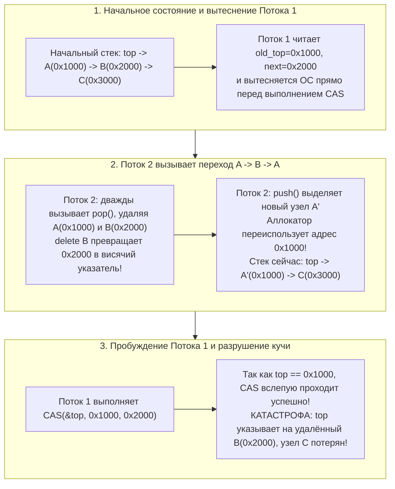
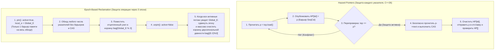

Современные серверные процессоры представляют собой массивно-параллельные машины с общей памятью: один двухсокетный сервер обычно объединяет от 128 до 256 физических ядер (и до 512 аппаратных потоков с учётом SMT), конкурирующих за единое кэш-когерентное адресное пространство (ccNUMA). При проектировании планировщиков ядра ОС, биржевых ядер высокочастотного трейдинга (HFT), обратных вызовов цифровой обработки аудиосигналов (DSP) в реальном времени или движков СУБД классический примитив синхронизации — <strong>мьютекс (`mutex`, взаимное исключение)</strong> — превращается из механизма защиты в катастрофическое узкое место.

Представьте, что 128 потоков одновременно добавляют и извлекают задачи из общей очереди, защищённой `std::mutex`. Само переключение указателя занимает едва ли 15 наносекунд. Но если единственный поток $T_1$, удерживающий мьютекс, будет вытеснен (Preempted) планировщиком ОС по истечении кванта времени или столкнётся с ошибкой страницы памяти (Page Fault), эти 15 наносекунд растянутся на несколько миллисекунд. Всё это время <strong>остальные 127 ядер процессора полностью простаивают</strong>, ожидая пробуждения спящего потока.

Чтобы разорвать эту фатальную зависимость, была создана теория и практика <strong>неблокирующей синхронизации (Non-Blocking Synchronization)</strong>: <strong>Lock-Free</strong> и <strong>Wait-Free</strong> алгоритмов. Однако, как только мы отказываемся от блокировок и начинаем менять указатели напрямую с помощью атомарных аппаратных инструкций вроде `Compare-And-Swap` (`CAS`), мы сталкиваемся с одной из самых коварных ошибок в информатике — <strong>проблемой ABA (ABA Problem)</strong> и задачей <strong>безопасного освобождения памяти (Safe Memory Reclamation, SMR)</strong> в языках без сборщика мусора (C, C++, Rust).

---

## Глава 1: Почему мьютексы (`mutex`) терпят крах в системах со сверхнизкой задержкой

Даже высокооптимизированные мьютексы вроде `futex` (Fast Userspace Mutex) в Linux страдают от четырёх фундаментальных патологий блокирующей синхронизации:

1. <strong>Вытеснение в критической секции и эффект конвоя (Lock Convoying)</strong>: Если поток, захвативший блокировку, приостанавливается планировщиком или обработчиком страничного прерывания, все остальные потоки выстраиваются в очередь ожидания внутри ядра. Даже после освобождения мьютекса последовательное пробуждение потоков, переключения контекста и сброс кэш-линий (Cache Line Bouncing) между узлами NUMA создают затяжной затор — «конвой блокировок».
2. <strong>Неограниченная инверсия приоритетов (Priority Inversion) — урок марсохода Mars Pathfinder (1997)</strong>: В июле 1997 года космический аппарат NASA *Mars Pathfinder* на поверхности Марса начал страдать от постоянных аварийных перезагрузок. В ОС реального времени VxWorks низкоприоритетная метеорологическая задача $T_{\text{low}}$ захватила мьютекс шины данных; высокоприоритетная задача управления шиной $T_{\text{high}}$ заблокировалась в ожидании этого мьютекса; тем временем среднеприоритетные задачи связи $T_{\text{med}}$ (которым этот мьютекс вообще не был нужен!) вытеснили $T_{\text{low}}$ с процессора, косвенно вызвав голодание $T_{\text{high}}$ и срабатывание сторожевого таймера (Watchdog Reset).
3. <strong>Взаимоблокировки (Deadlock) и отсутствие композиционности</strong>: Две потокобезопасные хэш-таблицы $A$ и $B$ с внутренними мьютексами нельзя безопасно объединить в атомарную операцию `transfer(A, B)` без глобального порядка захвата блокировок из-за риска перекрёстного дедлока AB-BA.
4. <strong>Абсолютный запрет в обработчиках сигналов, прерываний (ISR) и аудио-колбэках реального времени</strong>: Вызов `mutex_lock` внутри асинхронного обработчика сигналов POSIX (`SIGINT`, `SIGSEGV`) приводит к мгновенному <strong>самодедлоку (Self-Deadlock)</strong>, если прерванный поток уже удерживал этот замок. В аудио-колбэке DSP ($48\,\text{кГц}$, буфер 64 сэмпла $\implies$ жёсткий дедлайн $1{,}33\,\text{мс}$) любой уход в сон через `futex` вызывает опустошение буфера (слышимые щелчки и треск).

---

## Глава 2: Линеаризуемость и три гарантии неблокирующего прогресса

### 2.1 Критерий корректности: Линеаризуемость (Herlihy & Wing, 1990)
В конкурентной среде каждый вызов метода $op_i$ занимает временной интервал $[t_{\text{inv}}(op_i), t_{\text{resp}}(op_i)]$. Морис Херлихи и Жаннетт Винг определили, что конкурентный объект является <strong>линеаризуемым (Linearizable)</strong>, если каждой операции $op_i$ можно сопоставить мгновенную точку времени — <strong>точку линеаризации</strong> $t_{\text{lin}}(op_i) \in [t_{\text{inv}}(op_i), t_{\text{resp}}(op_i)]$ — так, что упорядочение всех операций по их точкам $t_{\text{lin}}$ образует корректную последовательную историю. Линеаризуемость — <strong>локальное (композиционное) свойство</strong>.

### 2.2 Три уровня неблокирующего прогресса (Liveness)
1. <strong>Obstruction-Free (Свобода от помех)</strong>: Поток гарантированно завершит операцию за конечное число шагов, <strong>если в конечном итоге будет выполняться изолированно</strong> (без вмешательства других потоков). Подвержен *livelock* при конкуренции и требует менеджера конкуренции с экспоненциальной задержкой (*backoff*).
2. <strong>Lock-Free (Свобода от блокировок)</strong>: Независимо от скорости, вытеснения или полного отказа (*crash-stop*) других потоков, <strong>гарантируется, что хотя бы один поток среди всех активных потоков завершит свою операцию за конечное число шагов</strong>. Если инструкция `CAS` одного потока терпит неудачу, это математически означает, что `CAS` *другого* потока завершился успешно и продвинул глобальное состояние системы вперёд!
3. <strong>Wait-Free (Свобода от ожидания)</strong>: <strong>Каждый отдельный поток</strong> гарантированно завершает свою операцию за конечное ограниченное число собственных шагов ($O(1)$ или $O(P)$), полностью исключая голодание (*Zero Starvation*). Достигается за счёт <strong>механизма помощи (Helping)</strong>: медленный поток публикует дескриптор своей операции в глобальном массиве `announce[i]`, а быстрые потоки помогают выполнить ожидающие операции других потоков перед завершением собственных.

| Гарантия прогресса | Блокирующая? | Глобальный прогресс системы? | Защита потока от голодания? | Безопасность в сигналах / ISR / RT? | Сложность в худшем случае | Типичные примеры |
| :--- | :--- | :--- | :--- | :--- | :--- | :--- |
| <strong>Blocking (`mutex`)</strong> | Да | Нет (остановка при сне владельца) | Нет (Deadlock и инверсия приоритетов) | <strong>Запрещено / Опасно</strong> | $\infty$ (Неограниченный сон в ОС) | `std::mutex`, `pthread_mutex_t` |
| <strong>Obstruction-Free</strong> | Неблокирующая | Только в изоляции (риск Livelock) | Нет (Нужен экспоненциальный backoff) | Безопасно | $\infty$ при конкуренции | Программная транзакционная память (STM) |
| <strong>Lock-Free</strong> | Неблокирующая | <strong>Да (Минимум 1 поток завершится)</strong> | Нет (Повторы при высокой нагрузке) | <strong>Полностью безопасно</strong> | Ожидаемая $O(1)$ | Стек Трейбера, Очередь Майкла — Скотта |
| <strong>Wait-Free</strong> | Неблокирующая | <strong>Да (Все потоки завершатся)</strong> | <strong>Да (Ноль голодания)</strong> | <strong>Жёсткое реальное время</strong> | <strong>Строго ограничена $O(1)$ или $O(P)$</strong> | Очередь Когана — Петранка, SPSC буфер, RCU |

---

## Глава 3: Атомарные инструкции и иерархия консенсуса Мориса Херлихи (1991)

В фундаментальной работе *"Wait-Free Synchronization"* (1991, премии Гёделя и Дейкстры) Морис Херлихи классифицировал вычислительную мощность любого примитива синхронизации $\mathcal{O}$ через его <strong>консенсусное число (Consensus Number) $C(\mathcal{O})$</strong>: максимальное число потоков $N$, для которых можно решить задачу Wait-Free консенсуса (Согласие, Обоснованность и Завершаемость), используя объекты типа $\mathcal{O}$ и атомарные регистры чтения/записи.

- <strong>$C = 1$: Атомарные регистры чтения/записи (`MOV` + барьер памяти)</strong>: <strong>Не способны решить консенсус даже для $N = 2$ потоков!</strong>
  *Доказательство через бивалентность*: Начиная с бивалентного начального состояния (когда достижимы оба решения 0 и 1), система неизбежно попадает в <strong>критическое бивалентное состояние $S_{\text{crit}}$</strong>, где шаг $e_A$ потока $A$ ведёт в 0-валентное состояние $S_0$, а шаг $e_B$ потока $B$ — в 1-валентное состояние $S_1$. В решающем случае, когда оба шага пишут в один и тот же регистр $R$, выполнение $e_A$, а затем сразу $e_B$ приводит к тому, что запись потока $B$ <strong>полностью перезаписывает и уничтожает</strong> запись потока $A$! Для потока $B$ 0-валентное состояние $e_B(e_A(S_{\text{crit}}))$ становится <strong>абсолютно неотличимым (Indistinguishable)</strong> от 1-валентного состояния $e_B(S_{\text{crit}})$, что приводит к противоречию при дальнейшем одиночном выполнении $B$.
- <strong>$C = 2$: `Test-and-Set` (`TAS`), `Swap` (`XCHG`), `Fetch-and-Add` (`LOCK XADD`), стеки и очереди FIFO</strong>: Решают консенсус для 2 потоков, но <strong>математически бессильны при $N \ge 3$ потоках!</strong> В `Fetch-and-Add`, если потоки $A$ и $B$ прибавляют 1 к регистру, из-за коммутативности сложения итоговое значение равно $r+2$ независимо от порядка; третий поток $C$ не может определить, кто был первым. Важнейшее следствие: <strong>невозможно построить универсальную Lock-Free очередь или стек для $\ge 3$ потоков, используя только `Fetch-and-Add` или `Swap`!</strong>
- <strong>$C = \infty$ (Универсальные примитивы): `Compare-And-Swap` (`CAS`) и `Load-Linked / Store-Conditional` (`LL/SC`)</strong>: При вызове `CAS(&decision, UNDECIDED, my_val)` только самый первый поток меняет значение регистра, а все остальные $N-1$ потоков терпят неудачу, <strong>не затирая решение победителя</strong>. Поэтому `CAS` и `LL/SC` универсальны для любого числа потоков $N \to \infty$.

---

## Глава 4: Стек Трейбера (1986) и анатомия проблемы ABA

Рассмотрим наивную реализацию `pop()` в классическом неблокирующем стеке Р. Кента Трейбера (1986):

```cpp
// Наивный метод pop() стека Трейбера — уязвим к проблеме ABA и Use-After-Free!
bool pop(T& result) {
    Node* old_top = top.load(std::memory_order_acquire);
    while (old_top != nullptr) {
        Node* next_node = old_top->next; // Опасная точка 1: разыменование old_top
        if (top.compare_exchange_weak(   // Опасная точка 2: CAS проверяет только равенство адреса
                old_top, next_node,
                std::memory_order_acquire, std::memory_order_relaxed)) {
            result = old_top->data;
            delete old_top;              // Возврат памяти аллокатору (спусковой крючок катастрофы!)
            return true;
        }
    }
    return false;
}
```

### 4.1 Пятишаговая хронология разрушения кучи из-за проблемы ABA
Начальное состояние стека: $\text{top} \longrightarrow A(\texttt{0x1000}) \longrightarrow B(\texttt{0x2000}) \longrightarrow C(\texttt{0x3000})$.

1. <strong>[Шаг 1] Поток 1 начинает `pop()` и вытесняется прямо перед `CAS`</strong>: Поток 1 читает `old_top = 0x1000` ($A$) и `next_node = 0x2000` ($B$), но планировщик ОС усыпляет его непосредственно перед выполнением инструкции `CAS(&top, 0x1000, 0x2000)`.
2. <strong>[Шаг 2] Поток 2 извлекает $A$ и $B$ и освобождает оба узла</strong>: Поток 2 дважды вызывает `pop()`: извлекает $A(\texttt{0x1000})$ (`delete A`), затем извлекает $B(\texttt{0x2000})$ и вызывает <strong>`delete B`</strong>. Адрес `0x2000` теперь является освобождённой памятью (висячим указателем), а стек имеет вид $\text{top} \to C(\texttt{0x3000})$.
3. <strong>[Шаг 3] Поток 2 выполняет `push()`, и аллокатор повторно использует адрес `0x1000`</strong>: Поток 2 создаёт новый узел $A'$. Современные аллокаторы (`jemalloc`, `tcmalloc`, `ptmalloc`) немедленно переиспользуют только что освобождённые блоки из LIFO-списка ради локальности кэша L1 и выделяют узлу $A'$ <strong>точно такой же адрес `0x1000`</strong>! После добавления в стек получаем $\text{top} \longrightarrow A'(\texttt{0x1000}) \longrightarrow C(\texttt{0x3000})$.
4. <strong>[Шаг 4] Поток 1 просыпается и выполняет устаревший `CAS(&top, 0x1000, 0x2000)`</strong>: Процессор сравнивает текущий `top` (`0x1000`) с `old_top` (`0x1000`). Поскольку биты адреса совпадают ($A \to B \to A$), <strong>инструкция `CAS` вслепую срабатывает успешно!</strong>
5. <strong>[Шаг 5] Полное разрушение кучи</strong>: Указатель `top` перезаписывается адресом `0x2000` (уже удалённый узел $B$!), узел $C(\texttt{0x3000})$ навсегда теряется (утечка памяти), а следующее обращение к стеку вызывает Use-After-Free или `SIGSEGV`.



---

## Глава 5: Четыре архитектуры решения проблемы ABA и безопасного освобождения памяти (SMR)

### 5.1 Решение 1: Тегированные указатели (Tagged Pointers) и двойной CAS (`DWCAS` / `CMPXCHG16B`)
Объединяет 64-битный указатель `ptr` с монотонно растущим 64-битным счётчиком поколений `tag` в 128-битную структуру `(ptr, tag)`, увеличивая `tag` при каждом обновлении: $(\texttt{0x1000}, 42) \to (\texttt{0x2000}, 43) \to (\texttt{0x1000}, 44)$. С помощью инструкции x86-64 `LOCK CMPXCHG16B` операция `DWCAS` обнаруживает `tag 42 != 44` и безопасно отклоняет замену. Требует типобезопасного пула памяти (*Type-Stable Freelist*), чтобы чтение `old_top->next` не вызывало `SIGSEGV`.

### 5.2 Решение 2: Опасные указатели (Hazard Pointers — Maged Michael 2004, C++26 `<hazard_pointer>`)
Каждый поток-читатель $i$ публикует адрес `p = top.load()` в глобальном атомарном массиве `HP[i].store(p, memory_order_seq_cst)`, после чего <strong>обязательно перепроверяет</strong> `if (top.load(memory_order_seq_cst) != p) retry;`. Пока `HP[i] == p` опубликован, ни один другой поток не имеет права освободить или переиспользовать адрес `p`. Извлечённые узлы помещаются в локальный список `retired_list` и удаляются через `delete` только после сканирования всех `HP[]`. Объём неосвобождённой памяти строго ограничен $O(P^2)$, но платой является тяжёлый барьер `SeqCst` (`MFENCE`) на каждый разыменованный указатель.

### 5.3 Решение 3: Освобождение на основе эпох (EBR — Keir Fraser 2004, Rust `crossbeam-epoch`)
Чтобы избавиться от барьеров памяти на каждом указателе, EBR использует глобальный счётчик эпох $E$ и 3 корзины мусора `bag[0..2]`. Входя в операцию (`pin()`), поток ставит флаг `active = true` и записывает `local_e = E` (<strong>всего один барьер памяти на всю операцию!</strong>). Удалённые узлы складываются в `bag[E % 3]`. Когда все активные потоки достигают эпохи $E$, глобальная эпоха увеличивается; при достижении эпохи $E+2$ ни один активный поток уже не может удерживать указатели из эпохи $E$, и корзина `bag[E % 3]` безопасно очищается целиком.



### 5.4 Решение 4: Read-Copy-Update (RCU — Ядро Linux и `liburcu`)
Для структур с преобладанием чтения (таблицы маршрутизации, кэш VFS `dcache`) RCU обеспечивает <strong>Wait-Free чтение с нулевыми накладными расходами</strong> (`rcu_read_lock()` в невытесняемом ядре компилируется в ноль машинных инструкций и лишь запрещает переключение контекста). Писатель создаёт копию узла (*Copy-on-Write*), атомарно меняет указатель и через `synchronize_rcu()` ждёт окончания <strong>периода благодати (Grace Period)</strong> — пока каждое ядро CPU не пройдёт хотя бы через одно переключение контекста (*Quiescent State*) — после чего безопасно освобождает старый узел.

| Метод SMR / Защиты от ABA | Накладные расходы чтения | Ограничена ли память при зависании потока? | Универсальность структур данных | Применение в индустрии |
| :--- | :--- | :--- | :--- | :--- |
| <strong>Tagged Pointers (`DWCAS` + Пул)</strong> | <strong>Минимальные</strong> (Атомарное чтение) | Фиксированный пул (Без возврата ОС) | Только простые структуры с 1 указателем | Ядро Linux `SLUB`, встроенные пулы |
| <strong>Hazard Pointers</strong> | <strong>Высокие</strong> (Барьер `SeqCst` на указатель) | <strong>Да — Строго $O(P^2)$ (100% Lock-Free)</strong> | <strong>Очень высокая</strong> (Списки, деревья, графы) | <strong>C++26 `<hazard_pointer>`</strong>, Meta `Folly` |
| <strong>Epoch-Based Reclamation (EBR)</strong> | <strong>Низкие</strong> (1 барьер на весь `pin()`) | Нет (Зависший в `pin` поток тормозит сборку) | <strong>Очень высокая</strong> (Идеально для глубоких обходов) | <strong>Rust `crossbeam-epoch`</strong>, Bw-Tree |
| <strong>Read-Copy-Update (RCU)</strong> | <strong>Нулевые (0 инструкций, Wait-Free)</strong> | Зависит от Grace Period | Специализировано для Read-Mostly нагрузок | <strong>Ядро Linux (VFS, Сеть)</strong>, `liburcu` |
