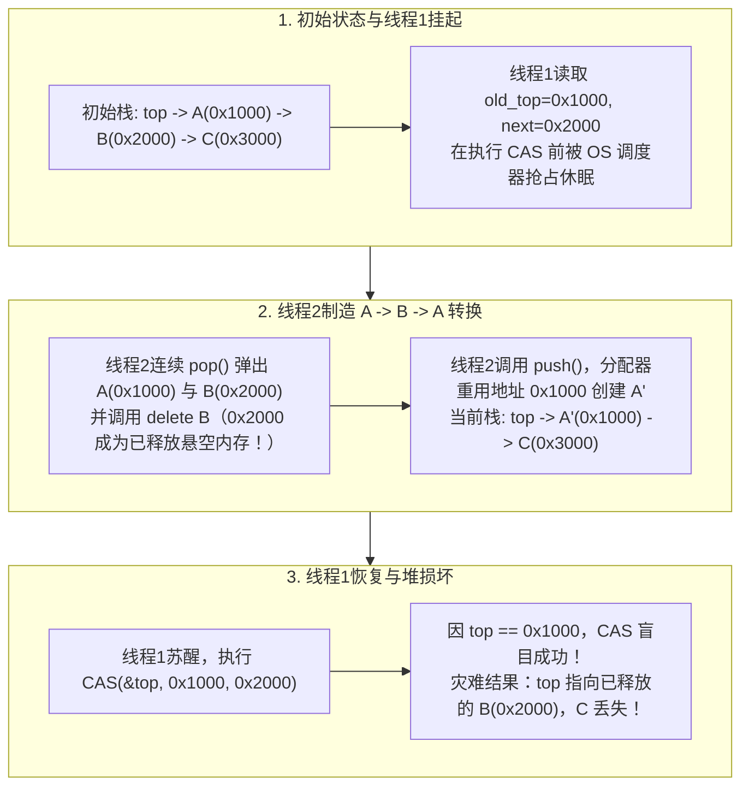
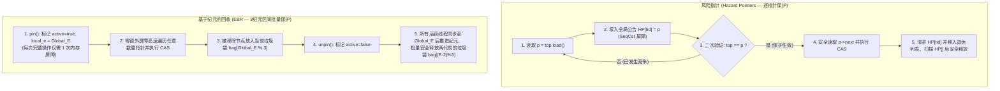

在现代多核服务器架构中，单台双路服务器往往拥有 128 至 256 个物理核心（通过同步多线程 SMT 可达 512 个硬件线程），它们共享同一个缓存一致性非均匀内存访问（ccNUMA）地址空间。当我们设计操作系统内核调度器、高频交易（HFT）订单撮合引擎、实时音频数字信号处理（DSP）回调或高并发数据库存储引擎时，传统并发编程奉为圭臬的同步原语——<strong>互斥锁（Mutual Exclusion Lock, `mutex`）</strong>——往往会从保护数据安全的盾牌演变为扼杀系统吞吐量与尾部延迟的致命瓶颈。

设想 128 个线程同时向一个由 `pthread_mutex_t` 或 `std::mutex` 保护的共享队列推入或弹出任务。修改队列头指针本身只需要寥寥数条机器指令，耗时不足 20 纳秒。然而，如果恰好持有锁的线程 $T_1$ 因操作系统时间片耗尽而被调度器抢占（Preempted），或者在临界区内触发了缺页异常（Page Fault），这 20 纳秒的临界区就会瞬间被拉长到数毫秒。在这数毫秒内，<strong>其余 127 个 CPU 核心将全部陷入停顿</strong>，只能等待一个正在睡眠的线程释放锁。

为了彻底斩断“单个线程的延迟绑架整个系统前进”的枷锁，计算机科学家创立了<strong>非阻塞同步（Non-blocking Synchronization）</strong>——即<strong>无锁（Lock-Free）</strong>与<strong>无等待（Wait-Free）</strong>算法的科学。然而，一旦抛弃互斥锁、直接依赖硬件原子指令（如 `Compare-And-Swap`）操作指针，我们就会立刻遭遇并发编程中最隐蔽、最凶险的陷阱：<strong>ABA 问题（ABA Problem）</strong>以及无垃圾回收语言（C / C++ / Rust）中的<strong>安全内存回收问题（Safe Memory Reclamation, SMR）</strong>。

---

## 第一章：为什么互斥锁（`mutex`）在超低延迟系统中会崩溃？

Linux 的现代互斥锁实现 `futex`（快速用户空间互斥锁）已经做到了极致优化：在无竞争情况下只需一次用户态原子操作，仅在发生冲突时才通过 `SYS_futex` 系统调用进入内核休眠队列。即便如此，互斥锁依然无法克服四大结构性缺陷：

1. <strong>内核抢占与锁护航效应（Lock Convoying）</strong>：持有锁的线程一旦因时间片中断或缺页异常被挂起，所有后续到达的线程都会在内核等待队列中堆积。即便持锁线程稍后恢复并释放锁，内核逐一唤醒睡眠线程、频繁切换上下文以及跨 NUMA 节点的缓存行颠簸（Cache Line Bouncing）也会引发连锁拥堵，称为“锁护航”。
2. <strong>无界优先级反转（Priority Inversion）</strong>：1997 年 7 月，NASA 的“火星探路者号（Mars Pathfinder）”探测器在火星表面频繁发生神秘重启。根本原因在于 VxWorks 实时操作系统上的三个线程：低优先级气象任务 $T_{\text{low}}$ 持有了总线互斥锁；高优先级总线管理任务 $T_{\text{high}}$ 试图获取该锁而被阻塞；此时与该锁毫无关系的多个中优先级通信任务 $T_{\text{med}}$ 抢占了 $T_{\text{low}}$ 的 CPU 时间，导致最高优先级的 $T_{\text{high}}$ 被间接饿死并触发看门狗超时复位。
3. <strong>死锁与不可组合性（Lack of Composability）</strong>：两个各自线程安全的锁保护哈希表 $A$ 和 $B$，无法在不引入全局加锁顺序（否则引发 AB-BA 死锁）的前提下合成原子的 `transfer(A, B)` 操作。
4. <strong>异步信号处理程序（Signal Handler）、中断上下文（ISR）与实时音频回调中的绝对禁区</strong>：在 POSIX 信号处理函数（如 `SIGINT`/`SIGSEGV`）中调用 `mutex_lock` 会引发不可恢复的<strong>自死锁（Self-Deadlock）</strong>；而在 $48\,\text{kHz}$、64 采样缓冲区的实时音频回调（硬性截止时间仅 $1.33\,\text{ms}$）中，任何一次 `futex` 休眠都会直接造成音频缓冲区欠载（爆音与卡顿）。

---

## 第二章：可线性化（Linearizability）与三层非阻塞进度保证

### 2.1 正确性准则：可线性化（Herlihy & Wing, 1990）
在并发系统中，每个方法调用 $op_i$ 都跨越一个时间区间 $[t_{\text{inv}}(op_i), t_{\text{resp}}(op_i)]$。Maurice Herlihy 与 Jeannette Wing 提出：如果对于每个并发操作 $op_i$，都能在其调用与返回之间找到一个瞬时时刻——称为<strong>线性化点（Linearization Point）</strong> $t_{\text{lin}}(op_i) \in [t_{\text{inv}}(op_i), t_{\text{resp}}(op_i)]$——使得所有操作按 $t_{\text{lin}}$ 排序后的序列完全符合串行规范，则该并发对象是<strong>可线性化的（Linearizable）</strong>。可线性化具有局部可组合性（Composable）：两个可线性化对象的组合天然可线性化。

### 2.2 活性（Liveness）的三层非阻塞保证
1. <strong>无阻碍（Obstruction-Free）</strong>：若某个线程最终在没有其他线程干扰的情况下<strong>独自运行（Solo Execution）</strong>，它必定在有限步内完成操作。最弱的非阻塞保证，并发竞争下可能发生活锁（Livelock），需配合退避竞争管理器。
2. <strong>无锁（Lock-Free）</strong>：无论其他线程运行速度如何、被抢占还是永久崩溃，<strong>所有正在执行操作的活跃线程中，“至少有一个线程”必定在有限步内完成其操作</strong>。每次某线程的 `CAS` 失败，都严格意味着另一个线程的 `CAS` 已经成功并推动了全局状态前进。因此系统整体吞吐量永不停止，彻底免疫死锁与锁护航。
3. <strong>无等待（Wait-Free）</strong>：无论其他线程如何竞争或崩溃，<strong>“每一个线程”都保证在有界有限步（$O(1)$ 或 $O(P)$）内完成其操作</strong>，彻底消除饥饿（Zero Starvation）。其核心机制是<strong>协助机制（Helping）</strong>：慢线程先在全局公告数组 `announce[i]` 中发布操作描述符，快线程在执行自身操作前先协助完成其他线程挂起的操作。

| 进度保证级别 | 是否阻塞 | 系统全局前进保证 | 单线程防饥饿保证 | 信号/中断/硬实时安全性 | 最坏时间复杂度 | 典型算法与工业应用 |
| :--- | :--- | :--- | :--- | :--- | :--- | :--- |
| <strong>互斥锁（Blocking）</strong> | 阻塞 | 无（持锁者挂起则全局停滞） | 无（存在死锁与优先级反转） | <strong>严禁使用</strong> | $\infty$（取决于 OS 调度） | `std::mutex`, `pthread_mutex_t` |
| <strong>无阻碍（Obstruction-Free）</strong> | 非阻塞 | 仅独自运行时保证（可能活锁） | 无（需指数退避控制） | 安全 | 竞争下 $\infty$ | 软件事务内存（STM） |
| <strong>无锁（Lock-Free）</strong> | 非阻塞 | <strong>始终保证（至少一线程完成）</strong> | 无（极端竞争下可能重试） | <strong>完全安全</strong> | 期望 $O(1)$ | Treiber 栈、Michael-Scott 队列 |
| <strong>无等待（Wait-Free）</strong> | 非阻塞 | <strong>始终保证（所有线程均完成）</strong> | <strong>绝对保证（零饥饿）</strong> | <strong>硬实时级安全</strong> | <strong>严格有界 $O(1)$ 或 $O(P)$</strong> | Kogan-Petrank 队列、SPSC 环形缓冲区、RCU 读端 |

---

## 第三章：硬件原子指令与 Herlihy 的“共识数层次（Consensus Hierarchy）”定理

1991 年，Maurice Herlihy 在其荣获哥德尔奖与迪杰斯特拉奖的经典论文 *"Wait-Free Synchronization"* 中提出了一个震撼理论计算机科学界的问题：<strong>仅靠不同强度的硬件原子指令，究竟能构建出什么样的无锁数据结构？</strong>

### 3.1 共识问题与共识数 $C(\mathcal{O})$
设有 $N$ 个线程各自提出初始值 $v_i$，最终所有线程必须在有限步内输出决定值 $d_i$，且满足：(1) <strong>一致性（Agreement）</strong>：所有线程输出相同的 $v^*$；(2) <strong>有效性（Validity）</strong>：$v^*$ 必然是某个线程提出的初始值；(3) <strong>无等待终止性（Wait-Free Termination）</strong>。
对象类型 $\mathcal{O}$ 的<strong>共识数 $C(\mathcal{O})$</strong> 定义为：使用任意数量的 $\mathcal{O}$ 实例与原子读写寄存器，能够解决无等待共识问题的最大线程数 $N$。

- <strong>$C = 1$：原子读写寄存器（Atomic Read/Write）</strong>：<strong>甚至连 $N = 2$ 个线程的共识都无法解决！</strong>
  <strong>二价性（Bivalence）证明核心</strong>：假设存在 2 线程无等待协议。初始状态必然是“二价的”（最终决定 0 或 1 均有可能）。随着协议推进，必然到达一个<strong>临界二价状态 $S_{\text{crit}}$</strong>：若线程 $A$ 走下一步 $e_A$ 则进入 0 价状态 $S_0$；若线程 $B$ 走下一步 $e_B$ 则进入 1 价状态 $S_1$。由于只有读写操作，无论是异址操作、一读一写，还是对同一寄存器 $R$ 的连续写入（$B$ 的写入会<strong>彻底覆盖并抹去</strong> $A$ 刚刚写入的值！），都会导致对线程 $B$ 而言 $e_B(e_A(S_{\text{crit}}))$（0 价）与 $e_B(S_{\text{crit}})$（1 价）在内存中<strong>完全不可区分（Indistinguishable）</strong>，让 $B$ 独自运行到底即产生矛盾！
- <strong>$C = 2$：`Test-and-Set` (`TAS`)、`Swap` (`XCHG`)、`Fetch-and-Add` (`LOCK XADD`)、FIFO 队列与栈</strong>：能解决 2 线程共识，但<strong>无法解决 $N \ge 3$ 线程共识</strong>！例如在 `Fetch-and-Add` 中，若线程 $A$ 和 $B$ 先后对寄存器加 1，由于加法交换律，无论谁先谁后，寄存器最终值均为 $r+2$，随后睡眠；第三个线程 $C$ 醒来时根本无法从内存中判断 $A$ 和 $B$ 谁是第一名！因此，<strong>仅用 `Fetch-and-Add` 或 `Swap` 绝对不可能构建出支持 3 个以上线程的通用无锁队列或栈</strong>。
- <strong>$C = \infty$（普适原语 Universal Primitives）：`Compare-And-Swap` (`CAS`) 与 `Load-Linked / Store-Conditional` (`LL/SC`)</strong>：当 $N$ 个线程同时执行 `CAS(&decision, UNDECIDED, my_val)` 时，唯有第一个线程成功写入，其余 $N-1$ 个线程全部失败且<strong>绝不覆盖胜出者的值</strong>。因此 $C(\text{CAS}) = C(\text{LL/SC}) = \infty$，能够无等待地实现任意并发数据结构！

---

## 第四章：Treiber 无锁栈（1986）与臭名昭著的“ABA 问题”解剖

R. Kent Treiber 于 1986 年提出了经典的无锁栈算法，`push` 和 `pop` 均通过 `CAS` 循环更新栈顶指针 `top`：

```cpp
// 存在致命 ABA 漏洞与 Use-After-Free 的朴素 Treiber 无锁栈 pop()
bool pop(T& result) {
    Node* old_top = top.load(std::memory_order_acquire);
    while (old_top != nullptr) {
        Node* next_node = old_top->next; // 危险点1：解引用可能已被释放的指针
        if (top.compare_exchange_weak(   // 危险点2：仅比较地址值是否相等的 CAS
                old_top, next_node,
                std::memory_order_acquire, std::memory_order_relaxed)) {
            result = old_top->data;
            delete old_top;              // 将内存归还给分配器（引发灾难的导火索！）
            return true;
        }
    }
    return false;
}
```

### 4.1 ABA 问题导致堆内存彻底损坏的 5 步时间线
假设初始栈状态为：$\text{top} \longrightarrow A(\texttt{0x1000}) \longrightarrow B(\texttt{0x2000}) \longrightarrow C(\texttt{0x3000})$。

1. <strong>【第 1 步】线程 1 启动 `pop()` 并在 `CAS` 前被抢占</strong>：线程 1 读取 `old_top = 0x1000` ($A$) 和 `next_node = 0x2000` ($B$)。就在执行 `CAS(&top, 0x1000, 0x2000)` 指令的前一刻，被操作系统挂起。
2. <strong>【第 2 步】线程 2 连续两次 `pop()` 并释放 $A$ 和 $B$</strong>：线程 2 弹出 $A(\texttt{0x1000})$ 并 `delete A`；接着弹出 $B(\texttt{0x2000})$ 并 <strong>`delete B`</strong>。此时地址 `0x2000` 已变成悬空内存（Dangling Pointer），栈仅剩 $\text{top} \to C(\texttt{0x3000})$。
3. <strong>【第 3 步】线程 2 执行 `push()`，内存分配器重用地址 `0x1000`</strong>：线程 2 分配新节点 $A'$。现代内存分配器（`jemalloc`/`tcmalloc`/`ptmalloc`）为了 L1 缓存局部性，立即从 LIFO 空闲链表重用刚刚释放的地址 `0x1000`！线程 2 将 $A'(\texttt{0x1000})$ 压入栈顶，此时栈为 $\text{top} \longrightarrow A'(\texttt{0x1000}) \longrightarrow C(\texttt{0x3000})$。
4. <strong>【第 4 步】线程 1 苏醒并执行过期的 `CAS(&top, 0x1000, 0x2000)`</strong>：CPU 检查当前 `top` 的值（`0x1000`）与线程 1 期望的 `old_top`（`0x1000`）。由于位模式完全相同（状态经历了 $A \to B \to A$），<strong>`CAS` 盲目地判断成功！</strong>
5. <strong>【第 5 步】堆内存彻底崩坏</strong>：栈顶 `top` 被错误地修改为 `0x2000`（已被释放的节点 $B$！），节点 $C(\texttt{0x3000})$ 永久泄漏，后续所有访问栈的线程都将触发 Use-After-Free 或段错误（`SIGSEGV`）！



---

## 第五章：攻克 ABA 问题与安全内存回收（SMR）的四大架构

在没有垃圾回收器（GC）的 C/C++/Rust 中，不仅要防止 `CAS` 的 ABA 误判，还必须防止线程 1 在执行 `old_top->next` 解引用前 `old_top` 被释放（Use-After-Free）。工业界主要采用四大架构方案：

### 5.1 方案一：带标签指针与双倍字宽 CAS（`DWCAS` / `CMPXCHG16B`）
将 64 位指针 `ptr` 与 64 位单调递增世代计数器 `tag` 封装为 16 字节对齐的 128 位结构体 `(ptr, tag)`。每次修改指针时令 `tag + 1`：$(\texttt{0x1000}, 42) \to (\texttt{0x2000}, 43) \to (\texttt{0x1000}, 44)$。利用 x86-64 的 `LOCK CMPXCHG16B` 指令（或利用 48 位虚拟地址的高 16 位进行指针位打包），线程 1 期望的 `tag=42` 与当前 `tag=44` 不匹配，`CAS` 安全失败。但需配合类型稳定内存池（Type-Stable Object Pool）以防止 `old_top->next` 触发缺页崩溃。

### 5.2 方案二：风险指针（Hazard Pointers — Maged Michael 2004, C++26 `<hazard_pointer>`）
每个读线程 $i$ 在全局风险数组 `HP[i]` 中拥有专属槽位。读取指针时遵循严格的三步握手：(1) 读取 `p = top.load()`；(2) 执行 `HP[i].store(p, memory_order_seq_cst)` 向全局宣告保护该地址；(3) <strong>二次验证（Validation）</strong>：再次检查 `top.load(memory_order_seq_cst) == p` 是否成立！若成立，则说明在 `p` 被弹出前保护宣告已全局可见。弹出节点的线程不直接 `delete`，而是放入本地退休列表 `retired_list`，当数量达到阈值时扫描全线程 `HP[]`，仅释放不在风险集合中的节点。未回收垃圾严格有界为 $O(P^2)$，但每次解引用指针均需一次昂贵的 `SeqCst` 内存屏障。

### 5.3 方案三：基于纪元的内存回收（EBR: Epoch-Based Reclamation — Rust `crossbeam-epoch`）
为了消除逐指针的内存屏障，Keir Fraser（2004）提出了三纪元轮转回收：维护全局纪元计数器 $E$ 与三个垃圾袋 `bag[0..2]`。线程进入操作时调用 `pin()`，将本地状态标记为活跃并记录 `local_e = E`（<strong>整个操作仅需这一次内存屏障！</strong>）。操作中被移除的节点放入当前纪元垃圾袋 `bag[E % 3]`。当所有活跃线程都追上纪元 $E$ 时，全局纪元推进至 $E+1$；一旦推进至 $E+2$，意味着没有任何活跃线程还持有两代前（纪元 $E$）的旧指针，即可安全地批量释放 `bag[E % 3]`！



### 5.4 方案四：读拷贝更新（RCU: Read-Copy-Update — Linux 内核与 `liburcu`）
针对读多写少（如路由表、VFS 目录缓存 `dcache`）场景，RCU 实现了<strong>零开销的无等待读取（Wait-Free Read）</strong>：`rcu_read_lock()` 在非抢占式内核中编译为<strong>零条机器指令</strong>（仅禁止读临界区内发生上下文切换）。写者采用写时复制（Copy-on-Write）分配新节点并原子替换指针，随后调用 `synchronize_rcu()` 等待所有 CPU 核心至少经历一次上下文切换（静止状态 Quiescent State，合称<strong>宽限期 Grace Period</strong>），即可 100% 确定所有旧读者均已退出并安全释放旧节点。

| 内存回收与防 ABA 技术 | 读路径开销 | 停滞线程下的内存有界性 | 适用数据结构广度 | 工业界代表实现 |
| :--- | :--- | :--- | :--- | :--- |
| <strong>带标签指针 (`DWCAS` + 对象池)</strong> | <strong>极低</strong>（仅原子加载） | 固定内存池（无法归还给 OS） | 仅限单指针 CAS 结构（如栈、空闲链表） | Linux 内核 `SLUB`、嵌入式无锁池 |
| <strong>风险指针 (Hazard Pointers)</strong> | <strong>较高</strong>（每指针需 `SeqCst` 屏障） | <strong>严格有界 $O(P^2)$（完全无锁回收）</strong> | <strong>极广</strong>（任意链表、树、跳表） | <strong>C++26 `<hazard_pointer>`</strong>、Meta `Folly` |
| <strong>基于纪元回收 (EBR)</strong> | <strong>极低</strong>（每次 `pin()` 仅一次屏障） | 无界（若某线程在 `pin` 内休眠则阻塞回收） | <strong>极广</strong>（最适合复杂多指针遍历结构） | <strong>Rust `crossbeam-epoch`</strong>、Bw-Tree |
| <strong>读拷贝更新 (RCU)</strong> | <strong>零开销（Wait-Free 读）</strong> | 取决于宽限期（写端延迟较高） | 读密集型（Read-Mostly）数据结构 | <strong>Linux 内核（VFS、网络栈）</strong>、`liburcu` |
