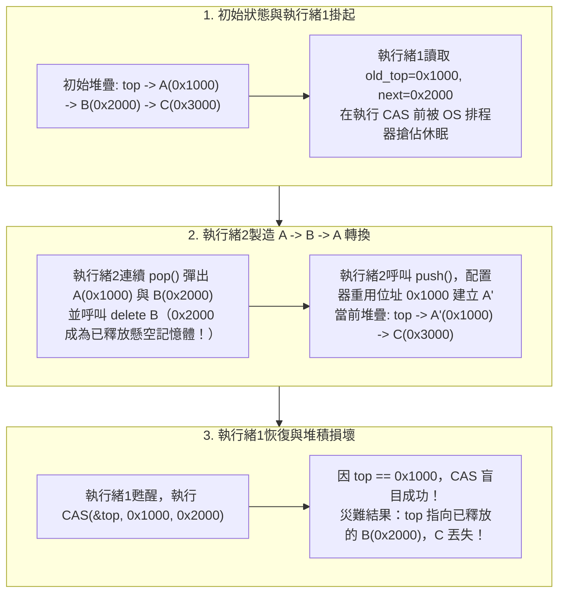
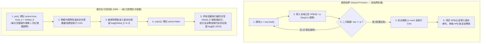

在現代多核心伺服器架構中，單台雙插槽伺服器往往配備 128 至 256 個實體核心（透過同步多執行緒 SMT 可達 512 個硬體執行緒），共同存取同一個快取一致性非均勻記憶體存取（ccNUMA）位址空間。當我們設計作業系統核心排程器、高頻交易（HFT）撮合引擎、即時音訊數位訊號處理（DSP）回呼或高並行資料庫引擎時，傳統並行程式設計高度依賴的同步原語——<strong>互斥鎖（Mutual Exclusion Lock, `mutex`）</strong>——往往會從保護資料安全的盾牌，演變為扼殺系統吞吐量與尾部延遲的致命瓶頸。

設想 128 個執行緒同時對一個由 `pthread_mutex_t` 或 `std::mutex` 保護的共享佇列進行推入與彈出。更新佇列指標本身僅需數條機器指令（不到 20 奈秒）。然而，若正好持有鎖的執行緒 $T_1$ 因作業系統時間片耗盡而被排程器搶佔（Preempted），或在臨界區內觸發分頁錯誤（Page Fault），這 20 奈秒的臨界區就會瞬間膨脹為數毫秒。在這數毫秒內，<strong>其餘 127 個 CPU 核心將全部陷入停頓</strong>，只能等待一個正在睡眠的執行緒釋放鎖。

為了徹底斬斷「單一執行緒的延遲綁架整個系統前進」的枷鎖，電腦科學家創立了<strong>非阻塞同步（Non-blocking Synchronization）</strong>——亦即<strong>無鎖（Lock-Free）</strong>與<strong>無等待（Wait-Free）</strong>演算法的科學。然而，一旦拋棄互斥鎖、直接依賴硬體原子指令（如 `Compare-And-Swap`）操作指標，我們就會立刻遭遇並行計算中最隱蔽、最兇險的陷阱：<strong>ABA 問題（ABA Problem）</strong>以及無垃圾回收語言（C / C++ / Rust）中的<strong>安全記憶體回收問題（Safe Memory Reclamation, SMR）</strong>。

---

## 第一章：為什麼互斥鎖（`mutex`）在超低延遲系統中會崩潰？

儘管 Linux 的現代互斥鎖實現 `futex`（快速使用者空間互斥鎖）在無競爭時僅需一次使用者態原子操作，僅在發生衝突時才透過 `SYS_futex` 系統呼叫進入核心休眠佇列，但互斥鎖依然無法克服四大結構性缺陷：

1. <strong>核心搶佔與鎖護航效應（Lock Convoying）</strong>：持有鎖的執行緒一旦因時間片中斷或分頁錯誤被掛起，所有後續到達的執行緒都會在核心等待佇列中堆積。即便持鎖執行緒稍後恢復並釋放鎖，核心逐一喚醒睡眠執行緒、頻繁進行上下文切換（Context Switch）以及跨 NUMA 節點的快取行顛簸（Cache Line Bouncing）也會引發連鎖擁堵，稱為「鎖護航」。
2. <strong>無界優先權反轉（Priority Inversion）</strong>：1997 年 7 月，NASA 的「火星探路者號（Mars Pathfinder）」探測器在火星表面頻繁發生神秘重啟。根本原因在於 VxWorks 即時作業系統上的三個執行緒：低優先權氣象任務 $T_{\text{low}}$ 持有了匯流排互斥鎖；高優先權匯流排管理任務 $T_{\text{high}}$ 試圖獲取該鎖而被阻塞；此時與該鎖毫無關係的多個中優先權通訊任務 $T_{\text{med}}$ 搶佔了 $T_{\text{low}}$ 的 CPU 時間，導致最高優先權的 $T_{\text{high}}$ 被間接餓死並觸發看門狗逾時重置。
3. <strong>死結與不可組合性（Lack of Composability）</strong>：兩個各自執行緒安全的鎖保護雜湊表 $A$ 和 $B$，無法在不引入全域加鎖順序（否則引發 AB-BA 死結）的前提下合成原子的 `transfer(A, B)` 操作。
4. <strong>非同步訊號處理常式（Signal Handler）、中斷服務常式（ISR）與即時音訊回呼中的絕對禁區</strong>：在 POSIX 訊號處理函式（如 `SIGINT`/`SIGSEGV`）中呼叫 `mutex_lock` 會引發不可恢復的<strong>自我死結（Self-Deadlock）</strong>；而在 $48\,\text{kHz}$、64 取樣緩衝區的即時音訊回呼（硬性截止時間僅 $1.33\,\text{ms}$）中，任何一次 `futex` 休眠都會直接造成音訊緩衝區欠載（爆音與雜訊）。

---

## 第二章：可線性化（Linearizability）與三層非阻塞進度保證

### 2.1 正確性準則：可線性化（Herlihy & Wing, 1990）
在並行系統中，每個方法呼叫 $op_i$ 都跨越一個時間區間 $[t_{\text{inv}}(op_i), t_{\text{resp}}(op_i)]$。Maurice Herlihy 與 Jeannette Wing 提出：如果對於每個並行操作 $op_i$，都能在其呼叫與返回之間找到一個瞬時時刻——稱為<strong>線性化點（Linearization Point）</strong> $t_{\text{lin}}(op_i) \in [t_{\text{inv}}(op_i), t_{\text{resp}}(op_i)]$——使得所有操作按 $t_{\text{lin}}$ 排序後的序列完全符合循序規範，則該並行物件是<strong>可線性化的（Linearizable）</strong>。可線性化具備局部可組合性（Composable）：兩個可線性化物件的組合天然可線性化。

### 2.2 活性（Liveness）的三層非阻塞保證
1. <strong>無阻礙（Obstruction-Free）</strong>：若某個執行緒最終在沒有其他執行緒干擾的情況下<strong>獨自執行（Solo Execution）</strong>，它必定在有限步內完成操作。最弱的非阻塞保證，並行競爭下可能發生活鎖（Livelock），需配合退避競爭管理器。
2. <strong>無鎖（Lock-Free）</strong>：無論其他執行緒執行速度如何、被搶佔還是永久崩潰，<strong>所有正在執行操作的活躍執行緒中，「至少有一個執行緒」必定在有限步內完成其操作</strong>。每次某執行緒的 `CAS` 失敗，都嚴格意味著另一個執行緒的 `CAS` 已經成功並推動了全域狀態前進。因此系統整體吞吐量永不停止，徹底免疫死結與鎖護航。
3. <strong>無等待（Wait-Free）</strong>：無論其他執行緒如何競爭或崩潰，<strong>「每一個執行緒」都保證在有界有限步（$O(1)$ 或 $O(P)$）內完成其操作</strong>，徹底消除飢餓（Zero Starvation）。其核心機制是<strong>協助機制（Helping）</strong>：慢執行緒先在全域公告陣列 `announce[i]` 中發佈操作描述符，快執行緒在執行自身操作前先協助完成其他執行緒掛起的操作。

| 進度保證級別 | 是否阻塞 | 系統全域前進保證 | 單執行緒防飢餓保證 | 訊號/中斷/硬即時安全性 | 最壞時間複雜度 | 典型演算法與工業應用 |
| :--- | :--- | :--- | :--- | :--- | :--- | :--- |
| <strong>互斥鎖（Blocking）</strong> | 阻塞 | 無（持鎖者掛起則全域停滯） | 無（存在死結與優先權反轉） | <strong>嚴禁使用</strong> | $\infty$（取決於 OS 排程） | `std::mutex`, `pthread_mutex_t` |
| <strong>無阻礙（Obstruction-Free）</strong> | 非阻塞 | 僅獨自執行時保證（可能活鎖） | 無（需指數退避控制） | 安全 | 競爭下 $\infty$ | 軟體交易記憶體（STM） |
| <strong>無鎖（Lock-Free）</strong> | 非阻塞 | <strong>始終保證（至少一執行緒完成）</strong> | 無（極端競爭下可能重試） | <strong>完全安全</strong> | 期望 $O(1)$ | Treiber 堆疊、Michael-Scott 佇列 |
| <strong>無等待（Wait-Free）</strong> | 非阻塞 | <strong>始終保證（所有執行緒均完成）</strong> | <strong>絕對保證（零飢餓）</strong> | <strong>硬即時級安全</strong> | <strong>嚴格有界 $O(1)$ 或 $O(P)$</strong> | Kogan-Petrank 佇列、SPSC 環形緩衝區、RCU 讀端 |

---

## 第三章：硬體原子指令與 Herlihy 的「共識數層次（Consensus Hierarchy）」定理

1991 年，Maurice Herlihy 在其榮獲哥德爾獎與迪傑斯特拉獎的經典論文 *"Wait-Free Synchronization"* 中，使用<strong>共識數（Consensus Number）$C(\mathcal{O})$</strong> 嚴格分類了所有同步原語的計算能力上限：即使用任意數量的型別 $\mathcal{O}$ 物件與原子讀寫暫存器，能解決 $N$ 執行緒無等待共識問題（Agreement、Validity、Wait-Free Termination）的最大整數 $N$。

- <strong>$C = 1$：原子讀寫暫存器（Atomic Read/Write）</strong>：<strong>甚至連 $N = 2$ 個執行緒的共識都無法解決！</strong>
  <strong>二價性（Bivalence）證明核心</strong>：假設存在 2 執行緒無等待協議。初始狀態必然是「二價的」（最終決定 0 或 1 均有可能）。隨著協議推進，必然到達一個<strong>臨界二價狀態 $S_{\text{crit}}$</strong>：若執行緒 $A$ 走下一步 $e_A$ 則進入 0 價狀態 $S_0$；若執行緒 $B$ 走下一步 $e_B$ 則進入 1 價狀態 $S_1$。由於只有讀寫操作，無論是異址操作、一讀一寫，還是對同一暫存器 $R$ 的連續寫入（$B$ 的寫入會<strong>徹底覆蓋並抹去</strong> $A$ 剛剛寫入的值！），都會導致對執行緒 $B$ 而言 $e_B(e_A(S_{\text{crit}}))$（0 價）與 $e_B(S_{\text{crit}})$（1 價）在記憶體中<strong>完全不可區分（Indistinguishable）</strong>，讓 $B$ 獨自執行到底即產生矛盾！
- <strong>$C = 2$：`Test-and-Set` (`TAS`)、`Swap` (`XCHG`)、`Fetch-and-Add` (`LOCK XADD`)、FIFO 佇列與堆疊</strong>：能解決 2 執行緒共識，但<strong>無法解決 $N \ge 3$ 執行緒共識</strong>！例如在 `Fetch-and-Add` 中，若執行緒 $A$ 和 $B$ 先後對暫存器加 1，由於加法交換律，無論誰先誰後，暫存器最終值均為 $r+2$，隨後雙雙休眠；第三個執行緒 $C$ 醒來時根本無法從記憶體中判斷 $A$ 和 $B$ 誰是第一名！因此，<strong>僅用 `Fetch-and-Add` 或 `Swap` 絕對不可能建構出支援 3 個以上執行緒的通用無鎖佇列或堆疊</strong>。
- <strong>$C = \infty$（普適原語 Universal Primitives）：`Compare-And-Swap` (`CAS`) 與 `Load-Linked / Store-Conditional` (`LL/SC`)</strong>：當 $N$ 個執行緒同時執行 `CAS(&decision, UNDECIDED, my_val)` 時，唯有第一個執行緒成功寫入，其餘 $N-1$ 個執行緒全部失敗且<strong>絕不覆蓋勝出者的值</strong>。因此 $C(\text{CAS}) = C(\text{LL/SC}) = \infty$，能夠無等待地實現任意並行資料結構！

---

## 第四章：Treiber 無鎖堆疊（1986）與惡名昭彰的「ABA 問題」解剖

R. Kent Treiber 於 1986 年提出了經典的無鎖堆疊演算法，`push` 和 `pop` 均透過 `CAS` 迴圈更新堆疊頂端指標 `top`：

```cpp
// 存在致命 ABA 漏洞與 Use-After-Free 的樸素 Treiber 無鎖堆疊 pop()
bool pop(T& result) {
    Node* old_top = top.load(std::memory_order_acquire);
    while (old_top != nullptr) {
        Node* next_node = old_top->next; // 危險點1：解參考可能已被釋放的指標
        if (top.compare_exchange_weak(   // 危險點2：僅比較位址值是否相等的 CAS
                old_top, next_node,
                std::memory_order_acquire, std::memory_order_relaxed)) {
            result = old_top->data;
            delete old_top;              // 將記憶體歸還給配置器（引發災難的導火線！）
            return true;
        }
    }
    return false;
}
```

### 4.1 ABA 問題導致堆積記憶體徹底損壞的 5 步時間線
假設初始堆疊狀態為：$\text{top} \longrightarrow A(\texttt{0x1000}) \longrightarrow B(\texttt{0x2000}) \longrightarrow C(\texttt{0x3000})$。

1. <strong>【第 1 步】執行緒 1 啟動 `pop()` 並在 `CAS` 前被搶佔</strong>：執行緒 1 讀取 `old_top = 0x1000` ($A$) 和 `next_node = 0x2000` ($B$)。就在執行 `CAS(&top, 0x1000, 0x2000)` 指令的前一刻，被作業系統掛起。
2. <strong>【第 2 步】執行緒 2 連續兩次 `pop()` 並釋放 $A$ 和 $B$</strong>：執行緒 2 彈出 $A(\texttt{0x1000})$ 並 `delete A`；接著彈出 $B(\texttt{0x2000})$ 並 <strong>`delete B`</strong>。此時位址 `0x2000` 已變成懸空記憶體（Dangling Pointer），堆疊僅剩 $\text{top} \to C(\texttt{0x3000})$。
3. <strong>【第 3 步】執行緒 2 執行 `push()`，記憶體配置器重用位址 `0x1000`</strong>：執行緒 2 配置新節點 $A'$。現代記憶體配置器（`jemalloc`/`tcmalloc`/`ptmalloc`）為了 L1 快取局部性，立即從 LIFO 空閒串列重用剛剛釋放的位址 `0x1000`！執行緒 2 將 $A'(\texttt{0x1000})$ 推入堆疊頂端，此時堆疊為 $\text{top} \longrightarrow A'(\texttt{0x1000}) \longrightarrow C(\texttt{0x3000})$。
4. <strong>【第 4 步】執行緒 1 甦醒並執行過期的 `CAS(&top, 0x1000, 0x2000)`</strong>：CPU 檢查當前 `top` 的值（`0x1000`）與執行緒 1 期望的 `old_top`（`0x1000`）。由於位元模式完全相同（狀態經歷了 $A \to B \to A$），<strong>`CAS` 盲目地判斷成功！</strong>
5. <strong>【第 5 步】堆積記憶體徹底崩壞</strong>：堆疊頂端 `top` 被錯誤地修改為 `0x2000`（已被釋放的節點 $B$！），節點 $C(\texttt{0x3000})$ 永久洩漏，後續所有存取堆疊的執行緒都將觸發 Use-After-Free 或區段錯誤（`SIGSEGV`）！



---

## 第五章：攻克 ABA 問題與安全記憶體回收（SMR）的四大架構

在沒有垃圾回收器（GC）的 C/C++/Rust 中，不僅要防止 `CAS` 的 ABA 誤判，還必須防止執行緒 1 在執行 `old_top->next` 解參考前 `old_top` 被釋放（Use-After-Free）。工業界主要採用四大架構方案：

### 5.1 方案一：帶標籤指標與雙倍字寬 CAS（`DWCAS` / `CMPXCHG16B`）
將 64 位元指標 `ptr` 與 64 位元單調遞增世代計數器 `tag` 封裝為 16 位元組對齊的 128 位元結構體 `(ptr, tag)`。每次修改指標時令 `tag + 1`：$(\texttt{0x1000}, 42) \to (\texttt{0x2000}, 43) \to (\texttt{0x1000}, 44)$。利用 x86-64 的 `LOCK CMPXCHG16B` 指令（或利用 48 位元虛擬位址的高 16 位元進行指標位元打包），執行緒 1 期望的 `tag=42` 與當前 `tag=44` 不匹配，`CAS` 安全失敗。但需配合型別穩定記憶體池（Type-Stable Object Pool）以防止 `old_top->next` 觸發分頁錯誤崩潰。

### 5.2 方案二：風險指標（Hazard Pointers — Maged Michael 2004, C++26 `<hazard_pointer>`）
每個讀執行緒 $i$ 在全域風險陣列 `HP[i]` 中擁有專屬槽位。讀取指標時遵循嚴格的三步交握：(1) 讀取 `p = top.load()`；(2) 執行 `HP[i].store(p, memory_order_seq_cst)` 向全域宣告保護該位址；(3) <strong>二次驗證（Validation）</strong>：再次檢查 `top.load(memory_order_seq_cst) == p` 是否成立！若成立，則說明在 `p` 被彈出前保護宣告已全域可見。彈出節點的執行緒不直接 `delete`，而是放入本地退休串列 `retired_list`，當數量達到閾值時掃描全執行緒 `HP[]`，僅釋放不在風險集合中的節點。未回收垃圾嚴格有界為 $O(P^2)$，但每次解參考指標均需一次昂貴的 `SeqCst` 記憶體屏障。

### 5.3 方案三：基於紀元的記憶體回收（EBR: Epoch-Based Reclamation — Rust `crossbeam-epoch`）
為了消除逐指標的記憶體屏障，Keir Fraser（2004）提出了三紀元輪轉回收：維護全域紀元計數器 $E$ 與三個垃圾袋 `bag[0..2]`。執行緒進入操作時呼叫 `pin()`，將本地狀態標記為活躍並記錄 `local_e = E`（<strong>整個操作僅需這一次記憶體屏障！</strong>）。操作中被移除的節點放入當前紀元垃圾袋 `bag[E % 3]`。當所有活躍執行緒都追上紀元 $E$ 時，全域紀元推進至 $E+1$；一旦推進至 $E+2$，意味著沒有任何活躍執行緒還持有兩代前（紀元 $E$）的舊指標，即可安全地批次釋放 `bag[E % 3]`！



### 5.4 方案四：讀拷貝更新（RCU: Read-Copy-Update — Linux 核心與 `liburcu`）
針對讀多寫少（如路由表、VFS 目錄快取 `dcache`）場景，RCU 實現了<strong>零開銷的無等待讀取（Wait-Free Read）</strong>：`rcu_read_lock()` 在非搶佔式核心中編譯為<strong>零條機器指令</strong>（僅禁止讀臨界區內發生上下文切換）。寫者採用寫時複製（Copy-on-Write）配置新節點並原子替換指標，隨後呼叫 `synchronize_rcu()` 等待所有 CPU 核心至少經歷一次上下文切換（靜止狀態 Quiescent State，合稱<strong>寬限期 Grace Period</strong>），即可 100% 確定所有舊讀者均已退出並安全釋放舊節點。

| 記憶體回收與防 ABA 技術 | 讀路徑開銷 | 停滯執行緒下的記憶體有界性 | 適用資料結構廣度 | 工業界代表實現 |
| :--- | :--- | :--- | :--- | :--- |
| <strong>帶標籤指標 (`DWCAS` + 物件池)</strong> | <strong>極低</strong>（僅原子載入） | 固定記憶體池（無法歸還給 OS） | 僅限單指標 CAS 結構（如堆疊、空閒串列） | Linux 核心 `SLUB`、嵌入式無鎖池 |
| <strong>風險指標 (Hazard Pointers)</strong> | <strong>較高</strong>（每指標需 `SeqCst` 屏障） | <strong>嚴格有界 $O(P^2)$（完全無鎖回收）</strong> | <strong>極廣</strong>（任意串列、樹、跳表） | <strong>C++26 `<hazard_pointer>`</strong>、Meta `Folly` |
| <strong>基於紀元回收 (EBR)</strong> | <strong>極低</strong>（每次 `pin()` 僅一次屏障） | 無界（若某執行緒在 `pin` 內休眠則阻塞回收） | <strong>極廣</strong>（最適合複雜多指標走訪結構） | <strong>Rust `crossbeam-epoch`</strong>、Bw-Tree |
| <strong>讀拷貝更新 (RCU)</strong> | <strong>零開銷（Wait-Free 讀）</strong> | 取決於寬限期（寫端延遲較高） | 讀密集型（Read-Mostly）資料結構 | <strong>Linux 核心（VFS、網路堆疊）</strong>、`liburcu` |
