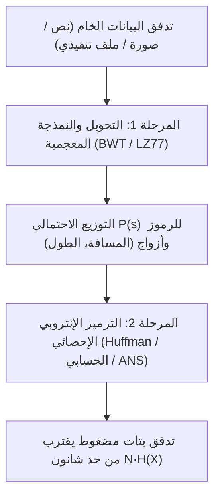
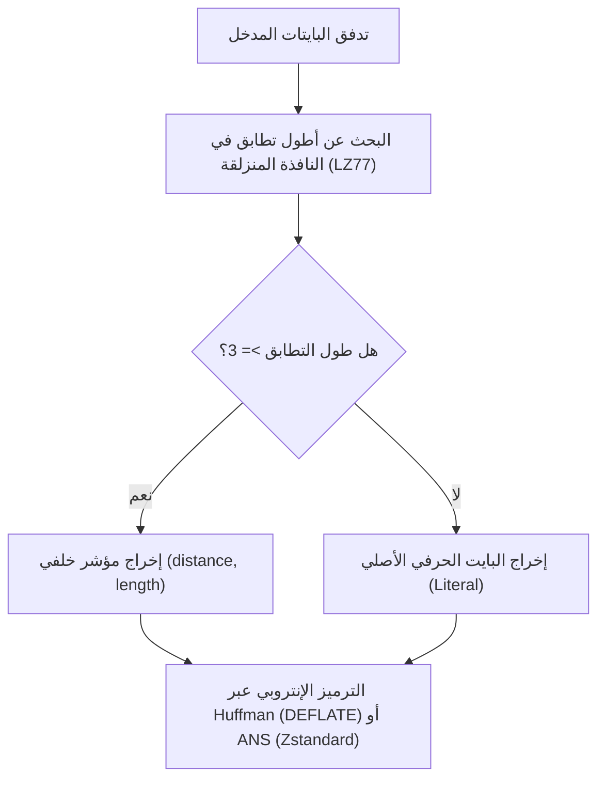

## 1. مبدأ برج الحمام: لماذا يستحيل وجود خوارزمية ضغط شاملة تصغّر جميع الملفات؟

عندما نستخدم يومياً أدوات مثل `zip` أو `gzip` أو `zstd` أو `7z` أو `PNG` لتقليص حجم المستندات أو الشفرات البرمجية أو الصور إلى جزء صغير من حجمها الأصلي، ثم نعيد فك ضغطها <strong>دون فقدان بت واحد على الإطلاق (ضغط غير فاقد / Lossless Compression)</strong>، يثور سؤال بديهي: إذا كان برنامج الضغط يصغّر حجم الملف، فلماذا لا نعيد ضغط ملف `.zip` الناتج عشر مرات متتالية حتى نختزل أي فيلم ضخم أو قاعدة بيانات إلى بايت واحد فقط؟

الإجابة قاطعة: <strong>هذا مستحيل رياضياً.</strong> ولا يتطلب إثبات ذلك سوى <strong>مبدأ برج الحمام (Pigeonhole Principle)</strong> في التوافقيات الأولية.

لتكن $E: \{0,1\}^* \to \{0,1\}^*$ دالة الترميز غير الفاقد و$D: \{0,1\}^* \to \{0,1\}^*$ دالة فك الترميز. لكي نضمن استرجاع أي ملف ثنائي $x$ بدقة تامة $D(E(x)) = x$، يجب حتماً أن تكون الدالة $E$ <strong>دالة متباينة (Injective / واحد لواحد)</strong>؛ لأنه لو تم ضغط ملفين مختلفين $x_1 \ne x_2$ إلى نفس السلسلة القصيرة $y = E(x_1) = E(x_2)$، فلن يتمكن فاكّ الترميز أبداً من معرفة ما إذا كان عليه استعادة $x_1$ أم $x_2$!

يوجد بالضبط $2^N$ ملفاً ثنائياً بطول $N$ بت، بينما إجمالي عدد جميع السلاسل الثنائية الأقصر قطعا من $N$ بت (أي من الطول $0$ إلى $N-1$) يساوي:

$$\sum_{k=0}^{N-1} 2^k = 2^N - 1 < 2^N$$

وبما أن لدينا $2^N$ ملف إدخال («حمامة») مقابل $2^N - 1$ سلسلة أقصر فقط («برج حمام»)، فإن <strong>أي خوارزمية ضغط غير فاقد تُقصّر ملفاً واحداً على الأقل لا بدّ أن تُطيل (تُضخّم) ملفات أخرى حتماً</strong>! بل إن نسبة الملفات ذات الطول $N$ التي يمكن تقليصها بمقدار $c$ بت على الأقل لا تتجاوز:

$$P\bigl(|E(X)| \le N - c\bigr) < 2^{-(c-1)}$$

أي أن السواد الأعظم من السلاسل الثنائية العشوائية غير قابل للضغط إطلاقاً. وإنما تنجح برامج الضغط اليومية لأن النصوص البشرية والبرمجيات والصور الطبيعية تشغل زاوية ضئيلة جداً وعالية التنظيم <strong>ومنخفضة الإنتروبيا</strong> داخل فضاء $\{0,1\}^N$.

---

## 2. نظرية شانون لترميز المصدر والإنتروبيا: الحد الفيزيائي المطلق

في عام 1948، صاغ كلود شانون (Claude E. Shannon) في بحثه الشهير *«النظرية الرياضية للاتصال»* الحد الأساسي لضغط البيانات. لمصدر متقطع عديم الذاكرة يصدر رموزاً من أبجدية $\mathcal{A} = \{s_1, \dots, s_m\}$ باحتمالات $P = (p_1, \dots, p_m)$، تُعرَّف <strong>المعلومات الذاتية (Surprisal)</strong> للرمز $s_i$ وقيمتها المتوقعة — <strong>إنتروبيا شانون $H(X)$</strong> — بالعلاقة:

$$I(s_i) = -\log_2 p_i, \qquad H(X) = -\sum_{i=1}^{m} p_i \log_2 p_i \quad (\text{bits per symbol})$$

وكل <strong>ترميز خالٍ من البادئات (فوري الفك)</strong> بأطوال كلمات $\ell_1, \dots, \ell_m$ يجب أن يحقق <strong>متباينة كرافت-ماكميلان (Kraft-McMillan Inequality)</strong>:

$$\sum_{i=1}^{m} 2^{-\ell_i} \le 1$$

وباستخدام عدم سلبية تباعد كولباك-لايبلر $D_{\text{KL}}(P \,\|\, Q) \ge 0$ مع $q_i = 2^{-\ell_i}/Z$ ($Z = \sum 2^{-\ell_i} \le 1$)، نبرهن <strong>نظرية شانون لترميز المصدر العديم الضجيج</strong> لمتوسط طول الكلمة $L = \sum_{i=1}^m p_i \ell_i$:

$$L - H(X) = \sum_{i=1}^m p_i \log_2 \frac{p_i}{2^{-\ell_i}} = D_{\text{KL}}(P \,\|\, Q) + \log_2 \frac{1}{Z} \ge 0 \implies H(X) \le L < H(X) + 1$$

---

## 3. ثلاثة أجيال من الترميز الإنتروبي: هوفمان، والترميز الحسابي، وأنظمة ANS

### 3.1 ترميز هوفمان (Huffman Coding, 1952)
يبني الگوريتم ديفيد هوفمان الجشع في زمن $O(m \log m)$ شجرة البادئات المثلى عبر دمج العقدتين الأقل احتمالاً بشكل متكرر. غير أن قيده البنيوي يكمن في أن <strong>كل رمز يجب أن يُمثَّل بعدد صحيح من البتات ($\ell_i \ge 1$)</strong>: فالرمز ذو الاحتمال $p_1 = 0.99$ لا يحمل سوى $-\log_2(0.99) \approx 0.0145\,\text{bit}$ من المعلومات، لكنه يستهلك بتاً كاملاً على الأقل.

### 3.2 الترميز الحسابي (Arithmetic / Range Coding)
يتجاوز الترميز الحسابي حاجز الأعداد الصحيحة عبر تمثيل <strong>رسالة كاملة $x_1 x_2 \dots x_N$ كفترة فرعية وحيدة $[L_{\text{low}}, H_{\text{high}}) \subset [0, 1)$</strong> عرضها النهائي $\Delta = \prod_{t=1}^N P(x_t)$ لا يحتاج إلا إلى $\lceil -\log_2 \Delta \rceil + 1 \approx N \cdot H(X)$ بت، محققاً كسور البتات مقابل كلفة حسابية أعلى في عمليات الضرب المتتالية.

### 3.3 الأنظمة العددية غير المتماثلة (ANS، ياريك دودا 2009–2014)
ابتكر الفيزيائي وعالم الحاسوب البولندي ياريك دودا (Jarek Duda) <strong>الأنظمة العددية غير المتماثلة (tANS وrANS)</strong> التي جمعت بين <strong>معدل الضغط المثالي للترميز الحسابي وسرعة جداول البحث الفائقة لترميز هوفمان</strong>. فعند ترميز رمز $s$ احتماله $p_s$ داخل الحالة الصحيحة $x \in \mathbb{N}$، تتطور الحالة وفق:

$$C(x, s) \approx \frac{x}{p_s}$$

واليوم تقود ANS محركات <strong>Zstandard (`zstd`)</strong> من Meta، و<strong>LZFSE</strong> من Apple، و<strong>JPEG XL</strong> من Google.

---

## 4. الضغط المعجمي والتحويلات: LZ77 وDEFLATE وBWT و«الضغط هو التنبؤ»

لاستغلال تكرار السلاسل النصية والسياق المتسلسل، تدمج الضواغط الحديثة النمذجة المعجمية مع الترميز الإنتروبي:
- <strong>LZ77 (ليمبل وزيف، 1977)</strong>: يستبدل السلاسل المتكررة داخل نافذة منزلقة بمؤشرات خلفية <strong>`(distance, length)`</strong>. ومع هوفمان يشكّل <strong>DEFLATE (`gzip`, `zip`, `PNG`)</strong>، ومع ANS يشكّل <strong>Zstandard (`zstd`)</strong>.
- <strong>تحويل بوروز-ويلر (BWT، 1994، `bzip2`)</strong>: يرتب جميع الإزاحات الدورية لكتلة البيانات أبجدياً ويأخذ العمود الأخير $L$، مما يجمّع الأحرف ذات السياق المتماثل لتسهيل ضغطها عبر Move-To-Front (MTF) وRLE.

| الخوارزمية / الأداة | المعجم / التحويل | المرمّز الإنتروبي | نسبة الضغط النموذجية | سرعة فك الضغط | أبرز التطبيقات الصناعية |
|---|---|---|---|---|---|
| <strong>`lz4`</strong> | LZ77 محاذى للبايت | لا يوجد (تدفق بايت مباشر) | $\sim 48\%$ | $\sim 4,000\,\text{MB/s}$ | ضغط الذاكرة (ZRAM)، قواعد البيانات الفورية |
| <strong>`gzip` (DEFLATE)</strong> | LZ77 (نافذة 32 كيلوبايت) | ترميز هوفمان | $\sim 32\%$ | $\sim 400\,\text{MB/s}$ | بروتوكول HTTP، ملفات `.tar.gz`، صور PNG |
| <strong>`zstd` (Zstandard)</strong> | LZ77 (نافذة كبيرة + مخبأ إزاحات) | <strong>ANS (tANS / FSE)</strong> + هوفمان | $\sim 28\%$ | $\sim 1,500\,\text{MB/s}$ | حزم لينكس، التخزين السحابي، نظام ملفات Btrfs |
| <strong>`bzip2`</strong> | <strong>فرز الكتل BWT</strong> + MTF + RLE | هوفمان متعدد الجداول | $\sim 26\%$ | $\sim 60\,\text{MB/s}$ | أرشفة الشفرات المصدرية، المعلوماتية الحيوية |
| <strong>`xz` (LZMA2)</strong> | LZ77 (معجم عملاق + سياق بتي) | ترميز حسابي نطاقي (Range) | $\sim 21\%$ | $\sim 120\,\text{MB/s}$ | توزيع البرمجيات بأقل حجم ممكن، البرمجيات المدمجة |
| <strong>`cmix` / `PAQ8` / LLM</strong> | خلط السياقات / Transformer | الترميز الحسابي | $\sim 11\%\text{–}14\%$ | $< 1\,\text{MB/s}$ | جائزة Hutter، تكافؤ الضغط والذكاء الاصطناعي |

وفي أعمق معاني نظرية المعلومات، <strong>فإن الضغط يكافئ التنبؤ تماماً (Compression is Prediction)</strong>: فأي نموذج احتمالي (بما في ذلك نماذج اللغة الكبيرة Transformer) يقلل خسارة الإنتروبيا المتقاطعة $-\sum \log_2 P_\theta(x_t \mid x_{<t})$ عند التنبؤ بالرمز التالي يحدد مباشرة أصغر حجم ممكن للملف المضغوط دون فقدان عند تمرير تلك الاحتمالات إلى مرمّز حسابي.
