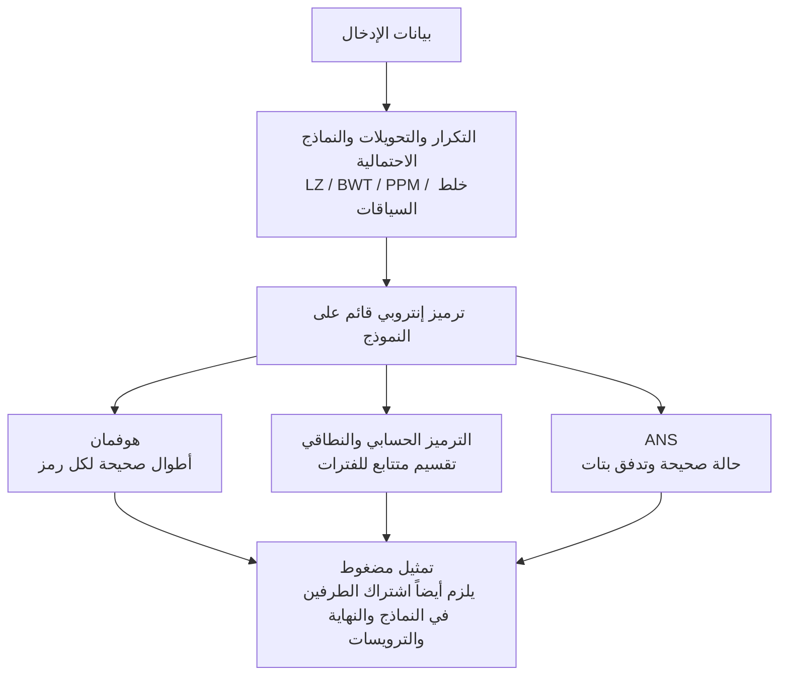
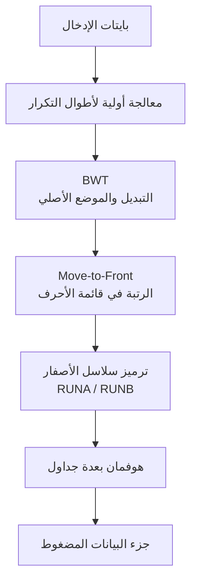

## 1. لماذا لا يستطيع أي ضاغط تقصير جميع الملفات؟

يستبدل الضغط غير الفاقد البيانات بتمثيل آخر يتيح استعادة البايتات الأصلية دون تغيير بت واحد. تصغّر أدوات مثل zip وgzip وzstd وxz بعض المدخلات، بينما لا تتغير مدخلات أخرى كثيراً أو تكبر بسبب الترويسات. يتوقف مقدار التصغير على المدخل. أما الضغط الفاقد، مثل JPEG أو MP3، فيسمح باختلاف القيم المستعادة، ولذلك يفرض شرطاً مختلفاً على إعادة البناء.

لتكن <bdi dir="ltr">{0,1}*</bdi> مجموعة السلاسل البتية المنتهية. نثبت مرمّزاً <bdi dir="ltr">E</bdi> وفاك ترميز <bdi dir="ltr">D</bdi>. يتطلب انعدام الفقد، لكل مدخل <bdi dir="ltr">x</bdi>، ما يلي:

$$
D(E(x))=x
$$

إذا أعطى مدخلان مختلفان الخرج نفسه، فلن يستطيع فاك الترميز استعادة كليهما؛ لذا يجب أن يكون الترميز دالة متباينة، أي واحداً لواحد. يوجد <bdi dir="ltr">2^n</bdi> مدخل بطول <bdi dir="ltr">n</bdi> بت بالضبط، لكن عدد المخارج الأقصر أقل، حتى مع احتساب السلسلة الفارغة. هنا <bdi dir="ltr">n≥1</bdi>.

$$
\left|\{0,1\}^{n}\right|=2^n>
\sum_{k=0}^{n-1}2^k=2^n-1
$$

لذلك لا يستطيع ضاغط غير فاقد ثابت تقصير جميع مدخلات الطول نفسه. كذلك لا تستطيع دالة متباينة على جميع السلاسل المنتهية تقصير بعضها دون إطالة أي سلسلة أخرى. لو قصّرت سلسلة <bdi dir="ltr">x</bdi> بطول <bdi dir="ltr">n</bdi> بت ولم تُطل أي مدخل، لكانت المدخلات الأقصر من هذا الطول قد شغلت جميع المخارج الأقصر منه بالفعل، فيتطابق <bdi dir="ltr">E(x)</bdi> مع أحدها.

للتقدير الكمي نثبت <bdi dir="ltr">E</bdi> ونختار <bdi dir="ltr">X</bdi> بانتظام من سلاسل طولها <bdi dir="ltr">n</bdi> بت. لعدد صحيح <bdi dir="ltr">1≤c≤n</bdi>، تحد النسبة التالية حصة المدخلات التي تقصر بمقدار <bdi dir="ltr">c</bdi> بت على الأقل. نحن نعدّ المخارج الممكنة؛ ولا يلزم أن يستخدم المرمّز جميعها.

$$
\Pr\!\left(|E(X)|\le n-c\right)
\le\frac{2^{n-c+1}-1}{2^n}
<2^{1-c}
$$

عند <bdi dir="ltr">c=11</bdi> تكون النسبة أصغر من <bdi dir="ltr">1/1024</bdi>، أي نحو <bdi dir="ltr">0.0977%</bdi>. لا يعني هذا أن أي ضاغط آخر يعجز عن تقصير أي ملف من البقية. لملف معين يمكن بناء مرمّز آخر يبادل هذا الملف بالسلسلة الفارغة: يقصر الملف وتطول السلسلة الفارغة. يجب أن يعرف فاك الترميز هذه القاعدة الخاصة. وفي تعقيد كولموغوروف أيضاً نميز لغة وصف ثابتة عن طول وصف برنامج فك الترميز.

يستفيد الضغط العملي من تمثيلات تلائم توزيعاً أو بنية متكررة: تفاوت تواتر الأحرف، أو تكرار السلاسل الفرعية، أو الأنماط العددية. يعتمد المكسب على المدخل والطريقة. لا يمكن الجزم بأن ملفاً مضغوطاً مسبقاً أو نصاً مشفراً يستحيل أن يصغر بايتاً واحداً. تؤثر خوارزمية التشفير ونمطها والبيانات الوصفية والبنية المتبقية في الشروط.

تختلف الوحدات أيضاً. يساوي <bdi dir="ltr">1 MiB</bdi> مقدار <bdi dir="ltr">1,048,576</bdi> بايت، أو <bdi dir="ltr">8,388,608</bdi> بت. ويساوي <bdi dir="ltr">1 MB</bdi> العشري <bdi dir="ltr">1,000,000</bdi> بايت، أو <bdi dir="ltr">8,000,000</bdi> بت.

## 2. إنتروبيا شانون وحدود متوسط طول الترميز

فصل بحث شانون عام 1948 القيمة الدلالية عن المسألة الهندسية للاتصال، ودرس المصادر بالاحتمالات. تعترف مقدمة [إعادة الطبع هذه](https://wucj.lab.westlake.edu.cn/Others/shannon1948.pdf) أيضاً بأعمال نايكويست وهارتلي السابقة.

لحدث ذي احتمال موجب نعرّف المعلومات الذاتية كما يلي. اللوغاريتم ذو الأساس اثنين يعطي وحدة البت. لا يقيس هذا الدهشة النفسية أو أهمية المحتوى نفسه.

$$
I(x)=-\log_2P(x),\qquad 0<P(x)\le1
$$

لمتغير عشوائي على أبجدية منتهية نضع <bdi dir="ltr">p_i=P(X=x_i)</bdi>. إنتروبيا شانون هي القيمة المتوقعة للمعلومات الذاتية، مع الاصطلاح <bdi dir="ltr">0log₂0=0</bdi> للحدود ذات الاحتمال الصفري.

$$
H(X)=-\sum_{i=1}^{m}p_i\log_2p_i,\qquad
p_i\ge0,\quad\sum_i p_i=1,\quad
0\le H(X)\le\log_2m
$$

الوحدة بت لكل رمز. لأبجدية ثابتة تضم <bdi dir="ltr">m</bdi> رموز، يعظّم التوزيع المنتظم الإنتروبيا؛ وإذا كان احتمال رمز واحد مساوياً للواحد، تكون الإنتروبيا صفراً. تحمل نتيجة رمية قطعة نقد عادلة بتاً واحداً من المعلومات الذاتية؛ ويحمل حدث احتماله <bdi dir="ltr">1/256</bdi> ثمانية بتات. تصف هذه القيم نموذج الرموز، ولا تحدد مباشرة معلومات متتالية مترابطة أو حداً أدنى لكل ملف منفرد.

### الترميز الخالي من البادئات ومتباينة كرافت–ماكميلان

نخصص لكل رمز كلمة ثنائية بحيث يمكن فك ترميز الكلمات المتصلة بطريقة وحيدة. في الترميز الخالي من البادئات لا تكون أي كلمة بداية كلمة أخرى. مثلاً تتيح المجموعة <bdi dir="ltr">{0,10,110,111}</bdi> تحليل <bdi dir="ltr">100110111</bdi> إلى <bdi dir="ltr">10 | 0 | 110 | 111</bdi>. وASCII نفسه ترميز أحرف من سبعة بتات، وليس مرادفاً لتخصيص ثمانية بتات لكل حرف.

نمثل كلمات الطول <bdi dir="ltr">ℓ_i</bdi> بأوراق شجرة ثنائية. في شجرة كاملة أقصى عمق لها <bdi dir="ltr">ℓ_max</bdi> تشغل الورقة <bdi dir="ltr">2^(ℓ_max−ℓ_i)</bdi> موضعاً محتملاً تحتها. يعطي عدّ هذه الأشجار الفرعية غير المتقاطعة متباينة كرافت. وتسري المتباينة نفسها على الترميزات القابلة لفك الترميز بطريقة وحيدة.

$$
\sum_i2^{\ell_{\max}-\ell_i}\le2^{\ell_{\max}}
\quad\Longrightarrow\quad
Z:=\sum_i2^{-\ell_i}\le1
$$

وبالعكس، إذا حققت أطوال صحيحة موجبة المتباينة أمكن إنشاء ترميز خالٍ من البادئات. فيما يلي نقتصر على الرموز ذات الاحتمال الموجب، ونفترض وجود رمزين منها على الأقل. في مصدر ذي رمز وحيد يجب تحديد جواز الكلمة الفارغة، وكيفية اشتراك الطرفين في معرفة عدد الرموز أو نهاية الرسالة، على نحو مستقل.

### الحد الأدنى بواسطة تباعد KL

نعرّف متوسط طول الترميز والتوزيع المطبّع الذي تولده الأطوال كما يلي:

$$
L=\sum_i p_i\ell_i,\qquad
q_i=\frac{2^{-\ell_i}}{Z},\qquad \sum_i q_i=1
$$

يعطي عدم سلبية تباعد كولباك–لايبلر هذه المتطابقة. يمكن إثبات عدم السلبية مثلاً بالمتباينة اللوغاريتمية <bdi dir="ltr">ln u≤u−1</bdi>.

$$
\begin{aligned}
0\le D_{\mathrm{KL}}(P\|Q)
&=\sum_i p_i\log_2\frac{p_i}{q_i}\\
&=-H(X)+\sum_i p_i\ell_i+\log_2Z\\
&=L-H(X)+\log_2Z
\end{aligned}
$$

ينتج الحد التالي لمتوسط الطول:

$$
L=H(X)+D_{\mathrm{KL}}(P\|Q)-\log_2Z\ge H(X)
$$

يقسم <bdi dir="ltr">Q</bdi> المقدار <bdi dir="ltr">2^(-ℓ_i)</bdi> على <bdi dir="ltr">Z</bdi>. لا يجوز حذف هذا التطبيع واحتساب الحد <bdi dir="ltr">−log₂Z</bdi> أيضاً على نحو إضافي. تتطلب المساواة <bdi dir="ltr">P=Q</bdi> و<bdi dir="ltr">Z=1</bdi>، ومن ثم <bdi dir="ltr">p_i=2^(-ℓ_i)</bdi>، أي تتوافق الاحتمالات مع أطوال الكلمات الثنائية.

يمكن أيضاً بناء ترميز يحقق حداً أعلى. تحقق أطوال شانون التالية متباينة كرافت:

$$
\ell_i=\lceil-\log_2p_i\rceil,\qquad
2^{-\ell_i}\le p_i,\qquad
\sum_i2^{-\ell_i}\le1
$$

يضيف التقريب إلى العدد الصحيح الأعلى أقل من بت واحد لكل رمز؛ لذلك يكون متوسط طول هذا الترميز أصغر من <bdi dir="ltr">H+1</bdi>. وعليه يقع متوسط طول الترميز الثنائي الأمثل الخالي من البادئات ضمن المجال:

$$
H(X)\le L_{\mathrm{opt}}<H(X)+1
$$

لمصدر رموزه مستقلة ومتطابقة التوزيع، وله رمزان موجبا الاحتمال على الأقل، نحصل على التالي بتجميع <bdi dir="ltr">N</bdi> رموز واختيار ترميز مناسب خالٍ من البادئات للكتل. هنا <bdi dir="ltr">L_N</bdi> متوسط طول الكتلة كاملة.

$$
H(X)\le\frac{L_N}{N}<H(X)+\frac1N
$$

مع الاعتماد لا تتحقق عموماً العلاقة <bdi dir="ltr">H(X_1,…,X_N)=NH(X_1)</bdi>. إذا اخترنا بتاً عادلاً وكررناه بطول معلوم، فالإنتروبيا الهامشية لكل موضع بت واحد، لكن إنتروبيا المتتالية كلها بت واحد أيضاً. للمصادر المستقرة إحصائياً ذات الأبجدية المنتهية نستخدم معدل الإنتروبيا:

$$
\overline H=\lim_{N\to\infty}\frac{H(X_1,\ldots,X_N)}{N}
$$

هذه عبارات عن المتوسطات تحت توزيعات وفئات ترميز محددة. لا تعني أن كل ملف يجب ألا يقصر عن هذا الطول، أو أنه يجوز تجاهل كلفة النموذج والترويسات.

## 3. هوفمان والترميز الحسابي وأنظمة ANS

يساعد فصل النموذج الإحصائي عن المرمّز الذي يحول الاحتمالات إلى بتات على فهم الطرق. هذا رسم مفاهيمي، وليس مواصفة تلزم كل صيغة بهذا الفصل إلى مراحل مستقلة.

### هوفمان: أمثل ضمن أي فئة؟

يبني [بحث هوفمان عام 1952](https://compression.ru/download/articles/huff/huffman_1952_minimum-redundancy-codes.pdf) ترميزات خالية من البادئات تقلل متوسط الطول لأوزان معطاة. في الحالة الثنائية ندمج العقدتين الأصغر وزناً ونُعيد إدراج مجموعهما، مراراً. باستخدام بنية كومة يمكن بناء الشجرة لعدد <bdi dir="ltr">m</bdi> من الرموز في زمن <bdi dir="ltr">O(m log m)</bdi>.

مع وجود وزنين موجبين على الأقل يمكن حذف الفروع الزائدة ذات الابن الوحيد من شجرة مثلى. يمكن وضع أصغر وزنين في ورقتين شقيقتين عند أقصى عمق دون زيادة متوسط الطول. عند دمجهما في رمز واحد تكون العلاقة بين الشجرة الأصلية والمصغرة:

$$
L(T)=L(T')+p_a+p_b
$$

الفرق ثابت، فيتيح الحل الأمثل للمسألة الأصغر بناء حل للأصلية. وقد تنتج أوزان متساوية أشجاراً مثلى متعددة. يحدد ترميز هوفمان القانوني (canonical) الكلمات من الأطوال وترتيب الرموز، فيبسط إرسال الشجرة. لكنه لا يلغي كلفة وصف الجداول أو خطوات فك الكلمات الطويلة الإضافية.

عند <bdi dir="ltr">P(0)=0.99</bdi> و<bdi dir="ltr">P(1)=0.01</bdi> يستخدم الترميز الثنائي الأمثل الخالي من البادئات، رمزاً برمز، بتاً واحداً لكل منهما.

$$
H(X)=-0.99\log_2(0.99)-0.01\log_2(0.01)
\approx0.080793,\qquad L_{\mathrm H}=1
$$

متوسط طوله نحو <bdi dir="ltr">12.4</bdi> ضعف الإنتروبيا. لا يعني ذلك أن الملف الأصلي لا يصغر؛ فالبدء بثمانية بتات لكل رمز يختلف عن متتالية معبأة بتاً ببت. تقلل الكتل الخسارة الناتجة عن الأطوال الصحيحة، لكن شجرة تغطي جميع تراكيب <bdi dir="ltr">m^k</bdi> صراحة تكبر سريعاً. ويبقى اصطلاح الكلمة الفارغة لرمز وحيد مسألة منفصلة عن كيفية معرفة عدد الرموز.

### الترميز الحسابي: الفترات والسلاسل المنتهية

يضيّق الترميز الحسابي فترة مرتبطة بالرسالة. لتكن <bdi dir="ltr">P(s)</bdi> احتمالية الرمز، و<bdi dir="ltr">A(s)</bdi> مجموع احتمالات الرموز التي تسبقه وفق ترتيب متفق عليه. نبدأ من <bdi dir="ltr">[lo_0,hi_0)=[0,1)</bdi> ونفترض أن احتمال كل رمز مرمّز موجب. إذا كان العرض <bdi dir="ltr">W_(t−1)=hi_(t−1)−lo_(t−1)</bdi>، فالتحديث:

$$
\begin{aligned}
\mathrm{lo}_t&=\mathrm{lo}_{t-1}+W_{t-1}A(x_t),\\
\mathrm{hi}_t&=\mathrm{lo}_{t-1}+W_{t-1}\bigl(A(x_t)+P(x_t)\bigr)
\end{aligned}
$$

في نموذج مستقل ثابت يكون العرض النهائي حاصل الضرب الأول أدناه. مع الاعتماد نستخدم احتمالات شرطية يستطيع الطرفان إعادة حسابها في كل خطوة.

$$
W_N=\prod_{t=1}^{N}P(x_t)
\quad\text{or}\quad
W_N=\prod_{t=1}^{N}P(x_t\mid x_{<t})
$$

تتوافق الرسائل المختلفة ذات الطول المعلوم نفسه مع فترات غير متداخلة. نختار فترة ثنائية <bdi dir="ltr">[j2^(-K),(j+1)2^(-K))</bdi> محتواة كلياً في الفترة النهائية؛ تحددها <bdi dir="ltr">K</bdi> بتات. تكفي شبكة مسافتها لا تتجاوز نصف العرض لضمان الطول الكافي التالي في حساب مثالي بدقة غير منتهية:

$$
K=\lceil-\log_2W_N\rceil+1<-\log_2W_N+2
$$

هذا حد للحمولة المثالية عند معرفة النموذج والطول. لا يقول إن أصغر <bdi dir="ltr">K</bdi> يساوي الصيغة دائماً، أو إن الملف كله لا يزيد إلا ببتين. للنماذج والنهاية والدقة والترويسات تكاليف إضافية. تحت توزيع الكتل الحقيقي يكون حد متوسط طول التمثيل الخالي من البادئات:

$$
H(P)\le\mathbb E_P[K]<H(P)+2
$$

عند <bdi dir="ltr">P(0)=0.99</bdi> تخفض نحو <bdi dir="ltr">69</bdi> صفراً متتابعاً العرض إلى النصف. ليس ذلك قاعدة لإخراج بت واحد بالضبط كل هذا العدد من الرموز؛ فالإخراج يعتمد على الفترة وإعادة التطبيع. تُخرج التطبيقات الصحيحة البتات أو البايتات العليا المحسومة وتوسع الحالة. يتطلب تكميم الاحتمالات ومعالجة الحمل والبتات المعلقة عملاً أيضاً. لا توجد نسبة سرعة عالمية بين الترميز الحسابي أو النطاقي وغيره من المرمّزات.

### ANS: تجميع المعلومات في حالة صحيحة

يبني [بحث دودا عن ANS](https://arxiv.org/html/1311.2540v2) أنظمة عددية لرموز غير متساوية الاحتمال. إلحاق رقم <bdi dir="ltr">s</bdi> في أساس عادي <bdi dir="ltr">b</bdi> عملية قابلة للعكس كما يلي:

$$
x'=bx+s,\qquad s=x'\bmod b,\qquad x=\lfloor x'/b\rfloor
$$

مع احتمالات متساوية وحالة موجبة كبيرة بما يكفي، تكون زيادة الحجم اللوغاريتمي نحو <bdi dir="ltr">log₂b</bdi>. وللاحتمالات العامة تكبر الحالة تقريباً بعامل <bdi dir="ltr">1/P(s)</bdi>. لا نطبق <bdi dir="ltr">log₂x</bdi> عند <bdi dir="ltr">x=0</bdi>، ولا نساوي هذا التقريب بطول صحيح دقيق للترميز.

يستخدم أحد تراكيب rANS المقدار <bdi dir="ltr">M=2^R</bdi>، وتواترات رموز صحيحة موجبة <bdi dir="ltr">f_s</bdi>، وتواترات تراكمية <bdi dir="ltr">b_s</bdi>.

$$
\sum_s f_s=M,\qquad b_s=\sum_{a<s}f_a,\qquad P(s)\approx f_s/M
$$

يحوّل حالة صحيحة غير سالبة ورمزاً كما يلي:

$$
C(x,s)=M\left\lfloor\frac{x}{f_s}\right\rfloor+(x\bmod f_s)+b_s
$$

يختار العكس الرمز بواسطة <bdi dir="ltr">slot</bdi> ويستعيد الحالة السابقة:

$$
\begin{aligned}
\mathrm{slot}&=x'\bmod M,\\
b_s&\le\mathrm{slot}<b_s+f_s,\\
x&=f_s\left\lfloor\frac{x'}M\right\rfloor+\mathrm{slot}-b_s
\end{aligned}
$$

إذا كان <bdi dir="ltr">M</bdi> قوة للاثنين، أمكن حساب خارج القسمة والباقي بالإزاحات والأقنعة. يبقى البحث عن الرمز والوصول إلى الجداول وإعادة التطبيع والإدخال/الإخراج ذا كلفة. هذا التقابل وحده لا يضمن خسارة ترميز صفرية أو فك ترميز في دورة ساعة واحدة.

يستخدم tANS عدداً منتهياً من الحالات وجداول الانتقال. لشرح قائم على البتات يمكن مثلاً استخدام مجموعة الأعداد الصحيحة التالية. تقابل الفترة نصف المفتوحة <bdi dir="ltr">[L,2L)</bdi>، لا <bdi dir="ltr">[L,2L−1)</bdi>.

$$
\mathcal I=\{L,L+1,\ldots,2L-1\},\qquad |\mathcal I|=L
$$

تُنقل البتات بين الحالة المتراكمة والتدفق للبقاء ضمن المجال المسموح. يجب أن تتوافق شروط التطبيع وتوزيع الرموز؛ فلا يكفي استبدال صيغ rANS بجدول صغير. وFSE تطبيق من عائلة tANS.

تتصرف عمليات حالة ANS كمكدس: آخر رمز يدخل هو أول ما يخرج. قد يتيح ترميز الكتل بترتيب معكوس فكها بالترتيب الأصلي. مع الاحتمالات السياقية يجب أيضاً تنسيق ترتيب حسابها مع الترميز المعكوس. هوفمان والترميز الحسابي وANS خيارات لنماذج وصيغ وتطبيقات مختلفة، لا ثلاثة أجيال يحل كل منها محل سابقه في كل الحالات.

## 4. ما الذي تغيره LZ وBWT والنماذج السياقية؟

لا يستغل نموذج قائم على تواترات البايتات المنفردة وحدها كامل التكرار الطويل والاعتماد. بدلاً من إسناد عدد بتات عالمي للإنجليزية، يجب تحديد مجموعة النصوص وما إذا كانت الوحدة حرفاً أو بايتاً أو توكناً.

### الضغط بالقاموس: LZ77 وLZ78 وLZW

تشير طرق عائلة LZ77 إلى بيانات أُخرجت سابقاً. إذا ظهرت سلسلة ASCII ذات <bdi dir="ltr">16</bdi> بايتاً <bdi dir="ltr">`std::vector<int>`</bdi> قبل <bdi dir="ltr">200</bdi> بايت وطابقت المدخل من جديد، أمكن تمثيلها بالمسافة والطول التاليين. كون هذا أقل كلفة من البايتات الحرفية يعتمد على كيفية ترميز العددين في الصيغة.

$$
(d,\ell)=(200,16)
$$

قد يتجاوز طول التطابق مسافته. بعد بايت حرفي <bdi dir="ltr">A</bdi> يعيد مرجع مسافته <bdi dir="ltr">1</bdi> وطوله <bdi dir="ltr">99</bdi> استخدام النسخ الجديدة كمصدر، لينتج <bdi dir="ltr">100 A</bdi> إجمالاً. تقدم [مواصفة DEFLATE](https://www.rfc-editor.org/rfc/rfc1951.txt) مثالاً أيضاً على التداخل. لا يصف استخدام memcpy عام على مناطق متداخلة، أو نسخ لقطة ثابتة من المصدر الأصلي فقط، هذا التوسع وصفاً صحيحاً. يجب التعامل مع الخرج المتنامي والتحقق من المسافات وحدود الخرج وأطوال المدخل.

يميز LZSS البايتات الحرفية والمطابقات بأعلام أو تمثيل آخر. للأعلام كلفة مكانية أيضاً، فلا ضمان ألا تكبر البيانات الخالية من التطابق. أما LZ78/LZW فيسجلان السلاسل التي تظهر في قاموس صريح ويستخدمان فهارس. تختلف آليات النمو وإعادة الضبط ونطاق الإحالة وترميز الأعداد؛ ولا يلزم أن تنتصر طريقة على جميع المدخلات.

تختلف الصيغ الفعلية كذلك. تستخدم كتل DEFLATE المضغوطة مسافات <bdi dir="ltr">1–32,768</bdi> وأطوالاً <bdi dir="ltr">3–258</bdi>، مع ترميز هوفمان منفصل للحرفيات/الأطوال وللمسافات. توجد كتل غير مضغوطة أيضاً. تفصل [مواصفة Zstandard](https://www.rfc-editor.org/rfc/rfc8878.html) الحرفيات عن المتتاليات: تستخدم الحرفيات أنماطاً خاماً أو RLE أو هوفمان، وتستخدم المتتاليات أنماطاً تشمل FSE. تدفق هوفمان واحد أو أربعة أمر مختلف عن الأنواع الثلاثة لحالة FSE الخاصة بالمتتاليات. يجمع LZMA/LZMA2 القواميس والنماذج الاحتمالية أيضاً؛ ويظهر [مرمّز LZMA](https://github.com/ip7z/7zip/blob/main/C/LzmaEnc.c) عمليات البحث عن المطابقات والترميز النطاقي. لا يحل اسم خوارزمية محل جميع الصيغ والأدوات ومستويات الضغط.

### BWT: تبديل يحافظ على الطول وعكسه

يجمع تحويل بوروز–ويلر الأحرف ذات السياق اللاحق نفسه. يحافظ العمود الأخير على عدد الرموز، لكن تمثيل الموضع أو علامة الحراسة اللازمة للعكس له كلفة أيضاً.

لنأخذ <bdi dir="ltr">`banana$`</bdi> مع علامة فريدة <bdi dir="ltr">`$`</bdi> تسبق بقية الأحرف في الترتيب. نرتب الإزاحات الدورية السبع معجمياً ونستخرج العمود الأخير ورقم الصف الأصلي.

| الصف | الإزاحة المرتبة معجمياً | الأول | الأخير |
| :--- | :--- | :---: | :---: |
| 0 | <bdi dir="ltr">`$banana`</bdi> | <bdi dir="ltr">`$`</bdi> | a |
| 1 | <bdi dir="ltr">`a$banan`</bdi> | a | n |
| 2 | <bdi dir="ltr">`ana$ban`</bdi> | a | n |
| 3 | <bdi dir="ltr">`anana$b`</bdi> | a | b |
| 4 | <bdi dir="ltr">`banana$`</bdi> | b | <bdi dir="ltr">`$`</bdi> |
| 5 | <bdi dir="ltr">`na$bana`</bdi> | n | a |
| 6 | <bdi dir="ltr">`nana$ba`</bdi> | n | a |

الخرج <bdi dir="ltr">`annb$aa`</bdi>، ورقم الصف الأصلي عند العد من الصفر هو <bdi dir="ltr">4</bdi>. إذا كان <bdi dir="ltr">L</bdi> العمود الأخير و<bdi dir="ltr">F</bdi> الأول، فإن ترتيب أحرف <bdi dir="ltr">L</bdi> معجمياً يعطي <bdi dir="ltr">F</bdi>. تعطي مطابقة ظهورات الحرف الواحد بحسب ترتيبها تحويل LF الذي يسير في المتتالية الأصلية إلى الخلف. مع فهرسة تبدأ بالصفر، يعدّ <bdi dir="ltr">C(c)</bdi> الأحرف الأصغر من الحرف المعني، ويعدّ <bdi dir="ltr">rank_c(i)</bdi> ظهوراته في <bdi dir="ltr">L</bdi> قبل الموضع <bdi dir="ltr">i</bdi>.

$$
\mathrm{LF}(i)=C(L_i)+\mathrm{rank}_{L_i}(i)
$$

لأبجدية صغيرة ثابتة يمكن بناء التواترات ورتب الظهور في زمن خطي، ثم عكس متتالية من <bdi dir="ltr">N</bdi> رمز في <bdi dir="ltr">O(N)</bdi>. إذا استُخدم ترتيب عام بالمقارنات، تُحسب كلفته منفصلة. لا يحول BWT كل مدخل إلى تكرارات متتابعة طويلة.

يجمع [دليل bzip2 1.0.8](https://sourceware.org/bzip2/manual/manual.html) و[مصدر تلك النسخة](https://sourceware.org/pub/bzip2/bzip2-1.0.8.tar.gz) بين RLE قبل BWT وMTF وترميز سلاسل الأصفار وعدة جداول هوفمان. يخرج MTF رتبة الحرف الحالية في قائمة ثم ينقله إلى المقدمة. تنتج الأحرف المتكررة أصفاراً تُرمّز عبر RUNA/RUNB. يوضح الرسم التحويلات الرئيسية دون الترويسات والفهارس وCRC.

### النماذج السياقية وLLM: طول الترميز وخسارة التنبؤ

يستخدم PPM سياقات بأطوال مختلفة ويعالج الرموز غير المرصودة بآليات مثل الهروب. يمزج خلط السياقات تنبؤات عدة نماذج. يمكن أن توفر النماذج العصبية تنبؤات أيضاً؛ وليست Transformer مرادفاً للشبكات العودية.

لمتتالية يسند إليها النموذج <bdi dir="ltr">Q_θ</bdi> احتمالات شرطية موجبة تكون المعلومات المثالية كما يلي. لا نساويها بطول الخرج الحقيقي.

$$
I_\theta(x_{1:N})=-\log_2 Q_\theta(x_{1:N})
=\sum_{t=1}^{N}-\log_2Q_\theta(x_t\mid x_{<t})
$$

لمتوسط سالب لوغاريتم دالة الإمكان لهذه المتتالية باللوغاريتم الطبيعي، يعطي تغيير الأساس وأخذ المتوسط:

$$
\mathcal L_{\mathrm{NLL}}(\theta)
=-\frac1N\sum_{t=1}^{N}\ln Q_\theta(x_t\mid x_{<t})
=\frac{\ln2}{N}I_\theta(x_{1:N})
$$

إذن، مع تطابق البيانات والوحدات وشروط النموذج، يقابل خفض هذه الخسارة تقليل طول الترميز المثالي. لا تتضمن الصيغة حجم النموذج المشترك، أو تقسيم البيانات إلى توكنات بصورة قابلة للعكس، أو الدقة المنتهية، أو النهاية، أو الترويسات، أو زمن فك الترميز. لا تتيح معلومات تنبؤ أقل من بت تخزين كلمته منفردة في ملف من كسر بت.

يدرس [Language Modeling Is Compression](https://arxiv.org/html/2309.10668v2) هذا الارتباط تجريبياً. تستخدم مقارنات الصور والصوت بيانات معالجة وأطوال سياق محددة، وتميز النسب المستبعدة لكلفة أوزان النموذج عن تلك المحتسبة لها. لا تُعمم النتائج على جميع الصور أو الصوت أو الملفات الاعتباطية. تشجع تحديات مثل جائزة Hutter البحث في التنبؤ، لكن معادلات الترميز وحدها لا تثبت شروطاً كافية للذكاء أو الفهم.

## 5. مقارنة الحجم المضغوط والسرعة والذاكرة

يجمع التقييم العملي الحجم المضغوط وزمني الترميز وفكه والذاكرة والتوافق وحجم وحدة الوصول. نعرّف الكسر المضغوط بأنه الحجم المضغوط مقسوماً على الأصلي: الأصغر أفضل. لا تصنع أرقام اختبارات ذات إعدادات مختلفة ترتيباً عالمياً.

| الطريقة أو الأداة | البنية | ما يجب فحصه في المقارنة |
| :--- | :--- | :--- |
| LZ4 | تمثيل من عائلة LZ77 قائم على البايت دون ترميز إنتروبي داخل الكتلة | كلفة التأطير للمدخلات الصغيرة، سرعة الفك، المخازن المؤقتة |
| Zstandard | بحث المطابقات والحرفيات والمتتاليات، هوفمان/FSE وأنماط أخرى | المستوى، القاموس، النافذة، الأنماط، ذاكرة الطرفين |
| DEFLATE / gzip | إحالات خلفية وهوفمان، مع إمكان كتل غير مضغوطة | الصيغة مقابل الأداة، التوافق، كلفة الكتل والغلاف |
| BWT / bzip2 | تحويل كتل وMTF وتكرارات وهوفمان | حجم الكتلة، مساحة إعادة البناء، الفهرس |
| LZMA/LZMA2 / xz و7-Zip | مطابقات القاموس والترميز الاحتمالي التكيفي | الصيغة والإعدادات، القاموس، زمن البحث، حدود فاك الترميز |
| PPM وخلط السياقات والتنبؤ العصبي | احتمالات سياقية يتبعها الترميز | مشاركة النموذج أو إرساله، السياق، الحساب، دقة قابلة لإعادة الإنتاج |

تعالج [مواصفة كتلة LZ4](https://github.com/lz4/lz4/blob/dev/doc/lz4_Block_format.md) التأطير بصورة منفصلة؛ ويميز [وصف صيغة 7-Zip](https://www.7-zip.org/7z.html) عدة طرق. نحتاج فهم البنية وقياس عبء العمل الفعلي معاً.

سجّل التطبيق ونسخته والأمر والمستوى وCPU والخيوط وبصمات المدخلات وأحجامها والقاموس وشروط الذاكرة المخبئية والإدخال/الإخراج. من إجمالي البايتات الأصلية <bdi dir="ltr">U</bdi> والمضغوطة <bdi dir="ltr">C</bdi> والزمن المنقضي نحسب <bdi dir="ltr">C/U</bdi> ومعدل المعالجة. تُفصل المدخلات الفارغة عند حساب نسبة الأحجام. تشمل الذاكرة المخازن المؤقتة والنماذج، لا القواميس وحدها. تحقق من أن بصمة بايتات الملف بعد فك الضغط تطابق الأصل. لا نقدم هنا قياس سرعة جديداً.

### عمل الترميز وفكه والإدخال/الإخراج

قد يكون فك الترميز في عائلة LZ أخف من البحث عن المطابقات واختيار تمثيلها عند الترميز. لكن المستوى والأوامر الناتجة قد يغيران سرعة الفك داخل الصيغة نفسها. لا تضمن المستويات الأعلى سرعة فك مطابقة تماماً. يجب أن يعيد فاك النموذج التنبؤي إنتاج الاحتمالات، بينما يستطيع المرمّز حسابها على دفعات، فلا يلزم تساوي الزمنين.

في نموذج قراءة بسيط لتكن سرعة الإدخال/الإخراج <bdi dir="ltr">v_io</bdi> وسرعة فك الترميز، مقيسة بالبايتات الأصلية في وحدة الزمن، <bdi dir="ltr">v_dec</bdi>. من دون تداخل عمل CPU والإدخال/الإخراج تكون الأزمنة التقريبية:

$$
T_{\mathrm{raw}}\approx\frac{U}{v_{\mathrm{io}}},\qquad
T_{\mathrm{compressed}}\approx\frac{C}{v_{\mathrm{io}}}
+\frac{U}{v_{\mathrm{dec}}}
$$

نقارن توفير الإدخال/الإخراج بكلفة فك الترميز. مع موارد مستقلة وخط أنابيب فعال قد يقترب زمن الحالة المستقرة من أكبر الحدين بدلاً من مجموعهما. قد تتطلب البداية وعرض حزمة الذاكرة والتوازي وحجم وحدة الوصول نموذجاً آخر.

تؤثر التفرعات والاعتماد والذاكرة المخبئية وSIMD والتوازي على مستوى التعليمات في السرعة. وجودها وحده لا يحدد سقفاً عالمياً بوحدة <bdi dir="ltr">MB/s</bdi>، ولا يضمن فصل التدفقات انعدام أخطاء التنبؤ بالتفرع. تختلف أولويات حزمة برمجية تُضغط مرة ويفكها قراء كثيرون عن سجلات تتحدث باستمرار.

## 6. أي حدود وتكاليف نحسب؟

يبين مبدأ برج الحمام أن مرمّزاً غير فاقد ثابتاً لا يستطيع تقصير جميع المدخلات. تتعلق حدود الإنتروبيا الدنيا بمتوسط الطول تحت نماذج احتمالية وشروط ترميز محددة. تربط طرق هوفمان والترميز الحسابي وANS الاحتمالات بالتمثيلات بطرق مختلفة؛ وتستغل LZ وBWT والنماذج السياقية التكرار والاعتماد.

يساعد ارتباط خسارة التنبؤ بالطول المثالي في فهم الضغط بالنماذج العصبية. يجب تمييزه عن كلفة الملف كله وسرعة المعالجة أو إثبات الذكاء. تحديد ما يعرفه الطرفان وما يُرسل وما قيس من المدخلات يربط النظرية بالقرارات العملية.
