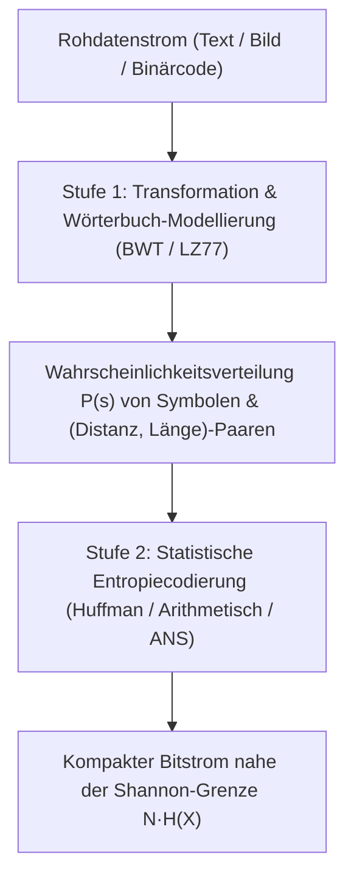
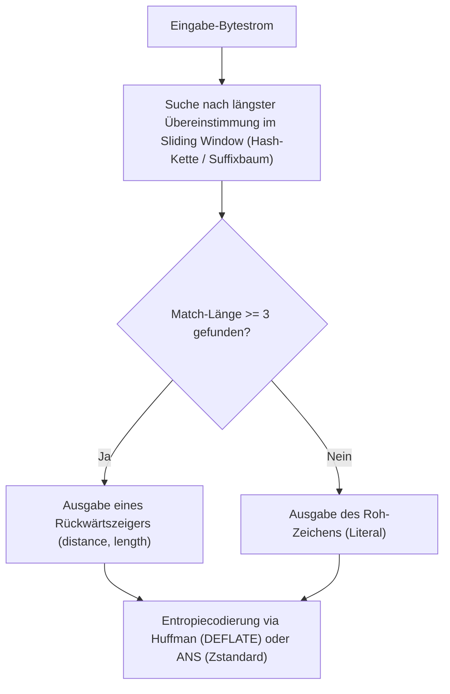

## 1. Das Schubfachprinzip: Warum es keinen universellen Kompressor geben kann, der jede Datei verkleinert

Wenn wir täglich Werkzeuge wie `zip`, `gzip`, `zstd`, `7z` oder `PNG` nutzen, um Dokumente, Quellcode oder Bilder auf einen Bruchteil ihrer ursprünglichen Größe zu schrumpfen und anschließend <strong>Bit für Bit exakt wiederherzustellen (verlustfreie / reversible Kompression)</strong>, drängt sich eine scheinbar naheliegende Frage auf: Wenn ein Kompressionsprogramm eine Datei verkleinert, warum komprimieren wir die erzeugte `.zip`-Datei nicht einfach zehnmal hintereinander, bis selbst ein riesiger Film nur noch ein einziges Byte groß ist?

Die Antwort lautet: <strong>Es ist mathematisch unmöglich.</strong> Der Beweis erfordert nicht einmal komplexe Informationstheorie, sondern folgt unmittelbar aus dem <strong>Schubfachprinzip (Pigeonhole Principle)</strong> der elementaren Kombinatorik.

Sei $E: \{0,1\}^* \to \{0,1\}^*$ ein verlustfreier Encoder und $D: \{0,1\}^* \to \{0,1\}^*$ der zugehörige Decoder. Damit jede beliebige Eingabedatei $x$ ohne Informationsverlust rekonstruiert werden kann ($D(E(x)) = x$), muss die Abbildung $E$ zwingend <strong>injektiv (eineindeutig)</strong> sein – denn würden zwei verschiedene Dateien $x_1 \ne x_2$ auf denselben komprimierten Bitstring $y = E(x_1) = E(x_2)$ abgebildet, könnte der Decoder niemals entscheiden, ob er $x_1$ oder $x_2$ ausgeben soll!

Betrachten wir nun alle möglichen Binärdateien der exakten Länge $N$ Bits: Es gibt genau $2^N$ solche Dateien. Wie viele Binärstrings gibt es insgesamt, die echt kürzer als $N$ Bits sind (also Länge $0$ bis $N-1$ besitzen)? Die geometrische Summe liefert:

$$\sum_{k=0}^{N-1} 2^k = 2^N - 1 < 2^N$$

Da es $2^N$ Eingabedateien („Tauben“), aber nur $2^N - 1$ kürzere Bitstrings („Schubfächer“) gibt, erzwingt das Schubfachprinzip ein unerbittliches Gesetz: <strong>Jeder verlustfreie Kompressionsalgorithmus, der mindestens eine Datei verkleinert, MUSS zwingend andere Dateien vergrößern (expandieren)!</strong> Mehr noch: Die Gesamtzahl aller Bitstrings mit einer Länge $\le N - c$ beträgt lediglich $2^{N-c+1} - 1$. Damit gilt für den Anteil der Dateien der Länge $N$, die sich um mindestens $c$ Bits verkleinern lassen:

$$P\bigl(|E(X)| \le N - c\bigr) < 2^{-(c-1)}$$

Im Universum aller möglichen 1-MB-Dateien lassen sich weniger als $2^{-99} \approx 1{,}57 \times 10^{-30}$ aller Dateien um auch nur 100 Bits (12,5 Byte) komprimieren! <strong>Fast alle zufälligen Bitstrings sind algorithmisch inkompressibel.</strong> Dass unsere Alltagsdateien dennoch drastisch schrumpfen, liegt daran, dass menschliche Texte, Programmcode und Sensordaten keine gleichverteilten Zufallsfolgen sind, sondern eine verschwindend kleine, hochgradig strukturierte <strong>Niedrig-Entropie-Teilmenge</strong> von $\{0,1\}^N$ bewohnen.

---

## 2. Shannons Quellencodierungstheorem und die Entropie: Die physikalische Grenze der Kompression

Im Jahr 1948 beantwortete Claude E. Shannon in *„A Mathematical Theory of Communication“* die fundamentale Frage, wie stark eine Informationsquelle im Mittel komprimiert werden kann. Sei $\mathcal{A} = \{s_1, \dots, s_m\}$ ein Alphabet mit den Auftrittswahrscheinlichkeiten $P = (p_1, \dots, p_m)$. Shannon definierte den <strong>Informationsgehalt (Eigeninformation / Surprisal)</strong> eines einzelnen Symbols $s_i$ sowie dessen Erwartungswert, die <strong>Shannon-Entropie $H(X)$</strong>, als:

$$I(s_i) = -\log_2 p_i, \qquad H(X) = -\sum_{i=1}^{m} p_i \log_2 p_i \quad (\text{Bits pro Symbol})$$

Ordnet man jedem Symbol $s_i$ ein binäres <strong>präfixfreies Codewort</strong> der Länge $\ell_i$ zu (sodass kein Codewort Präfix eines anderen ist), müssen die Wortlängen genau die <strong>Kraft-McMillan-Ungleichung</strong> erfüllen:

$$\sum_{i=1}^{m} 2^{-\ell_i} \le 1$$

Mithilfe der Nichtnegativität der Kullback-Leibler-Divergenz $D_{\text{KL}}(P \,\|\, Q) \ge 0$ für $q_i = 2^{-\ell_i}/Z$ ($Z = \sum 2^{-\ell_i} \le 1$) lässt sich für die mittlere Codewortlänge $L = \sum_{i=1}^m p_i \ell_i$ unmittelbar <strong>Shannons Quellencodierungstheorem (Noiseless Coding Theorem)</strong> beweisen:

$$L - H(X) = \sum_{i=1}^m p_i \log_2 \frac{p_i}{2^{-\ell_i}} = D_{\text{KL}}(P \,\|\, Q) + \log_2 \frac{1}{Z} \ge 0 \implies H(X) \le L < H(X) + 1$$

Die Shannon-Entropie $H(X)$ bildet die unüberwindbare untere Schranke jeder symbolweisen verlustfreien Codierung.

---

## 3. Drei Generationen der Entropiecodierung: Huffman, Arithmetische Codierung und ANS

### 3.1 Huffman-Codierung (1952): Optimale ganzzahlige Präfixbäume
David A. Huffman entwickelte 1952 einen Greedy-Algorithmus, der in $O(m \log m)$ Zeit durch sukzessives Verschmelzen der beiden unwahrscheinlichsten Knoten den optimalen Präfixbaum konstruiert. Das strukturelle Manko der Huffman-Codierung besteht jedoch darin, dass <strong>jedes Codewort eine ganzzahlige Bitlänge $\ell_i \ge 1$ besitzen muss</strong>. Tritt ein Symbol mit $p_1 = 0{,}99$ auf, beträgt sein wahrer Informationsgehalt nur $-\log_2(0{,}99) \approx 0{,}0145\,\text{Bits}$, doch ein Huffman-Code muss dafür mindestens $1\,\text{volles Bit}$ ausgeben – ein fast 69-facher Overhead!

### 3.2 Arithmetische Codierung (Arithmetic / Range Coding): Gebrochene Bits
Die Arithmetische Codierung (Rissanen, Pasco, Witten et al.) überwindet die Ganzzahligkeitsschranke, indem sie <strong>die gesamte Nachrichtenfolge $x_1 x_2 \dots x_N$ auf ein einziges Teilintervall $[L_{\text{low}}, H_{\text{high}}) \subset [0, 1)$ abbildet</strong>. Mit jedem Symbol $x_t$ schrumpft die Intervallbreite um den Faktor $P(x_t)$, sodass das finale Intervall die Breite $\Delta = \prod_{t=1}^N P(x_t)$ besitzt und durch $\lceil -\log_2 \Delta \rceil + 1 \approx N \cdot H(X)$ Bits kodiert werden kann. Dies erreicht gebrochene Bitraten beliebig nahe an der Shannon-Entropie, erfordert jedoch rechenintensive Multiplikationen und Renormierungen pro Symbol.

### 3.3 Asymmetric Numeral Systems (ANS, Jarek Duda 2009–2014)
Zwischen 2009 und 2014 revolutionierte der polnische Physiker und Informatiker Jarek Duda die Datenkompression mit den <strong>Asymmetric Numeral Systems (tANS und rANS)</strong>. Während das klassische Binärsystem beim Anhängen eines gleichverteilten Bits $b \in \{0,1\}$ den Zustand $x \in \mathbb{N}$ gemäß $x' = 2x + b$ verdoppelt ($2 = 1/P(b)$), skaliert ANS den Zustand $x$ beim Codieren eines Symbols $s$ der Wahrscheinlichkeit $p_s$ gemäß:

$$C(x, s) \approx \frac{x}{p_s}$$

Durch vorberechnete Zustandsübergangstabellen (<strong>tANS / Finite State Entropy</strong>) vereint ANS <strong>die exakte Kompressionsrate der Arithmetischen Codierung (gebrochene Bits) mit der extremen Tabellengeschwindigkeit der Huffman-Codierung</strong>! Heute bildet ANS das Herzstück von <strong>Facebook/Meta Zstandard (`zstd`)</strong>, <strong>Apple LZFSE</strong> und <strong>Google JPEG XL</strong>.

---

## 4. Wörterbuch-Kompression und Transformationen: LZ77, DEFLATE, BWT und „Kompression als Vorhersage“

Da natürliche Sprache und Quellcode starke Kontextabhängigkeiten und wiederkehrende Teilstrings aufweisen, kombiniert man Entropiecodierer mit Wörterbuch- und Transformationsverfahren:
- <strong>LZ77 (Lempel & Ziv, 1977)</strong>: Durchsucht ein gleitendes Fenster (Sliding Window) der bereits verarbeiteten Daten nach wiederholten Teilstrings und ersetzt diese durch kompakte Rückwärtsverweise <strong>`(distance, length)`</strong>. Zusammen mit Huffman-Codierung ergibt dies <strong>DEFLATE (`gzip`, `zip`, `PNG`)</strong>, zusammen mit ANS ergibt es <strong>Zstandard (`zstd`)</strong>.
- <strong>Burrows-Wheeler-Transformation (BWT, 1994, `bzip2`)</strong>: Sortiert alle zyklischen Verschiebungen eines Datenblocks lexikographisch. Die letzte Spalte $L$ dieser Matrix ist bemerkenswerterweise umkehrbar und gruppiert Zeichen mit identischem nachfolgendem Kontext direkt nebeneinander, sodass Move-To-Front (MTF) und Lauflängencodierung (RLE) enorme Kompressionsgewinne erzielen.

| Algorithmus / Tool | Wörterbuch / Transformation | Entropiecodierer | Typ. Kompressionsrate | Dekompressionsgeschwindigkeit | Typisches Einsatzgebiet |
|---|---|---|---|---|---|
| <strong>`lz4`</strong> | LZ77 Byte-orientiert | Keiner (reines Byte-Format) | $\sim 48\%$ | $\sim 4.000\,\text{MB/s}$ | RAM-Kompression (ZRAM), Echtzeit-Datenbanken |
| <strong>`gzip` (DEFLATE)</strong> | LZ77 (32-KB-Fenster) | Huffman-Codierung | $\sim 32\%$ | $\sim 400\,\text{MB/s}$ | HTTP-Webverkehr, `.tar.gz`, PNG-Bilder |
| <strong>`zstd` (Zstandard)</strong> | LZ77 (Großes Fenster + Offset-Cache) | <strong>ANS (tANS / FSE)</strong> + Huffman | $\sim 28\%$ | $\sim 1.500\,\text{MB/s}$ | Linux-Pakete, Cloud-Storage, Dateisysteme (Btrfs) |
| <strong>`bzip2`</strong> | <strong>BWT Block-Sortierung</strong> + MTF + RLE | Multi-Tabellen-Huffman | $\sim 26\%$ | $\sim 60\,\text{MB/s}$ | Quellcode-Archive, Genomdatenbanken |
| <strong>`xz` (LZMA2)</strong> | LZ77 (Riesiges Wörterbuch + Bit-Kontext) | Adaptive Range-Codierung | $\sim 21\%$ | $\sim 120\,\text{MB/s}$ | Software-Distribution mit minimaler Dateigröße |
| <strong>`cmix` / `PAQ8` / LLM</strong> | Context Mixing / Transformer | Arithmetische Codierung | $\sim 11\%\text{–}14\%$ | $< 1\,\text{MB/s}$ | Hutter Prize, KI-Forschung (Kompression = Vorhersage) |

Auf fundamentaler Ebene gilt die Äquivalenz <strong>„Kompression ist Vorhersage“</strong>: Ein Modell (wie ein modernes Large Language Model), das die bedingte Wahrscheinlichkeit $P_\theta(x_t \mid x_{<t})$ des nächsten Tokens präzise vorhersagt, minimiert den Kreuzentropieverlust $-\sum \log_2 P_\theta(x_t \mid x_{<t})$ – und genau dieser Wert entspricht exakt der Dateigröße, wenn man die vorhergesagten Wahrscheinlichkeiten in einen arithmetischen Codierer einspeist!
