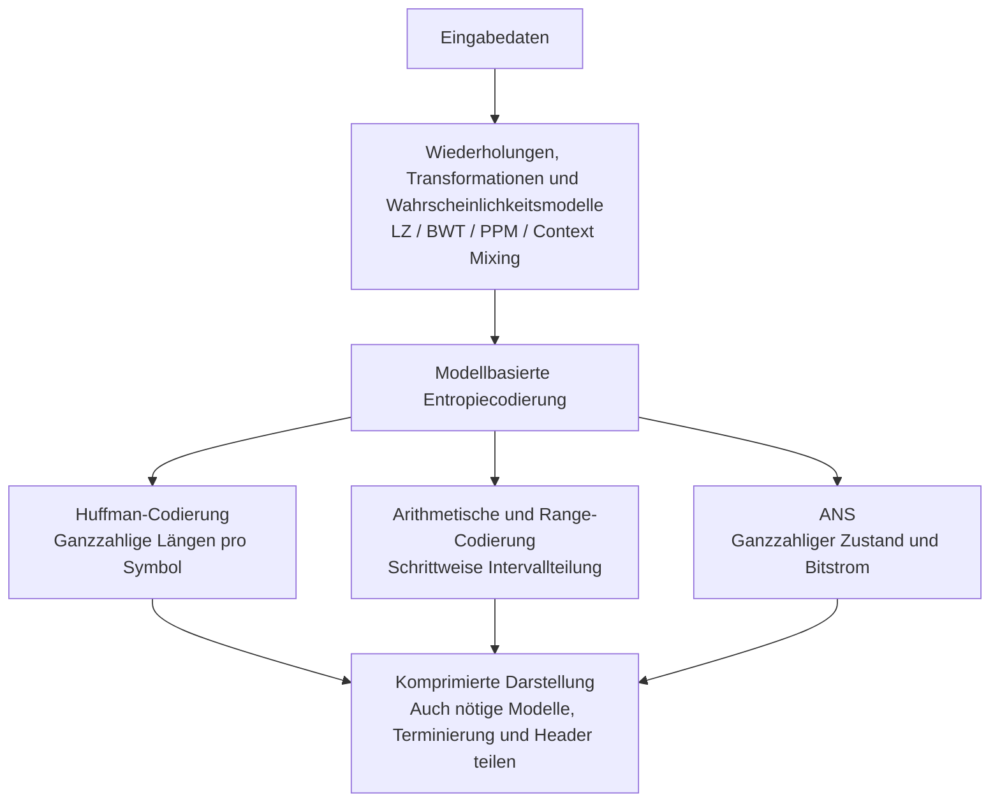
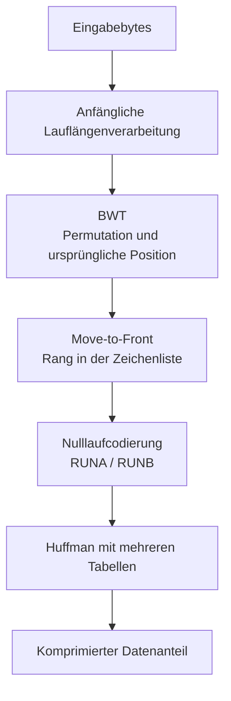

## 1. Warum kein Kompressor jede Datei verkürzen kann

Verlustfreie Kompression ersetzt Daten durch eine Darstellung, aus der sich die ursprünglichen Bytes ohne Änderung eines einzigen Bits wiederherstellen lassen. Werkzeuge wie zip, gzip, zstd und xz verkleinern manche Eingaben; andere bleiben fast gleich groß oder wachsen durch Header. Sie reduzieren nicht alles im gleichen Verhältnis. Verlustbehaftete Verfahren wie JPEG oder MP3 erlauben Abweichungen in den rekonstruierten Werten und stellen deshalb andere Anforderungen an die Wiederherstellung.

Sei {0,1}* die Menge der endlichen Bitfolgen. Wir legen einen Encoder E und einen Decoder D fest. Verlustfreiheit verlangt für jede Eingabe x:

$$
D(E(x))=x
$$

Hätten verschiedene Eingaben dieselbe Ausgabe, könnte D nicht beide rekonstruieren. E muss daher injektiv sein. Es gibt 2^n Eingaben mit genau n Bits, aber weniger Ausgaben mit weniger als n Bits, selbst einschließlich der leeren Folge. Hier gilt n≥1.

$$
\left|\{0,1\}^{n}\right|=2^n>
\sum_{k=0}^{n-1}2^k=2^n-1
$$

Ein festgelegter verlustfreier Kompressor kann also nicht jede n-Bit-Eingabe verkürzen. Eine injektive Abbildung auf allen endlichen Bitfolgen kann auch nicht manche verkürzen, ohne irgendeine andere zu verlängern. Würde sie eine n-Bit-Eingabe x verkürzen und keine Eingabe verlängern, belegten bereits die Eingaben mit weniger als n Bits sämtliche Ausgaben mit weniger als n Bits. E(x) müsste mit einer davon kollidieren.

Quantitativ legen wir E fest und ziehen eine n-Bit-Folge X gleichverteilt. Für eine ganze Zahl 1≤c≤n hat der Anteil der um mindestens c Bits verkürzten Eingaben folgende obere Schranke. Gezählt werden mögliche Ausgaben; der Encoder muss sie nicht alle verwenden.

$$
\Pr\!\left(|E(X)|\le n-c\right)
\le\frac{2^{n-c+1}-1}{2^n}
<2^{1-c}
$$

Für c=11 liegt dieser Anteil unter 1/1024, also ungefähr 0,0977 %. Das bedeutet nicht, dass kein anderer Kompressor irgendeine der übrigen Dateien verkürzen könnte. Für eine bestimmte Datei x könnte ein anderer Encoder x mit der leeren Folge vertauschen: x wird kürzer und die leere Folge länger. Der Decoder muss diese Sonderregel kennen. Auch bei Kolmogorov-Komplexität sind eine festgelegte Beschreibungssprache und die Beschreibungslänge eines Decodierprogramms auseinanderzuhalten.

Ein weiteres Beispiel ist c=100: Für denselben festgelegten Encoder und gleichverteilte n-Bit-Eingaben mit n≥100 liegt der Anteil unter 2^(-99), ungefähr 1,58×10^(-30). Bei Dateien von genau 1 MB im dezimalen Sinn ist n=8.000.000. 100 Bits entsprechen 12,5 Byte als Größenangabe; das behauptet keine Speicherung einzelner halber Bytes in einem byteorientierten Dateiformat.

Praktische Kompression nutzt Darstellungen, die zu einer Verteilung oder wiederholten Struktur passen: ungleiche Zeichenhäufigkeiten, wiederkehrende Teilfolgen oder Muster in Zahlen. Der Gewinn hängt von Eingabe und Methode ab. Bereits komprimierte Dateien oder Chiffretexte können nicht kategorisch als um kein einziges Byte verkleinerbar bezeichnet werden. Verfahren, Betriebsart, Metadaten und verbliebene Struktur bestimmen die Bedingungen.

Auch die Einheiten zählen. Ein MiB entspricht 1.048.576 Bytes oder 8.388.608 Bits. Ein dezimales MB entspricht 1.000.000 Bytes oder 8.000.000 Bits.

## 2. Shannon-Entropie und Grenzen der mittleren Codelänge

Shannons Arbeit von 1948 trennt semantischen Wert vom technischen Kommunikationsproblem und untersucht Quellen probabilistisch. Die Einleitung dieses [Nachdrucks](https://wucj.lab.westlake.edu.cn/Others/shannon1948.pdf) würdigt auch die Vorarbeiten von Nyquist und Hartley.

Für ein Ereignis x mit positiver Wahrscheinlichkeit definieren wir den Informationsgehalt, auch Eigeninformation, wie folgt. Logarithmen zur Basis zwei ergeben die Einheit Bit. Gemessen werden weder psychologische Überraschung noch die Bedeutung des Inhalts.

$$
I(x)=-\log_2P(x),\qquad 0<P(x)\le1
$$

Für eine Zufallsvariable X über einem endlichen Alphabet sei p_i=P(X=x_i). Die Shannon-Entropie ist der erwartete Informationsgehalt; für Terme mit Wahrscheinlichkeit null gilt die Konvention 0log₂0=0.

$$
H(X)=-\sum_{i=1}^{m}p_i\log_2p_i,\qquad
p_i\ge0,\quad\sum_i p_i=1,\quad
0\le H(X)\le\log_2m
$$

Die Einheit lautet Bits pro Symbol. Bei einem festen Alphabet mit m Symbolen maximiert die Gleichverteilung die Entropie; hat ein Symbol Wahrscheinlichkeit eins, beträgt sie null. Das Ergebnis eines fairen Münzwurfs hat einen Informationsgehalt von einem Bit, ein Ereignis mit Wahrscheinlichkeit 1/256 von acht Bits. Das beschreibt das Symbolmodell, bestimmt aber weder direkt die Information einer korrelierten Folge noch eine untere Schranke für jede einzelne Datei.

### Präfixcodes und die Kraft–McMillan-Ungleichung

Jedem Symbol wird ein binäres Codewort zugeordnet, sodass Verkettungen eindeutig decodierbar sind. Bei einem Präfixcode ist kein Codewort der Anfang eines anderen. Beispielsweise zerlegt {0,10,110,111} die Folge 100110111 in 10 | 0 | 110 | 111. ASCII selbst ist ein 7-Bit-Zeichencode und nicht gleichbedeutend damit, jedes Zeichen mit acht Bits darzustellen.

Wir stellen Codewörter der Länge ℓ_i als Blätter eines Binärbaums dar. In einem vollständigen Baum maximaler Tiefe ℓ_max belegt ein Blatt 2^(ℓ_max−ℓ_i) mögliche Positionen unter sich. Das Zählen dieser disjunkten Teilbäume ergibt die Kraft-Ungleichung. Dieselbe Ungleichung gilt auch für eindeutig decodierbare Codes.

$$
\sum_i2^{\ell_{\max}-\ell_i}\le2^{\ell_{\max}}
\quad\Longrightarrow\quad
Z:=\sum_i2^{-\ell_i}\le1
$$

Umgekehrt lassen positive ganzzahlige Längen, die die Ungleichung erfüllen, einen Präfixcode zu. Im Folgenden betrachten wir die Symbole positiver Wahrscheinlichkeit und nehmen mindestens zwei an. Bei einer Quelle mit nur einem Symbol ist gesondert festzulegen, ob ein leeres Codewort erlaubt ist und wie Symbolzahl oder Terminierung gemeinsam bekannt sind.

### Die untere Schranke über KL-Divergenz

Wir definieren die mittlere Codelänge und die durch die Längen induzierte normalisierte Verteilung Q:

$$
L=\sum_i p_i\ell_i,\qquad
q_i=\frac{2^{-\ell_i}}{Z},\qquad \sum_i q_i=1
$$

Die Nichtnegativität der Kullback–Leibler-Divergenz liefert folgende Identität. Sie lässt sich beispielsweise mit der logarithmischen Ungleichung ln u≤u−1 begründen.

$$
\begin{aligned}
0\le D_{\mathrm{KL}}(P\|Q)
&=\sum_i p_i\log_2\frac{p_i}{q_i}\\
&=-H(X)+\sum_i p_i\ell_i+\log_2Z\\
&=L-H(X)+\log_2Z
\end{aligned}
$$

Daraus folgt die Schranke für die mittlere Länge:

$$
L=H(X)+D_{\mathrm{KL}}(P\|Q)-\log_2Z\ge H(X)
$$

Q teilt 2^(-ℓ_i) durch Z. Man darf diese Normalisierung nicht weglassen und zugleich den Term −log₂Z zusätzlich zählen. Gleichheit setzt P=Q und Z=1 voraus, also p_i=2^(-ℓ_i): Die Wahrscheinlichkeiten passen zu den binären Codelängen.

Auch eine obere Schranke lässt sich konstruieren. Diese Shannon-Längen erfüllen die Kraft-Ungleichung:

$$
\ell_i=\lceil-\log_2p_i\rceil,\qquad
2^{-\ell_i}\le p_i,\qquad
\sum_i2^{-\ell_i}\le1
$$

Aufrunden fügt weniger als ein Bit pro Symbol hinzu; dieser Code hat daher eine mittlere Länge unter H+1. Die mittlere Länge L_opt des optimalen binären Präfixcodes liegt folglich in diesem Bereich:

$$
H(X)\le L_{\mathrm{opt}}<H(X)+1
$$

Für eine nicht degenerierte Quelle unabhängiger, identisch verteilter Symbole ergibt das Zusammenfassen von N Symbolen mit einem geeigneten Blockpräfixcode folgende Beziehung. L_N ist die mittlere Länge des gesamten Blocks.

$$
H(X)\le\frac{L_N}{N}<H(X)+\frac1N
$$

Bei Abhängigkeiten gilt im Allgemeinen H(X_1,...,X_N)≠NH(X_1). Wird ein gleichwahrscheinliches Bit gewählt und über eine bekannte Länge N wiederholt, hat jede Position eine marginale Entropie von einem Bit, die gesamte Folge aber ebenfalls nur ein Bit. Für stationäre Quellen mit endlichem Alphabet verwendet man die Entropierate:

$$
\overline H=\lim_{N\to\infty}\frac{H(X_1,\ldots,X_N)}{N}
$$

Dies sind Aussagen über Mittelwerte unter festgelegten Verteilungen und Codeklassen. Sie besagen nicht, dass jede Datei mindestens so lang sein muss oder Modell- und Headerkosten entfallen dürfen.

## 3. Huffman-Codierung, arithmetische Codierung und ANS

Die Trennung zwischen statistischem Modell und dem Codierer, der Wahrscheinlichkeiten in Bits umsetzt, erleichtert das Verständnis. Das Diagramm ist konzeptionell und schreibt nicht jedem Format eine solche Aufteilung in unabhängige Stufen vor.

### Huffman: In welcher Klasse optimal?

[Huffmans Arbeit von 1952](https://compression.ru/download/articles/huff/huffman_1952_minimum-redundancy-codes.pdf) konstruiert Präfixcodes minimaler mittlerer Länge für vorgegebene Gewichte. Im binären Fall werden wiederholt die beiden leichtesten Knoten zusammengefasst und ihre Summe wieder eingefügt. Ein Heap ermöglicht den Baumaufbau für m Symbole in O(m log m).

Bei mindestens zwei positiven Gewichten kann ein optimaler Baum unnötige Verzweigungen mit nur einem Kind vermeiden. Die beiden kleinsten Gewichte lassen sich auf tiefsten Geschwisterblättern platzieren, ohne die mittlere Länge zu erhöhen. Werden sie zum Symbol z verschmolzen, gilt zwischen dem ursprünglichen Baum T und dem kleineren T′:

$$
L(T)=L(T')+p_a+p_b
$$

Die Differenz ist fest. Eine optimale Lösung des kleineren Problems liefert damit eine Lösung des ursprünglichen. Gleiche Gewichte können mehrere optimale Bäume ergeben. Kanonische Huffman-Codes bestimmen Codewörter aus Längen und Symbolreihenfolge und vereinfachen damit die Übertragung des Baums. Die Beschreibungskosten der Tabellen und zusätzliche Schritte für lange Codewörter entfallen dadurch nicht.

Bei P(0)=0,99 und P(1)=0,01 verwendet ein optimaler binärer Präfixcode bei symbolweiser Codierung für jedes Symbol ein Bit.

$$
H(X)=-0.99\log_2(0.99)-0.01\log_2(0.01)
\approx0.080793,\qquad L_{\mathrm H}=1
$$

Seine mittlere Länge beträgt etwa das 12,4-Fache der Entropie. Das bedeutet nicht, dass die ursprüngliche Datei nicht kleiner werden kann: Eine Ausgangsdarstellung mit acht Bits pro Symbol unterscheidet sich von einer bereits bitweise gepackten Folge. Blöcke reduzieren den Verlust durch ganzzahlige Längen, aber ein Baum, der alle m^k Kombinationen explizit umfasst, wächst schnell. Die Konvention eines leeren Codeworts bei nur einem Symbol bleibt eine gesonderte Frage der gemeinsamen Kenntnis der Anzahl.

### Arithmetische Codierung: Intervalle und endliche Bitfolgen

Arithmetische Codierung verengt ein der Nachricht zugeordnetes Intervall. P(s) sei die Symbolwahrscheinlichkeit, A(s) die Summe der Wahrscheinlichkeiten vorheriger Symbole in einer vereinbarten Reihenfolge. Wir beginnen mit [lo_0,hi_0)=[0,1) und setzen positive Wahrscheinlichkeit für jedes codierte Symbol voraus. Bei Breite W_(t−1)=hi_(t−1)−lo_(t−1) lautet die Aktualisierung:

$$
\begin{aligned}
\mathrm{lo}_t&=\mathrm{lo}_{t-1}+W_{t-1}A(x_t),\\
\mathrm{hi}_t&=\mathrm{lo}_{t-1}+W_{t-1}\bigl(A(x_t)+P(x_t)\bigr)
\end{aligned}
$$

Bei einem festen unabhängigen Modell ist die Endbreite das erste Produkt unten. Bei Abhängigkeiten verwendet man bedingte Wahrscheinlichkeiten, die beide Seiten in jedem Schritt reproduzieren können.

$$
W_N=\prod_{t=1}^{N}P(x_t)
\quad\text{or}\quad
W_N=\prod_{t=1}^{N}P(x_t\mid x_{<t})
$$

Verschiedene Nachrichten derselben bekannten Länge N entsprechen disjunkten Intervallen. Wir wählen ein dyadisches Intervall [j2^(-K),(j+1)2^(-K)), das vollständig im Endintervall liegt; seine K Bits identifizieren es. Ein Rasterabstand von höchstens der halben Breite garantiert bei idealer Arithmetik unendlicher Genauigkeit diese ausreichende Länge:

$$
K=\lceil-\log_2W_N\rceil+1<-\log_2W_N+2
$$

Das begrenzt die ideale Nutzdatenlänge bei bekanntem Modell und bekannter Nachrichtenlänge. Es heißt nicht, dass das kleinste K stets der Formel entspricht oder die ganze Datei nur zwei Bits Zusatzkosten hat. Modelle, Terminierung, Genauigkeit und Header verursachen weitere Kosten. Unter der tatsächlichen Blockverteilung P erfüllt die entsprechende Präfixdarstellung:

$$
H(P)\le\mathbb E_P[K]<H(P)+2
$$

Bei P(0)=0,99 halbieren ungefähr 69 aufeinanderfolgende Nullen die Breite. Das ist keine Regel, die alle 69 Symbole exakt ein Ausgabebit verlangt: Die Ausgabe hängt von Intervall und Renormalisierung ab. Ganzzahlige Implementierungen geben bereits feststehende höherwertige Bits oder Bytes aus und vergrößern den Zustand. Wahrscheinlichkeitsquantisierung, Überträge und zurückgestellte Bits erfordern ebenfalls Arbeit. Arithmetische und Range-Codierung haben kein universelles Geschwindigkeitsverhältnis zu anderen Codierern.

### ANS: Information in einem ganzzahligen Zustand sammeln

[Dudas ANS-Arbeit](https://arxiv.org/html/1311.2540v2) konstruiert Zahlensysteme für Symbole mit ungleichen Wahrscheinlichkeiten. Das Anhängen einer Ziffer s in gewöhnlicher Basis b ist so umkehrbar:

$$
x'=bx+s,\qquad s=x'\bmod b,\qquad x=\lfloor x'/b\rfloor
$$

Bei gleichen Wahrscheinlichkeiten und hinreichend großem positivem Zustand x steigt die logarithmische Größe ungefähr um log₂b. Für allgemeine Wahrscheinlichkeiten wächst der Zustand konstruktionsgemäß ungefähr um den Faktor 1/P(s). Auf x=0 darf man log₂x nicht anwenden und diese Näherung nicht mit einer exakten ganzzahligen Codelänge gleichsetzen.

Eine rANS-Konstruktion verwendet M=2^R, positive ganzzahlige Symbolhäufigkeiten f_s und kumulierte Häufigkeiten b_s.

$$
\sum_s f_s=M,\qquad b_s=\sum_{a<s}f_a,\qquad P(s)\approx f_s/M
$$

Sie bildet einen nichtnegativen ganzzahligen Zustand x und ein Symbol s wie folgt ab:

$$
C(x,s)=M\left\lfloor\frac{x}{f_s}\right\rfloor+(x\bmod f_s)+b_s
$$

Die Umkehrung wählt das Symbol über slot und rekonstruiert den vorherigen Zustand:

$$
\begin{aligned}
\mathrm{slot}&=x'\bmod M,\\
b_s&\le\mathrm{slot}<b_s+f_s,\\
x&=f_s\left\lfloor\frac{x'}M\right\rfloor+\mathrm{slot}-b_s
\end{aligned}
$$

Ist M eine Zweierpotenz, lassen sich Quotient und Rest mit Verschiebungen und Masken berechnen. Symbolsuche, Tabellenzugriffe, Renormalisierung und Ein-/Ausgabe zählen weiterhin. Diese Bijektion allein garantiert weder Codierverlust null noch Decodierung in einem Takt.

tANS verwendet endlich viele Zustände und Übergangstabellen. Für eine bitbasierte Erklärung kann man beispielsweise folgende ganzzahlige Menge verwenden. Sie entspricht dem halboffenen Intervall [L,2L), nicht [L,2L−1).

$$
\mathcal I=\{L,L+1,\ldots,2L-1\},\qquad |\mathcal I|=L
$$

Bits werden zwischen dem angesammelten Zustand und dem Strom übertragen, um den zulässigen Bereich einzuhalten. Normalisierungsbedingungen und Symbolverteilung müssen zusammenpassen; die rANS-Formeln bloß durch eine kleine Tabelle zu ersetzen genügt nicht. FSE gehört zur tANS-Familie.

ANS-Zustandsoperationen verhalten sich wie ein Stapel: Das zuletzt hinzugefügte Symbol wird zuerst entnommen. Umgekehrte Codierreihenfolge innerhalb von Blöcken kann die Decodierung in ursprünglicher Reihenfolge ermöglichen. Bei Kontextwahrscheinlichkeiten muss auch deren Berechnungsreihenfolge mit der rückwärts laufenden Codierung vereinbart werden. Huffman, arithmetische Codierung und ANS sind Optionen je nach Modell, Format und Implementierung, keine drei Generationen, in denen jede die vorherige universell ersetzt.

## 4. Was LZ, BWT und Kontextmodelle verändern

Ein Modell nur auf Basis einzelner Bytehäufigkeiten nutzt lange Wiederholungen und Abhängigkeiten nicht vollständig. Statt Englisch eine universelle Bitzahl zuzuschreiben, sollte man Korpus und Einheit angeben: Zeichen, Bytes oder Tokens.

### Wörterbuchkompression: LZ77, LZ78 und LZW

Verfahren der LZ77-Familie verweisen auf bereits erzeugte Daten. Ist die 16 Byte lange ASCII-Folge `std::vector<int>` schon 200 Bytes vorher aufgetreten und stimmt sie erneut überein, kann sie durch folgende Distanz und Länge dargestellt werden. Ob das weniger als 16 wörtlich ausgegebene Bytes kostet, hängt von der Codierung dieser Zahlen im Format ab.

$$
(d,\ell)=(200,16)
$$

Die Länge kann größer als die Distanz sein. Nach einem Literal A verwendet ein Verweis mit Distanz 1 und Länge 99 auch neu kopierte A als Quelle und erzeugt insgesamt 100 A. Die [DEFLATE-Spezifikation](https://www.rfc-editor.org/rfc/rfc1951.txt) enthält ebenfalls ein Beispiel überlappender Verweise. Ein allgemeines memcpy für überlappende Bereiche oder bloßes Kopieren einer Momentaufnahme der ursprünglichen Quelle beschreibt diese Expansion nicht korrekt. Die Implementierung muss die wachsende Ausgabe behandeln und Distanzen, Ausgabelimits und Eingabelängen prüfen.

LZSS unterscheidet Literale und Treffer mit Flags oder einer anderen Darstellung. Auch Flags benötigen Platz; deshalb können auch Daten ohne Treffer größer werden. LZ78/LZW registrieren gefundene Folgen dagegen in einem expliziten Wörterbuch und verwenden Indizes. Wachstum, Zurücksetzen, Referenzbereich und Ganzzahlcodierung unterscheiden sich. Keine Variante muss bei jeder Eingabe gewinnen.

Auch konkrete Formate unterscheiden sich. Komprimierte DEFLATE-Blöcke verwenden Distanzen von 1 bis 32.768 und Längen von 3 bis 258, mit getrennter Huffman-Codierung für Literale/Längen und Distanzen. Es gibt auch unkomprimierte Blöcke. Die [Zstandard-Spezifikation](https://www.rfc-editor.org/rfc/rfc8878.html) trennt Literale und Sequenzen: Literale können roh, per RLE oder Huffman gespeichert werden; Sequenzen verwenden Modi einschließlich FSE. Ein oder vier Huffman-Ströme sind etwas anderes als die drei Arten von Sequenz-FSE-Zuständen. LZMA/LZMA2 verbinden ebenfalls Wörterbücher und Wahrscheinlichkeitsmodelle; der [LZMA-Encoder](https://github.com/ip7z/7zip/blob/main/C/LzmaEnc.c) zeigt Matchsuche und Range-Codierung. Ein Algorithmusname steht nicht für jedes Format, Werkzeug oder Kompressionsniveau.

### BWT: längenerhaltende Permutation und Umkehrung

Die Burrows–Wheeler-Transformation bringt Zeichen mit gleichem Folgekontext zusammen. Ihre letzte Spalte erhält die Symbolzahl, aber Positions- oder Sentinel-Information für die Umkehrung kostet ebenfalls Platz.

Betrachten wir `banana$` mit einem eindeutigen Sentinel `$`, der vor den anderen Zeichen sortiert wird. Wir sortieren die sieben zyklischen Verschiebungen und entnehmen die letzte Spalte und die ursprüngliche Zeilennummer.

| Zeile | Lexikographisch sortierte Rotation | Erstes Zeichen | Letztes Zeichen |
| :--- | :--- | :---: | :---: |
| 0 | `$banana` | `$` | a |
| 1 | `a$banan` | a | n |
| 2 | `ana$ban` | a | n |
| 3 | `anana$b` | a | b |
| 4 | `banana$` | b | `$` |
| 5 | `na$bana` | n | a |
| 6 | `nana$ba` | n | a |

Die Ausgabe ist `annb$aa`, die ab null gezählte ursprüngliche Zeile ist 4. Ist L die letzte und F die erste Spalte, erhält man F durch Sortieren der Zeichen von L. Gleiche Zeichen in ihrer Auftretensreihenfolge zuzuordnen liefert die LF-Abbildung, die die ursprüngliche Folge rückwärts durchläuft. Bei nullbasierten Positionen zählt C(c) die Zeichen kleiner als c und rank_c(i) die Vorkommen von c in L vor Position i.

$$
\mathrm{LF}(i)=C(L_i)+\mathrm{rank}_{L_i}(i)
$$

Für ein kleines festes Alphabet lassen sich Häufigkeiten und Auftretensränge in linearer Zeit aufbauen und N Symbole in O(N) invertieren. Bei allgemeinem Vergleichssortieren muss dessen Aufwand separat berücksichtigt werden. BWT verwandelt nicht jede Eingabe in lange gleiche Zeichenfolgen.

Das [Handbuch von bzip2 1.0.8](https://sourceware.org/bzip2/manual/manual.html) und der [Quelltext dieser Version](https://sourceware.org/pub/bzip2/bzip2-1.0.8.tar.gz) kombinieren RLE vor BWT mit MTF, Nulllaufcodierung und mehreren Huffman-Tabellen. MTF gibt den aktuellen Rang eines Zeichens in einer Liste aus und verschiebt es an den Anfang. Wiederholte Zeichen ergeben Nullen, die durch RUNA/RUNB codiert werden. Das Diagramm zeigt die wichtigsten Transformationen ohne Header, Indizes und CRCs.

### Kontextmodelle und LLMs: Codelänge und Vorhersageverlust

PPM verwendet Kontexte verschiedener Länge und behandelt unbeobachtete Symbole etwa durch Escape-Mechanismen. Context Mixing kombiniert Vorhersagen mehrerer Modelle. Auch neuronale Modelle können Vorhersagen liefern; Transformer sind nicht gleichbedeutend mit rekurrenten Netzen.

Für eine Folge, der das Modell Q_θ positive bedingte Wahrscheinlichkeiten zuweist, lautet die ideale Information wie folgt. Sie wird nicht mit der tatsächlichen Ausgabelänge gleichgesetzt.

$$
I_\theta(x_{1:N})=-\log_2 Q_\theta(x_{1:N})
=\sum_{t=1}^{N}-\log_2Q_\theta(x_t\mid x_{<t})
$$

Für den mittleren negativen Log-Likelihood-Verlust dieser Folge mit natürlichen Logarithmen ergeben Basiswechsel und Mittelung:

$$
\mathcal L_{\mathrm{NLL}}(\theta)
=-\frac1N\sum_{t=1}^{N}\ln Q_\theta(x_t\mid x_{<t})
=\frac{\ln2}{N}I_\theta(x_{1:N})
$$

Bei denselben Daten, Einheiten und Modellbedingungen entspricht eine Verringerung dieses Verlusts somit einer geringeren idealen Codelänge. Nicht enthalten sind Größe des gemeinsam bekannten Modells, reversible Tokenisierung, endliche Genauigkeit, Terminierung, Header oder Decodierzeit. Ein Vorhersageinformationsgehalt unter einem Bit erlaubt keine eigenständige Datei mit einem Bruchteil eines Bits.

[Language Modeling Is Compression](https://arxiv.org/html/2309.10668v2) untersucht diese Verbindung experimentell. Bild- und Audiovergleiche verwenden aufbereitete Datensätze und bestimmte Kontextlängen und unterscheiden Raten ohne Modellgewichte von solchen mit ihnen. Die Ergebnisse gelten nicht automatisch für alle Bilder, Audiodaten oder beliebige Dateien. Wettbewerbe wie der Hutter Prize fördern Vorhersageforschung; die Codiergleichungen allein beweisen aber keine hinreichenden Bedingungen für Intelligenz oder Verständnis.

## 5. Komprimierte Größe, Geschwindigkeit und Speicher vergleichen

Praktische Bewertung verbindet komprimierte Größe, Codier- und Decodierzeit, Speicherbedarf, Kompatibilität und Zugriffsgranularität. Wir definieren den komprimierten Anteil als komprimierte Größe geteilt durch Originalgröße: Kleiner ist besser. Zahlen aus unterschiedlich konfigurierten Benchmarks ergeben keine universelle Rangliste.

| Methode oder Werkzeug | Architektonische Merkmale | Was beim Vergleich zu prüfen ist |
| :--- | :--- | :--- |
| LZ4 | Byteorientierte LZ77-artige Darstellung ohne Entropiecodierung im Block | Framing-Kosten kleiner Eingaben, Decodiergeschwindigkeit und Puffer |
| Zstandard | Matchsuche, Literale und Sequenzen, Huffman/FSE und weitere Modi | Niveau, Wörterbuch, Fenster, Modi und Speicher auf beiden Seiten |
| DEFLATE / gzip | Rückwärtsverweise und Huffman; unkomprimierte Blöcke möglich | Format gegenüber Werkzeug, Kompatibilität, Block- und Wrapperkosten |
| BWT / bzip2 | Blocktransformation, MTF, Läufe und Huffman | Blockgröße, Rekonstruktionsspeicher und Index |
| LZMA/LZMA2 / xz und 7-Zip | Wörterbuchsuche und adaptive probabilistische Codierung | Format und Einstellungen, Wörterbuch, Suchzeit und Decoderlimits |
| PPM, Context Mixing und neuronale Vorhersage | Kontextwahrscheinlichkeiten mit anschließender Codierung | Modell teilen/übertragen, Kontextlänge, Rechenaufwand und reproduzierbare Genauigkeit |

Die [LZ4-Blockspezifikation](https://github.com/lz4/lz4/blob/dev/doc/lz4_Block_format.md) behandelt Framing gesondert; die [7-Zip-Formatbeschreibung](https://www.7-zip.org/7z.html) unterscheidet mehrere Methoden. Architekturverständnis und Messungen der eigenen Arbeitslast sind beide nötig.

Zu dokumentieren sind Implementierung und Version, Befehl und Niveau, CPU und Threads, Eingabehashes und -größen, Wörterbuch sowie Cache- und Ein-/Ausgabebedingungen. Aus insgesamt U Originalbytes, C komprimierten Bytes und verstrichener Zeit berechnet man C/U und Durchsatz. Leere Eingaben sind beim Größenverhältnis separat zu behandeln. Zum Speicher zählen neben Wörterbüchern auch Puffer und Modelle. Der Hash der dekomprimierten Bytes muss mit dem Original übereinstimmen. Hier wird keine neue Durchsatzmessung behauptet.

### Codier-/Decodieraufwand und Ein-/Ausgabe

Bei LZ-Verfahren kann Decodieren weniger Aufwand erfordern als Suche und Auswahl der Darstellung beim Codieren. Dennoch können Kompressionsniveau und ausgegebene Befehle die Decodiergeschwindigkeit innerhalb desselben Formats verändern. Höhere Niveaus garantieren keine exakt gleiche Decodiergeschwindigkeit. Prädiktive Decoder müssen Wahrscheinlichkeiten reproduzieren, während ein Encoder deren Berechnung bündeln kann; ihre Zeiten müssen deshalb ebenfalls nicht gleich sein.

In einem einfachen Lesemodell sei v_io die Ein-/Ausgabegeschwindigkeit und v_dec die Decodiergeschwindigkeit in Originalbytes. Ohne Überlappung von CPU-Arbeit und Ein-/Ausgabe ergeben sich näherungsweise:

$$
T_{\mathrm{raw}}\approx\frac{U}{v_{\mathrm{io}}},\qquad
T_{\mathrm{compressed}}\approx\frac{C}{v_{\mathrm{io}}}
+\frac{U}{v_{\mathrm{dec}}}
$$

Verglichen werden eingesparte Ein-/Ausgabe und Decodierkosten. Bei unabhängigen Ressourcen und wirksamer Pipeline kann die Zeit im eingeschwungenen Zustand eher dem größeren Term als ihrer Summe entsprechen. Anlaufzeit, Speicherbandbreite, Parallelität und Zugriffsgranularität können ein anderes Modell erfordern.

Verzweigungen, Abhängigkeiten, Cache, SIMD und Parallelität auf Befehlsebene beeinflussen die Geschwindigkeit. Ihr Vorhandensein allein legt keine universelle MB/s-Grenze fest; getrennte Ströme garantieren auch nicht null Sprungfehlvorhersagen. Ein einmal komprimiertes und von vielen Lesern decodiertes Softwarepaket hat andere Prioritäten als häufig aktualisierte Protokolle.

## 6. Welche Grenzen und Kosten werden gezählt?

Das Schubfachprinzip zeigt, dass ein festgelegter verlustfreier Encoder nicht jede Eingabe verkürzen kann. Entropieschranken betreffen die mittlere Länge unter bestimmten Wahrscheinlichkeitsmodellen und Codierbedingungen. Huffman, arithmetische Codierung und ANS verbinden Wahrscheinlichkeiten auf unterschiedliche Weise mit Darstellungen; LZ, BWT und Kontextmodelle nutzen Wiederholungen und Abhängigkeiten.

Vorhersageverlust und ideale Codelänge hängen zusammen, was neuronale Kompression verständlicher macht. Diese Verbindung ist von gesamten Dateikosten, Verarbeitungsgeschwindigkeit und einem Intelligenzbeweis zu unterscheiden. Anzugeben, was gemeinsam bekannt ist, was übertragen wird und welche Eingaben gemessen wurden, verbindet die Theorie mit praktischen Entscheidungen.
