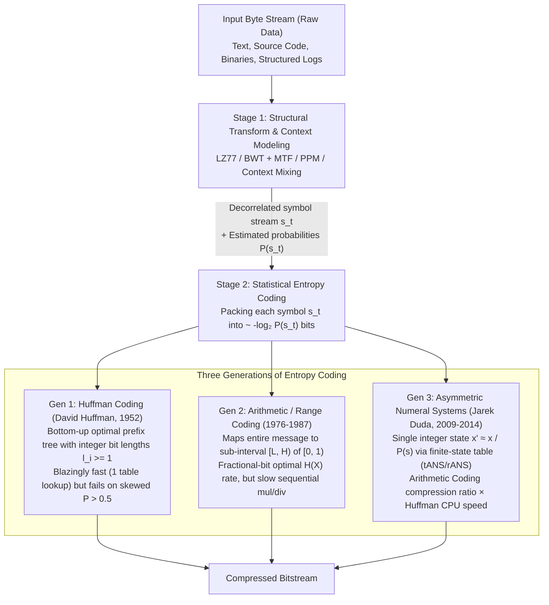
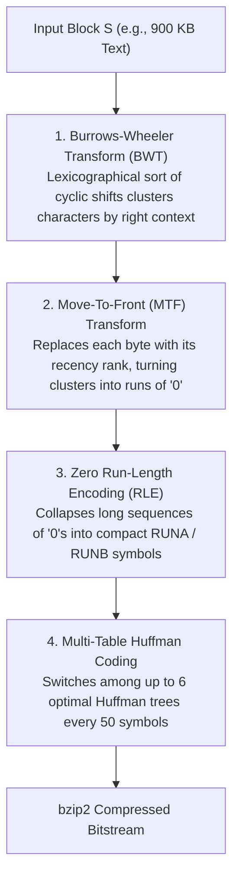

## 1. The Pigeonhole Principle and the Impossibility of Universal Compression: Why No Algorithm Can Shrink Every File

Every day, billions of times across global networks and storage arrays, utilities like `zip`, `gzip`, `zstd` (Zstandard), and `xz` take megabytes of source code, database dumps, and system logs, shrink them down to $10\%\text{–}30\%$ of their original size, and later reconstruct the original file <strong>without losing a single bit of information</strong>. In lossy compression schemes such as JPEG for images or MP3 and AAC for audio, the mechanism of size reduction is intuitively clear: psychoacoustic or psychovisual models discard high-frequency details that human senses barely register. In <strong>lossless compression</strong>, however, not a single character or bit is discarded. Every comma, every pointer, every whitespace byte is recovered verbatim. How is it mathematically possible to represent the exact same information in a fraction of the space?

Paradoxically, the deepest way to understand how lossless compression works is to begin by proving a stark, uncompromising theorem: <strong>a universal lossless compression algorithm that shrinks every possible file is mathematically impossible</strong>. Every few years, a startup or amateur inventor claims to have discovered a "revolutionary recursive compression algorithm" that can shrink any arbitrary file—and therefore, by applying the compressor repeatedly to its own output, reduce a multi-gigabyte movie down to a few bytes. We do not even need advanced information theory to refute such claims; three lines of elementary combinatorics using the <strong>Pigeonhole Principle</strong> suffice.

Let $\{0,1\}^* = \bigcup_{k=0}^{\infty} \{0,1\}^k$ denote the set of all finite binary strings of any length. A lossless compression scheme consists of an encoder $E: \{0,1\}^* \to \{0,1\}^*$ and a decoder $D: \{0,1\}^* \to \{0,1\}^*$ satisfying the exact reconstruction condition for every input bitstring $x \in \{0,1\}^*$:

$$D(E(x)) = x$$

Suppose two distinct input files $x \neq y$ produced the exact same compressed output $E(x) = E(y) = z$. Given $z$, the deterministic decoder $D(z)$ can output at most one string; it cannot simultaneously equal both $x$ and $y$. Therefore, any lossless encoder $E$ must be strictly <strong>injective (one-to-one)</strong>.

Now consider the set of all possible binary files of length exactly $n$ bits, denoted $\{0,1\}^n$. There are $2^n$ such files. Suppose an inventor claims that their lossless compressor $E$ shrinks every $n$-bit file by at least $1$ bit—meaning that for every $x \in \{0,1\}^n$, the compressed output $E(x)$ has length at most $n - 1$ bits. How many total binary strings of length strictly less than $n$ exist across all lengths $k = 0, 1, 2, \dots, n - 1$ (including the empty string $\epsilon$ of length $0$)? Summing the geometric series gives:

$$\sum_{k=0}^{n-1} 2^k = 2^0 + 2^1 + 2^2 + \cdots + 2^{n-1} = 2^n - 1$$

Here we hit an immovable wall of arithmetic. There are $2^n$ distinct $n$-bit files (the pigeons), but at most $2^n - 1$ possible bitstrings of length $n-1$ or shorter (the pigeonholes)—and even fewer if files initially shorter than $n$ bits also need their own unique compressed representations!

$$|\{0,1\}^n| = 2^n > 2^n - 1 = \left|\bigcup_{k=0}^{n-1} \{0,1\}^k\right|$$

By the Pigeonhole Principle, no injective mapping from $\{0,1\}^n$ into $\bigcup_{k=0}^{n-1} \{0,1\}^k$ can exist. Furthermore, if a lossless encoder $E$ maps even a single $n$-bit file to a shorter bitstring that would otherwise represent a shorter file, some other file must be displaced to a bitstring of length $\ge n$, or expand to $\ge n + 1$ bits. <strong>Every lossless compression algorithm that shrinks some files must, as an inescapable mathematical necessity, expand other files.</strong>

We can sharpen this counting argument into a quantitative bound known in algorithmic information theory as the <strong>Incompressibility Theorem (Kolmogorov Complexity Bound)</strong>. What fraction of all $n$-bit files can be compressed by at least $c$ bits (so that $|E(x)| \le n - c$)? The total number of candidate output bitstrings of length at most $n - c$ is:

$$\sum_{k=0}^{n-c} 2^k = 2^{n-c+1} - 1 < 2^{n-c+1}$$

Dividing by the total number of $n$-bit strings $2^n$, the fraction of $n$-bit files that can be shrunk by $c$ or more bits is strictly bounded by:

$$\frac{|\{x \in \{0,1\}^n : |E(x)| \le n - c\}|}{2^n} < \frac{2^{n-c+1}}{2^n} = 2^{-(c-1)}$$

Let us plug in $c = 11$ bits (just $1.375\,\text{bytes}$!). We get $2^{-(11-1)} = 2^{-10} = \frac{1}{1024} \approx 0.000976$. In other words, <strong>out of all possible binary files of size $n$ bits, fewer than $0.1\%$ can be compressed by even $1.375$ bytes by any fixed lossless algorithm; more than $99.9\%$ of all mathematically possible files are completely incompressible!</strong>

Why, then, do `gzip`, `zstd`, and `xz` effortlessly shrink almost every file on our hard drives by $50\%\text{–}90\%$? Because the files humans write and machines record—natural language prose, Python and C++ source code, x86-64/ARM executables, JSON logs, relational tables, and scientific sensor streams—are not drawn uniformly at random from $\{0,1\}^n$. Out of the $2^{8,388,608}$ possible $1\,\text{MB}$ files, virtually all of them are indistinguishable from pure white noise. Real-world files inhabit an <strong>astronomically tiny, highly structured, low-entropy manifold</strong> inside $\{0,1\}^n$. Letters and byte values appear with heavily skewed frequencies, words and syntax patterns repeat thousands of times, and preceding bytes strongly predict upcoming bytes.

A lossless compressor is therefore not a magic box that shrinks all bitstrings; it is a <strong>probability-weighted bijection</strong> that assigns very short binary codewords to the tiny subset of structured files that actually occur in human civilization, while pushing longer codewords onto the vast ocean of uniform random noise files that nobody ever stores. This also explains why running `gzip` on an already compressed `.gz` file or an AES-256 encrypted ciphertext never shrinks it: a good compressor or cipher removes statistical redundancy until the output looks like uniform random bits, leaving no structure left to exploit—and forcing the second pass to expand the file slightly by adding its own framing headers.

---

## 2. Claude Shannon's 1948 Information Theory and the Noiseless Source Coding Theorem

In July and October 1948, Bell Labs mathematician and electrical engineer <strong>Claude Elwood Shannon</strong> published his landmark two-part paper *"A Mathematical Theory of Communication"*, single-handedly founding the discipline of information theory. Prior to Shannon, engineers viewed communication through the lens of electromagnetic waveforms and subjective semantic meaning. Shannon severed information from human semantics and defined it purely through probability: <strong>information is the resolution of statistical uncertainty (surprisal)</strong>.

### Self-Information (Surprisal) and Shannon Entropy

Consider a discrete memoryless source (DMS) $X$ that emits symbols from a finite alphabet $\mathcal{A} = \{x_1, x_2, \dots, x_m\}$ according to a probability distribution $P(x_i) = \Pr(X = x_i)$. How much elemental information $I(x)$ do we receive when we observe that symbol $x$ has occurred? Shannon required $I(x)$ to satisfy three natural axioms:
1. An event that is certain to happen ($P(x) = 1$) carries zero surprise and zero information: $I(1) = 0$.
2. Less probable (rarer) events carry strictly more information than more probable events: $I(x)$ is a strictly decreasing function of $P(x)$.
3. If two independent events $x$ and $y$ occur with joint probability $P(x, y) = P(x)P(y)$, the total information gained must equal the sum of their individual informations (additivity): $I(x, y) = I(x) + I(y)$.

The unique continuous function mapping multiplication $(0, 1] \to [0, \infty)$ into addition is the negative logarithm. Choosing base $2$ defines the fundamental unit of information as the <strong>bit (or shannon)</strong>, giving the <strong>Self-Information (Surprisal)</strong> of symbol $x$:

$$I(x) = -\log_2 P(x) = \log_2 \frac{1}{P(x)} \quad [\text{bits}]$$

If a fair coin lands heads ($P = 1/2$), we gain $I = -\log_2(1/2) = 1\,\text{bit}$ of information. If a uniform random byte equals `0x41` ($P = 1/256$), we gain $I = -\log_2(1/256) = 8\,\text{bits}$. Conversely, if a highly predictable sensor status bit is `'0'` with probability $P(0) = 0.99$, observing `'0'` conveys only $I(0) = -\log_2(0.99) \approx 0.014355\,\text{bits}$ of information.

Taking the expectation of self-information across the entire probability distribution $P$ yields the <strong>Shannon Entropy</strong> $H(X)$ of the source (using the continuity convention $0 \log_2 0 = \lim_{p \to 0^+} p \log_2 p = 0$):

$$H(X) = \mathbb{E}[I(X)] = -\sum_{i=1}^{m} P(x_i) \log_2 P(x_i) \quad [\text{bits / symbol}]$$

Mathematically isomorphic to the Boltzmann-Gibbs entropy $S = -k_B \sum p_i \ln p_i$ in statistical mechanics, $H(X)$ measures the average uncertainty per symbol emitted by the source. When all $m$ symbols are equally likely ($P(x_i) = 1/m$), entropy reaches its maximum $H_{\max}(X) = \log_2 m$ bits. Whenever the distribution is skewed, $H(X) < \log_2 m$, and the difference $\log_2 m - H(X)$ represents the statistical redundancy that lossless compression can strip away.

### Prefix-Free (Instantaneous) Codes and the Kraft-McMillan Inequality

To connect $H(X)$ rigorously to the physical length of compressed files, consider a binary variable-length code $C$ that assigns to each symbol $x_i \in \mathcal{A}$ a binary codeword $c(x_i) \in \{0,1\}^{\ell_i}$ of length $\ell_i$ bits. When we encode a stream of symbols by concatenating their codewords without delimiter characters, the resulting bitstring must be <strong>uniquely decodable</strong>. Even stronger, for high-speed streaming decompression, we want the code to be <strong>instantaneous (prefix-free)</strong>: the decoder must recognize the end of each codeword the instant its last bit arrives, without having to look ahead at subsequent bits.

A code is a <strong>Prefix-Free Code (Prefix Code)</strong> if no codeword $c(x_i)$ is a prefix of any other distinct codeword $c(x_j)$ ($i \neq j$). For example, $C = \{0, 10, 110, 111\}$ is prefix-free: the bitstring `100110111` parses unambiguously and instantaneously from left to right as `10 | 0 | 110 | 111`.

Every binary prefix-free code corresponds bijectively to the set of leaves of a binary tree where left branches represent `0` and right branches represent `1`. The prefix-free condition is equivalent to stating that no codeword node is an ancestor of another codeword node—every codeword sits at a leaf of the binary tree.

Let $\ell_{\max} = \max_i \ell_i$ be the depth of the deepest leaf. A complete binary tree of depth $\ell_{\max}$ has $2^{\ell_{\max}}$ leaves at level $\ell_{\max}$. Placing a codeword leaf at depth $\ell_i$ prunes the subtree beneath it, consuming exactly $2^{\ell_{\max} - \ell_i}$ potential leaves at depth $\ell_{\max}$. Because the subtrees beneath distinct leaves are disjoint, the total number of depth-$\ell_{\max}$ leaves consumed across all $m$ codewords cannot exceed $2^{\ell_{\max}}$:

$$\sum_{i=1}^{m} 2^{\ell_{\max} - \ell_i} \le 2^{\ell_{\max}}$$

Dividing both sides by $2^{\ell_{\max}}$ yields <strong>Kraft's Inequality (Leon Kraft, 1949)</strong>—and in 1956, Brockway McMillan proved that the exact same inequality holds even if we relax the prefix-free requirement and allow *any* uniquely decodable code, establishing the <strong>Kraft-McMillan Inequality</strong>:

$$\sum_{i=1}^{m} 2^{-\ell_i} \le 1$$

Conversely, for any set of positive integers $\{\ell_1, \dots, \ell_m\}$ satisfying $\sum_{i=1}^m 2^{-\ell_i} \le 1$, there exists a binary prefix-free code with those exact codeword lengths. Kraft's inequality acts as a strict <strong>bit-length budget</strong>: assigning a short codeword of length $\ell_i = 1$ spends $2^{-1} = 1/2$ of the entire coding budget, leaving only $1/2$ for all remaining symbols combined.

### Proving Shannon's Noiseless Source Coding Theorem via Gibbs's Inequality (KL Divergence)

Let $L = \sum_{i=1}^{m} P(x_i) \ell_i$ be the expected codeword length (in bits per symbol) of a prefix-free (or uniquely decodable) code with lengths $\ell_1, \dots, \ell_m$. How small can $L$ be?

Let $Z = \sum_{j=1}^{m} 2^{-\ell_j} \le 1$ be the Kraft sum, and define an auxiliary probability distribution $Q(x_i) = \frac{2^{-\ell_i}}{Z}$ over $\mathcal{A}$ (so that $\sum_{i=1}^m Q(x_i) = 1$). Now evaluate the <strong>Kullback-Leibler (KL) Divergence</strong> $D_{\text{KL}}(P \| Q)$ between the true source distribution $P$ and the implicit code distribution $Q$. By Jensen's inequality (or Gibbs's inequality $\ln u \le u - 1$), $D_{\text{KL}}(P \| Q) \ge 0$ for any two probability distributions, with equality if and only if $P(x_i) = Q(x_i)$ for all $i$:

$$\begin{aligned}
0 \le D_{\text{KL}}(P \| Q) &= \sum_{i=1}^{m} P(x_i) \log_2 \frac{P(x_i)}{Q(x_i)} \\
&= \sum_{i=1}^{m} P(x_i) \log_2 P(x_i) - \sum_{i=1}^{m} P(x_i) \log_2 \left(\frac{2^{-\ell_i}}{Z}\right) \\
&= -H(X) - \sum_{i=1}^{m} P(x_i) \left(-\ell_i - \log_2 Z\right) \\
&= L - H(X) + \log_2 Z
\end{aligned}$$

Rearranging this identity reveals the exact decomposition of expected codeword length $L$:

$$L = H(X) + D_{\text{KL}}(P \| Q) + \log_2 \left(\frac{1}{Z}\right)$$

Because $D_{\text{KL}}(P \| Q) \ge 0$ and $Z \le 1 \implies \log_2(1/Z) \ge 0$, we immediately obtain the fundamental lower bound of <strong>Shannon's Noiseless Source Coding Theorem</strong>:

$$L \ge H(X)$$

Even better, this identity exposes the exact two sources of inefficiency (redundancy $R = L - H(X)$) in any lossless code:
1. $\log_2(1/Z) \ge 0$ is the waste caused by leaving unused leaves in the binary tree ($Z < 1$).
2. $D_{\text{KL}}(P \| Q) \ge 0$ is the <strong>wrong-probability penalty</strong>: if a compressor assumes symbol probabilities $Q(x_i) = 2^{-\ell_i}$ when the true data follows $P(x_i)$, it pays an extra $D_{\text{KL}}(P \| Q)$ bits per symbol! Equality $L = H(X)$ is achieved if and only if $P$ is a <strong>dyadic distribution</strong> ($P(x_i) = 2^{-\ell_i}$ for integers $\ell_i$) and we set $\ell_i = -\log_2 P(x_i)$.

When $-\log_2 P(x_i)$ is not an integer, choosing the <strong>Shannon codeword lengths</strong> $\ell_i = \lceil -\log_2 P(x_i) \rceil$ satisfies $-\log_2 P(x_i) \le \ell_i < -\log_2 P(x_i) + 1$. Since $2^{-\ell_i} \le P(x_i)$, summing over $i$ gives $\sum_{i=1}^m 2^{-\ell_i} \le \sum_{i=1}^m P(x_i) = 1$, so a valid prefix-free code is guaranteed to exist by Kraft's theorem. Taking the expectation of $\ell_i < -\log_2 P(x_i) + 1$ yields the classic sandwich bound for any optimal symbol-by-symbol prefix code:

$$H(X) \le L < H(X) + 1$$

Finally, if we group $N$ consecutive independent symbols into blocks $X^N \in \mathcal{A}^N$, the joint entropy is $H(X^N) = N H(X)$, so the expected block codeword length $L_N$ satisfies $N H(X) \le L_N < N H(X) + 1$. Dividing by $N$ proves that the per-symbol rate $L_N / N$ satisfies:

$$H(X) \le \frac{L_N}{N} < H(X) + \frac{1}{N}$$

As $N \to \infty$, the $+1$ bit rounding overhead vanishes completely, proving that $H(X)$ is the exact, achievable asymptotic limit of lossless compression.

---

## 3. The Three Generations of Statistical Entropy Coding: Huffman, Arithmetic Coding, and ANS

Shannon's theorem proved *what* limit is possible, but left open the algorithmic challenge of *how* to pack symbols with known probabilities $P(s)$ into roughly $-\log_2 P(s)$ bits at high speed. Over the past seven decades, <strong>Entropy Coding</strong> has evolved through three distinct generations. The diagram below illustrates the two-stage architecture of modern lossless compressors and how these three generations fit into the pipeline.

### Generation 1: David Huffman's Optimal Prefix Trees (Huffman Coding, 1952)

In 1948–1949, Claude Shannon and MIT professor Robert Fano independently proposed <strong>Shannon-Fano Coding</strong>, a top-down method that sorts symbols by probability and recursively splits the set into two subsets of roughly equal total probability ($50\% : 50\%$), assigning `0` to one half and `1` to the other. While intuitive, top-down splitting is locally greedy and frequently fails to produce the minimum possible expected codeword length $L$.

In 1951, <strong>David A. Huffman</strong> was a graduate student in Robert Fano's information theory course at MIT. Fano gave his students a choice: take a final exam, or write a term paper finding an algorithm for the most efficient binary code—without telling the class that neither he nor Shannon had been able to solve the problem! Days before the deadline, just as Huffman was about to give up and study for the final exam, he threw his notes of top-down trees into the wastebasket and had a sudden epiphany: <strong>instead of splitting probabilities from the root down to the leaves, merge the least probable symbols from the leaves up to the root!</strong>

Huffman's bottom-up greedy algorithm is guaranteed to find a strictly optimal prefix-free code in $O(m \log m)$ time by virtue of two structural lemmas:
* <strong>Lemma 1 (Sibling Property at Maximum Depth)</strong>: There exists an optimal prefix-free binary tree in which the two least probable symbols $x_{m-1}$ and $x_m$ are sibling leaves at the maximum depth $\ell_{\max}$. (If the deepest leaf had no sibling, we could delete its parent's branch and promote the leaf up one level, strictly decreasing $L$; and swapping any deeper symbol with a less probable shallower symbol never increases $L$.)
* <strong>Lemma 2 (Optimal Substructure via Symbol Merging)</strong>: If we merge $x_{m-1}$ and $x_m$ into a single composite meta-symbol $z$ with probability $P(z) = P(x_{m-1}) + P(x_m)$ over the reduced alphabet $\mathcal{A}'$ of size $m-1$, then any tree $T'$ for $\mathcal{A}'$ expands into a tree $T$ for $\mathcal{A}$ (by splitting leaf $z$ into two children $x_{m-1}, x_m$) whose expected length satisfies $L(T) = L(T') + P(x_{m-1}) + P(x_m)$. Since $P(x_{m-1}) + P(x_m)$ is constant, minimizing $L(T')$ automatically minimizes $L(T)$!

Using a min-priority queue (min-heap), Huffman's algorithm simply extracts the two nodes $u, v$ of minimum probability, creates a parent node $w$ with weight $P(u) + P(v)$, inserts $w$ back into the heap, and repeats $m-1$ times until a single root remains. In modern practice (such as `DEFLATE` and `zstd`), encoders convert the resulting codeword lengths $\{\ell_i\}$ into a <strong>Canonical Huffman Code</strong>, where codewords of the same length are assigned sequential integers. This allows the entire tree structure to be transmitted in just a few bytes (only the array of lengths $\ell_i$) and decoded via a single flat lookup table indexed by the next $11\text{–}15$ bits of input.

#### The Fundamental Wall of Huffman Coding: The Integer-Bit Floor ($\ell_i \ge 1$)

Among all codes that assign a discrete binary codeword to each individual symbol, Huffman coding is mathematically unbeatable. Why, then, did information theorists spend decades searching for a successor? Because every leaf in a binary tree has depth at least $\ell_i \ge 1$, meaning <strong>no symbol can ever be encoded in fewer than $1$ full bit</strong>!

Suppose a binary stream (such as a run-length flag, a bilevel document scan, or a context predictor output) emits `'0'` with probability $P(0) = 0.99$ and `'1'` with probability $P(1) = 0.01$. The true Shannon entropy of this source is:

$$H(X) = -0.99 \log_2(0.99) - 0.01 \log_2(0.01) \approx 0.014355 + 0.066439 = 0.08079\,\text{bits / symbol}$$

Each occurrence of `'0'` carries only $I(0) = -\log_2(0.99) \approx 0.014355\,\text{bits}$ of information—less than $1/69$th of a bit! Yet a symbol-by-symbol Huffman code must assign `0` ($1\,\text{bit}$) to `'0'` and `1` ($1\,\text{bit}$) to `'1'`, yielding an average codeword length of:

$$L_{\text{Huffman}} = 0.99 \times 1 + 0.01 \times 1 = 1.000\,\text{bit / symbol}$$

That is a <strong>$12.4\times$ bloat over the Shannon limit</strong> (and a <strong>$69.7\times$ overhead</strong> on the dominant symbol `'0'`)! Grouping $k$ symbols into macro-symbols reduces the penalty to $1/k$ bits per symbol, but causes the alphabet size $m^k$ and lookup table memory to explode exponentially ($256^4 = 4.29 \times 10^9$ entries for just 4 bytes).

### Generation 2: Arithmetic Coding and Range Coding (1976–1987)

How can we assign $0.014355$ bits to a symbol without building an exponentially large Huffman tree? By abandoning symbol-by-symbol trees completely and mapping the <strong>entire message sequence $x_1 x_2 \dots x_N$ to a single real sub-interval $[L_N, H_N) \subset [0, 1)$</strong>. Discovered independently by Jorma Rissanen and Richard Pasco in 1976, formulated as byte-level <strong>Range Coding</strong> by G. N. N. Martin in 1979, and popularized by Witten, Neal, and Cleary in 1987, <strong>Arithmetic Coding</strong> shattered the integer-bit barrier.

Let the alphabet be $\mathcal{A} = \{0, 1, \dots, m-1\}$ with probabilities $P(s)$ and cumulative probabilities $C(s) = \sum_{a < s} P(a)$ (with $C(0) = 0$).
1. Initialize the active interval to $[L_0, H_0) = [0, 1)$ with width $W_0 = H_0 - L_0 = 1$.
2. For each symbol $x_t$ at step $t = 1, 2, \dots, N$, subdivide the current interval $[L_{t-1}, H_{t-1})$ proportionally to the cumulative distribution of $x_t$:

$$L_t = L_{t-1} + W_{t-1} \cdot C(x_t), \qquad H_t = L_{t-1} + W_{t-1} \cdot \big(C(x_t) + P(x_t)\big)$$

Because the width shrinks at each step by $W_t = H_t - L_t = W_{t-1} \cdot P(x_t)$, after encoding all $N$ symbols, the final interval $[L_N, H_N)$ has width equal to the exact joint probability of the entire message:

$$W_N = H_N - L_N = \prod_{t=1}^{N} P(x_t)$$

Distinct messages of length $N$ map to strictly disjoint half-open sub-intervals of $[0, 1)$. To transmit the identity of $[L_N, H_N)$ to the decoder, the encoder simply outputs the shortest binary fraction $0.b_1 b_2 \dots b_K$ whose dyadic interval $[j 2^{-K}, (j+1)2^{-K})$ lies entirely inside $[L_N, H_N)$. Since an interval of width $W_N$ always contains a dyadic sub-interval of width $2^{-K}$ with $K = \lceil -\log_2 W_N \rceil + 1$, the total compressed file length is at most:

$$K = \left\lceil \sum_{t=1}^{N} -\log_2 P(x_t) \right\rceil + 1 < \sum_{t=1}^{N} I(x_t) + 2 \quad [\text{bits}]$$

Across an entire multi-megabyte file, Arithmetic Coding wastes <strong>at most $2$ bits in total</strong> ($< 2/N$ bits per symbol)! In our skewed $P(0)=0.99$ example, each `'0'` narrows the interval width by a factor of $0.99$, so roughly $69$ consecutive `'0'`s are absorbed before the interval width halves and emits a single bit.

In practice, instead of arbitrary-precision floats, arithmetic and range coders maintain $L$ and $W$ in $32$-bit or $64$-bit integer registers and perform <strong>renormalization</strong>—shifting out settled top bits (or top bytes in Range Coding) whenever the interval becomes narrow. However, there was a steep price: every single symbol (or bit in binary arithmetic coders like CABAC in H.264/HEVC or Context-Adaptive Range Coding in `LZMA/xz`) requires sequential integer multiplications, probability scaling, and conditional renormalization loops, making Arithmetic Coding <strong>$3\times\text{ to }10\times$ slower in CPU throughput than Huffman table lookups</strong>.

### Generation 3: Asymmetric Numeral Systems (ANS — Jarek Duda, 2009–2014)

For nearly forty years, compression engineers believed they had to choose between two incompatible worlds: <strong>Huffman Coding</strong> (fast table lookups, integer-bit precision loss) or <strong>Arithmetic Coding</strong> (exact fractional-bit entropy, heavy sequential arithmetic). Then, between 2009 and 2014, Polish physicist and computer scientist <strong>Jarek Duda</strong> at Jagiellonian University invented <strong>Asymmetric Numeral Systems (ANS)</strong>, unifying both worlds through a breathtaking generalization of positional numeral systems.

Consider how we append a base-$b$ digit $s \in \{0, 1, \dots, b-1\}$ to an existing natural number $x \in \mathbb{N}$ in standard positional arithmetic:

$$x' = x \cdot b + s \qquad \Longleftrightarrow \qquad s = x' \bmod b, \quad x = \lfloor x' / b \rfloor$$

From an information-theoretic perspective, why do we multiply $x$ by $b$? Because if all $b$ digits are equally likely with uniform probability $P(s) = 1/b$, multiplying $x$ by $b = 1/P(s)$ increases the bit-length $\log_2(x)$ of our state number by exactly the self-information of digit $s$:

$$\log_2(x') \approx \log_2\left(\frac{x}{P(s)}\right) = \log_2(x) - \log_2 P(s) = \log_2(x) + I(s) \quad [\text{bits}]$$

Standard base-$b$ numeral systems are therefore optimal entropy coders for <strong>symmetric (uniform) distributions</strong> $P(s) = 1/b$!

What if the symbols $s \in \mathcal{A}$ have <strong>asymmetric (non-uniform) probabilities</strong> $P(s)$? Duda realized that instead of maintaining two numbers $[L, H)$ defining an interval that shrinks by $P(s)$ (Arithmetic Coding), we only need <strong>a single natural number state $x \in \mathbb{N}$ that grows by $1/P(s)$</strong> when encoding symbol $s$:

$$x' = C(x, s) \approx \frac{x}{P(s)}$$

To make $C(x, s)$ an exact, lossless bijection between $\mathbb{N} \times \mathcal{A}$ and $\mathbb{N}$, we partition the natural numbers $\mathbb{N}$ into disjoint subsets $\mathbb{N}_s$ whose density is proportional to $P(s)$. This yields the two celebrated forms of ANS:

#### 1. rANS (Range ANS)

Quantize the probabilities over a power-of-two denominator $M = 2^R$ (e.g., $R=12 \implies M=4096$) into integer frequencies $f_s \in \mathbb{N}^+$ such that $P(s) \approx f_s / M$ and $\sum_{s} f_s = M$, with cumulative frequencies $b_s = \sum_{a < s} f_a$. The exact bijective encoding function $C(x, s)$ and decoding function $D(x')$ are:

$$\text{Encoding:} \quad x' = C(x, s) = \left\lfloor \frac{x}{f_s} \right\rfloor \cdot M + (x \bmod f_s) + b_s$$

$$\text{Decoding:} \quad \begin{cases}
\text{slot} = x' \bmod M = x' \mathbin{\&} (2^R - 1) \\
s = \text{unique symbol with } b_s \le \text{slot} < b_s + f_s \\
x = f_s \cdot \left\lfloor \frac{x'}{M} \right\rfloor + \text{slot} - b_s = f_s \cdot (x' \gg R) + \text{slot} - b_s
\end{cases}$$

Look closely at the decoding step $D(x')$: because $M = 2^R$, modulo $M$ is a single-cycle bitwise AND (`& (M - 1)`) and division by $M$ is a single-cycle right bit-shift (`>> R`)! <strong>There is not a single division instruction in the rANS decoder</strong>, and multiple independent rANS states $x_1, x_2, x_3, x_4$ can be interleaved in a single bitstream to execute $4\text{-way}$ or $8\text{-way}$ parallel SIMD decoding via AVX2/AVX-512/NEON instructions!

#### 2. tANS (Tabled ANS / Finite State Entropy — FSE)

By renormalizing the state $x$ (emitting or reading low bits) so that $x$ always remains bounded inside the half-open interval $x \in [L, 2L - 1)$ (where $L = 2^R$, typically $1024$ to $4096$), the state space becomes finite with just $L$ possible states. Consequently, the entire transition $(x') \mapsto (s, \text{num\_bits}, \text{base\_state})$ can be <strong>precomputed into a small lookup table in L1 cache</strong>!

Known as <strong>tANS</strong>—or <strong>FSE (Finite State Entropy)</strong> in Yann Collet's implementation—this table-driven state machine eliminates even the multiplication $f_s \cdot (x' \gg R)$. Decoding a symbol in tANS requires literally <strong>one table lookup, one bit-shift, and one addition—matching the exact CPU speed of Huffman coding while delivering the fractional-bit compression ratio of Arithmetic Coding ($D_{\text{KL}}$ overhead typically $< 0.001\,\text{bits/symbol}$)</strong>!

Because ANS pushes symbols onto and pops symbols off a single integer state $x$, it operates as a <strong>LIFO stack</strong> (Last-In, First-Out): the last symbol encoded is the first symbol decoded. Practical compressors simply encode each block of symbols in reverse order (from end of block to start) so that the decompressor can stream forward from start to end at gigabytes per second. Today, ANS powers <strong>Meta's Zstandard (`zstd`)</strong>, <strong>Apple's `LZFSE`</strong> across iOS and macOS, <strong>Google's Draco 3D mesh compression</strong>, and the <strong>JPEG XL</strong> image standard.

---

## 4. Dictionary & Transform-Based Compression: Stripping Sequential Context and Repetition (LZ77, LZ78/LZW, BWT, PPM, and LLMs)

Why can't we just feed an English text file directly into a single-byte Huffman or ANS coder and achieve maximum compression? Because in English text, single-byte (order-$0$) frequencies have an entropy of $H_0(X) \approx 4.5\,\text{bits/byte}$ (about $56\%$ of original size), whereas the true conditional entropy of English given its preceding context is $H(X_t \mid X_{<t}) \approx 1.0\text{–}1.3\,\text{bits/byte}$ ($12\%\text{–}16\%$ of original size)! Most of the redundancy in real-world files lies not in isolated byte frequencies, but in <strong>repeated substrings, grammatical syntax, and long-range sequential context</strong>.

To strip away sequential redundancy before handing symbols to an entropy coder, computer science developed three monumental families of structural transforms and models.

### 1. Dictionary Compression: LZ77, LZSS, DEFLATE, Zstandard, and LZ78/LZW

In 1977 and 1978, Israeli information theorists <strong>Abraham Lempel</strong> and <strong>Jacob Ziv</strong> published two landmark papers introducing <strong>LZ77</strong> and <strong>LZ78</strong>, proving that a sliding window or dynamic dictionary over past input asymptotically achieves the Shannon entropy rate of any stationary ergodic source without knowing its probability distribution in advance.

#### Sliding-Window Backward Pointers (LZ77, 1977 and LZSS, 1982)

In <strong>LZ77</strong>, the encoder maintains a <strong>Sliding Window</strong> over the most recently processed $W$ bytes of input (the *Search Buffer*, e.g., $32\,\text{KB}$ in `DEFLATE`, or $8\,\text{MB}\text{–}128\,\text{MB}$ in `zstd` and `xz`). As it scans the upcoming bytes in the *Lookahead Buffer*, it searches the window (using hash tables, hash chains, or binary search trees) for the longest matching substring that has already appeared in the past.

Suppose the 18-byte string `"content/post/index"` appeared $412$ bytes earlier in the file and now appears again. Instead of emitting $18$ raw literal bytes ($144$ bits), LZ77 replaces the entire substring with a compact backward reference pointer:

$$\text{Match Pair: } (\text{distance } d = 412,\; \text{length } \ell = 18)$$

instructing the decoder: *"jump back $412$ bytes in your output buffer and copy $18$ bytes forward to the current cursor."* (In the 1982 <strong>LZSS</strong> refinement by Storer and Szymanski, a 1-bit or entropy-coded flag distinguishes raw unmatched literals from `(distance, length)` match pairs, eliminating expansion on non-matching bytes.) Even more cleverly, LZ77 allows overlapping copies where $\text{distance} < \text{length}$: for instance, a literal `'A'` followed by `(distance = 1, length = 99)` copies the byte $1$ position back $99$ times in a row, automatically subsuming Run-Length Encoding (RLE) and periodic byte patterns!

Virtually all modern general-purpose compressors combine <strong>LZ77 match-finding with statistical entropy coding</strong>:
* <strong>`DEFLATE` (Phil Katz, 1991 — PKZIP, `gzip`, `zlib`, PNG, HTTP)</strong>: Combines a $32\,\text{KB}$ LZ77 sliding window (match lengths $3\text{–}258$ bytes) with <strong>two Huffman trees</strong>: one joint tree encoding literals ($0\text{–}255$), end-of-block ($256$), and length codes ($257\text{–}285$), and a second tree encoding distance codes ($0\text{–}29$ plus extra offset bits).
* <strong>`Zstandard (zstd)` (Yann Collet / Meta, 2016)</strong>: Expands the LZ77 sliding window to megabytes, maintains a 3-entry <strong>Repeat Offset Cache</strong> (since consecutive structural matches often share the exact same stride distance), compresses raw literals using <strong>4-way parallel Huffman coding</strong>, and compresses the sequence commands (`literal_length`, `match_length`, `offset`) using <strong>tANS (FSE)</strong>.
* <strong>`LZMA / LZMA2` (Igor Pavlov, 1998 — `7-Zip`, `xz`)</strong>: Pairs a massive sliding dictionary (up to $4\,\text{GB}$ searched via binary/Patricia trees and dynamic-programming optimal parsing) with a bit-level <strong>Context-Adaptive Range Coder</strong> that tracks conditional probabilities based on byte alignment and recent match history.

#### Why LZ77 Defeated LZ78 (1978) and LZW (Terry Welch, 1984)

Whereas LZ77 uses implicit backward pointers into a sliding window, <strong>LZ78</strong> and <strong>LZW</strong> build an explicit <strong>prefix trie dictionary</strong> of substrings encountered so far, outputting integer dictionary indices (used in historic Unix `compress`, <strong>GIF</strong>, and <strong>TIFF</strong>). Why did LZ77 ultimately triumph over LZ78/LZW in modern archivers? First, an LZW dictionary grows by only one character per step—meaning a 50-byte repeated sentence must appear dozens of times before the full phrase enters the trie—whereas LZ77 captures the entire 50-byte match on its very second appearance! Second, LZ77's separated `(distance, length)` components exhibit sharp statistical skew toward small integers, allowing downstream Huffman/ANS coders to compress them far more tightly than flat LZW dictionary indices.

### 2. Block-Sorting Permutation: The Burrows-Wheeler Transform (BWT, 1994 — `bzip2`)

In 1994, <strong>Michael Burrows</strong> and <strong>David Wheeler</strong> unveiled a completely different mathematical mechanism: the <strong>Burrows-Wheeler Transform (BWT)</strong>, which forms the core of Julian Seward's <strong>`bzip2`</strong>.

How can a reversible permutation of a string make it vastly easier to compress <strong>without changing its length by a single bit</strong>? Let us trace the BWT on the string $S = \text{`banana$`}$ (where `$` is an end-of-block sentinel ordered lexicographically before all characters, length $N = 7$):
1. Form all $N = 7$ cyclic shifts (rotations) of $S$ as an $N \times N$ matrix.
2. Sort the rows of the matrix in <strong>lexicographical order</strong>.
3. Output the <strong>Last Column $L$</strong> of the sorted matrix, together with the row index $I$ containing the original string $S$.

| Row | Cyclic Shift (Unsorted) | Sorted Row (First Col $F$ $\dots$ Last Col $L$) | First Col $F$ | Last Col $L$ (BWT Output) |
| :--- | :--- | :--- | :---: | :---: |
| 0 | `banana$` | `$banana` | `$` | `a` |
| 1 | `anana$b` | `a$banan` | `a` | `n` |
| 2 | `nana$ba` | `ana$ban` | `a` | `n` |
| 3 | `ana$ban` | `anana$b` | `a` | `b` |
| 4 | `na$bana` | `banana$` $\leftarrow$ Original string ($I=4$) | `b` | `$` |
| 5 | `a$banan` | `na$bana` | `n` | `a` |
| 6 | `$banana` | `nana$ba` | `n` | `a` |

Reading down the last column $L$ yields the BWT output string <strong>`annb$aa`</strong> (with index $I = 4$). Notice what happened: in the original string `banana$`, the letters `'a'` and `'n'` alternated (`a-n-a-n-a`) with zero contiguous runs. After BWT, the `'n'`s have clustered into `nn` and the `'a'`s into `aa`!

#### Why Does BWT Cluster Identical Characters, and How Is It Reversed (LF-Mapping)?

Because each row is a cyclic shift, the character in the last column $L$ is the character that appeared <strong>immediately before</strong> the character in the first column $F$ in the original text! Sorting the rows by their prefixes therefore sorts the characters of column $L$ by their <strong>right-hand (following) context</strong>. In an English book, thousands of cyclic shifts begin with `"he "`—and almost every one of them is preceded in the original text by `'t'` or `'T'` (forming `"the "`). Thus, in column $L$, all those hundreds of `'t'`s land in adjacent rows, creating massive contiguous runs of identical or near-identical characters!

Even more miraculous is that BWT is <strong>invertible in $O(N)$ linear time</strong> from $L$ and $I$ alone:
1. Sorting the characters of $L = \text{`annb$aa`}$ immediately reconstructs the first column $F = \text{`$aaabnn`}$.
2. By the <strong>LF-Mapping Theorem</strong>, <strong>the $k$-th occurrence of any character $c$ in column $L$ corresponds to the exact same text character as the $k$-th occurrence of $c$ in column $F$</strong>. Why? Because all rows starting with $c$ in $F$ are sorted by the substring following $c$, and all rows ending with $c$ in $L$ are also sorted by their row prefixes—which are the exact same substrings following $c$!

Using this LF pointer table, the decoder reconstructs $S$ backward in a single $O(N)$ pass. As shown in the pipeline below, `bzip2` feeds the BWT output into a <strong>Move-To-Front (MTF) Transform</strong> (which converts local character clusters into streams of small integers dominated by `0`s), followed by <strong>Zero Run-Length Encoding (RLE)</strong> and <strong>multi-table Huffman coding</strong>.

### 3. Statistical Context Modeling (PPM & Context Mixing) and the Equivalence of Compression and Intelligence (LLMs)

The third paradigm dispenses with pointers and permutations altogether. Instead, at each step $t$, an explicit statistical model estimates the conditional probability distribution $P_{\text{model}}(x_t \mid x_1, \dots, x_{t-1})$ over the next symbol given all preceding symbols, and feeds that probability distribution directly into an Arithmetic Coder:

* <strong>PPM (Prediction by Partial Matching — Cleary & Witten, 1984)</strong>: Maintains variable-order Markov tries recording symbol counts for contexts of length up to $k$ (e.g., $k = 5\text{–}16$), emitting an *escape symbol* to fall back to shorter contexts ($k-1 \to k-2 \to \dots \to 0$) whenever a novel character appears in a high-order context.
* <strong>Context Mixing (`PAQ8` by Matt Mahoney, `cmix` by Byron Knoll)</strong>: Runs hundreds of specialized sub-models in parallel (order-$k$ byte models, word/syntax models, sparse context models, stride models for tables/audio, and LSTM/Transformer neural networks) and blends their predictions at every single bit via adaptive logistic mixing before arithmetic coding.

Here we arrive at one of the most profound insights in modern computer science: <strong>the exact mathematical equivalence between lossless data compression and Large Language Models (LLMs)</strong>.

Suppose an autoregressive language model with weights $\theta$ assigns conditional probability $P_\theta(x_t \mid x_{<t})$ to each token (or byte) $x_t$ in a sequence $x_1, x_2, \dots, x_N$. If we connect the softmax probability distribution $P_\theta(\cdot \mid x_{<t})$ at each step to an Arithmetic Coder (or ANS coder), the total number of bits $L_{\text{total}}$ required to losslessly encode the entire dataset is:

$$L_{\text{total}} = \sum_{t=1}^{N} -\log_2 P_\theta(x_t \mid x_1, x_2, \dots, x_{t-1}) \quad [\text{bits}]$$

Compare this equation to the <strong>Cross-Entropy Loss (Negative Log-Likelihood)</strong> minimized during the pre-training of GPT-4, Claude, Gemini, and Llama:

$$\mathcal{L}_{\text{Cross-Entropy}}(\theta) = \frac{1}{N} \sum_{t=1}^{N} -\ln P_\theta(x_t \mid x_{<t}) = \frac{\ln 2}{N} \cdot L_{\text{total}}$$

They are <strong>mathematically identical up to the constant factor $\ln 2$</strong>! Minimizing cross-entropy loss during LLM training *is* minimizing the compressed bit length of the training corpus under an arithmetic coder. To compress the phrase `"The second derivative of sin(x) is "` down to near-zero bits, the compressor's probability model must assign $P(\text{"-sin(x)"}) \approx 1$—which requires mastering calculus, grammar, and world knowledge. This is why Marcus Hutter established the <strong>Hutter Prize</strong> (compressing $1\,\text{GB}$ of Wikipedia) as a formal benchmark for Artificial General Intelligence (AGI), and why DeepMind's landmark 2023 study *"Language Modeling Is Compression"* (Delétang et al.) demonstrated that pairing a pre-trained Chinchilla LLM with an arithmetic coder compresses not only text to $8.3\%$ of its original size, but even raw image patches and audio waveforms more tightly than domain-specific codecs like PNG and FLAC!

---

## 5. The Pareto Frontier of Speed, Memory, and Compression Ratio: Engineering Trade-Offs in Practice

If Context Mixing (`cmix`) and LLM-driven arithmetic coding achieve the highest compression ratios ever recorded, why don't operating systems, databases, and web servers use them everywhere? Because in real-world systems engineering, compression lives on a multi-dimensional <strong>Pareto Frontier</strong> trading off <strong>compression ratio</strong>, <strong>encoding throughput</strong>, <strong>decoding throughput</strong>, and <strong>RAM footprint</strong>.

The table below compares six major lossless compression families across typical single-core performance metrics on standard mixed text/binary corpora (`Silesia` / `enwik8`).

| Algorithm / Tool | Core Architecture (Transform + Entropy Coder) | Compression Speed (MB/s) | Decompression Speed (MB/s) | Text Compressed Size (% of Original) | Memory Footprint | Primary Real-World Use Cases |
| :--- | :--- | :---: | :---: | :---: | :---: | :--- |
| <strong>`LZ4`</strong> (Yann Collet) | LZ77 (direct hash table) + <strong>No Entropy Coder</strong> (byte-aligned tokens) | $700 \text{ – } 1,000$ | $4,000 \text{ – } 6,000$ | $45\% \text{ – } 50\%$ | $16 \text{ – } 64\,\text{KB}$ | Linux kernel (`zram`, initramfs), ZFS/Btrfs, NVMe in-flight I/O, real-time RPC |
| <strong>`Zstandard (zstd)`</strong> | LZ77 (large window + repeat offsets) + <strong>Huffman (literals) & tANS/FSE (sequences)</strong> | $400 \text{ – } 600$ (Lv.1) $15 \text{ – } 50$ (Lv.19) | $1,500 \text{ – } 2,200$ (level-independent!) | $28\% \text{ – } 35\%$ (Lv.3) $22\% \text{ – } 25\%$ (Lv.19) | $1\,\text{MB} \text{ – } 128\,\text{MB}$ | HTTP/3 & CDN web assets, Linux packages, Parquet/RocksDB, BorgBackup |
| <strong>`DEFLATE`</strong> (`gzip` / `zlib`) | LZ77 ($32\,\text{KB}$ window, hash chains) + <strong>2 Huffman Trees</strong> | $60 \text{ – } 120$ | $350 \text{ – } 500$ | $32\% \text{ – } 37\%$ | $\sim 256\,\text{KB}$ | `.zip`, `.tar.gz`, PNG images, HTTP/1.1 & HTTP/2, Git object store |
| <strong>`BWT`</strong> (`bzip2`) | <strong>BWT ($900\,\text{KB}$ block sort)</strong> + MTF + Zero-RLE + Multi-Huffman | $15 \text{ – } 25$ | $40 \text{ – } 70$ | $25\% \text{ – } 29\%$ | $4 \text{ – } 8\,\text{MB}$ | Legacy source tarballs (`.tar.bz2`), bioinformatics genomic archives |
| <strong>`LZMA2`</strong> (`xz` / `7-Zip`) | LZ77 (up to $4\,\text{GB}$ window, binary/Patricia trees) + <strong>Context-Adaptive Range Coder</strong> | $3 \text{ – } 15$ | $80 \text{ – } 150$ | $19\% \text{ – } 23\%$ | $32\,\text{MB} \text{ – } 4\,\text{GB}$ | Long-term software distribution (`.tar.xz`, Debian `.deb`), firmware ROMs |
| <strong>`cmix` / `PAQ8`</strong> | Hundreds of context models + <strong>Neural/Logistic Mixing + Arithmetic Coding</strong> | $0.01 \text{ – } 0.1$ ($10\text{–}100\,\text{KB/s}$) | $0.01 \text{ – } 0.1$ (symmetric cost!) | $11\% \text{ – } 15\%$ | $4\,\text{GB} \text{ – } 32\,\text{GB}$ | Hutter Prize archival benchmarks, theoretical entropy boundary research |

Three foundational engineering principles emerge from this Pareto frontier:

### 1. Symmetric vs. Asymmetric Compression Architectures

Notice that statistical context-mixing and LLM-based compressors (`cmix`, `PAQ8`, `PPM`) are <strong>computationally symmetric</strong>: decompression is just as slow as compression ($10\text{–}100\,\text{KB/s}$)! Why? Because to decode step $t$ of an arithmetic bitstream, the decoder must run the *exact same neural network or hundreds of context models* over $x_1, \dots, x_{t-1}$ to reproduce the exact same probability distribution $P(x_t \mid x_{<t})$ before it can invert the interval subdivision.

By contrast, <strong>LZ77-based compressors (`LZ4`, `zstd`, `gzip`, `xz`) are fundamentally asymmetric</strong>:
* <strong>Compression is search-heavy</strong>: The encoder spends CPU cycles searching hash chains or binary trees across megabytes of history and solving dynamic-programming optimal parsing problems to choose the best `(distance, length)` pairs.
* <strong>Decompression is search-free</strong>: The compressed stream already contains the explicit `(distance, length)` instructions! The decoder never searches anything; it simply decodes the entropy tokens and executes fast, cache-friendly `memcpy` operations (`dst[i] = dst[i - distance]`). Consequently, a file compressed with `zstd -19` at $20\,\text{MB/s}$ still decompresses at the same blistering <strong>$1,500\text{–}2,200\,\text{MB/s}$</strong> as a file compressed with `zstd -1`! In write-once, read-millions workloads (operating system packages, web bundles, container images, columnar analytics databases), this asymmetry is priceless.

### 2. CPU Branch Misprediction, Stream Separation, and the NVMe I/O Revolution

In the 1990s, when spinning hard disks read data at $10\,\text{MB/s}$, a `gzip` decompressor running at $350\,\text{MB/s}$ was more than fast enough to hide behind disk I/O. Today, a single PCIe 4.0/5.0 NVMe SSD reads data at <strong>$5,000\text{–}14,000\,\text{MB/s}$</strong>, and DDR5 memory bandwidth exceeds $60\,\text{GB/s}$. At these speeds, traditional `gzip` or `xz` becomes a severe CPU bottleneck!

Why does `DEFLATE` (`gzip`) hit a ceiling around $400\,\text{MB/s}$, whereas `LZ4` exceeds $5,000\,\text{MB/s}$ and `zstd` reaches $2,000\,\text{MB/s}$?
In `DEFLATE`'s 1991 bitstream format, literal bytes and LZ77 match tokens are <strong>interleaved serially inside a single Huffman stream</strong>. The CPU cannot know whether the next bits represent a literal character or a match length until it finishes decoding the current symbol. This creates a tight serial dependency chain full of <strong>unpredictable data-dependent branches</strong> (`if (is_literal) ... else ...`), causing frequent CPU pipeline flushes from branch mispredictions and preventing SIMD vectorization.

Yann Collet designed `LZ4` and `Zstandard` specifically for modern superscalar, out-of-order CPUs:
* <strong>`LZ4`</strong> omits bit-level entropy coding altogether, aligning all length and offset fields to byte boundaries so the CPU can execute wide 16-byte/32-byte SIMD register copies (`movdqu`) at near-RAM speeds ($5\,\text{GB/s}$).
* <strong>`Zstandard (zstd)`</strong> decouples the data into <strong>separate homogeneous streams</strong> within each block—one contiguous stream for raw literals (decoded via 4-way interleaved Huffman states) and a separate stream for match sequences (decoded via branchless tANS/FSE tables). Because the 4 interleaved Huffman streams have no data dependencies on one another, a single CPU core executes all 4 state transitions simultaneously across its execution ports without branch mispredictions, achieving <strong>both better compression than `gzip` and $4\text{–}5\times$ faster decompression</strong>.

---

## 6. Conclusion: The Mathematical Unity of Information, Order, and Intelligence

Our journey into the question *"Why can files be shrunk without losing a single character?"* reveals how seamlessly pure mathematics, physics, and systems engineering interlock inside everyday software:

1. <strong>The Pigeonhole Principle and the Incompressibility Theorem</strong>: Because a lossless compressor must be an injective function and $\sum_{k=0}^{n-1} 2^k = 2^n - 1 < 2^n$, no algorithm can shrink every file, and over $99.9\%$ of all possible $n$-bit strings cannot be compressed by even $11$ bits. Real-world compression succeeds only because human language, code, and physical measurements occupy an infinitesimally small, highly ordered, low-entropy subset of $\{0,1\}^n$.
2. <strong>Shannon's Source Coding Theorem (1948)</strong>: Defining self-information as $I(x) = -\log_2 P(x)$ bits and entropy as $H(X) = -\sum P(x)\log_2 P(x)$, the <strong>Kraft-McMillan Inequality ($\sum 2^{-\ell_i} \le 1$)</strong> and the non-negativity of <strong>KL Divergence ($D_{\text{KL}}(P \| Q) \ge 0$)</strong> prove that $L = H(X) + D_{\text{KL}}(P \| Q) + \log_2(1/Z) \ge H(X)$ is the absolute theoretical limit of lossless data representation.
3. <strong>The Three Generations of Entropy Coding</strong>:
   * <strong>Huffman Coding (1952)</strong> constructs the optimal symbol-by-symbol prefix tree via bottom-up greedy merging in $O(m \log m)$ time, but suffers from the $\ell_i \ge 1$ integer-bit floor on skewed distributions.
   * <strong>Arithmetic and Range Coding (1976–1987)</strong> map an entire message to an interval $[L_N, H_N) \subset [0, 1)$ of width $\prod P(x_t)$, achieving fractional-bit precision within $2$ bits of the exact Shannon limit at the cost of sequential arithmetic.
   * <strong>Asymmetric Numeral Systems (ANS — Jarek Duda, 2009–2014)</strong> generalize positional numeral systems to asymmetric probabilities via a single natural number state $x' \approx x / P(s)$, uniting Arithmetic Coding's compression ratio with Huffman Coding's lookup-table speed to power `zstd`, `LZFSE`, and JPEG XL.
4. <strong>Structural Transforms, Dictionaries, and Predictive Intelligence</strong>: Whether via <strong>LZ77</strong> sliding-window pointers, the <strong>Burrows-Wheeler Transform (BWT)</strong> sorting characters by right-hand context via LF-mapping, or <strong>PPM / Context Mixing / LLMs</strong> predicting $P(x_t \mid x_{<t})$, stripping away sequential redundancy is mathematically identical to learning the underlying generative structure of the world. To compress perfectly is to predict perfectly—and to predict perfectly is to understand.
