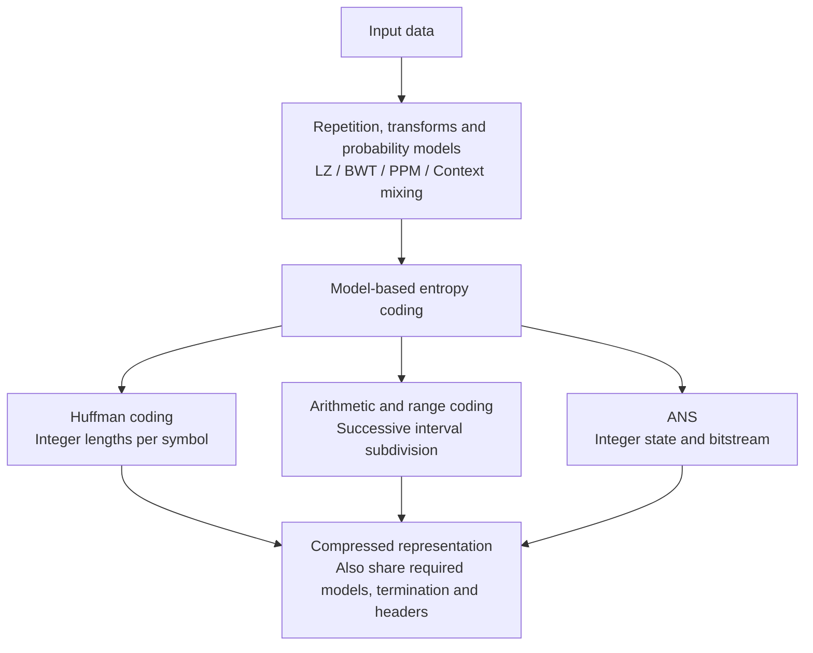
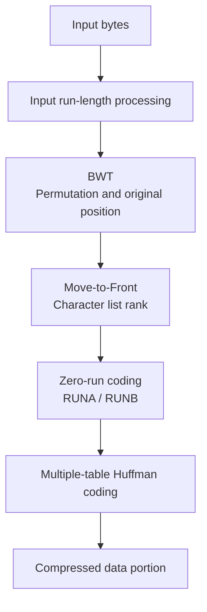

## 1. Why no compressor can shorten every file

Lossless compression replaces data with another representation from which the original bytes can be recovered without changing a single bit. Tools such as zip, gzip, zstd and xz can make some inputs smaller; other inputs barely change or grow because of headers. They do not shrink everything by the same proportion. Lossy compression, such as JPEG or MP3, permits differences in the reconstructed values and therefore has a different reconstruction requirement.

Let {0,1}* be the set of finite bitstrings, and fix an encoder E and decoder D. Losslessness requires the following for every input x.

$$
D(E(x))=x
$$

If different x and y had the same output, D could not recover both, so E must be injective. There are 2^n inputs of exactly n bits, but fewer outputs shorter than n bits, even including the empty string. Here n≥1.

$$
\left|\{0,1\}^{n}\right|=2^n>
\sum_{k=0}^{n-1}2^k=2^n-1
$$

Consequently, a fixed lossless compressor cannot shorten every n-bit input. An injective map on all finite strings also cannot shorten some inputs while keeping every other input no longer than before. If it shortened an n-bit x and expanded nothing, the inputs shorter than n would already occupy all outputs shorter than n. E(x) would collide with one of them.

More quantitatively, fix E, draw an n-bit X uniformly, and take an integer 1≤c≤n. The fraction shortened by at least c bits has this upper bound. This counts candidate outputs; the encoder need not actually use all of them.

$$
\Pr\!\left(|E(X)|\le n-c\right)
\le\frac{2^{n-c+1}-1}{2^n}
<2^{1-c}
$$

For c=11, this fraction is below 1/1024, approximately 0.0977%. It does not mean that no choice of compressor can shorten any of the remaining files. For a particular file x, a different encoder could swap x with the empty string: x becomes shorter and the empty string grows. The decoder must know that special rule. Statements about Kolmogorov complexity likewise distinguish a fixed description language from the description length of a decoding program.

Ordinary compression works by using representations suited to a distribution or repeated structure: biased characters, repeated substrings or patterns in numerical data. The gain depends on the input and method. Neither already-compressed files nor ciphertext can categorically be said never to shrink by a single byte. The cipher, mode, metadata and remaining structure affect the conditions.

Units matter too. One MiB is 1,048,576 bytes or 8,388,608 bits. One decimal MB is 1,000,000 bytes or 8,000,000 bits.

## 2. Shannon entropy and limits on expected code length

Shannon's 1948 paper separated semantic value from the engineering problem of communication and studied sources through probability. The introduction in this [reprint](https://wucj.lab.westlake.edu.cn/Others/shannon1948.pdf) also credits earlier work by Nyquist and Hartley.

For an event x of positive probability, define self-information as follows. Base-2 logarithms give units of bits. This measures neither psychological surprise nor the importance of the content itself.

$$
I(x)=-\log_2P(x),\qquad 0<P(x)\le1
$$

For a random variable X over a finite alphabet, let p_i=P(X=x_i). Shannon entropy is expected self-information, using the convention 0log₂0=0 for zero-probability terms.

$$
H(X)=-\sum_{i=1}^{m}p_i\log_2p_i,\qquad
p_i\ge0,\quad\sum_i p_i=1,\quad
0\le H(X)\le\log_2m
$$

The unit is bits per symbol. For a fixed alphabet of m symbols, the uniform distribution maximizes entropy; if one symbol has probability one, entropy is zero. A fair coin outcome has self-information one bit; an event of probability 1/256 has eight bits. These assess the symbol model; they do not directly determine the information in a correlated sequence or a lower bound for an individual file.

### Prefix codes and the Kraft–McMillan inequality

Assign each symbol a binary codeword so concatenations can be uniquely decoded. In a prefix code, no codeword is the beginning of another. For example, {0,10,110,111} parses 100110111 as 10 | 0 | 110 | 111. ASCII itself is a seven-bit character code; it is not synonymous with assigning eight bits to every character.

Represent codewords of lengths ℓ_i as leaves of a binary tree. In a complete tree of maximum depth ℓ_max, a leaf occupies 2^(ℓ_max−ℓ_i) potential positions below it. Counting these disjoint subtrees gives Kraft's inequality. The same inequality holds for uniquely decodable codes.

$$
\sum_i2^{\ell_{\max}-\ell_i}\le2^{\ell_{\max}}
\quad\Longrightarrow\quad
Z:=\sum_i2^{-\ell_i}\le1
$$

Conversely, positive integer lengths satisfying the inequality admit a prefix code. Below, consider the positive-probability support and assume it contains at least two symbols. Whether an empty code is allowed for a single-symbol source must be specified separately, together with how the count or termination is shared.

### The lower bound through KL divergence

Define expected code length and the normalized distribution Q induced by the lengths as follows.

$$
L=\sum_i p_i\ell_i,\qquad
q_i=\frac{2^{-\ell_i}}{Z},\qquad \sum_i q_i=1
$$

The nonnegativity of KL divergence yields this identity. Nonnegativity follows, for example, from the logarithmic inequality ln u≤u−1.

$$
\begin{aligned}
0\le D_{\mathrm{KL}}(P\|Q)
&=\sum_i p_i\log_2\frac{p_i}{q_i}\\
&=-H(X)+\sum_i p_i\ell_i+\log_2Z\\
&=L-H(X)+\log_2Z
\end{aligned}
$$

The resulting expected-length bound is:

$$
L=H(X)+D_{\mathrm{KL}}(P\|Q)-\log_2Z\ge H(X)
$$

Q divides 2^(-ℓ_i) by Z. Do not remove that normalization and also count the −log₂Z term. Equality requires P=Q and Z=1, giving p_i=2^(-ℓ_i): the probabilities match the binary code lengths.

An upper bound can also be constructed. These Shannon lengths satisfy Kraft's inequality.

$$
\ell_i=\lceil-\log_2p_i\rceil,\qquad
2^{-\ell_i}\le p_i,\qquad
\sum_i2^{-\ell_i}\le1
$$

Rounding up adds less than one bit per symbol, so this code has expected length below H+1. The optimal binary prefix code's expected length L_opt therefore lies in this range.

$$
H(X)\le L_{\mathrm{opt}}<H(X)+1
$$

For a nondegenerate source of independent, identically distributed symbols, grouping N symbols and choosing a suitable block prefix code gives the following, with L_N the expected length of the entire block.

$$
H(X)\le\frac{L_N}{N}<H(X)+\frac1N
$$

For dependent sequences, generally H(X_1,...,X_N)≠NH(X_1). If one fair bit is selected and repeated over a known length N, each position has marginal entropy one bit but the entire sequence has entropy one bit. For stationary finite-alphabet sources, use the entropy rate:

$$
\overline H=\lim_{N\to\infty}\frac{H(X_1,\ldots,X_N)}{N}
$$

These are statements about averages under specified distributions and code classes. They do not mean every file must be at least that long or that model and header costs may be ignored.

## 3. Huffman coding, arithmetic coding and ANS

Separating a statistical model from the coder that turns probabilities into bits helps explain each method. This is a conceptual diagram, not a specification requiring every format to separate into these stages.

### Huffman coding: optimal within which class?

[Huffman's 1952 paper](https://compression.ru/download/articles/huff/huffman_1952_minimum-redundancy-codes.pdf) constructs prefix codes minimizing expected length for given weights. In the binary case, repeatedly combine the two smallest-weight nodes and return their sum. A heap builds the tree in O(m log m) time for m symbols.

With at least two positive weights, an optimal tree can omit unnecessary one-child branches. The two least weights can be placed at deepest sibling leaves without increasing expected length. Combining them into a symbol z gives the following relation between the original tree T and the smaller tree T′.

$$
L(T)=L(T')+p_a+p_b
$$

The difference is fixed, so an optimal solution to the smaller problem constructs a solution to the original one. Equal weights may give multiple optimal trees. Canonical Huffman codes determine codewords from lengths and symbol order, simplifying transmission of the tree. They do not eliminate table-description costs or extra decoding steps for long codewords.

For P(0)=0.99 and P(1)=0.01, an optimal binary symbol-by-symbol prefix code uses one bit for each symbol.

$$
H(X)=-0.99\log_2(0.99)-0.01\log_2(0.01)
\approx0.080793,\qquad L_{\mathrm H}=1
$$

Its average length is about 12.4 times the entropy. That does not necessarily mean the original file cannot shrink: a representation initially using eight bits per symbol differs from an already bit-packed sequence. Blocks reduce rounding loss, but a tree explicitly covering every one of m^k combinations grows rapidly. The single-symbol empty-code convention remains a separate count-sharing question.

### Arithmetic coding: intervals and finite bitstrings

Arithmetic coding narrows an interval associated with the message. Let P(s) be a symbol's probability and A(s) the sum of probabilities of smaller symbols. Start with [lo_0,hi_0)=[0,1). Assume each encoded symbol has positive probability. With width W_(t−1)=hi_(t−1)−lo_(t−1), update as follows.

$$
\begin{aligned}
\mathrm{lo}_t&=\mathrm{lo}_{t-1}+W_{t-1}A(x_t),\\
\mathrm{hi}_t&=\mathrm{lo}_{t-1}+W_{t-1}\bigl(A(x_t)+P(x_t)\bigr)
\end{aligned}
$$

For a fixed independent model, the final width is the first product below. With dependencies, the same idea uses conditional probabilities that both sides can reproduce at each step.

$$
W_N=\prod_{t=1}^{N}P(x_t)
\quad\text{or}\quad
W_N=\prod_{t=1}^{N}P(x_t\mid x_{<t})
$$

Different messages of the same known length N map to disjoint intervals. Choose a dyadic interval [j2^(-K),(j+1)2^(-K)) wholly inside the final interval; its K bits identify that interval. A grid spacing no larger than half the width gives the following sufficient length with ideal infinite-precision arithmetic.

$$
K=\lceil-\log_2W_N\rceil+1<-\log_2W_N+2
$$

This bounds the ideal payload with a known model and length. It does not say the shortest K always equals the formula, nor that the entire file has only two bits of overhead. Models, termination, precision and headers have additional costs. Under the true block distribution P, the corresponding prefix representation has this expected-length bound.

$$
H(P)\le\mathbb E_P[K]<H(P)+2
$$

For P(0)=0.99, approximately 69 consecutive zeros halve the width. That is not a rule requiring exactly one bit to be emitted every 69 symbols: emission depends on the interval and renormalization. Integer implementations emit settled high bits or bytes and expand the state. Probability quantization, carry handling and pending bits also require work. Arithmetic and range coding do not have a universal speed ratio relative to other coders.

### ANS: accumulating information in an integer state

[Duda's ANS paper](https://arxiv.org/html/1311.2540v2) constructs numeral systems for symbols with unequal probabilities. Appending a digit s in ordinary base b is reversible as follows.

$$
x'=bx+s,\qquad s=x'\bmod b,\qquad x=\lfloor x'/b\rfloor
$$

For equal probabilities and a sufficiently large positive state x, the increase in logarithmic size is approximately log₂b. For general probabilities, the construction grows the state by roughly 1/P(s). Do not apply log₂x at x=0 or equate this approximation with exact integer code length.

One rANS construction uses M=2^R, positive integer symbol frequencies f_s and cumulative frequencies b_s.

$$
\sum_s f_s=M,\qquad b_s=\sum_{a<s}f_a,\qquad P(s)\approx f_s/M
$$

It maps nonnegative integer state x and symbol s to:

$$
C(x,s)=M\left\lfloor\frac{x}{f_s}\right\rfloor+(x\bmod f_s)+b_s
$$

The inverse selects a symbol using slot and recovers the old state.

$$
\begin{aligned}
\mathrm{slot}&=x'\bmod M,\\
b_s&\le\mathrm{slot}<b_s+f_s,\\
x&=f_s\left\lfloor\frac{x'}M\right\rfloor+\mathrm{slot}-b_s
\end{aligned}
$$

When M is a power of two, its quotient and remainder can be computed with shifts and masks. Symbol lookup, table accesses, renormalization and I/O still count. This bijection alone guarantees neither zero coding loss nor one-clock-cycle decoding.

tANS uses finitely many states and transition tables. For a bit-based explanation, for example, use this integer set. It corresponds to the half-open interval [L,2L), not [L,2L−1).

$$
\mathcal I=\{L,L+1,\ldots,2L-1\},\qquad |\mathcal I|=L
$$

Bits are transferred between the accumulated state and the stream to stay in the permitted range. The normalization conditions and symbol placement must fit together; simply substituting a small table for the rANS formulas is insufficient. FSE is a tANS-family implementation.

ANS state operations behave as a stack: the last symbol added is recovered first. Encoding blocks in reverse order can make decoding proceed in the original order. With contextual probabilities, the order for computing those probabilities must also be reconciled with reverse encoding. Huffman, arithmetic coding and ANS are choices for different models, formats and implementations, rather than three generations in which each universally replaces its predecessor.

## 4. What LZ, BWT and contextual models change

A model using only individual byte frequencies cannot fully exploit long repetitions and dependencies. Instead of assigning English one universal number of bits, specify the corpus and whether the units are characters, bytes or tokens.

### Dictionary compression: LZ77, LZ78 and LZW

LZ77-family schemes refer backward into already produced data. If the 16-byte ASCII string `std::vector<int>` appeared 200 bytes earlier and matches again, it can be represented by this distance and length. Whether this costs less than 16 literal bytes depends on how the format encodes those numbers.

$$
(d,\ell)=(200,16)
$$

Likewise, an 18-byte `content/post/index` occurring 412 bytes earlier can be represented by distance 412 and length 18 when it matches again.

A match can be longer than its distance. After a literal A, a distance-1, length-99 reference reuses newly copied As as sources and produces 100 As in total. The [DEFLATE specification](https://www.rfc-editor.org/rfc/rfc1951.txt) also gives an overlapping-reference example. Applying generic memcpy to overlapping regions, or copying only a snapshot of the original source, does not correctly describe this expansion. Implementations must handle growing output while checking distances, output limits and input lengths.

LZSS distinguishes literals and matches using flags or another representation. Flags also cost space, so unmatched data is not guaranteed never to expand. LZ78/LZW instead register encountered strings in an explicit dictionary and use indices. Growth, resets, reference scope and integer coding differ; neither approach must win on every input.

Actual formats differ too. DEFLATE compressed blocks use distances 1–32,768 and lengths 3–258, with separate Huffman coding for literals/lengths and distances. Uncompressed blocks also exist. The [Zstandard specification](https://www.rfc-editor.org/rfc/rfc8878.html) separates literals from sequences, using raw/RLE/Huffman literals and modes including FSE for sequences. One or four Huffman streams are distinct from the three kinds of sequence FSE state. LZMA/LZMA2 also combine dictionaries with probability models; the [LZMA encoder](https://github.com/ip7z/7zip/blob/main/C/LzmaEnc.c) exposes match-finding and range-coding operations. One algorithm name should not stand in for every format, tool or compression level.

### BWT: a length-preserving permutation and its inverse

The Burrows–Wheeler transform brings characters with the same following context together. Its last column preserves symbol count, but the position or sentinel information needed for inversion also has a cost.

Consider `banana$`, with a unique sentinel `$` ordered before the other characters. Sort its seven cyclic shifts and extract the last column and original row number.

| Row | Lexicographically sorted rotation | First | Last |
| :--- | :--- | :---: | :---: |
| 0 | `$banana` | `$` | a |
| 1 | `a$banan` | a | n |
| 2 | `ana$ban` | a | n |
| 3 | `anana$b` | a | b |
| 4 | `banana$` | b | `$` |
| 5 | `na$bana` | n | a |
| 6 | `nana$ba` | n | a |

The output is `annb$aa` and the zero-based original row is 4. If L is the last column and F the first, sorting L's characters obtains F. Matching equal-character occurrences in order gives LF mapping, which follows the original sequence backward. With zero-based positions, let C(c) count characters smaller than c and rank_c(i) count occurrences of c before position i in L.

$$
\mathrm{LF}(i)=C(L_i)+\mathrm{rank}_{L_i}(i)
$$

For a small fixed alphabet, frequencies and occurrence ranks can be built in linear time, and an N-symbol sequence inverted in O(N). If general comparison sorting is used, count that cost separately. BWT does not turn every input into long runs.

The [bzip2 1.0.8 manual](https://sourceware.org/bzip2/manual/manual.html) and [that version's source](https://sourceware.org/pub/bzip2/bzip2-1.0.8.tar.gz) combine RLE before BWT with MTF, zero-run coding and multiple Huffman tables. MTF outputs a character's current list rank and moves it to the front. Repeated characters yield zeros, encoded through RUNA/RUNB. This diagram shows the main data transformations, omitting headers, indices and CRCs.

### Context models and LLMs: code length and prediction loss

PPM uses contexts of different lengths and handles unobserved symbols through mechanisms such as escapes. Context mixing combines predictions from several models. Neural models can also provide predictions; Transformers are not synonymous with recurrent networks.

For a sequence to which model Q_θ assigns positive conditional probabilities, ideal information is as follows. It is not equated with the actual output length.

$$
I_\theta(x_{1:N})=-\log_2 Q_\theta(x_{1:N})
=\sum_{t=1}^{N}-\log_2Q_\theta(x_t\mid x_{<t})
$$

For this sequence's average negative log-likelihood using natural logarithms, the base and averaging factors give:

$$
\mathcal L_{\mathrm{NLL}}(\theta)
=-\frac1N\sum_{t=1}^{N}\ln Q_\theta(x_t\mid x_{<t})
=\frac{\ln2}{N}I_\theta(x_{1:N})
$$

Thus, under the same data, units and model conditions, reducing this loss corresponds to reducing ideal code length. The expression does not include the shared model's size, reversible tokenization, finite precision, termination, headers or decoding time. A prediction's information below one bit does not mean its word can be stored alone as a fractional-bit file.

[Language Modeling Is Compression](https://arxiv.org/html/2309.10668v2) investigates this connection experimentally. Its image/audio comparisons use processed datasets and specified context lengths, and distinguish rates excluding model weights from rates including them. Do not extend those results to all images, audio or arbitrary files. Compression challenges such as the Hutter Prize encourage prediction research, but the coding equations alone do not prove sufficient conditions for intelligence or understanding.

## 5. Comparing compression ratio, speed and memory

Practical evaluation combines compressed size, encoding time, decoding time, memory, compatibility and access granularity. Define compressed size as a fraction of original size, so smaller is better. Numbers from differently configured benchmarks do not form a universal ranking.

| Method or tool | Architectural features | What to check when comparing |
| :--- | :--- | :--- |
| LZ4 | Byte-oriented LZ77-type representation, no entropy coding inside the block | Framing cost for small inputs, decoding speed, required buffers |
| Zstandard | Match finding, literals and sequences, Huffman/FSE and other modes | Level, dictionary, window, modes and memory on both sides |
| DEFLATE / gzip | Backward references and Huffman; uncompressed blocks are possible | Format versus tool, compatibility, block and wrapper overhead |
| BWT / bzip2 | Block transform, MTF, runs and Huffman | Block size, reconstruction workspace and index |
| LZMA/LZMA2 / xz and 7-Zip | Dictionary matching and adaptive probabilistic coding | Format and settings, dictionary size, search time, decoder limits |
| PPM, context mixing and neural prediction | Context-derived probabilities followed by coding | Model sharing/transmission, context length, compute and reproducible precision |

The [LZ4 block specification](https://github.com/lz4/lz4/blob/dev/doc/lz4_Block_format.md) treats framing separately; the [7-Zip format description](https://www.7-zip.org/7z.html) distinguishes several methods. Understanding architectural features and measuring your workload are both necessary.

Record the implementation and version, command and level, CPU and threads, input hashes and sizes, dictionary, cache and I/O conditions. With total input bytes U, total compressed bytes C and elapsed time, calculate C/U and throughput. Treat empty input separately from the size ratio. Count buffers and models as well as dictionaries when measuring memory. Verify that the decompressed bytes hash to the original. No new throughput measurement is claimed here.

### Encoding/decoding work and I/O

For LZ-family formats, decoding may be lighter than encoder search and parsing. Nevertheless, compression level and the emitted commands can change decoding speed within the same format. Higher levels do not guarantee exactly the same decoding speed. Predictive-model decoders must reproduce probabilities, but an encoder may batch probability calculations, so their times are not necessarily identical either.

In a simple read model, let I/O speed be v_io and decoding speed, measured in original bytes, be v_dec. Without overlapping CPU work and I/O, approximate times are:

$$
T_{\mathrm{raw}}\approx\frac{U}{v_{\mathrm{io}}},\qquad
T_{\mathrm{compressed}}\approx\frac{C}{v_{\mathrm{io}}}
+\frac{U}{v_{\mathrm{dec}}}
$$

This compares saved I/O against decoding cost. With independent resources and effective pipelining, the steady-state time may approach the larger term instead of their sum. Startup, memory bandwidth, parallelism and access granularity may require a different model.

Branches, dependencies, cache, SIMD and instruction-level parallelism influence speed. Their presence alone does not set a universal MB/s ceiling, and separating streams does not guarantee zero branch mispredictions. A software bundle compressed once and decoded by many readers has different priorities from frequently updated logs.

## 6. Which limits and costs are being counted?

The pigeonhole principle shows that a fixed lossless encoder cannot shorten every input. Entropy lower bounds concern average length under specified probability models and coding conditions. Huffman, arithmetic coding and ANS connect probabilities to representations in different ways; LZ, BWT and contextual models exploit repetition and dependencies.

Prediction loss and ideal code length are connected, which helps explain compression with neural models. Distinguish that connection from total file cost, processing speed or a proof of intelligence. Specifying what is shared, what is transmitted and which inputs were measured connects theory to practical decisions.
