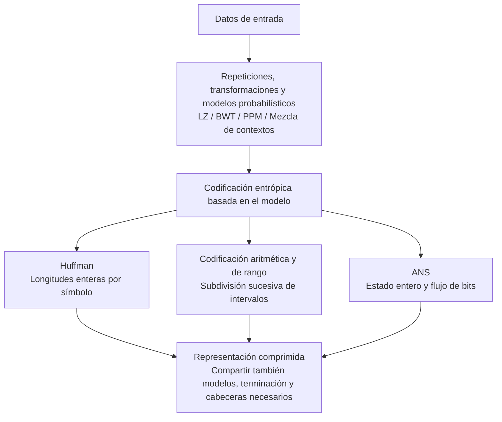
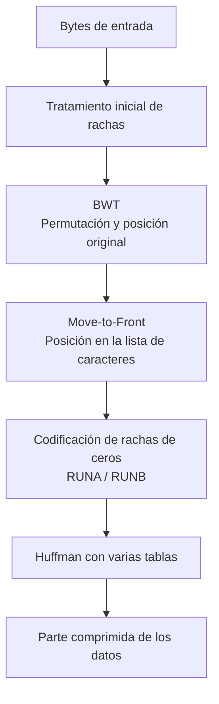

## 1. Por qué ningún compresor puede acortar todos los archivos

La compresión sin pérdida sustituye los datos por una representación que permite recuperar los bytes originales sin cambiar un solo bit. Herramientas como zip, gzip, zstd y xz reducen algunas entradas; otras apenas cambian o aumentan por las cabeceras. No reducen todos los datos en la misma proporción. La compresión con pérdida, como JPEG o MP3, permite diferencias en los valores reconstruidos y tiene otro requisito de reconstrucción.

Sea {0,1}* el conjunto de cadenas binarias finitas. Fijemos un codificador E y un decodificador D. Para toda entrada x, la ausencia de pérdida exige:

$$
D(E(x))=x
$$

Si dos entradas distintas tuvieran la misma salida, D no podría recuperar ambas: E debe ser inyectiva. Hay 2^n entradas de exactamente n bits y menos salidas de longitud inferior a n, incluso contando la cadena vacía. Aquí n≥1.

$$
\left|\{0,1\}^{n}\right|=2^n>
\sum_{k=0}^{n-1}2^k=2^n-1
$$

Por tanto, un compresor sin pérdida fijo no puede acortar todas las entradas de n bits. Una aplicación inyectiva sobre todas las cadenas finitas tampoco puede acortar algunas sin alargar ninguna otra. Si acortara una entrada x de n bits y no alargara ninguna, las entradas de menos de n bits ya ocuparían todas las salidas de menos de n bits; E(x) coincidiría con una de ellas.

Para cuantificarlo, fijemos E y elijamos uniformemente una cadena X de n bits. Para un entero 1≤c≤n, la fracción que se acorta al menos c bits está acotada así. Contamos salidas posibles; el codificador no tiene por qué utilizarlas todas.

$$
\Pr\!\left(|E(X)|\le n-c\right)
\le\frac{2^{n-c+1}-1}{2^n}
<2^{1-c}
$$

Para c=11, la fracción es menor que 1/1024, aproximadamente el 0,0977 %. Esto no significa que ningún compresor distinto pueda acortar cualquiera de los archivos restantes. Para un archivo particular x, otro codificador podría intercambiar x y la cadena vacía: x se acorta y la cadena vacía se alarga. El decodificador necesita conocer esa regla especial. Al hablar de complejidad de Kolmogórov también hay que distinguir un lenguaje de descripción fijo de la longitud de la descripción de un programa decodificador.

Los compresores habituales aprovechan representaciones adecuadas para una distribución o una estructura repetida: frecuencias desiguales de caracteres, subcadenas repetidas o patrones numéricos. La ganancia depende de la entrada y del método. No puede afirmarse de forma categórica que ningún archivo ya comprimido o texto cifrado pueda reducirse ni un byte: importan el cifrado, su modo, los metadatos y la estructura restante.

También importan las unidades. Un MiB equivale a 1.048.576 bytes, es decir, 8.388.608 bits. Un MB decimal equivale a 1.000.000 de bytes u 8.000.000 de bits.

## 2. Entropía de Shannon y límites de la longitud media

El artículo de Shannon de 1948 separó el valor semántico del problema técnico de comunicar y estudió las fuentes mediante probabilidades. La introducción de esta [reedición](https://wucj.lab.westlake.edu.cn/Others/shannon1948.pdf) reconoce también los trabajos anteriores de Nyquist y Hartley.

Para un suceso x de probabilidad positiva, la autoinformación se define como sigue. El logaritmo en base dos da unidades de bits. No mide la sorpresa psicológica ni la importancia del contenido.

$$
I(x)=-\log_2P(x),\qquad 0<P(x)\le1
$$

Para una variable aleatoria X sobre un alfabeto finito, sea p_i=P(X=x_i). La entropía de Shannon es la autoinformación esperada, con la convención 0log₂0=0 para los términos de probabilidad cero.

$$
H(X)=-\sum_{i=1}^{m}p_i\log_2p_i,\qquad
p_i\ge0,\quad\sum_i p_i=1,\quad
0\le H(X)\le\log_2m
$$

La unidad es bits por símbolo. Con un alfabeto fijo de m símbolos, la distribución uniforme maximiza la entropía; si un símbolo tiene probabilidad uno, la entropía es cero. Un resultado de una moneda equilibrada tiene un bit de autoinformación; un suceso de probabilidad 1/256 tiene ocho. Estos valores describen el modelo de símbolos, pero no determinan directamente la información de una secuencia correlacionada ni una cota inferior para cada archivo.

### Códigos prefijo y desigualdad de Kraft–McMillan

Asignemos una palabra binaria a cada símbolo de modo que las concatenaciones puedan decodificarse de manera única. En un código prefijo, ninguna palabra es el comienzo de otra. Por ejemplo, {0,10,110,111} permite analizar 100110111 como 10 | 0 | 110 | 111. ASCII es un código de caracteres de siete bits; no equivale a asignar ocho bits a todo carácter.

Representemos las palabras de longitud ℓ_i como hojas de un árbol binario. En un árbol completo de profundidad máxima ℓ_max, una hoja ocupa 2^(ℓ_max−ℓ_i) posiciones potenciales bajo ella. Contar estos subárboles disjuntos da la desigualdad de Kraft. La misma desigualdad se cumple para los códigos unívocamente decodificables.

$$
\sum_i2^{\ell_{\max}-\ell_i}\le2^{\ell_{\max}}
\quad\Longrightarrow\quad
Z:=\sum_i2^{-\ell_i}\le1
$$

Recíprocamente, unas longitudes enteras positivas que satisfacen la desigualdad admiten un código prefijo. En lo que sigue consideramos los símbolos de probabilidad positiva y suponemos que hay al menos dos. Si la fuente tiene un solo símbolo, debe especificarse por separado si se permite una palabra vacía y cómo se comparte el número de símbolos o la terminación.

### La cota inferior mediante divergencia KL

Definamos la longitud media del código y la distribución normalizada Q inducida por sus longitudes:

$$
L=\sum_i p_i\ell_i,\qquad
q_i=\frac{2^{-\ell_i}}{Z},\qquad \sum_i q_i=1
$$

La no negatividad de la divergencia de Kullback–Leibler da esta identidad. Puede demostrarse, por ejemplo, con la desigualdad logarítmica ln u≤u−1.

$$
\begin{aligned}
0\le D_{\mathrm{KL}}(P\|Q)
&=\sum_i p_i\log_2\frac{p_i}{q_i}\\
&=-H(X)+\sum_i p_i\ell_i+\log_2Z\\
&=L-H(X)+\log_2Z
\end{aligned}
$$

Se obtiene la cota para la longitud media:

$$
L=H(X)+D_{\mathrm{KL}}(P\|Q)-\log_2Z\ge H(X)
$$

Q divide 2^(-ℓ_i) entre Z. No se debe omitir esa normalización y contabilizar además el término −log₂Z. La igualdad requiere P=Q y Z=1, de donde p_i=2^(-ℓ_i): las probabilidades corresponden a las longitudes binarias.

También podemos construir una cota superior. Las siguientes longitudes de Shannon satisfacen la desigualdad de Kraft:

$$
\ell_i=\lceil-\log_2p_i\rceil,\qquad
2^{-\ell_i}\le p_i,\qquad
\sum_i2^{-\ell_i}\le1
$$

Redondear hacia arriba añade menos de un bit por símbolo, por lo que este código tiene longitud media menor que H+1. La longitud media L_opt del código prefijo binario óptimo queda, por tanto, en este intervalo:

$$
H(X)\le L_{\mathrm{opt}}<H(X)+1
$$

Para una fuente no degenerada de símbolos independientes e idénticamente distribuidos, agrupar N símbolos y elegir un código prefijo de bloques adecuado da la siguiente relación. L_N es la longitud media de todo el bloque.

$$
H(X)\le\frac{L_N}{N}<H(X)+\frac1N
$$

Con dependencias, en general H(X_1,...,X_N)≠NH(X_1). Si elegimos un bit equiprobable y lo repetimos N veces, siendo N conocido, cada posición tiene entropía marginal de un bit, pero toda la secuencia tiene entropía de un bit. Para fuentes estacionarias de alfabeto finito se usa la tasa de entropía:

$$
\overline H=\lim_{N\to\infty}\frac{H(X_1,\ldots,X_N)}{N}
$$

Son afirmaciones sobre promedios bajo distribuciones y clases de códigos especificadas. No dicen que cada archivo deba tener esa longitud mínima ni que se puedan ignorar modelos y cabeceras.

## 3. Huffman, codificación aritmética y ANS

Separar el modelo estadístico del codificador que convierte probabilidades en bits ayuda a entender cada método. Este diagrama es conceptual: no exige que todo formato se divida en etapas independientes.

### Huffman: ¿óptimo dentro de qué clase?

El [artículo de Huffman de 1952](https://compression.ru/download/articles/huff/huffman_1952_minimum-redundancy-codes.pdf) construye códigos prefijo que minimizan la longitud media para unos pesos dados. En el caso binario, se combinan repetidamente los dos nodos de menor peso y se reinserta su suma. Un montículo permite construir el árbol en O(m log m) para m símbolos.

Con al menos dos pesos positivos, un árbol óptimo puede prescindir de ramas innecesarias con un solo hijo. Los dos pesos mínimos pueden situarse en hojas hermanas de profundidad máxima sin aumentar la longitud media. Al fusionarlos en un símbolo z, el árbol original T y el reducido T′ cumplen:

$$
L(T)=L(T')+p_a+p_b
$$

La diferencia es fija: una solución óptima del problema reducido permite construir una solución del original. Los empates pueden producir varios árboles óptimos. Los códigos Huffman canónicos determinan las palabras a partir de sus longitudes y del orden de los símbolos, simplificando la transmisión del árbol. No eliminan el coste de describir las tablas ni los pasos adicionales para palabras largas.

Para P(0)=0,99 y P(1)=0,01, un código prefijo binario óptimo símbolo a símbolo usa un bit para cada símbolo.

$$
H(X)=-0.99\log_2(0.99)-0.01\log_2(0.01)
\approx0.080793,\qquad L_{\mathrm H}=1
$$

Su longitud media es unas 12,4 veces la entropía. Esto no implica que el archivo original no pueda reducirse: partir de ocho bits por símbolo es distinto de partir de una secuencia ya empaquetada bit a bit. Los bloques reducen la pérdida por redondeo, pero un árbol que represente explícitamente las m^k combinaciones crece rápidamente. La convención de palabra vacía para un solo símbolo sigue requiriendo acordar cómo se conoce su cantidad.

### Codificación aritmética: intervalos y cadenas finitas

La codificación aritmética estrecha un intervalo asociado al mensaje. Sean P(s) la probabilidad del símbolo y A(s) la suma de probabilidades de los símbolos anteriores en un orden convenido. Se parte de [lo_0,hi_0)=[0,1). Supongamos que cada símbolo codificado tiene probabilidad positiva. Para la anchura W_(t−1)=hi_(t−1)−lo_(t−1), la actualización es:

$$
\begin{aligned}
\mathrm{lo}_t&=\mathrm{lo}_{t-1}+W_{t-1}A(x_t),\\
\mathrm{hi}_t&=\mathrm{lo}_{t-1}+W_{t-1}\bigl(A(x_t)+P(x_t)\bigr)
\end{aligned}
$$

Con un modelo independiente fijo, la anchura final es el primer producto siguiente. Con dependencias, se usan probabilidades condicionales que ambas partes puedan reproducir en cada paso.

$$
W_N=\prod_{t=1}^{N}P(x_t)
\quad\text{or}\quad
W_N=\prod_{t=1}^{N}P(x_t\mid x_{<t})
$$

Los mensajes distintos de la misma longitud conocida N corresponden a intervalos disjuntos. Elijamos un intervalo diádico [j2^(-K),(j+1)2^(-K)) contenido por completo en el intervalo final; sus K bits lo identifican. Una cuadrícula con separación no mayor que la mitad de la anchura garantiza esta longitud suficiente con aritmética ideal de precisión infinita:

$$
K=\lceil-\log_2W_N\rceil+1<-\log_2W_N+2
$$

Esta cota corresponde a la carga útil ideal con modelo y longitud conocidos. No afirma que el menor K sea siempre el de la fórmula ni que todo el archivo tenga solo dos bits de sobrecoste. Modelos, terminación, precisión y cabeceras añaden costes. Bajo la distribución verdadera P de los bloques, la representación prefijo correspondiente satisface:

$$
H(P)\le\mathbb E_P[K]<H(P)+2
$$

Para P(0)=0,99, unos 69 ceros consecutivos reducen la anchura a la mitad. No es una regla que obligue a emitir exactamente un bit cada 69 símbolos: la emisión depende del intervalo y de la renormalización. Las implementaciones enteras emiten bits o bytes altos ya determinados y expanden el estado. La cuantización de probabilidades, los acarreos y los bits pendientes también requieren trabajo. La codificación aritmética o de rango no tiene una relación universal de velocidad frente a otros métodos.

### ANS: acumular información en un estado entero

El [artículo de Duda sobre ANS](https://arxiv.org/html/1311.2540v2) construye sistemas de numeración para símbolos con probabilidades desiguales. Añadir un dígito s en base b es reversible de este modo:

$$
x'=bx+s,\qquad s=x'\bmod b,\qquad x=\lfloor x'/b\rfloor
$$

Con probabilidades iguales y un estado positivo x suficientemente grande, el incremento de tamaño logarítmico es aproximadamente log₂b. Para probabilidades generales, la construcción multiplica aproximadamente el estado por 1/P(s). No se debe aplicar log₂x en x=0 ni identificar esta aproximación con una longitud entera exacta.

Una construcción rANS usa M=2^R, frecuencias enteras positivas f_s y frecuencias acumuladas b_s.

$$
\sum_s f_s=M,\qquad b_s=\sum_{a<s}f_a,\qquad P(s)\approx f_s/M
$$

Transforma un estado entero no negativo x y un símbolo s mediante:

$$
C(x,s)=M\left\lfloor\frac{x}{f_s}\right\rfloor+(x\bmod f_s)+b_s
$$

La inversa selecciona el símbolo mediante slot y recupera el estado anterior:

$$
\begin{aligned}
\mathrm{slot}&=x'\bmod M,\\
b_s&\le\mathrm{slot}<b_s+f_s,\\
x&=f_s\left\lfloor\frac{x'}M\right\rfloor+\mathrm{slot}-b_s
\end{aligned}
$$

Si M es potencia de dos, el cociente y el resto se calculan con desplazamientos y máscaras. También cuentan la búsqueda del símbolo, los accesos a tablas, la renormalización y la entrada/salida. Esta biyección por sí sola no garantiza pérdida de codificación nula ni decodificación en un ciclo de reloj.

tANS usa un número finito de estados y tablas de transición. Para una explicación basada en bits, puede usarse, por ejemplo, este conjunto de enteros. Corresponde al intervalo semiabierto [L,2L), no a [L,2L−1).

$$
\mathcal I=\{L,L+1,\ldots,2L-1\},\qquad |\mathcal I|=L
$$

Se transfieren bits entre el estado acumulado y el flujo para mantener el rango permitido. Las condiciones de normalización y la asignación de símbolos deben ser compatibles; no basta con sustituir las fórmulas rANS por una tabla pequeña. FSE es una implementación de la familia tANS.

Las operaciones de estado ANS se comportan como una pila: el último símbolo añadido se recupera primero. Codificar bloques en orden inverso puede permitir decodificarlos en el orden original. Con probabilidades contextuales, también hay que conciliar el orden de cálculo de esas probabilidades con el de codificación inversa. Huffman, codificación aritmética y ANS son opciones para distintos modelos, formatos e implementaciones, no tres generaciones donde cada una sustituya universalmente a la anterior.

## 4. Qué cambian LZ, BWT y los modelos contextuales

Un modelo basado solo en las frecuencias individuales de bytes no aprovecha por completo las repeticiones largas ni las dependencias. En vez de atribuir al inglés una cifra universal de bits, hay que especificar el corpus y si las unidades son caracteres, bytes o tokens.

### Diccionarios: LZ77, LZ78 y LZW

Los métodos de la familia LZ77 hacen referencias hacia atrás a datos ya producidos. Si la cadena ASCII de 16 bytes `std::vector<int>` apareció 200 bytes antes y vuelve a coincidir, puede representarse por esta distancia y longitud. Que cueste menos que 16 bytes literales depende de cómo el formato codifique ambos números.

$$
(d,\ell)=(200,16)
$$

Una coincidencia puede ser más larga que su distancia. Después de una A literal, una referencia de distancia 1 y longitud 99 reutiliza las nuevas A copiadas como origen y produce 100 A en total. La [especificación DEFLATE](https://www.rfc-editor.org/rfc/rfc1951.txt) también da un ejemplo con solapamiento. Aplicar un memcpy genérico a regiones solapadas o copiar solo una instantánea del origen inicial no describe correctamente esta expansión. La implementación debe tratar la salida creciente y comprobar distancias, límites de salida y longitudes de entrada.

LZSS distingue literales y coincidencias mediante indicadores u otra representación. Los indicadores ocupan espacio: no se garantiza que los datos sin coincidencias nunca aumenten. LZ78/LZW registran cadenas encontradas en un diccionario explícito y usan índices. Difieren el crecimiento, los reinicios, el alcance de referencias y la codificación de enteros; ningún método tiene que ganar con todas las entradas.

Los formatos concretos también difieren. Los bloques comprimidos DEFLATE usan distancias de 1 a 32.768 y longitudes de 3 a 258, con códigos Huffman separados para literales/longitudes y distancias. También existen bloques sin comprimir. La [especificación Zstandard](https://www.rfc-editor.org/rfc/rfc8878.html) separa literales y secuencias: para los literales admite modos sin comprimir, RLE o Huffman; para las secuencias, modos que incluyen FSE. Uno o cuatro flujos Huffman son distintos de los tres tipos de estado FSE de secuencia. LZMA/LZMA2 combinan diccionarios y modelos probabilísticos; el [codificador LZMA](https://github.com/ip7z/7zip/blob/main/C/LzmaEnc.c) muestra operaciones de búsqueda de coincidencias y codificación de rango. El nombre de un algoritmo no representa por sí solo todos los formatos, herramientas o niveles.

### BWT: permutación que conserva la longitud e inversión

La transformada de Burrows–Wheeler agrupa caracteres con el mismo contexto posterior. Su última columna conserva el número de símbolos, pero también cuesta representar la posición o el centinela necesarios para invertirla.

Consideremos `banana$`, con un centinela único `$` que precede a los demás caracteres en el orden elegido. Ordenamos sus siete rotaciones cíclicas y extraemos la última columna y el número de la fila original.

| Fila | Rotación en orden lexicográfico | Primero | Último |
| :--- | :--- | :---: | :---: |
| 0 | `$banana` | `$` | a |
| 1 | `a$banan` | a | n |
| 2 | `ana$ban` | a | n |
| 3 | `anana$b` | a | b |
| 4 | `banana$` | b | `$` |
| 5 | `na$bana` | n | a |
| 6 | `nana$ba` | n | a |

La salida es `annb$aa` y la fila original, numerada desde cero, es la 4. Si L es la última columna y F la primera, ordenar los caracteres de L produce F. Emparejar por orden las apariciones del mismo carácter da la correspondencia LF, que recorre la secuencia original hacia atrás. Con posiciones desde cero, C(c) cuenta los caracteres menores que c y rank_c(i) cuenta las apariciones de c en L anteriores a la posición i.

$$
\mathrm{LF}(i)=C(L_i)+\mathrm{rank}_{L_i}(i)
$$

Para un alfabeto pequeño y fijo, las frecuencias y los rangos de aparición se construyen en tiempo lineal; una secuencia de N símbolos se invierte en O(N). Si se usa ordenación general por comparaciones, su coste debe contarse aparte. BWT no convierte cualquier entrada en rachas largas.

El [manual de bzip2 1.0.8](https://sourceware.org/bzip2/manual/manual.html) y el [código de esa versión](https://sourceware.org/pub/bzip2/bzip2-1.0.8.tar.gz) combinan RLE anterior a BWT, MTF, codificación de rachas de ceros y varias tablas Huffman. MTF emite la posición actual del carácter en una lista y lo mueve al principio. Las repeticiones producen ceros, codificados mediante RUNA/RUNB. Este diagrama muestra las principales transformaciones; omite cabeceras, índices y CRC.

### Modelos contextuales y LLM: longitud de código y pérdida predictiva

PPM usa contextos de diferentes longitudes y trata los símbolos no observados mediante mecanismos como escapes. La mezcla de contextos combina predicciones de varios modelos. Las redes neuronales también pueden predecir; Transformer no es sinónimo de red recurrente.

Para una secuencia a la que el modelo Q_θ asigna probabilidades condicionales positivas, la información ideal es la siguiente. No se identifica con la longitud real de salida.

$$
I_\theta(x_{1:N})=-\log_2 Q_\theta(x_{1:N})
=\sum_{t=1}^{N}-\log_2Q_\theta(x_t\mid x_{<t})
$$

La pérdida media de log-verosimilitud negativa de esta secuencia, usando logaritmos naturales, incorpora estos factores de base y promedio:

$$
\mathcal L_{\mathrm{NLL}}(\theta)
=-\frac1N\sum_{t=1}^{N}\ln Q_\theta(x_t\mid x_{<t})
=\frac{\ln2}{N}I_\theta(x_{1:N})
$$

Así, con los mismos datos, unidades y condiciones del modelo, reducir esa pérdida corresponde a reducir la longitud ideal. La expresión no incluye el tamaño del modelo compartido, la tokenización reversible, la precisión finita, la terminación, las cabeceras ni el tiempo de decodificación. Que la información de una predicción sea menor que un bit no permite guardar su palabra por separado en un archivo de una fracción de bit.

[Language Modeling Is Compression](https://arxiv.org/html/2309.10668v2) estudia esta conexión experimentalmente. Sus comparaciones de imágenes y audio usan datos procesados y longitudes de contexto específicas, y distinguen tasas que excluyen los pesos del modelo de tasas que los incluyen. No deben extenderse a todas las imágenes, al audio en general ni a archivos arbitrarios. Retos como el Hutter Prize fomentan la investigación predictiva, pero las ecuaciones de codificación no prueban por sí solas condiciones suficientes para la inteligencia o la comprensión.

## 5. Comparar tamaño, velocidad y memoria

La evaluación práctica reúne tamaño comprimido, tiempos de codificación y decodificación, memoria, compatibilidad y granularidad de acceso. Definamos la fracción comprimida como tamaño comprimido dividido por tamaño original: cuanto menor, mejor. Cifras de pruebas con configuraciones diferentes no forman una clasificación universal.

| Método o herramienta | Arquitectura | Qué comprobar al comparar |
| :--- | :--- | :--- |
| LZ4 | Representación de tipo LZ77 orientada a bytes, sin codificación entrópica dentro del bloque | Coste del formato contenedor para entradas pequeñas, velocidad de decodificación y búferes |
| Zstandard | Búsqueda de coincidencias, literales y secuencias, Huffman/FSE y otros modos | Nivel, diccionario, ventana, modos y memoria en ambos extremos |
| DEFLATE / gzip | Referencias hacia atrás y Huffman; admite bloques sin comprimir | Formato frente a herramienta, compatibilidad y costes de bloques y envoltura |
| BWT / bzip2 | Transformación por bloques, MTF, rachas y Huffman | Tamaño de bloque, espacio de reconstrucción e índice |
| LZMA/LZMA2 / xz y 7-Zip | Coincidencias de diccionario y codificación probabilística adaptativa | Formato, opciones, diccionario, tiempo de búsqueda y límites del decodificador |
| PPM, mezcla de contextos y predicción neuronal | Probabilidades contextuales seguidas de codificación | Modelo compartido o transmitido, contexto, cálculo y precisión reproducible |

La [especificación de bloques LZ4](https://github.com/lz4/lz4/blob/dev/doc/lz4_Block_format.md) trata la envoltura por separado; la [descripción del formato 7-Zip](https://www.7-zip.org/7z.html) distingue varios métodos. Es necesario tanto conocer la arquitectura como medir la carga de trabajo propia.

Registre implementación y versión, comando y nivel, CPU e hilos, hashes y tamaños de entrada, diccionario y condiciones de caché y entrada/salida. Con U bytes originales totales, C bytes comprimidos totales y el tiempo transcurrido, calcule C/U y la tasa de procesamiento. Trate aparte la entrada vacía al calcular la fracción de tamaños. Al medir memoria, cuente búferes y modelos además de diccionarios. Compruebe que el hash de los bytes descomprimidos coincide con el original. Aquí no se presenta una medición nueva de velocidad.

### Trabajo de codificación/decodificación y entrada/salida

En la familia LZ, decodificar puede costar menos que buscar coincidencias y elegir la representación al codificar. Sin embargo, el nivel y las instrucciones emitidas pueden cambiar la velocidad de decodificación dentro de un mismo formato. Un nivel mayor no garantiza una velocidad de decodificación idéntica. Los decodificadores predictivos deben reproducir las probabilidades, pero el codificador puede calcularlas por lotes: sus tiempos tampoco tienen por qué coincidir.

En un modelo sencillo de lectura, sean v_io la velocidad de entrada/salida y v_dec la velocidad de decodificación medida en bytes originales. Sin solapar el trabajo de CPU con la entrada/salida, los tiempos aproximados son:

$$
T_{\mathrm{raw}}\approx\frac{U}{v_{\mathrm{io}}},\qquad
T_{\mathrm{compressed}}\approx\frac{C}{v_{\mathrm{io}}}
+\frac{U}{v_{\mathrm{dec}}}
$$

Se compara el ahorro de entrada/salida con el coste de decodificar. Con recursos independientes y una segmentación eficaz, el tiempo en régimen estable puede aproximarse al mayor término en vez de a la suma. El arranque, el ancho de banda de memoria, el paralelismo y la granularidad pueden exigir otro modelo.

Las bifurcaciones, dependencias, caché, SIMD y paralelismo entre instrucciones influyen en la velocidad. Su mera presencia no fija un límite universal en MB/s, ni separar flujos garantiza cero fallos de predicción de saltos. Un paquete comprimido una vez y decodificado por muchos lectores tiene prioridades distintas de unos registros actualizados continuamente.

## 6. ¿Qué límites y costes se están contabilizando?

El principio del palomar demuestra que un codificador sin pérdida fijo no puede acortar todas las entradas. Las cotas de entropía se refieren a la longitud media bajo modelos probabilísticos y condiciones de codificación específicos. Huffman, codificación aritmética y ANS relacionan probabilidades y representaciones de maneras diferentes; LZ, BWT y los modelos contextuales aprovechan repeticiones y dependencias.

La pérdida predictiva y la longitud ideal están relacionadas, lo que ayuda a explicar la compresión con modelos neuronales. Esa relación debe distinguirse del coste total del archivo, de la velocidad de procesamiento y de una prueba de inteligencia. Especificar qué se comparte, qué se transmite y qué entradas se midieron conecta la teoría con decisiones prácticas.
