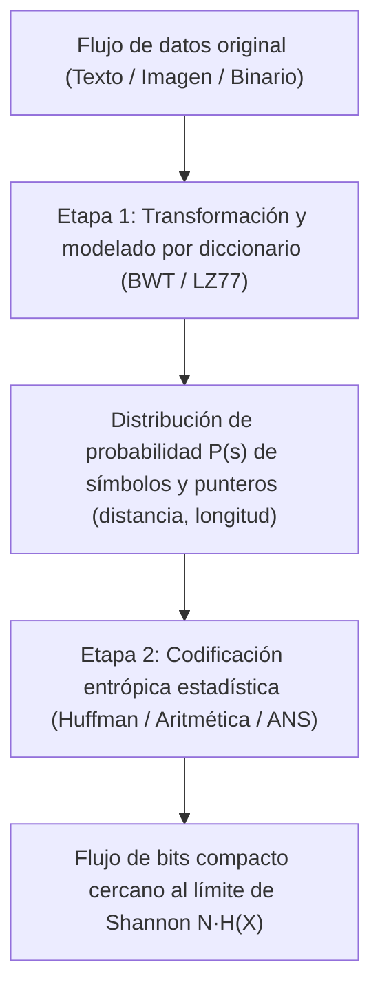
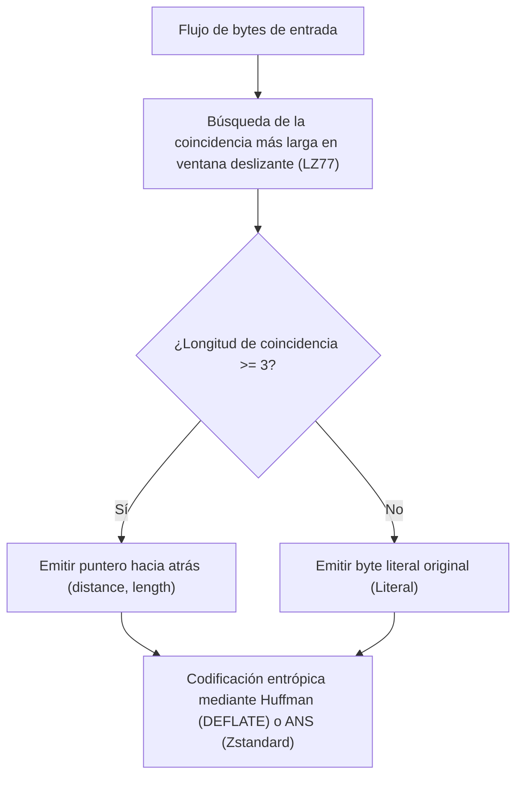

## 1. El principio del palomar: por qué no puede existir un compresor universal que reduzca todos los archivos

Cuando usamos a diario herramientas como `zip`, `gzip`, `zstd`, `7z` o `PNG` para reducir documentos, código fuente o imágenes a una fracción de su tamaño original y al descomprimirlos <strong>recuperamos hasta el último bit intacto (compresión sin pérdida / reversible)</strong>, surge una pregunta intuitiva: si un compresor reduce el tamaño de un archivo, ¿por qué no volvemos a comprimir el archivo `.zip` resultante diez veces seguidas hasta reducir cualquier película o base de datos a un solo byte?

La respuesta es rotunda: <strong>es matemáticamente imposible.</strong> Para demostrarlo ni siquiera hace falta recurrir a la teoría de la información avanzada; basta con el <strong>principio del palomar (Pigeonhole Principle)</strong> de la combinatoria elemental.

Sea $E: \{0,1\}^* \to \{0,1\}^*$ una función de codificación sin pérdida y $D: \{0,1\}^* \to \{0,1\}^*$ su función de decodificación. Para garantizar una reversibilidad exacta $D(E(x)) = x$ para cualquier secuencia binaria $x$, la aplicación $E$ debe ser necesariamente <strong>inyectiva (uno a uno)</strong>: si dos archivos distintos $x_1 \ne x_2$ se comprimieran en la misma cadena corta $y = E(x_1) = E(x_2)$, el decodificador jamás podría saber si debe restaurar $x_1$ o $x_2$.

Consideremos ahora el conjunto de todos los archivos binarios de longitud exacta $N$ bits: existen $2^N$ archivos posibles. En cambio, el número total de cadenas binarias estrictamente más cortas que $N$ bits (de longitud $0$ a $N-1$) es:

$$\sum_{k=0}^{N-1} 2^k = 2^N - 1 < 2^N$$

Como hay $2^N$ archivos de entrada («palomas») pero solo $2^N - 1$ cadenas más cortas («palomares»), <strong>cualquier algoritmo de compresión sin pérdida que acorte al menos un archivo DEBE forzosamente alargar otros</strong>! Más aún, la fracción de archivos de $N$ bits que pueden reducirse en al menos $c$ bits cumple:

$$P\bigl(|E(X)| \le N - c\bigr) < 2^{-(c-1)}$$

Casi todas las cadenas binarias aleatorias son algorítmicamente incompresibles. La razón por la que nuestros compresores cotidianos reducen casi cualquier archivo real es que el texto humano, el código fuente y las imágenes naturales habitan un subconjunto minúsculo, altamente estructurado y de <strong>baja entropía</strong> dentro del océano $\{0,1\}^N$.

---

## 2. El teorema de codificación de fuentes de Shannon y la entropía: el límite físico absoluto

En 1948, Claude E. Shannon formuló en *«A Mathematical Theory of Communication»* el límite fundamental de la compresión. Para una fuente discreta sin memoria que emite símbolos de un alfabeto $\mathcal{A} = \{s_1, \dots, s_m\}$ con probabilidades $P = (p_1, \dots, p_m)$, la <strong>autoinformación (Surprisal)</strong> de un símbolo $s_i$ y su valor esperado, la <strong>entropía de Shannon $H(X)$</strong>, vienen dados por:

$$I(s_i) = -\log_2 p_i, \qquad H(X) = -\sum_{i=1}^{m} p_i \log_2 p_i \quad (\text{bits por símbolo})$$

Todo <strong>código libre de prefijos (instantáneo)</strong> con longitudes de palabra $\ell_1, \dots, \ell_m$ debe satisfacer la <strong>desigualdad de Kraft-McMillan</strong>:

$$\sum_{i=1}^{m} 2^{-\ell_i} \le 1$$

Aplicando la no negatividad de la divergencia de Kullback-Leibler $D_{\text{KL}}(P \,\|\, Q) \ge 0$ con $q_i = 2^{-\ell_i}/Z$ ($Z = \sum 2^{-\ell_i} \le 1$), se demuestra el <strong>teorema de codificación de fuentes sin ruido de Shannon</strong> para la longitud media $L = \sum_{i=1}^m p_i \ell_i$:

$$L - H(X) = \sum_{i=1}^m p_i \log_2 \frac{p_i}{2^{-\ell_i}} = D_{\text{KL}}(P \,\|\, Q) + \log_2 \frac{1}{Z} \ge 0 \implies H(X) \le L < H(X) + 1$$

---

## 3. Tres generaciones de codificación entrópica: Huffman, Codificación Aritmética y ANS

### 3.1 Codificación de Huffman (1952): árboles de prefijos óptimos de longitud entera
El algoritmo voraz de David A. Huffman construye en tiempo $O(m \log m)$ el árbol libre de prefijos de menor longitud media fusionando iterativamente los dos símbolos menos probables. Su limitación estructural es que <strong>cada palabra de código debe tener un número entero de bits ($\ell_i \ge 1$)</strong>: un símbolo con probabilidad $p_1 = 0,99$ contiene solo $-\log_2(0,99) \approx 0,0145\,\text{bits}$ de información, pero consume al menos $1\,\text{bit}$ entero.

### 3.2 Codificación Aritmética (Arithmetic / Range Coding): bits fraccionarios
La codificación aritmética (Rissanen, Pasco, Witten et al.) supera la barrera entera representando <strong>toda la secuencia del mensaje $x_1 x_2 \dots x_N$ como un único subintervalo $[L_{\text{low}}, H_{\text{high}}) \subset [0, 1)$</strong> cuya anchura final $\Delta = \prod_{t=1}^N P(x_t)$ requiere $\lceil -\log_2 \Delta \rceil + 1 \approx N \cdot H(X)$ bits, logrando bits fraccionarios a cambio de un mayor coste computacional por multiplicación.

### 3.3 Sistemas Numéricos Asimétricos (ANS, Jarek Duda 2009–2014)
Inventados por el físico e informático polaco Jarek Duda, los <strong>Asymmetric Numeral Systems (tANS y rANS)</strong> combinan <strong>la razón de compresión óptima de la codificación aritmética con la velocidad de tabla de búsqueda de Huffman</strong>. Al codificar un símbolo $s$ de probabilidad $p_s$ en el estado entero $x \in \mathbb{N}$, el estado se actualiza según:

$$C(x, s) \approx \frac{x}{p_s}$$

Hoy ANS es el motor central de <strong>Zstandard (`zstd`)</strong> de Meta, <strong>LZFSE</strong> de Apple y <strong>JPEG XL</strong> de Google.

---

## 4. Compresión por diccionario y transformaciones: LZ77, DEFLATE, BWT y «Comprimir es predecir»

Para explotar la repetición de subcadenas y la estructura contextual, los compresores modernos combinan diccionarios con codificadores entrópicos:
- <strong>LZ77 (Lempel y Ziv, 1977)</strong>: reemplaza subcadenas repetidas dentro de una ventana deslizante por punteros hacia atrás <strong>`(distance, length)`</strong>. Junto con Huffman forma <strong>DEFLATE (`gzip`, `zip`, `PNG`)</strong>; junto con ANS forma <strong>Zstandard (`zstd`)</strong>.
- <strong>Transformada de Burrows-Wheeler (BWT, 1994, `bzip2`)</strong>: ordena lexicográficamente todas las rotaciones cíclicas de un bloque y toma la última columna $L$, agrupando caracteres con idéntico contexto posterior para que Move-To-Front (MTF) y Run-Length Encoding (RLE) los compriman drásticamente.

| Algoritmo / Herramienta | Diccionario / Transformación | Codificador entrópico | Tasa de compresión típica | Velocidad de descompresión | Aplicaciones industriales clave |
|---|---|---|---|---|---|
| <strong>`lz4`</strong> | LZ77 alineado a bytes | Ninguno (flujo de bytes directo) | $\sim 48\%$ | $\sim 4.000\,\text{MB/s}$ | Compresión RAM (ZRAM), bases de datos en tiempo real |
| <strong>`gzip` (DEFLATE)</strong> | LZ77 (ventana de 32 KB) | Codificación de Huffman | $\sim 32\%$ | $\sim 400\,\text{MB/s}$ | Tráfico web HTTP, `.tar.gz`, imágenes PNG |
| <strong>`zstd` (Zstandard)</strong> | LZ77 (gran ventana + caché de offsets) | <strong>ANS (tANS / FSE)</strong> + Huffman | $\sim 28\%$ | $\sim 1.500\,\text{MB/s}$ | Paquetes Linux, almacenamiento en la nube, Btrfs |
| <strong>`bzip2`</strong> | <strong>Ordenación de bloques BWT</strong> + MTF + RLE | Huffman multitabla | $\sim 26\%$ | $\sim 60\,\text{MB/s}$ | Archivos de código fuente, bioinformática |
| <strong>`xz` (LZMA2)</strong> | LZ77 (diccionario gigante + contexto bit) | Codificación aritmética de rango | $\sim 21\%$ | $\sim 120\,\text{MB/s}$ | Distribución de software de tamaño mínimo, firmware |
| <strong>`cmix` / `PAQ8` / LLM</strong> | Mezcla de contextos / Transformer | Codificación aritmética | $\sim 11\%\text{–}14\%$ | $< 1\,\text{MB/s}$ | Hutter Prize, equivalencia entre compresión e IA |

En el sentido matemático más profundo, <strong>comprimir es exactamente equivalente a predecir</strong>: cualquier modelo (incluidos los grandes modelos lingüísticos Transformer) que minimice la entropía cruzada $-\sum \log_2 P_\theta(x_t \mid x_{<t})$ al predecir el siguiente símbolo define directamente el límite de compresión sin pérdida alcanzable mediante codificación aritmética.
