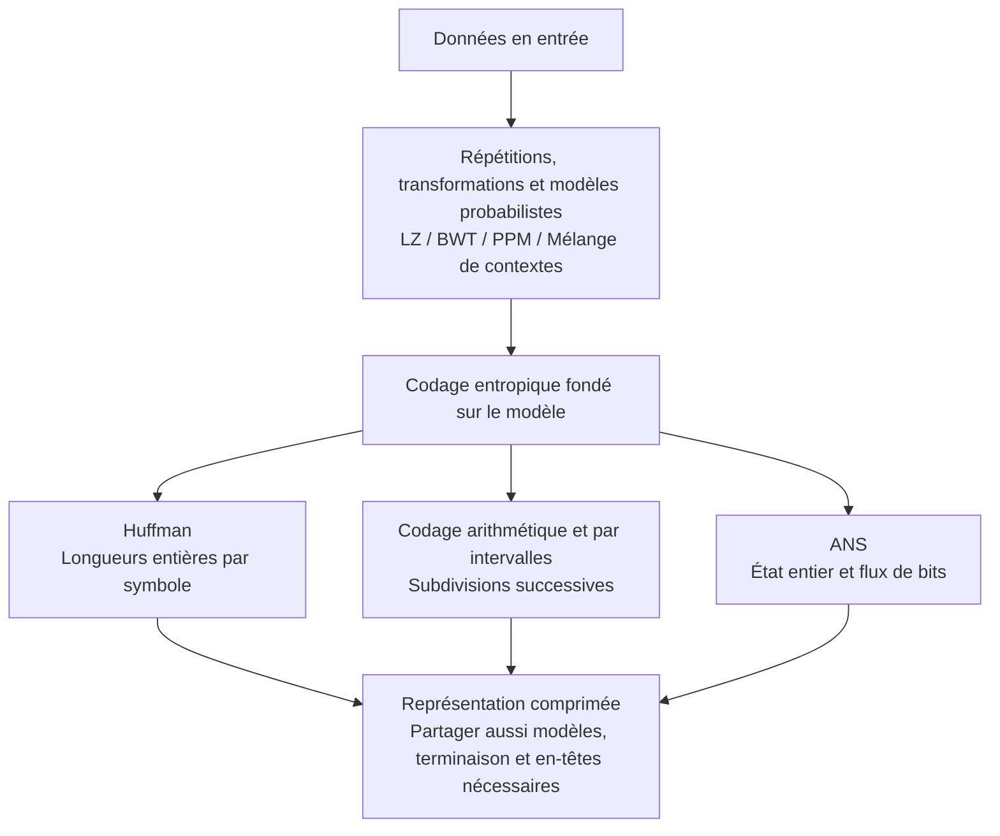
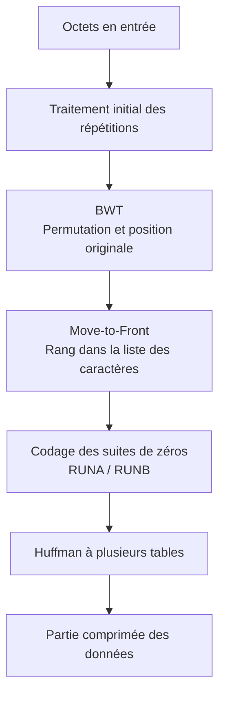

## 1. Pourquoi aucun compresseur ne peut raccourcir tous les fichiers

La compression sans perte remplace les données par une représentation permettant de retrouver les octets d’origine sans modifier un seul bit. Des outils comme zip, gzip, zstd et xz réduisent certaines entrées ; d’autres changent à peine ou grossissent à cause des en-têtes. Ils ne réduisent pas tout dans la même proportion. La compression avec perte, comme JPEG ou MP3, autorise des différences dans les valeurs reconstruites et impose donc une autre condition de restitution.

Soit {0,1}* l’ensemble des chaînes binaires finies. Fixons un codeur E et un décodeur D. L’absence de perte exige, pour toute entrée x :

$$
D(E(x))=x
$$

Si deux entrées distinctes avaient la même sortie, D ne pourrait pas restituer les deux : E doit être injective. Il existe 2^n entrées de longueur exactement n bits, mais moins de sorties plus courtes que n, même en comptant la chaîne vide. Ici, n≥1.

$$
\left|\{0,1\}^{n}\right|=2^n>
\sum_{k=0}^{n-1}2^k=2^n-1
$$

Un compresseur sans perte fixé ne peut donc raccourcir toutes les entrées de n bits. Une application injective sur l’ensemble des chaînes finies ne peut pas non plus en raccourcir certaines sans en allonger aucune autre. Si elle raccourcissait une entrée x de n bits sans rien allonger, les entrées plus courtes que n occuperaient déjà toutes les sorties plus courtes que n. E(x) entrerait en collision avec l’une d’elles.

Pour quantifier cela, fixons E et choisissons uniformément une chaîne X de n bits. Pour un entier 1≤c≤n, la proportion raccourcie d’au moins c bits est majorée ainsi. On compte les sorties possibles ; le codeur ne les utilise pas nécessairement toutes.

$$
\Pr\!\left(|E(X)|\le n-c\right)
\le\frac{2^{n-c+1}-1}{2^n}
<2^{1-c}
$$

Pour c=11, cette proportion est inférieure à 1/1024, soit environ 0,0977 %. Cela ne signifie pas qu’aucun autre compresseur ne puisse raccourcir l’un quelconque des fichiers restants. Pour un fichier particulier x, un autre codeur pourrait échanger x et la chaîne vide : x raccourcit, la chaîne vide s’allonge. Le décodeur doit connaître cette règle spéciale. En complexité de Kolmogorov aussi, il faut distinguer un langage de description fixé de la longueur de description d’un programme de décodage.

La compression courante exploite des représentations adaptées à une distribution ou à des structures répétées : fréquences inégales de caractères, sous-chaînes répétées ou motifs numériques. Le gain dépend de l’entrée et de la méthode. On ne peut pas affirmer catégoriquement qu’un fichier déjà comprimé ou un texte chiffré ne puisse jamais perdre un octet. Le chiffrement, son mode, les métadonnées et la structure restante comptent.

Les unités comptent également. Un MiB, ou mébioctet, représente 1 048 576 octets, soit 8 388 608 bits. Un MB décimal, ou mégaoctet (Mo), représente 1 000 000 d’octets, soit 8 000 000 de bits.

## 2. Entropie de Shannon et limites de la longueur moyenne

L’article de Shannon de 1948 sépare la valeur sémantique du problème technique de communication et étudie les sources par les probabilités. L’introduction de cette [réédition](https://wucj.lab.westlake.edu.cn/Others/shannon1948.pdf) reconnaît aussi les travaux antérieurs de Nyquist et Hartley.

Pour un événement x de probabilité positive, l’information propre est définie comme suit. Un logarithme en base deux donne une unité en bits. Elle ne mesure ni la surprise psychologique ni l’importance du contenu.

$$
I(x)=-\log_2P(x),\qquad 0<P(x)\le1
$$

Pour une variable aléatoire X sur un alphabet fini, posons p_i=P(X=x_i). L’entropie de Shannon est l’espérance de l’information propre, avec la convention 0log₂0=0 pour les termes de probabilité nulle.

$$
H(X)=-\sum_{i=1}^{m}p_i\log_2p_i,\qquad
p_i\ge0,\quad\sum_i p_i=1,\quad
0\le H(X)\le\log_2m
$$

L’unité est le bit par symbole. Pour un alphabet fixé de m symboles, la loi uniforme maximise l’entropie ; si un seul symbole a une probabilité de un, l’entropie est nulle. Le résultat d’une pièce équilibrée a une information propre d’un bit ; un événement de probabilité 1/256, de huit bits. Ces valeurs décrivent le modèle de symboles, mais ne déterminent directement ni l’information d’une suite corrélée ni une borne inférieure pour chaque fichier.

### Codes préfixes et inégalité de Kraft–McMillan

Attribuons à chaque symbole un mot binaire permettant de décoder les concaténations sans ambiguïté. Dans un code préfixe, aucun mot n’est le début d’un autre. Par exemple, {0,10,110,111} permet de décomposer 100110111 en 10 | 0 | 110 | 111. ASCII est un code de caractères sur sept bits ; il ne signifie pas que tout caractère est représenté sur huit bits.

Représentons les mots de longueur ℓ_i par les feuilles d’un arbre binaire. Dans un arbre complet de profondeur maximale ℓ_max, une feuille occupe 2^(ℓ_max−ℓ_i) positions potentielles sous elle. Compter ces sous-arbres disjoints donne l’inégalité de Kraft. La même inégalité vaut pour les codes à décodage unique.

$$
\sum_i2^{\ell_{\max}-\ell_i}\le2^{\ell_{\max}}
\quad\Longrightarrow\quad
Z:=\sum_i2^{-\ell_i}\le1
$$

Réciproquement, des longueurs entières positives satisfaisant l’inégalité admettent un code préfixe. Dans la suite, on considère les symboles de probabilité positive et l’on suppose qu’ils sont au moins deux. Pour une source à un seul symbole, il faut préciser séparément si le mot vide est autorisé et comment le nombre de symboles ou la terminaison est partagé.

### La borne inférieure par divergence KL

Définissons la longueur moyenne et la distribution normalisée Q induite par les longueurs :

$$
L=\sum_i p_i\ell_i,\qquad
q_i=\frac{2^{-\ell_i}}{Z},\qquad \sum_i q_i=1
$$

La divergence de Kullback–Leibler est toujours positive ou nulle, ce qui donne la relation suivante. Cette propriété se démontre, par exemple, avec l’inégalité logarithmique ln u≤u−1.

$$
\begin{aligned}
0\le D_{\mathrm{KL}}(P\|Q)
&=\sum_i p_i\log_2\frac{p_i}{q_i}\\
&=-H(X)+\sum_i p_i\ell_i+\log_2Z\\
&=L-H(X)+\log_2Z
\end{aligned}
$$

On obtient la borne suivante pour la longueur moyenne :

$$
L=H(X)+D_{\mathrm{KL}}(P\|Q)-\log_2Z\ge H(X)
$$

Q divise 2^(-ℓ_i) par Z. Il ne faut pas supprimer cette normalisation tout en comptant aussi le terme −log₂Z. L’égalité exige P=Q et Z=1, d’où p_i=2^(-ℓ_i) : les probabilités correspondent aux longueurs binaires.

On peut également construire une borne supérieure. Ces longueurs de Shannon satisfont l’inégalité de Kraft :

$$
\ell_i=\lceil-\log_2p_i\rceil,\qquad
2^{-\ell_i}\le p_i,\qquad
\sum_i2^{-\ell_i}\le1
$$

L’arrondi à l’entier supérieur ajoute moins d’un bit par symbole ; ce code a donc une longueur moyenne inférieure à H+1. La longueur moyenne L_opt du code préfixe binaire optimal appartient ainsi à cet intervalle :

$$
H(X)\le L_{\mathrm{opt}}<H(X)+1
$$

Pour une source non dégénérée de symboles indépendants et identiquement distribués, regrouper N symboles et choisir un code préfixe de blocs adapté donne la relation suivante. L_N est la longueur moyenne du bloc entier.

$$
H(X)\le\frac{L_N}{N}<H(X)+\frac1N
$$

En présence de dépendances, en général H(X_1,...,X_N)≠NH(X_1). Si l’on tire un bit équiprobable et qu’on le répète sur une longueur connue N, chaque position a une entropie marginale d’un bit, mais la suite entière a une entropie d’un bit. Pour les sources stationnaires à alphabet fini, on utilise le taux d’entropie :

$$
\overline H=\lim_{N\to\infty}\frac{H(X_1,\ldots,X_N)}{N}
$$

Ces affirmations concernent des moyennes sous des distributions et des classes de codes précisées. Elles ne disent pas que chaque fichier doit atteindre cette longueur minimale ni que le coût des modèles et des en-têtes peut être ignoré.

## 3. Huffman, codage arithmétique et ANS

Distinguer le modèle statistique du codeur qui transforme les probabilités en bits aide à comprendre chaque méthode. Ce schéma est conceptuel ; ce n’est pas une spécification imposant une telle séparation à tous les formats.

### Huffman : optimal dans quelle classe ?

L’[article de Huffman de 1952](https://compression.ru/download/articles/huff/huffman_1952_minimum-redundancy-codes.pdf) construit des codes préfixes minimisant la longueur moyenne pour des poids donnés. Dans le cas binaire, on combine les deux nœuds de poids minimal puis on réinsère leur somme, et l’on répète. Un tas permet de construire l’arbre en O(m log m) pour m symboles.

Avec au moins deux poids positifs, un arbre optimal peut se passer des branches inutiles à un seul enfant. On peut placer les deux plus petits poids sur des feuilles sœurs de profondeur maximale sans augmenter la longueur moyenne. En les fusionnant en un symbole z, l’arbre original T et l’arbre réduit T′ vérifient :

$$
L(T)=L(T')+p_a+p_b
$$

La différence est fixe : une solution optimale du petit problème permet de construire une solution du problème initial. Des poids égaux peuvent donner plusieurs arbres optimaux. Les codes Huffman canoniques déterminent les mots à partir des longueurs et de l’ordre des symboles, simplifiant la transmission de l’arbre. Ils ne suppriment ni le coût de description des tables ni les étapes supplémentaires pour les mots longs.

Pour P(0)=0,99 et P(1)=0,01, un code préfixe binaire optimal symbole par symbole utilise un bit pour chacun.

$$
H(X)=-0.99\log_2(0.99)-0.01\log_2(0.01)
\approx0.080793,\qquad L_{\mathrm H}=1
$$

Sa longueur moyenne représente environ 12,4 fois l’entropie. Cela n’implique pas que le fichier d’origine ne puisse diminuer : partir de huit bits par symbole diffère d’une suite déjà stockée bit par bit. Les blocs réduisent la perte due aux longueurs entières, mais un arbre couvrant explicitement toutes les m^k combinaisons grandit vite. La convention du mot vide pour un seul symbole pose toujours séparément la question du partage du nombre de symboles.

### Codage arithmétique : intervalles et chaînes finies

Le codage arithmétique resserre un intervalle associé au message. Soient P(s) la probabilité d’un symbole et A(s) la somme des probabilités des symboles qui le précèdent dans un ordre convenu. On part de [lo_0,hi_0)=[0,1). Supposons chaque symbole codé de probabilité positive. Avec la largeur W_(t−1)=hi_(t−1)−lo_(t−1), on met à jour :

$$
\begin{aligned}
\mathrm{lo}_t&=\mathrm{lo}_{t-1}+W_{t-1}A(x_t),\\
\mathrm{hi}_t&=\mathrm{lo}_{t-1}+W_{t-1}\bigl(A(x_t)+P(x_t)\bigr)
\end{aligned}
$$

Pour un modèle indépendant fixé, la largeur finale est le premier produit ci-dessous. Avec des dépendances, on utilise des probabilités conditionnelles que les deux côtés peuvent reproduire à chaque étape.

$$
W_N=\prod_{t=1}^{N}P(x_t)
\quad\text{or}\quad
W_N=\prod_{t=1}^{N}P(x_t\mid x_{<t})
$$

Des messages distincts de même longueur connue N correspondent à des intervalles disjoints. Choisissons un intervalle dyadique [j2^(-K),(j+1)2^(-K)) entièrement contenu dans l’intervalle final ; ses K bits le désignent. Un quadrillage de pas inférieur ou égal à la moitié de la largeur garantit cette longueur suffisante avec une arithmétique idéale de précision infinie :

$$
K=\lceil-\log_2W_N\rceil+1<-\log_2W_N+2
$$

Cette borne concerne la charge utile idéale avec modèle et longueur connus. Elle ne dit pas que le plus petit K est toujours celui de la formule, ni que le fichier entier n’a que deux bits de surcoût. Modèles, terminaison, précision et en-têtes ont des coûts supplémentaires. Sous la véritable distribution P des blocs, la représentation préfixe correspondante satisfait :

$$
H(P)\le\mathbb E_P[K]<H(P)+2
$$

Pour P(0)=0,99, environ 69 zéros consécutifs divisent la largeur par deux. Cela n’impose pas d’émettre exactement un bit tous les 69 symboles : l’émission dépend de l’intervalle et de la renormalisation. Les implémentations entières émettent les bits ou octets de poids fort déjà déterminés et dilatent l’état. Quantification des probabilités, gestion des retenues et bits en attente demandent aussi du travail. Le codage arithmétique ou par intervalles (range coding) n’a pas de rapport de vitesse universel avec les autres codeurs.

### ANS : accumuler l’information dans un état entier

L’[article de Duda sur ANS](https://arxiv.org/html/1311.2540v2) construit des systèmes de numération pour des symboles de probabilités inégales. Ajouter un chiffre s en base ordinaire b est réversible ainsi :

$$
x'=bx+s,\qquad s=x'\bmod b,\qquad x=\lfloor x'/b\rfloor
$$

Avec des probabilités égales et un état positif x suffisamment grand, l’accroissement de taille logarithmique vaut approximativement log₂b. Pour des probabilités générales, la construction multiplie l’état approximativement par 1/P(s). Il ne faut pas appliquer log₂x en x=0 ni assimiler cette approximation à une longueur entière exacte.

Une construction rANS utilise M=2^R, des fréquences entières positives f_s et des fréquences cumulées b_s.

$$
\sum_s f_s=M,\qquad b_s=\sum_{a<s}f_a,\qquad P(s)\approx f_s/M
$$

Elle transforme un état entier non négatif x et un symbole s par :

$$
C(x,s)=M\left\lfloor\frac{x}{f_s}\right\rfloor+(x\bmod f_s)+b_s
$$

L’inverse sélectionne le symbole à l’aide de slot et retrouve l’état antérieur :

$$
\begin{aligned}
\mathrm{slot}&=x'\bmod M,\\
b_s&\le\mathrm{slot}<b_s+f_s,\\
x&=f_s\left\lfloor\frac{x'}M\right\rfloor+\mathrm{slot}-b_s
\end{aligned}
$$

Lorsque M est une puissance de deux, le quotient et le reste se calculent par décalages et masques. La recherche de symbole, les accès aux tables, la renormalisation et les entrées/sorties comptent aussi. Cette bijection seule ne garantit ni une perte de codage nulle ni un décodage en un cycle d’horloge.

tANS emploie un nombre fini d’états et des tables de transition. Pour une explication fondée sur les bits, on peut utiliser, par exemple, cet ensemble d’entiers. Il correspond à l’intervalle semi-ouvert [L,2L), et non à [L,2L−1).

$$
\mathcal I=\{L,L+1,\ldots,2L-1\},\qquad |\mathcal I|=L
$$

On transfère des bits entre l’état accumulé et le flux pour rester dans la plage autorisée. Les conditions de normalisation et la répartition des symboles doivent s’accorder ; remplacer simplement les formules rANS par une petite table ne suffit pas. FSE est une implémentation de la famille tANS.

Les opérations d’état ANS se comportent comme une pile : le dernier symbole ajouté est récupéré en premier. Coder les blocs à l’envers peut permettre de les décoder dans l’ordre original. Avec des probabilités contextuelles, il faut aussi concilier l’ordre de calcul des probabilités avec le codage inverse. Huffman, codage arithmétique et ANS sont des choix selon les modèles, formats et implémentations, non trois générations dont chacune remplace universellement la précédente.

## 4. Ce que changent LZ, BWT et les modèles contextuels

Un modèle fondé uniquement sur les fréquences individuelles d’octets n’exploite pas entièrement les répétitions longues et les dépendances. Au lieu d’attribuer à l’anglais un nombre universel de bits, précisons le corpus et si les unités sont des caractères, des octets ou des tokens.

### Dictionnaires : LZ77, LZ78 et LZW

Les méthodes de la famille LZ77 font référence à des données déjà produites. Si la chaîne ASCII de 16 octets `std::vector<int>` est apparue 200 octets plus tôt et correspond à nouveau, on peut la représenter par cette distance et cette longueur. Le coût peut être inférieur ou non à celui de 16 octets littéraux, selon le codage des deux nombres.

$$
(d,\ell)=(200,16)
$$

Une correspondance peut dépasser sa distance. Après un A littéral, une référence de distance 1 et de longueur 99 réutilise les nouveaux A copiés comme source et produit 100 A au total. La [spécification DEFLATE](https://www.rfc-editor.org/rfc/rfc1951.txt) donne aussi un exemple de référence avec chevauchement. Un memcpy générique sur des zones chevauchantes, ou une copie limitée à un instantané de la source initiale, ne décrit pas correctement cette expansion. L’implémentation doit gérer la sortie croissante et vérifier distances, limites de sortie et longueurs d’entrée.

LZSS distingue littéraux et correspondances par des indicateurs ou une autre représentation. Les indicateurs prennent aussi de la place : on ne garantit pas que les données sans correspondance ne grossissent jamais. LZ78/LZW enregistrent les chaînes rencontrées dans un dictionnaire explicite et emploient des indices. Croissance, réinitialisations, portée des références et codage des entiers diffèrent ; aucune méthode n’est tenue de gagner sur toutes les entrées.

Les formats concrets diffèrent aussi. Les blocs comprimés DEFLATE utilisent des distances de 1 à 32 768 et des longueurs de 3 à 258, avec des codes Huffman séparés pour littéraux/longueurs et distances. Des blocs non comprimés existent également. La [spécification Zstandard](https://www.rfc-editor.org/rfc/rfc8878.html) sépare littéraux et séquences : les littéraux admettent des modes brut, RLE ou Huffman ; les séquences, des modes comprenant FSE. Un ou quatre flux Huffman constituent une distinction différente des trois types d’état FSE des séquences. LZMA/LZMA2 combinent aussi dictionnaires et modèles probabilistes ; le [codeur LZMA](https://github.com/ip7z/7zip/blob/main/C/LzmaEnc.c) expose recherche de correspondances et codage par intervalles. Un nom d’algorithme ne représente pas tous les formats, outils ou niveaux.

### BWT : permutation conservant la longueur et inversion

La transformée de Burrows–Wheeler rapproche les caractères ayant le même contexte suivant. Sa dernière colonne conserve le nombre de symboles, mais la position ou l’information de sentinelle nécessaire à l’inversion a aussi un coût.

Considérons `banana$` avec une sentinelle unique `$` ordonnée avant les autres caractères. Trions ses sept rotations cycliques et extrayons la dernière colonne et le numéro de la ligne originale.

| Ligne | Rotation dans l’ordre lexicographique | Premier | Dernier |
| :--- | :--- | :---: | :---: |
| 0 | `$banana` | `$` | a |
| 1 | `a$banan` | a | n |
| 2 | `ana$ban` | a | n |
| 3 | `anana$b` | a | b |
| 4 | `banana$` | b | `$` |
| 5 | `na$bana` | n | a |
| 6 | `nana$ba` | n | a |

La sortie est `annb$aa` et la ligne originale, numérotée à partir de zéro, est 4. Si L est la dernière colonne et F la première, trier les caractères de L donne F. Apparier dans l’ordre les occurrences d’un même caractère donne la correspondance LF, qui parcourt la suite originale à rebours. Avec des positions commençant à zéro, C(c) compte les caractères inférieurs à c et rank_c(i) les occurrences de c dans L avant la position i.

$$
\mathrm{LF}(i)=C(L_i)+\mathrm{rank}_{L_i}(i)
$$

Pour un petit alphabet fixe, fréquences et rangs d’occurrence se construisent en temps linéaire, puis une suite de N symboles s’inverse en O(N). Si l’on emploie un tri général par comparaisons, il faut compter ce coût séparément. BWT ne transforme pas toute entrée en longues répétitions consécutives.

Le [manuel de bzip2 1.0.8](https://sourceware.org/bzip2/manual/manual.html) et le [code de cette version](https://sourceware.org/pub/bzip2/bzip2-1.0.8.tar.gz) combinent RLE avant BWT, MTF, codage des suites de zéros et plusieurs tables Huffman. MTF émet le rang actuel d’un caractère dans une liste puis le place en tête. Les caractères répétés donnent des zéros, codés via RUNA/RUNB. Le schéma montre les principales transformations, en omettant en-têtes, indices et CRC.

### Modèles contextuels et LLM : longueur de code et perte prédictive

PPM emploie des contextes de longueurs différentes et traite les symboles non observés par des mécanismes comme les échappements. Le mélange de contextes combine les prédictions de plusieurs modèles. Les réseaux neuronaux peuvent aussi prédire ; Transformer n’est pas synonyme de réseau récurrent.

Pour une suite à laquelle le modèle Q_θ attribue des probabilités conditionnelles positives, l’information idéale est la suivante. On ne l’identifie pas à la longueur réelle de sortie.

$$
I_\theta(x_{1:N})=-\log_2 Q_\theta(x_{1:N})
=\sum_{t=1}^{N}-\log_2Q_\theta(x_t\mid x_{<t})
$$

Pour la perte moyenne de log-vraisemblance négative de cette suite, calculée avec des logarithmes naturels, les facteurs de base et de moyenne donnent :

$$
\mathcal L_{\mathrm{NLL}}(\theta)
=-\frac1N\sum_{t=1}^{N}\ln Q_\theta(x_t\mid x_{<t})
=\frac{\ln2}{N}I_\theta(x_{1:N})
$$

Ainsi, à données, unités et conditions de modèle identiques, diminuer cette perte correspond à diminuer la longueur idéale. L’expression n’inclut ni taille du modèle partagé, ni tokenisation réversible, ni précision finie, terminaison, en-têtes ou temps de décodage. Une prédiction dont l’information est inférieure à un bit ne permet pas de stocker son mot isolément dans un fichier d’une fraction de bit.

[Language Modeling Is Compression](https://arxiv.org/html/2309.10668v2) étudie ce lien expérimentalement. Ses comparaisons d’images et d’audio utilisent des données traitées et des longueurs de contexte définies, et distinguent les taux excluant les poids du modèle de ceux les incluant. Il ne faut pas généraliser ces résultats à toutes les images, à tout l’audio ou aux fichiers arbitraires. Des défis comme le Hutter Prize encouragent la recherche prédictive, mais les équations de codage seules ne prouvent pas des conditions suffisantes de l’intelligence ou de la compréhension.

## 5. Comparer taille comprimée, vitesse et mémoire

L’évaluation pratique combine taille comprimée, temps de codage et de décodage, mémoire, compatibilité et granularité d’accès. Définissons la fraction comprimée comme la taille comprimée divisée par la taille originale : plus elle est petite, mieux c’est. Des chiffres issus de tests configurés différemment ne forment pas un classement universel.

| Méthode ou outil | Caractéristiques de l’architecture | Points à vérifier pour comparer |
| :--- | :--- | :--- |
| LZ4 | Représentation de type LZ77 orientée octets, sans codage entropique interne au bloc | Coût d’encapsulation des petites entrées, vitesse de décodage, tampons |
| Zstandard | Recherche de correspondances, littéraux et séquences, Huffman/FSE et autres modes | Niveau, dictionnaire, fenêtre, modes et mémoire des deux côtés |
| DEFLATE / gzip | Références arrière et Huffman ; blocs non comprimés possibles | Format ou outil, compatibilité, coûts des blocs et de l’enveloppe |
| BWT / bzip2 | Transformation par blocs, MTF, répétitions et Huffman | Taille de bloc, espace de reconstruction et indice |
| LZMA/LZMA2 / xz et 7-Zip | Correspondances de dictionnaire et codage probabiliste adaptatif | Format et réglages, dictionnaire, recherche et limites du décodeur |
| PPM, mélange de contextes et prédiction neuronale | Probabilités contextuelles suivies du codage | Partage/transmission du modèle, contexte, calcul et précision reproductible |

La [spécification des blocs LZ4](https://github.com/lz4/lz4/blob/dev/doc/lz4_Block_format.md) traite l’encapsulation séparément ; la [description du format 7-Zip](https://www.7-zip.org/7z.html) distingue plusieurs méthodes. Il faut à la fois comprendre l’architecture et mesurer sa propre charge de travail.

Consignez implémentation et version, commande et niveau, CPU et threads, empreintes et tailles des entrées, dictionnaire, conditions de cache et d’entrées/sorties. Avec U octets originaux au total, C octets comprimés au total et le temps écoulé, calculez C/U et le débit. Traitez séparément l’entrée vide pour le rapport des tailles. Pour la mémoire, comptez tampons et modèles en plus des dictionnaires. Vérifiez que l’empreinte des octets décomprimés correspond à celle de l’original. Aucune nouvelle mesure de débit n’est présentée ici.

### Travail de codage/décodage et entrées/sorties

Dans la famille LZ, décoder peut être moins coûteux que rechercher les correspondances et choisir leur représentation au codage. Pourtant, le niveau et les commandes émises peuvent modifier la vitesse de décodage dans un même format. Un niveau supérieur ne garantit pas une vitesse de décodage exactement identique. Les décodeurs prédictifs doivent reproduire les probabilités, mais le codeur peut les calculer par lots ; leurs temps ne sont donc pas nécessairement égaux non plus.

Dans un modèle simple de lecture, soient v_io le débit d’entrées/sorties et v_dec le débit de décodage mesuré en octets originaux. Sans recouvrement entre calcul CPU et entrées/sorties, les temps approximatifs sont :

$$
T_{\mathrm{raw}}\approx\frac{U}{v_{\mathrm{io}}},\qquad
T_{\mathrm{compressed}}\approx\frac{C}{v_{\mathrm{io}}}
+\frac{U}{v_{\mathrm{dec}}}
$$

On compare l’économie d’entrées/sorties au coût du décodage. Avec des ressources indépendantes et un pipeline efficace, le temps en régime permanent peut approcher le plus grand terme plutôt que leur somme. Démarrage, bande passante mémoire, parallélisme et granularité d’accès peuvent demander un autre modèle.

Branchements, dépendances, cache, SIMD et parallélisme entre instructions influencent la vitesse. Leur seule présence ne fixe pas un plafond universel en Mo/s ; séparer les flux ne garantit pas zéro erreur de prédiction de branchement. Un paquet comprimé une fois et décodé par de nombreux lecteurs a des priorités différentes de journaux souvent mis à jour.

## 6. Quelles limites et quels coûts compte-t-on ?

Le principe des tiroirs montre qu’un codeur sans perte fixé ne peut raccourcir toutes les entrées. Les bornes d’entropie concernent la longueur moyenne sous des modèles probabilistes et des conditions de codage précisés. Huffman, codage arithmétique et ANS relient probabilités et représentations de façons différentes ; LZ, BWT et modèles contextuels exploitent répétitions et dépendances.

La perte prédictive et la longueur idéale sont liées, ce qui aide à comprendre la compression neuronale. Ce lien doit être distingué du coût total du fichier, de la vitesse de traitement et d’une preuve d’intelligence. Préciser ce qui est partagé, ce qui est transmis et quelles entrées ont été mesurées relie la théorie aux décisions pratiques.
