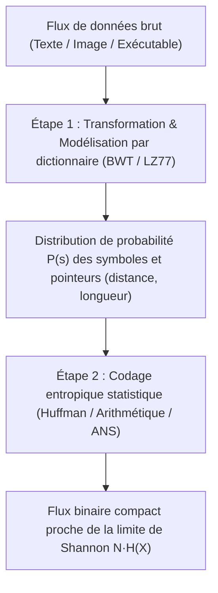
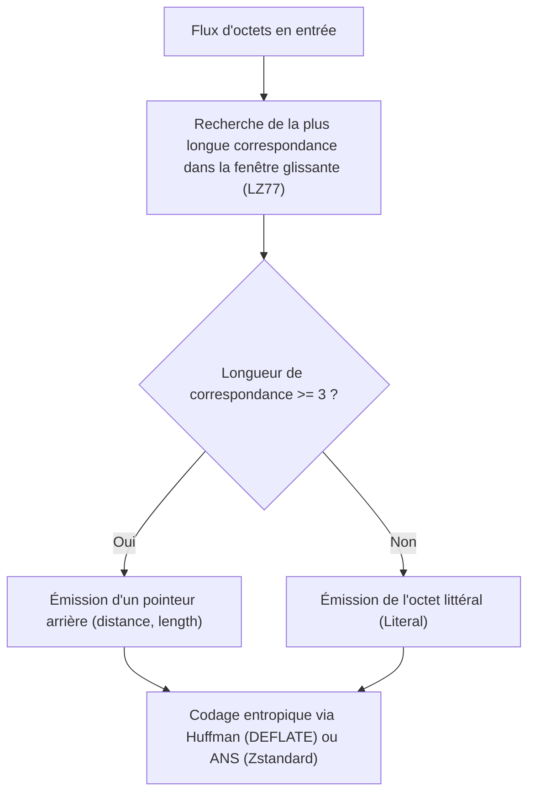

## 1. Le principe des tiroirs : pourquoi aucun algorithme ne peut compresser tous les fichiers

Lorsque nous utilisons quotidiennement `zip`, `gzip`, `zstd`, `7z` ou `PNG` pour réduire la taille de nos documents, codes sources ou images sans perdre <strong>un seul bit à la décompression (compression sans perte / réversible)</strong>, une question naturelle surgit : si un compresseur réduit la taille d’un fichier, pourquoi ne pas re-compresser le fichier `.zip` obtenu dix fois de suite jusqu’à réduire n’importe quel film ou base de données à un seul octet ?

La réponse est formelle : <strong>c’est mathématiquement impossible.</strong> La démonstration repose directement sur le <strong>principe des tiroirs de Dirichlet (Pigeonhole Principle)</strong> en combinatoire élémentaire.

Soit $E: \{0,1\}^* \to \{0,1\}^*$ une fonction d’encodage sans perte et $D: \{0,1\}^* \to \{0,1\}^*$ sa fonction de décodage. Pour garantir une réversibilité parfaite $D(E(x)) = x$ pour tout fichier binaire $x$, l’application $E$ doit impérativement être <strong>injective (biunivoque)</strong> : si deux fichiers distincts $x_1 \ne x_2$ produisaient la même séquence compressée $y = E(x_1) = E(x_2)$, le décodeur recevant $y$ ne pourrait jamais savoir s’il doit restituer $x_1$ ou $x_2$ !

Or, il existe exactement $2^N$ fichiers binaires de longueur $N$ bits, tandis que le nombre total de chaînes binaires strictement plus courtes que $N$ (de longueur $0$ à $N-1$) vaut :

$$\sum_{k=0}^{N-1} 2^k = 2^N - 1 < 2^N$$

Puisqu’il y a $2^N$ fichiers d’entrée (« pigeons ») pour seulement $2^N - 1$ chaînes plus courtes (« tiroirs »), <strong>tout algorithme de compression sans perte qui raccourcit au moins un fichier DOIT nécessairement en allonger d’autres</strong> ! Plus encore, la proportion de fichiers de $N$ bits pouvant être réduits d’au moins $c$ bits est strictement bornée par :

$$P\bigl(|E(X)| \le N - c\bigr) < 2^{-(c-1)}$$

La quasi-totalité des suites binaires aléatoires (au sens de la complexité de Kolmogorov) est donc totalement incompressible. Si nos compresseurs fonctionnent si bien au quotidien, c’est parce que les textes humains, les programmes informatiques et les images naturelles occupent un sous-ensemble infinitésimal, hautement structuré et à <strong>faible entropie</strong> au sein de $\{0,1\}^N$.

---

## 2. Le théorème du codage de source de Shannon et l’entropie : la limite absolue

En 1948, dans *« A Mathematical Theory of Communication »*, Claude E. Shannon a établi la limite fondamentale de la compression de données. Pour une source discrète sans mémoire émettant des symboles d’un alphabet $\mathcal{A} = \{s_1, \dots, s_m\}$ selon la loi de probabilité $P = (p_1, \dots, p_m)$, la <strong>quantité d’information propre (Surprisal)</strong> d’un symbole $s_i$ et son espérance mathématique, l’<strong>entropie de Shannon $H(X)$</strong>, sont définies par :

$$I(s_i) = -\log_2 p_i, \qquad H(X) = -\sum_{i=1}^{m} p_i \log_2 p_i \quad (\text{bits par symbole})$$

Tout <strong>code préfixe (instantané)</strong> attribuant à chaque symbole $s_i$ un mot de code binaire de longueur $\ell_i$ doit satisfaire l’<strong>inégalité de Kraft-McMillan</strong> :

$$\sum_{i=1}^{m} 2^{-\ell_i} \le 1$$

En utilisant la non-négativité de la divergence de Kullback-Leibler $D_{\text{KL}}(P \,\|\, Q) \ge 0$ avec $q_i = 2^{-\ell_i}/Z$ ($Z = \sum 2^{-\ell_i} \le 1$), on démontre le <strong>théorème du codage de source de Shannon</strong> pour la longueur moyenne $L = \sum_{i=1}^m p_i \ell_i$ :

$$L - H(X) = \sum_{i=1}^m p_i \log_2 \frac{p_i}{2^{-\ell_i}} = D_{\text{KL}}(P \,\|\, Q) + \log_2 \frac{1}{Z} \ge 0 \implies H(X) \le L < H(X) + 1$$

L’entropie $H(X)$ constitue ainsi la borne inférieure infranchissable de tout codage sans perte.

---

## 3. Trois générations de codage entropique : Huffman, Codage Arithmétique et ANS

### 3.1 Le codage de Huffman (1952) : arbres préfixes optimaux à longueurs entières
L’algorithme glouton de David A. Huffman construit en temps $O(m \log m)$ l’arbre binaire préfixe optimal en fusionnant itérativement les deux symboles les moins probables. Sa limite fondamentale réside toutefois dans la contrainte que <strong>chaque mot de code doit avoir un nombre entier de bits ($\ell_i \ge 1$)</strong> : un symbole de probabilité $p_1 = 0,99$ ne porte que $-\log_2(0,99) \approx 0,0145\,\text{bit}$ d’information, mais coûte au minimum $1\,\text{bit}$ entier.

### 3.2 Le codage arithmétique (Arithmetic Coding) : l’ère des bits fractionnaires
Le codage arithmétique (Rissanen, Pasco, Witten et al.) contourne la barrière entière en projetant <strong>la séquence entière du message $x_1 x_2 \dots x_N$ sur un unique sous-intervalle $[L_{\text{low}}, H_{\text{high}}) \subset [0, 1)$</strong> dont la largeur finale $\Delta = \prod_{t=1}^N P(x_t)$ ne requiert que $\lceil -\log_2 \Delta \rceil + 1 \approx N \cdot H(X)$ bits, au prix de multiplications séquentielles coûteuses en temps CPU.

### 3.3 Les systèmes numériques asymétriques (ANS, Jarek Duda 2009–2014)
Inventés par le physicien et informaticien polonais Jarek Duda, les <strong>Asymmetric Numeral Systems (tANS et rANS)</strong> réconcilient enfin <strong>le taux de compression optimal du codage arithmétique avec la vitesse d’exécution par table de correspondance du codage de Huffman</strong>. Lorsqu’un symbole $s$ de probabilité $p_s$ est encodé dans l’état entier $x \in \mathbb{N}$, l’état évolue selon :

$$C(x, s) \approx \frac{x}{p_s}$$

Cette avancée propulse aujourd’hui <strong>Zstandard (`zstd`)</strong> de Meta, <strong>LZFSE</strong> d’Apple et <strong>JPEG XL</strong> de Google.

---

## 4. Compression par dictionnaire et transformations : LZ77, DEFLATE, BWT et « Compresser c’est prédire »

Pour exploiter les répétitions de sous-chaînes et les corrélations contextuelles, les compresseurs modernes combinent modélisation séquentielle et codage entropique :
- <strong>LZ77 (Lempel & Ziv, 1977)</strong> : remplace toute sous-chaîne déjà apparue dans une fenêtre glissante par un pointeur arrière <strong>`(distance, length)`</strong>. Associé à Huffman, il forme <strong>DEFLATE (`gzip`, `zip`, `PNG`)</strong> ; associé à ANS, il donne <strong>Zstandard (`zstd`)</strong>.
- <strong>Transformée de Burrows-Wheeler (BWT, 1994, `bzip2`)</strong> : trie lexicographiquement toutes les rotations cycliques d’un bloc et extrait la dernière colonne $L$, regroupant les caractères partageant le même contexte suivant sans augmenter la taille du bloc.

| Algorithme / Outil | Dictionnaire / Transformation | Codeur entropique | Taux de compression typique | Vitesse de décompression | Applications industrielles clés |
|---|---|---|---|---|---|
| <strong>`lz4`</strong> | LZ77 aligné sur les octets | Aucun (flux d’octets direct) | $\sim 48\%$ | $\sim 4\,000\,\text{Mo/s}$ | Compression RAM (ZRAM), bases de données temps réel |
| <strong>`gzip` (DEFLATE)</strong> | LZ77 (fenêtre de 32 Ko) | Codage de Huffman | $\sim 32\%$ | $\sim 400\,\text{Mo/s}$ | Web HTTP, `.tar.gz`, format d’image PNG |
| <strong>`zstd` (Zstandard)</strong> | LZ77 (grande fenêtre + cache d’offsets) | <strong>ANS (tANS / FSE)</strong> + Huffman | $\sim 28\%$ | $\sim 1\,500\,\text{Mo/s}$ | Paquets Linux, stockage cloud, systèmes de fichiers (Btrfs) |
| <strong>`bzip2`</strong> | <strong>Tri de blocs BWT</strong> + MTF + RLE | Huffman multi-tables | $\sim 26\%$ | $\sim 60\,\text{Mo/s}$ | Archives sources, bio-informatique |
| <strong>`xz` (LZMA2)</strong> | LZ77 (dictionnaire géant + contexte bit) | Codage arithmétique d’intervalle | $\sim 21\%$ | $\sim 120\,\text{Mo/s}$ | Distribution logicielle à taille minimale, firmwares |
| <strong>`cmix` / `PAQ8` / LLM</strong> | Mélange de contextes / Transformer | Codage arithmétique | $\sim 11\%\text{–}14\%$ | $< 1\,\text{Mo/s}$ | Hutter Prize, équivalence entre compression et IA |

En dernière analyse, <strong>compresser équivaut exactement à prédire</strong> : tout modèle probabiliste (tel qu’un grand modèle de langage Transformer) qui minimise son entropie croisée $-\sum \log_2 P_\theta(x_t \mid x_{<t})$ fournit directement les probabilités conditionnelles permettant à un codeur arithmétique d’atteindre le taux de compression ultime.
