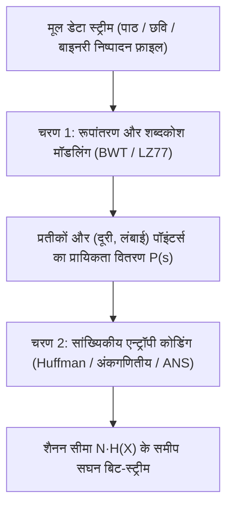
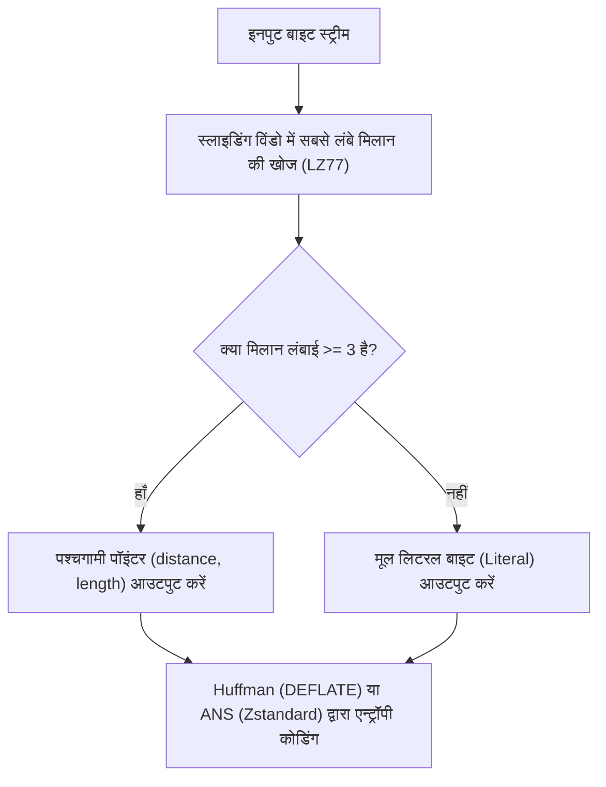

## 1. कबूतरखाना सिद्धांत (Pigeonhole Principle): क्यों कोई भी एल्गोरिदम हर फ़ाइल को छोटा नहीं कर सकता?

जब हम प्रतिदिन `zip`, `gzip`, `zstd`, `7z` या `PNG` का उपयोग करके दस्तावेज़ों, सोर्स कोड या छवियों को उनके मूल आकार के एक छोटे से हिस्से में संपीड़ित करते हैं और अनज़िप करने पर <strong>बिना एक भी बिट खोए मूल डेटा वापस पा लेते हैं (दोषरहित संपीड़न / Lossless Compression)</strong>, तो एक स्वाभाविक प्रश्न उठता है: यदि कंप्रेसर फ़ाइल को छोटा कर देता है, तो क्यों न हम प्राप्त `.zip` फ़ाइल को लगातार दस बार फिर से कंप्रेस करें जब तक कि कोई विशाल फ़िल्म या डेटाबेस घटकर केवल 1 बाइट का न रह जाए?

उत्तर स्पष्ट है: <strong>यह गणितीय रूप से असंभव है।</strong> इसे सिद्ध करने के लिए प्रारंभिक संयोजन गणित के <strong>कबूतरखाना सिद्धांत (Pigeonhole Principle)</strong> से अधिक किसी जटिल उपकरण की आवश्यकता नहीं है।

मान लीजिए $E: \{0,1\}^* \to \{0,1\}^*$ एक दोषरहित एनकोडिंग फलन है और $D: \{0,1\}^* \to \{0,1\}^*$ उसका डिकोडिंग फलन है। प्रत्येक बाइनरी इनपुट $x$ के लिए पूर्ण प्रतिवर्तनीयता $D(E(x)) = x$ सुनिश्चित करने हेतु, फलन $E$ को अनिवार्य रूप से <strong>एकैकी (Injective / One-to-One)</strong> होना चाहिए — क्योंकि यदि दो भिन्न फ़ाइलें $x_1 \ne x_2$ संपीड़ित होकर एक ही छोटे बिट-स्ट्रिंग $y = E(x_1) = E(x_2)$ में बदल जाएँ, तो डिकोडर कभी नहीं जान पाएगा कि उसे $x_1$ लौटाना है या $x_2$!

अब ठीक $N$ बिट लंबाई की सभी संभावित बाइनरी फ़ाइलों के समुच्चय $\{0,1\}^N$ पर विचार करें: ऐसी कुल $2^N$ फ़ाइलें हैं। इसके विपरीत, $N$ बिट से सख़्त रूप से छोटे (अर्थात् लंबाई $0$ से $N-1$ तक के) सभी संभावित बाइनरी स्ट्रिंग्स की कुल संख्या केवल इतनी है:

$$\sum_{k=0}^{N-1} 2^k = 2^N - 1 < 2^N$$

चूँकि $2^N$ इनपुट फ़ाइलें ("कबूतर") हैं और केवल $2^N - 1$ छोटे कोड स्ट्रिंग्स ("कबूतरखाने") हैं, इसलिए <strong>कोई भी दोषरहित संपीड़न एल्गोरिदम जो कम से कम एक फ़ाइल को छोटा करता है, उसे अनिवार्य रूप से अन्य फ़ाइलों को बड़ा (विस्तारित) करना ही होगा</strong>! इसके अलावा, $N$ बिट की उन फ़ाइलों का अनुपात जिन्हें कम से कम $c$ बिट्स तक छोटा किया जा सकता है, अधिकतम इतना हो सकता है:

$$P\bigl(|E(X)| \le N - c\bigr) < 2^{-(c-1)}$$

अर्थात् लगभग सभी यादृच्छिक (random) बाइनरी स्ट्रिंग्स पूरी तरह असंपीड़ित (incompressible) होते हैं। हमारे दैनिक कंप्रेसर इसलिए सफल होते हैं क्योंकि मानव पाठ, सोर्स कोड और प्राकृतिक छवियाँ $\{0,1\}^N$ के महासागर में एक अत्यंत सूक्ष्म, सुव्यवस्थित और <strong>निम्न-एन्ट्रॉपी (Low-Entropy)</strong> उपसमुच्चय में निवास करती हैं।

---

## 2. शैनन का स्रोत कोडिंग प्रमेय और सूचना एन्ट्रॉपी: संपीड़न की भौतिक सीमा

1948 में क्लॉड शैनन (Claude E. Shannon) ने अपने ऐतिहासिक शोधपत्र *«A Mathematical Theory of Communication»* में डेटा संपीड़न की परम सीमा निर्धारित की। वर्णमाला $\mathcal{A} = \{s_1, \dots, s_m\}$ और प्रायिकता वितरण $P = (p_1, \dots, p_m)$ वाले स्मृतिहीन स्रोत के लिए प्रतीक $s_i$ की <strong>स्व-सूचना (Surprisal)</strong> और उसका प्रत्याशित मान — <strong>शैनन एन्ट्रॉपी $H(X)$</strong> — इस प्रकार परिभाषित हैं:

$$I(s_i) = -\log_2 p_i, \qquad H(X) = -\sum_{i=1}^{m} p_i \log_2 p_i \quad (\text{bits per symbol})$$

शब्द लंबाई $\ell_1, \dots, \ell_m$ वाले किसी भी <strong>उपसर्ग-मुक्त कोड (Prefix-Free Code)</strong> को <strong>क्राफ़्ट-मैकमीलन असमिका (Kraft-McMillan Inequality)</strong> को संतुष्ट करना होता है:

$$\sum_{i=1}^{m} 2^{-\ell_i} \le 1$$

कुलबैक-लीब्लर डाइवर्जेंस की अऋणात्मकता $D_{\text{KL}}(P \,\|\, Q) \ge 0$ ($q_i = 2^{-\ell_i}/Z, \; Z = \sum 2^{-\ell_i} \le 1$) का उपयोग करके औसत कोड लंबाई $L = \sum_{i=1}^m p_i \ell_i$ के लिए <strong>शैनन का रव-रहित स्रोत कोडिंग प्रमेय (Shannon's Source Coding Theorem)</strong> सिद्ध होता है:

$$L - H(X) = \sum_{i=1}^m p_i \log_2 \frac{p_i}{2^{-\ell_i}} = D_{\text{KL}}(P \,\|\, Q) + \log_2 \frac{1}{Z} \ge 0 \implies H(X) \le L < H(X) + 1$$

---

## 3. एन्ट्रॉपी कोडिंग की तीन पीढ़ियाँ: हफ़मैन, अंकगणितीय कोडिंग और ANS

### 3.1 हफ़मैन कोडिंग (Huffman Coding, 1952)
डेविड हफ़मैन का ग्रीडी एल्गोरिदम $O(m \log m)$ समय में सबसे कम प्रायिकता वाले दो नोड्स को बार-बार जोड़कर इष्टतम उपसर्ग वृक्ष बनाता है। किंतु इसकी संरचनात्मक सीमा यह है कि <strong>प्रत्येक कोडवर्ड की लंबाई पूर्णांक बिट्स ($\ell_i \ge 1$) में होनी चाहिए</strong>: $p_1 = 0.99$ प्रायिकता वाले प्रतीक में केवल $-\log_2(0.99) \approx 0.0145\,\text{bit}$ सूचना होती है, फिर भी हफ़मैन कोड उस पर कम से कम $1\,\text{पूरा बिट}$ खर्च करता है।

### 3.2 अंकगणितीय कोडिंग (Arithmetic / Range Coding)
अंकगणितीय कोडिंग <strong>पूरे संदेश अनुक्रम $x_1 x_2 \dots x_N$ को अंतराल $[0, 1)$ के भीतर एक एकल उप-अंतराल $[L_{\text{low}}, H_{\text{high}})$</strong> में मैप करके पूर्णांक बाधा को समाप्त करती है। अंतिम अंतराल की चौड़ाई $\Delta = \prod_{t=1}^N P(x_t)$ को दर्शाने में केवल $\lceil -\log_2 \Delta \rceil + 1 \approx N \cdot H(X)$ बिट्स लगते हैं, जिससे भिन्नात्मक बिट्स (Fractional Bits) प्राप्त होते हैं।

### 3.3 असममित संख्या प्रणाली (ANS, जारेक डूडा 2009–2014)
पोलिश भौतिक विज्ञानी और कंप्यूटर वैज्ञानिक जारेक डूडा (Jarek Duda) द्वारा आविष्कृत <strong>Asymmetric Numeral Systems (tANS और rANS)</strong> ने <strong>अंकगणितीय कोडिंग के इष्टतम संपीड़न अनुपात को हफ़मैन कोडिंग की तीव्र लुकअप-टेबल गति के साथ</strong> जोड़ दिया। प्रायिकता $p_s$ वाले प्रतीक $s$ को पूर्णांक अवस्था $x \in \mathbb{N}$ में कोडित करते समय अवस्था इस नियम से बदलती है:

$$C(x, s) \approx \frac{x}{p_s}$$

आज ANS Meta के <strong>Zstandard (`zstd`)</strong>, Apple के <strong>LZFSE</strong> और Google के <strong>JPEG XL</strong> का मुख्य इंजन है।

---

## 4. शब्दकोश संपीड़न और रूपांतरण: LZ77, DEFLATE, BWT और "संपीड़न ही पूर्वानुमान है"

दोहराए जाने वाले उप-स्ट्रिंग्स और संदर्भ का लाभ उठाने के लिए आधुनिक कंप्रेसर शब्दकोश मॉडलिंग को एन्ट्रॉपी कोडर के साथ जोड़ते हैं:
- <strong>LZ77 (लेम्पेल और ज़िव, 1977)</strong>: स्लाइडिंग विंडो में पहले आ चुके उप-स्ट्रिंग्स को पश्चगामी पॉइंटर <strong>`(distance, length)`</strong> से बदल देता है। हफ़मैन के साथ मिलकर यह <strong>DEFLATE (`gzip`, `zip`, `PNG`)</strong> बनाता है, और ANS के साथ मिलकर <strong>Zstandard (`zstd`)</strong> बनाता है।
- <strong>बरोज़-व्हीलर रूपांतरण (BWT, 1994, `bzip2`)</strong>: डेटा ब्लॉक के सभी चक्रीय रोटेशनों को शब्दकोश क्रम में क्रमबद्ध कर अंतिम स्तंभ $L$ को निकालता है, जिससे समान संदर्भ वाले अक्षर एक साथ समूहित हो जाते हैं और Move-To-Front (MTF) व RLE द्वारा आसानी से संपीड़ित होते हैं।

| एल्गोरिदम / टूल | शब्दकोश / रूपांतरण | एन्ट्रॉपी कोडर | विशिष्ट संपीड़न अनुपात | डिकंप्रेशन गति | प्रमुख औद्योगिक अनुप्रयोग |
|---|---|---|---|---|---|
| <strong>`lz4`</strong> | बाइट-संरेखित LZ77 | कोई नहीं (सीधी बाइट स्ट्रीम) | $\sim 48\%$ | $\sim 4,000\,\text{MB/s}$ | RAM संपीड़न (ZRAM), रीयल-टाइम डेटाबेस |
| <strong>`gzip` (DEFLATE)</strong> | LZ77 (32 KB विंडो) | हफ़मैन कोडिंग | $\sim 32\%$ | $\sim 400\,\text{MB/s}$ | HTTP वेब ट्रैफ़िक, `.tar.gz`, PNG छवियाँ |
| <strong>`zstd` (Zstandard)</strong> | LZ77 (बड़ी विंडो + ऑफ़सेट कैश) | <strong>ANS (tANS / FSE)</strong> + हफ़मैन | $\sim 28\%$ | $\sim 1,500\,\text{MB/s}$ | लिनक्स पैकेज, क्लाउड स्टोरेज, Btrfs फ़ाइल सिस्टम |
| <strong>`bzip2`</strong> | <strong>BWT ब्लॉक सॉर्टिंग</strong> + MTF + RLE | बहु-तालिका हफ़मैन | $\sim 26\%$ | $\sim 60\,\text{MB/s}$ | सोर्स कोड अभिलेखागार, बायोइनफॉरमैटिक्स |
| <strong>`xz` (LZMA2)</strong> | LZ77 (विशाल शब्दकोश + बिट संदर्भ) | अनुकूली रेंज अंकगणितीय कोडिंग | $\sim 21\%$ | $\sim 120\,\text{MB/s}$ | न्यूनतम आकार सॉफ़्टवेयर वितरण, एम्बेडेड फ़र्मवेयर |
| <strong>`cmix` / `PAQ8` / LLM</strong> | संदर्भ मिश्रण / Transformer | अंकगणितीय कोडिंग | $\sim 11\%\text{–}14\%$ | $< 1\,\text{MB/s}$ | Hutter Prize, संपीड़न और कृत्रिम बुद्धिमत्ता की तुल्यता |

सबसे गहरे गणितीय अर्थ में, <strong>संपीड़न और पूर्वानुमान पूरी तरह समतुल्य हैं (Compression is Prediction)</strong>: कोई भी प्रायिकता मॉडल (जिसमें आधुनिक विशाल भाषा मॉडल Transformer भी शामिल हैं) जो अगले प्रतीक के पूर्वानुमान में क्रॉस-एन्ट्रॉपी हानि $-\sum \log_2 P_\theta(x_t \mid x_{<t})$ को न्यूनतम करता है, वह अंकगणितीय कोडर के माध्यम से सीधे न्यूनतम दोषरहित संपीड़ित फ़ाइल आकार निर्धारित करता है।
