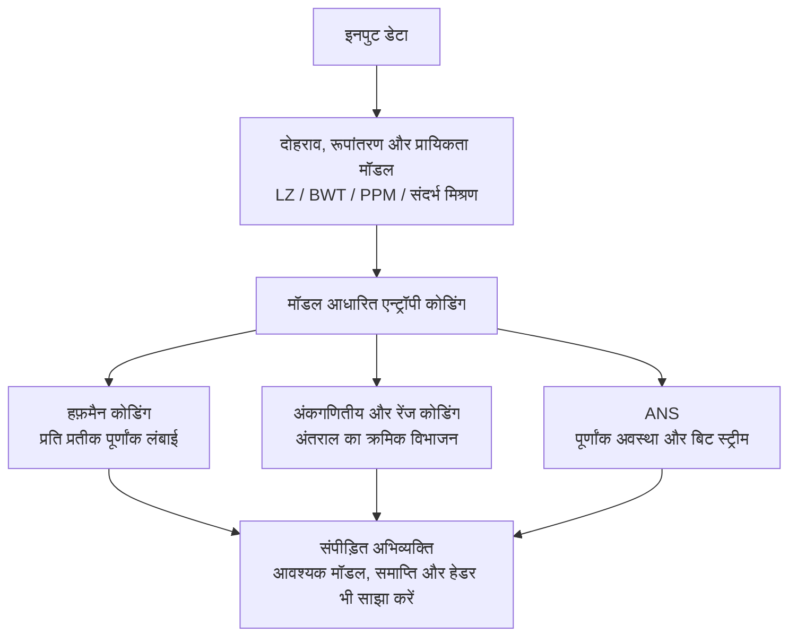
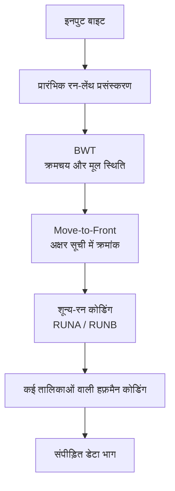

## 1. कोई भी कंप्रेसर हर फ़ाइल को छोटा क्यों नहीं कर सकता

दोषरहित संपीड़न (lossless compression) डेटा को ऐसी दूसरी अभिव्यक्ति में बदलता है जिससे मूल बाइट एक भी बिट बदले बिना वापस मिलते हैं। zip, gzip, zstd और xz कुछ इनपुट छोटे करते हैं; दूसरे लगभग वैसे ही रहते हैं या हेडर के कारण बढ़ जाते हैं। सभी डेटा एक ही अनुपात में छोटे नहीं होते। JPEG या MP3 जैसे हानिपूर्ण संपीड़न में पुनर्निर्मित मानों में अंतर स्वीकार्य होता है, इसलिए पुनर्निर्माण की शर्त अलग है।

{0,1}* सभी सीमित बिट-स्ट्रिंग का समुच्चय है। एक एनकोडर E और डिकोडर D तय करें। दोषरहित होने के लिए हर इनपुट x पर यह आवश्यक है:

$$
D(E(x))=x
$$

यदि अलग-अलग इनपुट का आउटपुट एक हो, तो D दोनों को वापस नहीं पा सकता। इसलिए E एकैकी होना चाहिए। ठीक n बिट के 2^n इनपुट हैं, लेकिन n से छोटे आउटपुट, खाली स्ट्रिंग सहित, इससे कम हैं। यहाँ n≥1 है।

$$
\left|\{0,1\}^{n}\right|=2^n>
\sum_{k=0}^{n-1}2^k=2^n-1
$$

इसलिए तय किया हुआ दोषरहित कंप्रेसर हर n-बिट इनपुट छोटा नहीं कर सकता। सभी सीमित स्ट्रिंग पर परिभाषित एकैकी फलन कुछ इनपुट छोटा करे, तो उसे कम से कम किसी दूसरे इनपुट को बढ़ाना होगा। यदि वह n-बिट के x को छोटा करे और किसी को न बढ़ाए, तो n से छोटे इनपुट पहले ही n से छोटे सभी आउटपुट भर देंगे। E(x) उन्हीं में से किसी से टकराएगा।

इसे परिमाण में व्यक्त करने के लिए E तय रखें और n-बिट की X को एकसमान वितरण से चुनें। पूर्णांक 1≤c≤n के लिए कम से कम c बिट घटने वाले इनपुट का अनुपात इस ऊपरी सीमा को मानता है। हम संभावित आउटपुट गिन रहे हैं; एनकोडर को उन सभी का उपयोग करना आवश्यक नहीं।

$$
\Pr\!\left(|E(X)|\le n-c\right)
\le\frac{2^{n-c+1}-1}{2^n}
<2^{1-c}
$$

c=11 पर अनुपात 1/1024, लगभग 0.0977%, से कम है। इसका अर्थ यह नहीं कि बची हुई किसी भी फ़ाइल को कोई दूसरा कंप्रेसर छोटा नहीं कर सकता। किसी खास फ़ाइल x के लिए अलग एनकोडर x और खाली स्ट्रिंग की अदला-बदली कर सकता है: x छोटा होगा और खाली स्ट्रिंग बढ़ेगी। डिकोडर को यह विशेष नियम पता होना चाहिए। कोल्मोगोरोव जटिलता में भी तय विवरण-भाषा और डिकोडिंग प्रोग्राम के विवरण की लंबाई में अंतर रखना पड़ता है।

व्यावहारिक संपीड़न किसी वितरण या दोहराई जाने वाली संरचना के अनुकूल अभिव्यक्ति अपनाता है: अक्षरों की असमान आवृत्ति, दोहराई गई उप-स्ट्रिंग या संख्यात्मक पैटर्न। लाभ इनपुट और विधि पर निर्भर है। यह निश्चित रूप से नहीं कहा जा सकता कि पहले से संपीड़ित फ़ाइल या कूटपाठ एक बाइट भी नहीं घट सकता। कूटलेखन विधि, उसका मोड, मेटाडेटा और बची संरचना मायने रखते हैं।

इकाइयाँ भी अलग हैं। एक MiB में 1,048,576 बाइट या 8,388,608 बिट होते हैं। दशमलव MB में 1,000,000 बाइट या 8,000,000 बिट होते हैं।

## 2. शैनन एन्ट्रॉपी और औसत कोड लंबाई की सीमाएँ

शैनन के 1948 के शोधपत्र ने अर्थगत मूल्य को संचार की अभियांत्रिकी समस्या से अलग किया और स्रोतों का अध्ययन प्रायिकताओं से किया। इस [पुनर्मुद्रण](https://wucj.lab.westlake.edu.cn/Others/shannon1948.pdf) की भूमिका नाइक्विस्ट और हार्टली के पहले के काम को भी मान्यता देती है।

धनात्मक प्रायिकता वाली घटना x की स्व-सूचना इस प्रकार परिभाषित है। आधार दो के लघुगणक से इकाई बिट मिलती है। यह मनोवैज्ञानिक आश्चर्य या विषय की महत्ता को नहीं मापती।

$$
I(x)=-\log_2P(x),\qquad 0<P(x)\le1
$$

सीमित वर्णमाला पर यादृच्छिक चर X के लिए p_i=P(X=x_i) लें। शैनन एन्ट्रॉपी स्व-सूचना का प्रत्याशित मान है। शून्य प्रायिकता वाले पदों के लिए 0log₂0=0 की परंपरा अपनाते हैं।

$$
H(X)=-\sum_{i=1}^{m}p_i\log_2p_i,\qquad
p_i\ge0,\quad\sum_i p_i=1,\quad
0\le H(X)\le\log_2m
$$

इकाई प्रति प्रतीक बिट है। m प्रतीकों की तय वर्णमाला में एकसमान वितरण एन्ट्रॉपी अधिकतम करता है; एक प्रतीक की प्रायिकता एक हो तो एन्ट्रॉपी शून्य है। निष्पक्ष सिक्के के परिणाम की स्व-सूचना एक बिट और प्रायिकता 1/256 वाली घटना की आठ बिट है। ये प्रतीक-मॉडल के मान हैं; इनसे सहसंबंधित अनुक्रम की सूचना या हर अलग फ़ाइल की निचली सीमा सीधे निर्धारित नहीं होती।

### उपसर्ग-मुक्त कोड और क्राफ़्ट–मैकमिलन असमिका

हर प्रतीक को एक बाइनरी कोडवर्ड दें ताकि उन्हें जोड़ने पर एकमात्र ढंग से डिकोड किया जा सके। उपसर्ग-मुक्त कोड में कोई कोडवर्ड दूसरे की शुरुआत नहीं है। उदाहरण के लिए {0,10,110,111}, 100110111 को 10 | 0 | 110 | 111 में बाँटता है। ASCII स्वयं सात-बिट का अक्षर कोड है; यह हर अक्षर को आठ बिट देने का पर्याय नहीं।

लंबाई ℓ_i वाले कोडवर्ड को बाइनरी वृक्ष की पत्तियों से दर्शाएँ। अधिकतम गहराई ℓ_max वाले पूर्ण वृक्ष में एक पत्ती अपने नीचे 2^(ℓ_max−ℓ_i) संभावित स्थान घेरती है। इन अलग-अलग उपवृक्षों की गिनती से क्राफ़्ट असमिका मिलती है। एकमात्र ढंग से डिकोड होने वाले कोड भी इसे मानते हैं।

$$
\sum_i2^{\ell_{\max}-\ell_i}\le2^{\ell_{\max}}
\quad\Longrightarrow\quad
Z:=\sum_i2^{-\ell_i}\le1
$$

उलटे, इस असमिका को मानने वाली धनात्मक पूर्णांक लंबाइयों के लिए उपसर्ग-मुक्त कोड बनाया जा सकता है। आगे हम धनात्मक प्रायिकता वाले प्रतीकों पर विचार करते हैं और उनकी संख्या कम से कम दो मानते हैं। केवल एक प्रतीक वाले स्रोत में खाली कोडवर्ड स्वीकार्य है या नहीं, और प्रतीकों की संख्या या समाप्ति कैसे साझा होगी, अलग से बताना आवश्यक है।

### KL डाइवर्जेंस से निचली सीमा

औसत कोड लंबाई और उन लंबाइयों से प्राप्त सामान्यीकृत वितरण Q इस प्रकार परिभाषित करें:

$$
L=\sum_i p_i\ell_i,\qquad
q_i=\frac{2^{-\ell_i}}{Z},\qquad \sum_i q_i=1
$$

कुलबैक–लाइब्लर डाइवर्जेंस के अऋणात्मक होने से यह सर्वसमिका मिलती है। अऋणात्मकता, उदाहरण के लिए, लघुगणकीय असमिका ln u≤u−1 से सिद्ध होती है।

$$
\begin{aligned}
0\le D_{\mathrm{KL}}(P\|Q)
&=\sum_i p_i\log_2\frac{p_i}{q_i}\\
&=-H(X)+\sum_i p_i\ell_i+\log_2Z\\
&=L-H(X)+\log_2Z
\end{aligned}
$$

इससे औसत लंबाई की सीमा प्राप्त होती है:

$$
L=H(X)+D_{\mathrm{KL}}(P\|Q)-\log_2Z\ge H(X)
$$

Q में 2^(-ℓ_i) को Z से भाग दिया गया है। इस सामान्यीकरण को हटाकर −log₂Z पद भी अलग से नहीं गिनना चाहिए। समानता के लिए P=Q और Z=1 चाहिए; तब p_i=2^(-ℓ_i), अर्थात् प्रायिकताएँ बाइनरी कोड लंबाइयों से मेल खाती हैं।

ऊपरी सीमा वाला कोड भी बनाया जा सकता है। शैनन की ये लंबाइयाँ क्राफ़्ट असमिका को मानती हैं:

$$
\ell_i=\lceil-\log_2p_i\rceil,\qquad
2^{-\ell_i}\le p_i,\qquad
\sum_i2^{-\ell_i}\le1
$$

अगले पूर्णांक तक बढ़ाने से प्रति प्रतीक एक बिट से कम जुड़ता है। इसलिए इस कोड की औसत लंबाई H+1 से कम है। इष्टतम बाइनरी उपसर्ग-मुक्त कोड की औसत लंबाई L_opt इस सीमा में है:

$$
H(X)\le L_{\mathrm{opt}}<H(X)+1
$$

स्वतंत्र और एक ही वितरण वाले प्रतीकों के ऐसे स्रोत में, जहाँ कम से कम दो प्रतीकों की प्रायिकता धनात्मक है, N प्रतीकों को जोड़कर उपयुक्त ब्लॉक उपसर्ग-मुक्त कोड चुनने से निम्न संबंध मिलता है। L_N पूरे ब्लॉक की औसत लंबाई है।

$$
H(X)\le\frac{L_N}{N}<H(X)+\frac1N
$$

निर्भरता होने पर सामान्यतः H(X_1,...,X_N)≠NH(X_1) होता है। एक निष्पक्ष बिट चुनकर उसे ज्ञात लंबाई N तक दोहराएँ: हर स्थान की सीमांत एन्ट्रॉपी एक बिट है, पर पूरे अनुक्रम की भी केवल एक बिट है। सीमित वर्णमाला वाले स्थिर स्रोतों में, जिनका संयुक्त वितरण समय-स्थानांतरण पर नहीं बदलता (stationary), एन्ट्रॉपी दर का उपयोग होता है:

$$
\overline H=\lim_{N\to\infty}\frac{H(X_1,\ldots,X_N)}{N}
$$

ये कथन बताए गए वितरणों और कोड की श्रेणियों में औसत के बारे में हैं। इनका अर्थ यह नहीं कि हर फ़ाइल कम से कम इतनी लंबी होगी या मॉडल व हेडर की लागत नज़रअंदाज़ की जा सकती है।

## 3. हफ़मैन कोडिंग, अंकगणितीय कोडिंग और ANS

सांख्यिकीय मॉडल और प्रायिकताओं को बिट में बदलने वाले कोडर को अलग समझने से प्रत्येक विधि स्पष्ट होती है। यह अवधारणात्मक चित्र है; यह हर फ़ॉर्मैट के लिए इन चरणों में स्वतंत्र विभाजन अनिवार्य करने वाला विनिर्देश नहीं।

### हफ़मैन: किस श्रेणी में इष्टतम?

[हफ़मैन का 1952 का शोधपत्र](https://compression.ru/download/articles/huff/huffman_1952_minimum-redundancy-codes.pdf) दिए गए भारों के लिए औसत लंबाई न्यूनतम करने वाले उपसर्ग-मुक्त कोड बनाता है। बाइनरी मामले में सबसे कम भार वाले दो नोड बार-बार जोड़कर उनका योग वापस रखा जाता है। हीप से m प्रतीकों का वृक्ष O(m log m) में बनता है।

कम से कम दो धनात्मक भार होने पर इष्टतम वृक्ष में केवल एक संतान वाली अनावश्यक शाखाएँ हटाई जा सकती हैं। सबसे छोटे दो भार अधिकतम गहराई की सहोदर पत्तियों पर रखने से औसत लंबाई नहीं बढ़ती। उन्हें प्रतीक z में मिलाने पर मूल वृक्ष T और छोटे वृक्ष T′ का संबंध है:

$$
L(T)=L(T')+p_a+p_b
$$

अंतर तय है, इसलिए छोटे प्रश्न का इष्टतम हल मूल प्रश्न का हल बनाता है। समान भारों से कई इष्टतम वृक्ष मिल सकते हैं। कैनॉनिकल हफ़मैन कोड लंबाइयों और प्रतीक क्रम से कोडवर्ड तय करते हैं, जिससे वृक्ष भेजना सरल होता है। इससे तालिकाओं के विवरण की लागत या लंबे कोडवर्ड डिकोड करने के अतिरिक्त चरण समाप्त नहीं होते।

P(0)=0.99 और P(1)=0.01 के लिए प्रतीक-दर-प्रतीक इष्टतम बाइनरी उपसर्ग-मुक्त कोड दोनों के लिए एक-एक बिट उपयोग करता है।

$$
H(X)=-0.99\log_2(0.99)-0.01\log_2(0.01)
\approx0.080793,\qquad L_{\mathrm H}=1
$$

इसकी औसत लंबाई एन्ट्रॉपी की लगभग 12.4 गुना है। इसका अर्थ यह नहीं कि मूल फ़ाइल छोटी नहीं हो सकती: प्रति प्रतीक आठ बिट से शुरू होने वाला रूप, पहले से बिट-दर-बिट पैक किए अनुक्रम से अलग है। ब्लॉक पूर्णांक लंबाई के कारण होने वाली हानि घटाते हैं, लेकिन सभी m^k संयोजनों का स्पष्ट वृक्ष तेज़ी से बढ़ता है। एक प्रतीक के खाली कोडवर्ड की परंपरा में संख्या साझा करने का प्रश्न अलग रहता है।

### अंकगणितीय कोडिंग: अंतराल और सीमित बिट-स्ट्रिंग

अंकगणितीय कोडिंग संदेश के अंतराल को संकरा करती है। P(s) प्रतीक की प्रायिकता और A(s) तय क्रम में उससे पहले के प्रतीकों की प्रायिकताओं का योग है। [lo_0,hi_0)=[0,1) से शुरू करें। हर कोडित प्रतीक की प्रायिकता धनात्मक मानें। चौड़ाई W_(t−1)=hi_(t−1)−lo_(t−1) हो, तो अद्यतन है:

$$
\begin{aligned}
\mathrm{lo}_t&=\mathrm{lo}_{t-1}+W_{t-1}A(x_t),\\
\mathrm{hi}_t&=\mathrm{lo}_{t-1}+W_{t-1}\bigl(A(x_t)+P(x_t)\bigr)
\end{aligned}
$$

तय स्वतंत्र मॉडल में अंतिम चौड़ाई नीचे का पहला गुणनफल है। निर्भरता होने पर ऐसी सशर्त प्रायिकताएँ उपयोग होती हैं जिन्हें दोनों पक्ष हर चरण में पुनः निकाल सकें।

$$
W_N=\prod_{t=1}^{N}P(x_t)
\quad\text{or}\quad
W_N=\prod_{t=1}^{N}P(x_t\mid x_{<t})
$$

एक ही ज्ञात लंबाई N के अलग संदेश अलग, न मिलने वाले अंतरालों में जाते हैं। अंतिम अंतराल के भीतर पूरा समाया हुआ द्विआधारी विभाजन का अंतराल [j2^(-K),(j+1)2^(-K)) चुनें; K बिट उसे पहचानते हैं। चौड़ाई के आधे से अधिक न होने वाला जाल-अंतर, आदर्श अनंत परिशुद्धता वाले अंकगणित में यह पर्याप्त लंबाई सुनिश्चित करता है:

$$
K=\lceil-\log_2W_N\rceil+1<-\log_2W_N+2
$$

यह ज्ञात मॉडल और लंबाई के अंतर्गत आदर्श पेलोड की सीमा है। यह नहीं कहता कि सबसे छोटा K हमेशा सूत्र के बराबर है या पूरी फ़ाइल में केवल दो बिट का अतिरिक्त खर्च है। मॉडल, समाप्ति, परिशुद्धता और हेडर की अलग लागत है। वास्तविक ब्लॉक वितरण P के अंतर्गत यह उपसर्ग-मुक्त अभिव्यक्ति औसत लंबाई की यह सीमा मानती है:

$$
H(P)\le\mathbb E_P[K]<H(P)+2
$$

P(0)=0.99 पर लगभग 69 लगातार शून्य चौड़ाई आधी करते हैं। यह हर 69 प्रतीक पर ठीक एक बिट निकालने का नियम नहीं: उत्सर्जन अंतराल और पुनःसामान्यीकरण पर निर्भर है। पूर्णांक कार्यान्वयन तय हो चुके उच्च-महत्त्व वाले बिट या बाइट निकालकर अवस्था फैलाते हैं। प्रायिकता का परिमाणीकरण, कैरी और लंबित बिट भी काम माँगते हैं। अंकगणितीय या रेंज कोडिंग का अन्य कोडरों के साथ कोई सार्वभौमिक गति-अनुपात नहीं।

### ANS: पूर्णांक अवस्था में सूचना जोड़ना

[डूडा का ANS शोधपत्र](https://arxiv.org/html/1311.2540v2) असमान प्रायिकता वाले प्रतीकों के लिए संख्या प्रणालियाँ बनाता है। सामान्य आधार b में अंक s जोड़ना इस तरह उलटा जा सकता है:

$$
x'=bx+s,\qquad s=x'\bmod b,\qquad x=\lfloor x'/b\rfloor
$$

समान प्रायिकताओं और पर्याप्त बड़ी धनात्मक अवस्था x के लिए लघुगणकीय आकार की वृद्धि लगभग log₂b है। सामान्य प्रायिकताओं में संरचना अवस्था को लगभग 1/P(s) गुना करती है। x=0 पर log₂x न लगाएँ और इस सन्निकटन को सटीक पूर्णांक कोड लंबाई न मानें।

rANS की एक रचना में M=2^R, धनात्मक पूर्णांक प्रतीक आवृत्तियाँ f_s और संचयी आवृत्तियाँ b_s हैं।

$$
\sum_s f_s=M,\qquad b_s=\sum_{a<s}f_a,\qquad P(s)\approx f_s/M
$$

यह अऋणात्मक पूर्णांक अवस्था x और प्रतीक s को इस प्रकार बदलती है:

$$
C(x,s)=M\left\lfloor\frac{x}{f_s}\right\rfloor+(x\bmod f_s)+b_s
$$

व्युत्क्रम slot से प्रतीक चुनकर पिछली अवस्था प्राप्त करता है:

$$
\begin{aligned}
\mathrm{slot}&=x'\bmod M,\\
b_s&\le\mathrm{slot}<b_s+f_s,\\
x&=f_s\left\lfloor\frac{x'}M\right\rfloor+\mathrm{slot}-b_s
\end{aligned}
$$

M दो की घात हो, तो भागफल और शेष शिफ़्ट और मास्क से मिलते हैं। प्रतीक खोज, तालिका पहुँच, पुनःसामान्यीकरण और इनपुट/आउटपुट का खर्च भी है। यह एकैकी-आच्छादक संबंध (bijection) अकेले शून्य कोडिंग हानि या एक क्लॉक चक्र में डिकोडिंग सुनिश्चित नहीं करता।

tANS सीमित अवस्थाएँ और संक्रमण तालिकाएँ उपयोग करता है। बिट-आधारित व्याख्या में, उदाहरण के लिए, यह पूर्णांक समुच्चय लें। यह अर्ध-खुले अंतराल [L,2L) के अनुरूप है, [L,2L−1) के नहीं।

$$
\mathcal I=\{L,L+1,\ldots,2L-1\},\qquad |\mathcal I|=L
$$

अनुमत सीमा में बने रहने के लिए संचित अवस्था और स्ट्रीम के बीच बिट स्थानांतरित होते हैं। सामान्यीकरण की शर्तें और प्रतीकों का विन्यास मेल खाने चाहिए; rANS सूत्रों की जगह केवल छोटी तालिका रखना पर्याप्त नहीं। FSE, tANS परिवार का कार्यान्वयन है।

ANS अवस्था के ऑपरेशन स्टैक की तरह हैं: आख़िरी जोड़ा प्रतीक पहले मिलता है। ब्लॉक को उलटे क्रम में एनकोड करने से मूल क्रम में डिकोड करना संभव हो सकता है। संदर्भगत प्रायिकताओं में उनकी गणना का क्रम भी उलटी कोडिंग से मिलाना पड़ता है। हफ़मैन, अंकगणितीय कोडिंग और ANS अलग मॉडलों, फ़ॉर्मैटों और कार्यान्वयनों के विकल्प हैं; ऐसी तीन पीढ़ियाँ नहीं जिनमें हर अगली हमेशा पिछली को बदल दे।

## 4. LZ, BWT और संदर्भ मॉडल क्या बदलते हैं

केवल अलग-अलग बाइट की आवृत्तियों वाला मॉडल लंबे दोहराव और निर्भरता का पूरा लाभ नहीं उठाता। अंग्रेज़ी को एक सार्वभौमिक बिट-संख्या देने के बजाय पाठ-संग्रह और इकाई स्पष्ट करें: अक्षर, बाइट या टोकन।

### शब्दकोश संपीड़न: LZ77, LZ78 और LZW

LZ77 परिवार पहले से निकले डेटा को पीछे संदर्भित करता है। यदि 16-बाइट की ASCII स्ट्रिंग `std::vector<int>` पहले 200 बाइट पीछे आई थी और फिर मेल खाती है, तो उसे इस दूरी और लंबाई से दिखा सकते हैं। यह 16 सीधे बाइट से सस्ता है या नहीं, इस पर निर्भर है कि फ़ॉर्मैट दोनों संख्याएँ कैसे कोड करता है।

$$
(d,\ell)=(200,16)
$$

मिलान की लंबाई दूरी से बड़ी हो सकती है। एक लिटरल A के बाद दूरी 1 और लंबाई 99 का संदर्भ नई कॉपी हुई A को भी स्रोत बनाकर कुल 100 A पैदा करता है। [DEFLATE विनिर्देश](https://www.rfc-editor.org/rfc/rfc1951.txt) में भी अतिव्यापी संदर्भ का उदाहरण है। ओवरलैप वाले क्षेत्रों पर सामान्य memcpy लगाना या मूल स्रोत की शुरुआती प्रति ही कॉपी करना इस विस्तार का सही वर्णन नहीं। कार्यान्वयन को बढ़ता आउटपुट सँभालकर दूरी, आउटपुट सीमा और इनपुट लंबाई जाँचनी होती है।

LZSS फ़्लैग या दूसरे रूप से लिटरल और मिलान अलग करता है। फ़्लैग भी स्थान लेते हैं, इसलिए बिना मिलान वाले डेटा का आकार कभी न बढ़ने की गारंटी नहीं। LZ78/LZW मिले हुए स्ट्रिंग स्पष्ट शब्दकोश में जोड़कर सूचकांक उपयोग करते हैं। वृद्धि, रीसेट, संदर्भ-क्षेत्र और पूर्णांक कोडिंग अलग हैं; किसी विधि को हर इनपुट पर जीतना आवश्यक नहीं।

वास्तविक फ़ॉर्मैट भी अलग हैं। DEFLATE के संपीड़ित ब्लॉक दूरी 1–32,768 और लंबाई 3–258 उपयोग करते हैं, तथा लिटरल/लंबाई और दूरी के लिए अलग हफ़मैन कोड रखते हैं। असंपीड़ित ब्लॉक भी हैं। [Zstandard विनिर्देश](https://www.rfc-editor.org/rfc/rfc8878.html) लिटरल और अनुक्रम अलग करता है: लिटरल के लिए असंपीड़ित/RLE/हफ़मैन और अनुक्रमों के लिए FSE सहित मोड हैं। एक या चार हफ़मैन स्ट्रीम, अनुक्रमों की तीन प्रकार की FSE अवस्थाओं से अलग बात है। LZMA/LZMA2 भी शब्दकोश और प्रायिकता मॉडल मिलाते हैं; [LZMA एनकोडर](https://github.com/ip7z/7zip/blob/main/C/LzmaEnc.c) में मिलान खोज और रेंज कोडिंग ऑपरेशन हैं। एक एल्गोरिदम का नाम हर फ़ॉर्मैट, टूल या स्तर का स्थान नहीं लेता।

### BWT: लंबाई सुरक्षित रखने वाला क्रमचय और उसका व्युत्क्रम

बरोज़–व्हीलर रूपांतरण समान अगले संदर्भ वाले अक्षर पास लाता है। अंतिम स्तंभ प्रतीकों की संख्या बनाए रखता है, पर उलटने के लिए आवश्यक स्थिति या सेंटिनल सूचना की लागत भी होती है।

`banana$` लें, जहाँ अद्वितीय सेंटिनल `$` अन्य अक्षरों से पहले क्रम में आता है। सात चक्रीय घुमाव क्रमबद्ध करके अंतिम स्तंभ और मूल पंक्ति संख्या निकालें।

| पंक्ति | शब्दकोश क्रम में घुमाव | पहला | अंतिम |
| :--- | :--- | :---: | :---: |
| 0 | `$banana` | `$` | a |
| 1 | `a$banan` | a | n |
| 2 | `ana$ban` | a | n |
| 3 | `anana$b` | a | b |
| 4 | `banana$` | b | `$` |
| 5 | `na$bana` | n | a |
| 6 | `nana$ba` | n | a |

आउटपुट `annb$aa` है और शून्य से गिनी मूल पंक्ति 4 है। L अंतिम स्तंभ और F पहला हो, तो L के अक्षर क्रमबद्ध करने से F मिलता है। एक ही अक्षर की उपस्थितियाँ क्रम से मिलाने पर LF मैपिंग बनती है, जो मूल अनुक्रम में पीछे की ओर चलती है। शून्य-आधारित स्थितियों में C(c), c से छोटे अक्षरों की संख्या है और rank_c(i), L में स्थिति i से पहले आए c की संख्या है।

$$
\mathrm{LF}(i)=C(L_i)+\mathrm{rank}_{L_i}(i)
$$

छोटी तय वर्णमाला में आवृत्तियाँ और उपस्थितियों के क्रम रैखिक समय में बनते हैं और N प्रतीकों का अनुक्रम O(N) में उलटता है। सामान्य तुलना-आधारित क्रमबद्धता का उपयोग हो तो उसकी लागत अलग गिनें। BWT हर इनपुट को लंबे लगातार दोहराव में नहीं बदलता।

[bzip2 1.0.8 मैनुअल](https://sourceware.org/bzip2/manual/manual.html) और [उस संस्करण का सोर्स](https://sourceware.org/pub/bzip2/bzip2-1.0.8.tar.gz) BWT से पहले RLE, फिर MTF, शून्य-रन कोडिंग और कई हफ़मैन तालिकाएँ मिलाते हैं। MTF किसी अक्षर का सूची में वर्तमान क्रमांक निकालकर उसे सामने लाता है। दोहराए अक्षर शून्य देते हैं, जिन्हें RUNA/RUNB से कोड किया जाता है। चित्र मुख्य डेटा रूपांतरण दिखाता है; हेडर, सूचकांक और CRC नहीं।

### संदर्भ मॉडल और LLM: कोड लंबाई और पूर्वानुमान हानि

PPM अलग लंबाई के संदर्भ उपयोग करता है और अनदेखे प्रतीकों के लिए एस्केप जैसे उपाय रखता है। संदर्भ मिश्रण कई मॉडलों के पूर्वानुमान जोड़ता है। न्यूरल मॉडल भी पूर्वानुमान दे सकते हैं; Transformer और आवर्ती नेटवर्क पर्याय नहीं।

जिस अनुक्रम को मॉडल Q_θ धनात्मक सशर्त प्रायिकताएँ देता है, उसकी आदर्श सूचना इस प्रकार है। इसे वास्तविक आउटपुट लंबाई के बराबर नहीं रखा गया है।

$$
I_\theta(x_{1:N})=-\log_2 Q_\theta(x_{1:N})
=\sum_{t=1}^{N}-\log_2Q_\theta(x_t\mid x_{<t})
$$

इस अनुक्रम के प्राकृतिक लघुगणक वाले औसत ऋणात्मक लॉग-लाइकलीहुड में आधार और औसत के गुणक यह संबंध देते हैं:

$$
\mathcal L_{\mathrm{NLL}}(\theta)
=-\frac1N\sum_{t=1}^{N}\ln Q_\theta(x_t\mid x_{<t})
=\frac{\ln2}{N}I_\theta(x_{1:N})
$$

इसलिए डेटा, इकाई और मॉडल की शर्तें समान हों तो इस हानि को घटाना आदर्श कोड लंबाई घटाने के अनुरूप है। सूत्र में साझा मॉडल का आकार, प्रतिवर्ती टोकनाइज़ेशन, सीमित परिशुद्धता, समाप्ति, हेडर या डिकोडिंग समय शामिल नहीं। किसी पूर्वानुमान की सूचना एक बिट से कम होने पर उसके कोडवर्ड को अकेले भिन्नात्मक-बिट फ़ाइल में नहीं रख सकते।

[Language Modeling Is Compression](https://arxiv.org/html/2309.10668v2) इस संबंध का प्रयोगात्मक अध्ययन करता है। छवि और ऑडियो तुलना में प्रसंस्कृत डेटा और निर्दिष्ट संदर्भ लंबाइयाँ हैं; मॉडल भार की लागत छोड़ने और शामिल करने वाले अनुपात अलग हैं। निष्कर्ष सभी छवियों, सभी ऑडियो या मनमानी फ़ाइलों पर लागू न करें। Hutter Prize जैसी चुनौतियाँ पूर्वानुमान अनुसंधान बढ़ाती हैं, पर कोडिंग समीकरण अकेले बुद्धिमत्ता या समझ की पर्याप्त शर्त सिद्ध नहीं करते।

## 5. संपीड़ित आकार, गति और मेमोरी की तुलना

व्यावहारिक मूल्यांकन में संपीड़ित आकार, एनकोडिंग और डिकोडिंग समय, मेमोरी, संगतता और पहुँच की इकाई साथ देखें। संपीड़ित अनुपात को संपीड़ित आकार/मूल आकार परिभाषित करें: छोटा बेहतर है। अलग विन्यास के बेंचमार्क से सार्वभौमिक क्रम नहीं बनता।

| विधि या टूल | संरचनात्मक विशेषताएँ | तुलना में जाँचें |
| :--- | :--- | :--- |
| LZ4 | बाइट-आधारित LZ77 जैसा रूप, ब्लॉक के भीतर एन्ट्रॉपी कोडिंग नहीं | छोटी इनपुट की फ़्रेमिंग लागत, डिकोडिंग गति, बफ़र |
| Zstandard | मिलान खोज, लिटरल और अनुक्रम, हफ़मैन/FSE और अन्य मोड | स्तर, शब्दकोश, विंडो, मोड, दोनों पक्षों की मेमोरी |
| DEFLATE / gzip | पीछे के संदर्भ और हफ़मैन; असंपीड़ित ब्लॉक संभव | फ़ॉर्मैट बनाम टूल, संगतता, ब्लॉक और आवरण की लागत |
| BWT / bzip2 | ब्लॉक रूपांतरण, MTF, रन और हफ़मैन | ब्लॉक आकार, पुनर्निर्माण कार्यक्षेत्र और सूचकांक |
| LZMA/LZMA2 / xz और 7-Zip | शब्दकोश मिलान और अनुकूली प्रायिकता कोडिंग | फ़ॉर्मैट और सेटिंग, शब्दकोश, खोज समय, डिकोडर सीमा |
| PPM, संदर्भ मिश्रण और न्यूरल पूर्वानुमान | संदर्भ प्रायिकताओं के बाद कोडिंग | मॉडल साझाकरण/प्रेषण, संदर्भ लंबाई, गणना, पुनरुत्पाद्य परिशुद्धता |

[LZ4 ब्लॉक विनिर्देश](https://github.com/lz4/lz4/blob/dev/doc/lz4_Block_format.md) फ़्रेमिंग अलग रखता है; [7-Zip फ़ॉर्मैट विवरण](https://www.7-zip.org/7z.html) कई विधियाँ अलग करता है। संरचना समझना और अपने कार्यभार को मापना, दोनों आवश्यक हैं।

कार्यान्वयन व संस्करण, कमांड व स्तर, CPU व थ्रेड, इनपुट हैश व आकार, शब्दकोश, कैश और इनपुट/आउटपुट की शर्तें लिखें। कुल मूल बाइट U, कुल संपीड़ित बाइट C और बीते समय से C/U व थ्रूपुट निकालें। आकार-अनुपात में खाली इनपुट अलग रखें। मेमोरी में शब्दकोश के साथ बफ़र और मॉडल भी गिनें। डिकंप्रेस किए बाइट का हैश मूल से मिलाएँ। यहाँ कोई नया गति-मापन प्रस्तुत नहीं है।

### एनकोडिंग/डिकोडिंग का काम और इनपुट/आउटपुट

LZ परिवार में डिकोडिंग, एनकोडर की मिलान खोज और निरूपण चुनने से हल्की हो सकती है। फिर भी एक ही फ़ॉर्मैट में स्तर और निकले निर्देश डिकोडिंग गति बदल सकते हैं। ऊँचा स्तर ठीक समान डिकोडिंग गति की गारंटी नहीं। पूर्वानुमान मॉडल के डिकोडर को प्रायिकताएँ पुनः निकालनी होती हैं, पर एनकोडर उनकी गणना बैच में कर सकता है; समय बराबर होना आवश्यक नहीं।

सरल पढ़ने के मॉडल में इनपुट/आउटपुट गति v_io और मूल बाइट में मापी डिकोडिंग गति v_dec लें। CPU का काम और इनपुट/आउटपुट न ओवरलैप हों तो अनुमानित समय हैं:

$$
T_{\mathrm{raw}}\approx\frac{U}{v_{\mathrm{io}}},\qquad
T_{\mathrm{compressed}}\approx\frac{C}{v_{\mathrm{io}}}
+\frac{U}{v_{\mathrm{dec}}}
$$

इससे इनपुट/आउटपुट की बचत की तुलना डिकोडिंग लागत से की जाती है। स्वतंत्र संसाधन और प्रभावी पाइपलाइन में स्थिर-अवस्था का समय योग के बजाय बड़े पद के निकट हो सकता है। आरंभिक लागत, मेमोरी बैंडविड्थ, समांतरता और पहुँच इकाई के लिए दूसरा मॉडल चाहिए हो सकता है।

शाखाएँ, निर्भरताएँ, कैश, SIMD और निर्देश-स्तरीय समांतरता गति बदलते हैं। केवल इनके होने से सार्वभौमिक MB/s सीमा नहीं निकलती और स्ट्रीम अलग करने से शाखा-पूर्वानुमान की त्रुटियाँ शून्य नहीं होतीं। एक बार संपीड़ित होकर कई पाठकों द्वारा डिकोड होने वाले सॉफ़्टवेयर पैकेज और बार-बार अद्यतन लॉग की प्राथमिकताएँ अलग हैं।

## 6. किन सीमाओं और लागतों को गिना जा रहा है?

कबूतरखाना सिद्धांत बताता है कि तय दोषरहित एनकोडर हर इनपुट छोटा नहीं कर सकता। एन्ट्रॉपी की निचली सीमाएँ निर्दिष्ट प्रायिकता मॉडल और कोडिंग शर्तों के अंतर्गत औसत लंबाई से संबंधित हैं। हफ़मैन, अंकगणितीय कोडिंग और ANS प्रायिकता को अलग तरीकों से अभिव्यक्ति से जोड़ते हैं; LZ, BWT और संदर्भ मॉडल दोहराव और निर्भरता का लाभ लेते हैं।

पूर्वानुमान हानि और आदर्श कोड लंबाई का संबंध न्यूरल संपीड़न समझने में मदद करता है। इसे पूरी फ़ाइल की लागत, प्रसंस्करण गति या बुद्धिमत्ता के प्रमाण से अलग रखें। क्या साझा है, क्या भेजा जाता है और कौन से इनपुट मापे गए, यह बताना सिद्धांत को व्यावहारिक निर्णयों से जोड़ता है।
