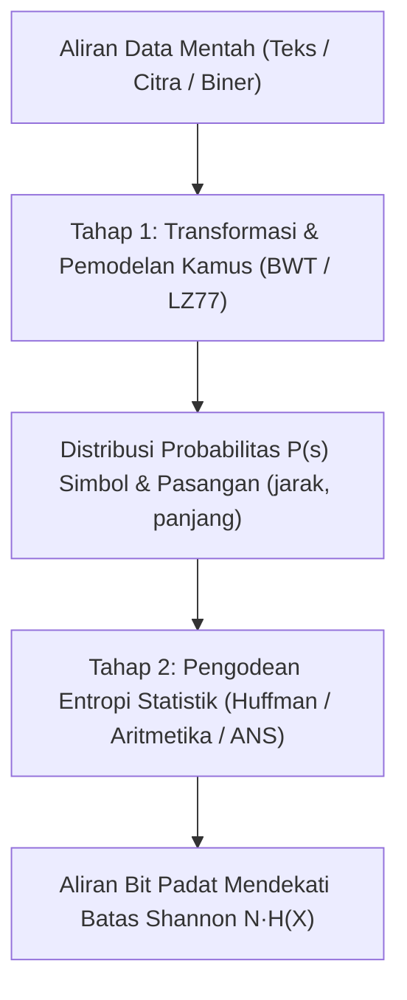
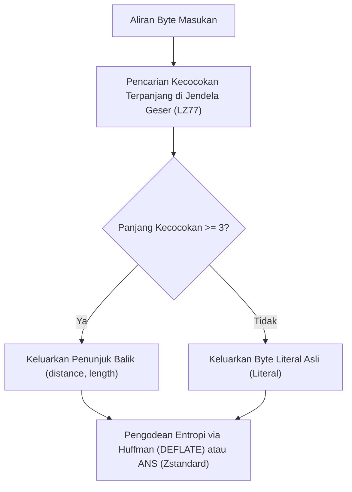

## 1. Prinsip Sarang Merpati: Mengapa Tidak Ada Kompresor Universal yang Bisa Mengecilkan Semua Berkas

Saat kita setiap hari menggunakan `zip`, `gzip`, `zstd`, `7z`, atau `PNG` untuk menyusutkan dokumen, kode sumber, atau citra menjadi sepersekian dari ukuran aslinya dan saat diekstrak <strong>kembali utuh tanpa kehilangan satu bit pun (kompresi nirrugi / lossless)</strong>, muncul sebuah pertanyaan intuitif: jika program kompresi mampu memperkecil berkas, mengapa kita tidak mengompresi ulang berkas `.zip` tersebut sepuluh kali berturut-turut hingga film atau basis data raksasa menyusut menjadi 1 byte saja?

Jawabannya tegas: <strong>itu mustahil secara matematis.</strong> Pembuktiannya bahkan tidak memerlukan teori informasi tingkat lanjut, melainkan cukup dengan <strong>Prinsip Sarang Merpati (Pigeonhole Principle)</strong> dari kombinatorika dasar.

Misalkan $E: \{0,1\}^* \to \{0,1\}^*$ adalah fungsi pengodean nirrugi dan $D: \{0,1\}^* \to \{0,1\}^*$ adalah fungsi pendekodeannya. Agar setiap berkas masukan $x$ dapat dipulihkan secara eksak ($D(E(x)) = x$), pemetaan $E$ wajib bersifat <strong>injektif (satu-ke-satu)</strong>: sebab jika dua berkas berbeda $x_1 \ne x_2$ menghasilkan rangkaian bit terkompresi yang sama $y = E(x_1) = E(x_2)$, dekoder tidak akan pernah tahu apakah harus mengembalikan $x_1$ atau $x_2$!

Terdapat tepat $2^N$ kemungkinan berkas biner dengan panjang $N$ bit. Sebaliknya, jumlah total seluruh untai biner yang panjangnya строго lebih pendek daripada $N$ bit (yakni panjang $0$ hingga $N-1$) hanyalah:

$$\sum_{k=0}^{N-1} 2^k = 2^N - 1 < 2^N$$

Karena terdapat $2^N$ berkas masukan ("merpati") tetapi hanya $2^N - 1$ untai yang lebih pendek ("sarang"), <strong>setiap algoritma kompresi nirrugi yang memperkecil setidaknya satu berkas WAJIB memperbesar (memekarkan) berkas lainnya</strong>! Lebih jauh lagi, proporsi berkas sepanjang $N$ bit yang dapat diperkecil minimal sebanyak $c$ bit dibatasi oleh:

$$P\bigl(|E(X)| \le N - c\bigr) < 2^{-(c-1)}$$

Hampir semua untai biner acak tidak dapat dikompresi sama sekali. Kompresor kita bekerja sangat efektif setiap hari karena teks manusia, kode program, dan citra alami menempati subhimpunan yang sangat kecil, terstruktur, dan <strong>berentropi rendah</strong> di dalam $\{0,1\}^N$.

---

## 2. Teorema Pengodean Sumber Shannon dan Entropi: Batas Fisik Absolut

Pada tahun 1948, Claude E. Shannon menetapkan batas fundamental kompresi data dalam *«A Mathematical Theory of Communication»*. Untuk sumber diskrit tanpa memori dengan alfabet $\mathcal{A} = \{s_1, \dots, s_m\}$ dan distribusi probabilitas $P = (p_1, \dots, p_m)$, <strong>informasi-diri (Surprisal)</strong> dari simbol $s_i$ beserta nilai harapannya, yaitu <strong>entropi Shannon $H(X)$</strong>, didefinisikan sebagai:

$$I(s_i) = -\log_2 p_i, \qquad H(X) = -\sum_{i=1}^{m} p_i \log_2 p_i \quad (\text{bit per simbol})$$

Setiap <strong>kode bebas-prefiks (instan)</strong> dengan panjang kata kode $\ell_1, \dots, \ell_m$ harus memenuhi <strong>ketaksamaan Kraft-McMillan</strong>:

$$\sum_{i=1}^{m} 2^{-\ell_i} \le 1$$

Dengan memanfaatkan sifat non-negatif divergensi Kullback-Leibler $D_{\text{KL}}(P \,\|\, Q) \ge 0$ untuk $q_i = 2^{-\ell_i}/Z$ ($Z = \sum 2^{-\ell_i} \le 1$), diperoleh <strong>Teorema Pengodean Sumber Nirderau Shannon</strong> untuk panjang rata-rata $L = \sum_{i=1}^m p_i \ell_i$:

$$L - H(X) = \sum_{i=1}^m p_i \log_2 \frac{p_i}{2^{-\ell_i}} = D_{\text{KL}}(P \,\|\, Q) + \log_2 \frac{1}{Z} \ge 0 \implies H(X) \le L < H(X) + 1$$

---

## 3. Tiga Generasi Pengodean Entropi: Huffman, Pengodean Aritmetika, dan ANS

### 3.1 Pengodean Huffman (1952): Pohon Prefiks Optimal Berpanjang Bilangan Bulat
Algoritma *greedy* karya David A. Huffman membangun pohon bebas-prefiks optimal dalam waktu $O(m \log m)$ dengan menggabungkan dua simpul berprobabilitas terkecil secara berulang. Kelemahan strukturalnya adalah <strong>setiap kata kode harus memiliki panjang bilangan bulat ($\ell_i \ge 1$ bit)</strong>: simbol dengan probabilitas $p_1 = 0,99$ hanya membawa $-\log_2(0,99) \approx 0,0145\,\text{bit}$ informasi, tetapi tetap menghabiskan minimal $1\,\text{bit}$ penuh.

### 3.2 Pengodean Aritmetika (Arithmetic / Range Coding): Bit Pecahan
Pengodean aritmetika (Rissanen, Pasco, Witten dkk.) menembus batas bilangan bulat dengan memetakan <strong>seluruh rangkaian pesan $x_1 x_2 \dots x_N$ ke dalam satu sub-interval tunggal $[L_{\text{low}}, H_{\text{high}}) \subset [0, 1)$</strong> yang lebar akhirnya $\Delta = \prod_{t=1}^N P(x_t)$ hanya membutuhkan $\lceil -\log_2 \Delta \rceil + 1 \approx N \cdot H(X)$ bit, menghasilkan bit pecahan per simbol dengan konsekuensi komputasi perkalian yang lebih lambat.

### 3.3 Asymmetric Numeral Systems (ANS, Jarek Duda 2009–2014)
Ditemukan oleh fisikawan dan ilmuwan komputer Polandia Jarek Duda, <strong>Asymmetric Numeral Systems (tANS dan rANS)</strong> menyatukan <strong>rasio kompresi optimal pengodean aritmetika dengan kecepatan tabel pencarian (lookup table) pengodean Huffman</strong>. Saat menyandikan simbol $s$ berprobabilitas $p_s$ ke dalam bilangan bulat keadaan $x \in \mathbb{N}$, keadaan diperbaruiตาม:

$$C(x, s) \approx \frac{x}{p_s}$$

Saat ini ANS menjadi mesin utama di balik <strong>Zstandard (`zstd`)</strong> milik Meta, <strong>LZFSE</strong> milik Apple, dan <strong>JPEG XL</strong> milik Google.

---

## 4. Kompresi Kamus dan Transformasi: LZ77, DEFLATE, BWT, dan "Kompresi adalah Prediksi"

Untuk memanfaatkan pengulangan untai dan konteks urutan, kompresor modern memadukan pemodelan kamus dengan pengode entropi:
- <strong>LZ77 (Lempel & Ziv, 1977)</strong>: mengganti untai berulang di dalam jendela geser (*sliding window*) dengan penunjuk balik <strong>`(distance, length)`</strong>. Dipadukan dengan Huffman menghasilkan <strong>DEFLATE (`gzip`, `zip`, `PNG`)</strong>; dipadukan dengan ANS menghasilkan <strong>Zstandard (`zstd`)</strong>.
- <strong>Transformasi Burrows-Wheeler (BWT, 1994, `bzip2`)</strong>: mengurutkan seluruh rotasi siklik blok data secara leksikografis dan mengambil kolom terakhir $L$, mengelompokkan karakter dengan konteks serupa agar mudah dikompresi oleh Move-To-Front (MTF) dan Run-Length Encoding (RLE).

| Algoritma / Alat | Kamus / Transformasi | Pengode Entropi | Rasio Kompresi Tipikal | Kecepatan Dekompresi | Aplikasi Industri Utama |
|---|---|---|---|---|---|
| <strong>`lz4`</strong> | LZ77 sejajar-byte | Tidak ada (aliran byte langsung) | $\sim 48\%$ | $\sim 4.000\,\text{MB/s}$ | Kompresi RAM (ZRAM), basis data waktu nyata |
| <strong>`gzip` (DEFLATE)</strong> | LZ77 (jendela 32 KB) | Pengodean Huffman | $\sim 32\%$ | $\sim 400\,\text{MB/s}$ | Lalu lintas HTTP web, `.tar.gz`, citra PNG |
| <strong>`zstd` (Zstandard)</strong> | LZ77 (jendela besar + cache offset) | <strong>ANS (tANS / FSE)</strong> + Huffman | $\sim 28\%$ | $\sim 1.500\,\text{MB/s}$ | Paket Linux, penyimpanan awan, sistem berkas Btrfs |
| <strong>`bzip2`</strong> | <strong>Pengurutan blok BWT</strong> + MTF + RLE | Huffman multitabel | $\sim 26\%$ | $\sim 60\,\text{MB/s}$ | Arsip kode sumber, bioinformatika |
| <strong>`xz` (LZMA2)</strong> | LZ77 (kamus raksasa + konteks bit) | Pengodean aritmetika rentang (Range) | $\sim 21\%$ | $\sim 120\,\text{MB/s}$ | Distribusi perangkat lunak ukuran minimal, firmware |
| <strong>`cmix` / `PAQ8` / LLM</strong> | Pencampuran konteks / Transformer | Pengodean aritmetika | $\sim 11\%\text{–}14\%$ | $< 1\,\text{MB/s}$ | Hutter Prize, ekuivalensi kompresi dan kecerdasan buatan |

Pada makna matematis terdalamnya, <strong>kompresi sepenuhnya setara dengan prediksi</strong>: model probabilistik apa pun (termasuk model bahasa besar Transformer) yang meminimalkan entropi silang $-\sum \log_2 P_\theta(x_t \mid x_{<t})$ saat memprediksi simbol berikutnya secara langsung menentukan ukuran berkas terkompresi nirrugi terkecil melalui pengodean aritmetika.
