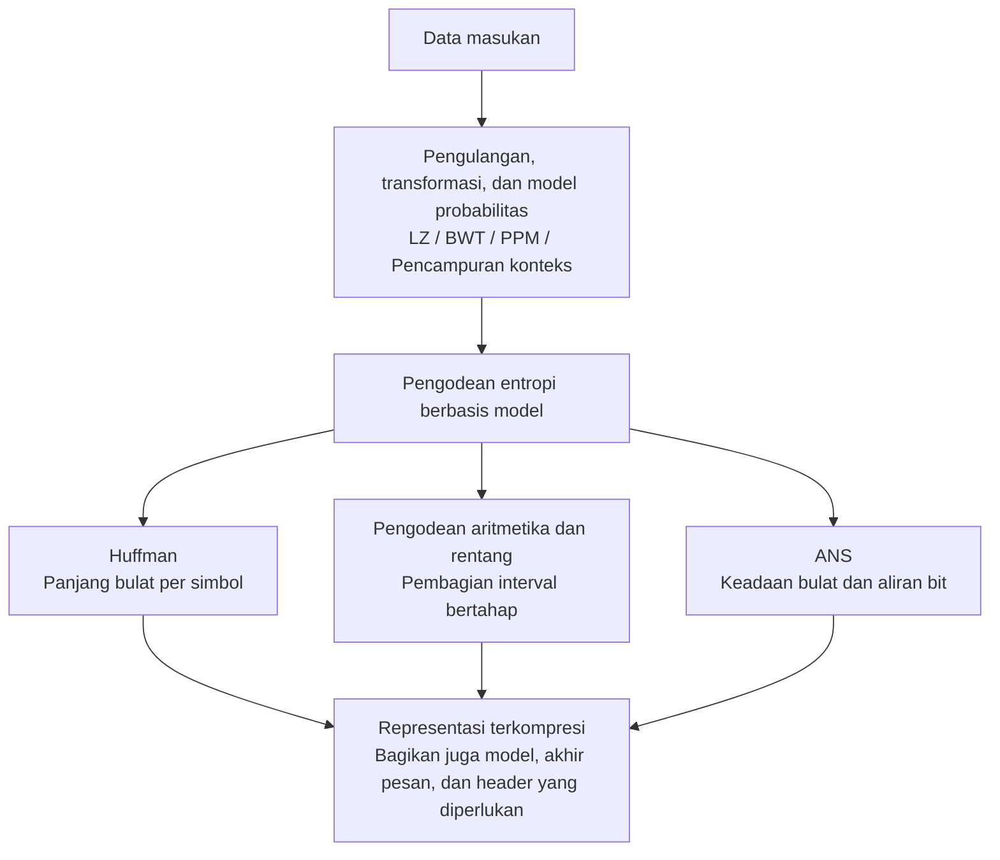
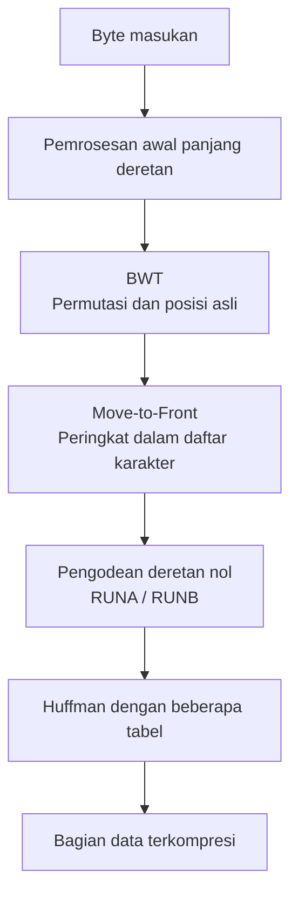

## 1. Mengapa tidak ada kompresor yang dapat memperpendek semua berkas

Kompresi nirrugi mengganti data dengan representasi lain yang memungkinkan byte asli dipulihkan tanpa mengubah satu bit pun. Alat seperti zip, gzip, zstd, dan xz memperkecil sebagian masukan; masukan lain hampir tidak berubah atau membesar karena header. Besarnya penyusutan bergantung pada masukan. Kompresi berugi, seperti JPEG atau MP3, mengizinkan perbedaan nilai hasil rekonstruksi sehingga syarat pemulihannya berbeda.

Misalkan {0,1}* adalah himpunan untai bit berhingga. Tetapkan satu enkoder E dan dekoder D. Syarat nirrugi untuk setiap masukan x adalah:

$$
D(E(x))=x
$$

Jika dua masukan berbeda memiliki keluaran yang sama, D tidak dapat memulihkan keduanya. Jadi, E harus injektif. Ada 2^n masukan dengan panjang tepat n bit, tetapi keluaran yang lebih pendek dari n bit berjumlah lebih sedikit, sekalipun untai kosong ikut dihitung. Di sini n≥1.

$$
\left|\{0,1\}^{n}\right|=2^n>
\sum_{k=0}^{n-1}2^k=2^n-1
$$

Karena itu, kompresor nirrugi yang telah ditetapkan tidak dapat memperpendek semua masukan n bit. Pemetaan injektif pada semua untai berhingga juga tidak dapat memperpendek sebagian masukan tanpa memperpanjang masukan lain sama sekali. Jika masukan x sepanjang n bit diperpendek dan tidak ada masukan yang diperpanjang, masukan yang lebih pendek dari n sudah mengisi semua keluaran yang lebih pendek dari n. E(x) akan bertabrakan dengan salah satunya.

Secara kuantitatif, tetapkan E dan pilih X secara seragam dari untai n bit. Untuk bilangan bulat 1≤c≤n, proporsi yang diperpendek setidaknya c bit memiliki batas atas berikut. Kita menghitung kemungkinan keluaran; enkoder tidak harus memakai semuanya.

$$
\Pr\!\left(|E(X)|\le n-c\right)
\le\frac{2^{n-c+1}-1}{2^n}
<2^{1-c}
$$

Untuk c=11, proporsi ini kurang dari 1/1024, sekitar 0,0977%. Ini tidak berarti bahwa tidak ada kompresor lain yang bisa memperpendek salah satu berkas sisanya. Untuk berkas tertentu x, enkoder lain dapat menukar x dengan untai kosong: x memendek dan untai kosong memanjang. Dekoder perlu mengetahui aturan khusus itu. Dalam kompleksitas Kolmogorov, bahasa deskripsi yang ditetapkan juga harus dibedakan dari panjang deskripsi program dekoder.

Kompresi biasa memanfaatkan representasi yang cocok dengan distribusi atau struktur berulang: frekuensi karakter yang tidak merata, subuntai berulang, atau pola numerik. Keuntungannya bergantung pada masukan dan metode. Tidak dapat dipastikan secara mutlak bahwa berkas yang sudah dikompresi atau teks tersandi tidak mungkin menyusut satu byte pun. Sandi, mode, metadata, dan struktur yang tersisa memengaruhi syaratnya.

Satuannya juga penting. Satu MiB adalah 1.048.576 byte atau 8.388.608 bit. Satu MB desimal adalah 1.000.000 byte atau 8.000.000 bit.

## 2. Entropi Shannon dan batas panjang kode rata-rata

Makalah Shannon tahun 1948 memisahkan nilai semantik dari masalah rekayasa komunikasi dan mengkaji sumber melalui probabilitas. Pengantar [cetak ulang ini](https://wucj.lab.westlake.edu.cn/Others/shannon1948.pdf) juga mengakui karya terdahulu Nyquist dan Hartley.

Untuk kejadian x dengan probabilitas positif, informasi diri didefinisikan sebagai berikut. Logaritma berbasis dua memberi satuan bit. Ini tidak mengukur keterkejutan psikologis atau pentingnya isi itu sendiri.

$$
I(x)=-\log_2P(x),\qquad 0<P(x)\le1
$$

Untuk peubah acak X pada alfabet berhingga, misalkan p_i=P(X=x_i). Entropi Shannon adalah nilai harapan informasi diri, dengan konvensi 0log₂0=0 untuk suku berprobabilitas nol.

$$
H(X)=-\sum_{i=1}^{m}p_i\log_2p_i,\qquad
p_i\ge0,\quad\sum_i p_i=1,\quad
0\le H(X)\le\log_2m
$$

Satuannya bit per simbol. Untuk alfabet tetap berisi m simbol, distribusi seragam memaksimalkan entropi; jika satu simbol berprobabilitas satu, entropinya nol. Hasil lemparan koin adil memiliki informasi diri satu bit; kejadian berprobabilitas 1/256 memiliki delapan bit. Nilai-nilai ini menjelaskan model simbol, tetapi tidak langsung menentukan informasi dalam urutan berkorelasi atau batas bawah untuk setiap berkas.

### Kode bebas prefiks dan ketaksamaan Kraft–McMillan

Berikan kata kode biner pada setiap simbol agar penggabungannya dapat didekode secara unik. Dalam kode bebas prefiks, tidak ada kata kode yang menjadi awalan kata lain. Misalnya, {0,10,110,111} menguraikan 100110111 menjadi 10 | 0 | 110 | 111. ASCII sendiri adalah kode karakter tujuh bit; bukan sinonim pemberian delapan bit kepada semua karakter.

Gambarkan kata kode sepanjang ℓ_i sebagai daun pohon biner. Dalam pohon lengkap dengan kedalaman maksimum ℓ_max, sebuah daun menempati 2^(ℓ_max−ℓ_i) posisi potensial di bawahnya. Menghitung subpohon yang tidak saling beririsan ini memberikan ketaksamaan Kraft. Ketaksamaan yang sama berlaku untuk kode yang dapat didekode secara unik.

$$
\sum_i2^{\ell_{\max}-\ell_i}\le2^{\ell_{\max}}
\quad\Longrightarrow\quad
Z:=\sum_i2^{-\ell_i}\le1
$$

Sebaliknya, panjang bilangan bulat positif yang memenuhi ketaksamaan tersebut memungkinkan pembentukan kode bebas prefiks. Selanjutnya, kita mempertimbangkan simbol berprobabilitas positif dan menganggap jumlahnya setidaknya dua. Untuk sumber dengan satu simbol saja, perlu ditentukan secara terpisah apakah kata kode kosong diperbolehkan dan bagaimana jumlah simbol atau akhir pesan diketahui bersama.

### Batas bawah melalui divergensi KL

Definisikan panjang kode rata-rata dan distribusi ternormalisasi Q yang diinduksi oleh panjang kode:

$$
L=\sum_i p_i\ell_i,\qquad
q_i=\frac{2^{-\ell_i}}{Z},\qquad \sum_i q_i=1
$$

Sifat taknegatif divergensi Kullback–Leibler memberikan identitas ini. Sifat tersebut dapat dibuktikan, misalnya, dengan ketaksamaan logaritmik ln u≤u−1.

$$
\begin{aligned}
0\le D_{\mathrm{KL}}(P\|Q)
&=\sum_i p_i\log_2\frac{p_i}{q_i}\\
&=-H(X)+\sum_i p_i\ell_i+\log_2Z\\
&=L-H(X)+\log_2Z
\end{aligned}
$$

Diperoleh batas panjang rata-rata:

$$
L=H(X)+D_{\mathrm{KL}}(P\|Q)-\log_2Z\ge H(X)
$$

Q membagi 2^(-ℓ_i) dengan Z. Jangan menghilangkan normalisasi itu sekaligus menghitung suku −log₂Z secara terpisah. Kesamaan memerlukan P=Q dan Z=1, sehingga p_i=2^(-ℓ_i): probabilitas sesuai dengan panjang kode biner.

Batas atas juga dapat dikonstruksi. Panjang Shannon berikut memenuhi ketaksamaan Kraft:

$$
\ell_i=\lceil-\log_2p_i\rceil,\qquad
2^{-\ell_i}\le p_i,\qquad
\sum_i2^{-\ell_i}\le1
$$

Pembulatan ke atas menambahkan kurang dari satu bit per simbol, sehingga kode ini memiliki panjang rata-rata di bawah H+1. Jadi, panjang rata-rata L_opt dari kode bebas prefiks biner optimal berada dalam rentang:

$$
H(X)\le L_{\mathrm{opt}}<H(X)+1
$$

Untuk sumber simbol yang independen dan berdistribusi identik, dengan setidaknya dua simbol berprobabilitas positif, mengelompokkan N simbol dan memilih kode bebas prefiks blok yang sesuai menghasilkan hubungan berikut. L_N adalah panjang rata-rata seluruh blok.

$$
H(X)\le\frac{L_N}{N}<H(X)+\frac1N
$$

Jika ada ketergantungan, secara umum H(X_1,...,X_N)≠NH(X_1). Jika satu bit adil dipilih lalu diulang sepanjang N yang diketahui, setiap posisi memiliki entropi marginal satu bit, tetapi seluruh urutan juga hanya satu bit. Untuk sumber stasioner dengan alfabet berhingga, gunakan laju entropi:

$$
\overline H=\lim_{N\to\infty}\frac{H(X_1,\ldots,X_N)}{N}
$$

Ini adalah pernyataan tentang rata-rata berdasarkan distribusi dan kelas kode tertentu. Bukan berarti setiap berkas harus memiliki panjang minimal tersebut atau biaya model dan header boleh diabaikan.

## 3. Huffman, pengodean aritmetika, dan ANS

Memisahkan model statistik dari pengode yang mengubah probabilitas menjadi bit membantu menjelaskan tiap metode. Diagram ini bersifat konseptual, bukan spesifikasi yang mengharuskan setiap format terbagi ke dalam tahap-tahap independen.

### Huffman: optimal di kelas mana?

[Makalah Huffman tahun 1952](https://compression.ru/download/articles/huff/huffman_1952_minimum-redundancy-codes.pdf) membentuk kode bebas prefiks dengan panjang rata-rata minimum untuk bobot tertentu. Pada kasus biner, dua simpul berbobot terkecil digabungkan berulang kali dan jumlahnya dimasukkan kembali. Heap memungkinkan pembangunan pohon dalam O(m log m) untuk m simbol.

Dengan setidaknya dua bobot positif, pohon optimal dapat menghilangkan percabangan takperlu dengan satu anak saja. Dua bobot terkecil dapat ditempatkan pada daun bersaudara terdalam tanpa menambah panjang rata-rata. Menggabungkannya menjadi simbol z memberikan hubungan antara pohon semula T dan pohon lebih kecil T′:

$$
L(T)=L(T')+p_a+p_b
$$

Selisihnya tetap, sehingga solusi optimal masalah kecil dapat membangun solusi masalah semula. Bobot sama dapat menghasilkan beberapa pohon optimal. Kode Huffman kanonis menentukan kata kode dari panjang dan urutan simbol sehingga pengiriman pohon lebih sederhana. Ini tidak menghilangkan biaya deskripsi tabel atau langkah dekode tambahan untuk kata kode panjang.

Untuk P(0)=0,99 dan P(1)=0,01, kode bebas prefiks biner optimal yang bekerja per simbol memakai satu bit untuk masing-masing simbol.

$$
H(X)=-0.99\log_2(0.99)-0.01\log_2(0.01)
\approx0.080793,\qquad L_{\mathrm H}=1
$$

Panjang rata-ratanya sekitar 12,4 kali entropi. Ini tidak berarti berkas asli tidak bisa menyusut: representasi awal delapan bit per simbol berbeda dari urutan yang sudah dikemas per bit. Blok mengurangi kerugian akibat panjang bulat, tetapi pohon yang mencakup semua m^k kombinasi secara eksplisit membesar dengan cepat. Konvensi kata kode kosong untuk satu simbol tetap memerlukan keputusan terpisah tentang pengetahuan jumlah simbol.

### Pengodean aritmetika: interval dan untai berhingga

Pengodean aritmetika mempersempit interval yang dikaitkan dengan pesan. Misalkan P(s) probabilitas simbol dan A(s) jumlah probabilitas simbol yang mendahuluinya dalam urutan yang disepakati. Mulai dari [lo_0,hi_0)=[0,1). Anggap setiap simbol yang dikodekan berprobabilitas positif. Dengan lebar W_(t−1)=hi_(t−1)−lo_(t−1), pembaruannya:

$$
\begin{aligned}
\mathrm{lo}_t&=\mathrm{lo}_{t-1}+W_{t-1}A(x_t),\\
\mathrm{hi}_t&=\mathrm{lo}_{t-1}+W_{t-1}\bigl(A(x_t)+P(x_t)\bigr)
\end{aligned}
$$

Untuk model independen tetap, lebar akhir adalah hasil kali pertama di bawah. Jika ada ketergantungan, gunakan probabilitas bersyarat yang dapat dihitung kembali oleh kedua pihak pada setiap langkah.

$$
W_N=\prod_{t=1}^{N}P(x_t)
\quad\text{or}\quad
W_N=\prod_{t=1}^{N}P(x_t\mid x_{<t})
$$

Pesan berbeda dengan panjang sama N yang diketahui dipetakan ke interval yang tidak beririsan. Pilih interval diadik [j2^(-K),(j+1)2^(-K)) yang seluruhnya berada dalam interval akhir; K bit mengidentifikasi interval tersebut. Jarak kisi yang tidak melebihi setengah lebar menjamin panjang yang mencukupi berikut dengan aritmetika ideal berpresisi takhingga:

$$
K=\lceil-\log_2W_N\rceil+1<-\log_2W_N+2
$$

Ini membatasi muatan ideal dengan model dan panjang diketahui. Bukan berarti K terkecil selalu sama dengan rumus, atau berkas lengkap hanya memiliki dua bit biaya tambahan. Model, akhir pesan, presisi, dan header memerlukan biaya lain. Dengan distribusi blok sebenarnya P, representasi bebas prefiks yang sesuai memenuhi:

$$
H(P)\le\mathbb E_P[K]<H(P)+2
$$

Untuk P(0)=0,99, sekitar 69 nol berturut-turut membagi lebar menjadi separuh. Ini bukan aturan yang mengharuskan tepat satu bit dikeluarkan setiap 69 simbol: pengeluaran bergantung pada interval dan renormalisasi. Implementasi bilangan bulat mengeluarkan bit atau byte paling signifikan yang sudah pasti dan memperluas keadaan. Kuantisasi probabilitas, penanganan carry, dan bit tertunda juga memerlukan kerja. Pengodean aritmetika atau rentang tidak memiliki perbandingan kecepatan universal terhadap pengode lain.

### ANS: mengumpulkan informasi dalam keadaan bilangan bulat

[Makalah ANS Duda](https://arxiv.org/html/1311.2540v2) membentuk sistem bilangan untuk simbol dengan probabilitas berbeda. Menambahkan digit s pada basis biasa b dapat dibalik sebagai berikut:

$$
x'=bx+s,\qquad s=x'\bmod b,\qquad x=\lfloor x'/b\rfloor
$$

Dengan probabilitas sama dan keadaan positif x cukup besar, kenaikan ukuran logaritmik mendekati log₂b. Untuk probabilitas umum, konstruksi memperbesar keadaan kira-kira 1/P(s) kali. Jangan menerapkan log₂x pada x=0 atau menyamakan pendekatan ini dengan panjang kode bilangan bulat yang eksak.

Salah satu konstruksi rANS menggunakan M=2^R, frekuensi simbol bilangan bulat positif f_s, dan frekuensi kumulatif b_s.

$$
\sum_s f_s=M,\qquad b_s=\sum_{a<s}f_a,\qquad P(s)\approx f_s/M
$$

Konstruksi ini memetakan keadaan bilangan bulat taknegatif x dan simbol s menjadi:

$$
C(x,s)=M\left\lfloor\frac{x}{f_s}\right\rfloor+(x\bmod f_s)+b_s
$$

Inversnya memilih simbol melalui slot dan memulihkan keadaan sebelumnya:

$$
\begin{aligned}
\mathrm{slot}&=x'\bmod M,\\
b_s&\le\mathrm{slot}<b_s+f_s,\\
x&=f_s\left\lfloor\frac{x'}M\right\rfloor+\mathrm{slot}-b_s
\end{aligned}
$$

Jika M merupakan pangkat dua, hasil bagi dan sisa dapat dihitung melalui pergeseran bit dan mask. Pencarian simbol, akses tabel, renormalisasi, dan masukan/keluaran tetap berbiaya. Bijeksi ini saja tidak menjamin kerugian pengodean nol atau dekode dalam satu siklus clock.

tANS menggunakan sejumlah keadaan berhingga dan tabel transisi. Untuk penjelasan berbasis bit, misalnya, gunakan himpunan bilangan bulat ini. Himpunan tersebut sesuai dengan interval setengah terbuka [L,2L), bukan [L,2L−1).

$$
\mathcal I=\{L,L+1,\ldots,2L-1\},\qquad |\mathcal I|=L
$$

Bit dipindahkan antara keadaan yang terkumpul dan aliran untuk menjaga rentang yang diizinkan. Syarat normalisasi dan penempatan simbol harus selaras; mengganti rumus rANS dengan tabel kecil saja tidak cukup. FSE adalah implementasi keluarga tANS.

Operasi keadaan ANS berperilaku seperti tumpukan: simbol yang terakhir ditambahkan dipulihkan lebih dahulu. Mengodekan blok dengan urutan terbalik dapat memungkinkan dekode dalam urutan asli. Jika memakai probabilitas kontekstual, urutan penghitungan probabilitas juga harus diselaraskan dengan pengodean terbalik. Huffman, pengodean aritmetika, dan ANS adalah pilihan untuk model, format, serta implementasi berbeda, bukan tiga generasi yang masing-masing selalu menggantikan pendahulunya.

## 4. Apa yang diubah LZ, BWT, dan model kontekstual

Model yang hanya menggunakan frekuensi byte individual tidak dapat sepenuhnya memanfaatkan pengulangan panjang dan ketergantungan. Daripada memberi bahasa Inggris satu angka bit universal, tentukan korpus serta apakah satuannya karakter, byte, atau token.

### Kamus: LZ77, LZ78, dan LZW

Metode keluarga LZ77 merujuk ke belakang pada data yang sudah dihasilkan. Jika untai ASCII 16 byte `std::vector<int>` telah muncul 200 byte sebelumnya dan kembali cocok, untai dapat direpresentasikan dengan jarak dan panjang ini. Apakah biayanya lebih kecil dari 16 byte literal bergantung pada cara format mengodekan angka-angka tersebut.

$$
(d,\ell)=(200,16)
$$

Panjang kecocokan bisa melampaui jaraknya. Setelah satu literal A, rujukan berjarak 1 dan panjang 99 memakai A yang baru disalin sebagai sumber sehingga menghasilkan total 100 A. [Spesifikasi DEFLATE](https://www.rfc-editor.org/rfc/rfc1951.txt) juga memberi contoh rujukan bertumpang tindih. Menggunakan memcpy umum pada area tumpang tindih, atau menyalin hanya salinan tetap dari sumber awal, tidak menjelaskan ekspansi ini dengan benar. Implementasi harus menangani keluaran yang bertambah sambil memeriksa jarak, batas keluaran, dan panjang masukan.

LZSS membedakan literal dan kecocokan melalui flag atau representasi lain. Flag memerlukan ruang, sehingga data tanpa kecocokan tidak dijamin selalu bebas pembesaran. LZ78/LZW justru mendaftarkan untai yang dijumpai dalam kamus eksplisit dan memakai indeks. Pertumbuhan, reset, cakupan rujukan, dan pengodean bilangan bulat berbeda; tidak satu pun harus menang pada setiap masukan.

Format sebenarnya juga berbeda. Blok terkompresi DEFLATE memakai jarak 1–32.768 dan panjang 3–258, dengan kode Huffman terpisah untuk literal/panjang dan jarak. Blok tanpa kompresi juga ada. [Spesifikasi Zstandard](https://www.rfc-editor.org/rfc/rfc8878.html) memisahkan literal dan sekuens: literal memiliki mode mentah/RLE/Huffman, sedangkan sekuens memiliki mode termasuk FSE. Satu atau empat aliran Huffman berbeda dari tiga jenis keadaan FSE sekuens. LZMA/LZMA2 juga menggabungkan kamus dengan model probabilitas; [enkoder LZMA](https://github.com/ip7z/7zip/blob/main/C/LzmaEnc.c) memperlihatkan operasi pencarian kecocokan dan pengodean rentang. Nama algoritma saja tidak mewakili semua format, alat, atau tingkat kompresi.

### BWT: permutasi yang mempertahankan panjang dan inversnya

Transformasi Burrows–Wheeler mendekatkan karakter dengan konteks berikutnya yang sama. Kolom terakhir mempertahankan jumlah simbol, tetapi posisi atau informasi penanda yang diperlukan untuk invers juga berbiaya.

Pertimbangkan `banana$` dengan penanda unik `$` yang diurutkan sebelum karakter lain. Urutkan tujuh rotasi sikliknya dan ambil kolom terakhir serta nomor baris asli.

| Baris | Rotasi dalam urutan leksikografis | Pertama | Terakhir |
| :--- | :--- | :---: | :---: |
| 0 | `$banana` | `$` | a |
| 1 | `a$banan` | a | n |
| 2 | `ana$ban` | a | n |
| 3 | `anana$b` | a | b |
| 4 | `banana$` | b | `$` |
| 5 | `na$bana` | n | a |
| 6 | `nana$ba` | n | a |

Keluarannya `annb$aa` dan baris asli bernomor 4 jika dihitung dari nol. Jika L adalah kolom terakhir dan F kolom pertama, mengurutkan karakter L menghasilkan F. Memasangkan kemunculan karakter sama sesuai urutannya memberi pemetaan LF, yang menelusuri urutan asli ke belakang. Dengan posisi berbasis nol, C(c) menghitung karakter yang lebih kecil dari c dan rank_c(i) menghitung kemunculan c dalam L sebelum posisi i.

$$
\mathrm{LF}(i)=C(L_i)+\mathrm{rank}_{L_i}(i)
$$

Untuk alfabet kecil yang tetap, frekuensi dan peringkat kemunculan dapat dibentuk dalam waktu linear, lalu urutan N simbol dibalik dalam O(N). Jika menggunakan pengurutan umum berbasis perbandingan, hitung biayanya secara terpisah. BWT tidak mengubah semua masukan menjadi deretan panjang karakter sama.

[Manual bzip2 1.0.8](https://sourceware.org/bzip2/manual/manual.html) dan [kode sumber versi tersebut](https://sourceware.org/pub/bzip2/bzip2-1.0.8.tar.gz) menggabungkan RLE sebelum BWT, MTF, pengodean deretan nol, dan beberapa tabel Huffman. MTF mengeluarkan peringkat karakter saat ini dalam daftar lalu memindahkannya ke depan. Karakter berulang menghasilkan nol yang dikodekan melalui RUNA/RUNB. Diagram menunjukkan transformasi data utama dengan mengabaikan header, indeks, dan CRC.

### Model kontekstual dan LLM: panjang kode dan kerugian prediksi

PPM memakai konteks dengan panjang berbeda dan menangani simbol yang belum diamati dengan mekanisme seperti escape. Pencampuran konteks menggabungkan prediksi beberapa model. Model neural juga dapat memberi prediksi; Transformer bukan sinonim jaringan rekuren.

Untuk urutan yang diberi probabilitas bersyarat positif oleh model Q_θ, informasi idealnya sebagai berikut. Nilainya tidak disamakan dengan panjang keluaran sebenarnya.

$$
I_\theta(x_{1:N})=-\log_2 Q_\theta(x_{1:N})
=\sum_{t=1}^{N}-\log_2Q_\theta(x_t\mid x_{<t})
$$

Untuk rata-rata log-likelihood negatif urutan ini dengan logaritma natural, faktor basis dan perataan memberi:

$$
\mathcal L_{\mathrm{NLL}}(\theta)
=-\frac1N\sum_{t=1}^{N}\ln Q_\theta(x_t\mid x_{<t})
=\frac{\ln2}{N}I_\theta(x_{1:N})
$$

Jadi, dengan data, satuan, dan kondisi model sama, penurunan kerugian ini berkaitan dengan penurunan panjang ideal. Rumus tidak mencakup ukuran model bersama, tokenisasi reversibel, presisi berhingga, akhir pesan, header, atau waktu dekode. Informasi prediksi di bawah satu bit tidak berarti kata kodenya dapat disimpan sendiri dalam berkas berukuran pecahan bit.

[Language Modeling Is Compression](https://arxiv.org/html/2309.10668v2) meneliti hubungan ini secara eksperimental. Perbandingan citra dan audionya memakai data yang diproses dan panjang konteks tertentu, serta membedakan rasio yang mengecualikan bobot model dari yang memasukkannya. Jangan memperluas hasil itu ke semua citra, semua audio, atau berkas sembarang. Tantangan seperti Hutter Prize mendorong riset prediksi, tetapi persamaan pengodean saja tidak membuktikan syarat cukup bagi kecerdasan atau pemahaman.

## 5. Membandingkan ukuran terkompresi, kecepatan, dan memori

Evaluasi praktis menggabungkan ukuran terkompresi, waktu pengodean dan dekode, memori, kompatibilitas, serta granularitas akses. Definisikan fraksi terkompresi sebagai ukuran terkompresi dibagi ukuran asli: lebih kecil lebih baik. Angka dari tolok ukur dengan pengaturan berbeda tidak membentuk peringkat universal.

| Metode atau alat | Ciri arsitektur | Hal yang diperiksa saat membandingkan |
| :--- | :--- | :--- |
| LZ4 | Representasi keluarga LZ77 berorientasi byte, tanpa pengodean entropi di dalam blok | Biaya pembingkaian masukan kecil, kecepatan dekode, buffer |
| Zstandard | Pencarian kecocokan, literal dan sekuens, Huffman/FSE serta mode lain | Tingkat, kamus, jendela, mode, memori kedua pihak |
| DEFLATE / gzip | Rujukan balik dan Huffman; blok tanpa kompresi mungkin | Format versus alat, kompatibilitas, biaya blok dan pembungkus |
| BWT / bzip2 | Transformasi blok, MTF, deretan, dan Huffman | Ukuran blok, ruang rekonstruksi, indeks |
| LZMA/LZMA2 / xz dan 7-Zip | Kecocokan kamus dan pengodean probabilistik adaptif | Format dan pengaturan, kamus, waktu pencarian, batas dekoder |
| PPM, pencampuran konteks, dan prediksi neural | Probabilitas kontekstual diikuti pengodean | Model bersama/dikirim, konteks, komputasi, presisi yang dapat direproduksi |

[Spesifikasi blok LZ4](https://github.com/lz4/lz4/blob/dev/doc/lz4_Block_format.md) menangani pembingkaian secara terpisah; [deskripsi format 7-Zip](https://www.7-zip.org/7z.html) membedakan beberapa metode. Memahami arsitektur dan mengukur beban kerja sendiri sama-sama diperlukan.

Catat implementasi dan versi, perintah dan tingkat, CPU dan thread, hash serta ukuran masukan, kamus, kondisi cache dan masukan/keluaran. Dengan total byte asli U, total byte terkompresi C, dan waktu berlalu, hitung C/U serta laju pemrosesan. Tangani masukan kosong secara terpisah untuk rasio ukuran. Dalam pengukuran memori, hitung buffer dan model selain kamus. Periksa bahwa hash byte hasil dekompresi sama dengan aslinya. Tidak ada pengukuran laju baru yang diklaim di sini.

### Kerja pengodean/dekode dan masukan/keluaran

Pada keluarga LZ, dekode dapat lebih ringan daripada pencarian dan pemilihan representasi oleh enkoder. Namun, tingkat kompresi dan perintah yang dikeluarkan dapat mengubah kecepatan dekode dalam format yang sama. Tingkat lebih tinggi tidak menjamin kecepatan dekode persis sama. Dekoder model prediktif harus menghitung ulang probabilitas, tetapi enkoder dapat menghitungnya dalam kelompok; waktunya juga tidak harus identik.

Dalam model baca sederhana, misalkan kecepatan masukan/keluaran adalah v_io, sedangkan v_dec adalah kecepatan dekode yang diukur dalam byte asli per satuan waktu. Tanpa tumpang tindih kerja CPU dan masukan/keluaran, waktu perkiraannya:

$$
T_{\mathrm{raw}}\approx\frac{U}{v_{\mathrm{io}}},\qquad
T_{\mathrm{compressed}}\approx\frac{C}{v_{\mathrm{io}}}
+\frac{U}{v_{\mathrm{dec}}}
$$

Ini membandingkan penghematan masukan/keluaran dengan biaya dekode. Dengan sumber daya independen dan pipeline efektif, waktu keadaan tunak dapat mendekati suku yang lebih besar, bukan jumlah keduanya. Biaya awal, bandwidth memori, paralelisme, dan granularitas akses mungkin memerlukan model berbeda.

Percabangan, ketergantungan, cache, SIMD, dan paralelisme tingkat instruksi memengaruhi kecepatan. Keberadaannya saja tidak menetapkan batas MB/s universal, dan pemisahan aliran tidak menjamin nol kesalahan prediksi cabang. Paket perangkat lunak yang sekali dikompresi lalu didekode banyak pembaca memiliki prioritas berbeda dari log yang sering diperbarui.

## 6. Batas dan biaya mana yang dihitung?

Prinsip sarang merpati menunjukkan bahwa enkoder nirrugi yang ditetapkan tidak bisa memperpendek semua masukan. Batas bawah entropi menyangkut panjang rata-rata berdasarkan model probabilitas dan syarat pengodean tertentu. Huffman, pengodean aritmetika, dan ANS menghubungkan probabilitas dengan representasi secara berbeda; LZ, BWT, serta model kontekstual memanfaatkan pengulangan dan ketergantungan.

Kerugian prediksi dan panjang ideal saling terkait sehingga membantu menjelaskan kompresi neural. Bedakan hubungan itu dari biaya berkas lengkap, kecepatan pemrosesan, atau bukti kecerdasan. Menyatakan apa yang diketahui bersama, apa yang dikirim, dan masukan mana yang diukur menghubungkan teori dengan keputusan praktis.
