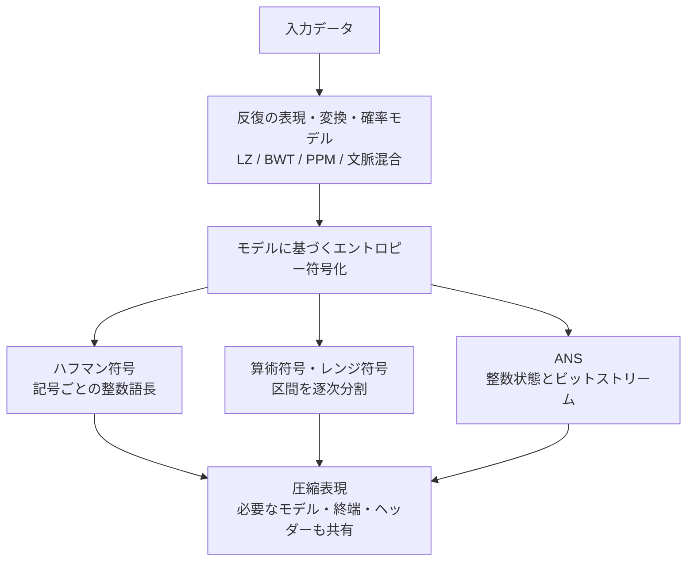
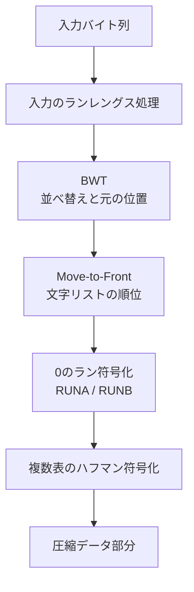

## 1. すべてのファイルを短くできない理由

可逆圧縮は、元のバイト列を1ビットも変えずに復元できるよう、別の表現へ置き換える処理です。zip、gzip、zstd、xzなどで小さくなるデータもあれば、ほとんど変わらないデータや、ヘッダーの分だけ大きくなるデータもあります。「すべてを同じ割合で縮める」方法ではありません。JPEGやMP3のように復元値の違いを許す非可逆圧縮とは、要求する再構成条件が異なります。

有限ビット列の集合を {0,1}* とし、符号化器Eと復号器Dを固定します。可逆性の条件は、すべての入力xについて次を満たすことです。

$$
D(E(x))=x
$$

異なるxとyを同じ出力にするとDが両方に戻せないため、Eは単射です。ちょうどnビットの入力は2^n通りですが、nビット未満の出力は、空列を含めても次の数しかありません。ここではn≥1です。

$$
\left|\{0,1\}^{n}\right|=2^n>
\sum_{k=0}^{n-1}2^k=2^n-1
$$

したがって、固定した可逆圧縮器が、nビットのすべての入力を短くすることはできません。また、全有限列上で一部を短くする単射が、他をすべて同じ長さ以下に保つこともできません。もし長さnのxを短くし、他を膨張させないなら、長さn未満の入力だけで長さn未満の出力をすべて占有します。そこへE(x)も入るため、単射性に反します。

より定量的には、固定したE、一様に選ぶnビット列X、整数1≤c≤nについて、cビット以上短くなる割合に次の上限があります。出力の候補数を数えた結果であり、実際にすべての短い出力を使えるとは限りません。

$$
\Pr\!\left(|E(X)|\le n-c\right)
\le\frac{2^{n-c+1}-1}{2^n}
<2^{1-c}
$$

c=11なら、この割合は1/1024、すなわち約0.0977%より小さくなります。ただし「残りは、どの圧縮器を選んでも縮まない」という意味ではありません。特定のファイルxだけを空列と交換する別の符号化器を作れば、そのxは短くなり、代わりに空列が長くなります。その場合、復号側はその特別な規則を知る必要があります。コルモゴロフ複雑性を論じるときも、固定した記述方式と、復号プログラムの記述長を区別して数えます。

日常のデータを圧縮できるのは、その分布や反復構造に合う表現を使えるからです。文字の偏り、同じ部分列、数値列の規則性などを利用します。どれだけ縮むかは対象と方式によって変わり、既圧縮ファイルや暗号文も「必ず1バイトも縮まない」とは断定できません。暗号方式、モード、メタデータ、残る構造によって条件が変わります。

単位にも注意します。1 MiBは1,048,576バイト、8,388,608ビットです。十進の1 MBは1,000,000バイト、8,000,000ビットです。

## 2. シャノンエントロピーと平均符号長の限界

Shannonの1948年の論文は、意味の価値と通信の工学的問題を分け、確率に基づいて情報源を扱いました。[再録版](https://wucj.lab.westlake.edu.cn/Others/shannon1948.pdf)の冒頭には、NyquistとHartleyの先行研究も挙げられています。

確率が正である事象xの自己情報量は、次のように定義します。底2なら単位はビットです。心理的な驚きや内容の重要性そのものを測る量ではありません。

$$
I(x)=-\log_2P(x),\qquad 0<P(x)\le1
$$

有限アルファベットの確率変数Xについて、p_i=P(X=x_i)とします。シャノンエントロピーは自己情報量の期待値です。確率0の項は0log₂0=0と約束します。

$$
H(X)=-\sum_{i=1}^{m}p_i\log_2p_i,\qquad
p_i\ge0,\quad\sum_i p_i=1,\quad
0\le H(X)\le\log_2m
$$

単位は1記号当たりのビットです。固定したm種類では一様分布で最大になり、1種類だけが確率1なら0です。例えば公平なコインの自己情報量は1ビット、確率1/256の事象なら8ビットです。これは各記号のモデルの評価であり、相関する列全体やファイルの下限を、そのまま決める数値ではありません。

### 接頭語符号とクラフト・マクミランの不等式

記号ごとに二進符号語を割り当て、連結しても一意に復号できる符号を考えます。どの符号語も他の符号語の先頭にならないものを接頭語符号といいます。例えば {0,10,110,111} なら、100110111は10 | 0 | 110 | 111と区切れます。ASCII自体は7ビットの文字コードです。「すべての文字を8ビットにすること」と同一ではありません。

符号長ℓ_iの接頭語符号を二分木の葉で表します。最大深さℓ_maxの完全木では、その葉の下にある2^(ℓ_max−ℓ_i)個の位置を他の符号語が使えません。重複しない部分木の占有数を数えると、クラフトの不等式が得られます。一意復号可能な符号にも同じ不等式が成り立ちます。

$$
\sum_i2^{\ell_{\max}-\ell_i}\le2^{\ell_{\max}}
\quad\Longrightarrow\quad
Z:=\sum_i2^{-\ell_i}\le1
$$

逆に、この不等式を満たす正の整数の語長には接頭語符号を構成できます。以下では正の確率を持つ記号の集合を扱い、少なくとも2種類あるとします。単一記号だけのときに空符号を許すかどうかは、個数や終端の共有方法とともに別途決めます。

### KLダイバージェンスによる下界

平均符号長と、語長から作る正規化済み分布Qを次のように置きます。

$$
L=\sum_i p_i\ell_i,\qquad
q_i=\frac{2^{-\ell_i}}{Z},\qquad \sum_i q_i=1
$$

KLダイバージェンスの非負性を使うと、次の恒等式を得ます。対数の不等式ln u≤u−1などから非負性を導けます。

$$
\begin{aligned}
0\le D_{\mathrm{KL}}(P\|Q)
&=\sum_i p_i\log_2\frac{p_i}{q_i}\\
&=-H(X)+\sum_i p_i\ell_i+\log_2Z\\
&=L-H(X)+\log_2Z
\end{aligned}
$$

従って、平均長の下界は次の通りです。

$$
L=H(X)+D_{\mathrm{KL}}(P\|Q)-\log_2Z\ge H(X)
$$

Qは2^(-ℓ_i)をZで割った分布です。正規化を外して計算した量と、−log₂Zの項を重ねて数えません。等号にはP=QとZ=1が必要で、そのときp_i=2^(-ℓ_i)となります。確率が二進の語長と一致する場合です。

上界の存在も示せます。次のシャノン語長はクラフトの不等式を満たします。

$$
\ell_i=\lceil-\log_2p_i\rceil,\qquad
2^{-\ell_i}\le p_i,\qquad
\sum_i2^{-\ell_i}\le1
$$

切り上げによる余分な長さが1未満なので、この符号の平均長はH+1未満です。最適な二進接頭語符号の平均長L_optも、従って次の範囲に入ります。

$$
H(X)\le L_{\mathrm{opt}}<H(X)+1
$$

独立同分布で非退化な記号をN個まとめ、適切なブロック接頭語符号を作れば、ブロック全体の平均長L_Nについて次が成り立ちます。

$$
H(X)\le\frac{L_N}{N}<H(X)+\frac1N
$$

依存する列では、一般にH(X_1,...,X_N)≠NH(X_1)です。例えば公平なビットを1回だけ選び、既知の長さNにわたって反復すれば、各位置の周辺エントロピーは1ビットでも、列全体は1ビットです。定常な有限アルファベット情報源では、エントロピー率を次で扱います。

$$
\overline H=\lim_{N\to\infty}\frac{H(X_1,\ldots,X_N)}{N}
$$

これらは指定した分布・符号のクラスに対する平均の主張です。各ファイルが必ずその長さ以上になるという意味でも、モデルやヘッダーを無視してよいという意味でもありません。

## 3. ハフマン符号・算術符号・ANS

統計的なモデルと、確率に応じてビット列を作る符号器を分けると、各方式の役割が分かりやすくなります。次は概念図であり、すべての形式がこの順序に分離できるという仕様ではありません。

### ハフマン符号：どの範囲で最適なのか

[Huffmanの1952年の論文](https://compression.ru/download/articles/huff/huffman_1952_minimum-redundancy-codes.pdf)は、与えられた重みに対する平均語長を最小にする接頭語符号を扱います。二進では、最小の重みを持つ2ノードを併合し、その重みの和を戻す操作を繰り返します。m種類ならヒープを使ってO(m log m)で構築できます。

正の重みを持つ2種類以上の最適木は、不要な片子を取り除いた形にできます。最深部の兄弟葉に最小の2重みを配置しても平均長は増えません。それらを合成記号zへまとめた木T′と元の木Tの間には次の関係があります。

$$
L(T)=L(T')+p_a+p_b
$$

この差が固定なので、小さくした問題の最適解から元の問題を構成できます。同じ重みには複数の最適木があり得ます。正準ハフマン符号では、語長と記号順から符号語を決め、木の伝達を簡潔にします。ただし、表の伝達費用や、長い語への追加の復号処理がなくなるわけではありません。

2値でP(0)=0.99、P(1)=0.01なら、最適な1記号ごとの二進接頭語符号は両方1ビットです。

$$
H(X)=-0.99\log_2(0.99)-0.01\log_2(0.01)
\approx0.080793,\qquad L_{\mathrm H}=1
$$

平均長はエントロピーの約12.4倍です。「元のファイルを全く縮められない」とは限りません。元が1記号8ビットなのか、既に1ビットに詰めた列なのかでも比較が変わります。ブロック化は丸めの損を減らしますが、全てのm^k通りを木に載せる方式では状態数が急増します。単一記号の空符号については、前節の個数共有の約束を別に扱います。

### 算術符号：区間と有限のビット列

算術符号はメッセージに対応する区間を狭めます。記号sの確率をP(s)、sより小さい記号の確率の和をA(s)とし、初期区間を[lo_0,hi_0)=[0,1)とします。以下では、実際に符号化する記号の確率は正とします。幅W_(t−1)=hi_(t−1)−lo_(t−1)を使い、次のように更新します。

$$
\begin{aligned}
\mathrm{lo}_t&=\mathrm{lo}_{t-1}+W_{t-1}A(x_t),\\
\mathrm{hi}_t&=\mathrm{lo}_{t-1}+W_{t-1}\bigl(A(x_t)+P(x_t)\bigr)
\end{aligned}
$$

固定した独立モデルなら、最後の区間幅は次の通りです。依存モデルでも、その時点の条件付き確率を双方で再現できれば、同じ考えで条件付き確率の積を使えます。

$$
W_N=\prod_{t=1}^{N}P(x_t)
\quad\text{or}\quad
W_N=\prod_{t=1}^{N}P(x_t\mid x_{<t})
$$

同じ既知の長さNの異なるメッセージは、重ならない区間へ写ります。最終区間の中に完全に含まれる二進小区間[j2^(-K),(j+1)2^(-K))を選べば、そのKビットで区間を指定できます。幅の半分以下の格子を取ることで、理想的な無限精度計算では次の十分な長さを選べます。

$$
K=\lceil-\log_2W_N\rceil+1<-\log_2W_N+2
$$

これは既知のモデル・長さを使う理想ペイロードの上界です。最短Kが必ずこの式と等しいという意味ではありません。ファイル全体に「2ビットしか余分な費用がない」という保証でもありません。モデル、終端、精度、ヘッダーには別の費用があります。真のブロック分布Pを使う場合、対応する接頭語表現の平均長は次で評価できます。

$$
H(P)\le\mathbb E_P[K]<H(P)+2
$$

P(0)=0.99なら0の連続で幅が半分になるのは約69回です。ただし「69個読むたび必ずその場で1ビット出る」という規則ではなく、実際の出力時点は区間と再正規化によります。整数実装では区間の上位ビットやバイトを確定させて出力し、状態を拡大します。有限精度で確率を量子化する費用、桁上がりや未確定ビットの処理も必要です。算術符号とレンジ符号の実装速度を一律の倍率で決めることはできません。

### ANS：整数状態への蓄積と取り出し

[DudaのANS論文](https://arxiv.org/html/1311.2540v2)は、確率の異なる記号を扱う記数法を構成します。通常のb進法で末尾に数字sを追加するときの操作は、次のように可逆です。

$$
x'=bx+s,\qquad s=x'\bmod b,\qquad x=\lfloor x'/b\rfloor
$$

等確率なら、十分大きな正の状態xの対数サイズの増分はおよそlog₂bです。一般の確率では、状態をおよそ1/P(s)倍へ広げるように構成します。x=0にlog₂xを適用せず、この近似と実際の整数語長を区別します。

rANSの一例では、M=2^R、各記号の正の整数頻度f_s、累積頻度b_sを使います。

$$
\sum_s f_s=M,\qquad b_s=\sum_{a<s}f_a,\qquad P(s)\approx f_s/M
$$

非負整数状態xと記号sを、次の状態へ写します。

$$
C(x,s)=M\left\lfloor\frac{x}{f_s}\right\rfloor+(x\bmod f_s)+b_s
$$

逆操作ではslotから記号を選び、元の状態を取り出します。

$$
\begin{aligned}
\mathrm{slot}&=x'\bmod M,\\
b_s&\le\mathrm{slot}<b_s+f_s,\\
x&=f_s\left\lfloor\frac{x'}M\right\rfloor+\mathrm{slot}-b_s
\end{aligned}
$$

Mが2のべきなら、その商・剰余はシフトとマスクで求められます。ただし、記号の検索、表へのアクセス、再正規化、入出力も処理に含まれます。この全単射だけで圧縮率の損失ゼロやCPUの1クロック復号を保証しません。

tANSは有限個の状態と遷移表を使います。ビット単位の説明では、例えば次の整数集合を使います。終端を含まない区間[L,2L)と同じであり、[L,2L−1)ではありません。

$$
\mathcal I=\{L,L+1,\ldots,2L-1\},\qquad |\mathcal I|=L
$$

状態に蓄積した情報からビットを出し入れして、許された範囲に保ちます。rANSの式を単に小さな表に置き換えるだけでなく、正規化条件と記号の配置を整合させる必要があります。FSEはtANS系の実装です。

ANSの状態操作は、最後に加えた記号を先に取り出すスタック型です。元の順に復号するため、ブロックを逆順に符号化するなどの構成を取ります。文脈依存の確率を使う場合は、その確率を求める順序と、逆順の符号化を両立させる設計も要ります。ハフマン・算術符号・ANSは、単純に新方式が旧方式を全用途で置き換える三世代ではなく、モデルや形式、実装に応じて使い分けられます。

## 4. LZ・BWT・文脈モデルは何を変えるのか

単一バイトの頻度だけを使うモデルでは、長い反復や前後関係を十分に利用できません。英語に普遍的な「必ず何ビット」という値を置くのでなく、対象コーパスと文字・バイト・トークンの単位を指定して、モデルを評価します。

### 辞書式圧縮：LZ77、LZ78、LZW

LZ77系は、既に出力したデータへの後方参照を使います。例えば16バイトのASCII列`std::vector<int>`が200バイト前にあり、再び一致したなら、次の距離・長さで表せます。これが生の16バイトより安いかは、形式内でその数値をどう符号化するかによります。

$$
(d,\ell)=(200,16)
$$

距離より長い一致もあります。直前のAに対する距離1・長さ99の参照なら、コピーしたAを次のコピー元にも使い、合計100個のAを作れます。[DEFLATE仕様](https://www.rfc-editor.org/rfc/rfc1951.txt)にも重なる参照の例があります。汎用memcpyを重なった領域に適用する説明や、最初のコピー元だけを保存して移す説明では、この伸長を正しく表せません。範囲内の距離、出力上限、入力長を確認しつつ、前向きに増える出力を扱います。

LZSSではリテラルと参照をフラグなどで区別しますが、そのフラグも費用なので、不一致なら膨張しないと保証するものではありません。LZ78/LZWは、見つかった文字列を明示的な辞書に登録して索引を使う別の方式です。辞書の増やし方、リセット、参照範囲、数値の符号化が異なり、一方が全データで必ず勝つわけではありません。

実際の形式も区別します。DEFLATEの圧縮ブロックでは距離1〜32,768、長さ3〜258の参照を使い、リテラル・長さと距離を別のハフマン符号で扱います。非圧縮ブロックもあります。[Zstandard仕様](https://www.rfc-editor.org/rfc/rfc8878.html)では、リテラル部と命令列を分け、リテラルに非圧縮・RLE・ハフマン、命令列にFSEなどのモードを使います。ハフマンの1本または4本のストリームと、命令列の3種類のFSE状態は別です。LZMA/LZMA2も辞書と確率モデルを組み合わせる例です。[LZMAエンコーダ](https://github.com/ip7z/7zip/blob/main/C/LzmaEnc.c)では、照合探索とレンジ符号の処理を確認できます。形式、ツール、圧縮レベルの違いを、1つのアルゴリズム名だけで代表させません。

### BWT：長さを保つ並べ替えと逆変換

Burrows–Wheeler変換は、同じ後続文脈を持つ文字を近くに集める可逆変換です。最後の列だけなら記号数は変わりませんが、逆変換に必要な位置や終端を含めた表現には費用があります。

例として、ほかに現れない最小の終端記号`$`を追加した`banana$`を考えます。7通りの巡回シフトを辞書順で並べ、最後の列と元の行の番号を取り出します。

| 行 | 辞書順の巡回シフト | 先頭 | 末尾 |
| :--- | :--- | :---: | :---: |
| 0 | `$banana` | `$` | a |
| 1 | `a$banan` | a | n |
| 2 | `ana$ban` | a | n |
| 3 | `anana$b` | a | b |
| 4 | `banana$` | b | `$` |
| 5 | `na$bana` | n | a |
| 6 | `nana$ba` | n | a |

出力は`annb$aa`、元の行は0始まりで4です。末尾列をL、先頭列をFとすると、FはLの文字を整列して得られます。同じ文字の出現順を対応させるLFマッピングを使うと、元の列を後ろからたどれます。0始まりで、C(c)をcより小さい文字の総数、rank_c(i)をLの位置iより前にあるcの個数とすれば、次の対応です。

$$
\mathrm{LF}(i)=C(L_i)+\mathrm{rank}_{L_i}(i)
$$

小さな固定アルファベットなら、度数と出現順位を線形時間で作り、長さNの逆変換をO(N)で行えます。文字を一般の比較ソートで整列する場合などは、その費用も別に数えます。BWTがすべての入力を長い連続文字に変えるわけではありません。

[bzip2 1.0.8の説明書](https://sourceware.org/bzip2/manual/manual.html)と[同版のソース](https://sourceware.org/pub/bzip2/bzip2-1.0.8.tar.gz)では、BWTの前のRLE、MTF、ゼロのラン符号化、複数のハフマン表を組み合わせています。MTFは文字をリストの先頭へ移し、その時点の順位を出します。同じ文字が続けば0が続き、それをRUNA/RUNBで表します。次の図は主なデータ変換で、ヘッダー・索引・CRCなどを省略しています。

### 文脈モデルとLLM：符号長と予測損失の関係

PPMは長短の文脈を使い、未観測記号をエスケープなどで扱います。文脈混合は複数の予測を組み合わせます。ニューラルモデルも予測器として使えますが、Transformerを再帰型ネットワークと同一視しません。

モデルQ_θが正の条件付き確率を割り当てる列について、理想情報量は次の通りです。実際の出力長そのものと等号で結びません。

$$
I_\theta(x_{1:N})=-\log_2 Q_\theta(x_{1:N})
=\sum_{t=1}^{N}-\log_2Q_\theta(x_t\mid x_{<t})
$$

この列の平均負対数尤度を自然対数で計算するなら、底と平均の違いは次の関係になります。

$$
\mathcal L_{\mathrm{NLL}}(\theta)
=-\frac1N\sum_{t=1}^{N}\ln Q_\theta(x_t\mid x_{<t})
=\frac{\ln2}{N}I_\theta(x_{1:N})
$$

したがって、同じデータ・単位・モデル条件の下でこの損失を小さくすることは、理想符号長を小さくすることと対応します。しかし、共有モデルの大きさ、トークナイザーの可逆性、有限精度、終端・ヘッダー、復号時間はこの式に含まれません。1回の予測の情報量が1ビット未満でも、その語を単独ファイルとして小数ビットで保存できるわけではありません。

[Language Modeling Is Compression](https://arxiv.org/html/2309.10668v2)は、この接続を実験しています。同論文の画像・音声の比較には、加工したデータと文脈長の条件があり、モデルの重みを除く率と含めた率を分けています。結果をそのまま全画像・音声や任意のファイルの優劣に広げません。Hutter Prizeのような圧縮課題は予測の研究を促しますが、圧縮の数式だけで知能や理解の十分条件が証明されるわけではありません。

## 5. 圧縮率・速度・メモリをどう比較するか

実務では圧縮後サイズ、圧縮時間、展開時間、メモリ、互換性、アクセス単位を一緒に評価します。元サイズに対する圧縮後サイズの割合は小さいほどよい、と定義して比較します。条件の違うベンチマークの数字を混ぜて、普遍的な順位表にすることはできません。

| 方式・ツール例 | 構成上の特徴 | 比較時に確認する点 |
| :--- | :--- | :--- |
| LZ4 | バイト指向のLZ77型表現、ブロック内にエントロピー符号なし | 小さい入力のフレーム費用、展開速度、必要なバッファ |
| Zstandard | 辞書照合、リテラルと命令列、ハフマンとFSEなど | レベル、辞書、窓、各モード、圧縮・展開の両側のメモリ |
| DEFLATE / gzip | 後方参照とハフマン、非圧縮ブロックも選択可能 | 形式・ツールの区別、互換性、ブロックやラッパーの費用 |
| BWT / bzip2 | ブロック変換、MTF、ラン符号、ハフマン | ブロックサイズ、復元に必要な領域と索引 |
| LZMA/LZMA2 / xz・7-Zip | 辞書照合と適応的な確率符号化 | 形式と設定、辞書容量、探索時間、復号側の制約 |
| PPM・文脈混合・ニューラル予測 | 文脈から確率を作り符号化 | モデルの伝達・共有、文脈長、計算量と精度の再現 |

[LZ4のブロック仕様](https://github.com/lz4/lz4/blob/dev/doc/lz4_Block_format.md)はフレームを別扱いにし、[7-Zipの形式説明](https://www.7-zip.org/7z.html)も複数の圧縮法を区別しています。アルゴリズムの特徴を知ることと、自分の用途で測ることは両方必要です。

測定には、実装名と版、コマンドとレベル、CPU・スレッド数、入力ファイルのハッシュとサイズ、辞書、キャッシュやI/Oの条件を残します。圧縮前の全バイト数U、圧縮後の総バイト数C、経過時間を使って、サイズ比C/Uと処理速度を計算します。空入力はサイズ比の定義から分けます。メモリは辞書だけでなく、入力・出力バッファやモデルも数えます。展開結果のハッシュが元と一致することも確認します。ここでは新たな速度測定をしたとは主張しません。

### 圧縮と展開の負荷、I/Oとの関係

LZ系では、圧縮側の探索・解析に比べ、展開側が軽いことがあります。ただし同じ形式でも、圧縮レベルや出力された命令によって展開速度は変わり得ます。「高レベルでも常に全く同じ速度」ではありません。予測モデル方式では復号側も確率を再現する必要がありますが、符号化側の確率計算をバッチ化できる場合などもあり、双方の時間が厳密に等しいわけではありません。

単純な読み出しモデルで、I/O速度をv_io、元サイズ基準の展開速度をv_decとし、CPUとI/Oを重ねないなら、時間の目安は次の通りです。

$$
T_{\mathrm{raw}}\approx\frac{U}{v_{\mathrm{io}}},\qquad
T_{\mathrm{compressed}}\approx\frac{C}{v_{\mathrm{io}}}
+\frac{U}{v_{\mathrm{dec}}}
$$

圧縮によるI/O短縮とCPU費用を比べられます。独立した資源で十分に並行化できるなら、定常部分は和ではなく大きい方に近づくこともあります。起動、メモリ帯域、並列度、アクセスの粒度が違えばモデルも変えます。

分岐、依存関係、キャッシュ、SIMDや命令レベル並列性は速度に影響します。しかし「分岐があるから必ず何MB/sで頭打ち」「ストリームを分ければ分岐予測ミスがゼロ」とは言えません。一度圧縮して多くの読者が展開する配信と、頻繁に更新するログでは、選ぶ条件も違います。

## 6. まとめ：どの限界と費用を数えるのか

鳩の巣原理は、固定した可逆符号化器がすべての入力を短くできないことを示します。エントロピーの下界は、指定した確率モデルと符号の条件で、平均長を論じます。ハフマン、算術符号、ANSは確率を表現へ結び付ける異なる手段で、LZやBWT、文脈モデルは反復や依存性を利用します。

予測損失と理想符号長の関係は、ニューラルモデルを含む圧縮を理解する手掛かりです。それをファイル全体の費用や処理速度、知能の証明と混同せず、何を共有し、何を伝え、どの入力に対して測ったかを明確にすると、実装と理論を結び付けて判断できます。
