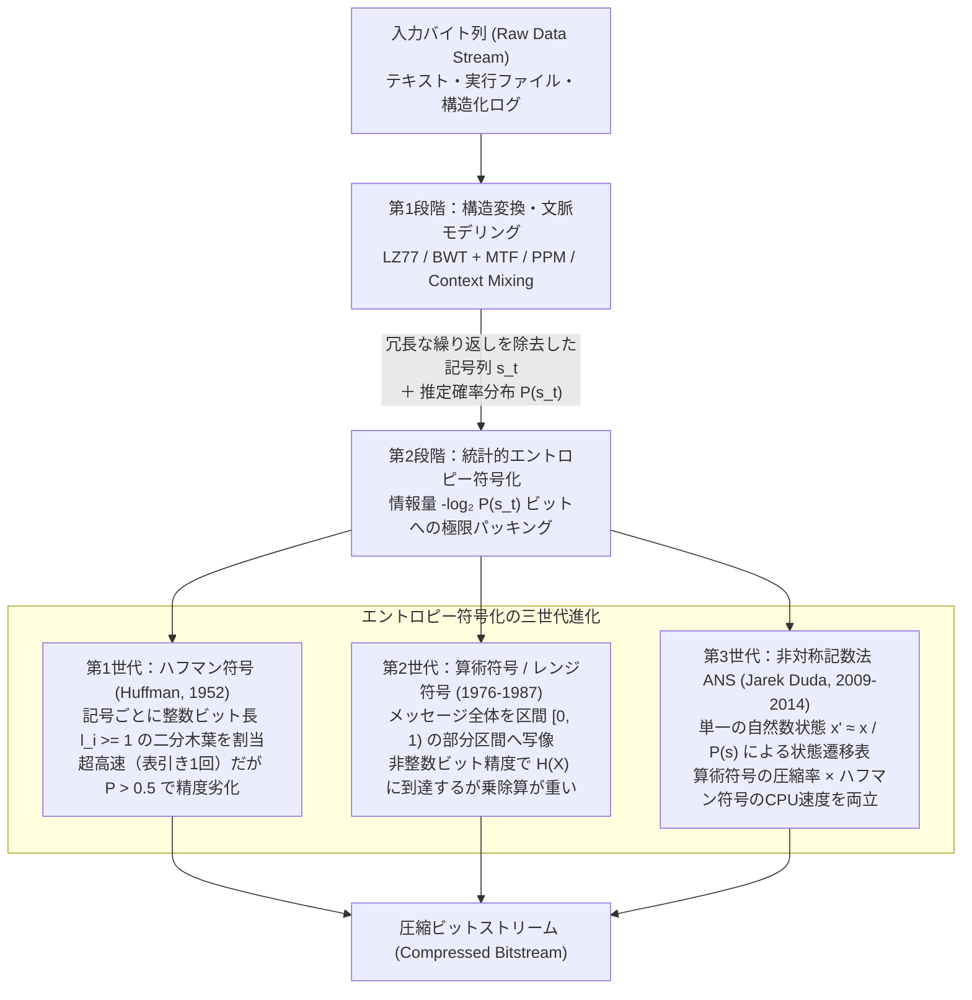
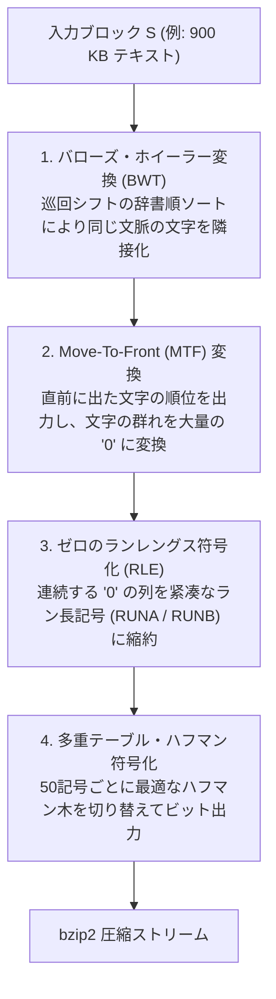

## 1. 鳩の巣原理が暴く「万能圧縮の不可能性」——なぜすべてのファイルを縮めるアルゴリズムは存在し得ないのか

私たちは日常的に、`zip` や `gzip`、`zstd`（Zstandard）、`xz` といったツールを使って、何メガバイトものソースコードやログファイル、データベースのダンプを元のサイズの $10\% \sim 30\%$ にまで縮小し、展開（復号）すれば<strong>1ビットの狂いもなく完全に元のファイルを取り出す</strong>ことができる。画像における JPEG や音声における MP3 のような非可逆圧縮（Lossy Compression）であれば、人間の視覚や聴覚が気づきにくい高周波成分を捨てているのだからファイルが小さくなる理由は直感的に理解できる。しかし、<strong>可逆圧縮（Lossless Compression）</strong>は「一文字も、1ビットも情報を捨てていない」にもかかわらず、なぜデータ容量を劇的に削減できるのだろうか。

この問いに答えるための最も劇的な出発点は、逆説的だが<strong>「世の中のあらゆるファイルを小さくできる可逆圧縮アルゴリズムは、数学的に絶対に存在しない」</strong>という冷徹な定理を証明することである。時折、「どんなデータでも繰り返し通せば限りなく $1\,\text{byte}$ に近づく夢の圧縮アルゴリズムを発明した」と主張する人物が現れるが、情報理論の知識を待つまでもなく、初等組合せ論の<strong>鳩の巣原理（Pigeonhole Principle）</strong>だけでその不可能性を3行で論破できる。

任意長のビット列全体の集合を $\{0,1\}^* = \bigcup_{k=0}^{\infty} \{0,1\}^k$ としよう。可逆圧縮アルゴリズムとは、符号化器（Encoder）$E: \{0,1\}^* \to \{0,1\}^*$ と復号器（Decoder）$D: \{0,1\}^* \to \{0,1\}^*$ の組であり、すべての入力ファイル $x \in \{0,1\}^*$ に対して完全再構成条件：

$$D(E(x)) = x$$

を満たすものである。もし2つの異なるファイル $x \neq y$ が同じ圧縮データ $E(x) = E(y)$ に変換されてしまったら、復号器 $D$ は $E(x)$ から $x$ と $y$ のどちらに戻すべきか原理的に判別できない。したがって、可逆圧縮の符号化写像 $E$ は数学的に必ず<strong>単射（Injective / One-to-One）</strong>でなければならない。

ここで、ちょうど $n$ ビットの長さを持つすべての可能なバイナリファイルの集合 $\{0,1\}^n$ を考えよう。その総数は $2^n$ 個ある。もし「長さ $n$ のすべてのファイルを、少なくとも1ビット以上短くする（すなわち長さ $0$ から $n-1$ までのビット列に変換する）可逆圧縮器 $E$」が存在したとしたらどうなるか。長さ $n-1$ 以下のすべての可能なビット列（空列 $\epsilon$ を含む）の総数を数え上げてみよう。

$$\sum_{k=0}^{n-1} 2^k = 2^0 + 2^1 + 2^2 + \cdots + 2^{n-1} = 2^n - 1$$

ここには逃れようのない算術の壁がある。長さ $n$ の入力ファイル（鳩）は $2^n$ 個存在するのに、長さ $n-1$ 以下の圧縮後ファイル（鳩の巣）は全部かき集めても $2^n - 1$ 個しか存在しない。さらに言えば、もし長さ $n-1$ 以下のファイル自体も可逆圧縮の対象に含まれるなら、それらの行き先も必要になるため空き巣はさらに減る。

$$|\{0,1\}^n| = 2^n > 2^n - 1 = \left|\bigcup_{k=0}^{n-1} \{0,1\}^k\right|$$

したがって単射性より、<strong>どれほど巧妙に設計された可逆圧縮アルゴリズムであっても、あるファイルを短くしたならば、その代償として別のファイルを必ず元のサイズ以上に膨張（Expansion）させなければならない</strong>。

この議論をさらに定量化すると、さらに驚くべき事実が浮かび上がる。長さ $n$ ビットのファイルのうち、少なくとも $c$ ビット以上圧縮できる（すなわち $|E(x)| \le n - c$ となる）ファイルは全体の何割存在するだろうか。長さ $n - c$ 以下のすべてのビット列の総数は高々次の通りである。

$$\sum_{k=0}^{n-c} 2^k = 2^{n-c+1} - 1 < 2^{n-c+1}$$

長さ $n$ ビットの全ファイル数 $2^n$ で割ると、$c$ ビット以上縮小できるファイルの割合 $P(|E(x)| \le n - c)$ は次の厳密な上限を持つ。

$$\frac{\text{Number of files compressible by } \ge c \text{ bits}}{2^n} < \frac{2^{n-c+1}}{2^n} = 2^{-(c-1)}$$

たとえば $c = 11$ ビット（わずか $1.375\,\text{bytes}$！）を代入してみよう。$2^{-(11-1)} = 2^{-10} = \frac{1}{1024} \approx 0.000976$ となる。つまり、<strong>数学的に存在するすべての $n$ ビットのバイナリファイルのうち、たった $11$ ビット（約1バイト強）でも小さくできるファイルは全体の $0.1\%$ 未満しか存在せず、残りの $99.9\%$ 以上のファイルはどんなアルゴリズムを使っても1バイトすら縮めることができない（コルモゴロフ複雑性における非圧縮性定理）</strong>のである。

ではなぜ、私たちの目の前にある `gzip` や `zstd` は、テキストファイルやプログラム、データベースをいとも簡単に $50\% \sim 90\%$ も縮小してみせるのか。答えは明快である。<strong>人間が書き、コンピュータが生成し、センサーが記録する現実世界のデータは、一様ランダムなビット列の海 $\{0,1\}^n$ の中にある「天文学的に小さな、極度に偏った部分集合（低エントロピー多様体）」にしか生息していないから</strong>である。

たとえば $1\,\text{MB}$（$n = 8,388,608$ ビット）の空間には $2^{8388608}$ 通りのファイルが存在するが、そのほとんどすべてはホワイトノイズのような完全な乱数列である。私たちが意味のある英語の文章や Python のソースコード、JSON データを書くとき、文字の出現頻度は極端に偏り、同じ単語や構文が何度も繰り返され、前の数文字を見れば次の文字が高い確率で予測できる。可逆圧縮アルゴリズムとは、「すべてのファイルを縮める魔法」ではなく、<strong>「現実世界に実在する規則的なファイルに対して極めて短い符号語を割り当て、現実にはまず現れない純粋な乱数ファイルに長い符号語を押し付けることで、期待値としてのデータ長を極限まで削ぎ落とす統計的・構造的変換器」</strong>なのである。だからこそ、すでに圧縮された `.zip` ファイルや AES で暗号化されたデータ（統計的性質が乱数と区別できない高エントロピー列）をもう一度圧縮しようとしても、1バイトも縮まず、ヘッダ情報の分だけわずかにサイズが増えてしまうのである。

---

## 2. クロード・シャノンの情報理論と情報源符号化定理（1948年）——情報が持つ「究極の限界重量」

1948年、ベル研究所の数学者・工学者であった<strong>クロード・シャノン（Claude Elwood Shannon）</strong>は、不朽の論文 *"A Mathematical Theory of Communication"*（通信の数学的理論）を発表し、それまで曖昧な概念であった「情報（Information）」を厳密な数学的実体として定義した。シャノンは、メッセージが持つ「意味」を一切捨象し、<strong>「ある事象が起きたときに、受け手の不確実性（Uncertainty）すなわち驚き（Surprisal）がどれだけ解消されたか」</strong>によって情報量を測るというコペルニクス的転回をもたらした。

### 自己情報量（Self-Information）とシャノン・エントロピー

アルファベット（記号の集合）$\mathcal{A} = \{x_1, x_2, \dots, x_m\}$ から記号を出力する離散情報源 $X$ を考える。ある記号 $x \in \mathcal{A}$ が生起する確率を $P(x)$ とするとき、その記号 $x$ を観測したときに得られる<strong>自己情報量（Self-Information / Surprisal）</strong> $I(x)$ は満たすべき3つの公理から一意に導かれる。

1. 確率 $P(x) = 1$ で確実に起きる事象が起きたとしても驚きはゼロである：$I(1) = 0$。
2. 発生確率 $P(x)$ が小さい（珍しい）事象ほど、起きたときの情報量 $I(x)$ は単調に大きくなる。
3. 独立な2つの事象 $x, y$ が同時に起きたときの結合確率 $P(x, y) = P(x)P(y)$ に対する情報量は、それぞれの情報量の和になる（加法性）：$I(x, y) = I(x) + I(y)$。

積を和に変える連続単調減少関数は対数関数以外に存在しない。底を $2$ にとることで単位を<strong>ビット（bit / shannon）</strong>と定めると、自己情報量は次式で定義される。

$$I(x) = -\log_2 P(x) = \log_2 \frac{1}{P(x)} \quad [\text{bits}]$$

公正なコイン投げ（$P = 1/2$）の結果は $I = -\log_2(1/2) = 1\,\text{bit}$ の情報量を持つ。確率 $1/256$ の珍しいバイト文字が現れれば $I = -\log_2(1/256) = 8\,\text{bits}$ の情報量を持つ。逆に、確率 $0.99$ で現れる文字は $I = -\log_2(0.99) \approx 0.0145\,\text{bits}$ というごくわずかな情報量しか持たない。

では、この情報源 $X$ が記号を次々と出力するとき、<strong>1記号あたり平均して何ビットの本質的情報量が含まれているか</strong>。自己情報量 $I(X)$ の確率分布 $P$ に関する期待値こそが、統計力学のボルツマン・ギブス・エントロピーと同型の式を持つ<strong>シャノン・エントロピー（Shannon Entropy）</strong> $H(X)$ である（ただし $0 \log_2 0 = \lim_{p \to 0^+} p \log_2 p = 0$ と定める）。

$$H(X) = \mathbb{E}[I(X)] = -\sum_{i=1}^{m} P(x_i) \log_2 P(x_i) \quad [\text{bits / symbol}]$$

シャノン・エントロピー $H(X)$ は、情報源の不確実性の大きさを表すと同時に、<strong>「その情報源から出るデータを一文字も失わずにバイナリ表現したとき、1記号あたり平均して何ビットまで縮められるかの絶対的な理論下限」</strong>を与える。

### 接頭語符号（Prefix-Free Code）とクラフト・マクミランの不等式

なぜ $H(X)$ が圧縮の絶対限界になるのかを、数学的に厳密に証明しよう。各記号 $x_i \in \mathcal{A}$ に対して、長さ $\ell_i = |c(x_i)|$ ビットの2進符号語 $c(x_i) \in \{0,1\}^{\ell_i}$ を割り当てる可変長符号（Variable-Length Code）を考える。

固定長符号（たとえば ASCII のように全文字を8ビットで表す方式）と異なり、可変長符号では符号語を隙間なく連結したビット列から元の記号列が一意に復元できなければならない（<strong>一意復号可能性：Unique Decodability</strong>）。さらに実用上は、ファイルの先頭からビットを読んでいき、ある符号語が終わった瞬間に次のビットを見るまでもなく即座に文字を確定できる<strong>瞬時復号可能性（Instantaneous / Prefix-Free Property）</strong>が求められる。

符号 $C$ が<strong>接頭語符号（Prefix-Free Code / 語頭符号）</strong>であるとは、どの符号語 $c(x_i)$ も、別の符号語 $c(x_j)$（$i \neq j$）の接頭辞（先頭部分文字列）になっていないことをいう。たとえば $\{0, 10, 110, 111\}$ は接頭語符号である。ビット列 `100110111` を先頭から読めば、区切り記号なしに `10 | 0 | 110 | 111` と一意かつ瞬時に分解できる。

すべての接頭語符号は、左枝を `0`、右枝を `1` とする<strong>二分木（Binary Tree）の葉（Leaf）</strong>として表現できる。「どの符号語も他の符号語の接頭辞にならない」という条件は、「どの符号語に対応するノードも他の符号語ノードの祖先にならない（すべてが葉である）」ことと完全に同値である。

符号語の最大長を $\ell_{\max} = \max_i \ell_i$ としよう。深さ $\ell_{\max}$ の完全二分木には $2^{\ell_{\max}}$ 個の葉が存在する。深さ $\ell_i$ の位置にあるノードを1つの符号語（葉）として確定させると、そのノードから下に伸びるはずだった深さ $\ell_{\max}$ の子孫の葉が $2^{\ell_{\max} - \ell_i}$ 個だけ消滅（占有）される。すべての符号語 $i = 1, \dots, m$ が互いに重ならない独立な部分木を占有するため、占有される深さ $\ell_{\max}$ の葉の総数は全体の葉の数 $2^{\ell_{\max}}$ を超えることができない。

$$\sum_{i=1}^{m} 2^{\ell_{\max} - \ell_i} \le 2^{\ell_{\max}}$$

両辺を $2^{\ell_{\max}}$ で割ることで、情報理論における最も重要な基本定理の一つである<strong>クラフトの不等式（Kraft's Inequality, 1949）</strong>が得られる（さらに1956年にブロックウェイ・マクミランが、接頭語符号に限らず「すべての一意復号可能な符号」がこの同じ不等式を満たすことを証明したため、<strong>クラフト・マクミランの不等式</strong>と呼ばれる）。

$$\sum_{i=1}^{m} 2^{-\ell_i} \le 1$$

逆に、正の整数列 $\ell_1, \ell_2, \dots, \ell_m$ がこの不等式を満たすならば、必ずその語長を持つ接頭語符号を構成できる。この不等式は、「短い符号語（小さい $\ell_i$）は $2^{-\ell_i}$ という大きな予算を消費するため、ある文字を短くすれば他の文字を長くしなければならない」という<strong>ビット長の予算制約（Budget Constraint）</strong>を完璧に定式化している。

### ギブスの不等式（KLダイバージェンス）による情報源符号化定理の証明

さて、情報源の確率分布 $P(x_i)$ に対して、語長 $\ell_i$ を持つ任意の接頭語符号（または一意復号可能符号）を適用したときの<strong>平均符号長（Expected Codeword Length）</strong> $L$ は次式で与えられる。

$$L = \sum_{i=1}^{m} P(x_i) \ell_i \quad [\text{bits / symbol}]$$

私たちは $L$ をできるだけ小さくしたい。ここでクラフトの和を $Z = \sum_{j=1}^{m} 2^{-\ell_j} \le 1$ と置き、規格化された補助確率分布 $Q(x_i) = \frac{2^{-\ell_i}}{Z}$ を定義しよう（$\sum_{i=1}^m Q(x_i) = 1$）。真の分布 $P$ と符号長が暗黙に仮定している分布 $Q$ の間の<strong>カルバック・ライブラー情報量（KL Divergence / 相対エントロピー）</strong> $D_{\text{KL}}(P \| Q)$ を計算する。対数の凸性（イェンゼンの不等式、あるいはギブスの不等式 $\ln u \le u - 1$）より、任意の2つの確率分布に対して $D_{\text{KL}}(P \| Q) \ge 0$（等号成立はすべての $i$ で $P(x_i) = Q(x_i)$ のとき、かつそのときに限る）が成り立つ。

$$\begin{aligned}
0 \le D_{\text{KL}}(P \| Q) &= \sum_{i=1}^{m} P(x_i) \log_2 \frac{P(x_i)}{Q(x_i)} \\
&= \sum_{i=1}^{m} P(x_i) \log_2 P(x_i) - \sum_{i=1}^{m} P(x_i) \log_2 \left(\frac{2^{-\ell_i}}{Z}\right) \\
&= -H(X) - \sum_{i=1}^{m} P(x_i) \left(-\ell_i - \log_2 Z\right) \\
&= -H(X) + \sum_{i=1}^{m} P(x_i) \ell_i + (\log_2 Z) \sum_{i=1}^{m} P(x_i) \\
&= L - H(X) + \log_2 Z
\end{aligned}$$

これを整理すると、平均符号長 $L$ とエントロピー $H(X)$ の間の厳密な関係式が得られる。

$$L = H(X) + D_{\text{KL}}(P \| Q) + \log_2 \left(\frac{1}{Z}\right)$$

ここで $D_{\text{KL}}(P \| Q) \ge 0$ であり、クラフトの不等式 $Z \le 1$ より $\log_2(1/Z) \ge 0$ であるから、直ちに次の<strong>シャノンの情報源符号化定理（下界）</strong>が証明される。

$$L \ge H(X)$$

しかもこの等式は、平均符号長 $L$ が理論下限 $H(X)$ を超えてしまう「無駄（Redundancy $R = L - H(X)$）」の正体を完全に暴き出している。
1. 第1の無駄 $\log_2(1/Z) \ge 0$ は、クラフト予算 $Z = \sum 2^{-\ell_i}$ を $1$ まで使い切っていないこと（二分木に空き葉があること）による損失である。
2. 第2の無駄 $D_{\text{KL}}(P \| Q) \ge 0$ は、<strong>符号語長 $\ell_i$ が理想的な自己情報量 $-\log_2 P(x_i)$ からずれていることによる統計的ミスマッチ損失（Coding Overhead）</strong>である。もしすべての $i$ について $\ell_i = -\log_2 P(x_i)$（すなわち $P(x_i) = 2^{-\ell_i}$、すべての生起確率が2のべき乗の逆数である<strong>ダイアディック分布：Dyadic Distribution</strong>）であれば、$Z=1$ かつ $D_{\text{KL}}(P \| Q) = 0$ となり、$L = H(X)$ がピタリと達成される。

では一般の確率分布（$-\log_2 P(x_i)$ が整数にならない場合）ではどうすればよいか。各記号の符号長として、自己情報量の小数点以下を切り上げた整数（<strong>シャノン符号の語長</strong>）：

$$\ell_i = \lceil -\log_2 P(x_i) \rceil$$

を選ぼう。天井関数の定義より $-\log_2 P(x_i) \le \ell_i < -\log_2 P(x_i) + 1$ である。まず左側の不等式から $2^{-\ell_i} \le P(x_i)$ となるため、和をとれば：

$$\sum_{i=1}^{m} 2^{-\ell_i} \le \sum_{i=1}^{m} P(x_i) = 1$$

となり、クラフトの不等式を満たすため、この語長を持つ接頭語符号が必ず存在する。そして右側の不等式に $P(x_i)$ を掛けて和をとれば：

$$L = \sum_{i=1}^{m} P(x_i) \ell_i < \sum_{i=1}^{m} P(x_i) \big(-\log_2 P(x_i) + 1\big) = H(X) + 1$$

以上より、1記号ずつ符号化する任意の最適接頭語符号の平均符号長 $L$ は必ず次の範囲に収まる（<strong>シャノンの雑音のない情報源符号化定理：Noiseless Source Coding Theorem</strong>）。

$$H(X) \le L < H(X) + 1$$

さらに、1記号ずつではなく $N$ 個の連続する記号を1つの塊（ブロック $X^N \in \mathcal{A}^N$）としてまとめて符号化すれば、ブロック全体の平均符号長 $L_N$ は $N H(X) \le L_N < N H(X) + 1$ を満たすため、1記号あたりの平均ビット数 $L_N / N$ は：

$$H(X) \le \frac{L_N}{N} < H(X) + \frac{1}{N}$$

となり、$N \to \infty$ の極限で<strong>1記号あたり $+1$ ビットの丸め誤差すら消滅して $H(X)$ にいくらでも漸近できる</strong>ことが証明されたのである。可逆圧縮の75年の歴史とは、まさにこの「$H(X)$ という極限に、いかに少ない計算量とメモリで到達するか」という戦いの歴史にほかならない。

---

## 3. エントロピー符号化の三世代進化——ハフマン符号・算術符号・非対称記数法（ANS）

シャノンの定理は「確率 $P(x_i)$ がわかれば、長さ $\ell_i \approx -\log_2 P(x_i)$ ビットで符号化できる」という存在証明を与えたが、実際にそれを高速なプログラムとして実装する<strong>エントロピー符号化（Entropy Coding）</strong>の技術は、1950年代から2010年代にかけて劇的な三世代の進化を遂げた。まずその全体像とデータ圧縮パイプラインにおける位置づけを図で確認しよう。

### 第1世代：デビッド・ハフマンの最適接頭語木（Huffman Coding, 1952）

1948〜1949年、シャノンとMITのロバート・ファノ（Robert Fano）が最初に提案した<strong>シャノン・ファノ符号（Shannon-Fano Coding）</strong>は、記号を確率の高い順に並べ、確率の合計がほぼ半分（$50\% : 50\%$）になるようにトップダウン（根から葉へ）に集合を二分割していく手法だった。しかし、このトップダウン分割は局所的な近似にすぎず、必ずしも平均符号長 $L$ を最小化しないという欠点があった。

1951年、MITの大学院生だった<strong>デビッド・ハフマン（David A. Huffman）</strong>は、ファノ教授の講義で「期末試験を受けるか、最適二進符号の構成法を見つけるレポートを書くか」という選択課題を与えられた。ファノ自身を含む当時の研究者たちが誰も解けていなかった未解決問題であるとは知らずに挑んだハフマンは、締め切り直前に<strong>「トップダウン（根から葉へ）ではなく、ボトムアップ（最も確率の低い葉から根へ）に木を組み立てる」</strong>という天才的な逆転の発想に到達した。

ハフマンの貪欲法（Greedy Algorithm）が厳密に最適である理由は、次の2つの補題（最適部分構造と貪欲選択性）によって保証される。
* <strong>補題1</strong>：最適な接頭語符号木において、生起確率が最も小さい2つの記号 $x_{m-1}, x_m$ は、最大深さ $\ell_{\max}$ に位置する「互いに兄弟（同じ親を持つ葉）」として配置しても一般性を失わない（もし最大深さに兄弟がいなければ、クラフト予算が余っているためその親自体を葉に繰り上げて平均長を短くでき、最適性に矛盾する）。
* <strong>補題2</strong>：最小確率の2つの葉 $x_{m-1}, x_m$ を統合して確率 $P(x_{m-1}) + P(x_m)$ を持つ1つの合成記号 $z$ に置き換えたサイズ $m-1$ のアルファベット $\mathcal{A}'$ を考える。このとき元の木 $T$ の平均符号長 $L(T)$ と新しい木 $T'$ の平均符号長 $L(T')$ の間には、常に $L(T) = L(T') + P(x_{m-1}) + P(x_m)$ が成り立つ。したがって $L(T')$ を最小化すれば $L(T)$ も自動的に最小化される。

これより、最小ヒープ（Min-Priority Queue）を用いた $O(m \log m)$ 時間のハフマン木構築アルゴリズムが導かれる。
1. 全記号 $x_1, \dots, x_m$ をそれぞれ重み $P(x_i)$ の葉ノードとして優先度付きキューに入れる。
2. キューから最小重みの2つのノード $u, v$ を取り出し、重み $P(u) + P(v)$ を持つ新しい内部ノード $w$ を作って $u, v$ の親とし、$w$ をキューに戻す。
3. キューの要素が1つ（根ノード）になるまでステップ2を繰り返す。

#### ハフマン符号の致命的な壁：「最低1ビット（整数ビット長）」の呪縛

ハフマン符号は「記号1つに対して1つの独立な二進符号語を割り当てる接頭語符号（Symbol-by-Symbol Prefix Code）」の中では<strong>数学的にこれ以上改善できない絶対最適解</strong>である。しかも復号時は、先頭の数ビット（たとえば $11 \sim 15$ ビット）をインデックスとするルックアップテーブル（配列参照）を1回引くだけで1文字が瞬時に確定し、CPUの命令パイプラインを止めずに毎秒数百メガバイト〜数ギガバイトで展開できる。

しかし、ハフマン符号には構造的な弱点がある。各文字の符号長 $\ell_i$ が<strong>必ず $1$ 以上の整数（$\ell_i \in \{1, 2, 3, \dots\}$）でなければならない</strong>という制約である。シャノンの定理 $H(X) \le L < H(X) + 1$ における「$+1$ ビットの誤差」は、エントロピー $H(X)$ が $4 \sim 6$ ビット程度あるときは比較的小さな割合で済むが、<strong>特定の記号の出現確率 $P(x_1)$ が極めて高い（偏りが強い）分布では壊滅的な非効率を引き起こす</strong>。

具体例で計算してみよう。ランレングス処理後のフラグや、白黒のファクシミリ画像、あるいは高性能な予測器の出力において、記号 `'0'` が確率 $P(0) = 0.99$、記号 `'1'` が確率 $P(1) = 0.01$ で出現する2値情報源を考える。この情報源のシャノン・エントロピーは：

$$H(X) = -0.99 \log_2(0.99) - 0.01 \log_2(0.01) \approx 0.014355 + 0.066439 = 0.08079\,\text{bits / symbol}$$

である。記号 `'0'` が本来持っている自己情報量は $I(0) = -\log_2(0.99) \approx 0.014355\,\text{bits}$（約 $1/70$ ビット）にすぎない。ところが、1記号ごとにハフマン符号を割り当てると、`'0'` には `0`（$1\,\text{bit}$）、`'1'` には `1`（$1\,\text{bit}$）を割り当てるしかなく、平均符号長は：

$$L_{\text{Huffman}} = 0.99 \times 1 + 0.01 \times 1 = 1.000\,\text{bit / symbol}$$

となってしまう。理論限界 $0.0808\,\text{bits}$ に対して<strong>約 $12.4$ 倍もの容量を浪費しており、まったく圧縮できていない</strong>のである。$k$ 個の記号を束ねるブロック・ハフマン符号を作れば改善できるが、アルファベットサイズが $m^k$ と指数関数的に爆発するため、たとえば $256$ 種類のバイト文字を $k=4$ 文字束ねるだけで $256^4 = 42$ 億個の葉を持つ木が必要になり、メモリ上で破綻してしまう。

### 第2世代：算術符号とレンジコーディング（Arithmetic Coding / Range Coding, 1976–1987）

「木構造を巨大化させることなく、$0.014355\,\text{bits}$ のような<strong>非整数ビット（Fractional Bits）</strong>の精度で記号を符号化できないか？」——この難問を根本から解決したのが、1976年にヨルマ・リッサネン（Jorma Rissanen）とリチャード・パスコ（Richard Pasco）が独立に定式化し、1979年にG. N. N. マーティン（Range Coding）、1987年にイアン・ウィッテン、ラドフォード・ニール、ジョン・クリアリー（Witten, Neal, Cleary）が実用化した<strong>算術符号（Arithmetic Coding）</strong>である。

算術符号の核心的なアイデアは、<strong>「個々の記号にビット列を割り当てるのをやめ、長さ $N$ のメッセージ全体 $x_1 x_2 \dots x_N$ を、実数区間 $[0, 1)$ の中にあるただ1つの極小の部分区間 $[L_N, H_N)$ に直接対応させる」</strong>ことにある。

アルファベット $\mathcal{A} = \{0, 1, \dots, m-1\}$ の各記号 $s$ の出現確率を $P(s)$ とし、累積確率（Cumulative Probability）を $C(s) = \sum_{a < s} P(a)$（ただし $C(0) = 0$）と定義する。これにより、区間 $[0, 1)$ は各記号 $s$ に対応する互いに素な部分区間 $[C(s), C(s) + P(s))$ に分割される。
1. 初期状態として、現在の区間を $[L_0, H_0) = [0, 1)$、区間幅を $W_0 = H_0 - L_0 = 1$ とする。
2. 時刻 $t = 1, 2, \dots, N$ において記号 $x_t$ を読み込むたびに、現在の区間 $[L_{t-1}, H_{t-1})$（幅 $W_{t-1} = H_{t-1} - L_{t-1}$）を、記号 $x_t$ の確率の比率 $[C(x_t), C(x_t) + P(x_t))$ に従ってさらに細分化する。

$$L_t = L_{t-1} + W_{t-1} \cdot C(x_t)$$

$$H_t = L_{t-1} + W_{t-1} \cdot \big(C(x_t) + P(x_t)\big)$$

この漸化式から、各ステップの区間幅 $W_t = H_t - L_t = W_{t-1} \cdot P(x_t)$ が成り立つため、$N$ 文字すべてを処理し終えた後の最終区間 $[L_N, H_N)$ の幅 $W_N$ は、<strong>メッセージ全体の同時生起確率そのもの</strong>に一致する。

$$W_N = H_N - L_N = \prod_{t=1}^{N} P(x_t)$$

異なるメッセージ列は必ず互いに重ならない別々の部分区間に写像される。したがって、復号器に元のメッセージ $x_1 \dots x_N$ を伝えるには、<strong>最終区間 $[L_N, H_N)$ の内部に含まれる任意の2進小数 $0.b_1 b_2 \dots b_K$（すなわち $\sum_{k=1}^K b_k 2^{-k} \in [L_N, H_N)$）を1つ選んで、そのビット列 $b_1 b_2 \dots b_K$ を出力するだけ</strong>でよい。

幅 $W_N$ の任意の区間の中には、分母が $2^K$（ただし $2^{-K} \le W_N / 2$）であるような2進小数の区間 $[j 2^{-K}, (j+1) 2^{-K}) \subset [L_N, H_N)$ が必ず少なくとも1つ完全に含まれる。したがって必要なビット数 $K$ は：

$$K = \lceil -\log_2 W_N \rceil + 1 = \left\lceil \sum_{t=1}^{N} -\log_2 P(x_t) \right\rceil + 1 < \sum_{t=1}^{N} I(x_t) + 2$$

なんと、<strong>ファイル全体でわずか高々 $2$ ビットのオーバーヘッドしか生じない</strong>。1文字あたりに換算すれば、平均符号長は $H(X) + \frac{2}{N}$ となり、数千文字もあればシャノン・エントロピー $H(X)$ と事実上完全に一致する。先ほどの $P(0)=0.99, P(1)=0.01$ の例でも、記号 `'0'` が続く限り区間幅は $0.99$ 倍ずつしか縮まらない（$-\log_2(0.99) = 0.014355$ ビット分しか区間が狭まらない）ため、約 $70$ 個の `'0'` を読み込んで初めて区間幅が半分になり $1$ ビットが出力されるのである。

もちろん、実際のコンピュータでは無限精度の実数をそのまま扱うことはできないため、$32\,\text{bit}$ や $64\,\text{bit}$ の整数レジスタ上で区間 $[L, H)$ を管理し、$L$ と $H$ の上位ビット（または上位バイト）が一致した瞬間にその確定ビットを出力ストリームへ吐き出して区間を2倍（または256倍）に拡大する<strong>再正規化（Renormalization）</strong>を行う（バイト単位で高速に再正規化する実装が<strong>レンジコーディング：Range Coding</strong>であり、特許問題を回避しつつ `LZMA / xz` や `7-Zip` の心臓部として採用された）。

しかし、算術符号とレンジコーディングには<strong>CPUの実行速度という大きな壁</strong>があった。1記号（あるいは2値算術符号では1ビット）を符号化・復号するたびに、区間幅 $W$ と確率 $P(x_t)$ の<strong>整数乗算（および復号時の除算または探索）と条件分岐を伴う再正規化</strong>を直列に実行しなければならない。このため、テーブル参照1回で済むハフマン符号に比べて $3 \sim 10$ 倍も処理が重く、長らく「高圧縮だが低速なアーカイブ用（`xz` や映像コーデック H.264/HEVC の CABAC など）」に用途が限定されていたのである。

### 第3世代：非対称記数法（ANS: Asymmetric Numeral Systems, Jarek Duda, 2009–2014）

「<strong>算術符号の非整数ビットの圧縮率</strong>と、<strong>ハフマン符号の乗除算なし・テーブル参照のみの圧倒的CPU速度</strong>を、数学的に1つに融合することはできないか？」
40年以上にわたり不可能と思われていたこの聖杯を単独で打ち立てたのが、ポーランドのヤギェウォ大学（Jagiellonian University）の物理学者・計算機科学者<strong>ヤレク・ドゥダ（Jarek Duda）</strong>が2009年から2014年にかけて発表した<strong>非対称記数法（ANS: Asymmetric Numeral Systems）</strong>である。

ドゥダの洞察は、私たちが小学校で習う<strong>位取り記数法（Positional Numeral System）の根本的な再解釈</strong>から始まった。
通常の $b$ 進法で書かれた自然数 $x \in \mathbb{N}$ の末尾に、新しい数字 $s \in \{0, 1, \dots, b-1\}$ を追加して新しい自然数 $x'$ を作る操作を考えよう。

$$x' = x \cdot b + s$$

逆に $x'$ から元の状態を取り出す復号操作は、商と余りを求めるだけでよい。

$$s = x' \bmod b, \qquad x = \lfloor x' / b \rfloor$$

ここで情報理論の視点からこの式を見直してみよう。すべての数字 $s \in \{0, \dots, b-1\}$ が等確率 $P(s) = 1/b$ で出現するとき、$x$ を $b$ 倍する操作 $x' = x \cdot b + s = \frac{x}{P(s)} + s$ は、状態 $x$ の対数サイズ $\log_2(x)$ をちょうど：

$$\log_2(x') \approx \log_2\left(\frac{x}{P(s)}\right) = \log_2(x) - \log_2 P(s) = \log_2(x) + I(s) \quad [\text{bits}]$$

だけ増加させている。つまり、<strong>通常の $b$ 進法とは「すべての記号が等確率 $P(s) = 1/b$（対称：Symmetric）であるときに最適なエントロピー符号器」にほかならない</strong>のである。

では、各記号 $s \in \mathcal{A}$ の出現確率 $P(s)$ が一様ではなく<strong>非対称（Asymmetric）</strong>である場合、自然数 $x \in \mathbb{N}$ に記号 $s$ の情報量 $-\log_2 P(s)$ ビットを追加して新しい自然数 $x' = C(x, s)$ を作るにはどうすればよいか。答えは驚くほどシンプルである。状態 $x$ が記号 $s$ の出現確率 $P(s)$ の逆数倍になるように自然数全体を分配すればよい。

$$x' = C(x, s) \approx \frac{x}{P(s)}$$

算術符号が「2つの実数 $[L, H)$ で挟まれた区間を $P(s)$ 倍に縮めていく」のに対し、ANS は<strong>「ただ1つの自然数（状態スカラー $x \in \mathbb{N}$）を $1/P(s)$ 倍に拡大していく」</strong>という双対的な構造を持つ。実用的な実装には大きく分けて <strong>rANS（Range ANS）</strong> と <strong>tANS（Tabled ANS / FSE）</strong> の2種類が存在する。

#### 1. rANS（Range Variants of ANS）の厳密な全単射式

分母を2のべき乗 $M = 2^R$（たとえば $R=12$ なら $M=4096$）にとり、各記号 $s$ の確率を整数頻度 $f_s \in \mathbb{N}^+$ で近似する（$P(s) \approx f_s / M$、かつ $\sum_{s} f_s = M$）。累積頻度を $b_s = \sum_{a < s} f_a$ と置くと、自然数全体を長さ $M$ のブロックごとに区切り、各ブロック内の区間 $[b_s, b_s + f_s - 1]$ を記号 $s$ に割り当てることができる。これにより、1ビットの無駄もない完全な全単射（Bijection）としての符号化関数 $C(x, s)$ と復号関数 $D(x')$ が次式で与えられる。

$$\text{符号化 (Encoding):} \quad x' = C(x, s) = \left\lfloor \frac{x}{f_s} \right\rfloor \cdot M + (x \bmod f_s) + b_s$$

$$\text{復号 (Decoding):} \quad \begin{cases}
\text{slot} = x' \bmod M = x' \mathbin{\&} (2^R - 1) \\
s = \text{symbol such that } b_s \le \text{slot} < b_s + f_s \\
x = f_s \cdot \left\lfloor \frac{x'}{M} \right\rfloor + \text{slot} - b_s = f_s \cdot (x' \gg R) + \text{slot} - b_s
\end{cases}$$

この復号式 $D(x')$ の驚異的な美しさに注目してほしい。算術符号では復号時に重い除算が必要だったのに対し、rANS の復号には<strong>除算が1回も登場しない</strong>。$M = 2^R$ であるため、$x' \bmod M$ は単なるビットマスク演算 `x' & (M - 1)` であり、$\lfloor x' / M \rfloor$ は単なる右ビットシフト演算 `x' >> R` であり、あとは $f_s$ との1回の乗算と加減算だけで前の状態 $x$ が1クロックサイクル級の速さで復元される（さらに複数状態のインターリーブにより SIMD ベクトル命令で4本・8本同時に並列復号できる）。

#### 2. tANS（Tabled ANS / Finite State Entropy: FSE）

状態 $x$ が無限に大きくならないよう、再正規化によって常に $x \in [L, 2L - 1)$（通常 $L = 2^R$、たとえば $L = 1024 \sim 4096$）の範囲に収まるように下位ビットをストリームへ入出力すると、状態 $x$ が取り得る値はわずか $L$ 通りしかなくなる。すると、上記の状態遷移とビット出力数のすべてを<strong>小さな静的ルックアップテーブル（有限状態オートマトン：Finite State Automaton）として完全に事前計算しておくことができる</strong>。

これが <strong>tANS</strong>、あるいは Meta（旧 Facebook）のヤン・コレ（Yann Collet）が実装して名付けた <strong>FSE（Finite State Entropy）</strong> である。tANS の復号ループは、乗算すら完全に消滅し、「現在の状態 $x$ でテーブルを引き、記号 $s$ を出力し、指定されたビット数だけストリームから読み込んで次の状態へジャンプする」という<strong>ハフマン符号と全く同じ操作だけで非整数ビットの算術符号並み圧縮率を達成する</strong>。

なお、ANS は数 $x$ に対して最後に追加した記号 $s$ が最初に復号されるため、データ構造としては<strong>LIFO（Last-In, First-Out：スタック）</strong>として振る舞う（算術符号は FIFO キュー）。そのため、実際のコンプレッサではブロック単位で配列の後ろから前へ逆順に符号化し、復号器はファイルの先頭から前向きに超高速で展開していく。この ANS の発明こそが、過去40年間動かなかった可逆圧縮の基礎理論を根底から塗り替え、現代の <strong>Zstandard (`zstd`)</strong>、Apple の <strong>`LZFSE`</strong>（iOS / macOS の標準圧縮）、Google の <strong>Draco</strong> や次世代画像規格 <strong>JPEG XL</strong> を誕生させる原動力となったのである。

---

## 4. 辞書式圧縮と変換技法——文脈・繰り返し構造をどう剥がすか（LZ77, LZ78/LZW, BWT, PPM）

ここまで見てきたエントロピー符号化（ハフマン・算術符号・ANS）は、「各記号 $s$ の出現確率 $P(s)$ が与えられたとき、それを $-\log_2 P(s)$ ビットで表現する」ための最終段のパッキング技術である。しかし、もし英文テキストファイルに対して、単純に1バイト（1文字）ごとの出現頻度だけを数える<strong>0次マルコフモデル（0th-order Markov / 記憶なし情報源モデル）</strong>でエントロピー符号化を適用したらどうなるだろうか。

英語テキストの1文字あたりの0次エントロピー $H_0(X)$ は約 $4.5\,\text{bits/byte}$ である。つまり、どれほど完璧な算術符号や ANS を使っても、1文字ごとの頻度しか見ていなければ元のサイズの $4.5 / 8 \approx 56\%$ より小さくすることは絶対にできない。なぜなら、英語のテキストには単一文字の頻度偏りだけでなく、<strong>「`q` の次にはほぼ確実に `u` が来る」「`the` や `function` という文字列が何度も繰り返し現れる」という強力な系列相関（Sequential Correlation / 条件付きエントロピー $H(X_t \mid X_{t-1}, X_{t-2}, \dots) \approx 1.0 \sim 1.3\,\text{bits/byte}$）</strong>が存在するからである。

この「文脈（Context）と繰り返し（Repetition）」の冗長性を削ぎ落とすアプローチとして、コンピュータ科学は大きく分けて3つの偉大なパラダイムを生み出した。

### 1. 辞書式圧縮（Dictionary Coding）：LZ77・LZSS・DEFLATE・Zstandard と LZ78/LZW

1977年と1978年、イスラエルの計算機科学者<strong>エイブラハム・レンペル（Abraham Lempel）</strong>と<strong>ジェイコブ・ジヴ（Jacob Ziv）</strong>は、確率分布を明示的に計算することなく、過去のデータの繰り返しを動的に辞書として利用する2つの記念碑的アルゴリズム <strong>LZ77</strong> と <strong>LZ78</strong> を発表した。

#### スライディングウィンドウ方式（LZ77, 1977 と LZSS, 1982）

<strong>LZ77</strong> の原理は極めて直感的かつ強力である。現在符号化しようとしている位置の直前 $W$ バイト（たとえば $32\,\text{KB}$ や $8\,\text{MB}$）を<strong>「探索バッファ（Search Buffer / Sliding Window）」</strong>として保持しておく。そして、これから符号化する先読みバッファ（Lookahead Buffer）の文字列が、探索バッファ内の過去のどこかにすでに出現していないかを探索する。

たとえば、ソースコード中に `std::vector<int>` という16文字が200バイト前に出現しており、いま再び同じ文字列が現れたとしよう。LZ77 はこの16文字をそのまま出力する代わりに、<strong>後方参照ポインタ（Backward Reference Pointer）</strong>である2つ組：

$$\text{Match Tuple: } (\text{distance } d = 200,\; \text{length } \ell = 16)$$

（「$200$ バイト前に戻り、そこから $16$ バイト分をコピーせよ」という命令）に置き換える（1982年にストーラーとシマンスキーが改良した <strong>LZSS</strong> では、一致が見つからない文字はそのままリテラル `Literal(byte)` として出力し、一致したときのみ1ビットのフラグとともに `(distance, length)` ペアを出力することで、一致しない場合のサイズ膨張を防いだ）。

さらに、もし `distance = 1, length = 100` のように<strong>コピー元とコピー先が重なる（$d < \ell$）</strong>場合を許可するとどうなるか。直前の1バイトを100回連続でコピーすることになり、<strong>ランレングス圧縮（RLE: Run-Length Encoding）や周期パターンの繰り返しを単一の `(d, l)` 命令で自動的に表現できる</strong>のである。

現代の主流アーカイブ形式はすべて、この<strong>「LZ77（繰り返し構造のポインタ化）＋ エントロピー符号化（リテラルとポインタ数値のビットパッキング）」</strong>という黄金の2段階ハイブリッド構成をとっている。
* <strong>`DEFLATE`（Phil Katz, 1991 — `.zip`, `gzip`, `zlib`, PNG, HTTP圧縮）</strong>：最大 $32\,\text{KB}$ のスライディングウィンドウと長さ $3 \sim 258$ バイトの一致探索（ハッシュチェインによる高速探索）を行い、リテラル文字（$0 \sim 255$）・ブロック終端（$256$）・一致長（$257 \sim 285$）を1つの<strong>ハフマン木</strong>で符号化し、距離コード（$0 \sim 29$）をもう1つの<strong>ハフマン木</strong>で符号化する。
* <strong>`Zstandard (zstd)`（Yann Collet / Meta, 2016）</strong>：$32\,\text{KB}$ という `DEFLATE` の狭い窓の制限を撤廃して数メガ〜百数十メガバイトの広大なウィンドウと直近オフセットキャッシュ（Repeat Offsets）を備え、リテラルストリームを<strong>ハフマン符号</strong>で、一致命令列（リテラル長・一致長・オフセット）を第3世代の<strong>tANS（FSE）</strong>で符号化する。
* <strong>`LZMA / LZMA2`（Igor Pavlov, 1998 — `7-Zip`, `xz`）</strong>：最大 $4\,\text{GB}$ までの巨大な辞書とパトリシア木・二分探索木による徹底的な最長一致探索を行い、出力をビット単位の<strong>文脈適応型レンジコーダ（Context-Adaptive Range Coder）</strong>に通すことで、LZ77 系として極限の圧縮率を叩き出す。

#### 明示的トライ木辞書方式（LZ78, 1978 と LZW, 1984）との対比

一方、<strong>LZ78</strong>（および1984年にテリー・ウェルチが改良した <strong>LZW: Lempel-Ziv-Welch</strong>）は、過去のテキストをスライディングウィンドウとして直接参照するのではなく、入力を読み進めながら<strong>「すでに出現した部分文字列のトライ木（Trie / 辞書テーブル）」</strong>を番号付きで明示的に構築していく方式である。未知の文字列に出会うたびに「既知の最長一致の辞書番号」を出力し、「その文字列＋次の1文字」を新しい辞書項目として登録する。Unix の初期 `compress` コマンドや、画像形式の <strong>GIF</strong>、<strong>TIFF</strong> に採用された。

なぜ現代の汎用圧縮では LZ78/LZW が衰退し、LZ77 系が完全に覇権を握ったのか。理由は2つある。第1に、LZW の辞書は1文字ずつしか成長しないため長い一致を捉えるまでに時間がかかり、さらに辞書テーブルが満杯になった際の破棄・更新コストが生じるのに対し、LZ77 のスライディングウィンドウは最初から任意の長さの完全一致を即座に参照でき、局所的な文脈変化に自然に追従する。第2に、LZ77 が出力する `(distance, length)` の確率分布は極端に小さな値に偏るため、後段のハフマンや ANS と組み合わせたときの相乗効果が LZW の一様な辞書インデックスよりも遥かに高かったのである。

### 2. ブロックソート変換：バローズ・ホイーラー変換（BWT, 1994 — `bzip2`）

1994年、DECシステムズ研究センターの<strong>マイケル・バローズ（Michael Burrows）</strong>と、ケンブリッジ大学の伝説的計算機科学者<strong>デビッド・ホイーラー（David Wheeler）</strong>は、LZ77 とは全く異なる数学的アプローチである<strong>バローズ・ホイーラー変換（BWT: Burrows-Wheeler Transform）</strong>を発表した。これを用いた圧縮ツールがジュリアン・スワード（Julian Seward）による <strong>`bzip2`</strong> である。

BWT はそれ自体ではデータサイズを1ビットも縮めない<strong>可逆な文字列の並べ替え（順列置換：Permutation）</strong>である。しかし、この変換を通すだけで、ばらばらに散らばっていた同じ文字が魔法のように一箇所に固まり、後段の単純な符号化器で劇的に圧縮できるようになる。具体的な手順と逆変換の仕組みを、文字列 $S = \text{`banana$`}$（`$` は辞書順で最も小さい終端記号、長さ $N = 7$）を例にとって追跡しよう。

1. 文字列 $S$ を1文字ずつ巡回シフト（Cyclic Shift）させた $N = 7$ 個の文字列をすべて並べ、$7 \times 7$ の行列を作る。
2. その行を<strong>辞書順（Lexicographical Order）にソート</strong>する。
3. ソート後の行列の<strong>最後の列 $L$（Last Column）</strong>の文字列と、元の文字列 $S$ が何行目にあるかのインデックス $I$ を出力する。

| 行番号 | 巡回シフト列（ソート前） | ソート後の行（先頭列 $F$ 〜 末尾列 $L$） | 先頭列 $F$ | 末尾列 $L$ (BWT出力) |
| :--- | :--- | :--- | :---: | :---: |
| 0 | `banana$` | `$banana` | `$` | `a` |
| 1 | `anana$b` | `a$banan` | `a` | `n` |
| 2 | `nana$ba` | `ana$ban` | `a` | `n` |
| 3 | `ana$ban` | `anana$b` | `a` | `b` |
| 4 | `na$bana` | `banana$` $\leftarrow$ 元の文字列 ($I=4$) | `b` | `$` |
| 5 | `a$banan` | `na$bana` | `n` | `a` |
| 6 | `$banana` | `nana$ba` | `n` | `a` |

ソート後の末尾列 $L$ を上から読むと、BWT 出力文字列 <strong>`annb$aa`</strong>（および $I=4$）が得られる。元の `banana$` では `'a'` と `'n'` が交互に現れて連続していなかったのに、BWT 後の `annb$aa` では `'n'` が `nn`、`'a'` が `aa` と連続して固まっている！

#### なぜ BWT で同じ文字が固まるのか？ そしてなぜ元の文字列に戻せるのか（LF-Mapping）？

巡回シフトの性質から、各行の<strong>末尾列 $L$ の文字は、元のテキストにおいてその行の先頭列 $F$ の文字の「1つ手前にあった文字」</strong>である。そして行列は先頭からの文字列（すなわち $L$ の文字の<strong>直後に続く文脈：Right Context</strong>）によって辞書順ソートされている。
たとえば英語のテキストを BWT にかけると、`he ` で始まるすべての巡回シフト行が辞書順ソートによって連続した行に集まる。そして英語で `he ` の1文字手前にある文字はほぼ確実に `'t'` または `'T'`（つまり `"the "`）である。結果として、末尾列 $L$ のその区間には `'t'` が何百個もズラリと連続して並ぶことになる！ すなわち BWT とは、<strong>「同じ後ろ向き文脈（Following Context）を持つ文字同士を1箇所にクラスタリングする高次文脈ソート器」</strong>なのである。

さらに驚くべきは<strong>逆変換（Reversibility）</strong>である。受け手には末尾列 $L = \text{`annb$aa`}$ と番号 $I=4$ しか届かない。先頭列 $F$ すら送られていないのに、どうやって元の文字列を復元できるのか？
1. 先頭列 $F$ は、末尾列 $L$ と全く同じ文字集合を辞書順にソートしたものだから、$L$ をソートするだけで $F = \text{`$aaabnn`}$ が即座に手に入る。
2. ここで<strong>LFマッピング定理（LF-Mapping Property）</strong>が成り立つ：<strong>「末尾列 $L$ の中に現れる $k$ 番目の文字 $c$ は、先頭列 $F$ の中に現れる $k$ 番目の文字 $c$ と、元の文字列上で全く同じ同一の文字インスタンスである」</strong>。なぜなら、同じ文字 $c$ で始まる行同士（$F$ 内の並び）も、同じ文字 $c$ で終わる行同士（$L$ 内の並び、すなわち $c$ を除いた残りの接頭辞の並び）も、どちらも「その文字 $c$ の直後に続く文字列の辞書順」によって全く同じ順序でソートされているからである！

この LF マッピングを使えば、元の文字列の末尾から先頭へ向かって $O(N)$ 時間で一意にたどることができる。`bzip2` はこの BWT の後ろに、局所的に固まった文字を小さな整数 `0, 0, 0, 1, 0...` に変換する <strong>Move-To-Front (MTF) 変換</strong>と、`0` の連続をまとめる<strong>ランレングス符号化（RLE）</strong>、そして<strong>ハフマン符号</strong>を直列につなぐパイプラインによって高い圧縮率を実現している。

### 3. 統計的文脈モデリング（PPM / Context Mixing）と「圧縮＝知能（LLM）」の数学的等価性

第3のパラダイムは、文字列を置換・並べ替えするのではなく、<strong>直前の $k$ 文字の文脈 $x_{t-k}^{t-1} = (x_{t-k}, \dots, x_{t-1})$ から次の文字 $x_t$ の条件付き確率分布 $P(x_t \mid x_{t-k}^{t-1})$ を直接予測し、その確率をそのまま算術符号に入力する</strong>という純粋なシャノン流アプローチである。

* <strong>PPM（Prediction by Partial Matching — Cleary & Witten, 1984）</strong>：過去に出現した長さ $k$（たとえば $k = 5 \sim 16$）までの文脈ごとに次の文字の出現頻度木を保持する。もし長い文脈（例：直前5文字）でまだ1度も見たことがない文字が現れたら、<strong>エスケープ記号（Escape Symbol）</strong>を発行して1つ短い文脈（直前4文字 $\to$ 3文字 $\to \cdots \to$ 0次）へと段階的にフォールバック（Blending / Exclusion）しながら条件付き確率を計算し、算術符号化する。
* <strong>文脈混合（Context Mixing — Matt Mahoney の `PAQ8` 系や Byron Knoll の `cmix`）</strong>：単一の文脈モデルだけでなく、単語レベルのモデル、構文モデル、バイナリ構造モデル、さらにはリカレントニューラルネットワーク（LSTM / Transformer）など<strong>数百個の異なる予測モデル</strong>を並列に走らせ、それぞれの予測確率をロジスティック回帰やニューラルネットワークで重み付け統合（Mixing）した究極の確率 $P(x_t \mid x_{<t})$ をビット単位の算術符号器に流し込む。

ここで現代の人工知能（AI）・<strong>大規模言語モデル（LLM: Large Language Models）</strong>との驚くべき接点が現れる。
長さ $N$ のトークン列（またはバイト列）$x_1, x_2, \dots, x_N$ に対して、パラメータ $\theta$ を持つ確率モデル $P_\theta(x_t \mid x_{<t})$ と算術符号器を組み合わせたとき、生成される圧縮ファイルの総ビット長 $L_{\text{total}}$ は次式になる。

$$L_{\text{total}} = \sum_{t=1}^{N} -\log_2 P_\theta(x_t \mid x_1, x_2, \dots, x_{t-1}) \quad [\text{bits}]$$

深層学習を学んだことがある読者なら、この右辺を見て背筋が凍るはずである。これは、GPT-4 や Claude、Gemini といった<strong>自己回帰型の大規模言語モデル（LLM）が学習時に最小化している「交差エントロピー損失関数（Cross-Entropy Loss / Negative Log-Likelihood）」そのもの（底を $e$ から $2$ に変えただけ）</strong>なのである！

$$\mathcal{L}_{\text{Cross-Entropy}}(\theta) = \frac{1}{N} \sum_{t=1}^{N} -\ln P_\theta(x_t \mid x_{<t}) = \frac{\ln 2}{N} \cdot L_{\text{total}}$$

つまり、<strong>「次の文字を高い確率で予測して交差エントロピー損失を下げること（言語モデルの事前学習）」と、「算術符号を使ってデータを極限まで可逆圧縮すること」は、数学的に100%同一の最適化問題</strong>である。

たとえばテキスト中に `"The capital of France is "` という文脈が現れたとき、世界知識を持たない単純な圧縮器は次の単語に多くのビットを費やすが、世界知識を持つ LLM は次の単語が `"Paris"` である確率を $P(\text{"Paris"}) \approx 0.99$ と予測するため、算術符号を通せば `"Paris"` という5文字（40ビット）を<strong>わずか $-\log_2(0.99) \approx 0.014$ ビットで可逆圧縮できる</strong>。2006年にマーカス・フッター（Marcus Hutter）が創設した「Wikipedia の先頭 $100\,\text{MB}$（のちに $1\,\text{GB}$）をどこまで小さく可逆圧縮できるか」を競う賞金懸賞 <strong>Hutter Prize</strong> が「汎用人工知能（AGI）の研究コンペティション」として位置づけられている理由も、2023年に DeepMind の研究者たちが論文 *"Language Modeling Is Compression"* において Chinchilla 70B に算術符号を繋ぐだけでテキストのみならず画像（PNG）や音声（FLAC）の専用圧縮器すら凌駕する圧縮率を実証した理由も、すべてこの数式の等価性に帰着するのである。

---

## 5. 速度・メモリ・圧縮率のパレート境界（Pareto Frontier）——実務におけるアルゴリズム選択の物理学

もし Context Mixing（`cmix`）や LLM＋算術符号が最も高い圧縮率を誇るのなら、なぜ私たちの OS やデータベース、Web サーバーはすべての通信やストレージにそれを使わないのか。答えは、実世界のエンジニアリングが<strong>「圧縮率（Compression Ratio）」「圧縮速度（Encoding Speed）」「展開速度（Decoding Speed）」「メモリ消費量（Memory Footprint）」の4次元空間におけるパレート境界（Pareto Frontier）のトレードオフ</strong>に支配されているからである。

代表的な6つの可逆圧縮アルゴリズムの特性と実測性能指標（英語テキストコーパス `silesia` / `enwik8` における標準的な1コアあたりのオーダー）を比較してみよう。

| アルゴリズム / ツール | 主要技術（構造変換 ＋ エントロピー符号） | 圧縮速度 (MB/s) | 展開速度 (MB/s) | テキスト圧縮率 (元サイズ比) | メモリ使用量 | 主な実務採用領域・ユースケース |
| :--- | :--- | :---: | :---: | :---: | :---: | :--- |
| <strong>`LZ4`</strong> (Yann Collet) | LZ77 (ハッシュ表直接参照) ＋ <strong>エントロピー符号なし</strong> (バイト境界フォーマット) | $700 \sim 1,000$ | $4,000 \sim 6,000$ | $45\% \sim 50\%$ | 数十 KB | Linuxカーネル (`zram`/起動イメージ), NVMe/ZFS/Btrfs, リアルタイムIPC通信 |
| <strong>`Zstandard (zstd)`</strong> | LZ77 (広大窓＋リピートオフセット) ＋ <strong>Huffman (リテラル) & tANS/FSE (一致列)</strong> | $400 \sim 600$ (Lv.1) $15 \sim 50$ (Lv.19) | $1,500 \sim 2,200$ (レベル非依存で超高速) | $28\% \sim 35\%$ (Lv.3) $22\% \sim 25\%$ (Lv.19) | 数 MB $\sim$ 数百 MB | HTTP/3・Web配信, Linuxパッケージ (`rpm`/`arch`), Parquet/ORC/RocksDB, BorgBackup |
| <strong>`DEFLATE`</strong> (`gzip` / `zlib`) | LZ77 ($32\,\text{KB}$ 窓・ハッシュ鎖) ＋ <strong>2つのハフマン木</strong> | $60 \sim 120$ | $350 \sim 500$ | $32\% \sim 37\%$ | 約 $256\,\text{KB}$ | `.zip`, `.tar.gz`, PNG画像, HTTP/1.1 & HTTP/2 標準圧縮, Git オブジェクト |
| <strong>`BWT`</strong> (`bzip2`) | <strong>BWT ($900\,\text{KB}$ ブロックソート)</strong> ＋ MTF ＋ RLE ＋ 多重ハフマン符号 | $15 \sim 25$ | $40 \sim 70$ | $25\% \sim 29\%$ | 約 $4 \sim 8\,\text{MB}$ | レガシーなソースコード配布 (`.tar.bz2`), バイオインフォマティクス配列データ |
| <strong>`LZMA2`</strong> (`xz` / `7-Zip`) | LZ77 (最大 $4\,\text{GB}$ 窓・二分木/パトリシア木) ＋ <strong>文脈適応型レンジコーダ</strong> | $3 \sim 15$ | $80 \sim 150$ | $19\% \sim 23\%$ | 数十 MB $\sim$ 数 GB | ソフトウェア長期配布アーカイブ (`.tar.xz`, Debian `.deb`), ファームウェア格納 |
| <strong>`cmix` / `PAQ8`</strong> | 数百個の文脈モデル ＋ <strong>ニューラルネット混合 ＋ 算術符号</strong> | $0.01 \sim 0.1$ ($10 \sim 100\,\text{KB/s}$) | $0.01 \sim 0.1$ (圧縮と同等の計算量) | $11\% \sim 15\%$ | 数 GB $\sim$ $32\,\text{GB}$ | Hutter Prize 競技、理論限界の検証用（実務利用は計算コスト過大） |

この比較表から、現代のシステムアーキテクチャにおける3つの極めて重要な物理法則が読み取れる。

### 1. 対称型アルゴリズム vs 非対称型アルゴリズムの構造的違い

表の右端にある `cmix` / `PAQ8`（および PPM や LLM 圧縮）は、<strong>圧縮速度と展開速度が全く同じ（どちらも極端に遅い「対称型：Symmetric」）</strong>であることに注目してほしい。なぜなら、予測器 $P(x_t \mid x_{<t})$ を使って算術符号で圧縮したデータは、復号する際にも<strong>全く同じ巨大な予測器・ニューラルネットワークを1文字ずつ動かして全く同じ確率分布 $P(x_t \mid x_{<t})$ を再現しなければ、算術符号の区間を逆算できない</strong>からである。

これに対し、<strong>LZ77 系のアルゴリズム（`LZ4`, `zstd`, `gzip`, `xz`）は、圧縮と展開の負荷が劇的に異なる「非対称型（Asymmetric）」</strong>である。
* <strong>圧縮時（重い）</strong>：数メガバイトの過去ウィンドウの中から、現在の文字列と最も長く一致する場所を探し出すために、ハッシュチェインや二分探索木を何度もたどり、どの `(distance, length)` を選べばビット数が最小になるか（Lazy Matching や動的計画法による Optimal Parsing）を計算しなければならない。
* <strong>展開時（圧倒的に軽い）</strong>：すでに確定した `(distance, length)` の命令が書かれているため、探索は一切不要であり、<strong>メモリ上の `dst - distance` のアドレスから `length` バイトを `memcpy`（SIMD レジスタコピー）するだけ</strong>で終わる！ だからこそ `zstd` は、レベル19でじっくり時間をかけて高圧縮したファイルであっても、展開するときはレベル1と全く変わらない $1,500 \sim 2,200\,\text{MB/s}$ という猛烈な速度で解凍できるのである（「1回圧縮して、何百万回もダウンロード・展開される」ソフトウェア配布や Web 資産、データベースページにおいて、この非対称性は決定的な価値を持つ）。

### 2. CPU の分岐予測ミス（Branch Misprediction）と SIMD 並列化

現代の CPU とストレージの速度バランスを考えると、かつての常識は完全に逆転している。1990年代の HDD の読み出し速度は $10\,\text{MB/s}$ 程度だったため、展開速度が $50\,\text{MB/s}$ の圧縮器でもディスク I/O より十分に速かった。しかし現代の PCIe 4.0 / 5.0 NVMe SSD は <strong>$5,000 \sim 14,000\,\text{MB/s}$</strong> でデータを読み出す。もし展開速度が $100\,\text{MB/s}$ の `xz` や $400\,\text{MB/s}$ の `gzip` をストレージ層で使うと、SSD が暇を持て余し、CPU の展開処理が深刻なボトルネックになってしまう。

なぜ `gzip`（DEFLATE）は $400\,\text{MB/s}$ 程度で頭打ちになり、`LZ4` は $5,000\,\text{MB/s}$、`zstd` は $2,000\,\text{MB/s}$ を出せるのか？
`DEFLATE` は1991年の設計であり、リテラル文字と LZ77 の一致命令が<strong>1つのハフマン木に混在して直列にビットパッキング</strong>されている。そのため、CPU は1シンボル復号するまで次のビットが「リテラル文字」なのか「一致長」なのか「オフセット」なのか分からず、<strong>データ依存の条件分岐（if文）が毎シンボル発生して CPU の分岐予測器（Branch Predictor）が破壊され、スーパースカラ実行や SIMD ベクトル化が阻害される</strong>のである。

これに対しヤン・コレが設計した `LZ4` は、エントロピー符号化すら潔く捨て去り、すべてのトークンをバイト境界（Byte-Aligned）に配置することでビットシフト演算を排除し、L1 キャッシュ上の `memcpy` 速度に近い $5\,\text{GB/s}$ 超の展開を実現した。そして `zstd` は、<strong>リテラル文字のストリームと、一致命令のストリームを別々の配列に分離（Stream Separation）し、さらにハフマン復号器と tANS（FSE）復号器を4ストリーム並列（4-way Interleaved Streams）で走らせる</strong>ことで、CPU の命令レベル並列性（ILP）を極限まで引き出し、`gzip` より高く縮みながら `gzip` の $4 \sim 5$ 倍速く展開するという奇跡を成し遂げたのである。

---

## 6. まとめ：可逆圧縮が映し出す「情報・秩序・知能」の本質

「一文字も失わずに、なぜファイルを小さくできるのか」という素朴な問いから始まった私たちの旅は、コンピュータ科学と数学の最も深い水脈へと到達した。本稿の要点を最後に俯瞰しよう。

1. <strong>万能圧縮の不可能性（鳩の巣原理）</strong>：長さ $n$ ビットのすべての可能なファイル $2^n$ 個のうち、長さ $n-1$ 以下のビット列は合計 $2^n - 1$ 個しか存在しない。すべてのファイルを縮める可逆圧縮は存在し得ず、全体の $99.9\%$ 以上のランダムなビット列は $11$ ビットすら縮まらない。私たちがファイルを劇的に圧縮できるのは、人間の言語・プログラム・観測データが、全ビット空間の中の<strong>極度に秩序立った低エントロピーな微小領域</strong>に集中しているからである。
2. <strong>シャノンの情報源符号化定理（1948）</strong>：事象 $x$ の自己情報量は $I(x) = -\log_2 P(x)$ ビットであり、情報源の期待情報量（シャノン・エントロピー）$H(X) = -\sum P(x)\log_2 P(x)$ が可逆圧縮の絶対的な理論下限を与える。接頭語符号の予算制約を表す<strong>クラフト・マクミランの不等式 $\sum 2^{-\ell_i} \le 1$</strong> と KL ダイバージェンスの非負性から、$L \ge H(X)$ が厳密に証明される。
3. <strong>エントロピー符号化の三世代進化</strong>：
   * <strong>第1世代（ハフマン符号, 1952）</strong>：ボトムアップの貪欲法で最適接頭語木を構築するが、「1記号＝最低1ビット以上の整数長」という制約により、確率が偏った分布（$P > 0.5$）で大きな損失を出す。
   * <strong>第2世代（算術符号 / レンジ符号, 1976–1987）</strong>：メッセージ全体を区間 $[0, 1)$ の部分区間に写像することで非整数ビットの極限圧縮を実現したが、直列の乗除算と再正規化により CPU 負荷が高かった。
   * <strong>第3世代（非対称記数法 ANS: rANS / tANS, 2009–2014）</strong>：単一の自然数状態 $x' \approx x / P(s)$ の遷移として位取り記数法を一般化し、<strong>算術符号の圧縮率とハフマン符号のテーブル参照速度を完全に統合</strong>して `zstd` や `LZFSE` の基盤となった。
4. <strong>構造変換・辞書と知能の等価性</strong>：LZ77（スライディングウィンドウの後方参照ポインタ）、BWT（文脈順の巡回シフトソートと LF マッピング）、PPM / Context Mixing は、データの中に潜む繰り返しと文脈依存性を剥がし、条件付きエントロピーを極小化する。そして「過去の文脈から次の記号の確率分布 $P(x_t \mid x_{<t})$ を予測してビット長 $-\log_2 P(x_t \mid x_{<t})$ を最小化する」という可逆圧縮の究極形は、現代の<strong>大規模言語モデル（LLM）の交差エントロピー学習そのもの</strong>である。

ファイルを小さく折りたたむという日常的なツールの背後には、鳩の巣原理の組合せ論、シャノンのエントロピー、ハフマンとドゥダのアルゴリズム美学、そして「予測することとは理解することである」という知能の数学的本質が、一分の隙もなく結晶化しているのである。
