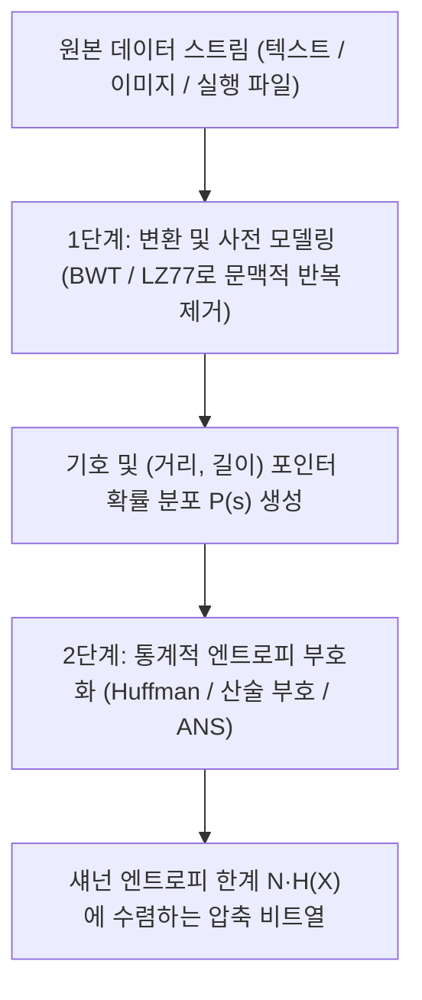
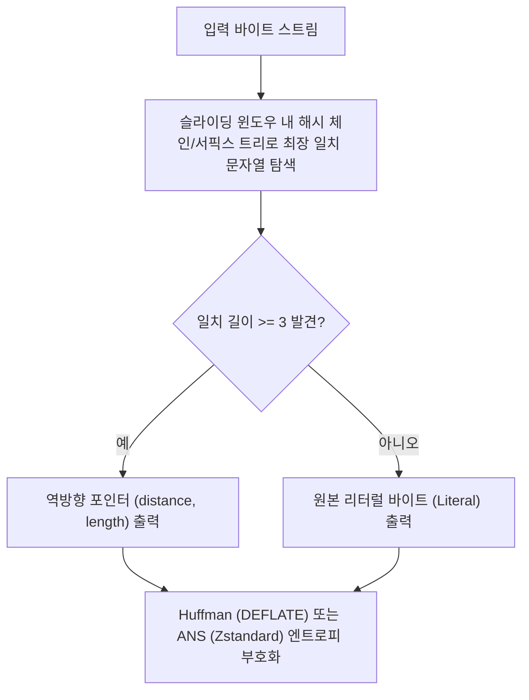

## 1. 비둘기집 원리의 철칙: 왜 '모든 파일을 줄이는' 만능 무손실 압축기는 존재할 수 없는가?

우리가 매일 `zip`, `gzip`, `zstd`, `7z`, `PNG`를 사용해 수십 메가바이트의 문서나 소스 코드, 이미지를 원래 크기의 몇 분의 일로 줄이면서도 압축을 풀면 <strong>단 1비트도 틀리지 않고 원본 그대로 복원(Lossless, 무손실 가역)</strong>할 때, 한 가지 직관적인 의문이 생깁니다. "압축 프로그램이 파일을 줄여 준다면, 압축된 `.zip` 파일을 다시 압축기에 넣고 열 번, 백 번 반복해서 압축하면 결국 어떤 거대한 영화나 데이터베이스도 1바이트로 줄일 수 있지 않을까?"

답은 <strong>절대 불가능하다</strong>입니다. 이를 증명하는 데는 복잡한 정보이론조차 필요 없으며, 기초 조합론의 <strong>비둘기집 원리(Pigeonhole Principle)</strong>만으로 충분합니다.

무손실 압축 부호화 함수를 $E: \{0,1\}^* \to \{0,1\}^*$, 복호화 함수를 $D: \{0,1\}^* \to \{0,1\}^*$라 합시다. 단 한 비트도 잃지 않는 완전 가역성 $D(E(x)) = x$가 모든 입력 비트열 $x$에 대해 성립하려면, 부호화 함수 $E$는 반드시 <strong>단사 함수(Injective / 일대일 함수)</strong>여야만 합니다. 만약 서로 다른 두 파일 $x_1 \ne x_2$가 동일한 짧은 비트열 $y = E(x_1) = E(x_2)$로 압축된다면, 복호화기는 $y$를 보고 $x_1$과 $x_2$ 중 무엇을 복원해야 할지 영원히 알 수 없기 때문입니다!

이제 길이가 정확히 $N$ 비트인 모든 가능한 이진 파일의 집합 $\{0,1\}^N$을 생각해 봅시다. 그 개수는 총 $2^N$개입니다. 반면 길이가 $N$보다 엄밀히 짧은(즉 길이 $0$부터 $N-1$까지의) 모든 이진 문자열의 총합은 다음과 같습니다.

$$\sum_{k=0}^{N-1} 2^k = 2^N - 1 < 2^N$$

$2^N$마리의 비둘기(길이 $N$인 원본 파일들)를 $2^N - 1$개의 비둘기집(더 짧은 모든 비트열)에 넣으려면, 비둘기집 원리에 의해 <strong>어떤 무손실 압축 알고리즘이 단 하나의 파일이라도 1비트 줄인다면, 반드시 다른 어떤 파일은 원래보다 더 길어져야(팽창해야) 합니다</strong>! 나아가 $N$비트 파일 중 $c$비트 이상 크기를 줄일 수 있는 파일의 비율은 최대 $2^{-(c-1)}$을 넘지 못합니다.

$$P\bigl(|E(X)| \le N - c\bigr) < 2^{-(c-1)}$$

즉 가능한 모든 이진 파일의 우주에서 <strong>대부분의 무작위 문자열(콜모고로프 비압축성 문자열)은 단 1바이트도 줄일 수 없습니다</strong>. 그럼에도 일상적인 압축 프로그램이 거의 모든 파일을 극적으로 줄여 주는 이유는, 인간이 작성한 텍스트, 소스 코드, 실행 파일, 사진 데이터가 $\{0,1\}^N$ 전체 공간에서 극도로 희박하고 고도로 구조화된 <strong>낮은 엔트로피(Low-Entropy) 부분집합</strong>에만 모여 있기 때문입니다.

---

## 2. 섀넌의 정보원 부호화 정리와 엔트로피: 가역 압축의 절대적 물리 한계

1948년 클로드 섀넌(Claude E. Shannon)은 《통신의 수학적 이론》에서 <strong>"중복성을 모두 제거했을 때, 정보를 표현하는 데 필요한 최소 비트 수는 얼마인가?"</strong>라는 근본 질문에 답했습니다.

알파벳 $\mathcal{A} = \{s_1, s_2, \dots, s_m\}$에서 확률 분포 $P = (p_1, p_2, \dots, p_m)$에 따라 기호를 발생하는 이산 무기억 정보원(DMS)을 가정합시다. 자주 등장하는 기호는 놀라움이 적고, 희귀한 기호는 큰 정보를 전달합니다. 기호 $s_i$의 <strong>자기 정보량(Self-Information / 놀람도)</strong>과 그 기댓값인 <strong>섀넌 엔트로피(Shannon Entropy)</strong>는 다음과 같이 정의됩니다.

$$I(s_i) = -\log_2 p_i, \qquad H(X) = -\sum_{i=1}^{m} p_i \log_2 p_i \quad (\text{bits / symbol})$$

모호함 없이 즉시 복호화 가능한 <strong>접두사 없는 부호(Prefix-Free Code)</strong>의 코드워드 길이들을 $\ell_1, \dots, \ell_m$이라 하면, 모든 이진 접두사 트리는 반드시 <strong>크래프트-맥밀란 부등식(Kraft-McMillan Inequality)</strong>을 만족해야 합니다.

$$\sum_{i=1}^{m} 2^{-\ell_i} \le 1$$

평균 부호 길이 $L = \sum_{i=1}^m p_i \ell_i$와 엔트로피 $H(X)$의 차이를 쿨백-라이블러 발산(KL Divergence) $D_{\text{KL}}(P \,\|\, Q) \ge 0$ ($q_i = 2^{-\ell_i}/Z$)으로 전개하면 다음의 <strong>섀넌 무잡음 정보원 부호화 정리(Shannon's Source Coding Theorem)</strong>가 도출됩니다.

$$L - H(X) = \sum_{i=1}^m p_i \log_2 \frac{p_i}{2^{-\ell_i}} = D_{\text{KL}}(P \,\|\, Q) + \log_2 \frac{1}{Z} \ge 0 \implies H(X) \le L < H(X) + 1$$

즉, 어떤 무손실 부호화도 평균 비트 수를 섀넌 엔트로피 $H(X)$ 미만으로 낮출 수 없으며, $H(X)$는 무손실 압축의 절대적 하한선입니다.

---

## 3. 통계적 엔트로피 부호화의 3세대 진화: 허프만, 산술 부호화, 그리고 ANS

### 3.1 허프만 부호화 (Huffman Coding, 1952)
데이비드 허프만(David A. Huffman)은 가장 확률이 낮은 두 노드를 반복적으로 병합하는 탐욕(Greedy) 알고리즘으로 $O(m \log m)$ 시간에 최적 접두사 트리를 구축했습니다. 그러나 허프만 부호화는 <strong>모든 코드워드가 반드시 정수 개의 비트($\ell_i \ge 1$)를 가져야 한다</strong>는 근본적 한계가 있습니다. 확률이 $p_1 = 0.99$인 기호의 실제 정보량은 $-\log_2(0.99) \approx 0.0145\,\text{bits}$에 불과하지만, 허프만 부호는 최소 1비트 전체를 소비하여 약 69배의 낭비를 초래합니다.

### 3.2 산술 부호화 (Arithmetic Coding)
정수 비트 제약을 깨기 위해 산술 부호화는 <strong>길이 $N$인 전체 메시지 문자열 $x_1 x_2 \dots x_N$을 단위 구간 $[0, 1)$ 내부의 하나의 좁은 부분 구간 $[L_{\text{low}}, H_{\text{high}})$으로 매핑</strong>합니다. 매 기호 $x_t$마다 구간 폭이 확률 $P(x_t)$ 비율로 줄어들므로, 최종 구간 폭 $\Delta = \prod_{t=1}^N P(x_t)$를 표현하는 데 필요한 비트 수는 다음과 같습니다.

$$\left\lceil -\log_2 \Delta \right\rceil + 1 \approx \sum_{t=1}^{N} \bigl(-\log_2 P(x_t)\bigr) = N \cdot H(X)$$

이를 통해 기호당 '소수점 이하 비트(Fractional Bits)'를 할당하여 섀넌 엔트로피에 완벽히 수렴하지만, 매 단계 곱셈과 재정규화 연산이 필요해 속도가 느리다는 단점이 있었습니다.

### 3.3 비대칭 수 체계 (Asymmetric Numeral Systems, ANS, 2009–2014)
폴란드의 물리학자 야레크 두다(Jarek Duda)가 발명한 <strong>비대칭 수 체계(ANS: tANS 및 rANS)</strong>는 "허프만의 속도"와 "산술 부호의 압축률"을 하나로 통합한 현대 압축 기술의 결정체입니다. 상태 자연수 $x \in \mathbb{N}$에 확률 $p_s$인 기호 $s$를 부호화할 때, 상태를 $C(x, s) \approx x / p_s$로전이시킴으로써 단일 정수의 증가율 속에 소수 비트 단위의 정보를 저장합니다. 미리 계산된 유한 상태 기계(FSM) 룩업 테이블을 사용하는 <strong>tANS(FSE)</strong> 덕분에 <strong>산술 부호화와 동일한 압축률을 달성하면서도 허프만 부호화 수준의 초고속 단일 테이블 참조 복호화</strong>가 가능해졌으며, 오늘날 Meta의 <strong>Zstandard (`zstd`)</strong>, Apple의 <strong>LZFSE</strong>, Google의 <strong>JPEG XL</strong>의 핵심 엔진으로 자리 잡았습니다.

---

## 4. 사전 압축과 변환: LZ77, DEFLATE, BWT, 그리고 '압축은 곧 예측이다'

자연어나 소스 코드의 진정한 중복성은 개별 문자의 빈도가 아니라 <strong>문맥과 반복되는 부분 문자열</strong>에 있습니다. 1977년 에이브러햄 렘펠(Abraham Lempel)과 제이콥 지브(Jacob Ziv)가 고안한 <strong>LZ77 슬라이딩 윈도우 알고리즘</strong>은 이전에 등장한 문자열이 다시 나타나면 이를 그대로 적는 대신 <strong>`(거리 distance, 길이 length)` 역방향 포인터</strong>로 치환합니다.

| 압축 알고리즘 / 도구 | 핵심 사전·변환 기법 | 후단 엔트로피 부호화기 | 대표 텍스트 압축률 | 복호화 속도 | 주요 산업 응용 분야 |
|---|---|---|---|---|---|
| <strong>`lz4`</strong> | LZ77 바이트 정렬 매칭 | 없음 (바이트 스트림 직결) | $\sim 48\%$ | $\sim 4,000\,\text{MB/s}$ | 커널 이미지, ZRAM 메모리 압축, 실시간 DB |
| <strong>`gzip` (DEFLATE)</strong> | LZ77 (32 KB 윈도우) | 허프만 부호화 (Huffman) | $\sim 32\%$ | $\sim 400\,\text{MB/s}$ | 웹 HTTP 전송, `.tar.gz`, PNG 이미지 |
| <strong>`zstd` (Zstandard)</strong> | LZ77 (대형 윈도우 + 오프셋 캐시) | <strong>ANS (tANS / FSE)</strong> + Huffman | $\sim 28\%$ | $\sim 1,500\,\text{MB/s}$ | 리눅스 패키지, 데이터센터 스토리지, Btrfs |
| <strong>`bzip2`</strong> | <strong>BWT 블록 정렬 변환</strong> + MTF + RLE | 다중 테이블 허프만 부호화 | $\sim 26\%$ | $\sim 60\,\text{MB/s}$ | 소스 아카이브, 유전체 서열 데이터 보관 |
| <strong>`xz` (LZMA2)</strong> | LZ77 (초대형 사전 + 비트 문맥) | 적응형 범위 산술 부호화 (Range) | $\sim 21\%$ | $\sim 120\,\text{MB/s}$ | 최소 용량 소프트웨어 배포, 임베디드 펌웨어 |
| <strong>`cmix` / `PAQ8` / LLM</strong> | 다중 문맥 혼합 / Transformer | 산술 부호화 (Arithmetic Coding) | $\sim 11\%\text{–}14\%$ | $< 1\,\text{MB/s}$ | Hutter Prize 벤치마크, 인공지능-압축 등가성 연구 |

정보이론의 가장 깊은 관점에서 <strong>"압축과 예측은 수학적으로 완전히 동치(Compression is Prediction)"</strong>입니다. 이전 문맥 $x_{<t}$가 주어졌을 때 다음 기호의 확률 분포 $P_\theta(x_t \mid x_{<t})$를 가장 정확히 예측하는 모델(현대 대규모 언어 모델 LLM의 교차 엔트로피 손실 $-\sum \log_2 P_\theta(x_t \mid x_{<t})$)은 산술 부호화기와 결합할 때 가장 작은 무손실 압축 파일을 만들어 냅니다!
