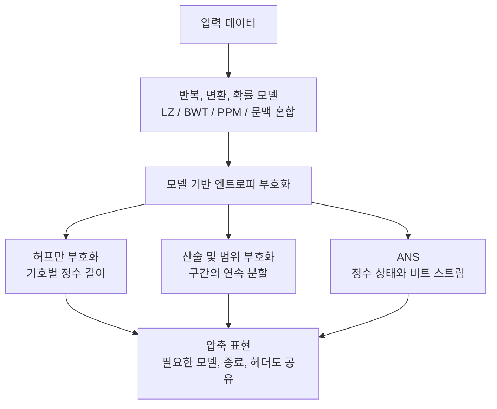
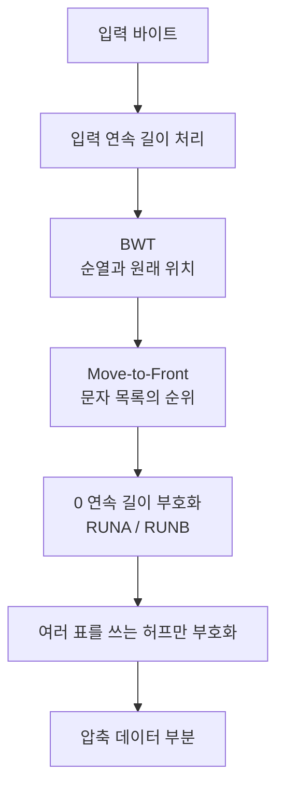

## 1. 모든 파일을 줄일 수 있는 압축기는 왜 없는가

무손실 압축은 원본 바이트를 단 한 비트도 바꾸지 않고 복원할 수 있는 다른 표현으로 데이터를 바꿉니다. zip, gzip, zstd, xz 같은 도구는 어떤 입력을 줄이지만, 다른 입력은 거의 줄이지 못하거나 헤더 때문에 오히려 키웁니다. 모든 데이터를 같은 비율로 줄이지는 않습니다. JPEG나 MP3 같은 손실 압축은 복원된 값의 차이를 허용하므로 복원 조건이 다릅니다.

{0,1}*를 유한 비트열의 집합이라 하고, 부호화기 E와 복호화기 D를 고정합시다. 무손실이려면 모든 입력 x에 대해 다음이 성립해야 합니다.

$$
D(E(x))=x
$$

서로 다른 입력의 출력이 같으면 D가 둘을 모두 복원할 수 없으므로 E는 단사여야 합니다. 길이가 정확히 n비트인 입력은 2^n개지만, n비트보다 짧은 출력은 빈 문자열까지 세어도 그보다 적습니다. 여기서 n≥1입니다.

$$
\left|\{0,1\}^{n}\right|=2^n>
\sum_{k=0}^{n-1}2^k=2^n-1
$$

따라서 고정된 무손실 압축기는 모든 n비트 입력을 줄일 수 없습니다. 모든 유한 비트열에서 정의된 단사 함수가 일부 입력을 줄인다면 적어도 다른 입력 하나는 늘려야 합니다. n비트 입력 x를 줄이고 어느 입력도 늘리지 않는다면, n비트보다 짧은 입력들이 이미 그 길이의 가능한 출력을 모두 차지합니다. 따라서 E(x)가 그중 하나와 충돌합니다.

정량적으로는 E를 고정하고 n비트 문자열 X를 균등하게 고릅니다. 정수 1≤c≤n에 대해 c비트 이상 줄어드는 비율의 상한은 다음과 같습니다. 이는 가능한 출력을 센 것이며, 부호화기가 그 출력을 모두 사용한다는 뜻은 아닙니다.

$$
\Pr\!\left(|E(X)|\le n-c\right)
\le\frac{2^{n-c+1}-1}{2^n}
<2^{1-c}
$$

c=11이면 이 비율은 1/1024, 약 0.0977%보다 작습니다. 그렇다고 남은 파일을 다른 어떤 압축기로도 줄일 수 없다는 뜻은 아닙니다. 특정 파일 x에 대해서는 x와 빈 문자열을 서로 바꾸는 별도의 부호화기를 만들 수 있습니다. x는 줄고 빈 문자열은 늘어나며, 복호화기는 그 특수 규칙을 알아야 합니다. 콜모고로프 복잡도를 논할 때도 고정된 기술 언어와 복호화 프로그램을 기술하는 길이를 구분해야 합니다.

실용 압축은 기호 빈도의 편향, 반복 부분 문자열, 수치 데이터의 패턴처럼 분포나 구조에 맞는 표현을 이용합니다. 이득은 입력과 방법에 달려 있습니다. 이미 압축한 파일이나 암호문은 단 한 바이트도 줄어들 수 없다고 단정할 수 없습니다. 암호 방식과 모드, 메타데이터, 남은 구조를 따져야 합니다.

단위도 구별해야 합니다. 1 MiB는 1,048,576바이트, 즉 8,388,608비트입니다. 십진 단위인 1 MB는 1,000,000바이트, 즉 8,000,000비트입니다.

## 2. 섀넌 엔트로피와 평균 부호 길이의 한계

섀넌의 1948년 논문은 의미적 가치와 통신의 공학적 문제를 분리하고 정보원을 확률적으로 연구했습니다. 이 [재판본](https://wucj.lab.westlake.edu.cn/Others/shannon1948.pdf)의 서론은 나이퀴스트와 하틀리의 선행 연구도 언급합니다.

확률이 양수인 사건 x의 자기 정보량은 다음과 같습니다. 밑이 2인 로그를 쓰면 단위는 비트입니다. 심리적 놀라움이나 내용의 중요성 자체를 측정하는 양은 아닙니다.

$$
I(x)=-\log_2P(x),\qquad 0<P(x)\le1
$$

유한 알파벳 위 확률변수 X에 대해 p_i=P(X=x_i)라 합시다. 섀넌 엔트로피는 자기 정보량의 기댓값이며, 확률이 0인 항에는 0log₂0=0이라는 관례를 씁니다.

$$
H(X)=-\sum_{i=1}^{m}p_i\log_2p_i,\qquad
p_i\ge0,\quad\sum_i p_i=1,\quad
0\le H(X)\le\log_2m
$$

단위는 기호당 비트입니다. m개 기호로 된 고정 알파벳에서는 균등분포가 엔트로피를 최대화하고, 하나의 기호가 확률 1이면 엔트로피는 0입니다. 공정한 동전 결과의 자기 정보량은 1비트이고, 확률 1/256인 사건은 8비트입니다. 이 값들은 기호 모델을 설명하며, 상관된 수열의 정보량이나 개별 파일의 하한을 직접 결정하지 않습니다.

### 접두 부호와 크래프트–맥밀란 부등식

이어 붙인 결과를 유일하게 복호화할 수 있도록 각 기호에 이진 부호어를 배정합시다. 접두 부호에서는 어느 부호어도 다른 부호어의 접두사가 아닙니다. 예를 들어 {0,10,110,111}로 100110111을 10 | 0 | 110 | 111로 나눌 수 있습니다. ASCII 자체는 7비트 문자 부호이며, 모든 문자를 8비트로 표현하는 것과 동의어가 아닙니다.

길이 ℓ_i인 부호어를 이진 트리의 잎으로 나타냅니다. 최대 깊이가 ℓ_max인 완전한 트리에서 잎 하나는 그 아래의 가능한 위치 2^(ℓ_max−ℓ_i)개를 차지합니다. 겹치지 않는 이 부분 트리들을 세면 크래프트 부등식을 얻습니다. 유일 복호 가능 부호에도 같은 부등식이 성립합니다.

$$
\sum_i2^{\ell_{\max}-\ell_i}\le2^{\ell_{\max}}
\quad\Longrightarrow\quad
Z:=\sum_i2^{-\ell_i}\le1
$$

역으로 이 부등식을 만족하는 양의 정수 길이들에는 접두 부호를 구성할 수 있습니다. 아래에서는 양의 확률을 가진 기호가 적어도 두 개인 경우를 다룹니다. 기호가 하나뿐인 정보원에서 빈 부호어를 허용할지, 기호 수나 종료를 어떻게 공유할지는 별도로 명시해야 합니다.

### KL 발산으로 얻는 하한

평균 부호 길이와 부호 길이에서 유도한 정규화된 분포 Q를 다음과 같이 정의합니다.

$$
L=\sum_i p_i\ell_i,\qquad
q_i=\frac{2^{-\ell_i}}{Z},\qquad \sum_i q_i=1
$$

쿨백–라이블러 발산이 음이 아니라는 사실로 다음 항등식을 얻습니다. 비음수성은 예를 들어 로그 부등식 ln u≤u−1로 증명할 수 있습니다.

$$
\begin{aligned}
0\le D_{\mathrm{KL}}(P\|Q)
&=\sum_i p_i\log_2\frac{p_i}{q_i}\\
&=-H(X)+\sum_i p_i\ell_i+\log_2Z\\
&=L-H(X)+\log_2Z
\end{aligned}
$$

따라서 평균 길이에 대한 하한은 다음과 같습니다.

$$
L=H(X)+D_{\mathrm{KL}}(P\|Q)-\log_2Z\ge H(X)
$$

Q는 2^(-ℓ_i)를 Z로 나눈 값입니다. 이 정규화를 빼면서 −log₂Z 항까지 따로 더하면 안 됩니다. 등호는 P=Q와 Z=1일 때 성립하며, 이때 p_i=2^(-ℓ_i)로 확률과 이진 부호 길이가 맞아떨어집니다.

상한을 만족하는 부호도 구성할 수 있습니다. 다음 섀넌 길이들은 크래프트 부등식을 만족합니다.

$$
\ell_i=\lceil-\log_2p_i\rceil,\qquad
2^{-\ell_i}\le p_i,\qquad
\sum_i2^{-\ell_i}\le1
$$

올림으로 늘어나는 길이는 기호당 1비트 미만이므로 이 부호의 평균 길이는 H+1보다 작습니다. 따라서 최적 이진 접두 부호의 평균 길이 L_opt는 다음 범위에 있습니다.

$$
H(X)\le L_{\mathrm{opt}}<H(X)+1
$$

기호가 독립이고 동일한 분포를 따르는 비퇴화 정보원에서, N개 기호를 묶어 적절한 블록 접두 부호를 고르면 다음을 얻습니다. L_N은 블록 전체의 평균 길이입니다.

$$
H(X)\le\frac{L_N}{N}<H(X)+\frac1N
$$

의존성이 있으면 일반적으로 H(X_1,...,X_N)≠NH(X_1)입니다. 공정하게 고른 비트 하나를 알려진 길이 N만큼 반복하면, 각 위치의 주변 엔트로피는 1비트이지만 전체 수열의 엔트로피는 1비트입니다. 유한 알파벳의 정상 정보원에서는 엔트로피율을 사용합니다.

$$
\overline H=\lim_{N\to\infty}\frac{H(X_1,\ldots,X_N)}{N}
$$

이들은 명시된 분포와 부호 클래스에서의 평균에 관한 명제입니다. 모든 파일이 그 길이 이상이어야 한다거나 모델과 헤더 비용을 무시해도 된다는 뜻이 아닙니다.

## 3. 허프만 부호화, 산술 부호화, ANS

통계 모델과 확률을 비트로 바꾸는 부호화기를 구분하면 각 방법을 이해하기 쉽습니다. 다음은 개념도이며, 모든 형식이 이처럼 독립적인 단계로 나뉘어야 한다는 사양은 아닙니다.

### 허프만 부호화: 어떤 클래스에서 최적인가

[허프만의 1952년 논문](https://compression.ru/download/articles/huff/huffman_1952_minimum-redundancy-codes.pdf)은 주어진 가중치에서 평균 길이를 최소화하는 접두 부호를 구성합니다. 이진 부호에서는 가중치가 가장 작은 두 노드를 반복해 합치고 그 합을 다시 넣습니다. 힙을 쓰면 m개 기호의 트리를 O(m log m)에 만들 수 있습니다.

양의 가중치가 적어도 두 개라면 최적 트리에 자식이 하나뿐인 불필요한 가지를 둘 필요가 없습니다. 가장 작은 두 가중치를 가장 깊은 형제 잎에 배치해도 평균 길이가 늘지 않습니다. 이들을 기호 z로 합치면 원래 트리 T와 작은 트리 T′ 사이에 다음 관계가 성립합니다.

$$
L(T)=L(T')+p_a+p_b
$$

차이가 고정되므로 작은 문제의 최적해로 원래 문제의 해를 구성할 수 있습니다. 가중치가 같으면 최적 트리가 여러 개일 수 있습니다. 정준 허프만 부호는 길이와 기호 순서로 부호어를 정하여 트리 전송을 단순화합니다. 그렇다고 표를 기술하는 비용이나 긴 부호어의 추가 복호화 단계가 사라지지는 않습니다.

P(0)=0.99, P(1)=0.01일 때 기호별 최적 이진 접두 부호는 두 기호에 각각 1비트를 씁니다.

$$
H(X)=-0.99\log_2(0.99)-0.01\log_2(0.01)
\approx0.080793,\qquad L_{\mathrm H}=1
$$

평균 길이는 엔트로피의 약 12.4배입니다. 원래 파일을 줄일 수 없다는 뜻은 아닙니다. 기호당 8비트로 시작한 표현과 이미 비트 단위로 채운 수열은 다릅니다. 블록은 정수 길이로 인한 손실을 줄이지만 m^k개 조합을 모두 명시하는 트리는 빠르게 커집니다. 단일 기호의 빈 부호어 관례는 여전히 개수 공유 문제와 구별해 다뤄야 합니다.

### 산술 부호화: 구간과 유한 비트열

산술 부호화는 메시지에 대응하는 구간을 좁힙니다. P(s)를 기호 확률, A(s)를 약속한 순서에서 s보다 앞선 기호들의 누적확률이라 합시다. [lo_0,hi_0)=[0,1)에서 시작하고, 부호화할 모든 기호의 확률은 양수라고 가정합니다. 폭 W_(t−1)=hi_(t−1)−lo_(t−1)에 대해 다음처럼 갱신합니다.

$$
\begin{aligned}
\mathrm{lo}_t&=\mathrm{lo}_{t-1}+W_{t-1}A(x_t),\\
\mathrm{hi}_t&=\mathrm{lo}_{t-1}+W_{t-1}\bigl(A(x_t)+P(x_t)\bigr)
\end{aligned}
$$

고정된 독립 모델에서 마지막 폭은 아래의 첫 곱입니다. 의존성이 있으면 양쪽이 단계마다 재현할 수 있는 조건부확률을 사용합니다.

$$
W_N=\prod_{t=1}^{N}P(x_t)
\quad\text{or}\quad
W_N=\prod_{t=1}^{N}P(x_t\mid x_{<t})
$$

알려진 같은 길이 N의 서로 다른 메시지는 겹치지 않는 구간에 대응합니다. 마지막 구간 안에 완전히 들어가는 이진 분할 구간 [j2^(-K),(j+1)2^(-K))을 고르면 K비트로 그 구간을 지정할 수 있습니다. 폭의 절반 이하인 격자 간격을 사용하면, 이상적인 무한 정밀도 산술에서 다음 길이로 충분합니다.

$$
K=\lceil-\log_2W_N\rceil+1<-\log_2W_N+2
$$

이는 모델과 길이를 알고 있을 때의 이상적 페이로드에 대한 상한입니다. 최소 K가 항상 이 식과 같거나 파일 전체의 오버헤드가 2비트뿐이라는 주장은 아닙니다. 모델, 종료, 정밀도, 헤더에는 추가 비용이 듭니다. 실제 블록 분포 P를 사용할 때 이 접두 표현의 평균 길이는 다음을 만족합니다.

$$
H(P)\le\mathbb E_P[K]<H(P)+2
$$

P(0)=0.99이면 약 69개의 연속된 0이 폭을 절반으로 줄입니다. 69기호마다 정확히 1비트를 내보낸다는 규칙은 아닙니다. 출력은 구간과 재정규화에 달려 있습니다. 정수 구현은 확정된 상위 비트나 바이트를 내보내고 상태를 확장합니다. 확률 양자화, 올림수 처리, 보류 비트에도 작업이 필요합니다. 산술 또는 범위 부호화와 다른 부호화기 사이에 보편적인 속도 비율은 없습니다.

### ANS: 정수 상태에 정보 누적하기

[두다의 ANS 논문](https://arxiv.org/html/1311.2540v2)은 기호별 확률이 다른 수 체계를 구성합니다. 일반적인 b진법에서 숫자 s를 덧붙이는 연산은 다음처럼 되돌릴 수 있습니다.

$$
x'=bx+s,\qquad s=x'\bmod b,\qquad x=\lfloor x'/b\rfloor
$$

확률이 같고 양의 상태 x가 충분히 크면 로그 크기 증가는 대략 log₂b입니다. 일반적인 확률에서는 상태가 대략 1/P(s)배로 커지도록 구성합니다. x=0에 log₂x를 적용하거나 이 근사를 정확한 정수 부호 길이로 보아서는 안 됩니다.

rANS의 한 구성은 M=2^R, 양의 정수 기호 빈도 f_s, 누적 빈도 b_s를 사용합니다.

$$
\sum_s f_s=M,\qquad b_s=\sum_{a<s}f_a,\qquad P(s)\approx f_s/M
$$

음이 아닌 정수 상태 x와 기호 s를 다음처럼 변환합니다.

$$
C(x,s)=M\left\lfloor\frac{x}{f_s}\right\rfloor+(x\bmod f_s)+b_s
$$

역변환은 slot으로 기호를 고른 뒤 이전 상태를 복원합니다.

$$
\begin{aligned}
\mathrm{slot}&=x'\bmod M,\\
b_s&\le\mathrm{slot}<b_s+f_s,\\
x&=f_s\left\lfloor\frac{x'}M\right\rfloor+\mathrm{slot}-b_s
\end{aligned}
$$

M이 2의 거듭제곱이면 몫과 나머지를 시프트와 마스크로 계산할 수 있습니다. 기호 검색, 표 접근, 재정규화, 입출력 비용도 들어갑니다. 이 전단사만으로 부호화 손실 0이나 한 클록 사이클 복호화가 보장되지는 않습니다.

tANS는 유한한 상태와 전이표를 사용합니다. 비트 기반 설명에서는 예를 들어 다음 정수 집합을 사용할 수 있습니다. 반열린 구간 [L,2L)에 대응하며 [L,2L−1)이 아닙니다.

$$
\mathcal I=\{L,L+1,\ldots,2L-1\},\qquad |\mathcal I|=L
$$

허용 범위에 머물도록 누적 상태와 스트림 사이에서 비트를 옮깁니다. 정규화 조건과 기호 배치가 서로 맞아야 하며, rANS 식을 단순히 작은 표로 바꾸는 것만으로는 부족합니다. FSE는 tANS 계열 구현입니다.

ANS의 상태 연산은 스택처럼 작동하여 마지막에 넣은 기호가 먼저 나옵니다. 블록을 역순으로 부호화하면 복호화를 원래 순서대로 진행하게 할 수 있습니다. 문맥 확률을 쓰면 그 확률을 계산하는 순서와 역순 부호화도 조정해야 합니다. 허프만, 산술 부호화, ANS는 모델과 형식, 구현에 따른 선택지이지 앞선 방법을 언제나 대체하는 세 세대가 아닙니다.

## 4. LZ, BWT, 문맥 모델은 무엇을 바꾸는가

바이트별 빈도만 사용하는 모델은 긴 반복과 의존성을 충분히 활용하지 못합니다. 영어에 보편적인 기호당 비트 수를 붙이기보다 말뭉치와 단위가 문자, 바이트, 토큰 중 무엇인지 명시해야 합니다.

### 사전 압축: LZ77, LZ78, LZW

LZ77 계열은 이미 출력한 데이터를 뒤로 참조합니다. 16바이트 ASCII 문자열 `std::vector<int>`가 200바이트 앞에 있었고 다시 일치한다면 다음 거리와 길이로 나타낼 수 있습니다. 두 숫자를 어떻게 부호화하느냐에 따라 16바이트를 그대로 쓰는 것보다 짧을 수도, 아닐 수도 있습니다.

$$
(d,\ell)=(200,16)
$$

일치 길이는 거리보다 클 수 있습니다. 리터럴 A 하나 뒤에서 거리 1, 길이 99를 참조하면 새로 복사한 A도 복사 원본으로 사용하여 총 100개의 A를 만듭니다. [DEFLATE 사양](https://www.rfc-editor.org/rfc/rfc1951.txt)에도 겹치는 참조 예가 있습니다. 겹친 영역에 일반적인 memcpy를 적용하거나 최초 원본의 스냅숏만 복사하는 것으로는 이 확장을 올바르게 설명할 수 없습니다. 구현은 증가하는 출력을 처리하며 거리, 출력 한계, 입력 길이를 검사해야 합니다.

LZSS는 플래그 등으로 리터럴과 일치 참조를 구별합니다. 플래그에도 공간이 들기 때문에 일치하지 않는 데이터가 절대로 늘지 않는다고 보장할 수 없습니다. LZ78/LZW는 발견한 문자열을 명시적인 사전에 등록하고 인덱스를 씁니다. 사전 성장과 초기화, 참조 범위, 정수 부호화가 다르며 어떤 방법도 모든 입력에서 이길 필요는 없습니다.

실제 형식도 다릅니다. DEFLATE 압축 블록은 거리 1~32,768, 길이 3~258을 쓰며 리터럴/길이와 거리에 별도 허프만 부호를 적용합니다. 비압축 블록도 있습니다. [Zstandard 사양](https://www.rfc-editor.org/rfc/rfc8878.html)은 리터럴과 시퀀스를 나누어 리터럴에는 비압축/RLE/허프만을, 시퀀스에는 FSE 등을 포함한 모드를 사용합니다. 허프만 스트림 1개 또는 4개와 시퀀스 FSE 상태의 세 종류는 서로 다른 구분입니다. LZMA/LZMA2도 사전과 확률 모델을 결합하며, [LZMA 부호화기](https://github.com/ip7z/7zip/blob/main/C/LzmaEnc.c)에는 일치 검색과 범위 부호화 연산이 나타납니다. 알고리즘 이름 하나가 모든 형식, 도구, 압축 수준을 대신하지는 않습니다.

### BWT: 길이를 보존하는 순열과 역변환

버로스–휠러 변환은 뒤따르는 문맥이 같은 문자들을 모읍니다. 마지막 열은 기호 수를 보존하지만, 역변환에 필요한 위치나 센티널 정보에도 비용이 듭니다.

다른 문자보다 앞서 정렬되는 고유 센티널 `$`를 붙인 `banana$`를 생각합시다. 일곱 순환 이동을 사전순으로 정렬한 뒤 마지막 열과 원래 행 번호를 얻습니다.

| 행 | 사전순으로 정렬한 회전 문자열 | 첫 문자 | 마지막 문자 |
| :--- | :--- | :---: | :---: |
| 0 | `$banana` | `$` | a |
| 1 | `a$banan` | a | n |
| 2 | `ana$ban` | a | n |
| 3 | `anana$b` | a | b |
| 4 | `banana$` | b | `$` |
| 5 | `na$bana` | n | a |
| 6 | `nana$ba` | n | a |

출력은 `annb$aa`이고 0부터 세는 원래 행 번호는 4입니다. 마지막 열을 L, 첫 열을 F라 하면 L의 문자를 정렬하여 F를 얻습니다. 같은 문자의 등장 순서를 대응시키면 원래 수열을 뒤로 따라가는 LF 매핑을 얻습니다. 위치를 0부터 셀 때 C(c)는 c보다 작은 문자 수, rank_c(i)는 L에서 위치 i보다 앞에 나온 c의 수입니다.

$$
\mathrm{LF}(i)=C(L_i)+\mathrm{rank}_{L_i}(i)
$$

작은 고정 알파벳에서는 빈도와 등장 순위를 선형 시간에 계산하고 N기호 수열을 O(N)에 복원할 수 있습니다. 일반적인 비교 정렬을 쓰면 그 비용을 별도로 세어야 합니다. BWT가 모든 입력을 긴 연속 반복으로 바꾸지는 않습니다.

[bzip2 1.0.8 매뉴얼](https://sourceware.org/bzip2/manual/manual.html)과 [해당 버전의 소스](https://sourceware.org/pub/bzip2/bzip2-1.0.8.tar.gz)는 BWT 전의 RLE, MTF, 0 연속 길이 부호화, 여러 허프만 표를 결합합니다. MTF는 현재 문자 목록에서의 순위를 출력하고 그 문자를 맨 앞으로 옮깁니다. 반복 문자는 0을 만들며 RUNA/RUNB로 부호화합니다. 다음 그림은 주요 데이터 변환만 나타내며 헤더, 인덱스, CRC는 생략합니다.

### 문맥 모델과 LLM: 부호 길이와 예측 손실

PPM은 길이가 다른 문맥을 쓰며 관측하지 못한 기호를 이스케이프 같은 방식으로 처리합니다. 문맥 혼합은 여러 모델의 예측을 결합합니다. 신경망도 예측을 제공할 수 있지만 Transformer는 순환 신경망과 동의어가 아닙니다.

모델 Q_θ가 양의 조건부확률을 부여하는 수열의 이상적 정보량은 다음과 같습니다. 실제 출력 길이와 같다고 두지는 않습니다.

$$
I_\theta(x_{1:N})=-\log_2 Q_\theta(x_{1:N})
=\sum_{t=1}^{N}-\log_2Q_\theta(x_t\mid x_{<t})
$$

이 수열에 대해 자연로그를 사용하는 평균 음의 로그우도의 밑과 평균 계수는 다음 관계를 줍니다.

$$
\mathcal L_{\mathrm{NLL}}(\theta)
=-\frac1N\sum_{t=1}^{N}\ln Q_\theta(x_t\mid x_{<t})
=\frac{\ln2}{N}I_\theta(x_{1:N})
$$

따라서 데이터, 단위, 모델 조건이 같을 때 이 손실의 감소는 이상적 부호 길이 감소에 대응합니다. 식에는 공유 모델의 크기, 가역 토큰화, 유한 정밀도, 종료, 헤더, 복호화 시간이 들어 있지 않습니다. 한 예측의 정보량이 1비트보다 작다고 그 부호어만 따로 소수 비트짜리 파일에 담을 수 있는 것은 아닙니다.

[Language Modeling Is Compression](https://arxiv.org/html/2309.10668v2)은 이 연결을 실험적으로 연구합니다. 이미지와 음성 비교는 전처리한 데이터와 정해진 문맥 길이를 사용하며, 모델 가중치를 제외한 비율과 포함한 비율을 구분합니다. 이를 모든 이미지나 음성, 임의의 파일에 일반화해서는 안 됩니다. Hutter Prize 같은 과제는 예측 연구를 장려하지만 부호화 방정식만으로 지능이나 이해의 충분조건이 증명되지는 않습니다.

## 5. 압축 크기, 속도, 메모리 비교하기

실용 평가는 압축 크기, 부호화 시간, 복호화 시간, 메모리, 호환성, 접근 단위를 함께 다룹니다. 압축 크기를 원본 크기로 나눈 비율은 작을수록 좋다고 정의합시다. 서로 다르게 설정한 벤치마크 수치로 보편적인 순위를 만들 수는 없습니다.

| 방법 또는 도구 | 구조적 특징 | 비교할 때 확인할 조건 |
| :--- | :--- | :--- |
| LZ4 | 바이트 지향 LZ77 계열 표현, 블록 내부 엔트로피 부호화 없음 | 작은 입력의 프레이밍 비용, 복호화 속도, 필요한 버퍼 |
| Zstandard | 일치 검색, 리터럴과 시퀀스, 허프만/FSE 등 여러 모드 | 수준, 사전, 윈도우, 모드, 양쪽 메모리 |
| DEFLATE / gzip | 이전 데이터 참조와 허프만, 비압축 블록도 가능 | 형식과 도구의 구별, 호환성, 블록과 래퍼 비용 |
| BWT / bzip2 | 블록 변환, MTF, 연속 길이, 허프만 | 블록 크기, 복원 작업 공간, 인덱스 |
| LZMA/LZMA2 / xz와 7-Zip | 사전 일치와 적응형 확률 부호화 | 형식과 설정, 사전 크기, 검색 시간, 복호화기 한계 |
| PPM, 문맥 혼합, 신경망 예측 | 문맥 확률을 구한 뒤 부호화 | 모델 공유/전송, 문맥 길이, 계산량, 재현 가능한 정밀도 |

[LZ4 블록 사양](https://github.com/lz4/lz4/blob/dev/doc/lz4_Block_format.md)은 프레이밍을 별도로 취급하며, [7-Zip 형식 설명](https://www.7-zip.org/7z.html)은 여러 방법을 구분합니다. 구조를 이해하는 것과 실제 작업 부하를 측정하는 것이 모두 필요합니다.

구현과 버전, 명령과 수준, CPU와 스레드, 입력 해시와 크기, 사전, 캐시와 입출력 조건을 기록해야 합니다. 전체 원본 바이트 U, 압축 바이트 C, 경과 시간으로 C/U와 처리량을 계산합니다. 빈 입력의 크기 비율은 따로 다룹니다. 메모리에는 사전뿐 아니라 버퍼와 모델도 포함합니다. 복원한 바이트의 해시가 원본과 일치하는지 검사합니다. 여기서는 새로운 처리량 측정을 주장하지 않습니다.

### 부호화·복호화 작업과 입출력

LZ 계열에서는 복호화가 부호화기의 일치 검색과 파싱보다 가벼울 수 있습니다. 하지만 같은 형식에서도 압축 수준과 출력 명령에 따라 복호화 속도가 달라질 수 있습니다. 높은 수준에서도 복호화 속도가 정확히 같다고 보장되지는 않습니다. 예측 모델의 복호화기는 확률을 재현해야 하지만 부호화기는 확률 계산을 묶어 처리할 수도 있으므로 두 시간도 반드시 같지는 않습니다.

단순한 읽기 모델에서 입출력 속도를 v_io, 원본 바이트 기준 복호화 속도를 v_dec라 합시다. CPU 작업과 입출력을 겹치지 않으면 시간은 대략 다음과 같습니다.

$$
T_{\mathrm{raw}}\approx\frac{U}{v_{\mathrm{io}}},\qquad
T_{\mathrm{compressed}}\approx\frac{C}{v_{\mathrm{io}}}
+\frac{U}{v_{\mathrm{dec}}}
$$

절약한 입출력과 복호화 비용을 비교하는 식입니다. 자원이 독립적이고 파이프라인이 효과적으로 작동하면 정상 상태의 시간은 합이 아니라 두 항 중 큰 값에 가까울 수 있습니다. 시작 비용, 메모리 대역폭, 병렬성, 접근 단위에 따라 다른 모델이 필요할 수 있습니다.

분기, 의존성, 캐시, SIMD, 명령어 수준 병렬성은 속도에 영향을 줍니다. 이들이 있다는 사실만으로 보편적인 MB/s 상한이 정해지지 않으며, 스트림을 나눈다고 분기 예측 실패가 0이 되지도 않습니다. 한 번 압축하고 많은 독자가 복호화하는 배포 묶음은 자주 갱신되는 로그와 우선순위가 다릅니다.

## 6. 어떤 한계와 비용을 세고 있는가

비둘기집 원리는 고정된 무손실 부호화기가 모든 입력을 줄일 수 없음을 보입니다. 엔트로피 하한은 명시된 확률 모델과 부호화 조건에서의 평균 길이에 관한 것입니다. 허프만, 산술 부호화, ANS는 서로 다른 방식으로 확률을 표현에 연결하고, LZ, BWT, 문맥 모델은 반복과 의존성을 이용합니다.

예측 손실과 이상적 부호 길이의 연결은 신경망 압축을 이해하는 데 도움이 됩니다. 이를 파일 전체 비용, 처리 속도, 지능의 증명과 구별해야 합니다. 무엇을 공유하고 무엇을 전송하며 어떤 입력을 측정했는지 명시해야 이론을 실용적인 선택에 연결할 수 있습니다.
