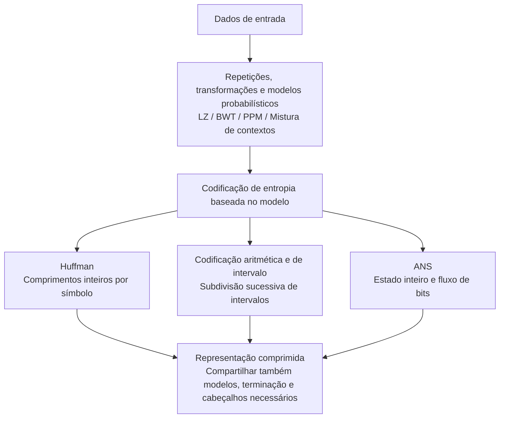
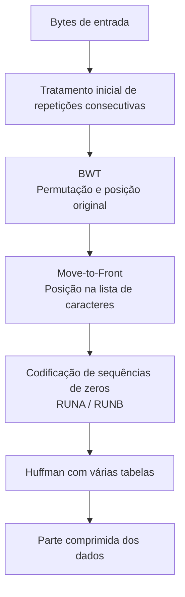

## 1. Por que nenhum compressor consegue encurtar todos os arquivos

A compressão sem perdas substitui os dados por uma representação que permite recuperar os bytes originais sem alterar um único bit. Ferramentas como zip, gzip, zstd e xz reduzem algumas entradas; outras quase não mudam ou crescem por causa dos cabeçalhos. Não reduzem tudo na mesma proporção. A compressão com perdas, como JPEG ou MP3, permite diferenças nos valores reconstruídos e, portanto, tem outro requisito de reconstrução.

Seja {0,1}* o conjunto das cadeias binárias finitas. Fixemos um codificador E e um decodificador D. A ausência de perdas exige, para toda entrada x:

$$
D(E(x))=x
$$

Se duas entradas distintas tivessem a mesma saída, D não conseguiria recuperar ambas; E precisa ser injetora. Existem 2^n entradas de exatamente n bits, mas menos saídas com comprimento inferior a n, mesmo incluindo a cadeia vazia. Aqui n≥1.

$$
\left|\{0,1\}^{n}\right|=2^n>
\sum_{k=0}^{n-1}2^k=2^n-1
$$

Logo, um compressor sem perdas fixo não consegue encurtar todas as entradas de n bits. Uma função injetora sobre todas as cadeias finitas também não pode encurtar algumas sem alongar nenhuma outra. Se encurtasse uma entrada x de n bits sem alongar nenhuma, as entradas menores que n já ocupariam todas as saídas menores que n. E(x) colidiria com uma delas.

Para quantificar isso, fixe E e escolha uniformemente uma cadeia X de n bits. Para um inteiro 1≤c≤n, a fração que é encurtada em pelo menos c bits tem o seguinte limite superior. Contamos saídas possíveis; o codificador não precisa utilizá-las todas.

$$
\Pr\!\left(|E(X)|\le n-c\right)
\le\frac{2^{n-c+1}-1}{2^n}
<2^{1-c}
$$

Para c=11, essa fração é menor que 1/1024, aproximadamente 0,0977%. Isso não significa que nenhum outro compressor possa encurtar qualquer um dos arquivos restantes. Para um arquivo específico x, outro codificador poderia trocar x pela cadeia vazia e vice-versa: x diminui e a cadeia vazia cresce. O decodificador precisa conhecer essa regra especial. Ao discutir complexidade de Kolmogorov, também se deve distinguir uma linguagem de descrição fixa do comprimento da descrição de um programa decodificador.

A compressão usual aproveita representações adequadas a uma distribuição ou estrutura repetitiva: frequências desiguais de caracteres, substrings repetidas ou padrões numéricos. O ganho depende da entrada e do método. Não se pode afirmar categoricamente que nenhum arquivo já comprimido ou texto cifrado diminua sequer um byte. Importam a cifra, o modo, os metadados e a estrutura restante.

As unidades também importam. Um MiB tem 1.048.576 bytes, ou 8.388.608 bits. Um MB decimal tem 1.000.000 de bytes, ou 8.000.000 de bits.

## 2. Entropia de Shannon e limites do comprimento médio

O artigo de Shannon de 1948 separou o valor semântico do problema de engenharia da comunicação e estudou fontes por meio de probabilidades. A introdução desta [reedição](https://wucj.lab.westlake.edu.cn/Others/shannon1948.pdf) também reconhece os trabalhos anteriores de Nyquist e Hartley.

Para um evento x de probabilidade positiva, define-se a autoinformação como segue. Logaritmos de base dois dão unidades de bits. Isso não mede a surpresa psicológica nem a importância do conteúdo.

$$
I(x)=-\log_2P(x),\qquad 0<P(x)\le1
$$

Para uma variável aleatória X em um alfabeto finito, seja p_i=P(X=x_i). A entropia de Shannon é a autoinformação esperada, com a convenção 0log₂0=0 para termos de probabilidade zero.

$$
H(X)=-\sum_{i=1}^{m}p_i\log_2p_i,\qquad
p_i\ge0,\quad\sum_i p_i=1,\quad
0\le H(X)\le\log_2m
$$

A unidade é bits por símbolo. Para um alfabeto fixo de m símbolos, a distribuição uniforme maximiza a entropia; se um símbolo tem probabilidade um, a entropia é zero. O resultado de uma moeda equilibrada tem um bit de autoinformação; um evento de probabilidade 1/256 tem oito. Esses valores descrevem o modelo de símbolos, mas não determinam diretamente a informação de uma sequência correlacionada nem um limite inferior para cada arquivo.

### Códigos de prefixo e desigualdade de Kraft–McMillan

Atribua uma palavra binária a cada símbolo de forma que as concatenações sejam unicamente decodificáveis. Em um código de prefixo, nenhuma palavra é o início de outra. Por exemplo, {0,10,110,111} permite analisar 100110111 como 10 | 0 | 110 | 111. ASCII é um código de caracteres de sete bits; não é sinônimo de atribuir oito bits a todo caractere.

Represente as palavras de comprimento ℓ_i como folhas de uma árvore binária. Em uma árvore completa de profundidade máxima ℓ_max, uma folha ocupa 2^(ℓ_max−ℓ_i) posições potenciais abaixo dela. Contar essas subárvores disjuntas dá a desigualdade de Kraft. A mesma desigualdade vale para códigos unicamente decodificáveis.

$$
\sum_i2^{\ell_{\max}-\ell_i}\le2^{\ell_{\max}}
\quad\Longrightarrow\quad
Z:=\sum_i2^{-\ell_i}\le1
$$

Reciprocamente, comprimentos inteiros positivos que satisfazem a desigualdade admitem um código de prefixo. A seguir, consideramos os símbolos de probabilidade positiva e supomos que existam pelo menos dois. Para uma fonte com um único símbolo, é preciso especificar separadamente se a palavra vazia é permitida e como a contagem de símbolos ou a terminação é compartilhada.

### O limite inferior pela divergência KL

Defina o comprimento médio e a distribuição normalizada Q induzida pelos comprimentos:

$$
L=\sum_i p_i\ell_i,\qquad
q_i=\frac{2^{-\ell_i}}{Z},\qquad \sum_i q_i=1
$$

A não negatividade da divergência de Kullback–Leibler produz esta identidade. Pode-se demonstrá-la, por exemplo, pela desigualdade logarítmica ln u≤u−1.

$$
\begin{aligned}
0\le D_{\mathrm{KL}}(P\|Q)
&=\sum_i p_i\log_2\frac{p_i}{q_i}\\
&=-H(X)+\sum_i p_i\ell_i+\log_2Z\\
&=L-H(X)+\log_2Z
\end{aligned}
$$

Assim, o limite para o comprimento médio é:

$$
L=H(X)+D_{\mathrm{KL}}(P\|Q)-\log_2Z\ge H(X)
$$

Q divide 2^(-ℓ_i) por Z. Não se deve retirar essa normalização e contabilizar também o termo −log₂Z. A igualdade exige P=Q e Z=1, dando p_i=2^(-ℓ_i): as probabilidades correspondem aos comprimentos binários.

Também é possível construir um limite superior. Estes comprimentos de Shannon satisfazem a desigualdade de Kraft:

$$
\ell_i=\lceil-\log_2p_i\rceil,\qquad
2^{-\ell_i}\le p_i,\qquad
\sum_i2^{-\ell_i}\le1
$$

Arredondar para cima acrescenta menos de um bit por símbolo; portanto, esse código tem comprimento médio menor que H+1. O comprimento médio L_opt do código de prefixo binário ótimo fica neste intervalo:

$$
H(X)\le L_{\mathrm{opt}}<H(X)+1
$$

Para uma fonte não degenerada de símbolos independentes e identicamente distribuídos, agrupar N símbolos e escolher um código de prefixo de blocos adequado dá a seguinte relação. L_N é o comprimento médio do bloco inteiro.

$$
H(X)\le\frac{L_N}{N}<H(X)+\frac1N
$$

Com dependências, em geral H(X_1,...,X_N)≠NH(X_1). Se um bit equiprovável for escolhido e repetido por um comprimento conhecido N, cada posição terá entropia marginal de um bit, mas a sequência inteira terá entropia de um bit. Para fontes estacionárias de alfabeto finito, usa-se a taxa de entropia:

$$
\overline H=\lim_{N\to\infty}\frac{H(X_1,\ldots,X_N)}{N}
$$

São afirmações sobre médias sob distribuições e classes de códigos especificadas. Não significam que todo arquivo deva ter pelo menos esse comprimento ou que modelos e cabeçalhos possam ser ignorados.

## 3. Huffman, codificação aritmética e ANS

Separar o modelo estatístico do codificador que transforma probabilidades em bits ajuda a entender cada método. O diagrama é conceitual: não é uma especificação que obrigue todo formato a se dividir em etapas independentes.

### Huffman: ótimo dentro de qual classe?

O [artigo de Huffman de 1952](https://compression.ru/download/articles/huff/huffman_1952_minimum-redundancy-codes.pdf) constrói códigos de prefixo que minimizam o comprimento médio para pesos dados. No caso binário, combinam-se repetidamente os dois nós de menor peso e reinsere-se sua soma. Com um heap, constrói-se a árvore em O(m log m) para m símbolos.

Com pelo menos dois pesos positivos, uma árvore ótima pode dispensar ramificações desnecessárias com um único filho. Os dois menores pesos podem ocupar folhas irmãs de profundidade máxima sem aumentar o comprimento médio. Ao combiná-los em um símbolo z, a árvore original T e a reduzida T′ satisfazem:

$$
L(T)=L(T')+p_a+p_b
$$

A diferença é fixa: uma solução ótima do problema menor permite construir uma solução do original. Empates podem produzir várias árvores ótimas. Códigos Huffman canônicos determinam as palavras a partir dos comprimentos e da ordem dos símbolos, simplificando a transmissão da árvore. Não eliminam o custo de descrever as tabelas nem etapas adicionais para palavras longas.

Para P(0)=0,99 e P(1)=0,01, um código de prefixo binário ótimo símbolo a símbolo usa um bit para cada símbolo.

$$
H(X)=-0.99\log_2(0.99)-0.01\log_2(0.01)
\approx0.080793,\qquad L_{\mathrm H}=1
$$

Seu comprimento médio é cerca de 12,4 vezes a entropia. Isso não implica que o arquivo original não possa diminuir: começar com oito bits por símbolo é diferente de partir de uma sequência já empacotada bit a bit. Blocos reduzem a perda devida a comprimentos inteiros, mas uma árvore que cubra explicitamente todas as m^k combinações cresce rapidamente. A convenção de palavra vazia para um único símbolo continua exigindo uma decisão separada sobre a contagem.

### Codificação aritmética: intervalos e cadeias finitas

A codificação aritmética estreita um intervalo associado à mensagem. Sejam P(s) a probabilidade de um símbolo e A(s) a soma das probabilidades dos símbolos anteriores em uma ordem combinada. Comece com [lo_0,hi_0)=[0,1). Suponha que cada símbolo codificado tenha probabilidade positiva. Com largura W_(t−1)=hi_(t−1)−lo_(t−1), atualize:

$$
\begin{aligned}
\mathrm{lo}_t&=\mathrm{lo}_{t-1}+W_{t-1}A(x_t),\\
\mathrm{hi}_t&=\mathrm{lo}_{t-1}+W_{t-1}\bigl(A(x_t)+P(x_t)\bigr)
\end{aligned}
$$

Para um modelo independente fixo, a largura final é o primeiro produto abaixo. Com dependências, usam-se probabilidades condicionais que ambos os lados consigam reproduzir a cada passo.

$$
W_N=\prod_{t=1}^{N}P(x_t)
\quad\text{or}\quad
W_N=\prod_{t=1}^{N}P(x_t\mid x_{<t})
$$

Mensagens distintas do mesmo comprimento conhecido N correspondem a intervalos disjuntos. Escolha um intervalo diádico [j2^(-K),(j+1)2^(-K)) inteiramente contido no intervalo final; seus K bits o identificam. Uma malha com espaçamento não maior que metade da largura garante este comprimento suficiente com aritmética ideal de precisão infinita:

$$
K=\lceil-\log_2W_N\rceil+1<-\log_2W_N+2
$$

Isso limita a carga útil ideal com modelo e comprimento conhecidos. Não afirma que o menor K seja sempre o da fórmula, nem que o arquivo inteiro tenha apenas dois bits de custo adicional. Modelos, terminação, precisão e cabeçalhos têm custos extras. Sob a distribuição verdadeira P dos blocos, a representação de prefixo correspondente satisfaz:

$$
H(P)\le\mathbb E_P[K]<H(P)+2
$$

Para P(0)=0,99, cerca de 69 zeros consecutivos reduzem a largura pela metade. Não é uma regra que exija emitir exatamente um bit a cada 69 símbolos: a emissão depende do intervalo e da renormalização. Implementações inteiras emitem bits ou bytes mais significativos já determinados e expandem o estado. Quantização de probabilidades, tratamento do vai-um (carry) e bits pendentes também exigem trabalho. A codificação aritmética ou de intervalo (range coding) não tem uma relação universal de velocidade com outros codificadores.

### ANS: acumular informação em um estado inteiro

O [artigo de Duda sobre ANS](https://arxiv.org/html/1311.2540v2) constrói sistemas numéricos para símbolos com probabilidades diferentes. Acrescentar um dígito s na base comum b é reversível assim:

$$
x'=bx+s,\qquad s=x'\bmod b,\qquad x=\lfloor x'/b\rfloor
$$

Com probabilidades iguais e um estado positivo x suficientemente grande, o aumento de tamanho logarítmico é aproximadamente log₂b. Para probabilidades gerais, a construção multiplica o estado aproximadamente por 1/P(s). Não se deve aplicar log₂x em x=0 nem identificar essa aproximação com um comprimento inteiro exato.

Uma construção rANS usa M=2^R, frequências inteiras positivas f_s e frequências acumuladas b_s.

$$
\sum_s f_s=M,\qquad b_s=\sum_{a<s}f_a,\qquad P(s)\approx f_s/M
$$

Ela transforma um estado inteiro não negativo x e um símbolo s por:

$$
C(x,s)=M\left\lfloor\frac{x}{f_s}\right\rfloor+(x\bmod f_s)+b_s
$$

A inversa escolhe o símbolo por slot e recupera o estado anterior:

$$
\begin{aligned}
\mathrm{slot}&=x'\bmod M,\\
b_s&\le\mathrm{slot}<b_s+f_s,\\
x&=f_s\left\lfloor\frac{x'}M\right\rfloor+\mathrm{slot}-b_s
\end{aligned}
$$

Quando M é potência de dois, o quociente e o resto podem ser calculados com deslocamentos e máscaras. Busca de símbolos, acessos a tabelas, renormalização e entrada/saída também contam. Essa bijeção, sozinha, não garante perda de codificação nula nem decodificação em um ciclo de relógio.

tANS usa um número finito de estados e tabelas de transição. Em uma explicação baseada em bits, podemos usar, por exemplo, este conjunto de inteiros. Ele corresponde ao intervalo semiaberto [L,2L), não a [L,2L−1).

$$
\mathcal I=\{L,L+1,\ldots,2L-1\},\qquad |\mathcal I|=L
$$

Bits são transferidos entre o estado acumulado e o fluxo para manter o intervalo permitido. As condições de normalização e a distribuição dos símbolos precisam ser compatíveis; não basta substituir as fórmulas rANS por uma tabela pequena. FSE é uma implementação da família tANS.

As operações de estado ANS se comportam como uma pilha: o último símbolo acrescentado é recuperado primeiro. Codificar blocos na ordem inversa pode permitir decodificá-los na ordem original. Com probabilidades contextuais, é preciso conciliar também a ordem de cálculo dessas probabilidades com a codificação inversa. Huffman, codificação aritmética e ANS são opções para modelos, formatos e implementações distintos, não três gerações em que cada uma substitui universalmente a anterior.

## 4. O que LZ, BWT e modelos contextuais mudam

Um modelo baseado apenas nas frequências individuais dos bytes não explora completamente repetições longas e dependências. Em vez de atribuir ao inglês uma quantidade universal de bits, especifique o corpus e se as unidades são caracteres, bytes ou tokens.

### Dicionários: LZ77, LZ78 e LZW

Métodos da família LZ77 fazem referências a dados já produzidos. Se a cadeia ASCII de 16 bytes `std::vector<int>` apareceu 200 bytes antes e volta a coincidir, pode ser representada por esta distância e comprimento. Custar menos que 16 bytes literais depende de como o formato codifica os números.

$$
(d,\ell)=(200,16)
$$

Uma correspondência pode ser mais longa que sua distância. Após um A literal, uma referência de distância 1 e comprimento 99 reutiliza os novos A copiados como origem e produz 100 A no total. A [especificação DEFLATE](https://www.rfc-editor.org/rfc/rfc1951.txt) também apresenta um exemplo com sobreposição. Aplicar um memcpy genérico a regiões sobrepostas, ou usar apenas uma cópia estática dos bytes originalmente presentes na origem, não descreve corretamente essa expansão. A implementação precisa tratar a saída crescente e verificar distâncias, limites de saída e comprimentos de entrada.

LZSS distingue literais e correspondências com indicadores ou outra representação. Os indicadores também ocupam espaço; não há garantia de que dados sem correspondências nunca cresçam. LZ78/LZW registram cadeias encontradas em um dicionário explícito e usam índices. Crescimento, reinicialização, alcance das referências e codificação dos inteiros diferem; nenhum método precisa vencer com toda entrada.

Formatos reais também diferem. Blocos comprimidos DEFLATE usam distâncias de 1 a 32.768 e comprimentos de 3 a 258, com códigos Huffman separados para literais/comprimentos e distâncias. Também existem blocos sem compressão. A [especificação Zstandard](https://www.rfc-editor.org/rfc/rfc8878.html) separa literais de sequências: os literais podem usar modos sem compressão, RLE ou Huffman; as sequências usam modos que incluem FSE. Um ou quatro fluxos Huffman são diferentes dos três tipos de estado FSE das sequências. LZMA/LZMA2 também combinam dicionários e modelos probabilísticos; o [codificador LZMA](https://github.com/ip7z/7zip/blob/main/C/LzmaEnc.c) mostra operações de busca de correspondências e codificação de intervalo. Um nome de algoritmo não representa todos os formatos, ferramentas ou níveis.

### BWT: permutação que preserva o comprimento e sua inversa

A transformada de Burrows–Wheeler aproxima caracteres com o mesmo contexto subsequente. Sua última coluna preserva a quantidade de símbolos, mas a posição ou a informação de sentinela necessária para a inversão também tem custo.

Considere `banana$` com uma sentinela única `$` ordenada antes dos demais caracteres. Ordene as sete rotações cíclicas e extraia a última coluna e o número da linha original.

| Linha | Rotação em ordem lexicográfica | Primeiro | Último |
| :--- | :--- | :---: | :---: |
| 0 | `$banana` | `$` | a |
| 1 | `a$banan` | a | n |
| 2 | `ana$ban` | a | n |
| 3 | `anana$b` | a | b |
| 4 | `banana$` | b | `$` |
| 5 | `na$bana` | n | a |
| 6 | `nana$ba` | n | a |

A saída é `annb$aa` e a linha original, contada a partir de zero, é 4. Se L é a última coluna e F a primeira, ordenar os caracteres de L produz F. Associar em ordem as ocorrências do mesmo caractere dá o mapeamento LF, que percorre a sequência original de trás para a frente. Com posições a partir de zero, C(c) conta os caracteres menores que c e rank_c(i) conta as ocorrências de c em L anteriores à posição i.

$$
\mathrm{LF}(i)=C(L_i)+\mathrm{rank}_{L_i}(i)
$$

Para um alfabeto pequeno e fixo, frequências e ordens de ocorrência são construídas em tempo linear, e uma sequência de N símbolos é invertida em O(N). Se houver ordenação geral por comparações, conte esse custo separadamente. BWT não transforma toda entrada em repetições consecutivas longas.

O [manual do bzip2 1.0.8](https://sourceware.org/bzip2/manual/manual.html) e o [código dessa versão](https://sourceware.org/pub/bzip2/bzip2-1.0.8.tar.gz) combinam RLE antes de BWT, MTF, codificação de sequências de zeros e várias tabelas Huffman. MTF emite a posição atual do caractere em uma lista e o move para o início. Caracteres repetidos geram zeros, codificados por RUNA/RUNB. O diagrama mostra as principais transformações dos dados, omitindo cabeçalhos, índices e CRCs.

### Modelos contextuais e LLMs: comprimento do código e perda preditiva

PPM usa contextos de comprimentos diferentes e trata símbolos não observados por mecanismos como escapes. A mistura de contextos combina previsões de vários modelos. Redes neurais também podem fornecer previsões; Transformers não são sinônimo de redes recorrentes.

Para uma sequência à qual o modelo Q_θ atribui probabilidades condicionais positivas, a informação ideal é a seguinte. Ela não é igualada ao comprimento real da saída.

$$
I_\theta(x_{1:N})=-\log_2 Q_\theta(x_{1:N})
=\sum_{t=1}^{N}-\log_2Q_\theta(x_t\mid x_{<t})
$$

Na perda média de log-verossimilhança negativa dessa sequência, usando logaritmos naturais, os fatores de base e média dão:

$$
\mathcal L_{\mathrm{NLL}}(\theta)
=-\frac1N\sum_{t=1}^{N}\ln Q_\theta(x_t\mid x_{<t})
=\frac{\ln2}{N}I_\theta(x_{1:N})
$$

Assim, com os mesmos dados, unidades e condições do modelo, reduzir essa perda corresponde a reduzir o comprimento ideal. A expressão não inclui tamanho do modelo compartilhado, tokenização reversível, precisão finita, terminação, cabeçalhos ou tempo de decodificação. Uma previsão com informação inferior a um bit não permite armazenar sua palavra isoladamente em um arquivo de uma fração de bit.

[Language Modeling Is Compression](https://arxiv.org/html/2309.10668v2) investiga essa conexão experimentalmente. Suas comparações de imagens e áudio usam dados processados e comprimentos de contexto definidos, distinguindo taxas que excluem os pesos do modelo das que os incluem. Não se devem estender os resultados a todas as imagens, ao áudio em geral ou a arquivos arbitrários. Desafios como o Hutter Prize incentivam a pesquisa preditiva, mas as equações de codificação, sozinhas, não provam condições suficientes para inteligência ou compreensão.

## 5. Comparar tamanho comprimido, velocidade e memória

A avaliação prática reúne tamanho comprimido, tempos de codificação e decodificação, memória, compatibilidade e granularidade de acesso. Defina a fração comprimida como tamanho comprimido dividido pelo original: quanto menor, melhor. Números de testes com configurações diferentes não formam uma classificação universal.

| Método ou ferramenta | Características da arquitetura | O que verificar na comparação |
| :--- | :--- | :--- |
| LZ4 | Representação LZ77 orientada a bytes, sem codificação de entropia dentro do bloco | Custo de enquadramento para entradas pequenas, velocidade de decodificação e buffers |
| Zstandard | Busca de correspondências, literais e sequências, Huffman/FSE e outros modos | Nível, dicionário, janela, modos e memória dos dois lados |
| DEFLATE / gzip | Referências anteriores e Huffman; blocos sem compressão são possíveis | Formato versus ferramenta, compatibilidade, custos de blocos e invólucro |
| BWT / bzip2 | Transformação em blocos, MTF, repetições e Huffman | Tamanho do bloco, espaço de reconstrução e índice |
| LZMA/LZMA2 / xz e 7-Zip | Correspondências em dicionário e codificação probabilística adaptativa | Formato e opções, dicionário, tempo de busca, limites do decodificador |
| PPM, mistura de contextos e previsão neural | Probabilidades contextuais seguidas de codificação | Compartilhar/transmitir modelo, contexto, cálculo e precisão reproduzível |

A [especificação de blocos LZ4](https://github.com/lz4/lz4/blob/dev/doc/lz4_Block_format.md) trata o enquadramento separadamente; a [descrição do formato 7-Zip](https://www.7-zip.org/7z.html) distingue vários métodos. É necessário entender a arquitetura e medir a própria carga de trabalho.

Registre implementação e versão, comando e nível, CPU e threads, hashes e tamanhos de entrada, dicionário, condições de cache e entrada/saída. Com U bytes originais totais, C bytes comprimidos totais e o tempo decorrido, calcule C/U e a taxa de processamento. Trate a entrada vazia separadamente no cálculo da fração. Ao medir memória, conte buffers e modelos além de dicionários. Verifique se o hash dos bytes descomprimidos coincide com o original. Aqui não se apresenta uma nova medição de velocidade.

### Trabalho de codificação/decodificação e entrada/saída

Na família LZ, decodificar pode ser mais leve que buscar correspondências e escolher a representação ao codificar. Ainda assim, o nível e os comandos emitidos podem alterar a velocidade de decodificação no mesmo formato. Níveis mais altos não garantem velocidade de decodificação exatamente igual. Decodificadores preditivos precisam reproduzir as probabilidades, mas o codificador pode calcular probabilidades em lotes; seus tempos também não precisam ser idênticos.

Em um modelo simples de leitura, sejam v_io a velocidade de entrada/saída e v_dec a velocidade de decodificação medida em bytes originais. Sem sobrepor trabalho de CPU e entrada/saída, os tempos aproximados são:

$$
T_{\mathrm{raw}}\approx\frac{U}{v_{\mathrm{io}}},\qquad
T_{\mathrm{compressed}}\approx\frac{C}{v_{\mathrm{io}}}
+\frac{U}{v_{\mathrm{dec}}}
$$

Compara-se a economia de entrada/saída ao custo de decodificação. Com recursos independentes e um pipeline eficaz, o tempo em regime permanente pode se aproximar do maior termo em vez da soma. Inicialização, largura de banda de memória, paralelismo e granularidade podem exigir outro modelo.

Desvios, dependências, cache, SIMD e paralelismo entre instruções influenciam a velocidade. Sua mera presença não define um teto universal em MB/s, e separar fluxos não garante zero erros de previsão de desvios. Um pacote comprimido uma vez e decodificado por muitos leitores tem prioridades diferentes de logs atualizados frequentemente.

## 6. Quais limites e custos estão sendo contados?

O princípio da casa dos pombos mostra que um codificador sem perdas fixo não consegue encurtar toda entrada. Limites inferiores de entropia tratam do comprimento médio sob modelos probabilísticos e condições de codificação especificados. Huffman, codificação aritmética e ANS ligam probabilidades a representações de formas diferentes; LZ, BWT e modelos contextuais exploram repetições e dependências.

A perda preditiva e o comprimento ideal estão relacionados, o que ajuda a entender a compressão com modelos neurais. Essa conexão deve ser distinguida do custo total do arquivo, da velocidade de processamento e de uma prova de inteligência. Especificar o que é compartilhado, o que é transmitido e quais entradas foram medidas conecta a teoria às decisões práticas.
