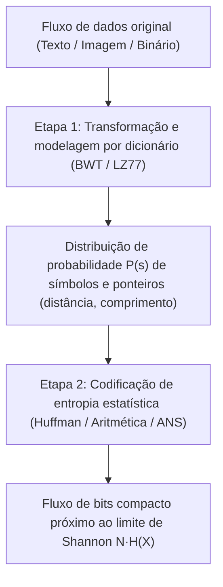
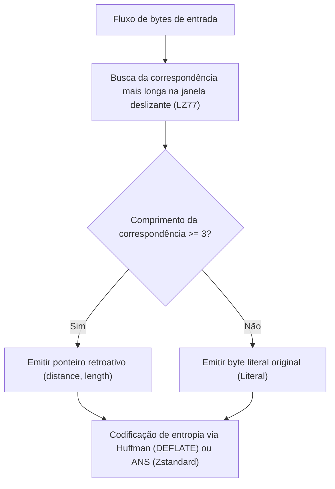

## 1. O princípio da casa dos pombos: por que não existe um compressor universal capaz de encolher todos os arquivos

Quando utilizamos diariamente ferramentas como `zip`, `gzip`, `zstd`, `7z` ou `PNG` para reduzir documentos, código-fonte ou imagens a uma fração do tamanho original e, ao descomprimi-los, <strong>recuperamos cada bit com exatidão absoluta (compressão sem perdas / reversível)</strong>, surge um questionamento intuitivo: se um compressor diminui o tamanho de um arquivo, por que não comprimimos o arquivo `.zip` resultante dez vezes seguidas até reduzir qualquer filme ou banco de dados a apenas 1 byte?

A resposta é definitiva: <strong>isso é matematicamente impossível.</strong> A prova decorre diretamente do <strong>princípio da casa dos pombos (Pigeonhole Principle)</strong> da combinatória elementar.

Seja $E: \{0,1\}^* \to \{0,1\}^*$ uma função de codificação sem perdas e $D: \{0,1\}^* \to \{0,1\}^*$ sua função de decodificação. Para garantir reversibilidade perfeita $D(E(x)) = x$ para qualquer sequência binária $x$, a função $E$ deve ser obrigatoriamente <strong>injetora (um para um)</strong>: se dois arquivos distintos $x_1 \ne x_2$ fossem comprimidos na mesma sequência curta $y = E(x_1) = E(x_2)$, o decodificador jamais saberia se deve restaurar $x_1$ ou $x_2$.

Existem exatamente $2^N$ arquivos binários de comprimento $N$ bits, mas o número total de cadeias binárias estritamente menores que $N$ bits (de comprimento $0$ até $N-1$) é:

$$\sum_{k=0}^{N-1} 2^k = 2^N - 1 < 2^N$$

Como há $2^N$ arquivos de entrada («pombos») para apenas $2^N - 1$ cadeias mais curtas («casas»), <strong>qualquer algoritmo de compressão sem perdas que encolha pelo menos um arquivo DEVE necessariamente expandir outros</strong>! Mais ainda, a fração de arquivos de $N$ bits que podem ser encolhidos em pelo menos $c$ bits é limitada por:

$$P\bigl(|E(X)| \le N - c\bigr) < 2^{-(c-1)}$$

Quase todas as sequências binárias aleatórias são algoritmicamente incompressíveis. Nossos compressores funcionam tão bem na prática porque textos humanos, códigos-fonte e imagens naturais ocupam um subconjunto minúsculo, altamente estruturado e de <strong>baixa entropia</strong> dentro de $\{0,1\}^N$.

---

## 2. O teorema da codificação de fonte de Shannon e a entropia: o limite físico absoluto

Em 1948, Claude E. Shannon estabeleceu em *«A Mathematical Theory of Communication»* o limite fundamental da compressão de dados. Para uma fonte discreta sem memória que emite símbolos de um alfabeto $\mathcal{A} = \{s_1, \dots, s_m\}$ com probabilidades $P = (p_1, \dots, p_m)$, a <strong>autoinformação (Surprisal)</strong> de um símbolo $s_i$ e seu valor esperado, a <strong>entropia de Shannon $H(X)$</strong>, são definidos por:

$$I(s_i) = -\log_2 p_i, \qquad H(X) = -\sum_{i=1}^{m} p_i \log_2 p_i \quad (\text{bits por símbolo})$$

Todo <strong>código livre de prefixo (instantâneo)</strong> com comprimentos de palavra $\ell_1, \dots, \ell_m$ deve satisfazer a <strong>desigualdade de Kraft-McMillan</strong>:

$$\sum_{i=1}^{m} 2^{-\ell_i} \le 1$$

Pela não negatividade da divergência de Kullback-Leibler $D_{\text{KL}}(P \,\|\, Q) \ge 0$ com $q_i = 2^{-\ell_i}/Z$ ($Z = \sum 2^{-\ell_i} \le 1$), demonstra-se o <strong>teorema da codificação de fonte sem ruído de Shannon</strong> para o comprimento médio $L = \sum_{i=1}^m p_i \ell_i$:

$$L - H(X) = \sum_{i=1}^m p_i \log_2 \frac{p_i}{2^{-\ell_i}} = D_{\text{KL}}(P \,\|\, Q) + \log_2 \frac{1}{Z} \ge 0 \implies H(X) \le L < H(X) + 1$$

---

## 3. Três gerações de codificação de entropia: Huffman, Codificação Aritmética e ANS

### 3.1 Codificação de Huffman (1952): árvores de prefixo ótimas com comprimentos inteiros
O algoritmo guloso de David A. Huffman constrói em tempo $O(m \log m)$ a árvore livre de prefixo ótima fundindo iterativamente os dois símbolos menos prováveis. Sua limitação estrutural é que <strong>cada palavra de código deve ter um número inteiro de bits ($\ell_i \ge 1$)</strong>: um símbolo com probabilidade $p_1 = 0,99$ carrega apenas $-\log_2(0,99) \approx 0,0145\,\text{bit}$ de informação, mas consome no mínimo $1\,\text{bit}$ inteiro.

### 3.2 Codificação Aritmética (Arithmetic / Range Coding): bits fracionários
A codificação aritmética (Rissanen, Pasco, Witten et al.) supera a barreira inteira mapeando <strong>toda a sequência da mensagem $x_1 x_2 \dots x_N$ em um único subintervalo $[L_{\text{low}}, H_{\text{high}}) \subset [0, 1)$</strong> cuja largura final $\Delta = \prod_{t=1}^N P(x_t)$ exige apenas $\lceil -\log_2 \Delta \rceil + 1 \approx N \cdot H(X)$ bits, alcançando bits fracionários ao custo de multiplicações sequenciais mais lentas.

### 3.3 Sistemas Numéricos Assimétricos (ANS, Jarek Duda 2009–2014)
Criados pelo físico e cientista da computação polonês Jarek Duda, os <strong>Asymmetric Numeral Systems (tANS e rANS)</strong> unem <strong>a taxa de compressão ótima da codificação aritmética com a velocidade de tabela de busca de Huffman</strong>. Ao codificar um símbolo $s$ de probabilidade $p_s$ no estado inteiro $x \in \mathbb{N}$, o estado evolui segundo:

$$C(x, s) \approx \frac{x}{p_s}$$

Hoje o ANS é o coração do <strong>Zstandard (`zstd`)</strong> da Meta, do <strong>LZFSE</strong> da Apple e do <strong>JPEG XL</strong> do Google.

---

## 4. Compressão por dicionário e transformações: LZ77, DEFLATE, BWT e «Comprimir é prever»

Para explorar a repetição de substrings e o contexto sequencial, os compressores modernos combinam modelagem por dicionário com codificadores de entropia:
- <strong>LZ77 (Lempel & Ziv, 1977)</strong>: substitui substrings repetidas dentro de uma janela deslizante por ponteiros retroativos <strong>`(distance, length)`</strong>. Combinado com Huffman, forma o <strong>DEFLATE (`gzip`, `zip`, `PNG`)</strong>; combinado com ANS, forma o <strong>Zstandard (`zstd`)</strong>.
- <strong>Transformada de Burrows-Wheeler (BWT, 1994, `bzip2`)</strong>: ordena lexicograficamente todas as rotações cíclicas de um bloco e extrai a última coluna $L$, agrupando caracteres com contexto subsequente idêntico para compressão via Move-To-Front (MTF) e Run-Length Encoding (RLE).

| Algoritmo / Ferramenta | Dicionário / Transformação | Codificador de entropia | Taxa de compressão típica | Velocidade de descompressão | Aplicações industriais principais |
|---|---|---|---|---|---|
| <strong>`lz4`</strong> | LZ77 alinhado a bytes | Nenhum (fluxo de bytes direto) | $\sim 48\%$ | $\sim 4.000\,\text{MB/s}$ | Compressão de RAM (ZRAM), bancos de dados em tempo real |
| <strong>`gzip` (DEFLATE)</strong> | LZ77 (janela de 32 KB) | Codificação de Huffman | $\sim 32\%$ | $\sim 400\,\text{MB/s}$ | Tráfego web HTTP, `.tar.gz`, imagens PNG |
| <strong>`zstd` (Zstandard)</strong> | LZ77 (janela grande + cache de offsets) | <strong>ANS (tANS / FSE)</strong> + Huffman | $\sim 28\%$ | $\sim 1.500\,\text{MB/s}$ | Pacotes Linux, armazenamento em nuvem, Btrfs |
| <strong>`bzip2`</strong> | <strong>Ordenação de blocos BWT</strong> + MTF + RLE | Huffman multitabela | $\sim 26\%$ | $\sim 60\,\text{MB/s}$ | Arquivos de código-fonte, bioinformática |
| <strong>`xz` (LZMA2)</strong> | LZ77 (dicionário gigante + contexto bit) | Codificação aritmética de intervalo | $\sim 21\%$ | $\sim 120\,\text{MB/s}$ | Distribuição de software de tamanho mínimo, firmware |
| <strong>`cmix` / `PAQ8` / LLM</strong> | Mistura de contextos / Transformer | Codificação aritmética | $\sim 11\%\text{–}14\%$ | $< 1\,\text{MB/s}$ | Hutter Prize, equivalência entre compressão e IA |

No sentido matemático mais profundo, <strong>comprimir é exatamente equivalente a prever</strong>: qualquer modelo probabilístico (incluindo grandes modelos de linguagem Transformer) que minimize a entropia cruzada $-\sum \log_2 P_\theta(x_t \mid x_{<t})$ ao prever o próximo símbolo determina diretamente o tamanho mínimo do arquivo comprimido sem perdas via codificação aritmética.
