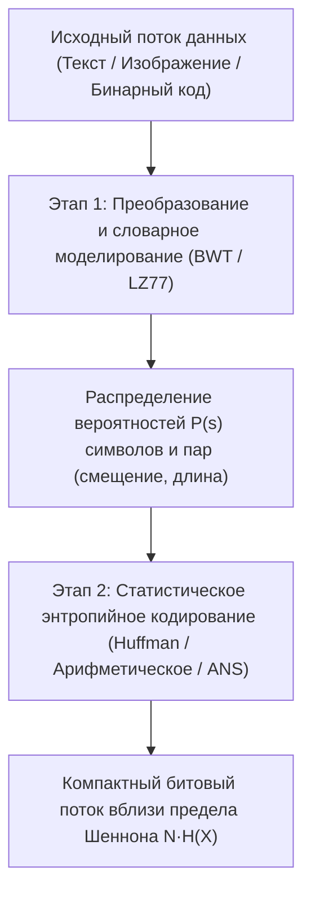
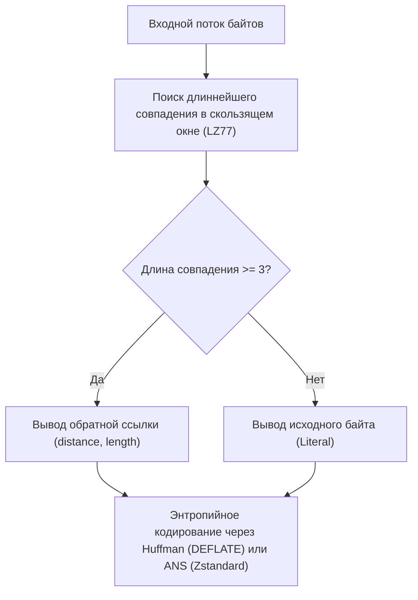

## 1. Принцип Дирихле: почему не существует универсального архиватора, способного уменьшить любой файл

Когда мы ежедневно используем `zip`, `gzip`, `zstd`, `7z` или `PNG`, уменьшая документы, исходный код или изображения в несколько раз и при распаковке <strong>восстанавливая их бит в бит (сжатие без потерь / обратимое сжатие)</strong>, возникает естественный вопрос: если архиватор уменьшает файл, почему бы не сжать полученный `.zip`-архив еще десять раз подряд, пока огромный фильм или база данных не сожмется до одного байта?

Ответ категоричен: <strong>это математически невозможно.</strong> Доказательство не требует даже сложной теории информации и следует напрямую из <strong>принципа Дирихле (принципа голубятен / Pigeonhole Principle)</strong> элементарной комбинаторики.

Пусть $E: \{0,1\}^* \to \{0,1\}^*$ — функция кодирования без потерь, а $D: \{0,1\}^* \to \{0,1\}^*$ — функция декодирования. Чтобы гарантировать безошибочное восстановление $D(E(x)) = x$ для любого входного файла $x$, отображение $E$ обязано быть <strong>инъективным (взаимно-однозначным)</strong>: если два разных файла $x_1 \ne x_2$ сожмутся в одну и ту же короткую битовую строку $y = E(x_1) = E(x_2)$, декодер никогда не узнает, должен ли он выдать $x_1$ или $x_2$!

Существует ровно $2^N$ различных двоичных файлов длины $N$ бит. В то же время общее число всех двоичных строк строго короче $N$ бит (длины от $0$ до $N-1$) равно:

$$\sum_{k=0}^{N-1} 2^k = 2^N - 1 < 2^N$$

Поскольку входных файлов длины $N$ («голубей») $2^N$, а более коротких кодовых строк («голубятен») всего $2^N - 1$, <strong>любой алгоритм сжатия без потерь, который уменьшает хотя бы один файл, ОБЯЗАН увеличивать (раздувать) другие файлы</strong>! Более того, доля файлов длины $N$, которые можно сжать хотя бы на $c$ бит, строго ограничена сверху величиной:

$$P\bigl(|E(X)| \le N - c\bigr) < 2^{-(c-1)}$$

Подавляющее большинство случайных битовых строк алгоритмически несжимаемы (по Колмогорову). Наши архиваторы успешно сжимают реальные файлы лишь потому, что человеческие тексты, программы и фотографии занимают ничтожно малое, высокоструктурированное <strong>низкоэнтропийное подмножество</strong> в пространстве $\{0,1\}^N$.

---

## 2. Теорема Шеннона о кодировании источника и информационная энтропия

В 1948 году Клод Шеннон в работе *«Математическая теория связи»* установил фундаментальный предел обратимого сжатия. Для дискретного источника без памяти с алфавитом $\mathcal{A} = \{s_1, \dots, s_m\}$ и распределением вероятностей $P = (p_1, \dots, p_m)$ <strong>собственная информация (Surprisal)</strong> символа $s_i$ и её математическое ожидание — <strong>энтропия Шеннона $H(X)$</strong> — определяются как:

$$I(s_i) = -\log_2 p_i, \qquad H(X) = -\sum_{i=1}^{m} p_i \log_2 p_i \quad (\text{бит на символ})$$

Любой <strong>префиксный (мгновенно декодируемый) код</strong> с длинами кодовых слов $\ell_1, \dots, \ell_m$ обязан удовлетворять <strong>неравенству Крафта — Макмиллана</strong>:

$$\sum_{i=1}^{m} 2^{-\ell_i} \le 1$$

Используя неотрицательность дивергенции Кульбака — Лейблера $D_{\text{KL}}(P \,\|\, Q) \ge 0$ для $q_i = 2^{-\ell_i}/Z$ ($Z = \sum 2^{-\ell_i} \le 1$), получаем <strong>теорему Шеннона о кодировании источника без шума</strong> для средней длины кодового слова $L = \sum_{i=1}^m p_i \ell_i$:

$$L - H(X) = \sum_{i=1}^m p_i \log_2 \frac{p_i}{2^{-\ell_i}} = D_{\text{KL}}(P \,\|\, Q) + \log_2 \frac{1}{Z} \ge 0 \implies H(X) \le L < H(X) + 1$$

---

## 3. Три поколения энтропийного кодирования: Хаффман, арифметическое кодирование и ANS

### 3.1 Кодирование Хаффмана (1952): оптимальные целочисленные префиксные деревья
Жадный алгоритм Дэвида Хаффмана за время $O(m \log m)$ строит префиксное дерево с минимальной средней длиной, последовательно объединяя два наименее вероятных узла. Однако у кода Хаффмана есть фундаментальное ограничение: <strong>каждое кодовое слово должно иметь целое число бит ($\ell_i \ge 1$)</strong>. Символ с вероятностью $p_1 = 0{,}99$ несет лишь $-\log_2(0{,}99) \approx 0{,}0145\,\text{бита}$ информации, но тратит минимум $1\,\text{целый бит}$.

### 3.2 Арифметическое кодирование (Arithmetic / Range Coding): дробное число бит
Арифметическое кодирование (Риссанен, Паско, Уиттен и др.) преодолевает целочисленный барьер, отображая <strong>всю последовательность сообщения $x_1 x_2 \dots x_N$ в единый подинтервал $[L_{\text{low}}, H_{\text{high}}) \subset [0, 1)$</strong> ширины $\Delta = \prod_{t=1}^N P(x_t)$, для записи которого требуется $\lceil -\log_2 \Delta \rceil + 1 \approx N \cdot H(X)$ бит. Это позволяет тратить дробное число бит на символ, но требует ресурсоемких операций умножения и ренормализации.

### 3.3 Асимметричные системы счисления (ANS, Ярек Дуда, 2009–2014)
Польский физик и математик Ярек Дуда изобрел <strong>Asymmetric Numeral Systems (tANS и rANS)</strong>, объединив <strong>степень сжатия арифметического кодирования со скоростью табличного декодирования Хаффмана</strong>. При кодировании символа $s$ с вероятностью $p_s$ целочисленное состояние автомата $x \in \mathbb{N}$ преобразуется по правилу:

$$C(x, s) \approx \frac{x}{p_s}$$

Сегодня ANS лежит в основе <strong>Zstandard (`zstd`)</strong> от Meta, <strong>LZFSE</strong> от Apple и <strong>JPEG XL</strong> от Google.

---

## 4. Словарное сжатие и преобразования: LZ77, DEFLATE, BWT и «Сжатие как предсказание»

Чтобы устранить контекстную избыточность и повторы строк, современные архиваторы объединяют словарные методы с энтропийными кодерами:
- <strong>LZ77 (Лемпель и Зив, 1977)</strong>: заменяет повторяющиеся подстроки в скользящем окне обратными ссылками <strong>`(distance, length)`</strong>. В паре с кодом Хаффмана это образует <strong>DEFLATE (`gzip`, `zip`, `PNG`)</strong>, а в паре с ANS — <strong>Zstandard (`zstd`)</strong>.
- <strong>Преобразование Барроуза — Уилера (BWT, 1994, `bzip2`)</strong>: лексикографически сортирует все циклические сдвиги блока данных и берет последний столбец $L$, группируя одинаковые символы с общим правым контекстом для последующего сжатия методами Move-To-Front (MTF) и RLE.

| Алгоритм / Утилита | Словарь / Преобразование | Энтропийный кодер | Типичная степень сжатия | Скорость распаковки | Ключевые области применения |
|---|---|---|---|---|---|
| <strong>`lz4`</strong> | LZ77 (байтово-выровненный) | Нет (прямой поток байтов) | $\sim 48\%$ | $\sim 4\,000\,\text{МБ/с}$ | Сжатие ОЗУ (ZRAM), СУБД реального времени |
| <strong>`gzip` (DEFLATE)</strong> | LZ77 (окно 32 КБ) | Кодирование Хаффмана | $\sim 32\%$ | $\sim 400\,\text{МБ/с}$ | Веб-трафик HTTP, `.tar.gz`, изображения PNG |
| <strong>`zstd` (Zstandard)</strong> | LZ77 (большое окно + кэш смещений) | <strong>ANS (tANS / FSE)</strong> + Хаффман | $\sim 28\%$ | $\sim 1\,500\,\text{МБ/с}$ | Пакеты Linux, облачные хранилища, ФС Btrfs |
| <strong>`bzip2`</strong> | <strong>Блочная сортировка BWT</strong> + MTF + RLE | Многотабличный Хаффман | $\sim 26\%$ | $\sim 60\,\text{МБ/с}$ | Архивы исходного кода, биоинформатика |
| <strong>`xz` (LZMA2)</strong> | LZ77 (огромный словарь + битовый контекст) | Интервальное арифметическое (Range) | $\sim 21\%$ | $\sim 120\,\text{МБ/с}$ | Дистрибутивы ПО минимального размера, прошивки |
| <strong>`cmix` / `PAQ8` / LLM</strong> | Смешивание контекстов / Transformer | Арифметическое кодирование | $\sim 11\%\text{–}14\%$ | $< 1\,\text{МБ/с}$ | Hutter Prize, эквивалентность сжатия и ИИ |

В фундаментальном смысле <strong>сжатие математически эквивалентно предсказанию</strong>: любая вероятностная модель (включая современные большие языковые модели Transformer), минимизирующая кросс-энтропию $-\sum \log_2 P_\theta(x_t \mid x_{<t})$ при предсказании следующего токена, напрямую задает минимальный размер файла при подаче этих вероятностей в арифметический кодер.
