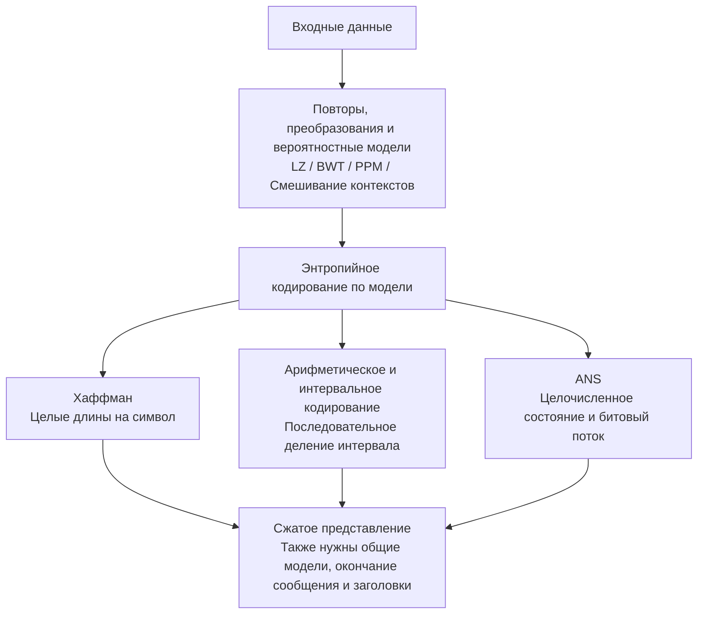
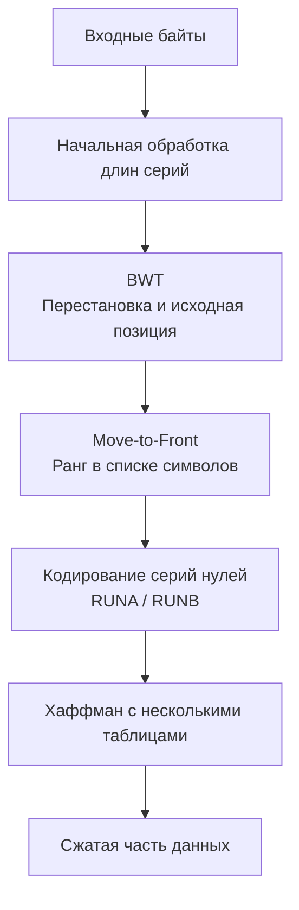

## 1. Почему ни один компрессор не может укоротить все файлы

Сжатие без потерь заменяет данные другим представлением, позволяющим восстановить исходные байты без изменения единого бита. Инструменты zip, gzip, zstd и xz уменьшают некоторые входные данные; другие почти не меняются или растут из-за заголовков. Степень уменьшения зависит от входа. Сжатие с потерями, например JPEG или MP3, допускает различия в восстановленных значениях и потому предъявляет другое требование к реконструкции.

Пусть {0,1}* — множество конечных битовых строк. Зафиксируем кодер E и декодер D. Для отсутствия потерь необходимо, чтобы для любого входа x выполнялось:

$$
D(E(x))=x
$$

Если разные входы дают одинаковый выход, D не сможет восстановить оба. Поэтому E должно быть инъективным отображением. Существует 2^n входов длины ровно n бит, но более коротких выходов меньше, даже с учётом пустой строки. Здесь n≥1.

$$
\left|\{0,1\}^{n}\right|=2^n>
\sum_{k=0}^{n-1}2^k=2^n-1
$$

Следовательно, фиксированный компрессор без потерь не может укоротить все n-битовые входы. Инъективное отображение на всех конечных строках также не может укоротить некоторые из них, не удлинив ни одной другой. Если оно укоротило n-битовую строку x и ничего не удлинило, входы короче n уже займут все выходы короче n. E(x) совпадёт с одним из них.

Для количественной оценки зафиксируем E и выберем X равномерно среди n-битовых строк. Для целого 1≤c≤n доля входов, укорачиваемых хотя бы на c бит, имеет следующую верхнюю границу. Мы считаем возможные выходы; кодер не обязан использовать их все.

$$
\Pr\!\left(|E(X)|\le n-c\right)
\le\frac{2^{n-c+1}-1}{2^n}
<2^{1-c}
$$

При c=11 эта доля меньше 1/1024, то есть примерно 0,0977%. Это не означает, что никакой другой компрессор не может укоротить какой-либо из остальных файлов. Для конкретного файла x другой кодер мог бы поменять местами x и пустую строку: x укорачивается, пустая строка удлиняется. Декодер должен знать это специальное правило. В колмогоровской сложности также различают фиксированный язык описания и длину описания программы декодирования.

Практическое сжатие использует представления, подходящие распределению или повторяющейся структуре: неравные частоты символов, повторные подстроки или числовые закономерности. Выигрыш зависит от входа и метода. Нельзя категорически утверждать, что уже сжатый файл или шифротекст никогда не уменьшится ни на байт. Важны шифр, режим, метаданные и сохранившаяся структура.

Единицы тоже различаются. Один MiB — это 1 048 576 байт, или 8 388 608 бит. Один десятичный MB — 1 000 000 байт, или 8 000 000 бит.

## 2. Энтропия Шеннона и границы средней длины кода

Работа Шеннона 1948 года отделяет смысловую ценность от инженерной задачи связи и изучает источники вероятностно. Введение этого [переиздания](https://wucj.lab.westlake.edu.cn/Others/shannon1948.pdf) также отмечает предшествующие работы Найквиста и Хартли.

Для события x положительной вероятности собственная информация определяется следующим образом. Логарифм по основанию два даёт единицу измерения в битах. Это не мера психологического удивления или важности содержания.

$$
I(x)=-\log_2P(x),\qquad 0<P(x)\le1
$$

Для случайной величины X на конечном алфавите положим p_i=P(X=x_i). Энтропия Шеннона — математическое ожидание собственной информации; для слагаемых нулевой вероятности используется соглашение 0log₂0=0.

$$
H(X)=-\sum_{i=1}^{m}p_i\log_2p_i,\qquad
p_i\ge0,\quad\sum_i p_i=1,\quad
0\le H(X)\le\log_2m
$$

Единица — бит на символ. Для фиксированного алфавита из m символов равномерное распределение максимизирует энтропию; если один символ имеет вероятность один, энтропия нулевая. Результат честного броска монеты несёт один бит собственной информации, событие вероятности 1/256 — восемь. Эти значения описывают модель символов, но не определяют напрямую информацию в коррелированной последовательности или нижнюю границу для каждого файла.

### Префиксные коды и неравенство Крафта — Макмиллана

Назначим каждому символу двоичное кодовое слово так, чтобы их конкатенации декодировались однозначно. В префиксном коде ни одно слово не является началом другого. Например, {0,10,110,111} позволяет разбить 100110111 на 10 | 0 | 110 | 111. ASCII сам по себе является семибитовым кодом символов, а не синонимом представления любого символа восемью битами.

Представим кодовые слова длины ℓ_i листьями двоичного дерева. В полном дереве максимальной глубины ℓ_max лист занимает 2^(ℓ_max−ℓ_i) потенциальных позиций под ним. Подсчёт этих непересекающихся поддеревьев даёт неравенство Крафта. Такое же неравенство справедливо для однозначно декодируемых кодов.

$$
\sum_i2^{\ell_{\max}-\ell_i}\le2^{\ell_{\max}}
\quad\Longrightarrow\quad
Z:=\sum_i2^{-\ell_i}\le1
$$

Обратно, для положительных целых длин, удовлетворяющих неравенству, существует префиксный код. Далее рассматриваем символы положительной вероятности и предполагаем, что их не меньше двух. Для источника с единственным символом отдельно оговариваются допустимость пустого кодового слова и способ передачи или совместного знания числа символов либо окончания сообщения.

### Нижняя граница через KL-дивергенцию

Определим среднюю длину и нормированное распределение Q, задаваемое длинами:

$$
L=\sum_i p_i\ell_i,\qquad
q_i=\frac{2^{-\ell_i}}{Z},\qquad \sum_i q_i=1
$$

Неотрицательность дивергенции Кульбака — Лейблера даёт это тождество. Её можно доказать, например, логарифмическим неравенством ln u≤u−1.

$$
\begin{aligned}
0\le D_{\mathrm{KL}}(P\|Q)
&=\sum_i p_i\log_2\frac{p_i}{q_i}\\
&=-H(X)+\sum_i p_i\ell_i+\log_2Z\\
&=L-H(X)+\log_2Z
\end{aligned}
$$

Получаем границу для средней длины:

$$
L=H(X)+D_{\mathrm{KL}}(P\|Q)-\log_2Z\ge H(X)
$$

В Q величина 2^(-ℓ_i) делится на Z. Нельзя убрать эту нормировку и одновременно дополнительно учитывать слагаемое −log₂Z. Равенство требует P=Q и Z=1, откуда p_i=2^(-ℓ_i): вероятности соответствуют двоичным длинам.

Можно построить и верхнюю границу. Следующие длины Шеннона удовлетворяют неравенству Крафта:

$$
\ell_i=\lceil-\log_2p_i\rceil,\qquad
2^{-\ell_i}\le p_i,\qquad
\sum_i2^{-\ell_i}\le1
$$

Округление вверх добавляет менее одного бита на символ, поэтому средняя длина этого кода меньше H+1. Средняя длина L_opt оптимального двоичного префиксного кода лежит в диапазоне:

$$
H(X)\le L_{\mathrm{opt}}<H(X)+1
$$

Для источника независимых одинаково распределённых символов с хотя бы двумя символами положительной вероятности объединение N символов и выбор подходящего блочного префиксного кода дают следующее. L_N — средняя длина всего блока.

$$
H(X)\le\frac{L_N}{N}<H(X)+\frac1N
$$

При зависимостях в общем случае H(X_1,...,X_N)≠NH(X_1). Если выбрать один равновероятный бит и повторить его известное число раз N, каждая позиция имеет маргинальную энтропию один бит, но вся последовательность тоже имеет энтропию лишь один бит. Для стационарных источников с конечным алфавитом используют энтропийную скорость — предельную энтропию на символ:

$$
\overline H=\lim_{N\to\infty}\frac{H(X_1,\ldots,X_N)}{N}
$$

Это утверждения о средних при заданных распределениях и классах кодов. Они не означают, что каждый файл должен иметь хотя бы такую длину или что стоимостью моделей и заголовков можно пренебречь.

## 3. Хаффман, арифметическое кодирование и ANS

Отделение статистической модели от кодера, преобразующего вероятности в биты, помогает понять методы. Это концептуальная схема, а не спецификация, требующая такого разделения на независимые этапы в каждом формате.

### Хаффман: в каком классе достигается оптимальность?

[Работа Хаффмана 1952 года](https://compression.ru/download/articles/huff/huffman_1952_minimum-redundancy-codes.pdf) строит префиксные коды минимальной средней длины для заданных весов. В двоичном случае многократно объединяют два узла наименьшего веса и возвращают их сумму. Куча позволяет построить дерево для m символов за O(m log m).

При хотя бы двух положительных весах оптимальное дерево может не содержать лишних ветвей с единственным потомком. Два наименьших веса можно поместить в самые глубокие соседние листья с общим родителем, не увеличив среднюю длину. Их объединение в символ z даёт соотношение между исходным деревом T и уменьшенным T′:

$$
L(T)=L(T')+p_a+p_b
$$

Разность фиксирована, поэтому оптимальное решение меньшей задачи позволяет построить решение исходной. При равных весах оптимальных деревьев может быть несколько. Канонические коды Хаффмана определяют слова по длинам и порядку символов, упрощая передачу дерева. Они не устраняют стоимость описания таблиц и дополнительные шаги декодирования длинных слов.

При P(0)=0,99 и P(1)=0,01 оптимальный двоичный префиксный посимвольный код использует по одному биту для обоих символов.

$$
H(X)=-0.99\log_2(0.99)-0.01\log_2(0.01)
\approx0.080793,\qquad L_{\mathrm H}=1
$$

Средняя длина примерно в 12,4 раза больше энтропии. Это не означает, что исходный файл нельзя уменьшить: исходное представление по восемь бит на символ отличается от уже побитно упакованной последовательности. Блоки уменьшают потери из-за целочисленных длин, но дерево, явно охватывающее все m^k сочетаний, быстро растёт. Соглашение о пустом слове для одного символа по-прежнему требует отдельного решения о числе символов.

### Арифметическое кодирование: интервалы и конечные строки

Арифметическое кодирование сужает интервал, связанный с сообщением. P(s) — вероятность символа, A(s) — сумма вероятностей предшествующих ему символов в согласованном порядке. Начинаем с [lo_0,hi_0)=[0,1) и предполагаем положительность вероятности каждого кодируемого символа. При ширине W_(t−1)=hi_(t−1)−lo_(t−1) обновление имеет вид:

$$
\begin{aligned}
\mathrm{lo}_t&=\mathrm{lo}_{t-1}+W_{t-1}A(x_t),\\
\mathrm{hi}_t&=\mathrm{lo}_{t-1}+W_{t-1}\bigl(A(x_t)+P(x_t)\bigr)
\end{aligned}
$$

Для фиксированной независимой модели конечная ширина равна первому произведению ниже. При зависимостях используют условные вероятности, которые обе стороны могут воспроизвести на каждом шаге.

$$
W_N=\prod_{t=1}^{N}P(x_t)
\quad\text{or}\quad
W_N=\prod_{t=1}^{N}P(x_t\mid x_{<t})
$$

Разные сообщения одной известной длины N попадают в непересекающиеся интервалы. Выберем двоичный интервал [j2^(-K),(j+1)2^(-K)), целиком лежащий внутри конечного интервала; K бит указывают его. Шаг сетки не больше половины ширины гарантирует следующую достаточную длину при идеальной арифметике бесконечной точности:

$$
K=\lceil-\log_2W_N\rceil+1<-\log_2W_N+2
$$

Это граница идеальной полезной нагрузки при известных модели и длине. Она не утверждает, что минимальное K всегда равно формуле или что весь файл имеет лишь два бита накладных расходов. Модели, окончание сообщения, точность и заголовки стоят дополнительно. При истинном распределении блоков P для средней длины соответствующего префиксного представления получаем:

$$
H(P)\le\mathbb E_P[K]<H(P)+2
$$

При P(0)=0,99 около 69 нулей подряд уменьшают ширину вдвое. Это не правило выдавать ровно один бит каждые 69 символов: выдача зависит от интервала и ренормализации. Целочисленные реализации выводят уже определённые старшие биты или байты и расширяют состояние. Квантование вероятностей, обработка переносов и отложенные биты тоже требуют работы. У арифметического или интервального кодирования нет универсального соотношения скоростей с другими кодерами.

### ANS: накопление информации в целочисленном состоянии

[Работа Дуды об ANS](https://arxiv.org/html/1311.2540v2) строит системы счисления для символов неравной вероятности. Приписывание цифры s в обычной системе с основанием b обратимо следующим образом:

$$
x'=bx+s,\qquad s=x'\bmod b,\qquad x=\lfloor x'/b\rfloor
$$

При равных вероятностях и достаточно большом положительном состоянии x логарифмический размер растёт примерно на log₂b. Для общих вероятностей конструкция увеличивает состояние примерно в 1/P(s) раз. Нельзя применять log₂x при x=0 или отождествлять это приближение с точной целой длиной кода.

Одна конструкция rANS использует M=2^R, положительные целые частоты символов f_s и накопленные частоты b_s.

$$
\sum_s f_s=M,\qquad b_s=\sum_{a<s}f_a,\qquad P(s)\approx f_s/M
$$

Она преобразует неотрицательное целочисленное состояние x и символ s так:

$$
C(x,s)=M\left\lfloor\frac{x}{f_s}\right\rfloor+(x\bmod f_s)+b_s
$$

Обратное преобразование выбирает символ по slot и восстанавливает прежнее состояние:

$$
\begin{aligned}
\mathrm{slot}&=x'\bmod M,\\
b_s&\le\mathrm{slot}<b_s+f_s,\\
x&=f_s\left\lfloor\frac{x'}M\right\rfloor+\mathrm{slot}-b_s
\end{aligned}
$$

Если M — степень двойки, частное и остаток вычисляются сдвигами и масками. Поиск символа, обращения к таблицам, ренормализация и ввод-вывод также требуют затрат. Эта биекция сама по себе не гарантирует ни нулевой потери при кодировании, ни декодирования за один такт.

tANS использует конечное число состояний и таблицы переходов. Для побитового объяснения можно, например, взять это множество целых. Оно соответствует полуоткрытому интервалу [L,2L), а не [L,2L−1).

$$
\mathcal I=\{L,L+1,\ldots,2L-1\},\qquad |\mathcal I|=L
$$

Чтобы оставаться в допустимом диапазоне, биты переносятся между накопленным состоянием и потоком. Условия нормализации и размещение символов должны согласовываться; просто заменить формулы rANS небольшой таблицей недостаточно. FSE — реализация семейства tANS.

Операции состояния ANS работают как стек: последний добавленный символ извлекается первым. Кодирование блоков в обратном порядке может обеспечить декодирование в исходном порядке. Для контекстных вероятностей нужно согласовать и порядок их вычисления с обратным кодированием. Хаффман, арифметическое кодирование и ANS — варианты для разных моделей, форматов и реализаций, а не три поколения, каждое из которых всегда заменяет предыдущее.

## 4. Что меняют LZ, BWT и контекстные модели

Модель только по отдельным частотам байтов не использует полностью длинные повторы и зависимости. Вместо универсального числа бит для английского следует указать корпус и единицы: символы, байты или токены.

### Словарное сжатие: LZ77, LZ78 и LZW

Методы семейства LZ77 ссылаются назад на уже выданные данные. Если 16-байтовая ASCII-строка `std::vector<int>` встречалась 200 байт назад и совпадает снова, её можно представить этой дистанцией и длиной. Будет ли это дешевле 16 буквальных байтов, зависит от кодирования чисел в формате.

$$
(d,\ell)=(200,16)
$$

Длина совпадения может превышать дистанцию. После литерала A ссылка с дистанцией 1 и длиной 99 использует вновь скопированные A как источник и создаёт суммарно 100 A. [Спецификация DEFLATE](https://www.rfc-editor.org/rfc/rfc1951.txt) также приводит пример перекрывающейся ссылки. Применение обычного memcpy к перекрывающимся областям или копирование лишь снимка первоначального источника неверно описывает такое развёртывание. Реализация должна обрабатывать растущий выход и проверять дистанции, ограничения выхода и длины входа.

LZSS различает литералы и совпадения флагами или другим представлением. Флаги тоже занимают место, поэтому данные без совпадений не гарантированно избегают увеличения. LZ78/LZW, напротив, регистрируют встреченные строки в явном словаре и используют индексы. Рост, сбросы, область ссылок и кодирование целых различаются; ни один подход не обязан выигрывать на любом входе.

Конкретные форматы тоже различаются. Сжатые блоки DEFLATE используют дистанции 1–32 768 и длины 3–258, отдельно кодируя Хаффманом литералы/длины и дистанции. Есть и несжатые блоки. [Спецификация Zstandard](https://www.rfc-editor.org/rfc/rfc8878.html) разделяет литералы и последовательности: литералы имеют режимы без сжатия/RLE/Хаффман, последовательности — режимы, включающие FSE. Один или четыре потока Хаффмана — не то же самое, что три типа состояний FSE последовательностей. LZMA/LZMA2 также сочетают словари и вероятностные модели; [кодер LZMA](https://github.com/ip7z/7zip/blob/main/C/LzmaEnc.c) показывает операции поиска совпадений и интервального кодирования. Одно название алгоритма не заменяет все форматы, утилиты или уровни.

### BWT: сохраняющая длину перестановка и её обращение

Преобразование Барроуза — Уилера сближает символы с одинаковым следующим контекстом. Последний столбец сохраняет число символов, но позиция или информация о специальном маркере для обращения также требует места.

Рассмотрим `banana$` с единственным маркером `$`, упорядоченным раньше остальных символов. Отсортируем семь циклических сдвигов и извлечём последний столбец и номер исходной строки.

| Строка | Ротация в лексикографическом порядке | Первый | Последний |
| :--- | :--- | :---: | :---: |
| 0 | `$banana` | `$` | a |
| 1 | `a$banan` | a | n |
| 2 | `ana$ban` | a | n |
| 3 | `anana$b` | a | b |
| 4 | `banana$` | b | `$` |
| 5 | `na$bana` | n | a |
| 6 | `nana$ba` | n | a |

Выход — `annb$aa`, исходная строка при нумерации с нуля имеет номер 4. Если L — последний столбец, а F — первый, сортировка символов L даёт F. Сопоставление одинаковых символов по порядку вхождений даёт LF-отображение, которое проходит исходную последовательность назад. При нумерации с нуля C(c) считает символы меньше c, а rank_c(i) — вхождения c в L до позиции i.

$$
\mathrm{LF}(i)=C(L_i)+\mathrm{rank}_{L_i}(i)
$$

Для небольшого фиксированного алфавита частоты и ранги вхождений строятся за линейное время, а N символов обращаются за O(N). При общей сортировке сравнениями её стоимость следует учитывать отдельно. BWT не превращает любой вход в длинные серии одинаковых символов.

[Руководство bzip2 1.0.8](https://sourceware.org/bzip2/manual/manual.html) и [исходный код этой версии](https://sourceware.org/pub/bzip2/bzip2-1.0.8.tar.gz) сочетают RLE до BWT, MTF, кодирование серий нулей и несколько таблиц Хаффмана. MTF выдаёт текущий ранг символа в списке и переносит его в начало. Повторные символы дают нули, кодируемые через RUNA/RUNB. Схема показывает основные преобразования без заголовков, индексов и CRC.

### Контекстные модели и LLM: длина кода и функция потерь

PPM использует контексты разной длины и обрабатывает ненаблюдавшиеся символы механизмами вроде escape. Смешивание контекстов объединяет прогнозы нескольких моделей. Предсказания могут давать и нейронные модели; Transformer не является синонимом рекуррентной сети.

Для последовательности, которой модель Q_θ присваивает положительные условные вероятности, идеальная информация имеет вид ниже. Она не приравнивается к фактической длине выхода.

$$
I_\theta(x_{1:N})=-\log_2 Q_\theta(x_{1:N})
=\sum_{t=1}^{N}-\log_2Q_\theta(x_t\mid x_{<t})
$$

Для среднего отрицательного логарифма правдоподобия этой последовательности с натуральными логарифмами смена основания и усреднение дают:

$$
\mathcal L_{\mathrm{NLL}}(\theta)
=-\frac1N\sum_{t=1}^{N}\ln Q_\theta(x_t\mid x_{<t})
=\frac{\ln2}{N}I_\theta(x_{1:N})
$$

Таким образом, при одинаковых данных, единицах и условиях модели уменьшение этой функции потерь соответствует уменьшению идеальной длины. Формула не включает размер общей модели, обратимую токенизацию, конечную точность, окончание сообщения, заголовки и время декодирования. Информация предсказания меньше бита не позволяет хранить отдельное слово в самостоятельном файле дробнобитовой длины.

[Language Modeling Is Compression](https://arxiv.org/html/2309.10668v2) исследует эту связь экспериментально. Сравнения изображений и аудио используют обработанные наборы данных и заданные длины контекста, различая показатели без стоимости весов модели и с ней. Не следует распространять результаты на все изображения, аудио или произвольные файлы. Соревнования вроде Hutter Prize стимулируют исследование предсказаний, но одни уравнения кодирования не доказывают достаточных условий интеллекта или понимания.

## 5. Сравнение сжатого размера, скорости и памяти

Практическая оценка объединяет сжатый размер, время кодирования и декодирования, память, совместимость и гранулярность доступа. Определим долю сжатого размера как сжатый размер, делённый на исходный: меньше — лучше. Числа из по-разному настроенных тестов не образуют универсального рейтинга.

| Метод или инструмент | Особенности архитектуры | Что проверять при сравнении |
| :--- | :--- | :--- |
| LZ4 | Байтовое представление семейства LZ77 без энтропийного кодирования внутри блока | Стоимость обрамления малых входов, скорость декодирования, буферы |
| Zstandard | Поиск совпадений, литералы и последовательности, Хаффман/FSE и другие режимы | Уровень, словарь, окно, режимы и память обеих сторон |
| DEFLATE / gzip | Обратные ссылки и Хаффман; возможны несжатые блоки | Формат или утилита, совместимость, расходы блоков и оболочки |
| BWT / bzip2 | Блочное преобразование, MTF, серии и Хаффман | Размер блока, рабочая память восстановления и индекс |
| LZMA/LZMA2 / xz и 7-Zip | Словарные совпадения и адаптивное вероятностное кодирование | Формат и настройки, словарь, время поиска, ограничения декодера |
| PPM, смешивание контекстов и нейронное предсказание | Контекстные вероятности с последующим кодированием | Общая/передаваемая модель, контекст, вычисления и воспроизводимая точность |

[Спецификация блоков LZ4](https://github.com/lz4/lz4/blob/dev/doc/lz4_Block_format.md) рассматривает обрамление отдельно; [описание формата 7-Zip](https://www.7-zip.org/7z.html) различает несколько методов. Необходимы и понимание архитектуры, и измерения своей нагрузки.

Запишите реализацию и версию, команду и уровень, CPU и потоки, хеши и размеры входов, словарь, условия кэша и ввода-вывода. По общему числу исходных байтов U, сжатых байтов C и прошедшему времени вычислите C/U и пропускную способность. Для отношения размеров пустой вход рассматривается отдельно. В памяти учитываются буферы и модели, а не только словари. Проверьте совпадение хеша декомпрессированных байтов с оригиналом. Новые измерения скорости здесь не заявляются.

### Работа кодера/декодера и ввод-вывод

Для семейства LZ декодирование может быть легче поиска совпадений и выбора представления при кодировании. Тем не менее уровень и выданные команды могут менять скорость декодирования в одном формате. Более высокий уровень не гарантирует точно такой же скорости декодирования. Декодеры предсказательных моделей должны воспроизводить вероятности, а кодер может считать их пакетами, поэтому их времена тоже не обязаны совпадать.

В простой модели чтения пусть скорость ввода-вывода равна v_io, а v_dec — скорость декодирования в исходных байтах за единицу времени. Без перекрытия работы CPU и ввода-вывода времена приближённо равны:

$$
T_{\mathrm{raw}}\approx\frac{U}{v_{\mathrm{io}}},\qquad
T_{\mathrm{compressed}}\approx\frac{C}{v_{\mathrm{io}}}
+\frac{U}{v_{\mathrm{dec}}}
$$

Сравниваются экономия ввода-вывода и стоимость декодирования. При независимых ресурсах и эффективном конвейере установившееся время может приближаться к большему слагаемому вместо суммы. Запуск, пропускная способность памяти, параллелизм и гранулярность доступа могут требовать иной модели.

Ветвления, зависимости, кэш, SIMD и параллелизм инструкций влияют на скорость. Само их наличие не устанавливает универсального предела в MB/s; разделение потоков также не гарантирует нуля ошибок предсказания ветвлений. Пакет программ, сжатый один раз и декодируемый многими читателями, имеет иные приоритеты, чем часто обновляемые журналы.

## 6. Какие границы и затраты учитываются?

Принцип Дирихле показывает, что фиксированный кодер без потерь не может укоротить все входы. Энтропийные нижние границы относятся к средней длине при определённых вероятностных моделях и условиях кодирования. Хаффман, арифметическое кодирование и ANS по-разному связывают вероятности с представлениями; LZ, BWT и контекстные модели используют повторы и зависимости.

Связь функции потерь предсказания с идеальной длиной помогает понять нейронное сжатие. Её нужно отличать от полной стоимости файла, скорости обработки или доказательства интеллекта. Уточнение того, что известно обеим сторонам, что передаётся и какие входы измерены, связывает теорию с практическими решениями.
