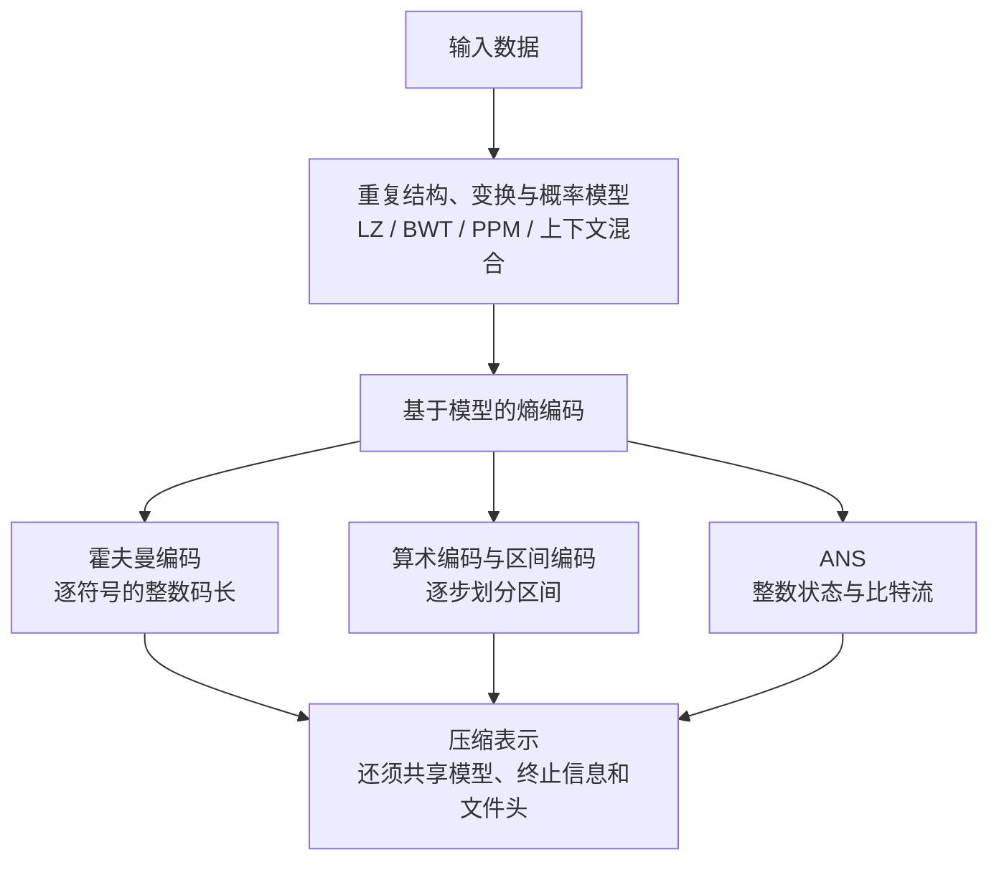
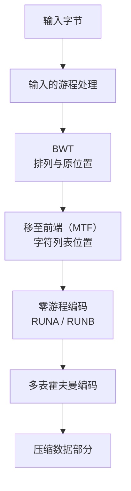

## 1. 为什么没有压缩器能缩短所有文件

无损压缩把数据换成另一种表示，使解码后能够逐比特恢复原来的字节序列。zip、gzip、zstd、xz等工具可以缩小某些输入；另一些输入几乎不变，或者因文件头而变大。它们不能把所有数据都按同一比例缩小。JPEG、MP3等有损压缩允许重建值存在差异，因此要求不同。

设{0,1}*为所有有限比特串的集合，固定编码器E和解码器D。无损性要求每个输入x都满足：

$$
D(E(x))=x
$$

如果不同的x和y得到相同输出，D就无法同时还原二者，所以E必须是单射。恰好n比特的输入有2^n种，但不足n比特的输出即使包括空串，也只有下面这么多。这里n≥1。

$$
\left|\{0,1\}^{n}\right|=2^n>
\sum_{k=0}^{n-1}2^k=2^n-1
$$

因此，固定的无损压缩器不可能缩短全部n比特输入。在所有有限串上，单射也不能只缩短某些输入，而让其他输入都不变长。若把一个n比特的x缩短且不扩张任何输入，那么不足n比特的输入已经占满全部不足n比特的输出，E(x)就会与其中一个冲突。

更具体地说，固定E，从全部n比特串中均匀选择X，并取整数1≤c≤n。至少缩短c比特的比例有如下上界。这只是短输出的候选数量，编码器不一定能用满所有候选。

$$
\Pr\!\left(|E(X)|\le n-c\right)
\le\frac{2^{n-c+1}-1}{2^n}
<2^{1-c}
$$

c=11时，该比例小于1/1024，即约0.0977%。也可以取c=100：在n≥100时，对固定E，该比例小于2^(-99)，约为1.58×10^(-30)。但这不意味着“其余文件不管换什么压缩器都无法缩短”。针对某个文件x，可以另造一个交换x与空串的编码器：x变短，空串变长，而解码器必须知道这个特殊规则。讨论柯尔莫哥洛夫复杂性时，也要固定描述语言，并区分解码程序的描述长度。

日常压缩利用适合数据分布或重复结构的表示，例如字符偏倚、重复子串、数值规律。效果因输入和方法而异，不能断言已压缩文件或密文绝不可能再少一个字节。密码算法、模式、元数据和残留结构都会影响条件。

还要区分单位：1 MiB是1,048,576字节、8,388,608比特；十进制1 MB是1,000,000字节、8,000,000比特。

## 2. 香农熵与平均码长的界限

香农在1948年的论文中，把语义价值与通信的工程问题分开，用概率研究信源。[重印版](https://wucj.lab.westlake.edu.cn/Others/shannon1948.pdf)的开头也提到了Nyquist和Hartley的前期工作。

对于概率为正的事件x，自信息量定义如下。以2为对数底时，单位为比特。这不是对心理惊讶或内容重要性的直接度量。

$$
I(x)=-\log_2P(x),\qquad 0<P(x)\le1
$$

对于有限字母表上的随机变量X，令p_i=P(X=x_i)。香农熵是自信息量的期望，并约定零概率项0log₂0=0。

$$
H(X)=-\sum_{i=1}^{m}p_i\log_2p_i,\qquad
p_i\ge0,\quad\sum_i p_i=1,\quad
0\le H(X)\le\log_2m
$$

单位为比特/符号。固定m种符号时，均匀分布使熵最大；只有一种符号概率为1时，熵为0。公平硬币一次结果的自信息量是1比特，概率1/256的事件则为8比特。这是在评价符号模型，不能直接据此决定相关序列的信息量或单个文件的下界。

### 前缀码与Kraft–McMillan不等式

给每个符号分配二进制码字，并要求连接后仍可唯一解码。任何码字都不是另一码字开头的码称为前缀码。例如{0,10,110,111}可以把100110111分成10 | 0 | 110 | 111。ASCII本身是七位字符编码，不等于“把每个字符都表示为八位”。

把长度为ℓ_i的码字表示成二叉树的叶子。在最大深度为ℓ_max的完全树中，这个叶子会占用下方2^(ℓ_max−ℓ_i)个潜在位置。对互不重叠的子树计数，就得到Kraft不等式。唯一可译码的编码也满足同样的不等式。

$$
\sum_i2^{\ell_{\max}-\ell_i}\le2^{\ell_{\max}}
\quad\Longrightarrow\quad
Z:=\sum_i2^{-\ell_i}\le1
$$

反过来，满足该不等式的正整数码长可以构造出前缀码。下文只考虑正概率符号的支撑集，并假设至少有两种符号。单符号信源能否使用空码字，需要连同数量和终止信息的共享方式另行约定。

### 用KL散度证明下界

平均码长，以及由码长导出的归一化分布Q定义如下。

$$
L=\sum_i p_i\ell_i,\qquad
q_i=\frac{2^{-\ell_i}}{Z},\qquad \sum_i q_i=1
$$

利用KL散度非负性，可得下面的恒等式。非负性可以由ln u≤u−1等对数不等式推出。

$$
\begin{aligned}
0\le D_{\mathrm{KL}}(P\|Q)
&=\sum_i p_i\log_2\frac{p_i}{q_i}\\
&=-H(X)+\sum_i p_i\ell_i+\log_2Z\\
&=L-H(X)+\log_2Z
\end{aligned}
$$

因此，平均码长满足：

$$
L=H(X)+D_{\mathrm{KL}}(P\|Q)-\log_2Z\ge H(X)
$$

Q中的2^(-ℓ_i)除以了Z。不能取消归一化后，又把−log₂Z重复计入。等号要求P=Q且Z=1，此时p_i=2^(-ℓ_i)，概率恰好与二进制码长匹配。

也可以构造上界。下面的香农码长满足Kraft不等式：

$$
\ell_i=\lceil-\log_2p_i\rceil,\qquad
2^{-\ell_i}\le p_i,\qquad
\sum_i2^{-\ell_i}\le1
$$

向上取整每个符号增加的长度不足1，因此这个码的平均长度小于H+1。最优二进制前缀码的平均长度L_opt也在下列范围内。

$$
H(X)\le L_{\mathrm{opt}}<H(X)+1
$$

对于非退化、独立同分布的符号信源，把N个符号分为一块并选择适当的块前缀码，可得下式。L_N表示整个块的平均长度。

$$
H(X)\le\frac{L_N}{N}<H(X)+\frac1N
$$

有依赖关系时，一般有H(X_1,...,X_N)≠NH(X_1)。例如只选择一次公平比特，并在已知长度N内重复：每个位置的边缘熵是1比特，但整个序列的联合熵只有1比特。对平稳的有限字母表信源，使用熵率：

$$
\overline H=\lim_{N\to\infty}\frac{H(X_1,\ldots,X_N)}{N}
$$

这些都是在指定分布和编码类别下讨论平均值，并不表示每个文件都不能短于该值，也不表示可以忽略模型和文件头的开销。

## 3. 霍夫曼编码、算术编码与ANS

把统计模型与“根据概率生成比特”的编码器分开，有助于理解各方法的作用。下面是概念图，并非要求所有格式都按这些阶段分离的规范。

### 霍夫曼编码：在哪个范围内最优？

[霍夫曼1952年的论文](https://compression.ru/download/articles/huff/huffman_1952_minimum-redundancy-codes.pdf)讨论给定权重下，使平均码长最小的前缀码。二进制情形反复合并权重最小的两个节点，并把权重之和放回集合。使用堆可以在O(m log m)时间内构造m个符号的树。

至少有两个正权重时，最优树可以去掉只有一个子节点的不必要分支。把最小的两个权重放在最深处的一对兄弟叶子上，不会增加平均码长。把它们合成符号z，原树T与较小的树T′之间满足：

$$
L(T)=L(T')+p_a+p_b
$$

差值固定，因此较小问题的最优解可以构造原问题的解。权重相同时可能有多棵最优树。规范霍夫曼码根据码长和符号顺序确定码字，可以简化树的传输，但不能消除码表开销，也不能保证所有长码字只需一次查表。

若P(0)=0.99、P(1)=0.01，最优逐符号二进制前缀码对两种符号都使用1比特。

$$
H(X)=-0.99\log_2(0.99)-0.01\log_2(0.01)
\approx0.080793,\qquad L_{\mathrm H}=1
$$

平均码长约为熵的12.4倍，但这不一定表示原文件不能变小。原表示每个符号占8比特，还是已经按1比特打包，比较结果不同。分块可以减小取整损失，但显式覆盖全部m^k种组合的树会迅速增大。单符号的空码字仍须按前文的数量共享约定另行讨论。

### 算术编码：区间与有限比特串

算术编码逐步缩小消息对应的区间。令P(s)为符号概率，A(s)为小于s的符号的概率之和，初始区间为[lo_0,hi_0)=[0,1)。假设实际编码符号的概率为正。使用宽度W_(t−1)=hi_(t−1)−lo_(t−1)，更新如下：

$$
\begin{aligned}
\mathrm{lo}_t&=\mathrm{lo}_{t-1}+W_{t-1}A(x_t),\\
\mathrm{hi}_t&=\mathrm{lo}_{t-1}+W_{t-1}\bigl(A(x_t)+P(x_t)\bigr)
\end{aligned}
$$

固定独立模型的最终宽度等于下式中的第一个乘积。有依赖时，只要双方能逐步重现条件概率，同样的思路就能使用条件概率的乘积。

$$
W_N=\prod_{t=1}^{N}P(x_t)
\quad\text{or}\quad
W_N=\prod_{t=1}^{N}P(x_t\mid x_{<t})
$$

相同已知长度N的不同消息会映射到不相交区间。选择一个完全包含在最终区间内的二进制小区间[j2^(-K),(j+1)2^(-K))，即可用它的K位来标识区间。令网格间距不大于区间宽度的一半，在理想无限精度运算下，可选择如下足够的长度：

$$
K=\lceil-\log_2W_N\rceil+1<-\log_2W_N+2
$$

这是模型和长度已知时，理想有效载荷的上界，不表示最短K必然等于该式，更不保证整个文件只增加两比特。模型、终止、精度、文件头都有额外开销。若使用真实块分布P，对应前缀表示的平均长度满足：

$$
H(P)\le\mathbb E_P[K]<H(P)+2
$$

P(0)=0.99时，约连续69个0使区间宽度减半。但并非每读69个符号就必须立即输出一位；输出时机取决于区间与重归一化。整数实现会输出已确定的高位比特或字节，并扩展状态，还要处理概率量化、进位和待定比特。算术编码或区间编码相对其他编码器的速度，没有固定通用的倍率。

### ANS：在整数状态中累积信息

[Duda的ANS论文](https://arxiv.org/html/1311.2540v2)构造了适用于不同概率符号的记数系统。普通b进制追加一个数字s的操作可逆：

$$
x'=bx+s,\qquad s=x'\bmod b,\qquad x=\lfloor x'/b\rfloor
$$

等概率且正状态x足够大时，对数大小约增加log₂b。一般概率下，让状态大约扩大为1/P(s)倍。不要在x=0处使用log₂x，也不要把近似增长量当成精确整数码长。

rANS的一种构造使用M=2^R、正整数频数f_s与累计频数b_s。

$$
\sum_s f_s=M,\qquad b_s=\sum_{a<s}f_a,\qquad P(s)\approx f_s/M
$$

它把非负整数状态x和符号s映射为：

$$
C(x,s)=M\left\lfloor\frac{x}{f_s}\right\rfloor+(x\bmod f_s)+b_s
$$

逆操作根据slot选择符号，并恢复旧状态。

$$
\begin{aligned}
\mathrm{slot}&=x'\bmod M,\\
b_s&\le\mathrm{slot}<b_s+f_s,\\
x&=f_s\left\lfloor\frac{x'}M\right\rfloor+\mathrm{slot}-b_s
\end{aligned}
$$

M是2的幂时，对M求商和余数可用移位与掩码完成。但符号查找、访存、重归一化与输入输出仍有成本。这个双射本身既不保证压缩损失为零，也不保证单时钟周期解码。

tANS使用有限状态和转移表。以按位操作为例，可以使用下面的整数集合。它对应半开区间[L,2L)，而不是[L,2L−1)。

$$
\mathcal I=\{L,L+1,\ldots,2L-1\},\qquad |\mathcal I|=L
$$

在状态与比特流之间传递比特，使状态保持在允许范围内。重归一化条件与符号布局必须相互配合，并非把rANS公式换成一张小表就完成了。FSE属于tANS系列实现。

ANS状态操作类似栈，最后加入的符号先恢复。可以倒序编码一个块，使解码按原顺序进行。上下文概率的计算顺序也必须与倒序编码协调。霍夫曼、算术编码、ANS应按模型、格式和实现选择，不是后一代在所有用途上都取代前一代。

## 4. LZ、BWT和上下文模型改变了什么？

只看单字节频数的模型不能充分利用长重复和依赖关系。不要给英语规定一个普遍必然的比特数，而应说明语料，以及单位是字符、字节还是词元。

### 字典压缩：LZ77、LZ78与LZW

LZ77系列用后向引用指向已输出的数据。如果16字节ASCII串`std::vector<int>`曾出现在200字节之前，此时再次匹配，可以用下面的距离、长度二元组表示。是否比16个原始字节更省，取决于格式怎样编码这些数值。

$$
(d,\ell)=(200,16)
$$

匹配长度也可以超过距离。一个字面量A后跟距离1、长度99的引用，会把刚复制的A继续作为源，总共生成100个A。[DEFLATE规范](https://www.rfc-editor.org/rfc/rfc1951.txt)也给出了重叠引用的例子。对重叠区域直接使用通用memcpy，或者只复制最初源区域的快照，都不能正确描述这种增长。实现必须在检查距离、输出上限和输入长度的同时，处理向前增长的输出。

LZSS用标志等方式区分字面量与引用，但标志也占空间，不能保证无匹配数据绝不膨胀。LZ78/LZW则把出现过的字符串登记在显式字典里，使用索引。字典增长、重置、引用范围和整数编码不同，并非某一种方法对所有输入都更好。

实际格式也要区分。DEFLATE压缩块使用距离1至32,768、长度3至258的引用，分别对字面量/长度与距离进行霍夫曼编码，也有非压缩块。[Zstandard规范](https://www.rfc-editor.org/rfc/rfc8878.html)把字面量与序列分开：字面量可用原始、RLE、霍夫曼等表示，序列可用FSE等模式。1条或4条霍夫曼流与序列的3类FSE状态不是同一回事。LZMA/LZMA2也结合字典与概率模型；[LZMA编码器](https://github.com/ip7z/7zip/blob/main/C/LzmaEnc.c)展示了匹配搜索与区间编码处理。不要用一个算法名称代替所有格式、工具和级别。

### BWT：保留长度的排列与逆变换

Burrows–Wheeler变换把具有相同后继上下文的字符聚到附近。末列本身保留符号数量，但逆变换所需的位置或终止符信息也有成本。

以添加唯一且最小终止符`$`的`banana$`为例。把7种循环移位按字典序排列，取出末列和原字符串所在的行号。

| 行 | 按字典序排列的循环移位 | 首列 | 末列 |
| :--- | :--- | :---: | :---: |
| 0 | `$banana` | `$` | a |
| 1 | `a$banan` | a | n |
| 2 | `ana$ban` | a | n |
| 3 | `anana$b` | a | b |
| 4 | `banana$` | b | `$` |
| 5 | `na$bana` | n | a |
| 6 | `nana$ba` | n | a |

输出是`annb$aa`，原行号从0计为4。设末列为L、首列为F，把L的字符排序即可得到F。同字符的出现顺序对应起来，形成LF映射，可以反向遍历原序列。按0起始编号，C(c)表示小于c的字符总数，rank_c(i)表示L中位置i之前出现c的次数，则：

$$
\mathrm{LF}(i)=C(L_i)+\mathrm{rank}_{L_i}(i)
$$

对小型固定字母表，频数与出现次序可以在线性时间内建立，N个符号的逆变换为O(N)。若使用一般比较排序，还要单独计算排序成本。BWT并不保证把所有输入都变成长游程。

[bzip2 1.0.8手册](https://sourceware.org/bzip2/manual/manual.html)及[该版本源码](https://sourceware.org/pub/bzip2/bzip2-1.0.8.tar.gz)结合了BWT之前的RLE、MTF、零游程编码和多个霍夫曼表。MTF输出字符当前在列表中的位置，再把该字符移到前端。相同字符连续出现时会产生连续的0，用RUNA/RUNB编码。下图表示主要数据变换，省略了文件头、索引和CRC。

### 上下文模型与LLM：码长和预测损失

PPM使用不同长度的上下文，并通过转义等机制处理未观测符号。上下文混合结合多个模型的预测。神经网络也能作为预测器，但Transformer不等同于循环神经网络。

模型Q_θ对序列分配正的条件概率时，理想信息量如下。不要把它直接等同于实际输出长度。

$$
I_\theta(x_{1:N})=-\log_2 Q_\theta(x_{1:N})
=\sum_{t=1}^{N}-\log_2Q_\theta(x_t\mid x_{<t})
$$

若用自然对数计算该序列的平均负对数似然，对数底与平均因子给出以下关系：

$$
\mathcal L_{\mathrm{NLL}}(\theta)
=-\frac1N\sum_{t=1}^{N}\ln Q_\theta(x_t\mid x_{<t})
=\frac{\ln2}{N}I_\theta(x_{1:N})
$$

因此，在相同数据、单位和模型条件下，减小该损失对应于减小理想码长。但表达式不包含共享模型大小、词元化的可逆性、有限精度、终止、文件头和解码时间。一次预测的信息量小于1比特，并不意味着能把这个词单独存成小数比特的文件。

[Language Modeling Is Compression](https://arxiv.org/html/2309.10668v2)通过实验研究了这一联系。其图像、音频比较使用了加工后的数据和指定的上下文长度，并区分不计模型权重与计入权重的压缩率。不能直接推广成对所有图像、音频或任意文件的优劣判断。Hutter Prize等压缩任务促进预测研究，但编码公式本身并没有证明智能或理解的充分条件。

## 5. 怎样比较压缩率、速度与内存

实际评估要同时考虑压缩后大小、编码时间、解码时间、内存、兼容性和访问粒度。这里把压缩率定义为“压缩后大小/原大小”，越小越好。混用不同条件的测试数字，不能得到普遍的排名。

| 方法或工具 | 结构特点 | 比较时检查的条件 |
| :--- | :--- | :--- |
| LZ4 | 面向字节的LZ77型表示，块内无熵编码 | 小输入的帧开销、解码速度、所需缓冲区 |
| Zstandard | 字典匹配、字面量与序列、霍夫曼/FSE等模式 | 级别、字典、窗口、各模式及双方内存 |
| DEFLATE / gzip | 后向引用与霍夫曼，也可选择非压缩块 | 格式与工具的区别、兼容性、块与包装开销 |
| BWT / bzip2 | 块变换、MTF、游程与霍夫曼 | 块大小、重建工作区与索引 |
| LZMA/LZMA2 / xz、7-Zip | 字典匹配与自适应概率编码 | 格式和设置、字典大小、搜索时间、解码器限制 |
| PPM、上下文混合、神经预测 | 根据上下文生成概率再编码 | 模型共享或传输、上下文长度、计算量与精度复现 |

[LZ4块规范](https://github.com/lz4/lz4/blob/dev/doc/lz4_Block_format.md)把帧格式单独处理，[7-Zip格式说明](https://www.7-zip.org/7z.html)也区分多种方法。理解结构特点与测量实际负载，两者都需要。

测量时记录实现与版本、命令和级别、CPU与线程数、输入文件的哈希及大小、字典、缓存与I/O条件。用总输入字节数U、压缩后总字节数C和耗时，计算C/U与吞吐量；空输入应与该比值的定义分开。内存不仅包括字典，还要计入输入输出缓冲区和模型。也要确认解码后字节的哈希与原文件一致。这里不声称重新测量过吞吐速度。

### 编码、解码负载与I/O

LZ系列的解码可能比编码器的搜索与解析更轻，但同一格式内的压缩级别和实际命令也会改变解码速度。不能保证高级别解码速度始终完全相同。预测模型的解码侧也须重现概率，但编码侧可能批量计算概率，因此两侧时间也不必精确相等。

在简单读取模型中，I/O速度为v_io，按原始字节计的解码速度为v_dec。如果CPU与I/O不重叠，时间近似为：

$$
T_{\mathrm{raw}}\approx\frac{U}{v_{\mathrm{io}}},\qquad
T_{\mathrm{compressed}}\approx\frac{C}{v_{\mathrm{io}}}
+\frac{U}{v_{\mathrm{dec}}}
$$

这样可以比较减少的I/O时间与解码成本。如果资源独立且流水线充分并行，稳定阶段的时间也可能接近两项中较大者，而非两项之和。启动、内存带宽、并行度和访问粒度不同，模型也应调整。

分支、依赖、缓存、SIMD与指令级并行都会影响速度，但不能据此断言普遍的MB/s上限，也不能保证分流后分支预测失误为零。只压缩一次、由很多读者解码的软件包，与频繁更新的日志有不同优先级。

## 6. 讨论的是哪种界限，计算了哪些成本？

鸽巢原理表明，固定的无损编码器不能缩短全部输入。熵下界讨论指定概率模型和编码条件下的平均长度。霍夫曼、算术编码、ANS以不同方式连接概率与表示；LZ、BWT和上下文模型则利用重复与依赖。

预测损失与理想码长的关系，有助于理解包括神经模型在内的压缩。应把这一联系与文件总成本、运行速度或智能的证明分开，说明共享了什么、传输了什么、测量了哪些输入，才能把理论与实际选择联系起来。
