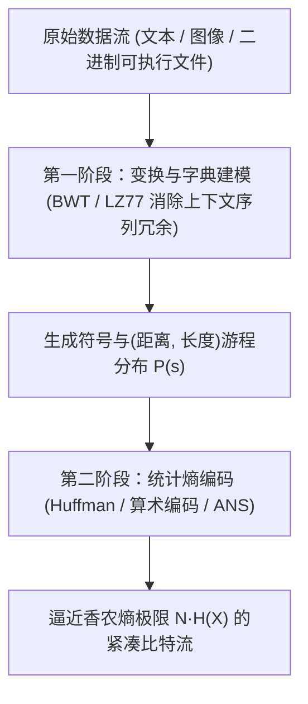
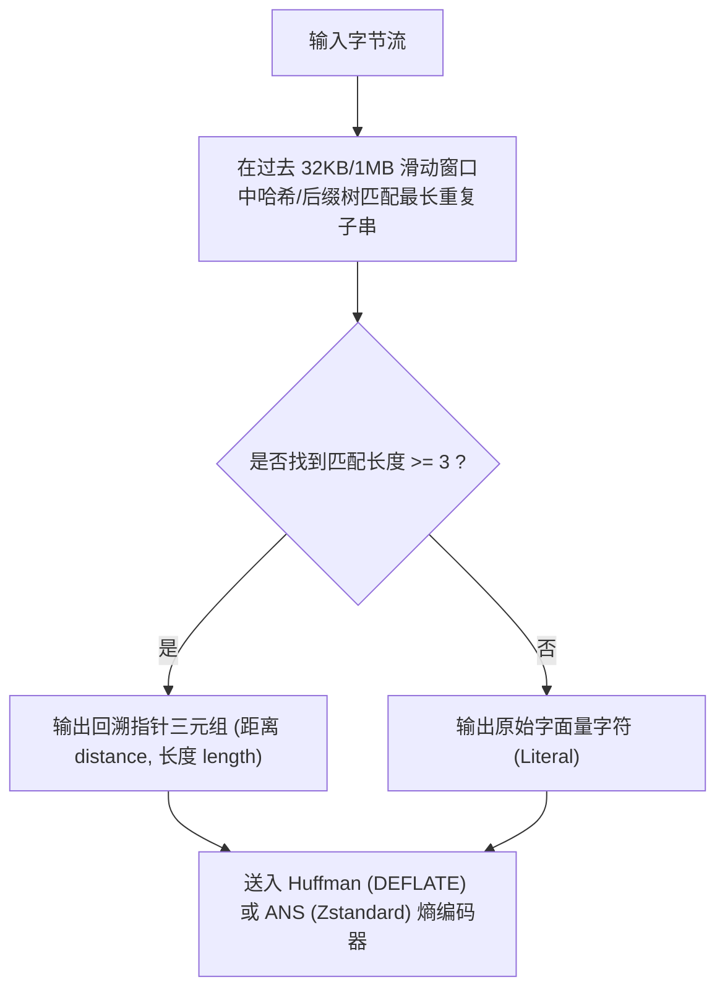

## 1. 鸽巢原理的铁律：为什么不存在“能把所有文件都变小”的万能无损压缩算法？

当我们每天使用 `zip`、`gzip`、`zstd`、`7z` 或 `PNG` 将几十兆的文档、源代码或图像压缩到原大小的几分之一，且解压后<strong>连一个比特都不差（Lossless，无损可逆）</strong>时，一个直觉上的悖论随之产生：既然压缩器能把文件变小，如果我把压缩后的 `.zip` 文件再放进压缩器里反复压缩十次，难道不能把任何巨大的电影或数据库最终缩减到只有 1 个字节吗？

答案是绝对不可能。证明这一点的工具甚至不需要高深的信息论，只需初等组合数学中的<strong>鸽巢原理（Pigeonhole Principle / 抽屉原理）</strong>。

设无损压缩编码函数为 $E: \{0,1\}^* \to \{0,1\}^*$，解码函数为 $D: \{0,1\}^* \to \{0,1\}^*$。要保证“一字不失”的完全可逆性，即对于任意输入二进制串 $x$ 都满足 $D(E(x)) = x$，编码映射 $E$ <strong>必须是一个单射（Injective / One-to-One）函数</strong>——因为如果两个不同的文件 $x_1 \ne x_2$ 被压缩成了同一个短比特串 $y = E(x_1) = E(x_2)$，解码器面对 $y$ 时就永远无法知道该还原出 $x_1$ 还是 $x_2$！

现在考察所有长度为 $N$ 比特的二进制文件集合 $\{0,1\}^N$，其元素总数为 $2^N$ 个。假设我们希望将它们压缩成严格短于 $N$ 比特的文件（即长度至多为 $N-1$ 比特）。那么，所有长度从 $0$ 到 $N-1$ 的二进制串总数一共只有：

$$\sum_{k=0}^{N-1} 2^k = 2^N - 1 < 2^N$$

将 $2^N$ 只“鸽子”（长为 $N$ 的原始文件）塞进 $2^N - 1$ 个“鸽巢”（所有更短的编码串），根据鸽巢原理，<strong>哪怕一个压缩算法只把某 1 个文件缩短了 1 比特，它也必然至少把另 1 个文件变得更长（膨胀）</strong>！更进一步，长度不超过 $N - c$ 比特的编码串总数仅为 $2^{N-c+1} - 1$，这意味着在所有 $N$ 比特文件中，能够被无损缩短 $c$ 比特以上的文件比例至多只有 $2^{-c+1}$：

$$P\bigl(|E(X)| \le N - c\bigr) < 2^{-(c-1)}$$

例如，在所有可能的 1 MB 二进制文件宇宙中，能够被缩减哪怕 100 比特（僅 12.5 字节！）的文件占比也不到 $2^{-99} \approx 1.57 \times 10^{-30}$！换言之，<strong>绝大多数随机二进制串（柯尔莫哥洛夫不可压缩串）都是完全无法被压缩的</strong>。

那么，为什么我们的日常压缩软件几乎总能把文件大幅缩小呢？因为人类撰写的小说、C++/Python 源代码、网页 HTML、数据库表格和自然图像，绝不是在 $\{0,1\}^N$ 中均匀随机投掷硬币产生的乱码！它们只占据了所有可能比特串海洋中一个极其微小、高度结构化、充满<strong>统计偏倚与上下文重复冗余</strong>的低熵角落。无损压缩的本质，就是将宝贵的“短码字”分配给我们现实世界中高频出现的结构化文件，而让那些如同白噪声般永不出现的随机比特串承担微小的膨胀代价。

---

## 2. 香农信源编码定理与信息熵：可逆压缩的绝对物理极限

1948年，克劳德·香农（Claude E. Shannon）在划时代的论文《通信的数学理论》中，回答了一个根本问题：<strong>去除冗余之后，一个信源究竟最少需要多少比特来表示？</strong>

设离散无记忆信源（DMS）从字母表 $\mathcal{A} = \{s_1, s_2, \dots, s_m\}$ 中以概率分布 $P = (p_1, p_2, \dots, p_m)$ 独立发出符号。一个极常出现的符号（如英语中的字母 `'e'` 或空格）携带着极少的意外性，而一个罕见符号（如 `'z'` 或 `'q'`）一旦出现则提供了巨大的信息量。香农定义单个符号 $s_i$ 的<strong>自信息量（Self-Information / Surprisal，惊讶度）</strong>为：

$$I(s_i) = -\log_2 p_i = \log_2 \frac{1}{p_i} \quad (\text{bits})$$

对整个符号表求数学期望，即得到度量信源不确定性与信息密度的核心指标——<strong>香农信息熵（Shannon Entropy）</strong>：

$$H(X) = \mathbb{E}[I(X)] = -\sum_{i=1}^{m} p_i \log_2 p_i \quad (\text{bits / symbol})$$

为了实现无歧义的即时解码，我们将每个符号 $s_i$ 映射为长度为 $\ell_i$ 的二进制<strong>前缀码（Prefix-Free Code / 瞬时码，即没有任何码字是另一个码字的前缀）</strong>。任何合法的二元前缀码树都必须满足<strong>克拉夫特-麦克米兰不等式（Kraft-McMillan Inequality）</strong>：

$$\sum_{i=1}^{m} 2^{-\ell_i} \le 1$$

定义平均码长 $L = \sum_{i=1}^m p_i \ell_i$。利用库尔巴克-莱布勒散度（KL 散度）的非负性 $D_{\text{KL}}(P \,\|\, Q) \ge 0$（其中构造辅助分布 $q_i = 2^{-\ell_i} / Z$，且 $Z = \sum 2^{-\ell_i} \le 1$），可以极其优雅地推导出：

$$L - H(X) = \sum_{i=1}^m p_i \ell_i + \sum_{i=1}^m p_i \log_2 p_i = \sum_{i=1}^m p_i \log_2 \frac{p_i}{2^{-\ell_i}} = D_{\text{KL}}(P \,\|\, Q) + \log_2 \frac{1}{Z} \ge 0$$

再结合香农码取整 $\ell_i = \lceil -\log_2 p_i \rceil < -\log_2 p_i + 1$，我们便得到了著名的<strong>香农无噪信源编码定理（Shannon's Source Coding Theorem）</strong>：

$$H(X) \le L < H(X) + 1$$

香农熵 $H(X)$ 就是无损统计压缩不可逾越的<strong>绝对下界</strong>：当且仅当每个符号的概率恰好是 $2$ 的负整数次幂（$p_i = 2^{-\ell_i}$）时，平均码长 $L$ 才能精确达到 $H(X)$。

---

## 3. 统计熵编码的三代演进：霍夫曼树、算术编码与非对称数系（ANS）

如何设计具体的编码算法来逼近香农极限 $H(X)$？计算机科学经历了三代跨越半个多世纪的算法革命：

### 3.1 霍夫曼编码（Huffman Coding, 1952）：最优整数位前缀树
大卫·霍夫曼（David A. Huffman）在麻省理工学院攻读博士期间，利用自底向上的贪心算法（每次将概率最小的两个节点合并为一棵子树），在 $O(m \log m)$ 时间内构造出了平均码长 $L$ 最小的<strong>最优前缀码树</strong>。然而，霍夫曼编码有一个致命的结构枷锁：<strong>每个符号的码长 $\ell_i$ 必须是正整数（至少 1 比特）</strong>！如果某个符号出现的概率高达 $p_1 = 0.99$，其真实信息量仅为 $-\log_2(0.99) \approx 0.0145\,\text{bits}$，但霍夫曼编码依然不得不为它消耗整整 $1\,\text{bit}$，造成近 $69$ 倍的带宽浪费！

### 3.2 算术编码（Arithmetic Coding / Range Coding）：突破整数比特壁垒
为了彻底消除 $\ell_i \ge 1$ 的整数取整损耗，算术编码（由 Rissanen、Pasco 及 Witten 等人完善）放弃了“逐个符号映射独立码字”的做法，而是将<strong>整条长度为 $N$ 的消息序列 $x_1 x_2 \dots x_N$ 映射为半开区间 $[0, 1)$ 内的一个极窄子区间 $[L_{\text{low}}, H_{\text{high}})$</strong>。每读入一个符号 $s_i$，当前区间就按该符号的概率占比 $p_i$ 同比例缩小。最终，整个消息子区间的宽度恰好等于联合概率：

$$\Delta = \prod_{t=1}^{N} P(x_t) \implies \text{输出总比特数} = \left\lceil -\log_2 \Delta \right\rceil + 1 \approx \sum_{t=1}^{N} \bigl(-\log_2 P(x_t)\bigr) = N \cdot H(X)$$

算术编码完美实现了“小数比特（Fractional Bits）”，逼近香农熵到全文件仅差 $2$ 比特以内！但其代价是每处理一个符号都需要执行高精度的乘法与区间重归一化（Renormalization），CPU 吞吐速度远慢于霍夫曼查表。

### 3.3 非对称数系（Asymmetric Numeral Systems, ANS, 2009–2014）：现代压缩的皇冠
2009年至2014年，波兰物理学家与计算机科学家雅罗斯瓦夫·杜达（Jarek Duda）发明了<strong>非对称数系（ANS，包括查表式 tANS 与区间式 rANS）</strong>，一举终结了“霍夫曼的速度”与“算术编码的压缩率”之间长达四十年的二律背反！
在标准二进制进位制中，我们在状态整数 $x \in \mathbb{N}$ 后追加一个均匀分布比特 $b \in \{0,1\}$ 时，新状态为 $x' = 2x + b$（因为 $P(b)=1/2$，状态乘以 $1/P(b) = 2$）。杜达洞察到：当符号 $s$ 的概率为非均匀的 $p_s$ 时，我们只需将当前自然数状态 $x$ 放大为约 $x / p_s$：

$$C(x, s) \approx \frac{x}{p_s}$$

信息被直接编码进单个无符号整数状态 $x$ 的增长速率中！通过预计算有限状态自动机查表（tANS），ANS 实现了<strong>与算术编码完全相同的“小数比特”香农熵极限压缩率，同时兼具与霍夫曼编码同级的单周期查表解压速度</strong>！正因如此，Meta（Facebook）的 <strong>Zstandard (`zstd`)</strong>、Apple 的 <strong>LZFSE</strong>、Google 的 <strong>JPEG XL</strong> 与 <strong>Draco</strong> 全部采用 ANS 作为核心熵编码引擎。

---

## 4. 字典压缩与上下文变换：LZ77、DEFLATE、BWT 与“压缩即预测”

单个字符的独立概率熵 $H_0(X)$ 往往高达 $4.5\,\text{bits/byte}$，但自然语言中存在着强烈的上下文相关性（例如 `'q'` 后面几乎必然跟着 `'u'`，代码中反复出现相同的变量名和函数调用）。为了挖掘高阶条件熵 $H(X_t \mid X_{t-1}, \dots, X_{t-k})$，1977年亚伯拉罕·兰佩尔（Abraham Lempel）与雅各布·齐夫（Jacob Ziv）提出了统治工业界的<strong>LZ77 滑动窗口字典压缩算法</strong>：

當编码器在当前位置发现一段长达 $L$ 字节的字符串已经在前文距离 $D$ 字节处出现过时，它不再重复存储这 $L$ 个字节，而是直接输出一个紧凑的<strong>回溯指针 `(distance = D, length = L)`</strong>！
- <strong>DEFLATE（`gzip` / `zip` / `PNG`）</strong>：采用 <strong>LZ77（32 KB 窗口）+ 霍夫曼编码</strong>。
- <strong>Zstandard (`zstd`)</strong>：采用 <strong>LZ77（最大数百 MB 窗口）+ 有限状态熵（tANS）+ 霍夫曼字面量编码</strong>，在压缩率与多核 GB/s 级速度上全面超越 `gzip`。
- <strong>LZMA / `xz` / `7z`</strong>：采用超大滑动字典 + 上下文自适应二进制算术/区间编码（Range Coding）。
- <strong>Burrows-Wheeler 变换（BWT，`bzip2`）</strong>：通过对数据块的所有循环移位按字典序排序并提取最后一列 $L$，将拥有相同后继上下文的字符神奇地聚集在一起，从而可通过移至前端（MTF）与游程编码（RLE）大幅压缩。

| 压缩算法 / 工具 | 核心字典/变换技术 | 后端熵编码器 | 典型文本压缩率 (Silesia) | 解压速度量级 | 典型工业应用场景 |
|---|---|---|---|---|---|
| <strong>`lz4`</strong> | LZ77 字节对齐匹配 | 无（纯字节流） | $\sim 48\%$ | $\sim 4,000\,\text{MB/s}$ | 内存压缩 (ZRAM)、实时数据库与内核镜像 |
| <strong>`gzip` (DEFLATE)</strong> | LZ77 (32 KB 窗口) | 霍夫曼编码 (Huffman) | $\sim 32\%$ | $\sim 400\,\text{MB/s}$ | HTTP 传输、`.tar.gz`、PNG 图像格式 |
| <strong>`zstd` (Zstandard)</strong> | LZ77 (大窗口 + 重复偏移) | <strong>ANS (tANS / FSE)</strong> + Huffman | $\sim 28\%$ | $\sim 1,500\,\text{MB/s}$ | 现代 Linux 软件包、数据中心日志、文件系统 (Btrfs) |
| <strong>`bzip2`</strong> | <strong>BWT 块排序变换</strong> + MTF + RLE | 霍夫曼编码 (多表切换) | $\sim 26\%$ | $\sim 60\,\text{MB/s}$ | 源码归档、生物信息学基因序列存储 |
| <strong>`xz` (LZMA2)</strong> | LZ77 (超大窗口 + 比特级上下文) | 自适应区间算术编码 (Range) | $\sim 21\%$ | $\sim 120\,\text{MB/s}$ | 极限体积软件分发、嵌入式固件归档 |
| <strong>`cmix` / `PAQ8` / LLM</strong> | 多模型上下文混合 / Transformer | 算术编码 (Arithmetic Coding) | $\sim 11\%\text{–}14\%$ | $< 1\,\text{MB/s}$ | Hutter Prize 极限基准测试、压缩即通用人工智能研究 |

在最深层的数学意义上，<strong>压缩与预测是完全等价的（Compression is Prediction）</strong>：给定历史上下文 $x_{<t}$，一个能够准确预测下一个符号概率分布 $P_\theta(x_t \mid x_{<t})$ 的模型（无论是 PPM、PAQ 上下文混合器，还是现代大语言模型 Transformer），其交叉熵损失 $-\sum \log_2 P_\theta(x_t \mid x_{<t})$ 直接等于将该概率分布送入算术编码器后得到的精确无损压缩文件体积！消除可预测的冗余，剩下的纯粹惊奇，便是信息本身。
