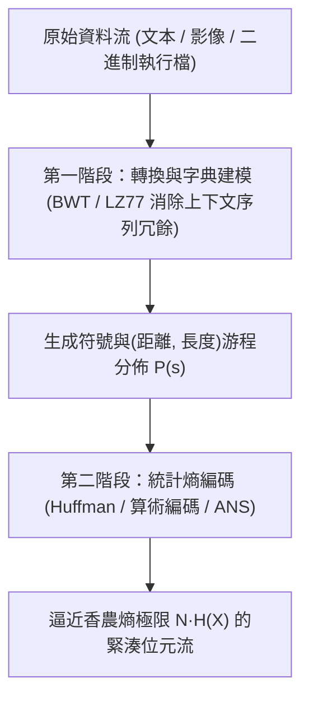
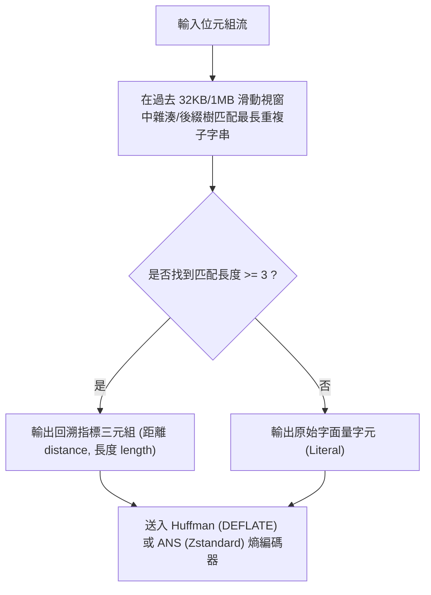

## 1. 鴿籠原理的鐵律：為什麼不存在「能把所有檔案都變小」的萬能無損壓縮演算法？

當我們每天使用 `zip`、`gzip`、`zstd`、`7z` 或 `PNG` 將幾十 MB 的文件、原始碼或影像壓縮到原大小的幾分之一，且解壓後<strong>連一個位元都不差（Lossless，無損可逆）</strong>時，一個直覺上的悖論隨之產生：既然壓縮器能把檔案變小，如果我把壓縮後的 `.zip` 檔案再放進壓縮器裡反覆壓縮十次，難道不能把任何巨大的電影或資料庫最終縮減到只有 1 個位元組嗎？

答案是絕對不可能。證明這一點的工具甚至不需要高深的資訊理論，只需初等組合數學中的<strong>鴿籠原理（Pigeonhole Principle / 抽屜原理）</strong>。

設無損壓縮編碼函數為 $E: \{0,1\}^* \to \{0,1\}^*$，解碼函數為 $D: \{0,1\}^* \to \{0,1\}^*$。要保證「一字不失」的完全可逆性，即對於任意輸入二進制串 $x$ 都滿足 $D(E(x)) = x$，編碼映射 $E$ <strong>必須是一個單射（Injective / One-to-One）函數</strong>——因為如果兩個不同的檔案 $x_1 \ne x_2$ 被壓縮成了同一個短位元串 $y = E(x_1) = E(x_2)$，解碼器面對 $y$ 時就永遠無法知道該還原出 $x_1$ 還是 $x_2$！

現在考察所有長度為 $N$ 位元的二進制檔案集合 $\{0,1\}^N$，其元素總數為 $2^N$ 個。假設我們希望將它們壓縮成嚴格短於 $N$ 位元的檔案（即長度至多為 $N-1$ 位元）。那麼，所有長度從 $0$ 到 $N-1$ 的二進制串總數一共只有：

$$\sum_{k=0}^{N-1} 2^k = 2^N - 1 < 2^N$$

將 $2^N$ 隻「鴿子」（長為 $N$ 的原始檔案）塞進 $2^N - 1$ 個「鴿籠」（所有更短的編碼串），根據鴿籠原理，<strong>哪怕一個壓縮演算法只把某 1 個檔案縮短了 1 位元，它也必然至少把另 1 個檔案變得更長（膨脹）</strong>！更進一步，長度不超過 $N - c$ 位元的編碼串總數僅為 $2^{N-c+1} - 1$，這意味著在所有 $N$ 位元檔案中，能夠被無損縮短 $c$ 位元以上的檔案比例至多只有 $2^{-c+1}$：

$$P\bigl(|E(X)| \le N - c\bigr) < 2^{-(c-1)}$$

例如，在所有可能的 1 MB 二進制檔案宇宙中，能夠被縮減哪怕 100 位元（僅 12.5 位元組！）的檔案佔比也不到 $2^{-99} \approx 1.57 \times 10^{-30}$！換言之，<strong>絕大多數隨機二進制串（柯爾莫哥洛夫不可壓縮串）都是完全無法被壓縮的</strong>。

那麼，為什麼我們的日常壓縮軟體幾乎總能把檔案大幅縮小呢？因為人類撰寫的小說、C++/Python 原始碼、網頁 HTML、資料庫表格和自然影像，絕不是在 $\{0,1\}^N$ 中均勻隨機投擲硬幣產生的亂碼！它們只佔據了所有可能位元串海洋中一個極其微小、高度結構化、充滿<strong>統計偏倚與上下文重複冗餘</strong>的低熵角落。無損壓縮的本質，就是將寶貴的「短碼字」分配給我們現實世界中高頻出現的結構化檔案，而讓那些如同白雜訊般永不出現的隨機位元串承擔微小的膨脹代價。

---

## 2. 香農信源編碼定理與資訊熵：可逆壓縮的絕對物理極限

1948年，克勞德·香農（Claude E. Shannon）在劃時代的論文《通訊的數學理論》中，回答了一個根本問題：<strong>去除冗餘之後，一個信源究竟最少需要多少位元來表示？</strong>

設離散無記憶信源（DMS）從字母表 $\mathcal{A} = \{s_1, s_2, \dots, s_m\}$ 中以機率分佈 $P = (p_1, p_2, \dots, p_m)$ 獨立發出符號。一個極常出現的符號（如英語中的字母 `'e'` 或空白鍵）攜帶著極少的意外性，而一個罕見符號（如 `'z'` 或 `'q'`）一旦出現則提供了巨大的資訊量。香農定義單個符號 $s_i$ 的<strong>自資訊量（Self-Information / Surprisal，驚訝度）</strong>為：

$$I(s_i) = -\log_2 p_i = \log_2 \frac{1}{p_i} \quad (\text{bits})$$

對整個符號表求數學期望值，即得到度量信源不確定性與資訊密度的核心指標——<strong>香農資訊熵（Shannon Entropy）</strong>：

$$H(X) = \mathbb{E}[I(X)] = -\sum_{i=1}^{m} p_i \log_2 p_i \quad (\text{bits / symbol})$$

為了實現無歧義的即時解碼，我們將每個符號 $s_i$ 映射為長度為 $\ell_i$ 的二進制<strong>前綴碼（Prefix-Free Code / 瞬時碼，即沒有任何碼字是另一個碼字的前綴）</strong>。任何合法的二元前綴碼樹都必須滿足<strong>克拉夫特-麥克米蘭不等式（Kraft-McMillan Inequality）</strong>：

$$\sum_{i=1}^{m} 2^{-\ell_i} \le 1$$

定義平均碼長 $L = \sum_{i=1}^m p_i \ell_i$。利用庫爾巴克-萊布勒散度（KL 散度）的非負性 $D_{\text{KL}}(P \,\|\, Q) \ge 0$（其中構造輔助分佈 $q_i = 2^{-\ell_i} / Z$，且 $Z = \sum 2^{-\ell_i} \le 1$），可以極其優雅地推導出：

$$L - H(X) = \sum_{i=1}^m p_i \ell_i + \sum_{i=1}^m p_i \log_2 p_i = \sum_{i=1}^m p_i \log_2 \frac{p_i}{2^{-\ell_i}} = D_{\text{KL}}(P \,\|\, Q) + \log_2 \frac{1}{Z} \ge 0$$

再結合香農碼取整 $\ell_i = \lceil -\log_2 p_i \rceil < -\log_2 p_i + 1$，我們便得到了著名的<strong>香農無噪信源編碼定理（Shannon's Source Coding Theorem）</strong>：

$$H(X) \le L < H(X) + 1$$

香農熵 $H(X)$ 就是無損統計壓縮不可逾越的<strong>絕對下界</strong>：當且僅當每個符號的機率恰好是 $2$ 的負整數次冪（$p_i = 2^{-\ell_i}$）時，平均碼長 $L$ 才能精確達到 $H(X)$。

---

## 3. 統計熵編碼的三代演進：霍夫曼樹、算術編碼與非對稱數系（ANS）

如何設計具體的編碼演算法來逼近香農極限 $H(X)$？電腦科學經歷了三代跨越半個多世紀的演算法革命：

### 3.1 霍夫曼編碼（Huffman Coding, 1952）：最優整數位元前綴樹
大衛·霍夫曼（David A. Huffman）在麻省理工學院攻讀博士期間，利用自底向上的貪婪演算法（每次將機率最小的兩個節點合併為一棵子樹），在 $O(m \log m)$ 時間內構造出了平均碼長 $L$ 最小的<strong>最優前綴碼樹</strong>。然而，霍夫曼編碼有一個致命的結構枷鎖：<strong>每個符號的碼長 $\ell_i$ 必須是正整數（至少 1 位元）</strong>！如果某個符號出現的機率高達 $p_1 = 0.99$，其真實資訊量僅為 $-\log_2(0.99) \approx 0.0145\,\text{bits}$，但霍夫曼編碼依然不得不為它消耗整整 $1\,\text{bit}$，造成近 $69$ 倍的頻寬浪費！

### 3.2 算術編碼（Arithmetic Coding / Range Coding）：突破整數位元壁壘
為了徹底消除 $\ell_i \ge 1$ 的整數取整損耗，算術編碼（由 Rissanen、Pasco 及 Witten 等人完善）放棄了「逐個符號映射獨立碼字」的做法，而是將<strong>整條長度為 $N$ 的訊息序列 $x_1 x_2 \dots x_N$ 映射為半開區間 $[0, 1)$ 內的一個極窄子區間 $[L_{\text{low}}, H_{\text{high}})$</strong>。每讀入一個符號 $s_i$，當前區間就按該符號的機率佔比 $p_i$ 同比例縮小。最終，整個訊息子區間的寬度恰好等於聯合機率：

$$\Delta = \prod_{t=1}^{N} P(x_t) \implies \text{輸出總位元數} = \left\lceil -\log_2 \Delta \right\rceil + 1 \approx \sum_{t=1}^{N} \bigl(-\log_2 P(x_t)\bigr) = N \cdot H(X)$$

算術編碼完美實現了「小數位元（Fractional Bits）」，逼近香農熵到全檔案僅差 $2$ 位元以內！但其代價是每處理一個符號都需要執行高精度的乘法與區間重歸一化（Renormalization），CPU 吞吐速度遠慢於霍夫曼查表。

### 3.3 非對稱數系（Asymmetric Numeral Systems, ANS, 2009–2014）：現代壓縮的皇冠
2009年至2014年，波蘭物理學家與電腦科學家雅羅斯瓦夫·杜達（Jarek Duda）發明了<strong>非對稱數系（ANS，包括查表式 tANS 與區間式 rANS）</strong>，一舉終結了「霍夫曼的速度」與「算術編碼的壓縮率」之間長達四十年的二律背反！
在標準二進制進位制中，我們在狀態整數 $x \in \mathbb{N}$ 後追加一個均勻分佈位元 $b \in \{0,1\}$ 時，新狀態為 $x' = 2x + b$（因為 $P(b)=1/2$，狀態乘以 $1/P(b) = 2$）。杜達洞察到：當符號 $s$ 的機率為非均勻的 $p_s$ 時，我們只需將當前自然數狀態 $x$ 放大為約 $x / p_s$：

$$C(x, s) \approx \frac{x}{p_s}$$

資訊被直接編碼進單個無符號整數狀態 $x$ 的增長速率中！透過預計算有限狀態自動機查表（tANS），ANS 實現了<strong>與算術編碼完全相同的「小數位元」香農熵極限壓縮率，同時兼具與霍夫曼編碼同級的單週期查表解壓速度</strong>！正因如此，Meta（Facebook）的 <strong>Zstandard (`zstd`)</strong>、Apple 的 <strong>LZFSE</strong>、Google 的 <strong>JPEG XL</strong> 與 <strong>Draco</strong> 全部採用 ANS 作為核心熵編碼引擎。

---

## 4. 字典壓縮與上下文轉換：LZ77、DEFLATE、BWT 與「壓縮即預測」

單個字元的獨立機率熵 $H_0(X)$ 往往高達 $4.5\,\text{bits/byte}$，但自然語言中存在著強烈的上下文相關性（例如 `'q'` 後面幾乎必然跟著 `'u'`，程式碼中反覆出現相同的變數名和函數呼叫）。為了挖掘高階條件熵 $H(X_t \mid X_{t-1}, \dots, X_{t-k})$，1977年亞伯拉罕·蘭佩爾（Abraham Lempel）與雅各布·齊夫（Jacob Ziv）提出了統治工業界的<strong>LZ77 滑動視窗字典壓縮演算法</strong>：

當編碼器在當前位置發現一段長達 $L$ 位元組的字串已經在前文距離 $D$ 位元組處出現過時，它不再重複儲存這 $L$ 個位元組，而是直接輸出一個緊湊的<strong>回溯指標 `(distance = D, length = L)`</strong>！
- <strong>DEFLATE（`gzip` / `zip` / `PNG`）</strong>：採用 <strong>LZ77（32 KB 視窗）+ 霍夫曼編碼</strong>。
- <strong>Zstandard (`zstd`)</strong>：採用 <strong>LZ77（最大數百 MB 視窗）+ 有限狀態熵（tANS）+ 霍夫曼字面量編碼</strong>，在壓縮率與多核 GB/s 級速度上全面超越 `gzip`。
- <strong>LZMA / `xz` / `7z`</strong>：採用超大滑動字典 + 上下文自適應二進制算術/區間編碼（Range Coding）。
- <strong>Burrows-Wheeler 轉換（BWT，`bzip2`）</strong>：透過對資料塊的所有循環移位按字典序排序並提取最後一列 $L$，將擁有相同後繼上下文的字元神奇地聚集在一起，從而可透過移至前端（MTF）與游程編碼（RLE）大幅壓縮。

| 壓縮演算法 / 工具 | 核心字典/轉換技術 | 後端熵編碼器 | 典型文本壓縮率 (Silesia) | 解壓速度量級 | 典型工業應用場景 |
|---|---|---|---|---|---|
| <strong>`lz4`</strong> | LZ77 位元組對齊匹配 | 無（純位元組流） | $\sim 48\%$ | $\sim 4,000\,\text{MB/s}$ | 記憶體壓縮 (ZRAM)、即時資料庫與核心映像 |
| <strong>`gzip` (DEFLATE)</strong> | LZ77 (32 KB 視窗) | 霍夫曼編碼 (Huffman) | $\sim 32\%$ | $\sim 400\,\text{MB/s}$ | HTTP 傳輸、`.tar.gz`、PNG 影像格式 |
| <strong>`zstd` (Zstandard)</strong> | LZ77 (大視窗 + 重複偏移) | <strong>ANS (tANS / FSE)</strong> + Huffman | $\sim 28\%$ | $\sim 1,500\,\text{MB/s}$ | 現代 Linux 軟體套件、資料中心日誌、檔案系統 (Btrfs) |
| <strong>`bzip2`</strong> | <strong>BWT 區塊排序轉換</strong> + MTF + RLE | 霍夫曼編碼 (多表切換) | $\sim 26\%$ | $\sim 60\,\text{MB/s}$ | 原始碼歸檔、生物資訊學基因序列儲存 |
| <strong>`xz` (LZMA2)</strong> | LZ77 (超大視窗 + 位元級上下文) | 自適應區間算術編碼 (Range) | $\sim 21\%$ | $\sim 120\,\text{MB/s}$ | 極限體積軟體分發、嵌入式韌體歸檔 |
| <strong>`cmix` / `PAQ8` / LLM</strong> | 多模型上下文混合 / Transformer | 算術編碼 (Arithmetic Coding) | $\sim 11\%\text{–}14\%$ | $< 1\,\text{MB/s}$ | Hutter Prize 極限基準測試、壓縮即通用人工智慧研究 |

在最深層的數學意義上，<strong>壓縮與預測是完全等價的（Compression is Prediction）</strong>：給定歷史上下文 $x_{<t}$，一個能夠準確預測下一個符號機率分佈 $P_\theta(x_t \mid x_{<t})$ 的模型（無論是 PPM、PAQ 上下文混合器，還是現代大型語言模型 Transformer），其交叉熵損失 $-\sum \log_2 P_\theta(x_t \mid x_{<t})$ 直接等於將該機率分佈送入算術編碼器後得到的精確無損壓縮檔案體積！消除可預測的冗餘，剩下的純粹驚奇，便是資訊本身。
