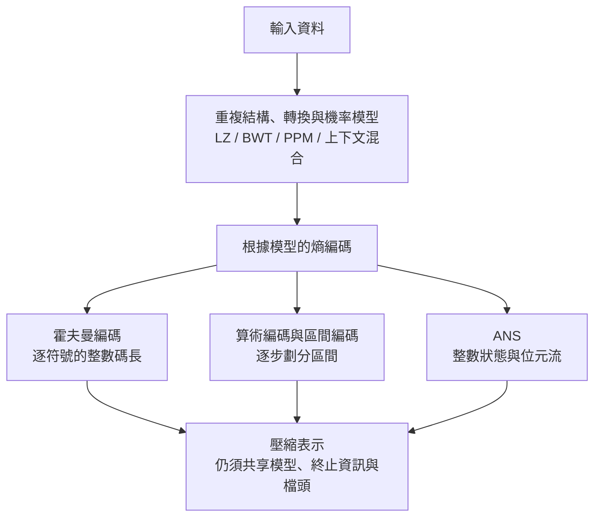
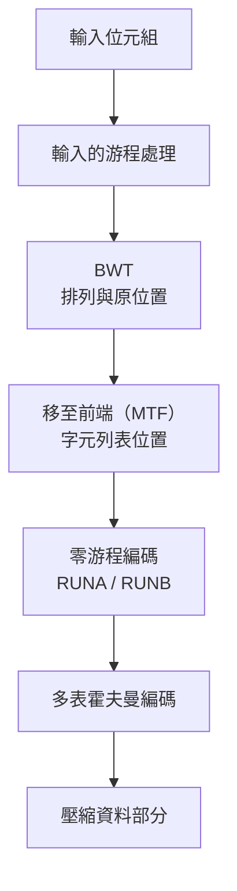

## 1. 為什麼沒有壓縮器能縮短所有檔案

無損壓縮把資料換成另一種表示，讓解碼後能逐位元還原原來的位元組序列。zip、gzip、zstd、xz等工具可以縮小某些輸入；另一些輸入幾乎不變，或因檔頭而變大。它們不能把所有資料都按同一比例縮小。JPEG、MP3等有損壓縮允許重建值有所差異，因此要求不同。

令{0,1}*為所有有限位元串的集合，固定編碼器E與解碼器D。無損性要求每個輸入x都滿足：

$$
D(E(x))=x
$$

若不同的x與y得到相同輸出，D就無法同時還原兩者，所以E必須是單射。恰好n位元的輸入有2^n種，但不足n位元的輸出即使包含空字串，也只有下列數量。這裡n≥1。

$$
\left|\{0,1\}^{n}\right|=2^n>
\sum_{k=0}^{n-1}2^k=2^n-1
$$

因此，固定的無損壓縮器不可能縮短全部n位元輸入。在所有有限字串上，單射也不能只縮短某些輸入，卻讓其他輸入都不變長。若把一個n位元的x縮短且不擴張任何輸入，那麼不足n位元的輸入已占滿全部不足n位元的輸出，E(x)就會與其中一個衝突。

更具體地說，固定E，從全部n位元串中均勻選取X，並取整數1≤c≤n。至少縮短c位元的比例有如下上界。這只是短輸出的候選數量，編碼器未必能用滿所有候選。

$$
\Pr\!\left(|E(X)|\le n-c\right)
\le\frac{2^{n-c+1}-1}{2^n}
<2^{1-c}
$$

c=11時，該比例小於1/1024，約為0.0977%。也可取c=100：在n≥100時，對固定E，比例小於2^(-99)，約為1.58×10^(-30)。但這不表示「其餘檔案無論換哪個壓縮器都無法縮短」。針對某個檔案x，可以另造一個交換x與空字串的編碼器：x變短，空字串變長，而解碼器必須知道這項特殊規則。討論柯爾莫哥洛夫複雜度時，也要固定描述語言，並區分解碼程式的描述長度。

日常壓縮利用符合資料分布或重複結構的表示，例如字元偏倚、重複子字串、數值規律。效果會隨輸入與方法而變，不能斷言已壓縮檔案或密文絕不可能再少一個位元組。密碼演算法、模式、詮釋資料與殘留結構都會影響條件。

單位也要區分：1 MiB是1,048,576位元組、8,388,608位元；十進位1 MB是1,000,000位元組、8,000,000位元。

## 2. 香農熵與平均碼長的界限

香農在1948年的論文中，把語義價值與通訊的工程問題分開，以機率研究資訊源。[重印版](https://wucj.lab.westlake.edu.cn/Others/shannon1948.pdf)的開頭也提到Nyquist與Hartley的前期工作。

對機率為正的事件x，自資訊量定義如下。以2為對數底時，單位為位元。這並非直接衡量心理驚訝或內容的重要性。

$$
I(x)=-\log_2P(x),\qquad 0<P(x)\le1
$$

對有限字母表上的隨機變數X，令p_i=P(X=x_i)。香農熵是自資訊量的期望值，並約定零機率項0log₂0=0。

$$
H(X)=-\sum_{i=1}^{m}p_i\log_2p_i,\qquad
p_i\ge0,\quad\sum_i p_i=1,\quad
0\le H(X)\le\log_2m
$$

單位為位元/符號。固定m種符號時，均勻分布使熵最大；只有一種符號的機率為1時，熵為0。公平硬幣一次結果的自資訊量是1位元，機率1/256的事件則為8位元。這是在評估符號模型，不能直接用來決定相依序列的資訊量或單一檔案的下界。

### 前綴碼與Kraft–McMillan不等式

為每個符號分配二進位碼字，並要求串接後仍能唯一解碼。任何碼字都不是另一碼字開頭的碼稱為前綴碼。例如{0,10,110,111}可把100110111分成10 | 0 | 110 | 111。ASCII本身是七位元字元編碼，不等於「把每個字元都表示成八位元」。

把長度為ℓ_i的碼字表示成二元樹的葉節點。在最大深度為ℓ_max的完全樹中，這個葉節點會占用下方2^(ℓ_max−ℓ_i)個潛在位置。計算互不重疊子樹的占用數量，就得到Kraft不等式。可唯一解碼的碼也滿足相同不等式。

$$
\sum_i2^{\ell_{\max}-\ell_i}\le2^{\ell_{\max}}
\quad\Longrightarrow\quad
Z:=\sum_i2^{-\ell_i}\le1
$$

反過來，滿足此不等式的正整數碼長可以構造出前綴碼。下文只考慮正機率符號的支撐集，並假設至少有兩種符號。單一符號資訊源能否使用空碼字，須連同數量與終止資訊的共享方式另行約定。

### 用KL散度證明下界

平均碼長，以及由碼長導出的正規化分布Q定義如下。

$$
L=\sum_i p_i\ell_i,\qquad
q_i=\frac{2^{-\ell_i}}{Z},\qquad \sum_i q_i=1
$$

利用KL散度非負性，可得下列恆等式。非負性可由ln u≤u−1等對數不等式推出。

$$
\begin{aligned}
0\le D_{\mathrm{KL}}(P\|Q)
&=\sum_i p_i\log_2\frac{p_i}{q_i}\\
&=-H(X)+\sum_i p_i\ell_i+\log_2Z\\
&=L-H(X)+\log_2Z
\end{aligned}
$$

因此，平均碼長滿足：

$$
L=H(X)+D_{\mathrm{KL}}(P\|Q)-\log_2Z\ge H(X)
$$

Q中的2^(-ℓ_i)除以了Z。不能取消正規化後，又把−log₂Z重複計入。等號要求P=Q且Z=1，此時p_i=2^(-ℓ_i)，機率恰好與二進位碼長匹配。

也可以構造上界。下列香農碼長滿足Kraft不等式：

$$
\ell_i=\lceil-\log_2p_i\rceil,\qquad
2^{-\ell_i}\le p_i,\qquad
\sum_i2^{-\ell_i}\le1
$$

向上取整對每個符號增加的長度不到1，因此這個碼的平均長度小於H+1。最優二進位前綴碼的平均長度L_opt也落在下列範圍。

$$
H(X)\le L_{\mathrm{opt}}<H(X)+1
$$

對非退化、獨立同分布的符號資訊源，把N個符號組成一個區塊並選擇適當的區塊前綴碼，可得下式。L_N表示整個區塊的平均長度。

$$
H(X)\le\frac{L_N}{N}<H(X)+\frac1N
$$

存在相依性時，一般有H(X_1,...,X_N)≠NH(X_1)。例如只選取一次公平位元，並在已知長度N內重複：每個位置的邊際熵為1位元，但整個序列的聯合熵只有1位元。對平穩的有限字母表資訊源，使用熵率：

$$
\overline H=\lim_{N\to\infty}\frac{H(X_1,\ldots,X_N)}{N}
$$

這些都是在指定分布與編碼類別下討論平均值，不表示每個檔案都不能短於該值，也不表示可以忽略模型與檔頭的成本。

## 3. 霍夫曼編碼、算術編碼與ANS

把統計模型與「根據機率產生位元」的編碼器分開，有助於理解各方法的作用。下圖是概念圖，並非要求所有格式都按這些階段分離的規範。

### 霍夫曼編碼：在哪個範圍內最優？

[霍夫曼1952年的論文](https://compression.ru/download/articles/huff/huffman_1952_minimum-redundancy-codes.pdf)討論給定權重下，使平均碼長最小的前綴碼。二進位情形反覆合併權重最小的兩個節點，再把權重之和放回集合。使用堆積可在O(m log m)時間內構造m個符號的樹。

至少有兩個正權重時，最優樹可移除只有一個子節點的不必要分支。把最小的兩個權重放在最深處的一對兄弟葉節點上，不會增加平均碼長。將它們合成符號z，原樹T與較小的樹T′之間滿足：

$$
L(T)=L(T')+p_a+p_b
$$

差值固定，因此較小問題的最優解能構造原問題的解。權重相同時可能有多棵最優樹。正準霍夫曼碼根據碼長與符號順序決定碼字，可簡化樹的傳輸，但不會消除碼表成本，也不保證所有長碼字只需查表一次。

若P(0)=0.99、P(1)=0.01，最優逐符號二進位前綴碼對兩種符號都使用1位元。

$$
H(X)=-0.99\log_2(0.99)-0.01\log_2(0.01)
\approx0.080793,\qquad L_{\mathrm H}=1
$$

平均碼長約為熵的12.4倍，但不一定表示原檔案不能變小。原表示每個符號占8位元，或已經按1位元打包，兩者的比較不同。分塊可減少取整損失，但明確涵蓋全部m^k種組合的樹會迅速增大。單一符號的空碼字仍須依前文的數量共享約定另行討論。

### 算術編碼：區間與有限位元串

算術編碼逐步縮小訊息對應的區間。令P(s)為符號機率，A(s)為小於s的符號之機率總和，初始區間為[lo_0,hi_0)=[0,1)。假設實際編碼符號的機率為正。使用寬度W_(t−1)=hi_(t−1)−lo_(t−1)，更新如下：

$$
\begin{aligned}
\mathrm{lo}_t&=\mathrm{lo}_{t-1}+W_{t-1}A(x_t),\\
\mathrm{hi}_t&=\mathrm{lo}_{t-1}+W_{t-1}\bigl(A(x_t)+P(x_t)\bigr)
\end{aligned}
$$

固定獨立模型的最終寬度等於下式的第一個乘積。存在相依性時，只要雙方能逐步重現條件機率，同樣的想法就能使用條件機率的乘積。

$$
W_N=\prod_{t=1}^{N}P(x_t)
\quad\text{or}\quad
W_N=\prod_{t=1}^{N}P(x_t\mid x_{<t})
$$

相同已知長度N的不同訊息會映射到互不重疊的區間。選取一個完全包含在最終區間內的二進位小區間[j2^(-K),(j+1)2^(-K))，便可用其K位來標識區間。讓格點間距不大於區間寬度的一半，在理想無限精度運算下，可選擇下列足夠的長度：

$$
K=\lceil-\log_2W_N\rceil+1<-\log_2W_N+2
$$

這是模型與長度已知時，理想酬載的上界，不表示最短K必然等於該式，更不保證整個檔案只增加兩位元。模型、終止、精度與檔頭都有額外成本。若使用真實區塊分布P，對應前綴表示的平均長度滿足：

$$
H(P)\le\mathbb E_P[K]<H(P)+2
$$

P(0)=0.99時，約連續69個0使區間寬度減半。但並非每讀69個符號就必須立即輸出一位；輸出時機取決於區間與重新正規化。整數實作會輸出已確定的高位元或位元組，並擴展狀態，還須處理機率量化、進位及待定位元。算術編碼或區間編碼相對其他編碼器的速度，沒有固定通用的倍率。

### ANS：在整數狀態中累積資訊

[Duda的ANS論文](https://arxiv.org/html/1311.2540v2)構造適用於不同機率符號的記數系統。普通b進位追加數字s的操作可逆：

$$
x'=bx+s,\qquad s=x'\bmod b,\qquad x=\lfloor x'/b\rfloor
$$

等機率且正狀態x足夠大時，對數大小約增加log₂b。一般機率下，讓狀態大約擴大為1/P(s)倍。不要在x=0處使用log₂x，也不要把近似增長量當成精確的整數碼長。

rANS的一種構造使用M=2^R、正整數頻數f_s與累積頻數b_s。

$$
\sum_s f_s=M,\qquad b_s=\sum_{a<s}f_a,\qquad P(s)\approx f_s/M
$$

它把非負整數狀態x與符號s映射為：

$$
C(x,s)=M\left\lfloor\frac{x}{f_s}\right\rfloor+(x\bmod f_s)+b_s
$$

逆操作根據slot選取符號，並還原舊狀態。

$$
\begin{aligned}
\mathrm{slot}&=x'\bmod M,\\
b_s&\le\mathrm{slot}<b_s+f_s,\\
x&=f_s\left\lfloor\frac{x'}M\right\rfloor+\mathrm{slot}-b_s
\end{aligned}
$$

M為2的冪次時，對M求商與餘數可用移位及遮罩完成。不過符號查找、記憶體存取、重新正規化與輸入輸出仍有成本。此雙射本身既不保證壓縮損失為零，也不保證單時脈週期解碼。

tANS使用有限狀態與轉移表。以逐位元操作為例，可使用下列整數集合。它對應半開區間[L,2L)，而不是[L,2L−1)。

$$
\mathcal I=\{L,L+1,\ldots,2L-1\},\qquad |\mathcal I|=L
$$

在狀態與位元流之間傳遞位元，讓狀態保持在允許範圍內。重新正規化的條件與符號配置必須互相配合，並非把rANS公式換成一張小表就完成了。FSE屬於tANS系列實作。

ANS狀態操作類似堆疊，最後加入的符號先還原。可以反向編碼一個區塊，讓解碼依原順序進行。上下文機率的計算順序也必須與反向編碼協調。霍夫曼、算術編碼與ANS應依模型、格式和實作選用，不是後一代在所有用途上都取代前一代。

## 4. LZ、BWT與上下文模型改變了什麼？

只看單一位元組頻數的模型，無法充分利用長重複與相依關係。不要為英語規定普遍必然的位元數，而應說明語料，以及單位是字元、位元組或詞元。

### 字典壓縮：LZ77、LZ78與LZW

LZ77系列用後向參照指向已輸出的資料。若16位元組的ASCII字串`std::vector<int>`曾出現在200位元組之前，此時再次匹配，可以用下列距離、長度二元組表示。是否比16個原始位元組更省，取決於格式如何編碼這些數值。

$$
(d,\ell)=(200,16)
$$

匹配長度也可以超過距離。一個字面值A後接距離1、長度99的參照，會將剛複製的A繼續當作來源，總共產生100個A。[DEFLATE規範](https://www.rfc-editor.org/rfc/rfc1951.txt)也有重疊參照的例子。對重疊區域直接使用通用memcpy，或只複製最初來源區域的快照，都不能正確描述這種增長。實作必須檢查距離、輸出上限及輸入長度，同時處理向前增長的輸出。

LZSS用旗標等方式區分字面值與參照，但旗標也占空間，不能保證沒有匹配的資料絕不膨脹。LZ78/LZW則把出現過的字串登錄在明確的字典裡，使用索引。字典成長、重設、參照範圍與整數編碼不同，並非某一種方法對所有輸入都較好。

實際格式也須區分。DEFLATE壓縮區塊使用距離1至32,768、長度3至258的參照，分別對字面值/長度與距離進行霍夫曼編碼，也有未壓縮區塊。[Zstandard規範](https://www.rfc-editor.org/rfc/rfc8878.html)把字面值與序列分開：字面值可用原始、RLE、霍夫曼等表示，序列可用FSE等模式。1條或4條霍夫曼流與序列的3類FSE狀態是不同的事。LZMA/LZMA2也結合字典與機率模型；[LZMA編碼器](https://github.com/ip7z/7zip/blob/main/C/LzmaEnc.c)呈現匹配搜尋與區間編碼的處理。不要用一個演算法名稱代替所有格式、工具和級別。

### BWT：保留長度的排列與逆轉換

Burrows–Wheeler轉換把具有相同後繼上下文的字元聚到附近。末欄本身保留符號數量，但逆轉換所需的位置或終止符資訊也有成本。

以加入唯一且最小終止符`$`的`banana$`為例。把7種循環位移按字典順序排列，取出末欄與原字串所在的列號。

| 列號 | 按字典順序排列的循環位移 | 首欄 | 末欄 |
| :--- | :--- | :---: | :---: |
| 0 | `$banana` | `$` | a |
| 1 | `a$banan` | a | n |
| 2 | `ana$ban` | a | n |
| 3 | `anana$b` | a | b |
| 4 | `banana$` | b | `$` |
| 5 | `na$bana` | n | a |
| 6 | `nana$ba` | n | a |

輸出為`annb$aa`，原列號從0計為4。令末欄為L、首欄為F，把L的字元排序即可得到F。將相同字元的出現順序對應起來，形成LF映射，便能反向走訪原序列。採0起始編號，C(c)表示小於c的字元總數，rank_c(i)表示L中位置i之前出現c的次數，則：

$$
\mathrm{LF}(i)=C(L_i)+\mathrm{rank}_{L_i}(i)
$$

對小型固定字母表，頻數與出現次序可在線性時間內建立，N個符號的逆轉換為O(N)。若使用一般比較排序，還須另外計算排序成本。BWT不保證把所有輸入都變成長游程。

[bzip2 1.0.8手冊](https://sourceware.org/bzip2/manual/manual.html)與[該版本原始碼](https://sourceware.org/pub/bzip2/bzip2-1.0.8.tar.gz)結合BWT之前的RLE、MTF、零游程編碼及多個霍夫曼表。MTF輸出字元目前在列表中的位置，再把該字元移到前端。相同字元連續出現會產生連續的0，再用RUNA/RUNB編碼。下圖表示主要資料轉換，省略檔頭、索引與CRC。

### 上下文模型與LLM：碼長和預測損失

PPM使用不同長度的上下文，並以跳脫等機制處理未觀測符號。上下文混合結合多個模型的預測。神經網路也能作為預測器，但Transformer不等同於循環神經網路。

當模型Q_θ對序列分配正的條件機率時，理想資訊量如下。不要將它直接等同於實際輸出長度。

$$
I_\theta(x_{1:N})=-\log_2 Q_\theta(x_{1:N})
=\sum_{t=1}^{N}-\log_2Q_\theta(x_t\mid x_{<t})
$$

若使用自然對數計算該序列的平均負對數概似，對數底與平均因子給出下列關係：

$$
\mathcal L_{\mathrm{NLL}}(\theta)
=-\frac1N\sum_{t=1}^{N}\ln Q_\theta(x_t\mid x_{<t})
=\frac{\ln2}{N}I_\theta(x_{1:N})
$$

因此，在相同資料、單位與模型條件下，降低此損失對應於縮短理想碼長。但式中不含共享模型大小、詞元化的可逆性、有限精度、終止、檔頭與解碼時間。一次預測的資訊量少於1位元，不表示能把這個詞單獨存成小數位元的檔案。

[Language Modeling Is Compression](https://arxiv.org/html/2309.10668v2)以實驗研究這項聯繫。其影像、音訊比較使用加工後的資料及指定的上下文長度，並區分不計模型權重與計入權重的壓縮率。不能直接推廣為對所有影像、音訊或任意檔案的優劣判斷。Hutter Prize等壓縮任務促進預測研究，但編碼公式本身並未證明智慧或理解的充分條件。

## 5. 如何比較壓縮率、速度與記憶體

實際評估要同時考慮壓縮後大小、編碼時間、解碼時間、記憶體、相容性與存取粒度。這裡把壓縮率定義為「壓縮後大小/原大小」，越小越好。混用不同條件的測試數字，無法得到普遍的排名。

| 方法或工具 | 結構特點 | 比較時檢查的條件 |
| :--- | :--- | :--- |
| LZ4 | 位元組導向的LZ77型表示，區塊內沒有熵編碼 | 小輸入的訊框成本、解碼速度、所需緩衝區 |
| Zstandard | 字典匹配、字面值與序列、霍夫曼/FSE等模式 | 級別、字典、視窗、各模式及雙方記憶體 |
| DEFLATE / gzip | 後向參照與霍夫曼，也可選未壓縮區塊 | 格式與工具的區別、相容性、區塊與包裝成本 |
| BWT / bzip2 | 區塊轉換、MTF、游程與霍夫曼 | 區塊大小、重建工作區與索引 |
| LZMA/LZMA2 / xz、7-Zip | 字典匹配與適應性機率編碼 | 格式與設定、字典大小、搜尋時間、解碼器限制 |
| PPM、上下文混合、神經預測 | 根據上下文產生機率再編碼 | 模型共享或傳輸、上下文長度、計算量與精度重現 |

[LZ4區塊規範](https://github.com/lz4/lz4/blob/dev/doc/lz4_Block_format.md)把訊框格式分開處理，[7-Zip格式說明](https://www.7-zip.org/7z.html)也區分多種方法。理解結構特點與測量實際負載，兩者都需要。

測量時記錄實作與版本、命令和級別、CPU與執行緒數、輸入檔案的雜湊值及大小、字典、快取與I/O條件。用總輸入位元組數U、壓縮後總位元組數C及耗時，計算C/U與吞吐量；空輸入應與此比值的定義分開。記憶體不僅包含字典，還須計入輸入輸出緩衝區與模型。也要確認解碼後位元組的雜湊值與原檔案一致。這裡不宣稱重新測量過吞吐速度。

### 編碼、解碼負載與I/O

LZ系列的解碼可能比編碼器的搜尋與解析更輕，但相同格式內的壓縮級別及實際命令也會改變解碼速度。不能保證高級別的解碼速度始終完全相同。預測模型的解碼端也須重現機率，但編碼端可能批次計算機率，因此兩端時間不必精確相等。

在簡單讀取模型中，I/O速度為v_io，以原始位元組計的解碼速度為v_dec。若CPU與I/O不重疊，時間近似為：

$$
T_{\mathrm{raw}}\approx\frac{U}{v_{\mathrm{io}}},\qquad
T_{\mathrm{compressed}}\approx\frac{C}{v_{\mathrm{io}}}
+\frac{U}{v_{\mathrm{dec}}}
$$

這樣可比較減少的I/O時間與解碼成本。若資源獨立且管線充分並行，穩定階段的時間也可能接近兩項中較大者，而非兩項之和。啟動、記憶體頻寬、並行度與存取粒度不同，模型也應調整。

分支、相依性、快取、SIMD與指令層級並行都會影響速度，但不能據此斷言普遍的MB/s上限，也不能保證分流後分支預測失誤為零。只壓縮一次、由許多讀者解碼的軟體套件，與頻繁更新的日誌有不同優先順序。

## 6. 討論哪種界限，計入哪些成本？

鴿籠原理表明，固定的無損編碼器不能縮短全部輸入。熵下界討論指定機率模型與編碼條件下的平均長度。霍夫曼、算術編碼與ANS以不同方式連結機率及表示；LZ、BWT與上下文模型則利用重複及相依性。

預測損失與理想碼長的關係，有助於理解包含神經模型的壓縮。應把這項聯繫與檔案總成本、執行速度或智慧的證明分開，說明共享了什麼、傳輸了什麼、測量了哪些輸入，才能把理論與實際選擇連結起來。
