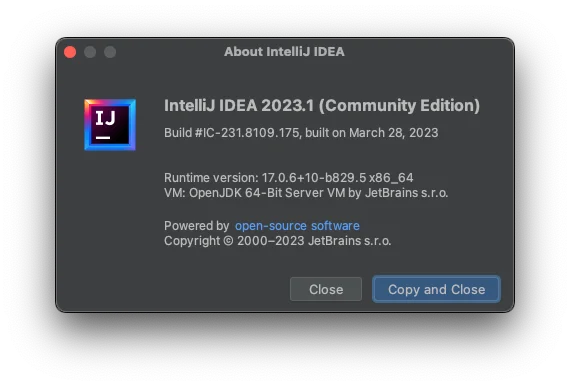

# Покупка Mac mini(2018)

Я купил подержанный Mac mini(2018) предыдущего поколения на Mercari. Характеристики следующие:

- Процессор: 3.2GHz 6-ядерный Intel Core i7
- Оперативная память: 32GB
- Накопитель: 1TB SSD

Цена составляет 77 000 иен.

# Причина покупки

- Я использую Mac mini с почти такими же характеристиками на работе для разработки мобильных приложений, и хотел создать среду разработки и дома (особенно среду выполнения Xcode).
- У меня есть MacBook Pro, но я купил его 9 лет назад, и он работает довольно медленно, поэтому я его почти не использую.
- Я хотел заниматься разработкой приложений для iOS в личных целях.

# Сразу же установил Xcode и IntelliJ IDEA

Версия Xcode — Version 14.3 (14E222b)

Версия IntelliJ IDEA — 2023.1

Ну что ж! Начнем разработку!

## Примечание о текущей совместимости

В статье описаны покупка и среда разработки по состоянию на 2 апреля 2023 года; это не актуальная рекомендация к покупке. На 24 ноября 2026 года Mac mini (2018) отсутствует в списке моделей, совместимых с macOS Tahoe 26. Xcode 27 работает только на Mac с Apple silicon; для Intel Mac требуется Xcode 26 или более ранняя версия. Перед покупкой подержанного компьютера или настройкой среды разработки проверьте поддерживаемые версии macOS и Xcode.

## Официальные источники

- [Mac mini (2018) 技術仕様](https://support.apple.com/111912)
- [macOS Tahoe compatibility](https://support.apple.com/122867)
- [Xcode system requirements](https://developer.apple.com/Xcode/system-requirements/)
- [Porting your macOS apps to Apple silicon](https://developer.apple.com/documentation/Apple-Silicon/porting-your-macOS-apps-to-Apple-silicon)
