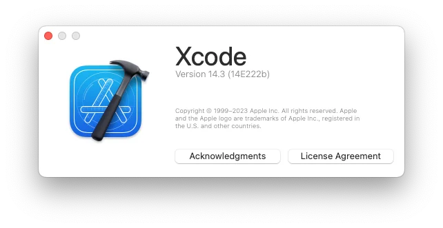

# 购买了Mac mini(2018)

在煤炉(Mercari)上购买了旧款二手Mac mini(2018)。配置如下。

- CPU: 3.2GHz 6核Intel Core i7
- 内存: 32GB
- 存储: 1TB SSD

价格为 ￥ 77,000

# 购买理由

- 在公司使用几乎相同配置的Mac mini进行智能手机应用开发，但也想在家里搭建开发环境（尤其是Xcode的运行环境）。
- 虽然有一台MacBook Pro，但是是9年前买的，运行相当慢，所以几乎没在用。
- 个人想要开发iOS应用。

# 马上安装了 Xcode 和 IntelliJ IDEA

Xcode版本为Version 14.3 (14E222b)

IntelliJ IDEA版本为2023.1

好！开始开发吧！

## 当前兼容性说明

本文记录的是2023年4月2日的购买和开发环境，并非当前购买建议。截至2026年11月24日，Mac mini (2018) 不在 macOS Tahoe 26 的兼容机型列表中。Xcode 27 仅可在 Apple 芯片 Mac 上运行；Intel Mac 需要使用 Xcode 26 或更早版本。购买二手设备或搭建开发环境前，请先确认 macOS 和 Xcode 的支持版本。

## 官方资料

- [Mac mini (2018) 技術仕様](https://support.apple.com/111912)
- [macOS Tahoe compatibility](https://support.apple.com/122867)
- [Xcode system requirements](https://developer.apple.com/Xcode/system-requirements/)
- [Porting your macOS apps to Apple silicon](https://developer.apple.com/documentation/Apple-Silicon/porting-your-macOS-apps-to-Apple-silicon)
