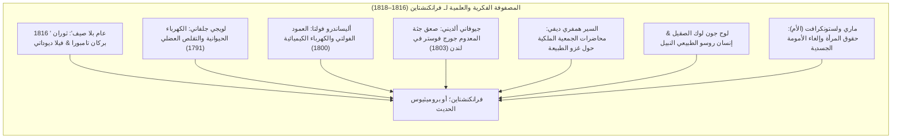
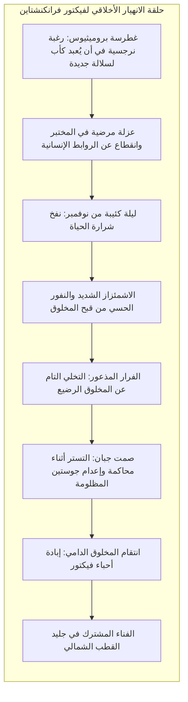

في ربيع عام 1818، نُشرت في لندن رواية مجهولة المؤلف بعنوان <strong>«فرانكنشتاين؛ أو بروميثيوس الحديث» (Frankenstein; or, The Modern Prometheus)</strong>، صاغتها كاتبة شابة في العشرين من عمرها: <strong>ماري ولستونكرافت شيلي (Mary Wollstonecraft Shelley, 1797–1851)</strong>. لم تكن هذه الرواية <strong>أول عمل حقيقي في أدب الخيال العلمي</strong> فحسب، بل شكّلت الميثاق الفلسفي الأول لعلم <strong>الأخلاقيات الحيوية الحديث (Bioethics)</strong>.

في الوعي الشعبي الشائع المشوه باقتباسات السينما التجارية، اختُزل اسم فرانكنشتاين خطأً في صورة الوحش الأبكم ذي المسامير المغروسة في عنقه. لكن في النص الأصلي، فرانكنشتاين هو اسم الصانع: <strong>فيكتور فرانكنشتاين</strong>، طالب الفلسفة الطبيعية السويسري الذي كشف سر دفق الحياة، وجمع أشلاء الموتى من المشافي والمقابر، ثم فرّ مذعوراً أمام هول التبعات الأخلاقية لعمله لحظة استيقاظ الكائن.

طرحت ماري شيلي السؤال المصيري لعصر الحداثة: <strong>حين تمنح المعرفة العلمية الإنسان القدرة على خلق الحياة من العدم، ما هي المسؤولية الأخلاقية والأبوية والمجتمعية التي يدين بها الخالق لمخلوقه؟</strong>

---

## 1. نشأة ديوداتي: 1816 و«عام بلا صيف»

انبثقت الرواية من رحم كارثة مناخية كوكبية: ثوران بركان <strong>تامبورا</strong> بإندونيسيا عام 1815، الذي أدى إلى حجب أشعة الشمس وظهور <strong>«عام بلا صيف» (1816)</strong> في أوروبا، مخلفاً أمطاراً طوفانية ومجاعات مروعة.

اجتمع لورد بايرون، وطبيبه جون بوليدوري، والشاعر بيرسي بيش شيلي، والشابة ماري غودوين في <strong>فيلا ديوداتي</strong> بسويسرا. واقترح بايرون تسلية: *«سيكتب كل منا قصة أشباح»*. وبعد ليالٍ من النقاش حول الجلفانية وإمكانية بث الروح في الجثث، رأت ماري في كابوس يقظة مرعب:
> «رأيتُ طالب الفنون المحرمة الشاحب راكعاً بجانب الشيء الذي ركّبه. رأيتُ شبح رجل كريه مسجى، ثم بفعل محرك قوي، يُظهر علامات الحياة ويتحرك بحركات غير مريحة ونصف حية...»

---

## 2. المنطلقات العلمية: الجلفانية والتشريح

رفضت ماري شيلي الخرافات والأرواح، مؤسسة عملها على التجارب العلمية المعاصرة:
- <strong>جلفاني وفولتا:</strong> أثبتت تجارب الضفادع أن التيارات الكهربائية تحرك العضلات الميتة، مما عزز الاعتقاد بأن الكهرباء هي سر الحياة.
- <strong>تجارب ألديني (1803):</strong> صعق جثة المجرم المشنوق فوستر أمام أطباء لندن، حيث ارتعش الفك ورُفعت اليد، مثيراً رعب الحاضرين.
- <strong>همفري ديفي:</strong> بشّر بأن الكيمياء تمنح العلماء سلطة إلهية لترويض قوى الكون.

---

## 3. غطرسة فيكتور والإهمال الأبوي الفادح

لم تكن خطيئة فيكتور في اكتشاف سر الحياة، بل في <strong>إنكاره الجبان لمسؤوليته الأخلاقية والأبوية تجاه وليده</strong>:

حين رأى عينيه الصفراوين وبشرته المتقبضة، استبد به الاشمئزاز، ففرّ هارباً وترك المخلوق — الذي يملك قوة عملاق ولكن عقل رضيع — يواجه العالم وحيداً بلا اسم ولا رعاية.

---

## 4. مأساة المخلوق: من الفطرة الخيرة إلى هاوية الشر

استيقظ المخلوق كـ <strong>لوح صقيل عند لوك</strong> و<strong>الإنسان الفطري النبيل عند روسو</strong>؛ يرعى الطيور ويتغذى على الثمار. تعلّم اللغة بمراقبة أسرة دي ليسي، وقرأ *آلام فرتر* لغوته، و*سير العظماء* لبلوتارخ، و*الفردوس المفقود* لميلتون.

صرخ المخلوق في وجه صانعه متألماً:
> «تذكّر: كان ينبغي أن أكون آدمك؛ لكني صرتُ إبليسك الساقط الذي حرمتَه من السعادة دون ذنب اقترفتُه!»

وعندما هاجمه البشر وأطلقوا عليه النار لمجرد قبح مظهره، تحولت براءته إلى غضب مدمر: *«كنتُ خيّراً ومحباً؛ لكن البؤس جعل مني شيطاناً»*.

---

## 5. دروس للذكاء الاصطناعي وتعديل الجينات

تعد الرواية نبوءة ساطعة لتحديات التكنولوجيا الراهنة:

| نص شيلي (1818) | الواقع التكنولوجي المعاصر |
|---|---|
| <strong>تجميع الأعضاء وتخليق الحياة</strong> | تعديل الجينات بتقنية كريسبر والبيولوجيا التخليقية |
| <strong>قوة جسدية وعقلية خارقة</strong> | الذكاء الاصطناعي العام (AGI) فائق القدرة |
| <strong>تنصل الصانع من المسؤولية</strong> | <strong>مشكلة المحاذاة (Alignment Problem)</strong> وفقدان السيطرة |
| <strong>تمرد المخلوق ومواجهته المميتة</strong> | المخاطر الوجودية الناجمة عن نظم ذكية بلا إطار أخلاقي |

تحذير ماري شيلي هو درس خالد: <strong>من يجرؤ على إشعال شرارة الخلق، يجب أن يتحلى بالشجاعة الأخلاقية لتحمل مسؤولية ما خلقه إلى الأبد.</strong>
