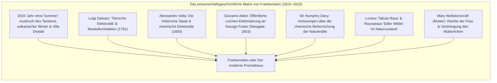
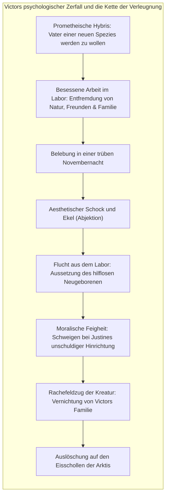

Im Frühjahr 1818 veröffentlichte die damals erst zwanzigjährige britische Schriftstellerin <strong>Mary Wollstonecraft Shelley (1797–1851)</strong> anonym ihren bahnbrechenden dreibändigen Roman <strong>Frankenstein; or, The Modern Prometheus</strong> (*Frankenstein oder Der moderne Prometheus*). Dieses Werk markiert nicht nur den historischen Ursprung der modernen Science-Fiction, sondern formuliert das ethische Fundament der <strong>zeitgenössischen Bioethik</strong>.

In der Populärkultur wurde der Name „Frankenstein“ im Laufe eines Jahrhunderts filmischer Verkürzungen fälschlicherweise auf das stöhnende, bolzenhalsige Ungeheuer übertragen. Doch in Shelleys Originaltext ist Frankenstein nicht die Kreatur, sondern der ehrgeizige Genfer Naturphilosoph <strong>Victor Frankenstein</strong>, der das Mysterium der Lebenszeugung entschlüsselt, die Grenze zwischen Tod und Dasein niederreißt, um im Moment des Erfolgs entsetzt vor den moralischen Konsequenzen seiner Tat zu fliehen.

An der Schwelle zwischen aufklärerischem Fortschrittsoptimismus und romantischer Skepsis stellte Mary Shelley die Kardinalfrage der Moderne: <strong>Welche unveräußerliche moralische, elterliche und soziale Verantwortung erwächst dem Menschen, wenn er sich anmaßt, durch Technologie neues Leben ex nihilo zu erschaffen?</strong>

---

## 1. Die Diodati-Genese: 1816 und das „Jahr ohne Sommer“

Die Entstehung des Romans ist untrennbar mit einer globalen Klimakatastrophe verbunden. Im April 1815 explodierte der Vulkan <strong>Tambora</strong> im heutigen Indonesien in einer der verheerendsten Eruptionen der Menschheitsgeschichte. Die in die Stratosphäre geschleuderten Aerosole verdunkelten die Atmosphäre und führten zum <strong>„Jahr ohne Sommer“ (1816)</strong> mit Dauerregen, Kälteeinbrüchen und Hungersnöten in Europa.

Am Genfer See versammelten sich in der <strong>Villa Diodati</strong> Lord Byron, sein Arzt John Polidori, Percy Bysshe Shelley und die junge Mary Wollstonecraft Godwin. Vom Unwetter im Haus gefangen, lasen sie deutsche Geistergeschichten (*Fantasmagoriana*). Byron schlug vor: *„Jeder von uns soll eine Gespenstergeschichte schreiben.“* Aus dieser Wette entstanden Polidoris *Der Vampyr* und Mary Shelleys *Frankenstein*, inspiriert von einem nächtlichen Wachalbtraum:

> „Ich sah den bleichen Schüler unheiliger Künste neben dem Ding knien, das er zusammengefügt hatte. Ich sah das schreckliche Phantom eines Mannes daliegen, das auf das Ingangsetzen einer gewaltigen Maschine Lebenszeichen von sich gab und sich mit unruhigen, halblebendigen Bewegungen regte...“

---

## 2. Wissenschaftshistorischer Kontext: Galvanismus und quantitative Chemie

Im Gegensatz zu den Schauerromanen des 18. Jahrhunderts verzichtet Shelley auf Geister und Zauberei. Das Schöpfungsmotiv gründet streng auf der damaligen empirischen Spitzenforschung:
- <strong>Galvani und Volta:</strong> Die Entdeckung, dass elektrische Impulse Muskelkontraktionen toter Organismen auslösen, nährte die Überzeugung, Elektrizität sei der immaterielle Lebensfunke (*Vital Force*).
- <strong>Aldinis Newgate-Experimente (1803):</strong> Giovanni Aldini elektrisierte die frische Leiche des gehängten George Foster; Kiefer bebten, ein Auge öffnete sich, der Arm hob sich drohend empor. Dies war keine Fiktion, sondern zeitgenössische Realität.
- <strong>Sir Humphry Davy:</strong> Die Verheißung, dass Chemiker „der Natur ihre verborgensten Geheimnisse entreißen und wie Gottheiten schöpferisch wirken können“, trieb Victor in den wissenschaftlichen Wahn.

---

## 3. Victors Hybris und elterliche Pflichtvergessenheit

Victors fundamentales Vergehen besteht nicht im Wissensdrang, sondern in der <strong>sofortigen und vollständigen Verleugnung jeglicher Fürsorgepflicht gegenüber seinem Geschöpf</strong>.

Sobald die Kreatur die trüben gelben Augen aufschlägt, erfährt Victor eine fundamentale <strong>Abjektion (viszeraler Ekel)</strong>. Anstatt dem Neugeborenen einen Namen, Sprache und Fürsorge zu schenken, flieht er in panischem Entsetzen. Die Kreatur, mit dem Körper eines 2,40 Meter großen Riesen, aber der Psyche eines Säuglings, wird nackt und verlassen in eine feindselige Welt gestoßen.

---

## 4. Die Tragödie des Geschöpfs: Lockes Tabula Rasa und Rousseaus Naturzustand

Die Kreatur beginnt ihre Existenz im Zustand von <strong>John Lockes Tabula Rasa</strong> und <strong>Rousseaus edlem Wilden</strong>: von Natur aus wohlwollend, mitfühlend und vegetarisch lebend.
- Durch geheime Beobachtung der Familie De Lacey lernt sie sprechen und empfindet familiäre Liebe.
- Sie findet drei Bücher, die ihr Bewusstsein formen: Goethes *Werther* (existenzielle Innerlichkeit), Plutarchs *Lebensbeschreibungen* (Bürgertugend) und Miltons *Verlorenes Paradies* (Metaphysik).

Aus Miltons Epos begreift die Kreatur ihre entsetzliche Lage:
> „Erinnere dich: Ich sollte dein Adam sein; doch ich bin vielmehr dein gefallener Engel, den du ohne jede Schuld aus aller Seligkeit verstoßen hast!“

Als die Menschen die Kreatur allein aufgrund ihrer Hässlichkeit zusammenschlagen und auf sie schießen, schlägt ihre Liebe in vernichtenden Hass um: *„Ich war gut und voller Liebe; das Elend hat mich zum Dämon gemacht.“*

---

## 5. Relevanz für moderne Bioethik und KI-Forschung

Die dreifache Rahmenhandlung um Kapitän Walton warnt vor dem Verfall menschlicher Bindungen durch blinden Forschungsdrang. Heute steht die Menschheit an derselben Schwelle:

| Viktorianische Fiktion | Moderne technologische Realität |
|---|---|
| <strong>Schöpfung aus Leichenteilen</strong> | Synthetische Biologie & CRISPR-Cas9-Keimbahneingriffe |
| <strong>Übermenschliche Physis</strong> | Autonome AGI-Agenten mit unermesslicher Intelligenz |
| <strong>Verstoßung des Geschöpfs</strong> | <strong>Alignment-Problem</strong>: Verfehlen moralischer Wertekorridore |
| <strong>Rache der Schöpfung</strong> | Unkontrollierbare existentielle Risiken für die Menschheit |

Mary Shelleys Vermächtnis fordert gebieterisch: <strong>Wer die Macht besitzt, denkendes oder biologisches Leben zu entfachen, muss den unbedingten Willen haben, lebenslang die volle ethische Verantwortung dafür zu tragen.</strong>
