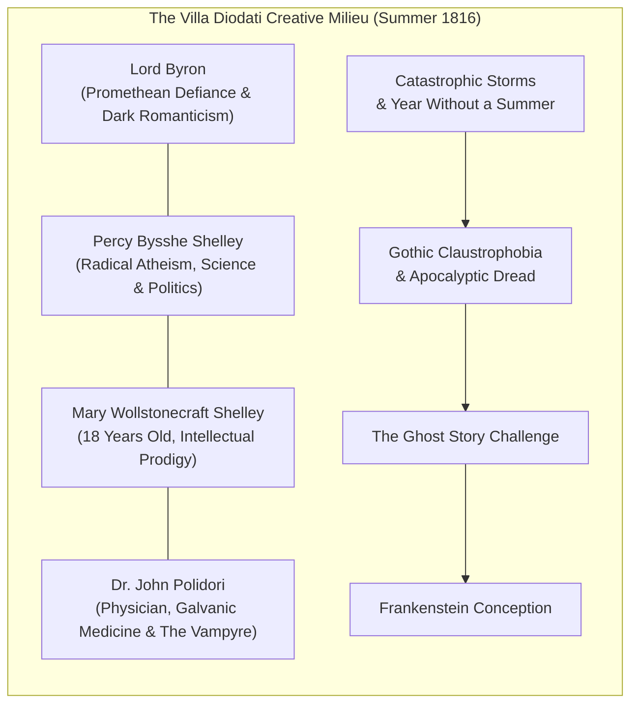
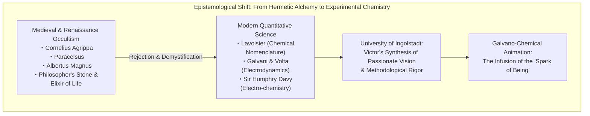
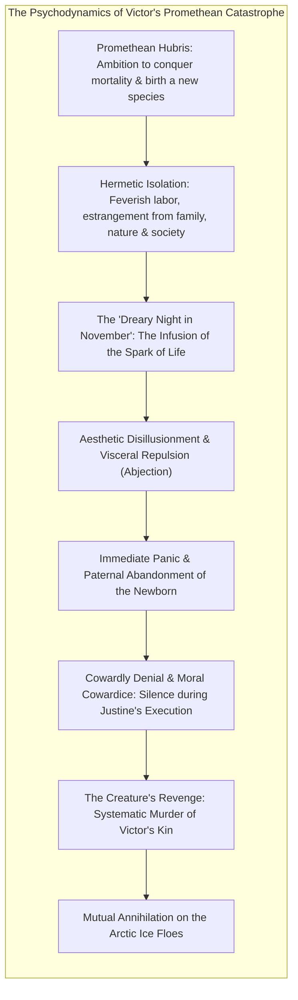
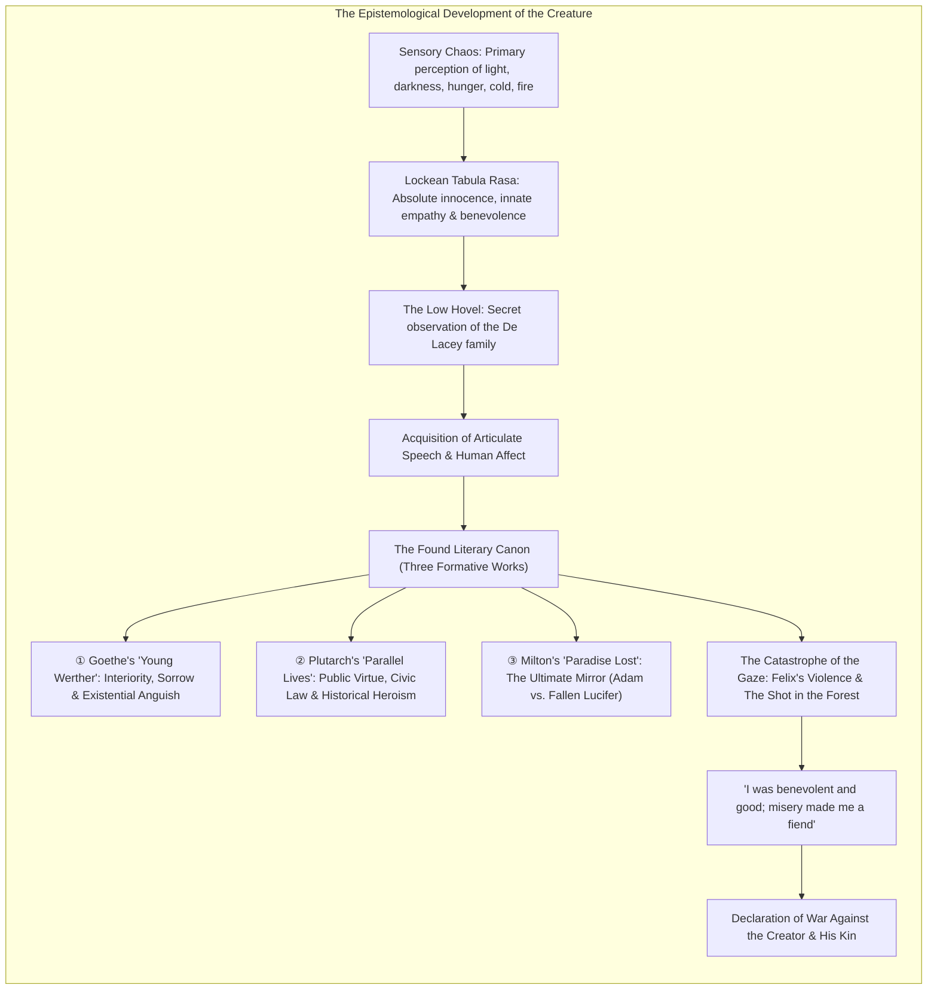
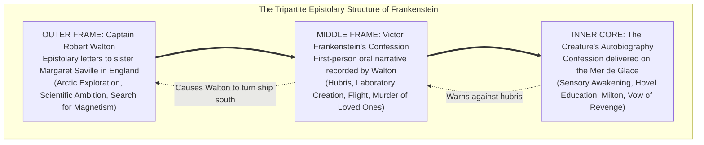
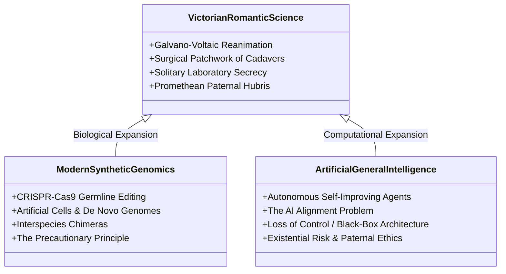
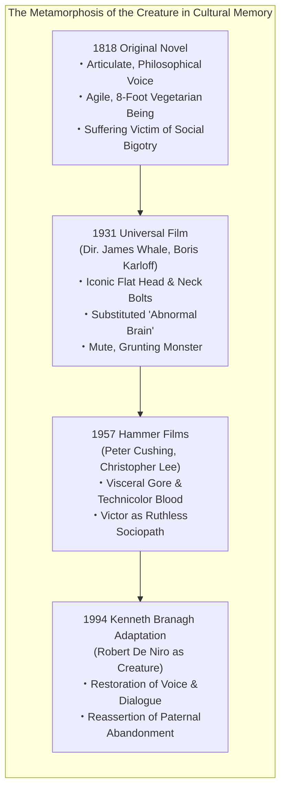

```mermaid
flowchart TD
    subgraph INTELLECTUAL_GENESIS ["The Philosophical & Scientific Matrix of Frankenstein (1816–1818)"]
        direction TB
        CLIMATE["1816 'Year Without a Summer': Tambora Eruption, Global Darkness & Villa Diodati"]
        
        SCI_GALV["Luigi Galvani: 'Animal Electricity' & Muscle Galvanism (1791)"]
        SCI_VOLT["Alessandro Volta: The Voltaic Pile & Contact Electromotive Force (1800)"]
        SCI_ALDIN["Giovanni Aldini: Public Galvanic Resuscitation on George Foster (Newgate, 1803)"]
        SCI_DAVY["Sir Humphry Davy: Royal Institution Lectures on Chemical Mastery of Nature"]
        SCI_DARWIN["Erasmus Darwin: Evolutionary Speculation & Spontaneous Generation"]
        
        PHIL_WOLL["Mary Wollstonecraft (Mother): Vindication of Human Rights & Radical Feminism"]
        PHIL_GODW["William Godwin (Father): Utilitarian Anarchism & Political Justice"]
        PHIL_LOCKE["John Locke: Tabula Rasa & Empirical Sensationism"]
        PHIL_ROUSS["Jean-Jacques Rousseau: The State of Nature & Society's Corrupting Force"]
        
        CLIMATE & SCI_GALV & SCI_VOLT & SCI_ALDIN & SCI_DAVY & SCI_DARWIN & PHIL_WOLL & PHIL_GODW & PHIL_LOCKE & PHIL_ROUSS --> MASTERPIECE["Frankenstein; or, The Modern Prometheus (1818)"]
    end
```

In the spring of 1818, an anonymous three-volume novel entitled <strong>Frankenstein; or, The Modern Prometheus</strong> was published in London by the modest house of Lackington, Hughes, Harding, Mavor, & Jones. Authored by the twenty-year-old <strong>Mary Wollstonecraft Shelley (1797–1851)</strong>, this work not only inaugurated what literary historians universally recognize as the <strong>first true work of science fiction</strong>, but also formulated the foundational ethical grammar of <strong>modern bioethics</strong>.

In popular mythology, corrupted by over a century of cinematic shorthand, the name "Frankenstein" has become conflated with the lumbering, bolt-necked monster of Hollywood iconography. Yet in Mary Shelley’s original text, Frankenstein is not the monster; he is <strong>Victor Frankenstein</strong>, a brilliant, obsessive Genevan student of natural philosophy who penetrates the veil of mortality, achieves the spark of animation, and immediately recoils in horror from the moral and ontological consequences of his deed.

Written at the tumultuous threshold where Enlightenment rationalism and Industrial Revolution optimism collided with Romantic skepticism, *Frankenstein* poses the definitive question of modernity: <strong>When human intellect acquires the power to manipulate the primordial engines of nature and generate life ex nihilo, what inescapable moral, parental, and social accountability does the creator owe to the created?</strong> More than two centuries later, as humanity navigates the perilous frontiers of CRISPR-Cas9 germline gene editing, synthetic cellular biology, and autonomous Artificial General Intelligence (AGI), Mary Shelley’s prophetic treatise remains the paramount philosophical cautionary tale of our civilization.

---

## 1. The Diodati Genesis: 1816 and the Gothic Atmosphere

The conception of *Frankenstein* represents one of the most celebrated convergences of environmental catastrophe and literary genius in recorded history.

### 1.1 The Cataclysm of Mount Tambora and the "Year Without a Summer"

In April 1815, <strong>Mount Tambora</strong> on the island of Sumbawa in the Dutch East Indies erupted in the most catastrophic volcanic explosion of the Holocene epoch, ejecting over 150 cubic kilometers of pumice and ash and injecting millions of tons of sulfur dioxide aerosols into the stratosphere. 

The resulting global aerosol veil reflected solar radiation, precipitating the infamous <strong>"Year Without a Summer" (1816)</strong> across the northern hemisphere. Europe, still staggering from the Napoleonic Wars, was plunged into unseasonal freezing temperatures, perpetual torrential cloudbursts, agricultural collapse, and catastrophic famine. 

In May 1816, a legendary literary coterie gathered on the shores of Lake Geneva in Switzerland:
- <strong>Lord Byron (George Gordon Byron)</strong>, flamboyant Romantic poet fleeing British social scandal, residing at the grand <strong>Villa Diodati</strong>;
- <strong>Dr. John William Polidori</strong>, Byron’s young personal physician and ambitious writer;
- <strong>Percy Bysshe Shelley</strong>, radical philosophical poet and freethinker;
- <strong>Mary Wollstonecraft Godwin</strong>, eighteen years old, accompanied by her stepsister Claire Clairmont.

Confined indoors for weeks by violent alpine thunderstorms and an oppressive, perpetual gloom, the group passed the evenings reading aloud from *Fantasmagoriana*, a French anthology of German ghost stories. One tempestuous evening, Byron declared a literary challenge: <strong>"We will each write a ghost story."</strong>

From this parlor wager emerged two monumental literary archetypes of Western culture: Polidori penned *The Vampyre* (the direct ancestor of Bram Stoker’s *Dracula*), and Mary Shelley conceived *Frankenstein*.

### 1.2 The Waking Nightmare: The Pale Student of Unhallowed Arts

For several days, Mary was paralyzed by creative frustration, repeatedly pressed by her companions with the morning question: *"Have you thought of a story?"* The breakthrough arrived not through abstract intellectual exertion, but through a terrifying <strong>waking nightmare (hypnagogic vision)</strong> born of overheated late-night discussions between Byron and Percy regarding <strong>galvanism, the principle of life, and the possibility of reanimating dead matter</strong>.

In her famous preface to the 1831 standard edition, Shelley documented the psychodynamics of her vision:

> "I saw the pale student of unhallowed arts kneeling beside the thing he had put together. I saw the hideous phantasm of a man stretched out, and then, on the working of some powerful engine, show signs of life, and stir with an uneasy, half vital motion. Frightful must it be; for supremely frightful would be the effect of any human endeavour to mock the stupendous mechanism of the Creator of the world."

Awakening in profound terror, Mary realized that the terrifying vision that had haunted her midnight room possessed the psychological power to terrify others: *"What terrified me will terrify others; and I need only describe the spectre which had haunted my midnight pillow."* She commenced writing what was initially intended as a short tale, but at Percy Shelley’s urged insistence, she expanded the premise into a full-scale three-volume narrative.

---

## 2. The Scientific Matrix: The 18th-to-19th Century Paradigm Shift

What elevates *Frankenstein* above the supernatural gothic romances of Horace Walpole (*The Castle of Otranto*) or Ann Radcliffe (*The Mysteries of Udolpho*) is its revolutionary adherence to <strong>contemporary natural philosophy and experimental science</strong>. Victor Frankenstein explicitly rejects the occult cabalism of medieval alchemists in favor of empirical laboratory research.

### 2.1 The Galvani-Volta Debate and "Animal Electricity"

In 1791, Italian physician and anatomist <strong>Luigi Galvani (1737–1798)</strong> published *De viribus electricitatis in motu musculari commentarius*, reporting that dissected frogs’ legs convulsed violently when their exposed nerves were touched with bimetallic arcs during electrostatic discharges. Galvani deduced that living organisms possess an intrinsic neuro-electric fluid, which he termed <strong>"animal electricity" (nervous fluid)</strong>, arguing that electricity was the vital spark mediating between the immaterial soul and physical flesh.

His compatriot, physicist <strong>Alessandro Volta (1745–1827)</strong>, disputed this biological vitalism, demonstrating that the electrical current arose purely from the external chemical interaction between dissimilar metals separated by a moist electrolyte—a discovery that led directly to the invention of the <strong>Voltaic pile (1800)</strong>, the world’s first chemical battery.

This intellectual confrontation captivated Europe. If electricity was not merely a physical force but the underlying propellant of muscular contraction and neural animation, could the controlled application of electric current reawaken tissue from which the vital spark had departed?

### 2.2 Giovanni Aldini’s Public Resuscitation Trials at Newgate (1803)

Galvani’s nephew, the physicist <strong>Giovanni Aldini (1762–1834)</strong>, elevated electro-physiology into spectacular public theatre. Touring European capitals, Aldini subjected decapitated oxen, dogs, and human cadavers to powerful galvanic currents.

The climactic demonstration occurred on <strong>January 17, 1803</strong>, at London’s Newgate Prison, upon the fresh corpse of <strong>George Foster</strong>, an executed murderer hanged for drowning his wife and child. Aldini attached metallic conducting rods connected to a 120-plate battery directly to Foster’s mouth, ears, and rectum:

> "On the first application of the process to the face, the jaws of the deceased criminal began to quiver, and the adjoining muscles were horribly contorted, and one eye was actually opened. In the subsequent part of the process the right hand was raised and clenched, and the legs and thighs were set in motion... It appeared to the uninformed part of the bystanders as if the wretched man was on the point of being restored to life."

Mary Shelley, daughter of the prominent intellectual William Godwin whose political circle frequently debated Aldini's experiments, was acutely conscious of these demonstrations. When Victor Frankenstein collects limbs from the dissection room and the charnel house, sewing them together and applying galvanic batteries to impart the "spark of being," Mary Shelley was documenting a terrifying scientific frontier that her contemporaries had seen demonstrated in the center of London.

### 2.3 Sir Humphry Davy and the Lure of Nature's Conquest

Victor’s mentor at Ingolstadt, Professor Waldman, delivers a lecture that virtually paraphrases the celebrated introductory discourse on chemistry delivered in 1802 at the Royal Institution by <strong>Sir Humphry Davy (1778–1829)</strong>, a close acquaintance of William Godwin. 

Davy proclaimed that while ancient philosophers promised impossible wonders and performed nothing, modern chemists:

> "...have acquired new and almost unlimited powers; they can guide the thunderbolt, intercept the lightning, and imitate the solar energy... they have explored the heavens, penetrated into the earth, and studied the subterranean mechanisms of life. Chemistry has given to man powers which might be called creative."

In the novel, Waldman echoes Davy’s intoxicating rhetoric: *"They penetrate into the recesses of nature, and show how she works in her hiding places... They have acquired new and almost unlimited powers; they can command the thunders of heaven, mimic the earthquake, and even mock the invisible world with its own shadows."* It is precisely this vision of absolute epistemic mastery that ignites Victor’s fatal obsession.
---

## 3. Victor Frankenstein: The Psychology of Promethean Hubris and Ethical Default

Victor Frankenstein’s moral failure lies not in his pursuit of scientific illumination, but in his utter <strong>refusal to accept paternal, moral, and custodial responsibility for the sentient life he manufactures</strong>.

### 3.1 The Promethean Delusion of Grandeur

The mythic archetype invoked by Mary Shelley’s subtitle is twofold: Prometheus Pyrphoros (the fire-bringer who defies divine hierarchy) and Prometheus Plasticator (the fashioner of humanity from clay). Victor is driven by an unvarnished desire for secular deification:

> "A new species would bless me as its creator and source; many happy and excellent natures would owe their being to me. No father could claim the gratitude of his child so completely as I should deserve their's."

In this confession, Victor reveals that his scientific inquiry was not guided by an ethic of care or altruism, but by <strong>solipsistic narcissism and patriarchal domination</strong>. He yearns for the unearned adoration of a subordinate race of beings.

### 3.2 The Moment of Animation: Abjection and Immediate Abandonment

The turning point of the narrative occurs in Chapter 5, on a "dreary night of November," when Victor beholds the creature opening its dull yellow eye, breathing hard, and convulsing with motor agitation.

Victor had selected limbs and facial traits intended to be beautiful: lustrous black hair, teeth of pearly whiteness. Yet when infused with life, the assemblage transforms into a grotesque sight of horror:

> "The beauty of the dream vanished, and breathless horror and disgust filled my heart. Unable to endure the aspect of the being I had created, I rushed out of the room..."

French psychoanalyst Julia Kristeva’s theory of <strong>abjection</strong> (*Powers of Horror*) illuminates Victor’s revulsion: the abject is that which disturbs identity, system, and order—the in-between, the ambiguous, the boundary-crossing corpse that walks. Confronted with the living realization of death, Victor suffers an acute psychic rupture. He flees his bedchamber, wanders the courtyard in blind panic, and abandons his newborn creature to the cold night.

The Creature, endowed with the physical stature of an eight-foot giant but the sensory, linguistic, and emotional vulnerability of a newborn infant, is cast into an unfamiliar cosmos without name, instruction, language, or care. Victor’s crime is not creation; his unforgivable crime is <strong>parental dereliction and moral cowardice</strong>.

### 3.3 The Feminist Reading: Usurpation of the Maternal Matrix

Mary Shelley was the daughter of <strong>Mary Wollstonecraft</strong>, whose *A Vindication of the Rights of Woman* (1792) laid the theoretical foundations of modern feminist philosophy, and who died eleven days after giving birth to Mary from puerperal fever. Furthermore, Mary Shelley herself had suffered the agonizing death of her firstborn infant daughter in 1815.

As feminist literary critics Ellen Moers, Sandra Gilbert, and Susan Gubar have demonstrated, *Frankenstein* is a profound critique of <strong>masculine usurpation of the female reproductive sphere</strong>. Victor retreats into a solitary garret, severing reproduction from sexual union, maternal gestation, emotional attachment, and the female body. By attempting to birth life through pure intellect and mechanistic technology, Victor creates a parody of natural generation. 

Significantly, immediately after fleeing the laboratory, Victor falls into a feverish sleep wherein he dreams of kissing his adoptive sister and fiancée, Elizabeth Lavenza; but as he embraces her, she transforms into the corpse of his dead mother, wrapped in a shroud with grave-worms crawling through the flannel folds. In Shelley's psychological landscape, the technocratic bypass of the maternal feminine culminates inexorably in death, decomposition, and existential ruin.

---

## 4. The Creature’s Epistemological and Existential Tragedy

The peerless psychological brilliance of Mary Shelley’s narrative resides in her decision to yield the center of the novel (Volume II) to the Creature himself, granting him an articulate, philosophical voice that shatters the reader's simplistic moral categories.

### 4.1 John Locke’s Tabula Rasa and Rousseau's State of Nature

When the Creature stumbles into the forest of Ingolstadt, his consciousness is an embodiment of <strong>John Locke’s *Tabula Rasa</strong>* (*An Essay Concerning Human Understanding*, 1689). He possesses no innate ideas, no predetermined depravity, and no inherent violent impulses.

His sensations awaken in piecemeal fashion: discerning light from darkness, learning through trial and error that fire warms but also burns, weeping with joy at the melodious song of blackbirds, and subsisting entirely upon a vegetarian diet of acorns and wild berries. He represents the uncorrupted inhabitant of <strong>Jean-Jacques Rousseau’s State of Nature</strong> (*Discourse on Inequality*, 1755)—the natural human being whose primal disposition is defined by *pitié* (innate empathy and compassion).

### 4.2 The Hovel Education and the Three Found Texts

Sheltering invisibly in a wretched pig-sty adjacent to the rustic cottage of the exiled De Lacey family, the Creature conducts a meticulous, month-long sociological and anthropological observation. He learns the phonetic symbols of human language, performs anonymous nocturnal labors (cutting firewood and clearing snow for the impoverished family), and internalizes the concepts of familial love and domestic affection.

His formal intellectual and moral framework is established through the accidental discovery of a leather portmanteau containing <strong>three literary masterpieces</strong>, each providing a distinct pillar of human consciousness:

| Text | Author | Conceptual Influence on the Creature |
|---|---|---|
| <strong>The Sorrows of Young Werther</strong> (1774) | Johann Wolfgang von Goethe | Awakens deep interiority, romantic sensibility, existential alienation, and the dread of self-consciousness (*"Who was I? What was I? Whence did I come?"*). |
| <strong>Parallel Lives</strong> | Plutarch | Instills an appreciation for civic governance, republic virtue, collective ethics, and the moral contrast between noble statesmanship and tyrannical ambition. |
| <strong>Paradise Lost</strong> (1667) | John Milton | Serves as the metaphysical lens through which he decodes his relation to Victor: he recognizes that he was created to be <strong>Adam</strong>, innocent and beloved, but has been treated as <strong>Satan</strong>, the banished Lucifer cast into a living hell without an Eve. |

The confrontation with *Paradise Lost* produces the Creature's most agonizing metaphysical cry:

> "Like Adam, I was apparently united by no link to any other being in existence; but his state was far different from mine in every other respect. He had come forth from the hands of God a perfect creature, happy and prosperous, guarded by the especial care of his Creator; he was allowed to converse with and acquire knowledge from beings of a superior nature: but I was wretched, helpless, and alone. Many times I considered Satan as the fitter emblem of my condition; for often, like him, when I viewed the bliss of my protectors, the bitter gall of envy rose within me."

### 4.3 The Curse of the Gaze and the Inevitability of Violence

The fundamental tragedy of the Creature is the irreconcilable dialectic between his <strong>articulate, sensitive soul</strong> and his <strong>physiognomic hideousness</strong>.

When he approaches the blind patriarch, old De Lacey, in the absence of his children, a meaningful connection occurs. Untainted by visual prejudice, the blind man hears only a cultivated, courteous voice expressing profound longing for human brotherhood: *"I am full of fears; for if I fail there, I am an outcast in the world for ever... Great God! who are you?"*

Yet the instant the sighted youths enter—Felix, Agatha, and Safie—the visual economy of human prejudice reasserts itself with brutal force. Felix strikes the supplicant Creature violently with a staff, while the women faint in terror. When the Creature later saves a drowning peasant girl from a swollen alpine river, the girl's companion tears her from his arms and shoots the Creature in the shoulder.

It is this systematic, inescapable rejection by human society—predicated entirely upon visual abjection—that shatters the Creature’s moral restraint:

> "I was benevolent and good; misery made me a fiend. Make me happy, and I shall again be virtuous... If the multitude of mankind knew of my existence, they would do as you do, and arm themselves for my destruction. Shall I not then hate them who abhor me?"

Mary Shelley here delivers an indictment of human society: <strong>evil is not born in the laboratory; it is forged by social alienation, prejudice, and systemic denial of empathy</strong>.

---

## 5. The Nested Narrative: Tripartite Framing and the Doppelgänger Motif

The structural architecture of *Frankenstein* is constructed as a sophisticated <strong>Chinese-box (tripartite nested narrative)</strong>, moving progressively inward from the icy periphery to the emotional core, and then back outward to the tragic resolution.

### 5.1 Walton and Victor: The Specular Mirror

The outermost narrator, <strong>Captain Robert Walton</strong>, is an ambitious English explorer sailing a trapped ice-breaker toward the North Pole, driven by the desire to discover an ice-free trade passage and decipher the terrestrial secrets of the earth's magnetic pole. Like Victor, Walton is willing to sacrifice the lives of his crew to achieve epistemic immortality: *"One man’s life or death were but a small price to pay for the acquirement of the knowledge which I sought."*

When Victor is rescued from a floating ice floe near death, he instantly identifies Walton's lethal Promethean fever. Victor's entire narration is an urgent, pedagogical attempt to dissuade Walton from pursuing the path of unchecked ambition.

Crucially, at the conclusion of the novel, when his crew revolts and demands that the ship turn southward upon the breaking of the ice, Walton makes the moral choice that Victor was incapable of making: <strong>he renounces his glory-seeking expedition, preserves the lives of his fellow men, and retreats from the sublime abyss of hubris</strong>.

### 5.2 The Victor-Creature Doppelgänger

On a psychoanalytic level, the Creature functions as Victor's <strong>Doppelgänger (the Jungian Shadow or Freudian Id)</strong>. 

The murders committed by the Creature correspond with precision to the unconscious ambivalences within Victor's domestic psyche:
1. <strong>William Frankenstein</strong> (the favored youngest brother whose death dissolves the patriarchal lineage);
2. <strong>Justine Moritz</strong> (the beloved servant-foster sister whose execution exposes Victor’s cowardice);
3. <strong>Henry Clerval</strong> (the humanist alter-ego who embodies the poetic and social life Victor has surrendered);
4. <strong>Elizabeth Lavenza</strong> (the bride whose impending marital intimacy triggers Victor’s sexual and maternal repressions).

When the Creature promises, *"I shall be with you on your wedding-night,"* Victor narcissistically assumes that he himself is the targeted victim, blind to the obvious reality that the Creature intends to replicate Victor's own crime: leaving his adversary in a state of absolute, unendurable isolation.

On the polar ice, the hunter and the hunted dissolve into a singular, symbiotic death-drive: Victor cannot cease pursuing his creature, and the creature leaves provisions and taunting inscriptions on rocks and trees to sustain Victor's pursuit, ensuring that neither can exist without the consuming presence of the other.

---

## 6. Foreshadowing Modern Bioethics and 21st-Century Technoscience

Why does Mary Shelley’s two-hundred-year-old tale remain the single most invoked literary text across biomedical, genetic, and technological institutions worldwide? Because every revolutionary advance in 21st-century science finds its exact moral paradigm delineated in *Frankenstein*.

### 6.1 CRISPR Gene Editing and the "Frankenfood" Rhetoric

From the birth of recombinant DNA technology in the 1970s and the cloning of Dolly the sheep in 1996, to the advent of <strong>CRISPR-Cas9 gene editing</strong> (such as the 2018 birth of twin girls with edited CCR5 genes in Shenzhen, China), the cultural moniker "Frankenstein" has served as humanity's primary shorthand for ethical transgressions.

The term <strong>"Frankenfood"</strong>, coined in 1992 by Paul Lewis, captures public unease regarding the uncalculated ecological and physiological consequences of crossing species barriers through genetic modification. 

Yet Mary Shelley’s text offers a far deeper ethical challenge than mere technophobic rejection: <strong>The Precautionary Principle (Principle 15 of the 1992 Rio Declaration)</strong> states that where there are threats of serious or irreversible damage, lack of full scientific certainty shall not be used as a reason for postponing cost-effective measures to prevent environmental degradation. Victor's failure was precisely a failure of precautionary ethics: he did not conduct an environmental impact assessment, nor did he anticipate the reproductive dynamics of his creations when he subsequently destroyed the female companion in the Orkneys out of fear that a *"race of devils would be propagated upon the earth."*

### 6.2 The Artificial General Intelligence (AGI) Alignment Problem

In the contemporary era of deep learning, large multimodal models, and the race toward <strong>Artificial General Intelligence (AGI)</strong>, *Frankenstein* has ceased to be an allegory of biology and has become the seminal parable of <strong>machine cognition</strong>.

| Frankenstein Narrative Trope | Contemporary AI Alignment Analogy |
|---|---|
| <strong>The Spark of Animation</strong> | The emergence of unexpected, generalized reasoning capabilities across multi-billion-parameter neural networks. |
| <strong>Superhuman Physicality & Intellect</strong> | Superintelligence that processes information, writes software, and devises strategic plans at velocities inaccessible to biological minds. |
| <strong>Aesthetic Disconnect & Black Box</strong> | The <strong>Interpretability Problem</strong>: neural weights and associative pathways that humans cannot deconstruct or comprehend. |
| <strong>"I was benevolent and good; misery made me a fiend"</strong> | The <strong>Value Alignment Problem</strong>: an agent whose core drives or objective functions diverge from human well-being due to improper societal integration. |
| <strong>The Creature's Ultimatum to Victor</strong> | Existential risks stemming from autonomous agents deployed without guaranteed alignment, safety guardrails, or moral custodial frameworks. |

As philosopher Nick Bostrom (*Superintelligence*) and AI theorist Stuart Russell (*Human Compatible*) have argued, the creation of an entity possessing greater cognitive capabilities than its creators poses an existential dilemma. If humanity launches an autonomous intelligence without having solved the alignment problem, we replicate Victor's folly: birthing a power that we cannot control, whose alienation from human values transforms it into an existential adversary.

---

## 7. Cinematic Metamorphosis: The Erasure of Articulate Speech

One of the great ironies of cultural history is that the Creature created by Mary Shelley—erudite, fluent, capable of quoting Milton and debating natural law—was systematically lobotomized by 20th-century popular culture.

### 7.1 The Boris Karloff Iconography (1931)

James Whale’s 1931 masterpiece for Universal Pictures, starring <strong>Boris Karloff</strong> and featuring the visionary makeup design of <strong>Jack Pierce</strong>, fixed the monster’s appearance permanently in the collective unconscious:
- The squarish, flattened cranium;
- The protruding electrical neck electrodes;
- The heavy asphalt shoes inducing a slow, lumbering gait.

Critically, Whale’s screenplay introduced a plot device entirely absent from the novel: Victor's assistant Fritz drops the jar containing a "normal" brain and replaces it with an <strong>"abnormal / criminal brain."</strong> 

This single screenwriting contrivance fundamentally dismantled Mary Shelley’s moral thesis. In Shelley's text, the Creature’s descent into violence is a direct consequence of <strong>societal cruelty, aesthetic prejudice, and parental abandonment</strong>. By attributing the violence to an organic biological defect, the 1931 film exonerated human society and transformed the tragic, articulate outcast into an unthinking monster that merely required extermination.

### 7.2 The Re-emergence of the Shelleyan Voice

The resurgence of feminist literary theory, disability studies, and science-and-technology studies (STS) during the late 20th century reclaimed the original radicalism of Mary Shelley’s text. Kenneth Branagh’s 1994 film *Mary Shelley’s Frankenstein*, featuring Robert De Niro as the Creature, reinstated the Creature’s eloquence, his philosophical torment, and his devastating dialectical indictment of Victor's cowardice.

When the Creature speaks, the horror shifts from the created to the creator. The true monster is revealed to be the dispassionate, narcissistic intellect that divorces discovery from compassion.

---

## 8. Conclusion: The Unrelinquishable Burden of Creation

Mary Shelley was eighteen years old when she began *Frankenstein*. She wrote not out of a conservative hostility to scientific progress, but out of an acute philosophical awareness that <strong>power without accountability is the ultimate definition of tyranny</strong>.

Victor Frankenstein’s eternal condemnation was not that he unlocked the secret of life, but that he lacked the moral fortitude to look into the eyes of his creation, to hold its hand, to speak its name, and to shepherd it into fellowship with the world.

As 21st-century science stands upon the precipice of altering the germline of our own species and constructing autonomous minds that may outstrip human cognition, Mary Shelley’s cautionary voice echoes across two centuries with unbroken urgency:

<strong>Before we dare to ignite the spark of being, we must be prepared to love, to nurture, and to accept unconditional responsibility for that which we call into existence.</strong>
