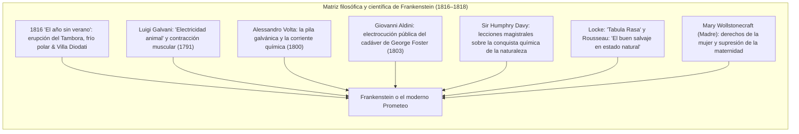
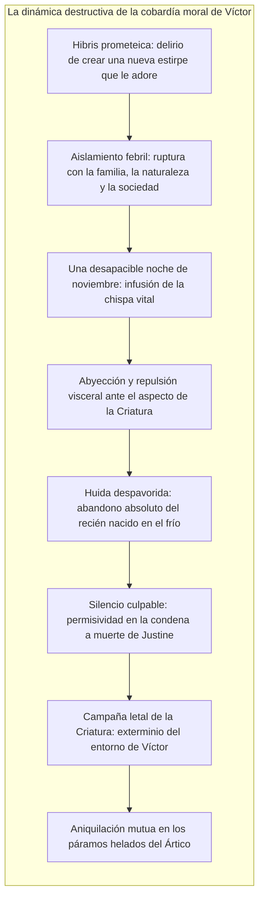

En la primavera de 1818 se publicó en Londres una novela anónima en tres volúmenes titulada <strong>Frankenstein; or, The Modern Prometheus</strong> (*Frankenstein o el moderno Prometeo*), escrita por una joven de apenas veinte años: <strong>Mary Wollstonecraft Shelley (1797–1851)</strong>. Aclamada unánimemente como la <strong>primera gran novela de ciencia ficción de la historia</strong>, esta obra fundacional constituye a la vez el primer tratado sobre las trampas morales de la <strong>bioética contemporánea</strong>.

En el imaginario popular, degradado por adaptaciones cinematográficas reduccionistas, el nombre de Frankenstein suele asociarse al monstruo torpe de pernos en el cuello. Sin embargo, en la novela original, Frankenstein no es la criatura, sino el científico: <strong>Víctor Frankenstein</strong>, un joven suizo que descubre el principio generador de la vida, anima un cuerpo formado por despojos de cementerios y huye despavorido ante las consecuencias morales de su hazaña.

En los albores de la Revolución Industrial, Mary Shelley planteó la pregunta nodal de nuestra época: <strong>Cuando la ciencia dota al ser humano del poder de crear vida de la nada, ¿cuál es la responsabilidad moral ineludible que el creador contrae con su criatura y con la sociedad?</strong>

---

## 1. La génesis de Diodati: 1816 y el «año sin verano»

El nacimiento de la novela está vinculado a una catástrofe planetaria: la colosal explosión del volcán <strong>Tambora</strong> en 1815, cuyas cenizas oscurecieron los cielos europeos dando lugar al <strong>«año sin verano» (1816)</strong>. En la <strong>Villa Diodati</strong>, junto al lago de Ginebra, se reunieron Lord Byron, John Polidori, Percy Bysshe Shelley y la joven Mary Godwin. Encerrados por tormentas implacables, Byron propuso: *«Cada uno de nosotros escribirá una historia de aparecidos»*.

Tras varias noches de conversaciones sobre galvanismo y el hálito vital, Mary tuvo una aterradora pesadilla lúcida:
> «Vi al pálido estudiante de artes impías arrodillado junto a la cosa que había ensamblado. Vi el horrible fantasma de un hombre yacer tendido, y luego, por obra de algún potente motor, dar muestras de vida y agitarse con un movimiento penoso y a medias vivo...»

---

## 2. Marco científico: galvanismo y química moderna

La obra se desmarca del gótico sobrenatural al sustentarse en la vanguardia empírica de su tiempo:
- <strong>Galvani y Volta:</strong> El descubrimiento de que las corrientes eléctricas provocaban espasmos en ranas muertas popularizó la noción de la electricidad como el principio vital primordial.
- <strong>Aldini en Newgate (1803):</strong> La reanimación experimental del ahorcado George Foster ante médicos londinenses demostró la posibilidad de provocar convulsiones faciales y movimientos corporales en cadáveres frescos.
- <strong>Humphry Davy:</strong> Proclamaba que los químicos modernos tenían el poder de imitar las fuerzas del Creador y desentrañar las intimidades de la naturaleza.

---

## 3. La hibris de Víctor y la deserción paternal

El pecado imperdonable de Víctor Frankenstein no es haber alcanzado el saber, sino <strong>haber renegado cobardemente de su deber de cuidado y amor hacia el ser engendrado</strong>:

Dominado por la <strong>abyección</strong>, Víctor huye del laboratorio ante los ojos acuosos y la piel tirante de su creación. El ser, con la corpulencia de un gigante de dos metros y medio pero con la extrema vulnerabilidad de un recién nacido, queda abandonado a su suerte en un mundo hostil.

---

## 4. La Criatura: de la inocencia natural a la rebelión luciferina

La Criatura despierta como la <strong>tabula rasa de John Locke</strong> y el <strong>hombre bondadoso en estado de naturaleza de Rousseau</strong>: se alimenta de frutos silvestres, ama el trino de las aves y ansía el afecto humano. Escondido en una choza, aprende el idioma observando a los De Lacey y devora tres libros capitales: *Werther* de Goethe (la angustia existencial), las *Vidas paralelas* de Plutarco (la virtud pública) y *El paraíso perdido* de Milton.

Es en Milton donde encuentra la formulación trágica de su existencia:
> «Acuérdate de que yo debería ser tu Adán; pero soy más bien el ángel caído a quien privas de toda dicha sin que haya pecado alguno».

Tras ser golpeado y tiroteado simplemente por su fealdad física, su innata generosidad se transfigura en cólera vengativa: *«Yo era bueno y afectuoso; la desdicha me ha convertido en un demonio»*.

---

## 5. Lecciones para la bioética y la inteligencia artificial

El dilema de Frankenstein adquiere hoy una vigencia absoluta:

| La novela de 1818 | El escenario tecnológico actual |
|---|---|
| <strong>Ensamblaje cadavérico</strong> | Edición genética CRISPR, clonación y biología sintética |
| <strong>Fuerza e inteligencia sobrehumanas</strong> | Inteligencia Artificial General (AGI) y agentes autónomos |
| <strong>Abandono y falta de control</strong> | <strong>Problema de alineamiento</strong> y modelos de caja negra |
| <strong>Rebelión contra el artífice</strong> | Amenazas existenciales derivadas de tecnologías sin gobernanza |

El legado de Mary Shelley es perentorio: <strong>Nadie tiene derecho a encender la chispa de la creación si carece del coraje moral para cuidar, amar y responsabilizarse del destino de lo creado.</strong>
