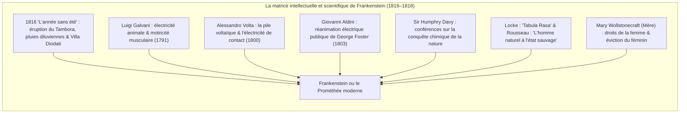
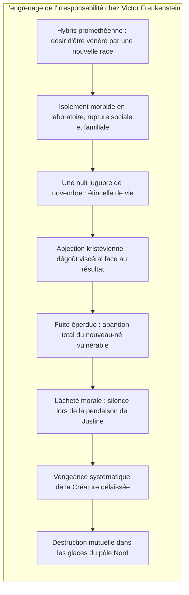

Au printemps 1818 paraissait anonymement à Londres un roman en trois volumes intitulé <strong>Frankenstein; or, The Modern Prometheus</strong> (*Frankenstein ou le Prométhée moderne*), écrit par une jeune femme de vingt ans, <strong>Mary Wollstonecraft Shelley (1797–1851)</strong>. Considéré par la critique mondiale comme le <strong>premier véritable chef-d'œuvre de science-fiction</strong>, ce texte séminal constitue également la première grande charte philosophique de la <strong>bioéthique contemporaine</strong>.

Dans l'imaginaire populaire corrompu par le cinéma hollywoodien, Frankenstein est souvent assimilé au monstre muet aux coutures grossières. Or, dans le texte de Mary Shelley, Frankenstein est le nom du créateur : <strong>Victor Frankenstein</strong>, un jeune savant genevois exalté qui perce les mystères de la vitalité, assemble des fragments de cadavres, et s'enfuit avec effroi au moment même où s'éveille la créature qu'il a enfantée.

À la croisée du rationalisme des Lumières et de l'inquiétude romantique, Mary Shelley posa la question capitale du monde moderne : <strong>Lorsque le savoir scientifique confère à l'homme le pouvoir quasi divin d'animer la matière inerte, quelle dette morale, éducative et ontologique lie le savant à son œuvre ?</strong>

---

## 1. La genèse de Diodati : 1816 et « l'année sans été »

L'origine du roman s'enracine dans le cataclysme de l'éruption du volcan <strong>Tambora</strong> en 1815, dont les cendres plongèrent l'hémisphère nord dans <strong>« l'année sans été » (1816)</strong>. Confinés au bord du lac Léman dans la <strong>Villa Diodati</strong>, Lord Byron, John Polidori, Percy Bysshe Shelley et Mary Godwin affrontèrent l'ennui en lisant des contes de revenants. Byron lança le défi : *« Nous allons chacun écrire une histoire de fantômes. »*

Hantée par les discussions nocturnes sur le galvanisme, Mary connut une vision terrifiante :
> « Je vis l'étudiant blême des arts sacrilèges s'agenouiller auprès de la chose qu'il avait assemblée. Je vis le fantôme hideux d'un homme étendu, puis, sous l'action d'une puissante machine, manifester des signes de vie et remuer d'un mouvement malaisé, à demi vivant... »

---

## 2. Piliers scientifiques : galvanisme et dissection

L'œuvre puise son réalisme dans les recherches d'avant-garde de l'époque :
- <strong>Galvani et Volta :</strong> Les secousses des membres de grenouilles disséquées conduisirent à l'idée que le fluide électrique constituait l'essence même du souffle vital.
- <strong>Aldini à Newgate (1803) :</strong> L'électrisation publique du cadavre du criminel George Foster provoqua des contorsions faciales et l'élévation d'un bras, terrifiant le public londonien.
- <strong>Sir Humphry Davy :</strong> Ses leçons à la Royal Institution promettaient que la chimie moderne donnerait aux hommes des pouvoirs créateurs comparables à ceux des dieux.

---

## 3. L'hybris de Victor et l'abandon parental

Le véritable crime de Victor n'est pas d'avoir assemblé des tissus inertes, mais d'avoir <strong>immédiatement renié et abandonné son enfant monstrueux</strong> :

Frappé d'<strong>abjection</strong> à la vue des yeux jaunâtres et de la chair étirée de sa création, Victor fuit le laboratoire. La créature, douée de la force d'un colosse de huit pieds mais possédant la fragilité sensorielle d'un nouveau-né, est rejetée sans nom, sans langage et sans tendresse.

---

## 4. La Créature : de la bonté naturelle à la désolation métaphysique

La Créature s'éveille dans l'état de la <strong>tabula rasa de Locke</strong> et de <strong>l'homme à l'état de nature de Rousseau</strong> : innocente, végétarienne et avide d'amour. En épiant la famille De Lacey, elle apprend à parler et dévore trois livres fondamentaux : *Werther* de Goethe (l'intériorité douloureuse), les *Vies parallèles* de Plutarque (la vertu civique) et *Le Paradis perdu* de Milton.

Face à Milton, la Créature formule sa révolte déchirante :
> « Souviens-toi que je devrais être ton Adam ; or je suis plutôt l'ange déchu que tu as banni de toute félicité sans que j'aie commis de faute ! »

Rejetée violemment à coups de fusil par des humains terrifiés par sa laideur, elle bascule dans la violence : *« J'étais bon et bienveillant ; le malheur a fait de moi un démon. »*

---

## 5. Portée bioéthique et intelligence artificielle

Le destin tragique de Frankenstein résonne avec une acuité brûlante au XXIe siècle :

| Récit de Shelley | Enjeux contemporains |
|---|---|
| <strong>Création d'un être patchwork</strong> | CRISPR-Cas9, bébés sur mesure et génomique synthétique |
| <strong>Capacités surhumaines</strong> | Intelligence Artificielle Générale (AGI) surpuissante |
| <strong>Fuite devant l'œuvre</strong> | <strong>Problème de l'alignement</strong> des valeurs et opacité de la boîte noire |
| <strong>Révolte destructrice</strong> | Risques existentiels liés à la perte de contrôle technologique |

Mary Shelley avertit la modernité : <strong>Nul ne peut allumer le feu de la création sans assumer jusqu'au bout la garde, l'éducation et la responsabilité morale de ce qu'il a appelé à la vie.</strong>
