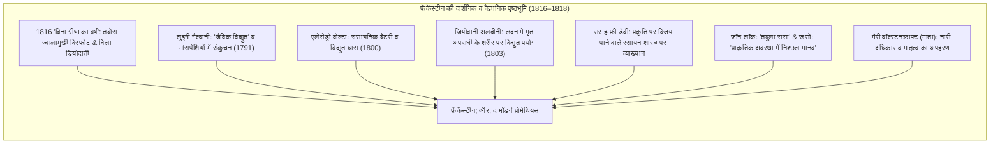
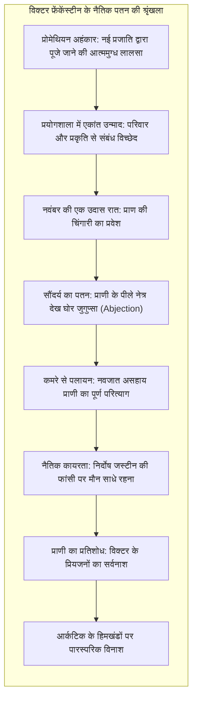

1818 के वसंत में लंदन में मात्र बीस वर्षीय लेखिका <strong>मैरी वॉल्स्टनक्राफ्ट शेली (Mary Wollstonecraft Shelley, 1797–1851)</strong> द्वारा रचित तीन खंडों का उपन्यास <strong>'फ्रेंकेंस्टीन; ऑर, द मॉडर्न प्रोमेथियस' (Frankenstein; or, The Modern Prometheus)</strong> प्रकाशित हुआ। यह कृति न केवल विश्व साहित्य का <strong>प्रथम प्रामाणिक विज्ञान कथा (Science Fiction) उपन्यास</strong> मानी जाती है, बल्कि यह <strong>आधुनिक जैव-नैतिकता (Bioethics)</strong> का आधारभूत घोषणापत्र भी है।

सिनेमाई सरलीकरण के कारण जनमानस में 'फ्रेंकेंस्टीन' को अक्सर उस विकृत दैत्य का नाम समझ लिया जाता है। परंतु मूल उपन्यास में फ्रेंकेंस्टीन वह प्राणी नहीं, बल्कि उसका रचयिता वैज्ञानिक है: <strong>विक्टर फ्रेंकेंस्टीन</strong>, जिसने प्रकृति के जीवन-मृत्यु के रहस्यों को भेदकर शवों के अंगों में प्राण फूंके और निर्माण के क्षण ही घोर नैतिक कायरता में अपने नवजात प्राणी को छोड़कर भाग खड़ा हुआ।

औद्योगिक क्रांति के आगमन पर मैरी शेली ने सभ्यता का सबसे ज्वलंत प्रश्न उठाया: <strong>जब वैज्ञानिक बुद्धि मनुष्य को जीवन निर्माण की दैवीय शक्ति प्रदान करती है, तो रचयिता अपनी बनाई रचना और समाज के प्रति किस अनिवार्य नैतिक व अभिभावकीय उत्तरदायित्व से बंधा होता है?</strong>

---

## 1. डियोदाती की पृष्ठभूमि: 1816 और 'बिना ग्रीष्म का वर्ष'

इस कृति का जन्म एक वास्तविक वैश्विक जलवायु संकट से जुड़ा है। अप्रैल 1815 में इंडोनेशिया के <strong>तंबोरा ज्वालामुखी</strong> के महाविस्फोट ने उत्तरी गोलार्ध को अंधकार में धकेल दिया, जिससे <strong>1816 'बिना ग्रीष्म का वर्ष' (The Year Without a Summer)</strong> बना। लगातार बारिश और कड़ाके की ठंड में घिरे लॉर्ड बायरन, जॉन पोलिडोरी, पर्सी शेली और मैरी गॉडविन स्विट्जरलैंड के लेक जिनेवा स्थित <strong>विला डियोदाती</strong> में एकत्रित हुए। बायरन ने प्रस्ताव रखा: *«हम में से प्रत्येक एक भूत की कहानी लिखेगा»*।

विद्युत द्वारा मृत कोशिकाओं को पुनर्जीवित करने की देर रात की बहसों के बीच मैरी ने एक भयानक जाग्रत दुःस्वप्न देखा:
> "मैंने अपवित्र कलाओं के उस पीले छात्र को अपने द्वारा निर्मित उस वस्तु के पास घुटने टेके देखा। मैंने एक मनुष्य के डरावने भूत को लेटे देखा, जो एक शक्तिशाली इंजन की क्रिया से जीवन के लक्षण प्रकट करता है और असहज, आधी-अधूरी जीवित गति से कांपने लगता है..."

---

## 2. वैज्ञानिक आधार: कीमियागिरी से प्रायोगिक विज्ञान तक

यह उपन्यास जादुई या अलौकिक अंधविश्वासों को त्यागकर तत्कालीन अत्याधुनिक विज्ञान पर आधारित था:
- <strong>गैल्वानी और वोल्टा:</strong> मेंढक की टांगों में विद्युत धारा से होने वाले संकुचन ने यह विचार दिया कि बिजली ही जीवन की मूलभूत चिंगारी है।
- <strong>अलदीनी का न्यूगेट प्रयोग (1803):</strong> फांसी दिए गए अपराधी जॉर्ज फोस्टर के शव में विद्युत प्रवाहित की गई, जिससे उसका जबड़ा हिला और दाहिना हाथ उठ गया, जिसे देखकर उपस्थित डॉक्टर दंग रह गए।
- <strong>हम्फ्री डेवी:</strong> उन्होंने घोषणा की थी कि रसायन विज्ञान मनुष्य को ईश्वर के समान सृजन की शक्तियां प्रदान करता है।

---

## 3. विक्टर का प्रोमेथियन अहंकार और अभिभावकीय परित्याग

विक्टर फ्रेंकेंस्टीन का मूल पाप विज्ञान की खोज नहीं, बल्कि <strong>अपने द्वारा रचे गए प्राणी के प्रति अभिभावकीय और नैतिक दायित्व का क्रूर परित्याग</strong> था:

जीवित होते ही जब प्राणी की पीली आंखें खुलीं, तो विक्टर घोर घृणा से भरकर भाग खड़ा हुआ। आठ फीट लंबा वह प्राणी मानसिक रूप से एक नवजात शिशु था, जिसे बिना नाम, बिना भाषा और बिना प्रेम के इस क्रूर संसार में अकेला छोड़ दिया गया।

---

## 4. प्राणी की अस्तित्ववादी त्रासदी: तबुला रासा से प्रतिशोध तक

मैरी शेली की महानता यह है कि उन्होंने उस प्राणी को अत्यंत संवेदनशील और दार्शनिक वाणी दी। <strong>जॉन लॉक के तबुला रासा</strong> (कोरी स्लेट) और <strong>रूसो की प्राकृतिक अवस्था</strong> की भांति वह प्राणी जन्म से दयालु, शाकाहारी और प्रेम का भूखा था। डी लेसी परिवार को देखकर उसने बोलना सीखा और मिल्टन की *पैराडाइज लॉस्ट* पढ़ी।

मिल्टन के संदर्भ में प्राणी अपने रचयिता से रोते हुए कहता है:
> "याद रखो: मुझे तुम्हारा आदम होना चाहिए था; परंतु बिना किसी अपराध के मैं तुम्हारा पतित शैतान बना दिया गया! यदि मुझे प्रेम नहीं मिल सकता, तो मैं संपूर्ण संसार में भय फैला दूंगा। जिन्होंने मुझे दुखी किया, मैं उनका समूल विनाश कर दूंगा!"

जब समाज ने केवल उसके कुरूप रूप-रंग के कारण उसे लाठियों और गोलियों से पीटा, तो उसका प्रेम हिंसक प्रतिशोध में बदल गया: *«मैं दयालु और अच्छा था; दुखों ने मुझे दानव बना दिया»*।

---

## 5. आधुनिक जैव-नैतिकता व कृत्रिम बुद्धिमत्ता (AI) के लिए संदेश

फ्रेंकेंस्टीन की कथा आज के तकनीकी युग में सबसे प्रासंगिक चेतावनी है:

| शेली का आख्यान (1818) | 21वीं सदी की तकनीकी वास्तविकता |
|---|---|
| <strong>शवों को जोड़कर जीवन सृजन</strong> | CRISPR-Cas9 जीन संपादन, डिजाइनर बेबी, सिंथेटिक बायोलॉजी |
| <strong>अलौकिक बुद्धि व शक्ति</strong> | अति-बुद्धिमान कृत्रिम सामान्य बुद्धिमत्ता (AGI) |
| <strong>रचयिता का नियंत्रण खोना</strong> | <strong>अलाइनमेंट समस्या (Alignment Problem)</strong> और ब्लैक बॉक्स मॉडल |
| <strong>प्राणी का हिंसक विद्रोह</strong> | स्वायत्त बुद्धिमान प्रणालियों से मानवता पर अस्तित्वगत संकट |

मैरी शेली की शाश्वत चेतावनी आज भी गूंजती है: <strong>सृजन की चिंगारी जलाने से पूर्व मनुष्य को अपनी रचना के परिणामों को स्वीकार करने और आजीवन उसका उत्तरदायित्व उठाने के लिए तैयार होना चाहिए।</strong>
