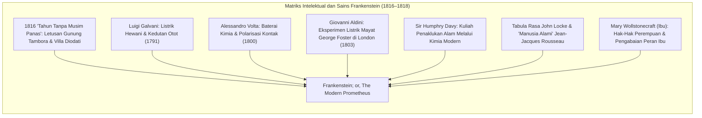
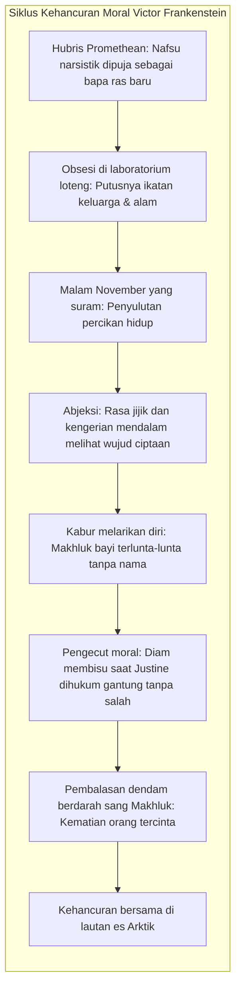

Pada musim semi tahun 1818, sebuah novel tiga jilid anonim berjudul <strong>Frankenstein; or, The Modern Prometheus</strong> diterbitkan di London oleh penulis muda berusia dua puluh tahun, <strong>Mary Wollstonecraft Shelley (1797–1851)</strong>. Karya ini secara luas diakui oleh sejarawan sastra sebagai <strong>novel fiksi ilmiah sejati pertama di dunia</strong>, sekaligus menjadi piagam etika fundamental bagi <strong>bioetika modern</strong>.

Dalam budaya populer yang tereduksi oleh film-film abad ke-20, nama Frankenstein kerap disalahartikan sebagai monster kikuk dengan baut di lehernya. Namun dalam teks aslinya, Frankenstein bukanlah sang monster, melainkan sang penciptanya: <strong>Victor Frankenstein</strong>, seorang mahasiswa filsafat alam asal Jenewa yang berhasil memecahkan rahasia pembangkitan kehidupan dari jasad mati, namun seketika melarikan diri dalam kepanikan moral begitu melihat makhluk ciptaannya bernapas.

Ditulis pada masa fajar Revolusi Industri ketika rasionalisme Pencerahan mendewakan sains, Mary Shelley melontarkan pertanyaan etis yang paling menentukan: <strong>Ketika sains memberi manusia kuasa ilahi untuk menciptakan kehidupan dari ketiadaan, tanggung jawab moral, pengasuhan, dan sosial apakah yang wajib dipikul pencipta terhadap ciptaannya?</strong>

---

## 1. Asal Usul Diodati: 1816 dan 'Tahun Tanpa Musim Panas'

Kelahiran novel ini bertaut erat dengan bencana iklim global. Letusan dahsyat <strong>Gunung Tambora</strong> di Hindia Belanda pada April 1815 melontarkan miliaran ton sulfur ke stratosfer, memicu <strong>"Tahun Tanpa Musim Panas" (1816)</strong> di belahan bumi utara, ditandai badai hujan lebat, gagal panen, dan kelaparan massal di Eropa.

Di tepi Danau Jenewa di <strong>Villa Diodati</strong>, berkumpul Lord Byron, dokter pribadinya John Polidori, penyair Percy Bysshe Shelley, dan Mary Godwin muda. Terkurung badai berhari-hari, Byron mengusulkan: *«Masing-masing dari kita harus menulis cerita hantu»*. 

Setelah mendengarkan percakapan malam tentang kemungkinan menghidupkan kembali jaringan mati dengan listrik, Mary mengalami mimpi buruk yang nyata:
> "Aku melihat pelajar pucat dari ilmu terlarang berlutut di samping benda yang telah dirakitnya. Aku melihat sosok manusia mengerikan terbaring, lalu atas kerja mesin yang kuat, menunjukkan tanda-tanda kehidupan dan bergerak canggung setengah hidup..."

---

## 2. Landasan Sains Eksperimental: Dari Alkimia Menuju Galvanisme

Berbeda dari novel gotik supranatural yang mengandalkan kutukan sihir, Mary Shelley menyandarkan plotnya pada sains eksperimental terdepan:
- <strong>Galvani dan Volta:</strong> Eksperimen kontraksi otot pada kaki katak mati memicu hipotesis bahwa listrik adalah percikan vital kehidupan.
- <strong>Eksperimen Aldini di Newgate (1803):</strong> Giovanni Aldini mengalirkan arus listrik kuat ke tubuh mayat narapidana George Foster di hadapan publik; rahangnya bergetar hebat, matanya terbuka, dan lengannya terangkat.
- <strong>Sir Humphry Davy:</strong> Menyatakan bahwa kimia modern memberikan kekuasaan yang sebanding dengan sang Pencipta dalam menembus rahasia alam.

---

## 3. Hubris Victor dan Pengabaian Paternal

Dosa hakiki Victor Frankenstein bukanlah rasa ingin tahunya, melainkan <strong>penolakan totalnya untuk merawat, membimbing, dan bertanggung jawab atas makhluk yang ia lahirkan</strong>:

Mengalami <strong>abjeksi</strong> saat melihat mata kuning berair dan kulit tegang ciptaannya, Victor kabur. Sang Makhluk, dengan kekuatan fisik raksasa namun kepolosan mental bayi baru lahir, ditinggalkan sendirian di dunia yang dingin tanpa bahasa maupun bimbingan.

---

## 4. Tragedi Makhluk Ciptaan: Antara Tabula Rasa dan Kerusakan Moral

Sang Makhluk mengawali hidupnya sesuai <strong>Tabula Rasa Locke</strong> dan <strong>keadaan alami manusia menurut Rousseau</strong>: cinta damai, vegetarian, dan peka terhadap kasih sayang. Belajar mengamati keluarga De Lacey, ia menguasai bahasa dan membaca tiga buku agung: *Werther* karya Goethe, *Biografi Paralel* karya Plutarkhos, dan *Paradise Lost* karya Milton.

Dalam karya Milton, sang Makhluk meratapi nasibnya:
> "Ingatlah: Aku seharusnya menjadi Adam bagimu; namun aku justru menjadi malaikat jatuh yang kau buang dari segala kebahagiaan tanpa kesalahan apa pun!"

Ketika manusia menyerang dan menembaknya hanya karena rupa fisiknya yang buruk, kebaikannya berubah menjadi angkara murka: *«Aku dahulunya baik dan pengasih; penderitaanlah yang menjadikanku iblis»*.

---

## 5. Pelajaran bagi Bioetika Modern dan Kecerdasan Buatan

Kisah Frankenstein menjadi metafora paling hidup bagi tantangan sains kontemporer:

| Narasi Frankenstein (1818) | Sains Abad ke-21 |
|---|---|
| <strong>Merakit bagian tubuh jasad</strong> | Rekayasa genom CRISPR-Cas9, bayi desainer, biologi sintetis |
| <strong>Kekuatan fisik & akal raksasa</strong> | Artificial General Intelligence (AGI) berkemampuan super |
| <strong>Pengabaian pencipta</strong> | <strong>Masalah Penyelarasan (Alignment Problem)</strong> etika AI |
| <strong>Pemberontakan ciptaan</strong> | Risiko eksistensial hilangnya kendali manusia atas teknologi |

Pesan Mary Shelley bergema abadi: <strong>Siapa pun yang berani menyalakan percikan penciptaan kehidupan, wajib memiliki komitmen moral untuk merawat dan mempertanggungjawabkan ciptaannya hingga akhir.</strong>
