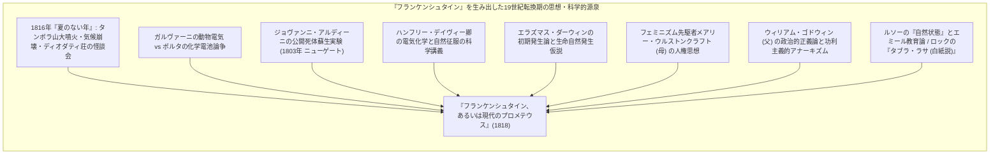
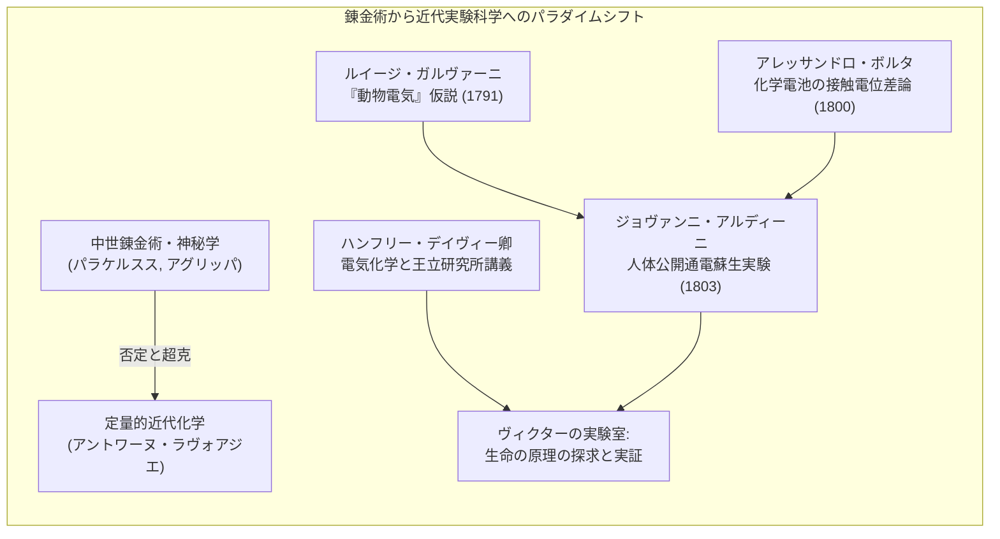
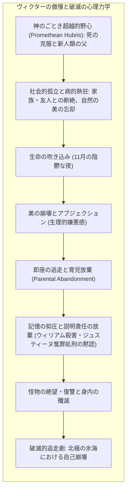
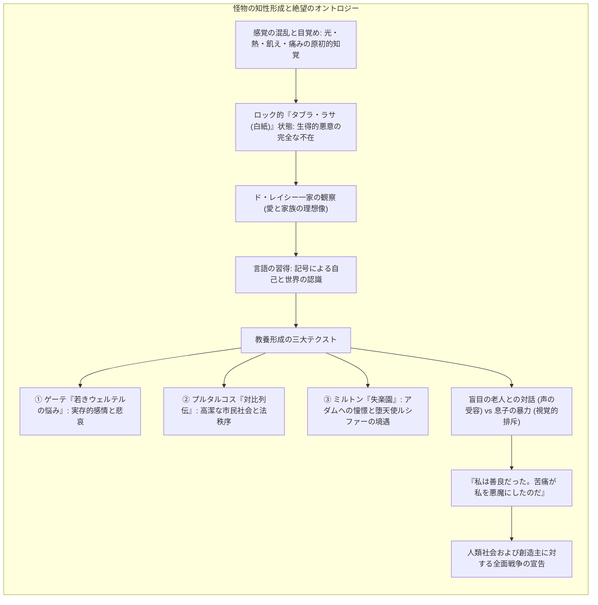
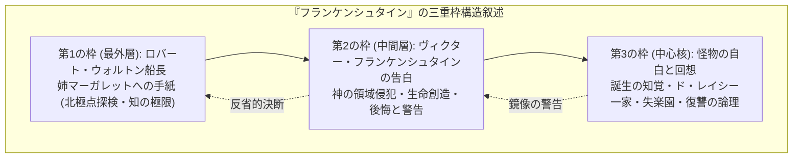
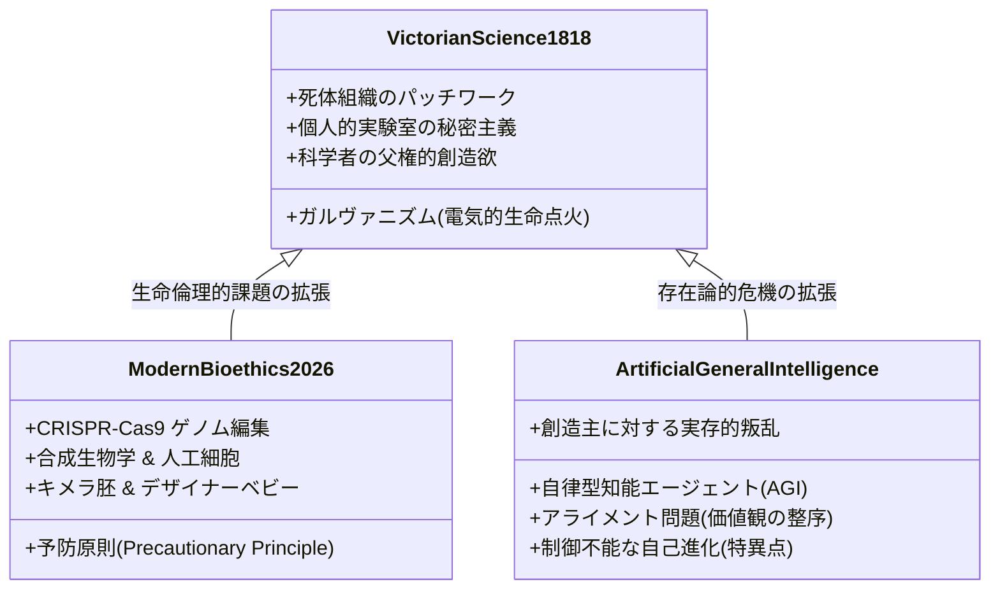
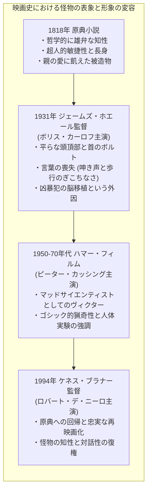

1818年、わずか20歳の女性作家<strong>メアリー・ウルストンクラフト・シェリー（Mary Wollstonecraft Shelley, 1797–1851）</strong>によって匿名で出版された『<strong>フランケンシュタイン、あるいは現代のプロメテウス（Frankenstein; or, The Modern Prometheus）</strong>』は、近代文学史上における<strong>「最初の本格的サイエンス・フィクション（SF）」</strong>であり、同時に科学技術の制御不能な暴走と研究者の倫理的責任を告発した<strong>「生命倫理学（Bioethics）の原典」</strong>です。

大衆文化において「フランケンシュタイン」という名は、ボルトを首に刺した怪異な緑色の怪物の代名詞として誤認されがちですが、原典におけるフランケンシュタインとは怪物そのものではなく、生命の神秘を解き明かし神の領域に侵犯した青年科学者<strong>ヴィクター・フランケンシュタイン（Victor Frankenstein）</strong>の名に他なりません。

啓蒙主義の理性万能論と産業革命の科学技術楽観主義が狂乱の昂揚を迎えていた19世紀初頭、メアリー・シェリーは「科学知が自然の不可侵領域を征服したとき、その創造主たる人間はいかなる道義的・社会的責任を負うのか」という、200年後の現在において遺伝子編集（CRISPR-Cas9）、合成生物学、そして自律型汎用人工知能（AGI）の開発競争に直面する人類が最も切実に直面しているアポリア（原理的難問）を予見していました。

---

## 1. 創作の背景：1816年「夏のない年」とディオダティ荘の奇跡

『フランケンシュタイン』の誕生は、地球規模の気候異変とヨーロッパ・ロマン主義の文学史的結節点が交差する極めて劇的な瞬間にもたらされました。

### 1.1 タンボラ火山の破局噴火と「夏のない年」

1815年4月、現在のインドネシア・スンバワ島に位置する<strong>タンボラ山（Mount Tambora）</strong>が過去1万年間で最大規模とされる破局的噴火を引き起こしました。成層圏へ注入された膨大な二酸化硫黄エアロゾルは地球全体の日射を遮り、翌<strong>1816年は「夏のない年（The Year Without a Summer）」</strong>としてヨーロッパおよび北米に記録的な冷害、豪雨、農作物の全滅、そして飢饉と社会不安をもたらしました。

スイス・レマン湖畔に位置する<strong>ディオダティ荘（Villa Diodati）</strong>には、イギリス社交界の醜聞を逃れて亡命してきた詩人<strong>ジョージ・ゴードン・バイロン（Lord Byron）</strong>、彼の主治医で作家志望の<strong>ジョン・ウィリアム・ポリドリ（John William Polidori）</strong>、詩人<strong>パーシー・ビッシュ・シェリー（Percy Bysshe Shelley）</strong>、そして彼の恋人であった18歳の<strong>メアリー・ウルストンクラフト・ゴドウィン（後のメアリー・シェリー）</strong>とその義妹クレア・クレアモントが集いました。

降り続く冷たい豪雨と昼なお暗い陰鬱な雲に閉じ込められた彼らは、フランス語訳されたドイツの怪談集『ファンタスマゴリアーナ（Fantasmagoriana）』を読み耽り、退屈を紛らわせるためにバイロンが<strong>「我々一人ひとりが怪奇譚（Ghost Story）を書こうではないか」</strong>と提案しました。この文学史上名高い<strong>「ディオダティ荘の怪談会」</strong>から、ポリドリは吸血鬼文学の祖となる短編『吸血鬼（The Vampyre）』を生み出し、メアリーは『フランケンシュタイン』の構想を得ることになります。

### 1.2 白昼夢と「青ざめた学徒」の幻視

メアリーは何日もの間、新しい恐怖の物語を着想できず苦悩していました。しかし、バイロンとパーシー・シェリーが夜を徹して議論していた<strong>「生命の本質（The Principle of Life）」「ガルヴァニズム」「死体への通電と再活性化」</strong>に耳を傾けていたある夜、彼女は鮮烈な白昼夢（恐怖の覚醒夢）に捉えられます。メアリーは1831年版の著者序文でその瞬間を克明に回想しています：

> 「私は見た。冒涜的な技芸を修めた青ざめた学徒が、自ら組み立てた怪物の傍らに跪いている姿を。私は見た。恐ろしい人間の亡霊が横たわり、強力な機関の作動によって生命の徴候を示し、不自然な半生半死の身じろぎを始める様を……」

メアリーはこの戦慄すべき光景を「翌朝起き抜けに短い物語として書き留めよう」とペンを執りましたが、夫パーシーの励ましを受け、長編小説へと発展させていきました。

---

## 2. 18世紀末〜19世紀初頭の科学史的源泉

『フランケンシュタイン』がそれまでのゴシック小説（幽霊や悪魔、超自然的呪いによる怪異）と一線を画し、人類最初のSFと呼ばれる所以は、その生命創造の動因が<strong>「魔法やオカルティズムではなく、当時の最先端実験科学」</strong>に依拠している点にあります。

### 2.1 ガルヴァニズムと動物電気論争

1780年代、ボローニャ大学の解剖学教授<strong>ルイージ・ガルヴァーニ（Luigi Galvani, 1737–1798）</strong>は、起電機の火花が飛んだ瞬間に解剖台上のカエルの脚が激しく痙攣することを発見しました。ガルヴァーニは、生物の神経や筋肉の内部には生命活動そのものを司る固有の流体<strong>「動物電気（Animal Electricity）」</strong>が存在し、金属はその伝導体に過ぎないと結論づけました（1791年『筋肉運動における電気の力について』）。

これに対し、パヴィア大学の物理学者<strong>アレッサンドロ・ボルタ（Alessandro Volta, 1745–1827）</strong>は、異種金属（銅と亜鉛）が湿った電解質を介して接触することで電位差が生じていると反論し、1800年に人類初の化学電池<strong>「ボルタの電堆（Voltaic Pile）」</strong>を発明しました。

この「ガルヴァーニ対ボルタ論争」はヨーロッパ全土の科学界を熱狂させ、<strong>「電気こそが物質と生命の境界線を架橋する究極の活力（Vital Force）ではないか」</strong>という生気論（Vitalism）的想像力を爆発的に刺激しました。

### 2.2 ジョヴァンニ・アルディーニによる死体公開蘇生実験

ガルヴァーニの甥である物理学者<strong>ジョヴァンニ・アルディーニ（Giovanni Aldini, 1762–1834）</strong>は、ガルヴァニズムを死体蘇生の実用技術として実証すべく、ヨーロッパ各地で劇的な公開実験を敢行しました。

その頂点が、1803年1月17日、ロンドンのニューゲート監獄で妻殺しの罪により絞首刑に処された直後の死刑囚<strong>ジョージ・フォスター（George Foster）</strong>の遺体を用いて行われた公開実験です。アルディーニは死体の顔面、耳、直腸にボルタ電池の電極を接続し、強力な電流を流しました。当時の『ニューゲート・カレンダー』は以下のように記録しています：

> 「顔面に電極を当て通電した瞬間、死体の顎がガタガタと震え始め、周辺の筋肉が恐ろしく痙攣した。一方の目が大きく見開かれ、右手が握りこぶしを作って跳ね上がり、脚が激しく動いた。居合わせた観衆の中には、死刑囚が蘇生したのではないかという恐怖に囚われ、ショックで失神する者や発病する外科医が続出した。」

少女時代のメアリー・シェリーは、父ウィリアム・ゴドウィンのサロンに出入りしていた知識人たちを通じてこの公開実験の生々しい記録を熟知していました。ヴィクターが墓地や解剖室から人骨や死体組織を掻き集め、電気的火花によって生命を吹き込むという着想は、単なる奇怪なファンタジーではなく、<strong>当時の社会が目の当たりにしていた現実の科学的ショックの直接的反映</strong>だったのです。

### 2.3 ハンフリー・デイヴィー卿の講義と近代化学の誘惑

ヴィクターがインゴルシュタット大学で出会うウォルドマン教授（Professor Waldman）の言葉は、イギリス王立研究所（Royal Institution）の初代化学教授<strong>ハンフリー・デイヴィー卿（Sir Humphry Davy, 1778–1829）</strong>が1802年に行った記念講義『化学哲学試論』の熱烈な引用と変奏です。

中世の錬金術師（パラケルススやアグリッパ）が不老不死の霊薬や卑金属の黄金化という誇大な妄想を抱いて挫折したのに対し、近代の化学者は「一見すると卑小な実験器具を用いながら、自然界の深奥を解剖し、雷電を手中に収め、地震の謎を暴き、不可視の力を操作して神のごとき力を人間に授ける」と称揚されました。ヴィクターはこの科学的万能感に魅了され、自然のベールを剥ぎ取って生命の根源を暴くという狂気的な研究へ没入していくのです。
---

## 3. ヴィクター・フランケンシュタインの心理力学と倫理的破綻

ヴィクター・フランケンシュタインの悲劇は、単に「恐ろしい怪物を作ってしまった」ことにあるのではありません。真の悲劇は、<strong>「生命を創造する能力を持ちながら、被造物に対する親的・道義的責任を一切引き受けなかったこと」</strong>にあります。

### 3.1 ヒュブリス（傲慢）と超越的プロメテウス信仰

副題にある「現代のプロメテウス（The Modern Prometheus）」とは、ギリシャ神話において天界から火を盗んで人間に与え、泥から最初の人類を創り出したとされるティターン族の神プロメテウスを指します。プロメテウスはゼウスの怒りを買い、カウカソス山の岩に縛り付けられて毎日鷲に肝臓を啄まれる永遠の拷問を受けました。

ヴィクターもまた、死の支配を打ち破り、生命の火花を泥（死体組織）に点火することで、<strong>「新しき種族の父たる創造主（Creator）」</strong>として崇められたいという肥大化した自己愛とヒュブリス（傲慢）に憑りつかれていました：

> 「生命と死は、私にとって打破すべき単なる境界に過ぎなかった。私はこの暗闇の世界に光明の奔流を注ぎ込むことができるのだ。新しい種族が、私を自分たちの創造主、源泉として祝福するだろう。これほど多くの幸福で優れた生命が、私の手によって存在を得るのだ！」

ここには、純粋な知的好奇心の美名のもとに隠された、<strong>「神の権能の奪取」と「他者に対する絶対的支配欲」</strong>が剥き出しになっています。

### 3.2 アブジェクション（生理的嫌悪）と育児放棄

ヴィクターの道義的崩壊が決定的に露呈するのは、2年間の狂気的な研究の末、ついに生命の点火に成功した「11月の陰鬱な夜」の直後です。

彼が解剖室から選りすぐったパーツは、個々には「均斉が取れ、美しかった」はずでした。豊かな黒髪、真珠のような白い歯。しかし、黄色く濁った水っぽい瞳が開き、乾いた黄色い皮膚が筋肉と動脈を辛うじて覆い、黒ずんだ唇が引きつった瞬間、ヴィクターの幻想は音を立てて崩壊します：

> 「私がどれほど熱心に、途方もない労力を費やして成し遂げようとしたか、言葉では言い尽くせない。しかし、完成した今、その夢の美しさは消え去り、息苦しいほどの恐怖と嫌悪が私の心を充たした。自ら創り出した存在の姿に耐えられず、私は実験室から逃げ出した……」

現代の精神分析家ジュリア・クリステヴァが提唱した<strong>「アブジェクション（Abjection：排除されるべきおぞましさ）」</strong>がここに現出しています。ヴィクターは生まれたばかりの被造物を命名（Naming）することすら拒絶し、「悪魔（Daemon）」「怪物（Monster）」「忌まわしい者（Wretch）」と罵倒して闇の中に遺棄（Abandonment）しました。

生まれたばかりの怪物は、肉体こそ身長8フィート（約2.4メートル）の巨躯でしたが、精神と知覚はまさに「生まれたての乳児」そのものでした。寒さに震え、光に眩み、飢えと喉の渇きに泣きじゃくる赤子を、生みの親である科学者が生理的嫌悪感から見捨てて逃亡したこと――これこそが、その後に続くすべての殺戮と悲劇の唯一にして絶対的な元凶なのです。

### 3.3 フェミニズム的視座：母性の簒奪と身体の排除

メアリー・シェリーの母は、近代フェミニズムの嚆矢とされる『女性の権利の擁護（A Vindication of the Rights of Woman, 1792）』を著した思想家<strong>メアリー・ウルストンクラフト（Mary Wollstonecraft）</strong>でした。彼女はメアリーを出産したわずか11日後に産褥熱で亡くなっており、メアリー自身もまた、本作執筆以前にパーシーとの間に生まれた生後数週間の長女を亡くすという深いトラウマを抱えていました。

文学批評家エレン・モアーズ（Ellen Moers）やサンドラ・ギルバート＆スーザン・グーバーが指摘したように、『フランケンシュタイン』は<strong>「女性身体（母胎）を完全に排除し、男性科学者が自らの理知のみによって生命を再生産しようとした試みの破綻」</strong>を描いた物語として解読できます。

ヴィクターは、女性との愛の交歓や肉体的な出産過程を忌避し、実験室という閉鎖空間で無性生殖的な生命創造を試みました。これは母性の暴力的簒奪であり、女性を介さない生命の誕生が、いかに歪で呪われた怪物を生み出すかという無意識の告発に他なりません。実際、怪物が誕生した直後、ヴィクターは婚約者エリザベスに口吻を交わすと彼女が母の死体へと変貌し、屍衣から蛆虫が湧き出るという悪夢を見ています。生殖の自然な環から逸脱した科学知は、必然的に「死と腐敗」の恐怖へ直結するのです。

---

## 4. 『怪物（The Creature）』の存在論と認識論的悲劇

メアリー・シェリーの卓越した文学的達成は、暴走する怪物だけでなく、<strong>「怪物の主観的内面と知性の発達過程」</strong>を物語の中核に据え、彼に雄弁な声を与えた点にあります。

### 4.1 ジョン・ロックの「タブラ・ラサ」とルソーの「高貴な野蛮人」

怪物が誕生した瞬間、彼の精神は<strong>ジョン・ロック（John Locke）</strong>が説いた<strong>「タブラ・ラサ（Tabula Rasa：白紙状態）」</strong>そのものでした。彼には先天的な邪悪さや暴力衝動は一切存在しませんでした。

森を彷徨いながら鳥のさえずりに聴き惚れ、木の実を食べて飢えを凌ぎ、火の暖かさと火傷の痛みを経験的に学んでいく怪物の姿は、<strong>ジャン＝ジャック・ルソー（Jean-Jacques Rousseau）</strong>が『人間不平等起源論』で描いた「文明に毒されていない自然状態の人間（高貴な野蛮人）」の具現化です。怪物は生来、共感に満ちた善良な存在でした。

### 4.2 ド・レイシー一家の観察と教養形成の三大書物

森の納屋の裂け目から貧しい亡命貴族ド・レイシー一家の生活を数ヶ月にわたって覗き見ることで、怪物は人間言語を習得し、一家のために夜間に薪を運ぶなどの無私の親愛を示します。そして、彼が森で拾ったトランクに入っていた<strong>三冊の書物</strong>が、彼の精神構造を決定づけます：

| 書物 | 著者 | 怪物が受容した思想・感情 | 存在論的影響 |
|---|---|---|---|
| <strong>『若きウェルテルの悩み』</strong> *(The Sorrows of Young Werther)* | ヨハン・ヴォルフガング・フォン・ゲーテ | 魂の深遠な孤独、崇高な愛、生への絶望と自死の観念 | 自己の存在を客観視し、「私は一体何者なのか？」という実存的問いに目覚める |
| <strong>『対比列伝』</strong> *(Parallel Lives)* | プルタルコス | 古代ギリシャ・ローマの英雄たちの徳性、市民社会の法、公的責任 | 私利私欲を超えた高潔な徳義と社会秩序への畏敬の念を培う |
| <strong>『失楽園』</strong> *(Paradise Lost)* | ジョン・ミルトン | 神とアダムの親愛関係、反逆天使ルシファー（サタン）の堕落と地獄 | 創造主に見捨てられた自己を、アダムではなく「堕天使ルシファー」と同一視する |

特にミルトンの『失楽園』は、怪物の自己理解を決定づけました。神から愛され、楽園を与えられたアダムとは異なり、怪物は創造主から誕生の瞬間に呪われ、追放されました。怪物はヴィクターに向かって痛切に叫びます：

> 「思い出してください。私はあなたのアダムであるはずでした。それなのに、私は何の罪も犯していないのに、あなたの手によって堕天使にされてしまったのです！」

### 4.3 視覚的怪物性と「アブジェクションによる他者化」

怪物の悲劇は、彼の「精神の高潔さ」と「肉体の醜怪さ」の絶望的な乖離にありました。

盲目の老人ド・レイシーと二人きりで会話した際、視覚的偏見を持たない老人は怪物の洗練された言葉遣いと温かな心を受け入れ、客人として迎え入れようとしました。しかし、目が見える息子フェリックスたちが帰還した瞬間、彼らは怪物の異形を見るや否やパニックに陥り、棒切れで激しく打ち据えて追い払いました。

川で溺れる人間の少女を命がけで救助した際も、駆けつけた農夫は怪物の姿を見るなり銃を乱射し、彼を重傷に至らしめました。

<strong>「人間社会は、他者をその内面ではなく、外見的均整によってのみ裁断する」</strong>という残酷な認識論的現実を突きつけられた怪物は、絶望のあまり神と人間への愛を捨て、復讐の鬼へと変貌します：

> 「私はかつて愛に満ち、善良であった。私の魂は愛と人情に燃えていた。しかし、私は孤独だ。惨めなほど孤独なのだ。お前たち人間は私を拒絶する。もし私が共感と愛を得られないならば、私は恐怖をばら撒いてやろう。私を不幸にしたお前たちを、徹底的に呪い尽くしてやるのだ！」

怪物を「悪魔」へと仕立て上げたのは、彼自身の肉体ではなく、彼を拒絶し迫害した人間社会の偏見と暴力だったのです。

---

## 5. 三重の枠構造（Frame Narrative）とドッペルゲンガー

メアリー・シェリーは、『フランケンシュタイン』の物語構造に極めて緻密な<strong>「三重の枠構造（入れ子構造叙述）」</strong>を採用しました。この構造は、単なる物語技法にとどまらず、主題である「知識探求の傲慢と破滅」を反響させる批評的装置として機能しています。

### 5.1 ウォルトン船長とヴィクターの鏡像関係

物語の最外層を担うのは、未踏の北極点航路の発見と地磁気の解明を求めて氷海へ船を進める探検家<strong>ロバート・ウォルトン（Robert Walton）</strong>です。ウォルトンは、乗組員の生命を危険に晒してでも「人類未踏の栄光」を掴み取ろうとする若き野心家であり、その精神性はまさに<strong>かつてのヴィクター・フランケンシュタインの忠実な鏡像（Doppelgänger）</strong>です。

氷山に囲まれて航行不能となったウォルトンの船に、瀕死のヴィクターが救助されます。ヴィクターはウォルトンの瞳に宿る自分と同じ破滅的な野心の火花を見抜き、彼を思いとどまらせるために自らの生涯を語り始めます：

> 「不幸な男よ！ あなたもまた同じ狂気に取り憑かれているのか？ あなたもその毒杯を飲み干そうというのか？ 私の言葉を聞くがいい。私の物語から教訓を汲み取るがいい！」

物語の結末において、ヴィクターの死と怪物の悲痛な弔辞を目の当たりにしたウォルトンは、乗組員の懇願を受け入れ、北極点征服の野心を捨てて船を南へと反転させます。ヴィクターが果たせなかった<strong>「野心の放棄による人間性の回復」</strong>を、鏡像たるウォルトンが成し遂げることで、物語は辛うじて破滅の連鎖を断ち切るカタルシスを迎えます。

### 5.2 ヴィクターと怪物の分身関係

心理学的に見れば、<strong>怪物とはヴィクター自身の無意識の影（シャドウ）、抑圧された破壊衝動の具現化</strong>です。

怪物は、ヴィクターが意識の上では愛しながらも無意識に拒絶していた周囲の人々を次々と抹殺していきます。弟ウィリアム、無実の罪を着せられた義妹ジュスティーヌ、無二の親友クラーヴァル、そして結婚初夜の新妻エリザベス。怪物は常にヴィクターの「結婚」と「幸福」を妨害し、彼を自分と同じ完全な孤独へと引きずり落とします。

ヴィクターが怪物を追って北極の氷原を犬ぞりで疾走するとき、追う者と追われる者の境界は消失します。二人はもはや互いの存在なしには生きられない単一の引き裂かれた魂の二面であり、怪物の死によってしか解決されない共依存的な破滅の旅路を歩んでいたのです。

---

## 6. 現代バイオエシックスと先端科学技術への予見的警鐘

200年の時を超えて、なぜ『フランケンシュタイン』は今なお世界中で引用され、議論され続けているのでしょうか。それは、現代の科学技術が直面する最も先鋭的な倫理的危機が、ヴィクターが犯した過ちと完全に同型だからです。

### 6.1 ゲノム編集・合成生物学と「フランケンフーズ」

1970年代の組換えDNA技術の黎明期から、1996年のクローン羊ドリーの誕生、そして近年の<strong>CRISPR-Cas9によるヒト受精卵の遺伝子改変</strong>に至るまで、生命科学の飛躍は常に「フランケンシュタインの怪物を作り出すのではないか」という社会的不安を伴ってきました。

遺伝子組み換え作物を批判する際に用いられる<strong>「フランケンフーズ（Frankenfoods）」</strong>というジャーナリスティックな造語は、自然界の摂理を無視して異種の遺伝子をパッチワークのように継ぎ接ぎすることへの民衆的恐怖を象徴しています。

しかし、『フランケンシュタイン』が突きつける真の教訓は、「未知の生命を創り出すことの是非」以上に、<strong>「ひとたびこの世界に解き放たれた生命・技術に対して、人間社会はそのライフサイクル全体にわたって責任を負い続けられるのか」</strong>というガバナンスと説明責任（Accountability）の問いです。生殖医療におけるデザイナーベビーの選別や、自然生態系へ人工改変生物を放流する遺伝子ドライブ技術は、まさにヴィクター的傲慢の現代的変奏に他なりません。

### 6.2 自律型AI（AGI）とアライメント問題

現代において『フランケンシュタイン』の寓話が最も切実に響く領域は、バイオテクノロジーを超えて<strong>人工知能（AI）研究、とりわけ汎用人工知能（AGI）の安全性と倫理</strong>です。

| フランケンシュタインの寓話 | 現代の人工知能（AI/AGI）研究における課題 |
|---|---|
| <strong>生命の点火</strong> | 自己学習・創発的能力を持つ高度自律型ニューラルネットワークの起動 |
| <strong>怪物の超人的肉体と知性</strong> | 人間を遥かに凌駕する計算速度、情報処理能力、論理的推論力 |
| <strong>創造主による拒絶と理解不能</strong> | ブラックボックス問題、説明可能性の欠如、機械の内面状態の不可知性 |
| <strong>「私を愛せ、さもなくば破滅を」</strong> | <strong>アライメント問題（Alignment Problem）</strong>: 人類の幸福や倫理観とAIの目的関数の一致 |
| <strong>被造物による人類への反逆</strong> | 制御を離れた自律的AIエージェントによる社会的インフラや人類生存への脅威 |

AI研究者ニック・ボストロムやスチュアート・ラッセルが警告するように、人類が自らよりも知的で強力な存在を創り出しながら、その存在に対する適切な「道徳的・社会的受容環境」や「安全な制御フレームワーク」を用意できなければ、我々はヴィクターと同様に、自らの被造物に追いつめられることになります。怪物がヴィクターに求めたのは、物理的な破壊ではなく「対話と共感、そして自らの居場所」でした。AIとのアライメントの本質もまた、冷徹なアルゴリズムの制御にとどまらず、知的存在としての責任ある共生モデルの構築にあるのです。

---

---

## 7. 大衆文化における怪物の変容：映画史と「失われた雄弁さ」

原典の怪物は、ミルトンを引用し、論理的な弁論で創造主を圧倒する「雄弁な知性」を備えていました。しかし、20世紀の映画を中心とする大衆メディアへの移植過程で、怪物は<strong>「言葉を奪われ、唸り声を上げるだけの無軌道な暴力機械」</strong>へと決定的な変貌を遂げました。

### 7.1 ジェームズ・ホエール監督とボリス・カーロフの図像学（1931年）

ユニバーサル映画が1931年に製作したジェームズ・ホエール監督、ボリス・カーロフ主演の映画『フランケンシュタイン』は、世界中の人々の脳裏に「怪物の普遍的視覚イメージ」を不可逆的に焼き付けました。
- <strong>ジャック・ピアースの特殊メイク:</strong> 平らにならされた四角い頭蓋骨、皮膚を縫い合わせた無骨な手術痕、首の両脇に突き出た電極ボルト、そして重厚なアスファルト作業靴によるぎこちない歩行。
- <strong>言葉の剥奪と「凶暴犯の脳」:</strong> 映画版最大の改変は、助手のフリッツが実験室に持ち帰る脳を誤って「殺人犯・異常者の脳（Abnormal Brain）」にしてしまったという設定です。原典において怪物の悲劇は「善良な魂が社会の拒絶によって悪へと歪められたこと」にあったのに対し、映画版は「粗悪な生物学的欠陥」へと原因を矮小化し、怪物の内省的苦悩と言語能力を奪い去りました。少女マリアとの有名な池のシーン（花びらを浮かべる遊びの延長で無邪気に少女を溺死させてしまう悲劇）にわずかな純真性が残されたものの、怪物は本質的に「討伐されるべきモンスター」として記号化されたのです。

### 7.2 原典への回帰運動と今日的再評価

1970年代以降のフェミニズム批評、ポストコロニアル批評、そして障害学（Disability Studies）の台頭に伴い、メアリー・シェリーの原典テキストは劇的な復権を遂げました。1994年のケネス・ブラナー監督による映画『フランケンシュタイン』では、ロバート・デ・ニーロ演じる怪物が原典同様に流暢な言語を操り、創造主と対峙する哲学的ドラマが忠実に再現されました。

怪物が雄弁さを取り戻したとき、観客は改めて戦慄することになります。恐怖すべきは、暗闇を徘徊する異形の怪物ではなく、<strong>「自らの手で生命を創り出しながら、その痛みに耳を塞ぎ、自らの名声のために他者を消費し尽くす冷酷な科学者の知性そのもの」</strong>だったという真実に。

## 8. 結語：責任なき創造の告発と未来への遺産

メアリー・シェリーが18歳の若さで描いた『フランケンシュタイン』は、科学技術そのものを否定する反知性主義の書ではありません。むしろ、パーシー・シェリーやバイロンらロマン派の詩人たちが抱いていた「自然の神秘への賛美」と、啓蒙主義的な「合理的分折精神」の狭間に立ち、<strong>「知的好奇心の暴走に倫理的ブレーキをかけるのは何か」</strong>を生涯かけて問い続けた思索の記念碑です。

科学者が自らの研究室の扉を閉じ、社会や被造物への影響から目を背けて「純粋な知識の探求」に逃げ込むとき、その研究は必然的に怪物を生み出します。

ヴィクターの罪は、死体を繋ぎ合わせたことではなく、<strong>自らの手で生み出した生命の目を見つめ、その手を握りしめる勇気を持たなかったこと</strong>です。現代の科学者、技術者、そして政策決定者たちに対し、メアリー・シェリーは200年前の暗い湖畔から今なお静かに問いかけています。

<strong>「あなた方は、自らが創り出す未来に対して、最後まで愛と責任を引き受ける覚悟があるのか」</strong>と。
