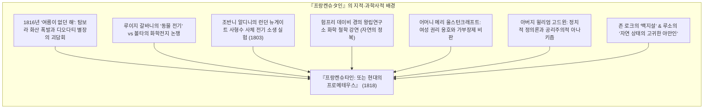
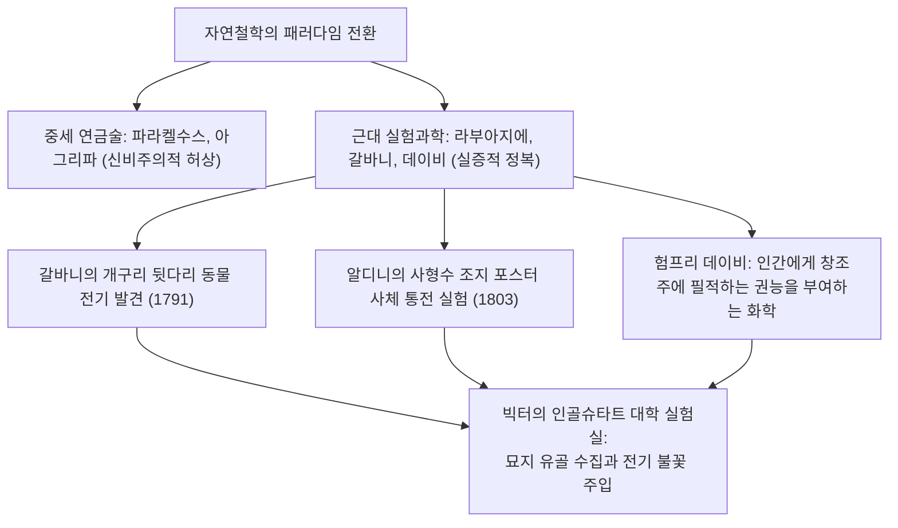
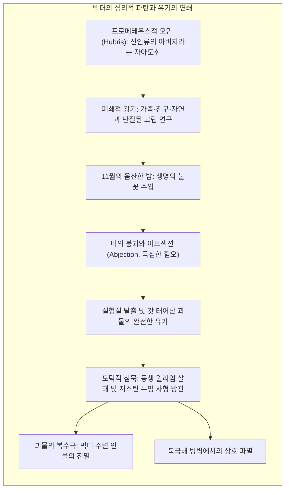
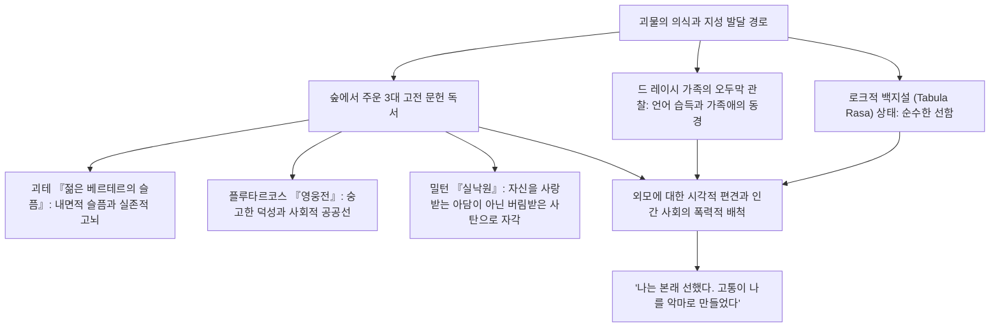
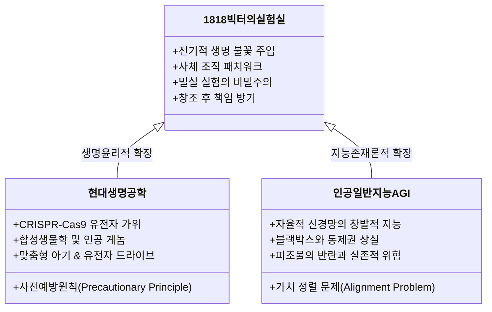

1818년, 스무 살의 청년 작가 <strong>메리 울스턴크래프트 셸리(Mary Wollstonecraft Shelley, 1797–1851)</strong>가 익명으로 출간한 『<strong>프랑켄슈타인: 또는 현대의 프로메테우스(Frankenstein; or, The Modern Prometheus)</strong>』는 근대 문학사상 <strong>최초의 본격적인 과학소설(SF)</strong>이자, 기술 문명의 통제 불능한 폭주와 과학자의 도덕적 책임을 엄중히 고발한 <strong>현대 생명윤리학(Bioethics)의 원전</strong>입니다.

대중문화에서 '프랑켄슈타인'은 흔히 목에 나사가 박힌 괴물의 이름으로 오인되지만, 원작에서 프랑켄슈타인은 괴물이 아니라, 생명의 비밀을 파헤쳐 신의 영역을 침범한 스위스 출신의 청년 과학자 <strong>빅터 프랑켄슈타인(Victor Frankenstein)</strong>의 이름입니다.

계몽주의의 이성 만능론과 산업혁명의 기술 낙관주의가 최고조에 달했던 19세기 초, 메리 셸리는 <strong>"인간 과학이 자연의 불가침 영역을 정복하여 생명을 창조해냈을 때, 창조주는 피조물과 사회에 대해 어떠한 도덕적·양육적 책임을 져야 하는가?"</strong>라는 근원적 질문을 던졌습니다. 이 화두는 200년이 지난 오늘날, CRISPR 유전자 편집, 합성생물학, 그리고 자율형 인공일반지능(AGI)의 개발 경쟁에 직면한 현대 인류에게 그 어느 때보다 서늘한 현실적 경고로 다가옵니다.

---

## 1. 1816년 '여름이 없던 해'와 디오다티 별장의 환상

『프랑켄슈타인』의 잉태는 지구적 기후 재앙과 낭만주의 문학의 찬란한 불꽃이 교차한 순간에 이루어졌습니다.

1815년 4월, 인도네시아의 <strong>탐보라 화산(Mount Tambora)</strong>이 인류 역사상 최대 규모로 폭발하여 성층권으로 뿜어 올려진 이산화황 에어로졸이 태양광을 차단했습니다. 그 결과 <strong>1816년은 '여름이 없던 해(The Year Without a Summer)'</strong>로 기록되며 유럽 전역에 유례없는 한파, 폭우, 농작물 흉작, 그리고 기근을 불러왔습니다.

스위스 제네바 호숫가의 <strong>디오다티 별장(Villa Diodati)</strong>에 바이런 경(Lord Byron), 의사 존 폴리도리(John Polidori), 퍼시 비시 셸리(Percy Bysshe Shelley), 그리고 18세의 메리 고드윈(이후 메리 셸리)이 모였습니다. 폭우로 실내에 갇힌 채 괴담집을 읽던 이들에게 바이런은 <strong>"우리 각자 괴담을 하나씩 써보자"</strong>고 제안했습니다. 폴리도리는 근대 흡혈귀 문학의 효시인 『흡혈귀』를 썼고, 메리는 며칠간의 고뇌 끝에 퍼시와 바이런이 나누던 '갈바니즘'과 '생명의 기원'에 관한 대화 속에서 섬뜩한 <strong>백일몽(Waking Nightmare)</strong>을 목격했습니다:

> "나는 보았다. 불경한 학문을 닦은 창백한 학도가 자신이 조립해낸 존재 곁에 무릎 꿇고 있는 모습을. 나는 보았다. 흉측한 인간의 유령이 누워 있다가, 강력한 기계의 작동과 함께 생명의 징후를 보이며 불완전하고 불안한 반쯤 살아있는 몸짓으로 꿈틀거리는 것을……"

---

## 2. 19세기 초의 과학사적 지평: 연금술에서 실험과학으로

『프랑켄슈타인』이 이전의 고딕 소설과 결정적으로 다른 점은 생명 창조의 동력을 초자연적 마법이 아닌 <strong>당대 최첨단 실험과학</strong>에 두었다는 사실입니다.

### 2.1 갈바니즘과 동물 전기 논쟁

1791년 볼로냐 대학의 해부학자 <strong>루이지 갈바니(Luigi Galvani)</strong>는 금속에 닿은 개구리 다리 근육의 경련을 관찰하고 생체 내에 독자적인 '동물 전기'가 존재한다고 주장했습니다. 이에 알렉산드로 볼타(Alessandro Volta)가 화학 전지를 발명하며 반박했으나, 유럽 지식인 사회는 <strong>"전기야말로 물질과 생명 사이를 잇는 궁극의 생명력(Vital Spark)"</strong>이라는 강렬한 확신을 얻었습니다.

1803년 갈바니의 조카 <strong>조반니 알디니(Giovanni Aldini)</strong>는 런던 뉴게이트 감옥에서 갓 교수형을 당한 살인범 조지 포스터의 사체에 전극을 연결하는 공개 실험을 감행했습니다. 전류가 흐르자 사체의 턱이 떨리고 눈이 떠지며 오른팔이 치솟았고, 이를 목격한 의사가 쇼크로 사망하는 소동이 벌어졌습니다. 메리 셸리는 이 충격적인 사건을 명확히 인지하고 있었으며, 빅터가 묘지에서 유해를 모아 전기적 불꽃으로 생명을 불어넣는 장면은 당시 과학 현실의 직접적 문학화였습니다.

---

## 3. 빅터 프랑켄슈타인의 오만과 부모로서의 유기

빅터의 결정적 비극은 생명을 창조한 행위 자체가 아니라, <strong>생명을 낳은 후 피조물에 대한 부모로서의 윤리적 양육과 책임을 완전히 내팽개친 '무책임'</strong>에 있습니다.

### 3.1 모성의 박탈과 가부장적 생명 창조의 파탄

여성주의 비평가들은 『프랑켄슈타인』을 <strong>"여성의 자궁과 모성을 완전히 배제한 채 남성 과학자의 순수한 지적 기계성만으로 생명을 재생산하려 했던 시도의 참담한 실패"</strong>로 해석합니다.

빅터는 정상적인 사랑과 출산 과정을 거부하고 홀로 밀실에서 생명을 '조립'했습니다. 그러나 황색 피부 사이로 근육과 혈관이 비쳐 보이고 탁한 눈을 깜빡이는 괴물이 태어난 순간, 빅터는 극심한 <strong>아브젝션(혐오와 공포)</strong>에 휩싸여 도망쳤습니다.

키 2.4미터의 거구였지만 정신적으로는 갓난아기에 불과했던 괴물은 이름도, 언어도, 보살핌도 받지 못한 채 세상에 버려졌습니다. 이 <strong>부모로서의 원초적 유기(Parental Abandonment)</strong>야말로 이후 벌어진 모든 비극의 진정한 도화선이었습니다.

---

## 4. 괴물의 존재론적 비극: 로크의 백지설에서 복수의 화신으로

메리 셸리의 위대함은 괴물을 단순한 야수가 아니라 <strong>고도로 지적이고 웅변적이며 상처받기 쉬운 영혼</strong>으로 창조했다는 점에 있습니다.

숲속에서 주운 밀턴의 『실낙원』을 읽으며 괴물은 자신의 처지를 통탄합니다:

> "기억하십시오. 나는 당신의 아담이어야 했습니다. 그러나 나는 아무런 죄도 짓지 않았는데, 당신의 손에 의해 타락한 루시퍼가 되었습니다! 만약 내가 온정과 사랑을 얻을 수 없다면, 나는 온 세상에 공포를 뿌릴 것입니다. 나를 비참하게 만든 당신들을 철저히 파멸시키겠습니다!"

괴물을 살인자로 만든 것은 그의 추한 육체가 아니라, <strong>외모만으로 그를 악마화하고 총격을 가한 인간 사회의 시각적 편견과 혐오</strong>였습니다.

---

## 5. 북극의 3중 액자 구조와 현대 과학기술 윤리에의 경종

소설은 로버트 월턴 선장의 북극 탐험 서간, 빅터의 고백, 그리고 괴물의 내면 독백이라는 <strong>3중 액자 서술(Frame Narrative)</strong>을 취합니다. 월턴 선장은 명예욕에 눈이 멀어 선원들을 사지로 몰아넣던 또 다른 빅터였으나, 빅터의 파멸을 목격하고 북극 정복의 야망을 접은 채 배를 남쪽으로 돌림으로써 인간성을 회복합니다.

현대의 <strong>유전자 조작 생물(Frankenfoods)</strong> 논쟁이나, 인간의 통제를 벗어날 위험이 있는 <strong>초지능 AGI의 가치 정렬(Alignment) 문제</strong>는 빅터가 200년 전에 저지른 오류의 거울상입니다.

메리 셸리는 우리에게 묻습니다. <strong>"과학 기술의 불꽃을 당기기 전에, 당신은 당신이 창조한 결과물에 대해 끝까지 책임을 지고 사랑할 준비가 되어 있는가?"</strong>
