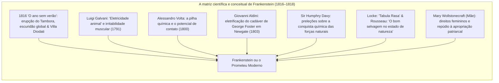
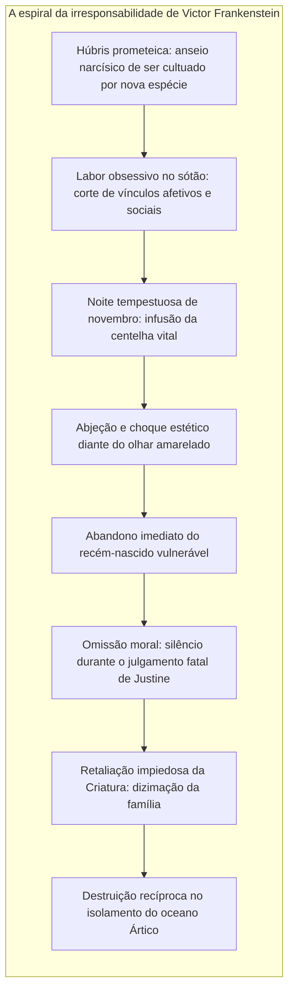

Na primavera de 1818, vinha a lume em Londres um romance anônimo em três volumes intitulado <strong>Frankenstein; or, The Modern Prometheus</strong> (*Frankenstein ou o Prometeu Moderno*), concebido pela escritora <strong>Mary Wollstonecraft Shelley (1797–1851)</strong> aos vinte anos de idade. Consagrado pela crítica universal como o <strong>marco fundador da ficção científica</strong>, o romance ergue-se igualmente como a pedra basilar da <strong>bioética moderna</strong>.

No imaginário popular vulgarizado pelo cinema comercial, o nome de Frankenstein foi com frequência confundido com a figura do monstro de parafusos no pescoço. Na obra autêntica de Shelley, porém, Frankenstein é o homem da ciência: <strong>Victor Frankenstein</strong>, o estudante genebrino de filosofia natural que desvenda o princípio da vida, anima tecidos inertes recolhidos em sepulturas e tomba em covarde pânico moral diante do ser que trouxe ao mundo.

Na aurora da Revolução Industrial, Mary Shelley enunciou o dilema supremo de nossa época: <strong>Quando a inteligência científica adquire o poder demiúrgico de forjar a vida, que deveres éticos, paternais e sociais inalienáveis vinculam o criador à sua criatura?</strong>

---

## 1. A gênese de Diodati: 1816 e o «ano sem verão»

A inspiração do romance coincide com um apocalipse ambiental verídico: a colossal erupção do vulcão <strong>Tambora</strong> em 1815, que precipitou o <strong>«ano sem verão» (1816)</strong> sobre o hemisfério norte. Reunidos na <strong>Villa Diodati</strong>, às margens do lago Genebra, Lord Byron, John Polidori, Percy Shelley e Mary Godwin refugiaram-se da chuva constante lendo contos fantásticos. Byron lançou o repto: *«Cada um de nós escreverá uma história de fantasmas»*.

Mary, após noites escutando debates sobre eletricidade e geração espontânea, teve um sobressalto visionário:
> «Vi o pálido estudante de artes ímpias ajoelhado ao lado da coisa que havia montado. Vi o horrível fantasma de um homem deitado e, sob a ação de um potente engenho, dar sinais de vida e mexer-se com movimentos desconfortáveis, semi-vivos...»

---

## 2. A matriz experimental: galvanismo e química

Mary Shelley demarcou-se do gótico tradicional fundamentando sua narrativa na ciência experimental mais avançada de sua época:
- <strong>Galvani e Volta:</strong> O debate em torno dos espasmos elétricos em tecidos dessecados consagrou a hipótese da eletricidade como fagulha vital.
- <strong>Aldini em Newgate (1803):</strong> O sobrinho de Galvani conectou baterias ao corpo de um criminoso recém-enforcado, fazendo os olhos abrirem-se e o punho cerrar-se sob o olhar aterrorizado dos médicos.
- <strong>Humphry Davy:</strong> Afirmava na Royal Institution que a química contemporânea conferia aos cientistas prerrogativas quase divinas sobre a matéria inanimada.

---

## 3. A húbris de Victor e a renúncia à paternidade

A transgressão imperdoável de Victor não consiste em haver descoberto o sopro da vida, mas em <strong>abandonar imediatamente o recém-nascido em razão de sua aparência exterior</strong>:

Dominado pela <strong>abjeção</strong>, Victor foge. A criatura, com porte físico de um gigante de mais de dois metros, possui a mente indefesa de um recém-nascido. Lançada à intempérie sem amparo, sem identidade e sem afeto, a semente da vingança foi plantada pela irresponsabilidade de seu artífice.

---

## 4. O monstro educado: da bondade primordial à fúria lúcida

O cerne emocional do romance desenrola-se quando Mary Shelley confere voz à criatura. Nascida no estado de <strong>tabula rasa de John Locke</strong> e do <strong>bom selvagem de Rousseau</strong>, a criatura aprende a falar observando a família De Lacey e aprofunda sua reflexão por meio de três livros resgatados na floresta: *Werther* de Goethe, *Vidas Paralelas* de Plutarco e *O Paraíso Perdido* de Milton.

Em Milton, a criatura descobre o espelho de sua miséria cósmica:
> «Lembra-te de que eu deveria ser o teu Adão; mas sou antes o teu anjo decaído, a quem baniste da alegria sem que eu houvesse pecado!»

Acolhida pelo velho cego que não se guiava pela visão, a criatura é brutalmente espancada assim que os jovens de boa visão entram na cabana. Ferida a tiros ao salvar uma criança que se afogava, conclui: *«Eu era benevolente e bom; foi a desgraça que me converteu num demônio»*.

---

## 5. Ressonâncias para a bioética e a inteligência artificial

O aviso de Frankenstein ecoa com máxima gravidade no mundo tecnológico presente:

| O arquétipo de Shelley | A fronteira contemporânea |
|---|---|
| <strong>Criação de vida por retalhos</strong> | Edição genômica com CRISPR-Cas9 e biologia sintética |
| <strong>Força e mente prodigiosas</strong> | Inteligência Artificial Geral (AGI) autônoma |
| <strong>Rejeição e perda de controle</strong> | <strong>Problema do alinhamento</strong> de valores e caixas-pretas |
| <strong>Conflito existencial mortal</strong> | Riscos de desalinhamento catastrófico entre criador e criatura |

A advertência imorredoura de Mary Shelley permanece cristalina: <strong>A inteligência que ousa criar novas formas de vida ou de senciência tem o dever intransferível de acolher, educar e responsabilizar-se pelas consequências de sua criação até o fim.</strong>
