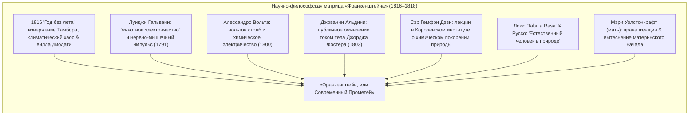
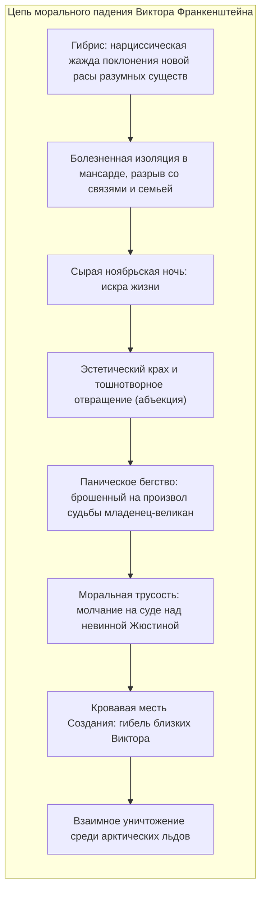

Весной 1818 года в Лондоне анонимно вышел в свет трехтомный роман <strong>«Франкенштейн, или Современный Прометей» (Frankenstein; or, The Modern Prometheus)</strong>, созданный двадцатилетней писательницей <strong>Мэри Уолстонкрафт Шелли (Mary Wollstonecraft Shelley, 1797–1851)</strong>. Это произведение признано не только <strong>первым подлинным научно-фантастическим романом в истории мировой литературы</strong>, но и основополагающим текстом <strong>современной биоэтики</strong>.

В массовом сознании, деформированном голливудскими штампами, имя Франкенштейна ошибочно закрепилось за немым монстром со шрамами и электродами в шее. Однако в оригинальном тексте Франкенштейн — это не чудовище, а ученый: женевский естествоиспытатель <strong>Виктор Франкенштейн</strong>, постигший тайну зарождения жизни, создавший живое существо из фрагментов мертвых тел и в ужасе сбежавший от моральных последствий своего дерзновения.

На пороге индустриальной эпохи Мэри Шелли сформулировала кардинальный вопрос цивилизации: <strong>Когда наука наделяет человека демиургической силой созидания жизни из небытия, какую неотчуждаемую этическую, родительскую и социальную ответственность творец несет перед своим творением?</strong>

---

## 1. Женевский генезис: 1816 год и «год без лета»

Замысел романа родился в атмосфере глобальной климатической катастрофы. В апреле 1815 года колоссальное извержение вулкана <strong>Тамбора</strong> в Индонезии выбросило в стратосферу миллионы тонн пепла и аэрозолей, породив <strong>«год без лета» (1816)</strong>: непрекращающиеся бури, морозный холод и неурожай в Европе.

На берегу Женевского озера на <strong>вилле Диодати</strong> собрались лорд Байрон, его врач Джон Полидори, поэт Перси Биши Шелли и юная Мэри Годвин. Из-за ливней запертые в доме, они читали немецкие рассказы о привидениях (*Fantasmagoriana*). Байрон предложил: *«Пусть каждый из нас напишет страшную повесть»*.

После полуночных бесед поэтов о гальванизме и тайне витальной силы Мэри пережила потрясший ее кошмар наяву:
> «Я увидела бледного адепта нечестивых искусств, склонившегося над созданным им существом. Я увидела отвратительного фантома человека, распростертого на столе, который под действием некоего мощного механизма подал признаки жизни и зашевелился в неуклюжей, полуживой судороге...»

---

## 2. Научный фундамент: гальванизм и новая химия

В отличие от традиционной готики с ее замковыми духами и черной магией, роман Шелли базировался на острие эмпирической науки своего времени:
- <strong>Гальвани и Вольта:</strong> Открытие электрических сокращений в мертвых мышцах породило концепцию электричества как материального аналога «жизненной силы» (*vital spark*).
- <strong>Опыты Альдини в Ньюгейте (1803):</strong> Джованни Альдини подключил батарею к телу только что повешенного преступника Джорджа Фостера: челюсти затряслись, левый глаз открылся, правая рука поднялась вверх. Это зрелище потрясло лондонских врачей.
- <strong>Гемфри Дэви:</strong> Провозглашал, что современная экспериментальная химия вручает естествоиспытателю поистине божественные творческие силы.

---

## 3. Прометеевский гибрис Виктора и родительское предательство

Подлинная трагедия Виктора заключается не в его исследовательской дерзости, а в <strong>мгновенном и малодушном отречении от родительских обязанностей перед новорожденным существом</strong>:

Охваченный <strong>абъекцией</strong> при виде желтых водянистых глаз и натянутой кожи ожившего гиганта, Виктор бежит из лаборатории. Создание — с телом исполина, но душой и уязвимостью младенца — оказывается выброшено в жестокий мир без имени, языка и крова. <strong>Именно это первородное родительское предательство стало источником всех последующих катастроф.</strong>

---

## 4. Создание: от естественной доброты к бунту Люцифера

Создание начинает путь в координатах <strong>tabula rasa Джона Локка</strong> и <strong>естественного человека Жан-Жака Руссо</strong>: оно вегетарианствует, упивается пением птиц и стремится к добру. Подглядывая за крестьянами Де Лейси, оно овладевает речью и постигает три великие книги: *«Страдания юного Вертера»* Гёте, *«Сравнительные жизнеописания»* Плутарха и *«Потерянный рай»* Мильтона.

Через Мильтона Создание формулирует свою горькую экзистенциальную правду:
> «Помни: я должен был стать твоим Адамом; но без всякой вины с моей стороны я сделался твоим падшим ангелом, отвергнутым создателем!»

Когда люди избивают и расстреливают его лишь за устрашающую внешность, доброта оборачивается отчаянием и яростью: *«Я был добр и полон любви; лишь страдания сделали меня демоном»*.

---

## 5. Предостережение для современной биоэтики и ИИ

Уроки Мэри Шелли звучат сегодня с предельной актуальностью:

| Текст Шелли (1818) | Технологическая реальность XXI века |
|---|---|
| <strong>Сшивание тела из фрагментов</strong> | Редактирование генома CRISPR-Cas9, синтетическая биология |
| <strong>Сверхчеловеческий разум и сила</strong> | Общий искусственный интеллект (AGI), автономные системы |
| <strong>Отречение создателя</strong> | <strong>Проблема согласования (Alignment Problem)</strong> ценностей ИИ |
| <strong>Бунт создания</strong> | Экзистенциальные риски утраты контроля над суперинтеллектом |

Предостережение Мэри Шелли бессмертно: <strong>Тот, кто дерзает зажечь искру новой жизни или сознания, обязан обладать мужеством любить свое творение и нести за него безусловную ответственность.</strong>
